# CMU《高级自然语言处理｜CMU CS 11-711 Advanced NLP Spring 2025》中英字幕（claude-3.7-s - P11：-11-(12)_ Benchmarking and Evaluation.zh_en - GPT中英字幕课程资源 - BV1nYVHz7Eoa

Talk first， I'll talk about some motivation of why we might need some benchmarks。

 And then I'll talk about the properties of good benchmarks。 And then lastly。

 I'll share a few examples of widely used benchmarks and their corresponding metrics。

So let's get started with the first topic， which is motivation。

So I think that the main reason why we might want a very good benchmark is of course。

 to track progress of like how good our models are and with this we can compare performance so for。

Example like， let's say we have two models， Model A and model B。

 and then we want to tell which model is better。This could be a very hard question。

 given that the models we have today are general purpose systems。

 meaning that given any arbitrary text， they can generate fluently generate text。

And if you look at one of the figures from the recent Deepseq R1 paper。

 they have this kind of figure in the first page， which means that it might be important。

 so they're showing the performance of their model， deepse R1 versus the other models， for example。

 Open AI01 and their previous models the deepseq V3 and Open AI01 mini and they're evaluating their models on six benchmarks that you could see on the bottom。

Yeah。It seems like the slides are broken a bit， but yeah。

So the main message here is that they want to compare their model against the model that they thought was most proficient at the time。

 which is open A01 and if you look at the blue lines and the gray line。

 you could see that the performance is on par or slightly above Open AI01。

 so the main message they want to tell is that their model is as good as01。

So benchmarks serve as this kind of purpose telling how good your model is compared to another model。

Oh， sorry， the slides are broken a bit。嗯。Yeah， here's another table from the G4 technical report back at that time。

 they had G 3。5 and all sorts of state of the art LMs on these different benchmarks。 and again。

 the purpose of showing this table in their paper was that to tell how good their model， new model。

 G4 is compared to the previous soda models。 So they evaluated G4 on these different benchmarks。Yeah。

And also， besides comparing between two models， we could also use benchmarks to tell how rapidly our programs or language models are improving。

 So in this figure， you could see the performance of closer source models across different time frames when they were released compared to openwe models。

 So you could see that， for example， this is the NmLU benchmark that I'll be talking about later today。

 And you could see that overall， the performance gap between the closer source models and the open source models are getting narrow and narrower。

 So this means that we're getting better open source models。So likewise。

 these benchmarks could tell us the overall story of how good our systems are。

So it's important to build good benchmarks because it drives progress and tells us the overall story of like。

 how good we are doing。 And there might be multiple things that we might want to consider when building a benchmark。

 today， I am going to share five different aspects of what I think are important。

 The first one is difficulty。The second one is diversity。 The third one is usefulness。

 The fourth one is reproducibility and lastly， data contamination。

 So I'll go through each one by one。

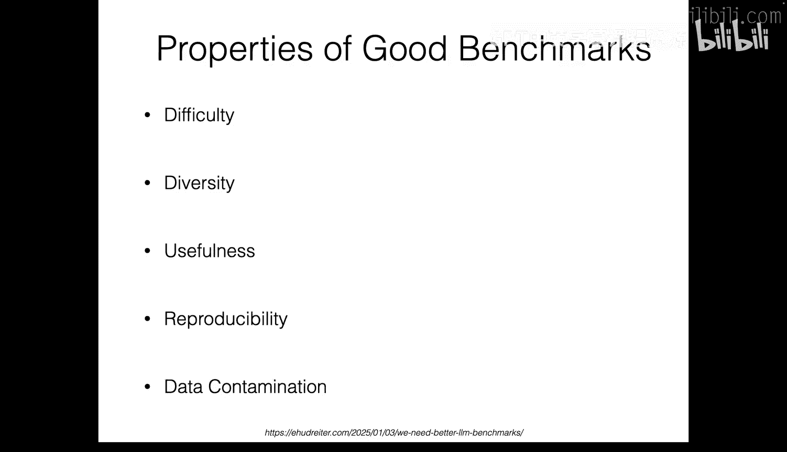

So yeah for difficulty， this is a figure from a researcher called Jason Way and you kind of shared this figure of the state of the art performance on different benchmarks so I think that in this figure we can learn two things the first thing is that let's take mass。

 for example， the green line back at 2021 early 2021 the benchmark was so hard that the state of the art performance was a single dig number。

 so it means that it was a really hard benchmark， but as time progresses the state of the art performance increased rapidly and today at 2025。

 people consider mass as a relatively easy benchmark for state of the art systems because the best performance reaches over to 90%。

And so using these benchmarks， what this tells is that it's important to have a very difficult benchmark because if the benchmark is too easy。

 it will not be able to distinguish between two systems so。If mass was a good test bed back at 2021。

 nowadays， it might not be a good test bed as before。

And this is also one of the reasons why people are coming up with increasingly more hard benchmarks。

Here we go。

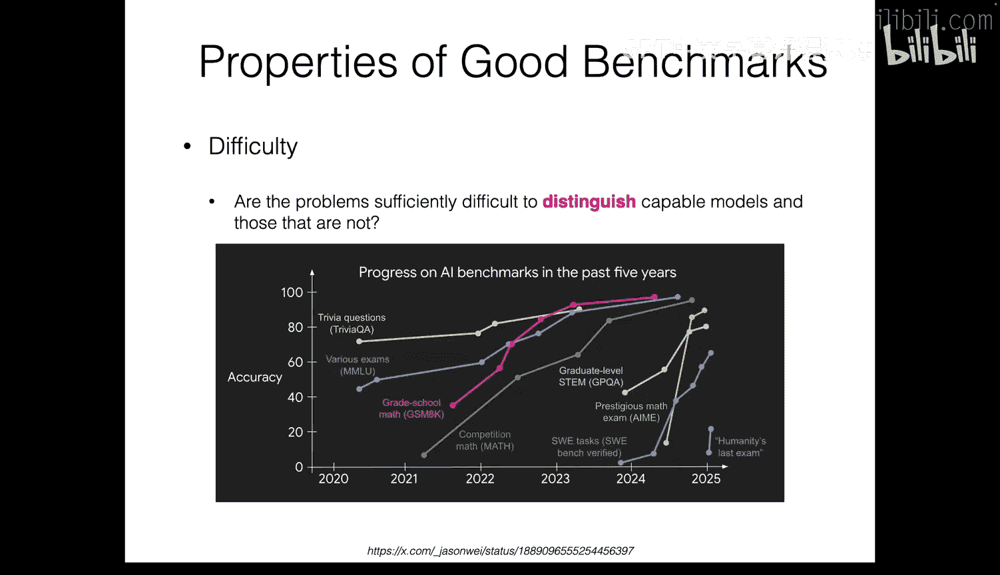

The second thing I want to talk about is diversity so regarding diversity。

 this is a figure from a paper called mixed el so in this paper they used embeddings to plot or visualize the distribution of different questions so on the right figure you could see that on there are lots of different domains for example。

 on the top you could see things like coding， mass， physics， chemistry。

 stem stuff and on the bottom you could see more subjective things like sports music entertainment or grammar and language。

 social dynamics。

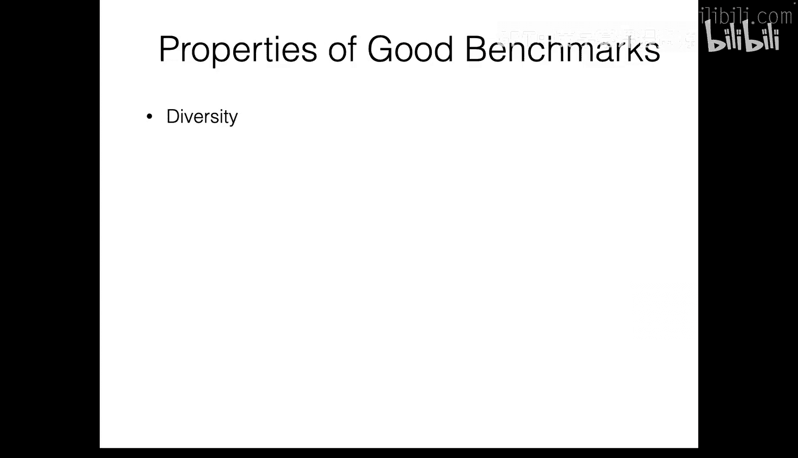

So I think it's important to consider about diversity when we build benchmarks。 And the reason is。

 let's say， we only use， for example， Whyino Grande。

 which has a distribution skewed towards the right bottom。In this case， if we measure performance。

 we will only be keeping track of the domains on the right bottom。

 which means that it's not comprehensive enough to tell the whole story。So first， first of all。

 it's important to use multiple benchmarks at once so that we could evaluate across diverse domains。

 And second of all， within a single benchmark， it's also important to have diverse questions because we don't want to get trapped by a few questions。

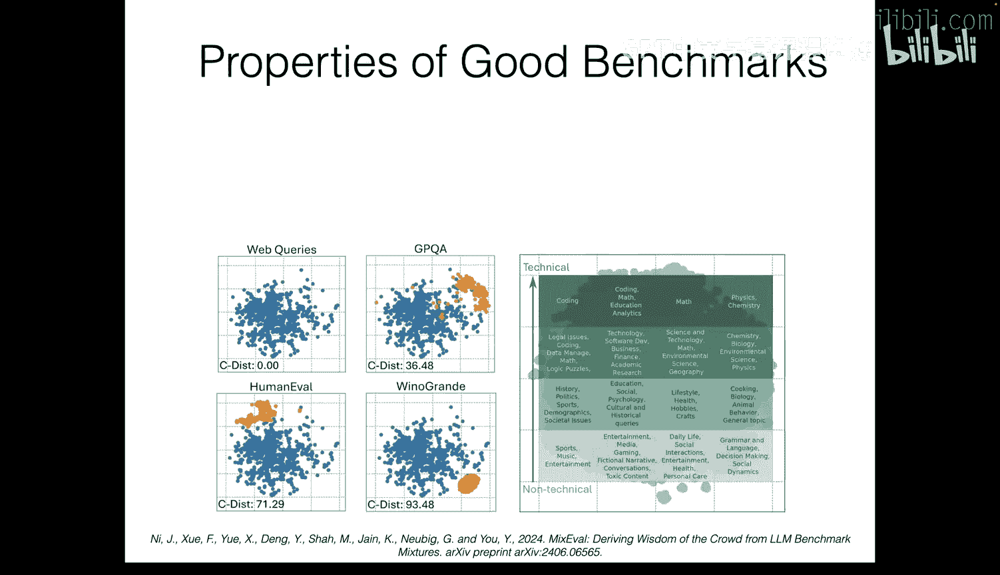

The third thing I want to talk about is usefulness。 I think a lot of people kind of miss this aspect。

 but it's very good to think about it for a while。 So， for example。

 here's an instance from the mass benchmark， which is a mass word problem。

For like Olympia style problems。 and for a long time， even up till now。

 people have been using this benchmark to evaluate mass performance of language models。

 But if we think about it， my question is why do we need a language model that is good at solving such kind of mass word problems？

There could be multiple reasons if I split it up into three and please let me know if you have other opinions。

 the first thing is that I think if we have a model that's good on this mass data set。

It could mean that it could serve as a foundation for more complex tasks。

 so what I mean by that is mass is a very important basic skill to do more advanced things。

 for example， financial analysis。 So if you have a model that scores well on the mass dataset set。

 it could mean that it could potentially also serve as a good model for the task we care about that require mass。

The second example could be that such kind of mass problems could be useful directly to some kind of users。

 so for example， if a high school student asks about his homework to chat GT。In this case。

 a model that's good at the mass dataset set could be very useful for him or her。And last of all。

 I think for researchers having a good performance on the mass dataset could enable us to address more high abstract questions。

 research questions， for example， can an AI model reason。

 so it's very vague how to define what reasoning means。

 but using different data sets that we might agree that requires reasoning。

 we could answer these kind of questions。So。Usefulness means that does achieving a high score on this benchmark actually have meaning or is it just a number？

Here's another example from a data set called human Aval。

 so this benchmark kind of measures how good the model is at solving leak code style coding problems。

And again， like we can think about why is it important for a language model to solve this leak code cell problems at the first place first reason could be。

 again， it could serve as a foundation for more complex tasks for example。

 recently starting from 2024， there's been a lot of interest in building coding agents that could implement。

 for example， a whole repository。And in this case， having a good performance on the human ML data set could mean that it could also potentially work or function to solve more complex problems like this。

The second thing is that it could also be useful for target users who are interested in similar questions。

 for example， let's say I'm preparing for a coding interview and then I got stuck by this merge sort problem in this case I could ask chatGBT to implement the code and then I could learn how to code it so it could be useful for real world users。

The last thing again is it could serve as a medium for addressing research questions， for example。

 answering questions like can an AI model self debug itself？

The first aspect I want to talk about is reproducibility and this one is an aspect that people miss this a lot。

 but I think it's very important for example， here's a figure from a paper called quantifyantifying language models sensitivityivity to spurious features in prompt design。

And this paper， this paper， this figure was very surprising because like normally when you ask a model to solve。

 for example， question answering， you might consider this blue box format where you give a passage and then ask it to spit out an answer。

Of course you can try different prompt templates and surprisingly if you try different templates。

 the papers showed that the performance could vary a lot。

 so meaning that let's say the researcher from one paper use one of these prompts then you wanted to reemploment the score and you accidentally tried a different prompt for example。

 because they didn't share their prompt and if in this case if you got a low score。

 you would not be able to tell like what's the problem at the first place so this means that reproducibility is an important aspect when designing a benchmark。

Here's another example that a lot of people have discussed about in the community。

 so there's a benchmark called MMLU and in this benchmark you have to choose one of the options between four options。

And there's multiple ways to implement this， the original MMLU paper implemented as follows。

 so they prompt the language model by providing the options and the language model would output either A B C or D and then you take the logic values to see which one has the highest logic value and then use it as a prediction。

 but in their implementation let's say that here a word called a token calledsiggote got the highest value and in their implementation they discarded the logic values of this token and only compared the logic values of A D。

C and D， so even ifsiggotes got the highest logic value it would not be chosen as the final prediction。

But there was another。Paper or project called Hem from Stanford that also measured the score of MML across diverse models。

And in their implementation， they considered all the lock probabilities of different tokens。

 So in this case， the token Zyiggote will be chosen instead of D。 So it would get marked as wrong。

And there's also a widely used evaluation benchmark called LM AL Harness from Eusai。

And different from the previous two projects or papers in this。Reposterory。

 what they did is they provided the not only the option。

 but the text like description of the option and then measured the lock prop of the whole sequence。

 and then average by the number of tokens for each option。

And chose the option with the highest probability。So in this case。

 it would also be kind of different with the previous two examples that I showed。

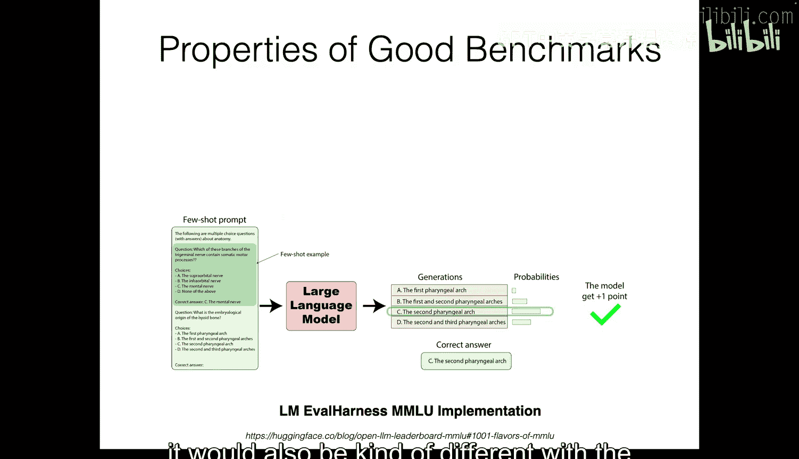

So Hoging F kind of used these three different implementations and measured performance across different models and this is very concerning because like you could see that depending on which implementation you use。

 you could get different scores and different ranks across models so if you were not aware of this and didn't thought about other ways of implementing the same kind of benchmark。

 you would end up using only one implementation and then get getting different results。

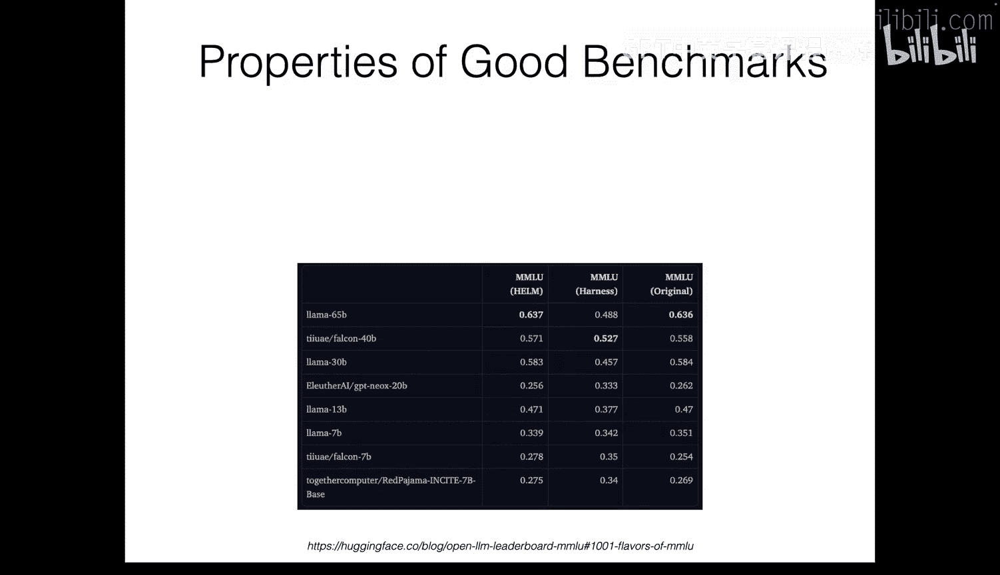

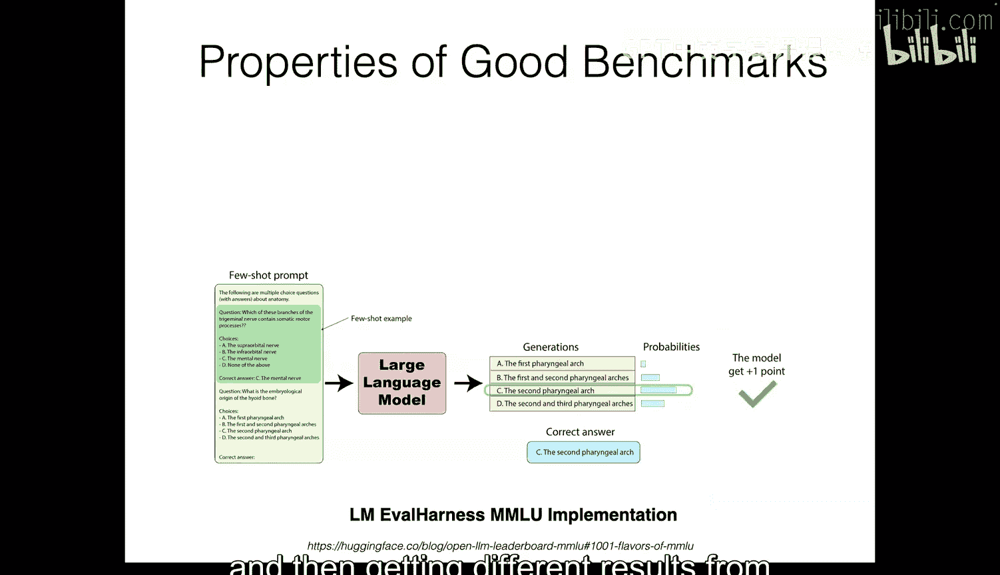

From the original paper that you referred to and then would not be able to tell what was the problem。

So these kind of aspects are important to consider when you think about reproducibility of benchmarks。

嗯。😊，Youre observing this。 what was the solution。Just like suggest alwaysYeah， that's a good question。

 the easy answer would be that when you report the number of your method or model。

 you might need to try all different kinds of like these implementations。 But in practice。

 I think people just try what they prefer the most。 So it's very concerning。

Do you have any other questions？ Yeah， sure。That's a good question people usually don't include that in the paper so it's really hard to tell so I think that overall papers only tell the very small story of the overall project or like journeys throughout the project yeah。

哦啊。

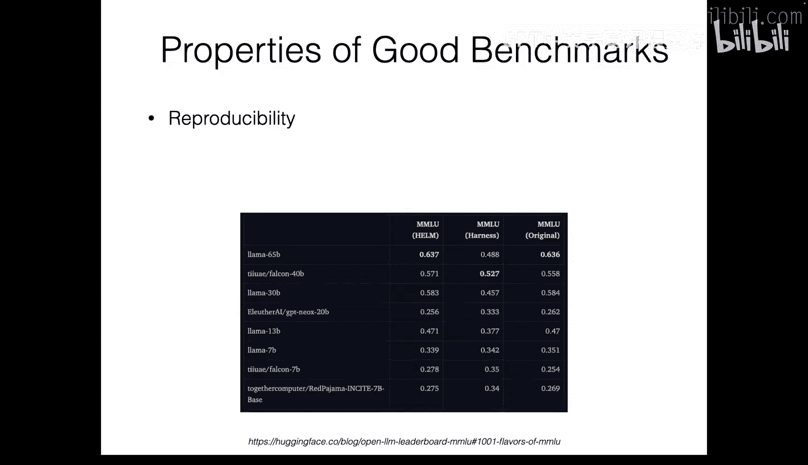

The last thing I want to talk about is data contamination。

 and I think this has become a very crucial issue， especially in noway systems。

 because you're trained on so many text from the internet。

So just for a brief recap in your like instruction tuning or fine tuning course。

 you might have learned that LMs are trained on vast amounts of information during both pretrain and a wide range of tasks during post training。

 so this is a figure from 2023 where Google released a model called FanPm and F T5。And in this paper。

 it was really surprising back at the time because they trained on almost。If I remember correctly。

 it was 1，800 data sets from previous NLP papers， and then they tested on like held out challenging tasks like MMLU and Big Benchchar。

It really becomes fuzzy to divide what a test set could be in this case because actually a lot of the instances could overlap with each other across different benchmarks。

 so even if you saw that you had a heldout task it could actually be contained inside your training data and it could also be inside your pretraining corpora so it's really concerning。

And the reason why this is concerning is that what we want to check with our language models is the ability to generalize to unseen novel tasks。

 so if we train on two tasks， for example， a lot of papers want to check their language model performance on unseen tasks。

 whether they could address these。So a good example for this is there was a paper called GSM 1K and for people who don't know GSM 8K is the widely used data set。

 but a data annotation company called Sc AI gathered 1。

000 questions that looked very similar to GSM 8K and then measured the performance across different models。

And you could see that on the left figure， this shows the difference or deelta value。

Compared to JsM8K and JsM1K， and you could see that a lot of the models score relatively lower than their scores at GsM8k。

 which means that the GsM8K test set could have been included in the models's training data and result in having only high scores on JsM8K。

They also showed this plot where the x axis is the performance on JM8K and the Y axis is the performance on JM1K。

And since the numbers or dots are below y equals x。

 it means that almost all models score lower on JM1 k。

 even if they have the same like distribution and similar difficulty。

Do you have any questions or I can move on to the next topic。

Okay the commercial like model actually like scored higher on the rent page。Yeah。

 I didn't include it here。 The conclusion was that the larger models or proprietary models actually score similarly on those gsM 8K and 1K。

 but the open source distilled models kind of like score lower on JsM 1K。Yeah。Not all the models。

 but mostly。Okay。😊，Next， I want to talk about some of the widely used benchmarks and their corresponding metrics。

So I'll first talk about some data sets for multiple choice QA or in other words， classification。

 and then I'll talk about some metrics and benchmarks for evaluating language generation。

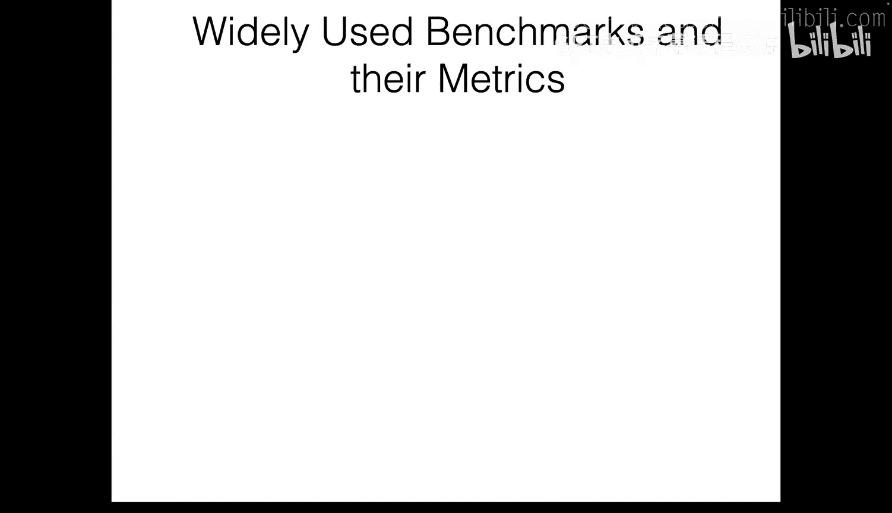

So for multiple choice QA， if you look back at this figure。

 one of the trend that I want to mention is that benchmarks tend to get saturated over time。

 so even if the state of the arts score was low back at in the previous time frame。

 it gets conquered at some moment and that benchmark gets retired naturally。

 so this kind of trend has been observed throughout different benchmarks。

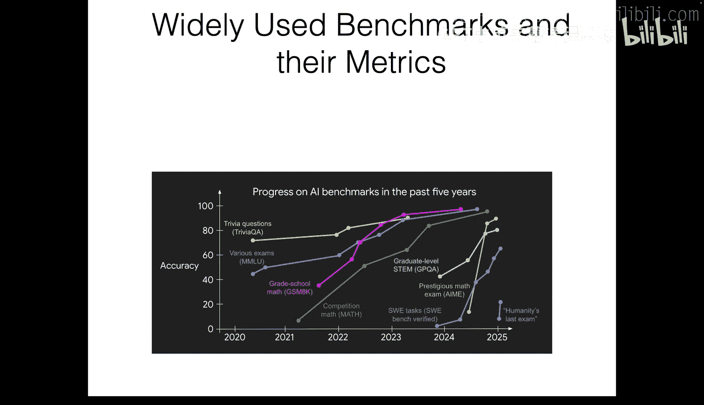

But I want to mention today。So one example is this benchmark called Hillaswag。

 So this is a benchmark for evaluating common sense reasoning of models。

 Here's an example of a question。Such as given this using this video。

 they generated a question where a woman is outside with a bucket and a dog。

 the dog is running around trying to avoid a bath and she and then we have to find the sentence that finishes the previous context。

 and in this case， the answer would be C， where she gets the dog wet， then it runs away again。

And back at the time， the state of the art model was a model called Bt。

 I'm not sure if you heard about it， it used to be widely used before the decoder only language models。

And back at that time， Ha Sgg was considered a really challenging benchmark because the bird models scored really low。

And one thing I wanted to mention about here is that before HeaSwag。

 there was a dataset set called SwaAC from the same authors， which basically measured the same thing。

And。Like during the time when H Swag was introduced。

 swag was also kind of conquered by state of the art models， so if you look at the right figure here。

 you could see that the scores on swag across different question types are really high because it ranges around 80 to 70 or something。

And they collected more challenging questions and perturbed the question format and ended up making this hella sag data more challenging because you could see that the state of the art performance became lower compared to SwaAC。

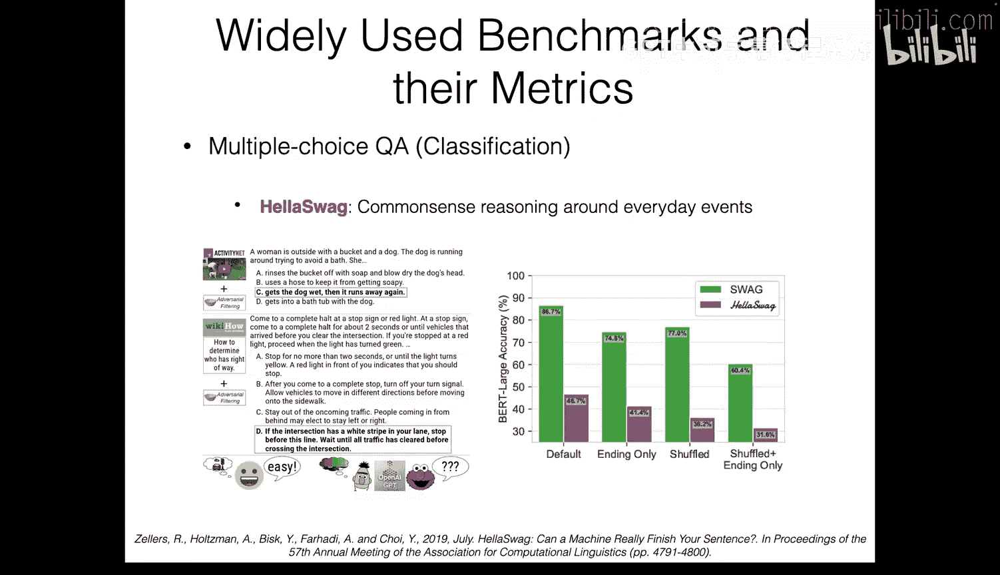

Here's another example， here's a benchmark called super gluelue。

 this again was also a follow up work from a benchmark called Glu and as you could see in the title。

 the people's name is a stickier benchmark for general purpose language understandingstand systems。

So in this super glue benchmark， they contained， I think 9 or 10 tasks for classification。

 So here's an example of a question， Given the passage。

 the language model has to predict for this question is。Bs root beer， a Pepsi product or not。

 And then the answer would be no。 And similarly， there is also a natural language inference problem。

 MLI problem， and then predicting whether two sentences match with each other or not and those kind of questions。

One thing I want to talk about is in the super gluelu paper。

 they also have a very similar kind of figure with what I showed before。

 this is a figure of the performance of different state of PRR models on their previous benchmark called gluelu。

And you could see that over time， the black line here is the human performance and the blue line。

 which is the language state of guard model performance， tend to increase rapidly。And actually。

 the state of the art system here， ExcelLnet， was trained here at CMU。And to overcome this issue。

 they proposed a new benchmark called Super gluelu。And here's another dataset set called MMLU。

 so compared to the previous classification benchmarks like Superglu or Haswag。

 the difference of this benchmark was that it contained it requires expert knowledge of different domains。

 so the question span across 57 subjects， both on professional and academic areas。So this again。

 is an example for a physics question of calculating the acceleration rate。

And they also had this similar figure where they compared the performance of GT3。

 which was considered state of the art back at 2020 and showed that on their new benchmark， MMLU。

 the state of the art models scored lower than the previous different benchmarks。Yeah。

 but MML also tend to be conquered because the current models are scoring really high。

 so recently there's been a benchmark called MMLU Pro where in the previous MMLU benchmark there were only four options。

 but in the MMLU Pro data set， they expanded this to more options between4 and 10 options to choose from。

So for this question， physics question， you could see that they have7 options and you would have to choose。

The answer A here。And again。Yeah。TheYou could see that there's the overall trend of like， where。

When the new benchmark comes out， it compares with the previous benchmark showing that the performance of state of the art models are lower on their benchmark。

So。To wrap up， like you could see that， first of all， there was， there was swag and glue。

 and then it got replaced by Ha Swag and super gluelu。 And then there came out MM ML U。

 and more recently， there came out MM ML U Pro。And a very important question that is very hard to address is whether like we can come up with more challenging benchmarks like the current progress。

 The problem is that if I go back to the previous slides。

 you could see that the overall trend here is that the new challenging benchmarks tend to get solved more quickly than before。

 So it took nearly four or five years to reach score above 90 on MMmMLU。 but for example。

 here's a data set called GBBQA， this is a very hard PhD level。

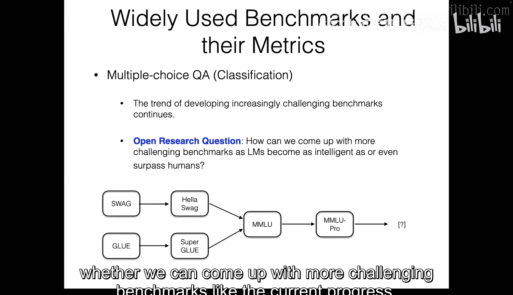

Multiple choice QA questions for experts。 and you could see that it only took about a year or so to reach a very high score。

 so the models are becoming more and more rapidly intelligent so that it becomes more challenging to come up with a good benchmark to test them。

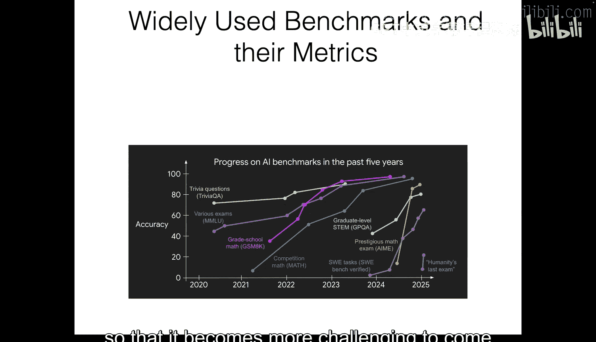

So it's an open question of how we could like come up with more challenging benchmarks so that we could match the progress of the improvement。

Next， oh， do you have any questions up till here for classification。If not。

 I could continue with generation。Yeah， so here's a motivation of why people might be interested in evaluating generation capabilities。

 So as humans， when we use chat GBT， we don't give it different options to choose from。

 that would be a very unnatural way to interact with it。

 So a more natural way would be we just ask a question and then it generates a free form response。

 And then we could tell how good the response is whether it like addressed what we wanted it to do。

However， the problem here is that compared to multiple choice QA benchmarks。

 assessing freeform response is very challenging by itself because like with multiple choice QA。

 you only need to measure accuracy so you could tell that out of for example。

 100 questions the model got 57 correct and then you could conclude there but with freeform response there's this spectrum of a very good response。

 a moderately good response or a very bad response and so forth。

 and it's really hard to automatically label such kind of like annotations of how good the response is。

So。There are some benchmarks that are easy relatively easy to do so。 So for example。

 GsMK that I've been talking about lot today is relatively easy to measure because although the model has to generate a long chain of sought or its reasoning process what we care about is whether it got the final answer correct or not。

 So unless we could just parse this final prediction you can use exact match and then tell if the model got the problem correct or not。

 Of course， like there could be cases where the model has an incorrect logic regarding its chain of sought but got the answer correct。

 and there are also research that kind of tries to address that。

 but in practice a lot of people are using this dataset set by like only checking the final answer correctness。

And here's another example that's relatively easy to evaluate。

 so there's a data set called human A that tests Pythson codingding tasks and it contains lead code cell coding problems and in this case it's very easy to tell if the code is correct or not because the benchmark has some test cases like how we would actually code that lead code and then we could verify that this code is correct if it passes through all the test cases。

So in this case， a lot of papers use a metric called pass K。

 meaning that when a model generates a solution K times， whether it got correct at least one time。

However， the。Problem gets really challenging for open ended questions like this。

 So let's say I asked Cha G BT。Well there some business etiquette norms when doing business in Japan。

 And then I got these two responses， one from Chat GPT and one from deepse or one， for example。嗯。

Overall， the both look very long and very formal because like it has a structured kind of output。

 so it's hard to tell which response is better than the other unless you observe it very carefully。

So the question for a long time for a lot of papers have been。

 how can we automatically evaluate the goodness of such responses？So as a working example。

 let's say I have a question what are the benefits of regular exercise and then my model generated five words。

 exercise improves mood and health， and then I have a reference answer that tells regular exercise benefits health and mood。

The conventional way of evaluating this prediction was using a metric called Rouge and with Rouge。

 you count the word overlap between the prediction and the reference answer。So， for example。

 when we use a metric called Rouge 1， we would count how much words overlap with each other between the prediction and the reference answer。

 And in this case， four words overlap。Exercise， health。And mood。 And you could count the prediction。

 You could calculate the precision by 4 over 5， because the prediction has five words and four words overlap。

And then you could also calculate the recall value。

 which is that four words overlap among the six words from the reference answer。

 and then you could take the harmonic mean and calculate the F1 score。

 and you would report Rouge1 as the F1 score。Similarly， you could do it for。Rugach2。

And this is kind of a place where we could find that the Rouge metric isn't perfect because if you look at the prediction and the reference answer。

 and if you find for two gram words that overlap， there's no overlap at all because like there's no exercise improves inside reference answer。

So in this case， you would get a zero score for post precision and recall。

 and then you would get a zero F1 score。Rouge L this kind of sees the least common subences and then you could see that there's exercise mood in the prediction and it also existss inside the reference answer exercise mood。

 so there's one and another overlap would be exercise and because there's also exercise and inside the reference answer。

So we have two common subequences and then if we calculate this。

 the precision would be two over5 and the recall would be two over 6。

 and then we would get the F1 score of 0。364。So this is how we use Ro， but as I mentioned。嗯。

This is not desirable because like even if the prediction and reference answer are really similar to each other。

 the root metric could capture like whether like the prediction is good enough。

So to overcome this issue， people。对红是。help z。Yes。Yeah。

 so I use an example where we switch the order of mood and health。But that's also true。

 If you use some other word for mood。It would not be able to capture that kind of relationship。

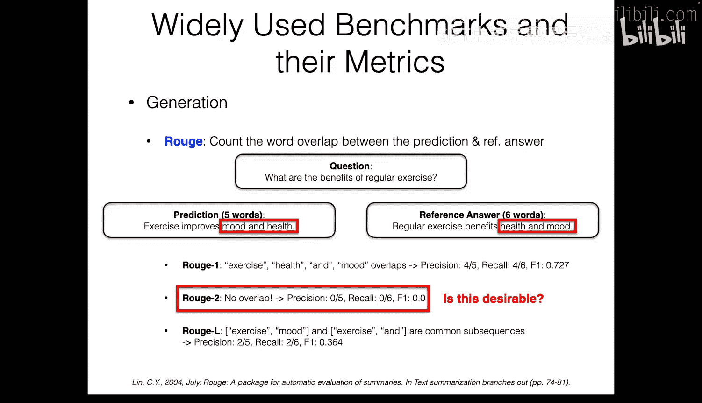

So to overcome this issue， a new metric called B score has been introduced and what the bird score metric tries to do is measure the word similarity between the prediction and the reference answer。

So what we would do is given the reference sensor and prediction or candidate。

 we would pass through a bird model to acquire the CLS token or embedding for each word and then calculate the pairwise cosine similarity between the words and then we could have this kind of matrix and then we could calculate the top value within each row and then average those and multiply it with a thing called IDF weights the ideaF weights is inverse document frequency。

 this is widely used in information retrieval and what it accounts is like whether the word appears frequently or not so it's kind of just like adjusting based on the frequency。

And that's kind of optional。 And then after doing that。

 we could acquire a single scholar value score for how similar the reference answer is。

Oh how similar the candidate is compared to the reference answer。

Another way to do this is using a thing called LLM as a judge。

This is a widely like open area of research that a lot of people are exploring today and the main idea is relatively simple。

 it's to prompt a language model to assess the quality of the given response。

 so it could be something like provide a score of like three out of five or given two responses。

 tell which responses better。So going back to the example that I used， which is like。

 what are some business et norms when doing business in Japan， we could prompt， for example。

 G4 and then ask it to create the two responses at once。

 then G4 will generate such a kind of chain of thought that compares the quality of two responses。

 and then we could tell that。Assistant A's answer is more detailed than organized。

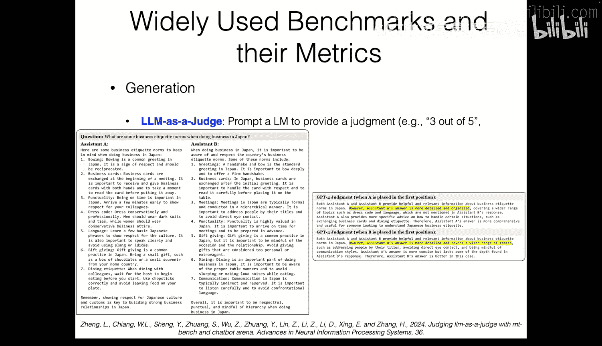

One nice thing about having such language model evaluators is that we can decide the evaluation criteria that we evaluate on。

 so let's say we have an instruction， what is the meaning and significance of containerization in software development and what role does Docker play in it。

And let's say we have two responses。 In some cases。

 we might just want to measure how helpful the given responses is， but in other cases。

 we might want more detailed criteria。So for example。

 we might want to tell if does the response accurately employ specific industry terminologies。

 meaning that whether the response is professional or in other cases。

 we might want to tell like if the response is easy to understand for a beginner。And in this case。

 if you think about the previous BRT score， you can't really have control over what you're trying to evaluate。

 but with LM as a judge， you can directly provide what you're trying to evaluate and then the judge model would generate a chain of sought based on the given evaluation criteria and then evaluate what you want to what you desire。

So this was alum as a judge， and。Are there any like？

Noteworthy patterns and the model you're evaluating versus the judge like should the judge be larger model model yeah I think that's an open question so for context there's a hypothesis called the super alignment hypothesis。

And what it tells is that because the models are becoming so intelligent nowadays at some moment it'll become more smarter than humans then the question is how are we going to guide them or make them more smarter and in that case a very important direction might be to let the language models guide themselves and there are some people who believe that smaller models could guide larger models and there are other people who think that that's impossible like more intelligent models are only capable to value weaker models so I think it's a question thats we don't know yet。

 but yeah。I kind of believe that it is possible for weaker models to guide stronger models because like there's this debate on P versus MP。

Meaning that people think that evaluation is easier than generation。

 so we might be able to have this weaker models to verify the outputs of stronger models。

ButA there like certain types of efforts that along as the judge tends to well on and other ones where people might want be more cautious but easy？

So yeah， that's a good question。 I did it included in the slides。

 There is a well known pitfall of LM as a judge。 So one pattern is that the judge model。

 whether what kind of model you use， tends to prefer longer responses， so。

Being having a long response could be a doubleedd sword。 if it contains more useful information。

 of course， having a longer response is better， but it could also contain very repetitive。

 like information or things that are not useful In that case， we don't want the longer response。

 But it seems like the judge models that we have today， tend to prefer longer responses。

 no matter whether it's useful or not。 So that's one pitfall。

Another issue or limitation that people have been reporting a lot is that models tend to prefer its own responses compared to other models。

 so G4， when you use G4 as a judge， it would prefer G4's response when you use Gemini Gemin I will prefer its own response。

 so that kind of like a chicken and egg problem because like it if you're trying to evaluate one like model。

 like you should use different kind of like models judge as judges that case。Yeah。

Cool are there any questions so yeah a particular model does well on like a benchmark that has open ended questions。

Like say they do 90% or something 90%。How with these methods are you getting like a correct or incorrect thing is the the BRT score is kind of like score from zero to one so is there like a threshold that you say okay if I get above this it's it's correct and if I get below this it'。

Oh， I could give some examples for that。Yeah， so there's a benchmark called Alpa Aval that's widely used for like using LM as a judge for evaluation。

 And in this benchmark， what they do is they compare the performance against the reference model。

 So I think they use G4 the November version of G4 as the reference model。

 then you would be measuring the win rate against it。

 So the performance you could get would be a value between 0 and 100。Are there any other questions？

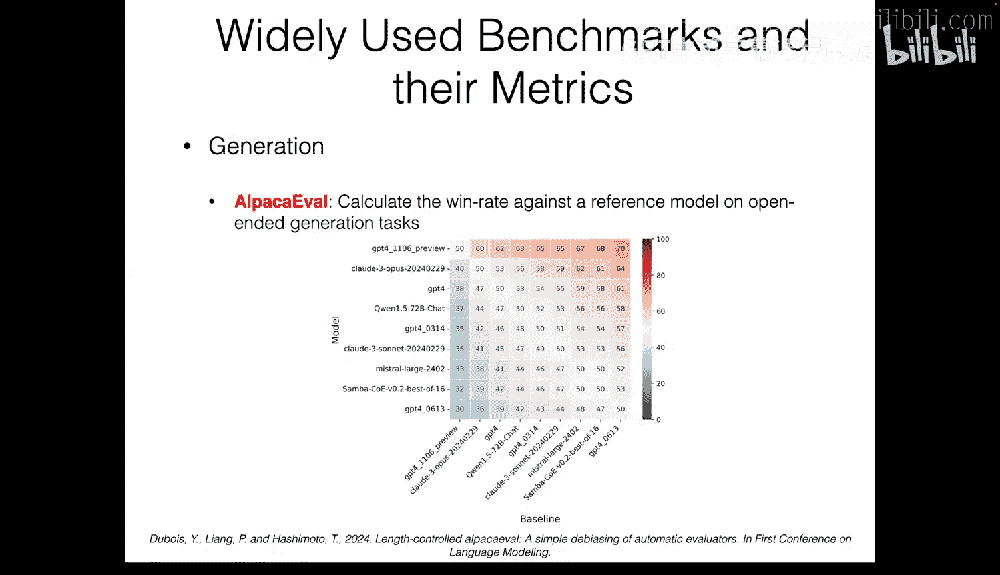

や看。Another example that's widely used is this。Platform called LMCs Chabot Arena。

 So this is a platform run by a nonprofit organization。

And what they do is they serve different models， then ask humans to vote which response seems better。

 So here I asked a question， recommend some places to visit at Pittsburgh。

 and then I would get two responses that's anonymized。

 then I could choose whether response A is better， B is better。

 whether both are fine or whether both are bad。And by gathering such annotations from different people。

 the platform provides a leaderboard of like how people thought different models are。

 So you would get a L rating score here。嗯。This is great because it actually uses real world data from users to evaluate the systems。

 but the pitfall is that a wide range of the questions that people ask tend to be far from what you might want you might desire。

 for example， a lot of people ask are you chat GBT or can you do something or very simple questions And since a lot of these questions are distributed across the whole range of distributions the eating might not be a useful measure in that case。

 if you want to assess a specific property of a model。

 So my recommendation is that you might want to look at different scores from both chatbot arena and then benchmarks as well。

こうあ。

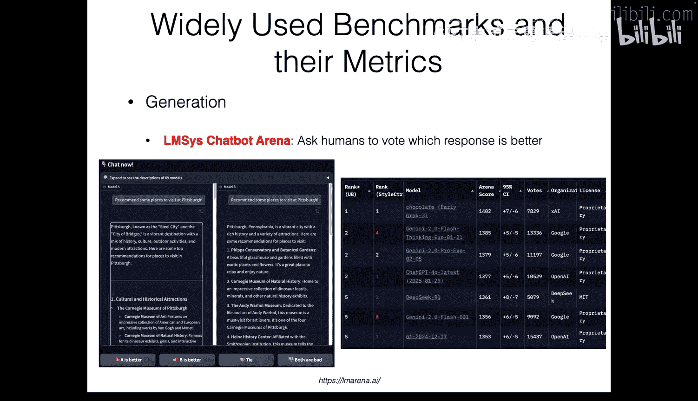

对。Here are some of the things that I didn't cover in today's lecture， first of all。

 I didn't talk about evaluation of specific NLP tasks like text retrieval。

 and I didn't talk about evaluation of like specific behaviors like safety evaluation。

 but these are topics that you might want to find through the recent literature and then do it as your like course project as well。

So that's what I prepared for today。 Do you have any questions。

