# CMU《高级自然语言处理｜CMU CS 11-711 Advanced NLP Spring 2025》中英字幕（claude-3.7-s - P12：-12-(13)_ Experimental Design.zh_en - GPT中英字幕课程资源 - BV1nYVHz7Eoa

We're going to talk about。

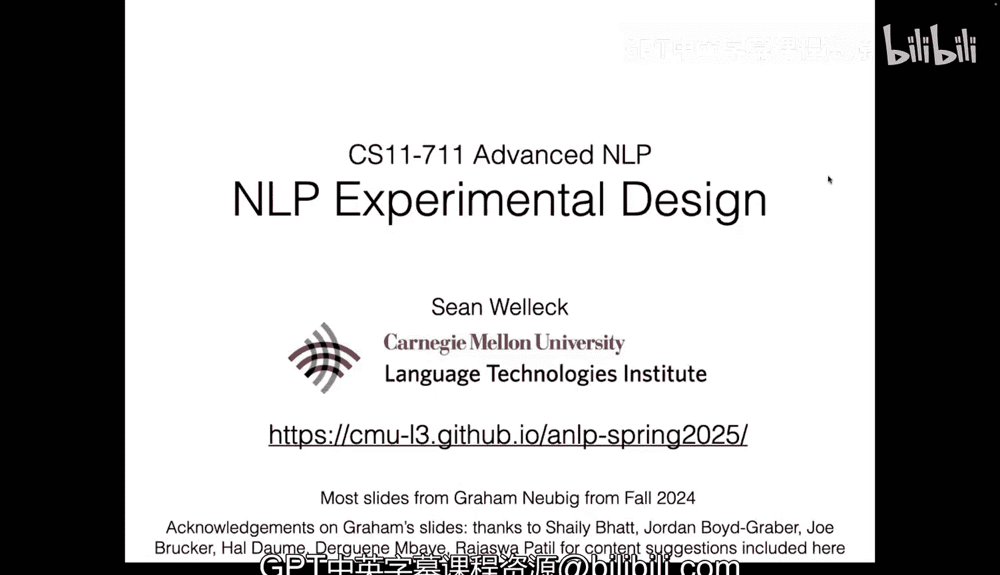

Experimental design， how to pick research problems， some things around。How to。

Choose the amount of data you use。嗯。Things around human annotation and evaluation。

 it's a kind of mixed bag of helpful things。So it's a bit lighter on really technical content than some of the other lectures。

I hear there's a lot of midterms this week， so maybe that's a good thing， but。

Most of the content here is put together by Graham from the previous semester。

 And so it's really good。 and it has a lot of insights。 and it could be very helpful。

 especially when you think about。Putting together your project for homeworks3 and four。

 and then just more broadly as you're doing research or doing things in advanced NLP。

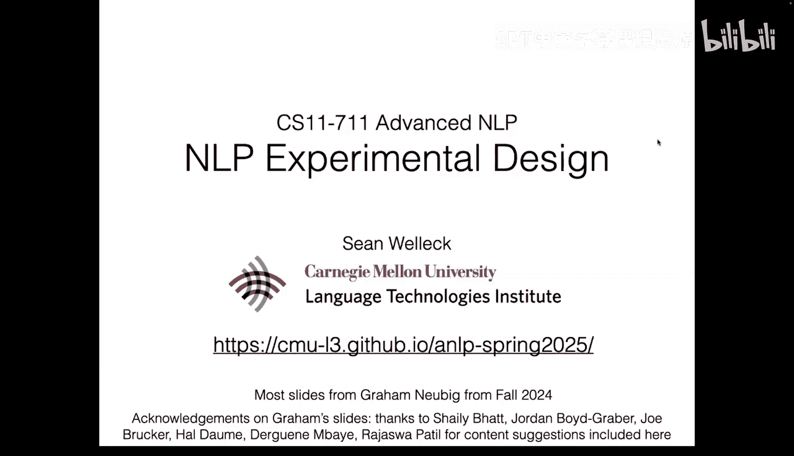

So。The structure of today's lecture is actually based on this figure from Wikipedia。

And it outlines six key steps involved in the scientific method。

So first you have an observation or question， then you research the topic area。You form a hypothesis。

Test the hypothesis with experiment。Analyze your data。And then report conclusions。

And so we'll use this as a kind of structure to walk through some helpful things that you could do or that you could think about as you're doing research or structuring projects in advanced NLP。

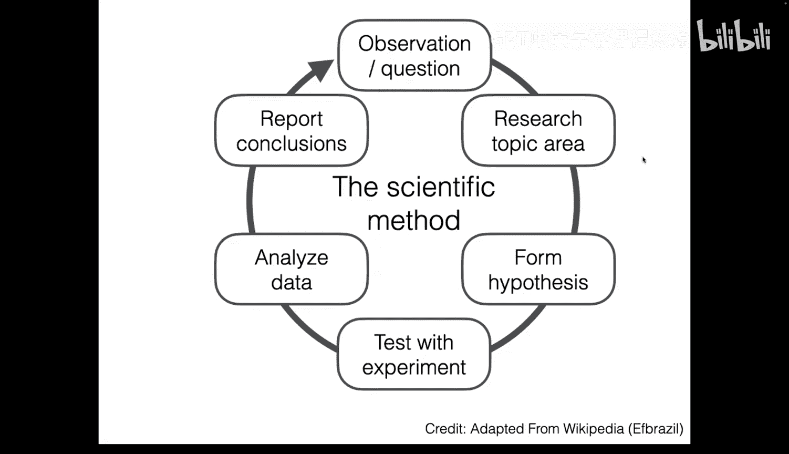

So the first is on identifying good research directions so this is。

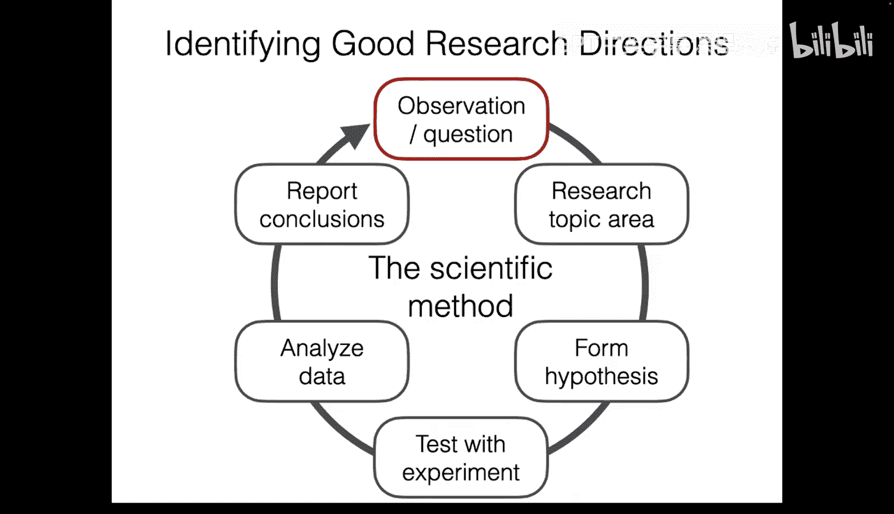

Making observations or asking different questions。And there's a kind of initial question which is like。

 why do we do research at all？And one way to break it down is into two different categories。So， some。

Family of research is driven by a particular application or set of applications。

And so you might have some application in mind and then think about， okay。

 how do you make a useful system for the application？

Or what does it take to make the existing systems work better on your。Application。

And the other is curiosity driven research。So here you might just have something you're curious about。

If it's about language， maybe you want to learn more about language or better understand how language models model language。

There's a kind of whole host of things you could come up with just based on your own curiosity。

And so typically， one trade off is that with an application。

 you might be starting with something concrete in mind， which kind of narrows the。

Space or scope of questions you might ask。Whereas with curiosity driven research。

 the space is much more wide open。 and so sometimes you have to think a lot more carefully about。

You know。Whether the question you're asking is good， whether it's relevant。

 and then whether if you ask the question， it would kind of represent something useful for yourself and for the community。

嗯。And so。Oops， and so we have some examples on the other slide。

 and I would say that sometimes research projects don't neatly fall into one or the other and they might have a mixture of both。

But it is kind of useful to come up with this distinction， and。

Think about how it impacts the research questions that you ask。

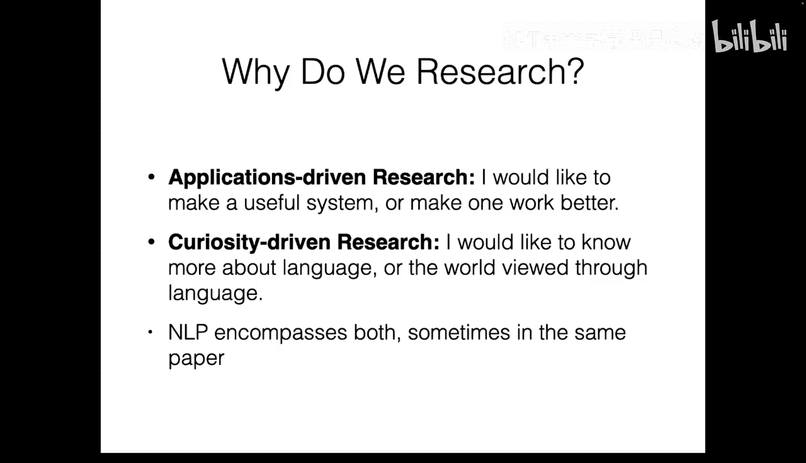

So here's some examples of application driven research。And these are taken from older papers。

 but the ideas are fairly similar。So this is one of the original papers or maybe the original paper that proposed sentiment analysis。

And when you look at why they proposed it， they say that。

Labeling these articles with their sentiment would provide succinct summaries to readers。

So in some sense， in their mind or who knows maybe in their。嗯。

Company or in the people they were doing research for。 They had actual readers in mind。

 and they wanted to provide these succinct summaries。And at least at the time。

 it seemed like doing this task of sentiment analysis。

 kind of identifying whether an article was positive or negative would help give some useful and succinct information to the readers。

So you can think of that as being driven by an application。嗯。

Here's another paper that proposed conversational question answering。And here。

 when you look at their motivation， again， it's。Ultimately based in some sort of application。

So they mentioned that they propose it because an inability to build and maintain common ground is part of why virtual assistants usually don't seem like competent conversational partners。

So here again， they had this kind of goal of building some conversational assistant。

 and at least at the time， it was useful to frame the subtask。

 which would be helpful towards their ultimate goal。嗯。

Here's another example which is maybe a bit different flavor。So in this paper。

 they proposed bottom up abstractive summarization。

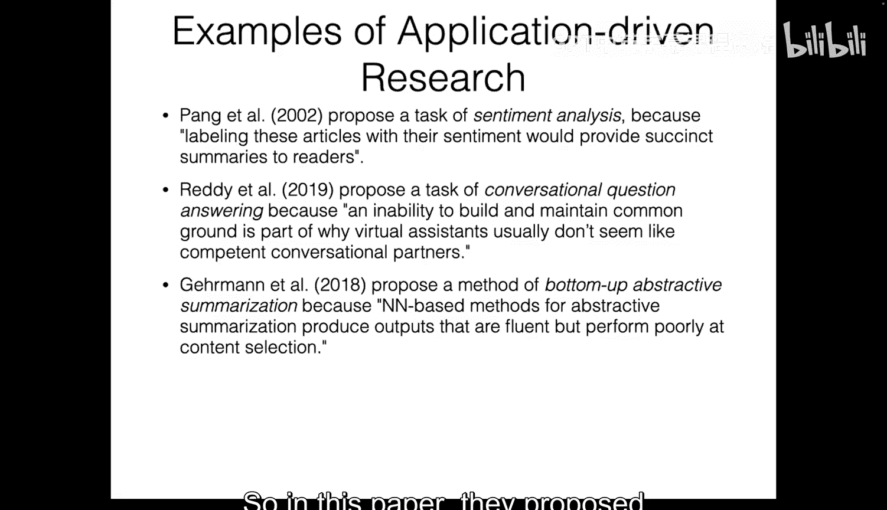

And they said it was because neural network based methods for abstractive summarization produced outputs that are fluent but perform poorly at content selection。

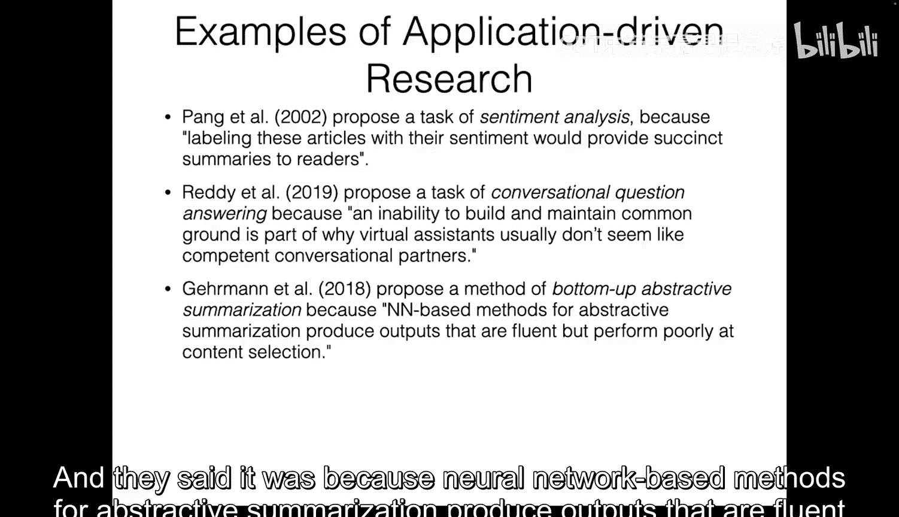

So here again， now they're looking at the particular state of the field and the particular methods that are used on this problem of summarization。

And then they're thinking about， okay， how do we do。

How do we do better or how do we kind of study a helpful sub problemm？

And so they proposed this idea of bottom up abstractive summarization。But again， in their minds。

 there's this kind of concrete application in mind。

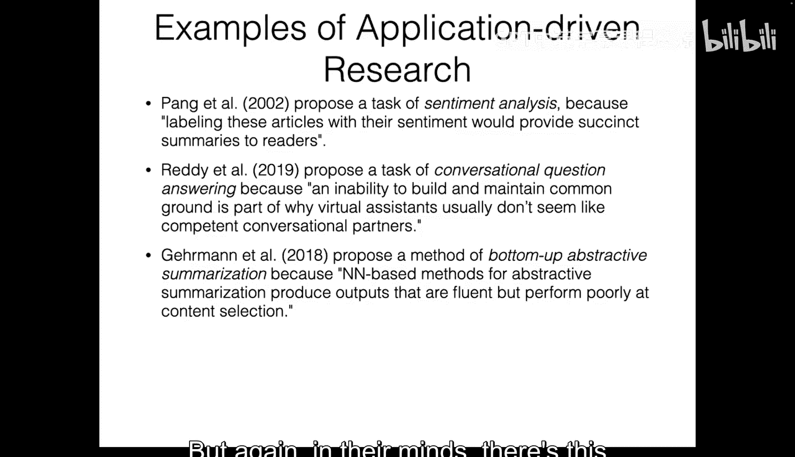

And then here's another one where they're again proposing a method。

 but you could argue that their motivation is rooted in some application。

So this was the paper that proposed。One of the famous methods for the subboard segmentation or tokenization。

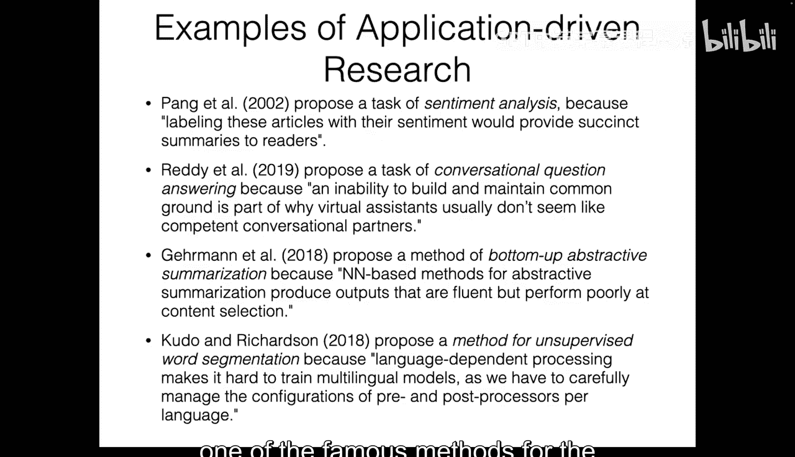

And they said that。It was because language dependent processing makes it hard to train multilingual models。

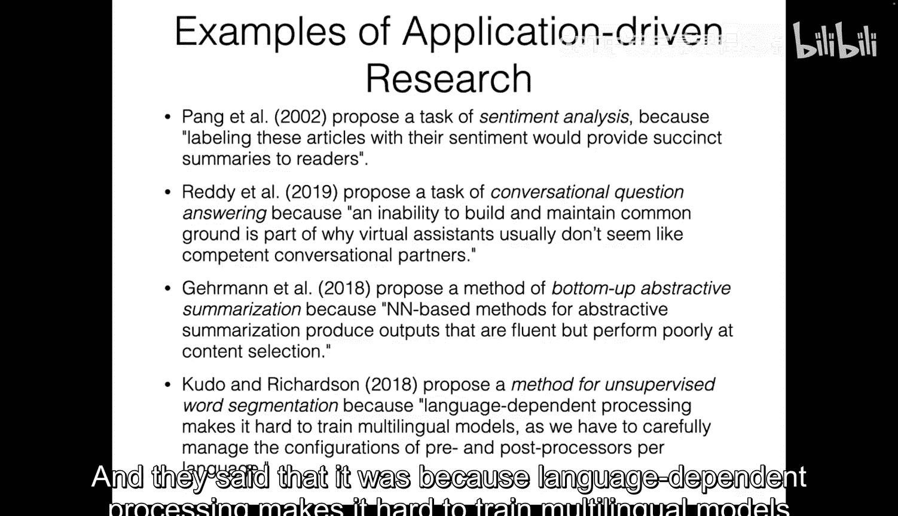

As we have to manage the configurations of。Pre and post processors per language。

So at the time again to make a multilingual model， there was kind of complexity involved。

 and so they chose this research direction and then ultimately came up with a method which solves really big sub problemblem at the time。

O。嗯。

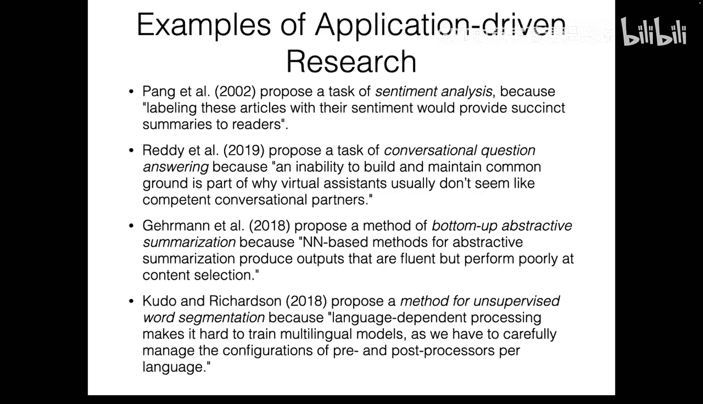

So that's application driven。And then curiosity driven， as I mentioned， the space could。可是。Yeah。

 I mean， it's really bounded by people's curiosity。So here's an example where。They have a paper。

 and they said。What is the difference between the language of real news with that of。Satire。

 hoaxes and propaganda。So here it looks like they're interested in these kind of properties of language。

And although you could imagine that answering this question could be useful for certain applications。

Arguably， it's less tied to a particular application than the previous examples we saw on the previous slide。

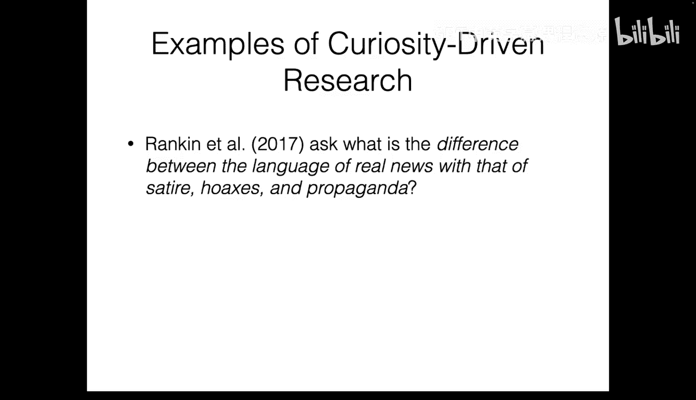

Here's another one which is， are all languages equally hard to language model？

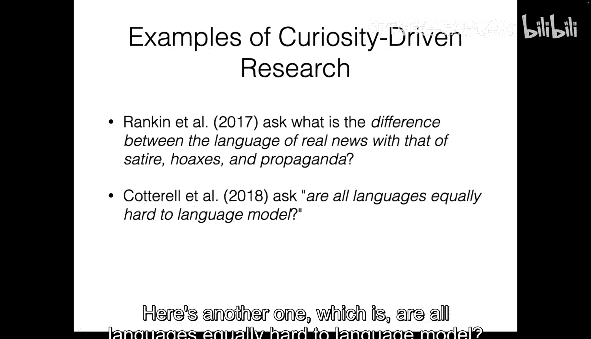

So here they're again， maybe interested in these properties of languages or they're interested in language models。

And they kind of come up with the with this question that they're interested in。And then again。

 you could imagine that。If they come up with a good answer to this question。

 then it could have a bearing on。You know， different applications， for instance。

 maybe it helps with our understanding of how language models perform in other languages。

 which then helps with multilingual applications。And things like that。But arguably， again。

 the motivation， the kind of starting point is a bit different。

And then here's another example where they looked at these burnRT models。

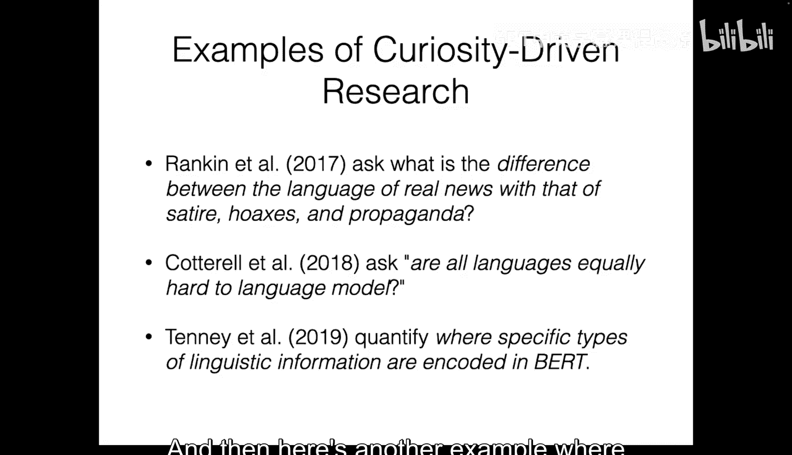

And then tried to quantify where specific types of linguistic information was encoded in the model。

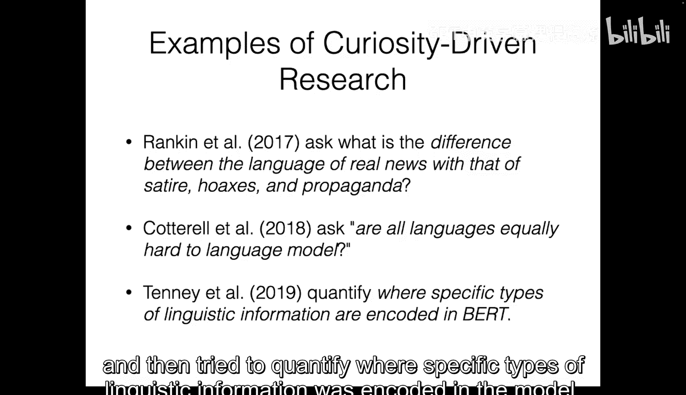

So again， here they're maybe interested in。Linguistics or。In how the neural models work。

 like interpreting them。嗯。And yeah， you have to formulate a good question to investigate and it's not necessarily tied to any particular application。

So these are just some examples and again， these are from you know what eight or six years ago at this point。

But hopefully it helps to come up with this distinction and then you can look at newspaper papers and think about like。

 okay， what is the core question they're asking？Is there some application in mind。

 is it kind of curiosity driven， and then you could think about how you're structuring your own research questions in that way。

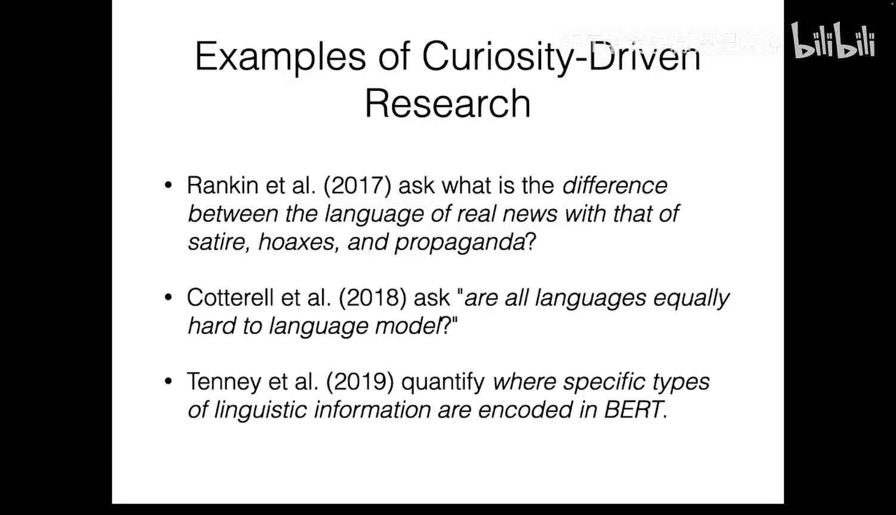

So then another question is like， where do we get research ideas in the first place？

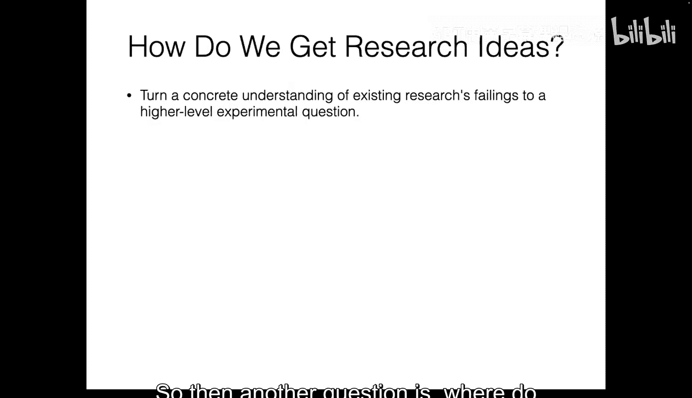

嗯。Maybe does anyone have any thoughts on this before a show。

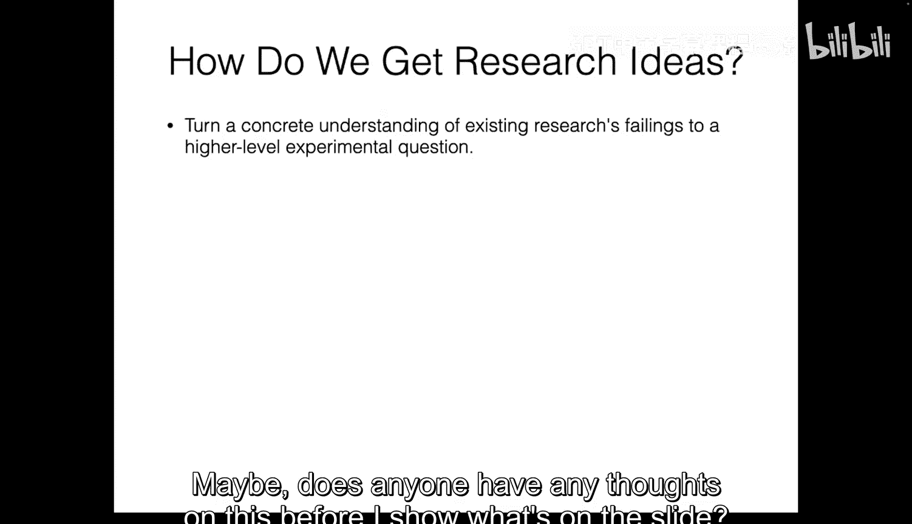

What's inside。People have done research before。Maybe where does the idea come from in the first place？

And the point is there's no one right answer。So I'm curious。嗯哼。😊。

You can mix things from like different research。就欢。Best of both worlds Yeah。

 so maybe you have multiple research areas or multiple kind of solutions。

 and then you take some unique combination of them to get something new。

And maybe it has the best of both worlds， yeah。嗯，that's a good one yeah。

 so sometimes people will actually write down here's the future directions related to this paper or this idea。

Okay。So one way is to look at existing research。And then try to identify where it fails。

And then based on where it's failing， try to come up with some higher level experimental question。

And you could think of this as maybe being some bottom up discovery of ideas。Because in some sense。

 you're starting with the existing research and then you're trying to look at where it's failing and then you know。

 find the research question to investigate。And so just broadly speaking。

 given that you're looking at where the existing research fails and trying to fix it。Then。

 in some sense， it is。Kind of anchored to the existing research。

And so this could be very good for incremental progress。And incremental progress is very important。

In the field。And occasionally， it can also lead to large progress， so this is just a heuristic here。

But sometimes it can preclude kind of thinking of a completely new paradigm。

Unless you just look at the research failings and then you kind of go back and think like， okay。

 what if I was to do this completely from scratch in a new way？

So that would kind of lead to the other type， which is top down。

So here you might start with some high level question or even some like high level methodology that you're interested in。

And then you might think about like， okay， how do I turn this into some concrete research question and research problem？

And。Kind of danger here is that。You can end up solving a problem that isn't actually a problem。

 so you can like。Formulate your own problem and then solve it。

 but then it turns out that it's a bit like disconnected from reality。

The other kind of failure mode or thing to be aware of is that。

Sometimes you start off with a solution。Like you say like， okay。

 this method is the way to do this task and then it turns out to not be the right fit and so that's another thing to look out for。

So for the first part， like some examples are。Yeah， you could look at a existing。System in NLP。

Like say the system was， you know， solving math problems。

And then maybe you could look at the places or the types of questions that it's failing on。And then。

 for instance， you might see that it's actually very good at。I don't know， Olympia problems。

 but it's not in general， like it gets high average score。

 but it's really bad at like problems that involve， I don't know， combinatorics。

And then you could think about like， okay， what like how do I turn this into a research idea。

 a research project to kind of fix that method。And then of course， how you solve it。

 there's a wide space of things and you have to be really creative in coming up with the solution。

A good example of the top down design is when you think about deep learning or neural networks。

So for a long time， deep learning。Wasn't working very well。 It was very hard to train。

But some of the early people working on deep learning had this kind of sense or belief that this was going to be the future and that it was worth continuing to work on deep learning。

 even though it was。Not working， it was difficult to get funding and so on。

And then like with more compute， with a few key ideas and with more data and things like this。

It eventually did start working， and it completely replaced what people were doing in order to solve particular tasks。

And so。Part of that is having this kind of top down。

You could call it belief in the particular research direction。

And then you pursue it in terms of like you know， individual projects。Okay， so that's bottom up and。

Top down and yeah， I mentioned these two points here。

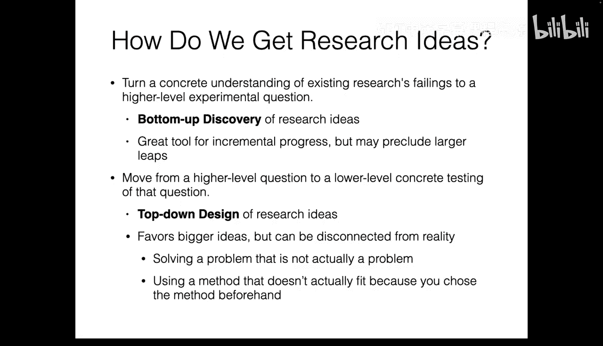

So then once you come up with some。Research question or some observation about where methods fail or something like that。

Then you want to do a little bit of looking into work that has been done in the area。

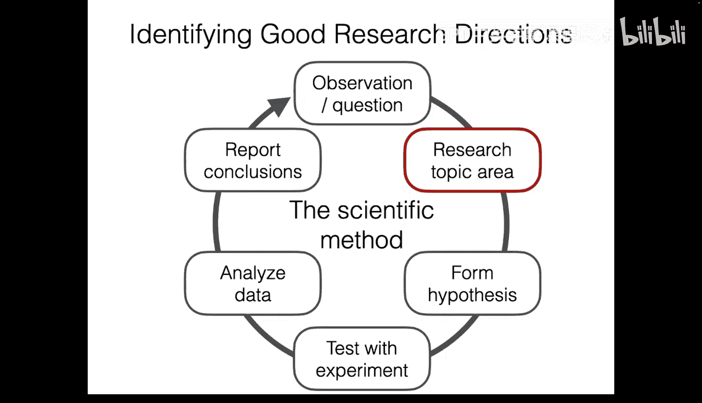

So that's the next part of the talk。Or the lecture。And here's just some kind of， you know。

 basic methods that you can use， you can do a search on Google。Find older and newer papers。Typically。

 if you're going through a lot of papers at once， you might want to just get the sense of the paper from the abstract。

 see if it's in the。Rough area that you're interested in。

And then once you find papers that are very relevant。

 then maybe you spend a bit more time on them and kind of go into the details。On them。

One thing that could be helpful is。To make a summary of a paper。

Just to kind of synthesize your own understanding， sometimes when you start writing out an idea。

 you realize that you didn't like you maybe missed a few important details and you can't really explain it in your own words。

So maybe for this stage， if you're doing this in order to better your own understanding。

 then maybe skip using chat GPT or something like that。

 the point is to kind of go through the exercise and kind of force yourself to try to synthesize what was in the paper and try to identify gaps in your own understanding。

And then you'll have this nice like list of summaries too for the papers that are related to your question。

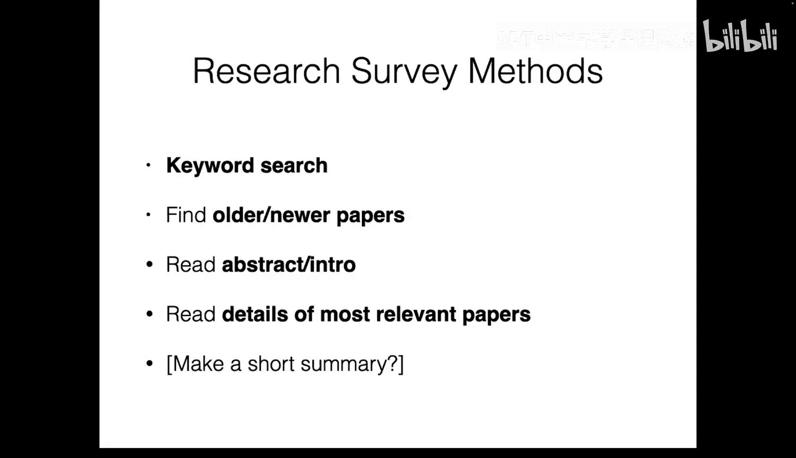

Here's just like some。Different sources of papers in NLP。

You haven't seen these before just as a kind of summary。So。Of course。

 a lot of papers are posted on archive。嗯。Here you have to kind of choose which archive papers you read。

Does anyone have any favorite strategies for？Choosing which archive papers to read。

 because there's way too many。 There's like hundreds or， I don't know。

 maybe even 1 thousand0 that come out every day。嗯。是。Read a survey paper。 Yeah， that's good。

 So do a kind of maybe initial。Survey， yeah， through reading the survey paper and then good luck。

Any other ones。So there are。For like very recent papers。

 you can like follow researchers that you're interested in on like social media and if you're kind of really closely following a research field then it could be helpful too。

Yeah， to kind of get their insight or to get notified about new papers。

One downside of that is that it can kind of bias what you're looking at towards things that are popular。

 that is if you。Get papers from social media。嗯。And then another is to actually just people host papers on archive。

 but then ultimately they may be accepted to these conferences here。Or you can look at things like。

Yeah， their popularity in terms of the number of citations， which is again， just one proxy。

And so that leads to these other categories here。So here are。Some of the popular conferences。

So nerveps and eye clear and ICML are。Yeah， traditionally kind of machine learning conferences。

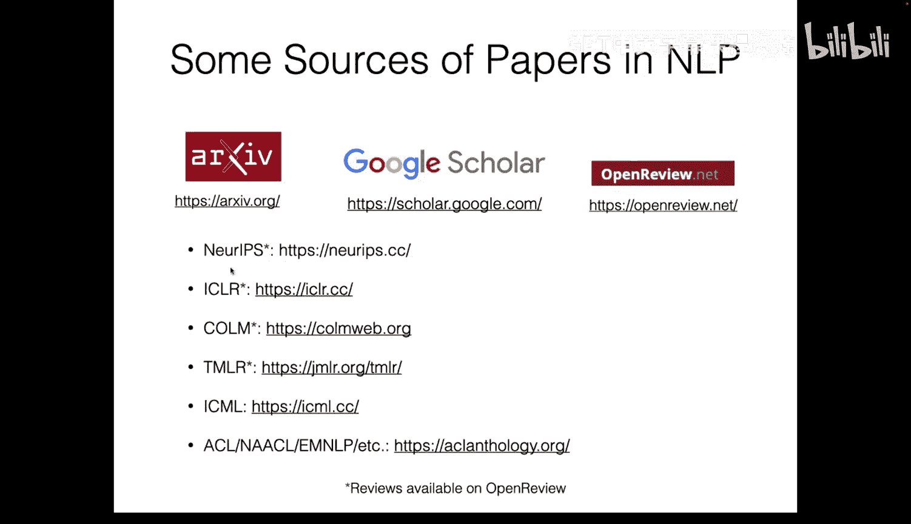

Given that NLP and language models and things like this are。

Having such a large impact and so much interest in the community。

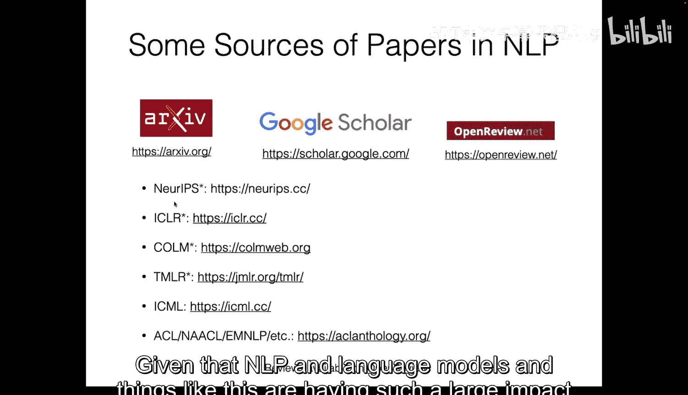

Nowadays， a lot of relevant papers will be published at Yen Ns， ICClA and ICO。

And then there's a few others， so calm is a new。Conference， it's conference on language models。

So the first edition was last year， second edition will be this year。

And so that'll have various papers， yeah， related to all aspects of language models。

TMLR is a journal。And。This one。Yeah， people can submit kind of at any time throughout the year。

 and then it gets reviewed again。And again， you'll see some high quality papers there。

And then here I just put one link， but there's basically like a group of NLP related conferences。

 ACL， NACL， EMNLP。And they're kind of folded into this organization。

And they'll keep all the papers here on this ACL anthology。So yeah。

 by looking at the conference proceedings， you could at least know that the papers have undergone some peer review。

One thing that's helpful， especially for areas， if you're just interested in like。

Finding out about new areas， even if you're not going to research it。

 sometimes it's useful to look at the papers that get awards。You can either see， you know。

 that these things are kind of interesting to the community。

 or oftentimes you can just learn kind of really interesting things from from the insights in the papers。

And then here the ones with stars。It means that all of the reviews are also visible。

 they're hosted on this site called Open Review。And so again， sometimes it can be useful。To嗯。Yeah。

 look at the reviews themselves to see kind of how reviewers from the community were interpreting the work and its significance。

 and also they can often like narrow in on the kind of edge cases or the weak points or strengths of the paper。

So anyways， this is a kind of。嗯。Yeah， overview of sources of。

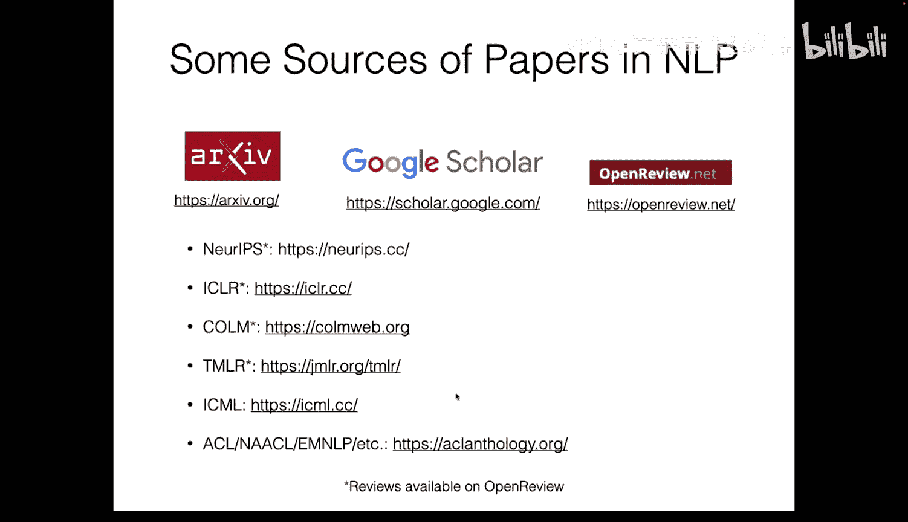

Papers in NLP。Here's just some more about this ACL anthology， so you can see all the different。嗯。

Conferences or some of these are you journals。And they organize all the papers from here。

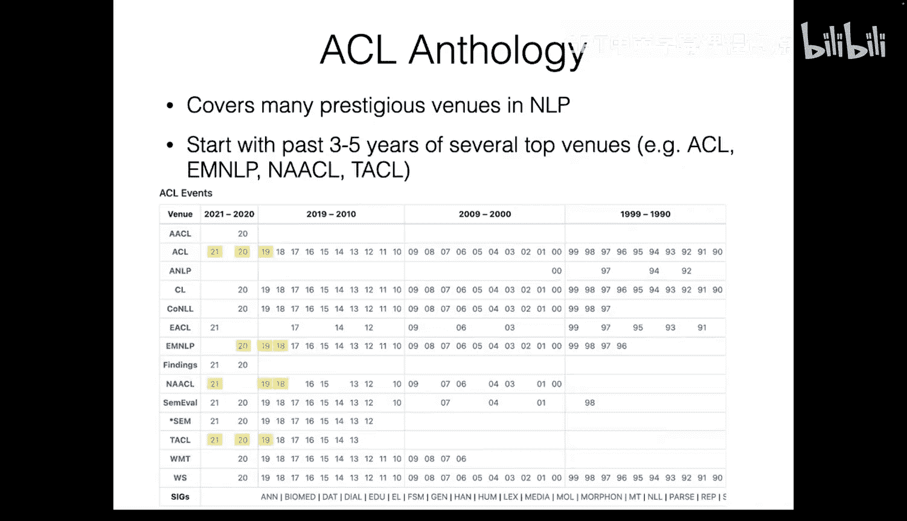

This is just a slide about Google Scholar。You haven't seen it before then， yeah。

 you can view the recent papers。You can also click on， yeah。

 you can either search for a phrase or you could click on。Of paper citations。

 and then this is actually very useful。 You can yeah， basically start with the paper and。嗯。Yeah。

 look at like which ones are citing it and kind of build up this like little like network of。

Relevant papers。And so in practice。Yeah， this is very useful。嗯。This one here。

 I think Graham noted that。So Guam Lapo is one of the founders of Mistrral AI。And this was， I think。

 one of his first papers and it was done here at CMU。

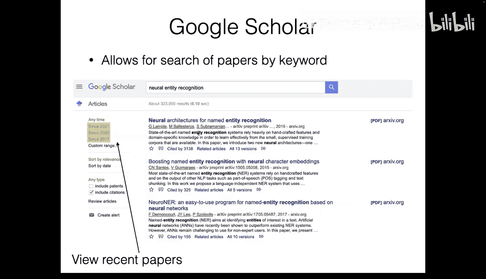

So， just a fun。Tax there。

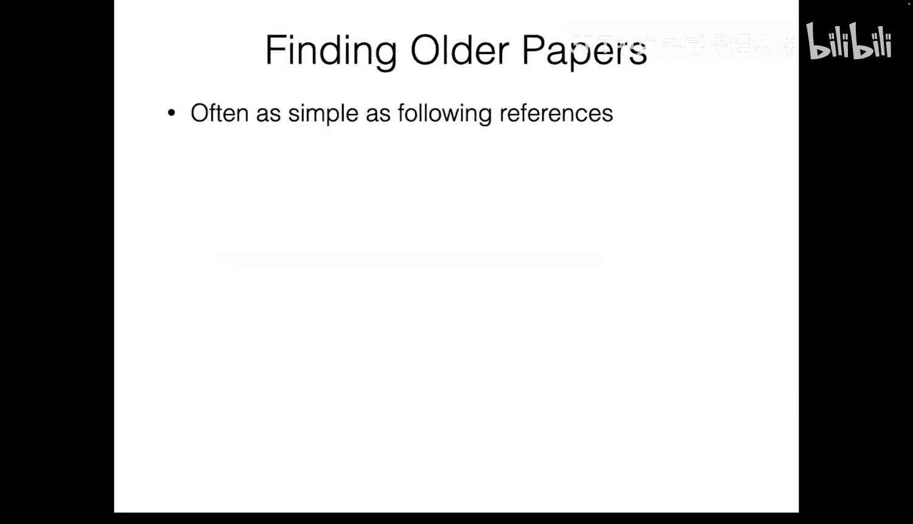

嗯。And then yeah， as I mentioned， it's it's often useful to just kind of start with a paper and you can start looking like backward in time or you could start with a paper and look which ones have cited it and kind of go forward in time and you can like build this。

Tree in either direction that you're interested in。And so usually pretty quickly， you can。You know。

 if the paper is citing things well， then you can kind of get to the core papers fairly quickly and like。

You know， a couple hubs。Okay。😊，So。I will say that doing these surveys is。I mean， it's obviously good。

 so。It prevents you from duplicating work。And it can give you a toolbox of methods and tell you about different problems。

Um， but you have to be aware that like if you're just doing the survey， then you're not。

Starting to solve the problem on your own。And so one is just like， yeah。

 don't spend too much time reading about the prior work。

Sometimes it's actually useful to almost like start solving the problem on your own and then stop and then say okay。

 let me look at what's been done and then you can see like。

 oh they actually already solved this or they solved it a bit differently for me。

 what I'm doing is actually new。Or like， oh， they solved it in this different way。

 and this was actually useful for my research question。

So usually some combination of like starting the research and then， yeah。

 being sure to stop and look at where it fits in can be very useful。

And then the other thing is that like it can constrain your thinking。

 so you could think of like a very extreme bottom up case where you know you're just going through the details of like all these different papers and then in some sense that is constraining the space of ideas to the existing papers。

Of course， in practice， it's a balance， but it's just something to be aware about。

So I think this paper here。Was。Something like， it was by an economist。 And the economists said that。

嗯。When they're going to look for new research problems， they don't read papers。

 they read the newspaper。Because because that is all the kind of interesting problems。

 And then later on， they'll read the existing papers to kind of synthesize or look whether it's been done already。

Okay， any like discussion points or questions before I move on to the next section。

 let me just pause for a bit。Just science Google Schol。

 but also transmantic scholarol you can also attract。By research topics。

 like you will I can recommend many different papers that are released in the in the later days and based on。

yeah yeah that's a great suggestion so yeah semantic scholar is a tool or website made by AI2 so I've mentioned AI too a few times in the various lectures。

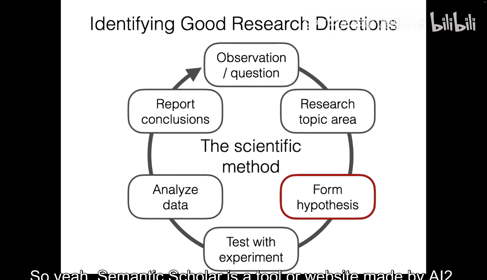

And yeah， it can have like a。Super set or different functionality from Google Scholar that could be。

very useful。That actually reminds me of like， yeah， increasingly， I mean。

 in the first lecture I mentioned this tool or this research project called Open scholarol。

 and it essentially used language models and retrieval to like help do a literature review。

And these types of things are becoming more and more common， it's a kind of active area of research。

With those， you just always have to keep in mind that。

What you're seeing from the system is not necessarily reliable。

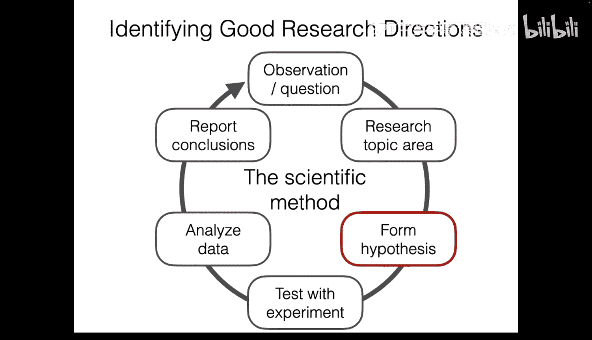

Especially if it's not using like retrieved data and just going from its own。

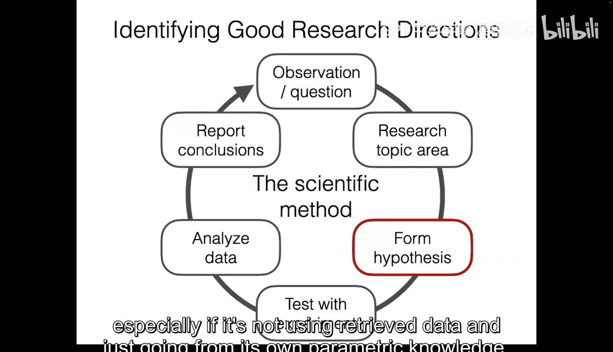

Parametric knowledge。And I find a lot that， if I。Ask， yeah， like chat GT something。

 Then sometimes the the references like aren't。Actually irrelevant and can look very convincing。

So it's definitely like kind of be skeptical and。

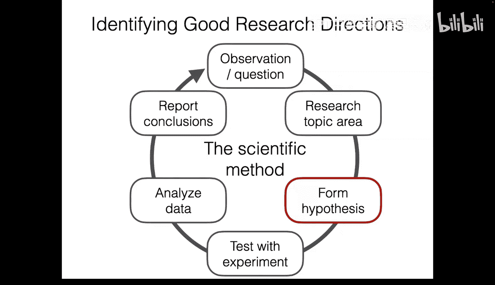

Be sure to actually look at the ground truth if you're using those tools would be mywise。

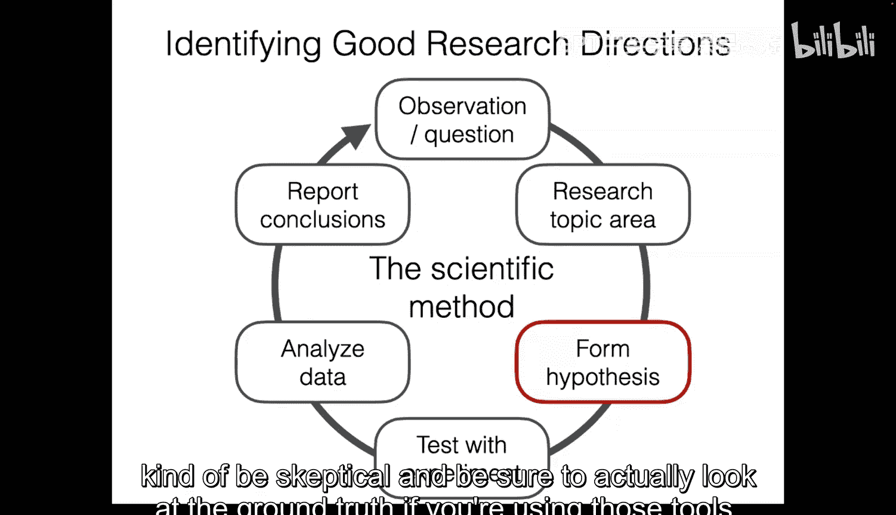

Okay。😊，So， oh， and another thing on that is like， if the paper is， yeah， very， very relevant。Then。

Yeah， there's a chance that it's been seen， you know， even less times and it's training data。

 So be extra skeptical， but always be kind of skeptical and look at the。Yeah。

 look at the source document。If you're using the generative AI tools to help with a literature review。

Okay， so next we form a hypothesis。嗯。

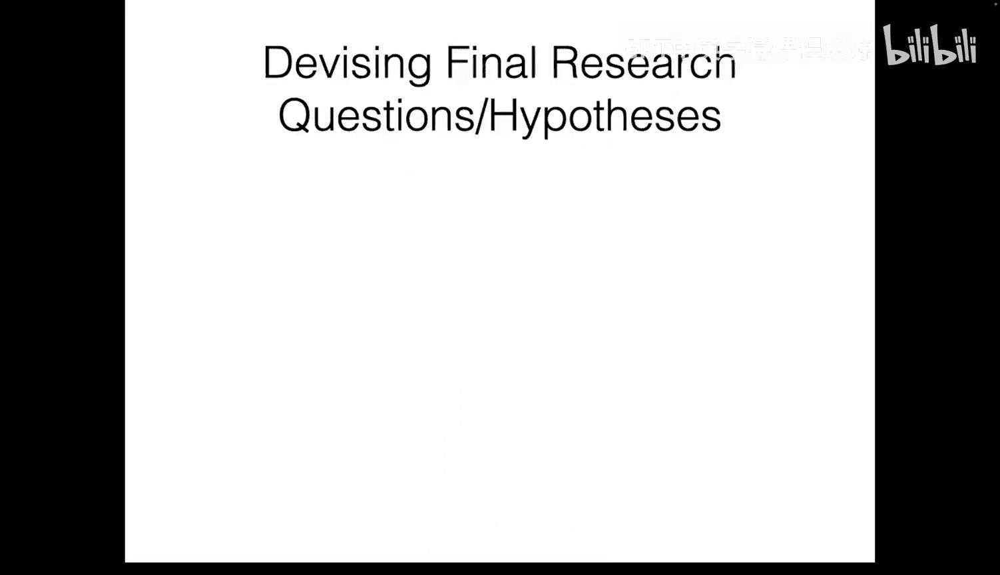

so。Let's just look at everything that's here。So yeah。

 now you want to come up with one or several questions that you're interested in。

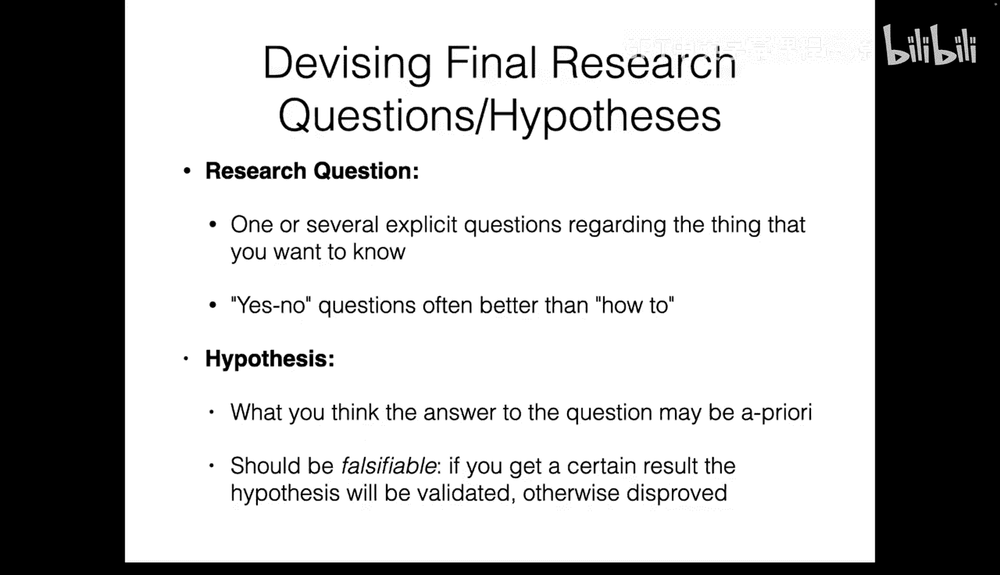

And often it's helpful to you have like a yes or no question。

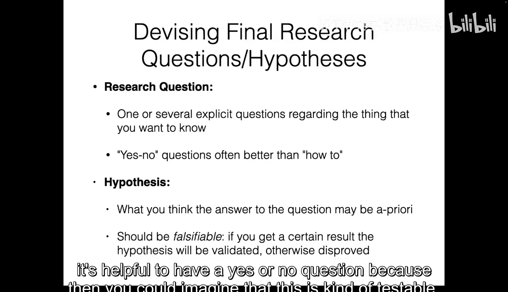

Because then you could imagine that this is kind of testable。You could say yes or no。

 and then maybe you can run an experiment and show that， you know it is the case or is not the case。

嗯。And。One way of viewing this is that， you know， you're actually doing this kind of scientific method and you're coming up with some hypothesis。

So you come up with a question and then you say like， okay， here's my hypothesis。

And if I get a certain result， then the hypothesis will be validated， otherwise it'll be disproved。

And so a lot of the time。You know， we don't。Like， remember or。To actually do this。

 like list out the specific questions or hypotheses。

 but this can be very useful in kind of organizing your thinking around a particular question。

And it could be useful in like setting up the experimental design。

Because if you really think about like， here is the question I want to answer。

Thenhan the exact experiment that you need to justify the answer to that question。

You can really think about like， yeah， what is the specific experiment？

嗯。

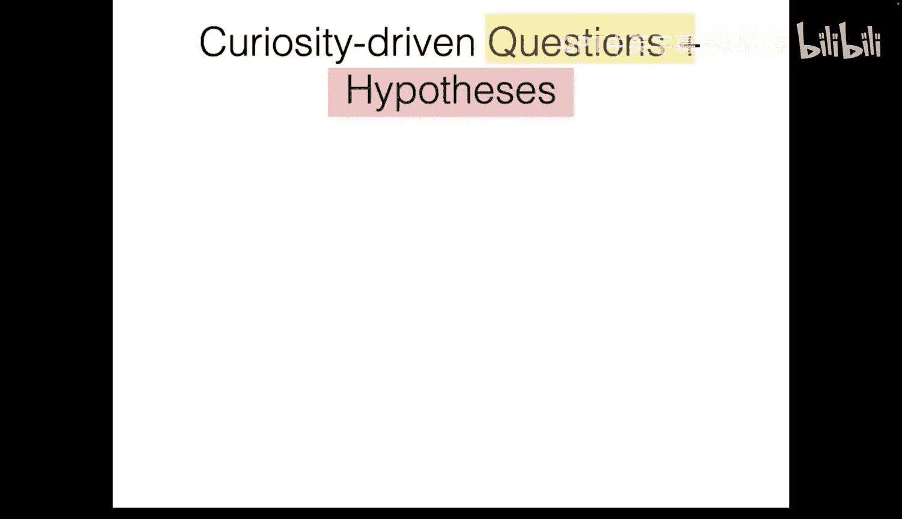

So。Yeah， I think we have some some concrete examples here。 And again， they're taken from。

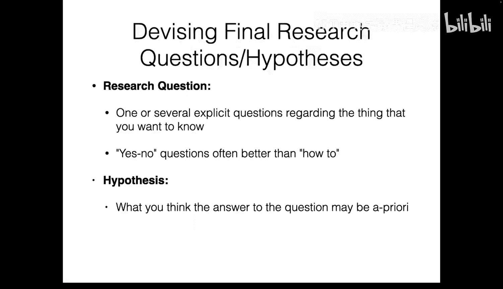

嗯。Some actual papers， so here's the paper that I mentioned earlier calledA all languages equally hard to language model？

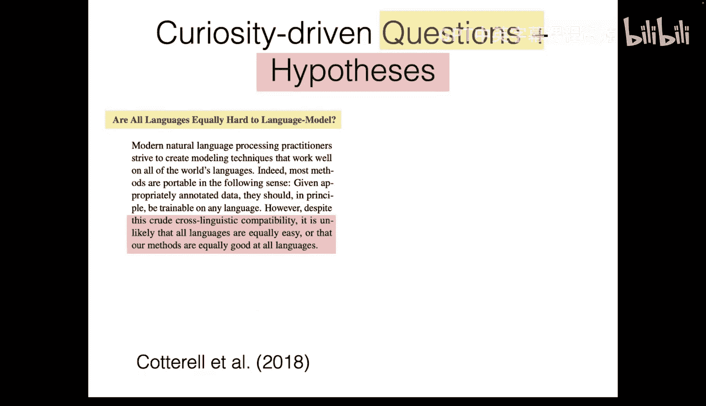

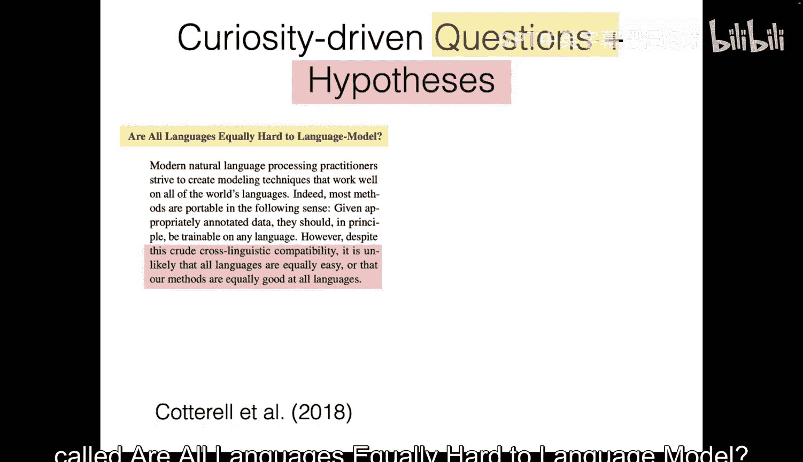

And so there they have the question in the title of the paper。

And then if you look at the text here in red， is their kind of underlying hypothesis。

So it says despite this crude cross linguistic compatibility。

 it is unlikely that all languages are equally easy。

Or that our methods are equally good at all languages。Okay。

 so this is their kind of hypothesis and then they have to come up with some experiments that test this and。

Yeah， kind of demonstrate this for the current methods， at least。

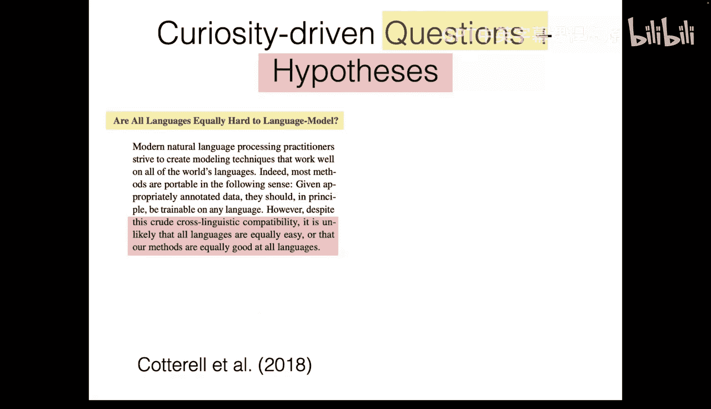

This one says what makes a particular podcast broadly engaging？And then again， here。

 they kind of have。Reducing filler words and disfluencies or incorporating emotion。

But there's been little quantitative research into how aspects of language usage。

Contribute to listener engagement。So it looks like， yeah。

 here they have some underlying hypothesis about this question。

And I guess it also looks like they're interested in。Aspects of language usage as well。So again。

 sometimes it's not sometimes it's very clearly laid out。

 sometimes you kind of have to read and say like， hey。

 what is their underlying question or hypothesis？

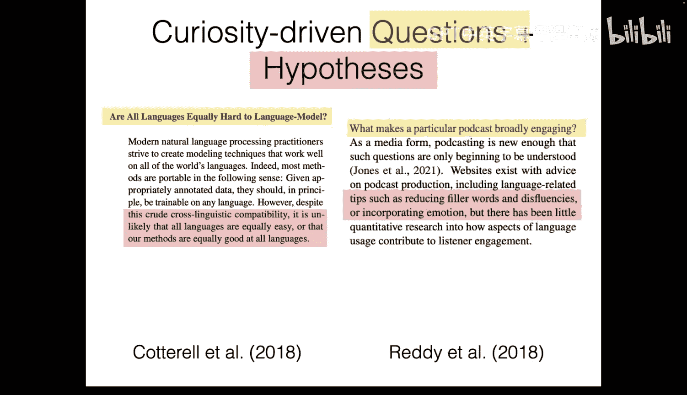

Other times you'll see you questions like explicitly listed out like this。And again。

 here you can see that they're linking to like specific sections of their experiments。And so again。

 if you're able to do this and like go through the exercise of doing it， it can be very helpful for。

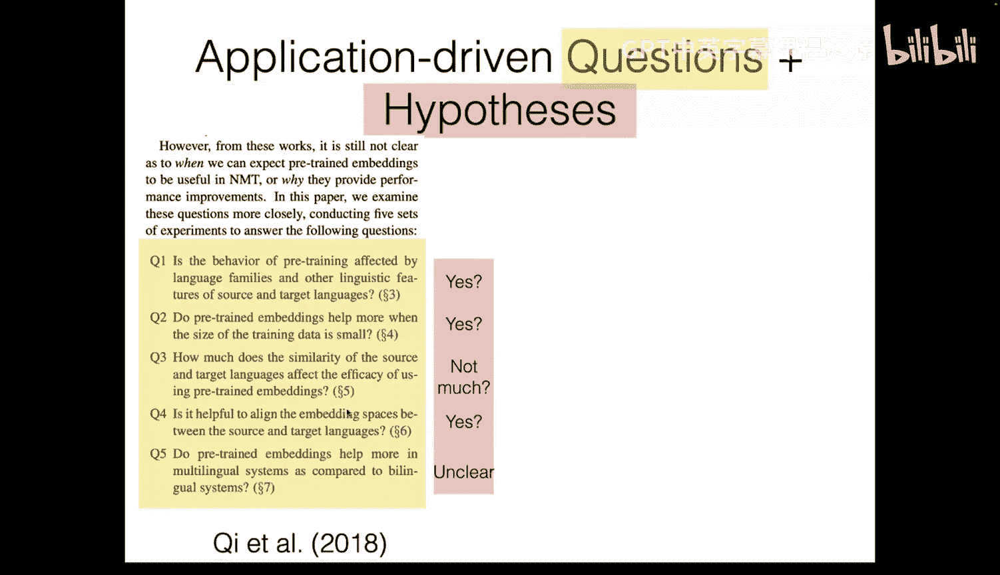

Strstructuring your experiments and communicating the results。嗯。So。嗯。

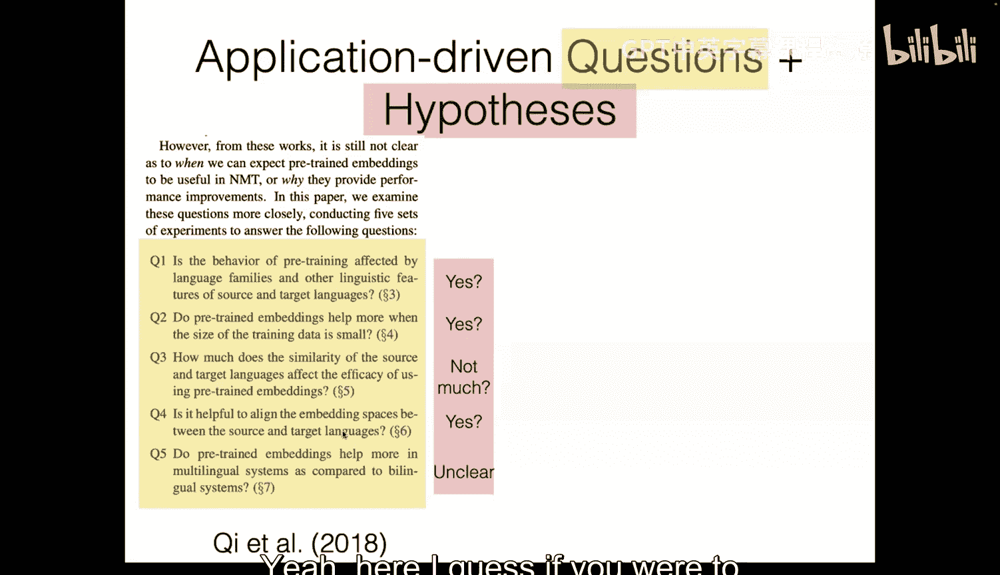

Yeah， here， I guess if you were to read through the the different questions。

 then you could think like。What was their hypothesis， Yes， or。Or no。嗯。But yeah。

 this is a more concrete example of at least laying out the questions。

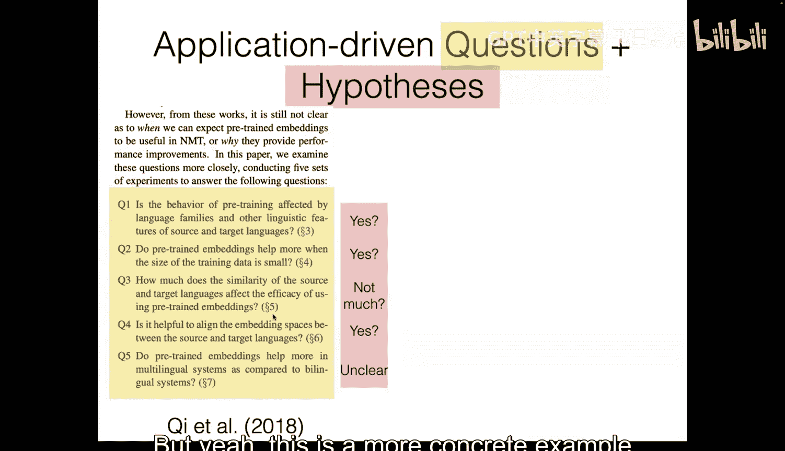

嗯。And then here， the question is， again， kind of hidden so。A not hidden， but。Yeah。

 it says the research question of whether and how contextual information benefits end to end。嗯。

I think speech translation。Has received little attention。And so maybe their hypothesis is that。

You know， the fact that they're bringing it up means that they think it'll help and like here's their method that incorporates the contextual information。

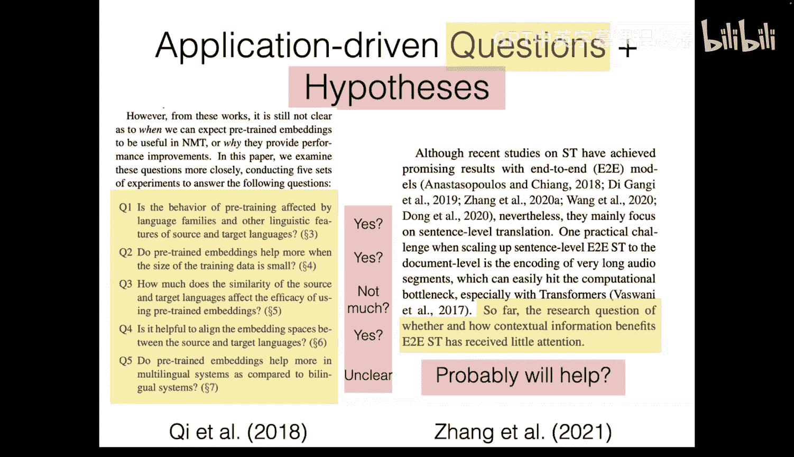

Okay。😊。

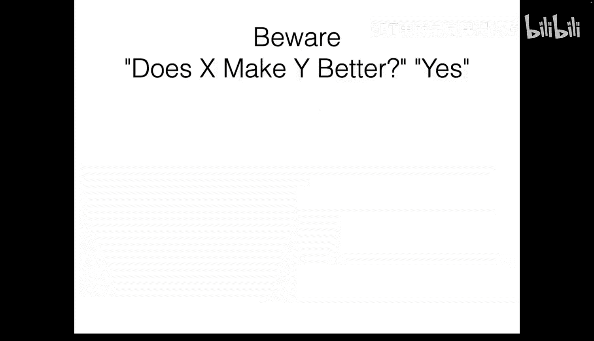

嗯。So。Yeah， this again is a heuristic。 So I mean， this isn't necessarily always the case， but。

Sometimes， you know， it's tempting to say， does X make y better？

Is the question and then the hypothesis is yes。嗯。And I think one。If everything works out， then。

 you know， this is fine。 But then if the answer is no， then you have to do a bit more。

A bit more digging。And so it could help upfront to have some like underlying hypothesis for Y X will make y better。

Like maybe you have some intuition about the method。Or you think， like。You know。

 humans use context when they're translating speech。

 so therefore I think that adding in context will make y better。嗯。And。

So then you could again think of other research questions or hypothesis based on why you think something is the case。

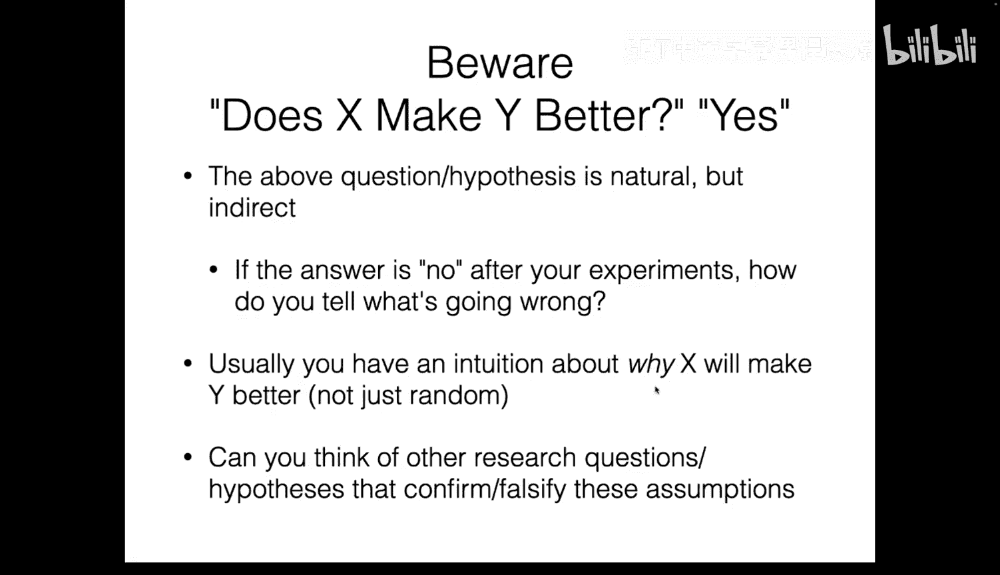

嗯。So， any。Questions or things to discuss here。Okay。😊。

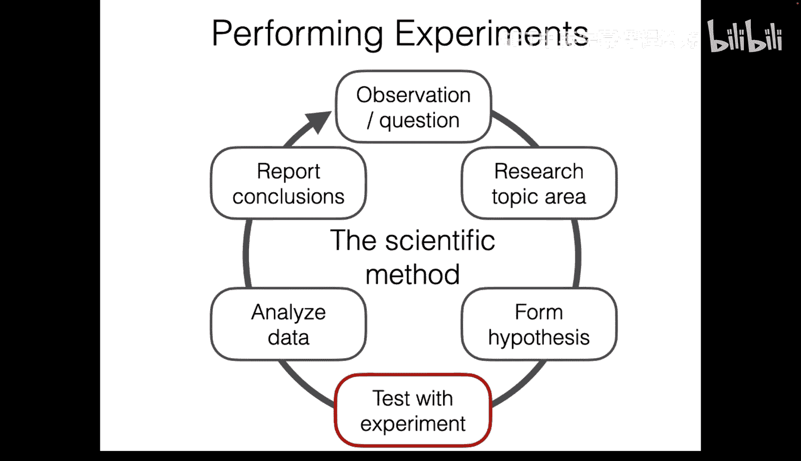

So then you move on to testing with experiments。And so just you know。

 the basic idea is you find data that will help answer your research question。

You run some experiments and calculate some numbers。And then you。

Calculate whether the differences were significant and look at the effects。

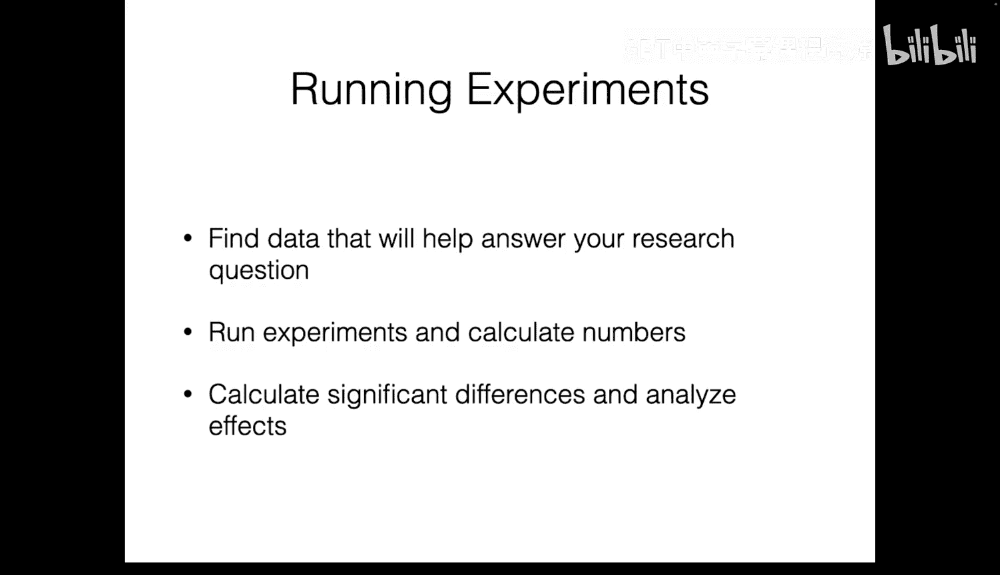

So the first question is， you know， where do you get the data from？

And so often if you're building on previous work。Then as a start。

 you might try just using the same test data that they're using。UmIf it's kind of， you know。

Work that is has proven to be significant in the community and has undergone peer review and all that then。

Their experimental setup is at least valid for what they were doing。

 so its might be a good starting point to just， yeah， start with their data sets。

 start with their experimental setup if it's similar to the question you're asking。

The tricky thing comes if you're answering a new question， like a new application or you know。

 maybe no one has looked into what was the question。

 whether language models model all languages equally， it's a kind of just new thing。

So then you really have to think about like， what is the right test data that I need to。

Evaluate this question or this new application。Oftentimes you can repurpose other data sets。嗯。Yeah。

 a good example of this is like。If you look at。Different。Yeah。

 like there's a method that I'll actually go over later called。Direct preference optimization。

And it's a kind of alternative to reinforcement learning。

And then if you look at the data sets that they evaluate on。

 they might actually use like a sentiment analysis data set。嗯。

And the point is that they're not trying to solve sentiment analysis。

 but they're just using this kind of。Well established data set along with its metrics to kind of demonstrate their new method。

And then sometimes you're really doing something that just requires oops， new data。

And this can be very time intensive， so be careful about this。But at the same time。

 if you do create data， then it can be incredibly useful， not only for your own investigation。

 but if you make it openly available for the wider community。

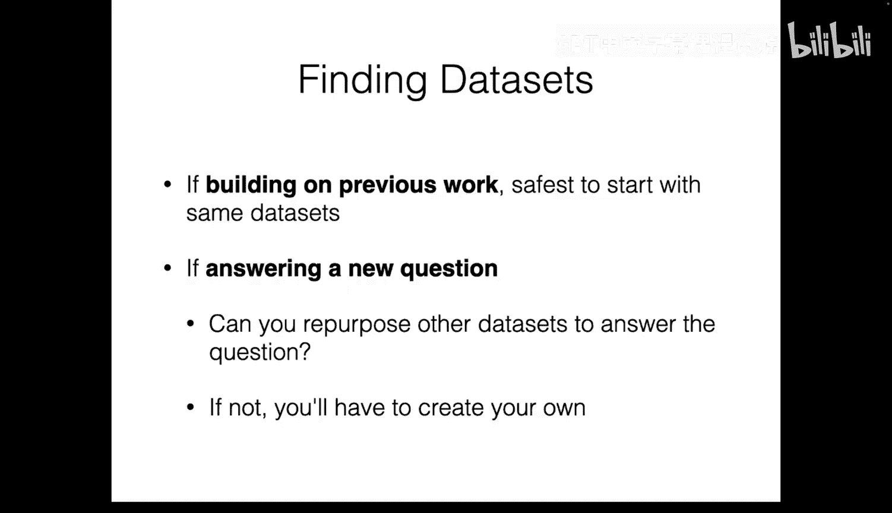

Okay， and then we've gone over these different data sets lists。

 I showed you a few times this hugging face site that has different data sets。

This is。Another one， Lrec， these might be like。European Language Resources Association。

So sometimes， you know， on other sites， you'll find things that aren't on hugging face。

U but as a good start， you might， yeah， try searching on here if there's anything。

Relevant。There's also sites that track like whether papers have code or data。

 you could also of course like just look at the paper if it's relevant to your question。

And see whether they posted， the data incurred。

嗯。So。Then like suppose you want to annotate data。So let's say that。

 you know there's not a good sentiment analysis data site。Or。You know。

 you're trying to solve new mathematical problems or like generate code in a new language。嗯。Well。

 then you have to like start collecting it and you have to get humans to annotate it。So first。

 you have to decide how much to annotate you have to create。

Guidelines and hire people and evaluate the quality。

So。Let me go through a few of these。

So one question is like how much test or development data do you need？And ideally。

 what you want is you want。An amount of data that。If there's a difference。

 then you know that it's statistically significant。So if you have two small of amount of data。

And you see a difference then。It might be just due to the data being a kind of。Bed or noisy sample。

And on a different sample of data or on a larger data set。

We wouldn't actually see the difference with the new method。

So there's actually a kind of formal framework for thinking about this。

And it's called power analysis。So there was this kind of nice paper from 2020。

Talking about power analysis in the context of NLP。I want to just。Yeah。

 walk you through an example of this。 just so you've。Seeme one example of it before。And。嗯。

Here you want to make some assumption about。So say you introduced。

 you have model A and you have Model B。And you want to say that， like， okay。

 a 2% improvement would be。Would be like。A good accuracy difference。And then you want to ask like。

 okay， given that you want to demonstrate a 2% difference。

 how much data do you need for it to be statistically significant at a given threshold。

And so power analysis will give you a kind of framework for doing this。

So here's an example。The type of power analysis that you apply will depend on the type of results you have。

So here this is looking at like， okay， say you have two different models。

You have Model one and you have Model 2。Then you could come up with this contingency table。

 which says like， okay， let's look at cases where both systems are correct。

Where Model 1 is correct and Model 2 is incorrect。嗯。Vice versa。

 and then where they're both incorrect。So in this case we've collected。

 we have basically 100 test points and then we've broken them up。

Based on what is correct and incorrect。So then I put it all in one slide so the font is small。

 but here you can see that the accuracy of M1。Is 40 plus 10， so you look at。

How much has gotten corrected over 100？So that's 50%。And accuracy M2 is 60%。

 so there's a kind of 10% difference。So then here's a kind of analysis you can do if you have one of these two dimensional contingency tables。

It's。You compute this statistic， and it's called Mcneimmers。Test statistic。

 it's also this like chi squared statistic， chi squared distribution。

And it basically just looks at。How often。The two models disagree。

So you can see here that this 10 here has showed up where M1 is correct and M2 is correct。

And the 20 has shown up here。And then you get this statistic here and it says 3。33。

So then what you want to do is look at a particular P value so you could look at like p of0 point。

Sorry，0。05。And then you can go and look up in the， you know like chii squared table。What the。

Test stat number is there。And this basically corresponds to some point on this。On this density。

And it says that like。If your statistic lies to the left here。

 then you would reject the hypothesis that there's a difference between the two methods。Otherwise。

 if it's to the right， then you would accept the。Or you wouldn't reject the null hypothesis。

At the P value of 0。05。So like in this case， this 3。3 is less than 3。8 over here。

So the difference in their error patterns might just be due to random chance。And in particular。

 you kind of like can't reject the hypothesis that they're the same and that we're seeing this observation just due to random chance。

So this argument I'm going through is a kind of standard， you know， argument when you're doing these。

Significance tests， it's not like specific to power analysis。

But then power analysis basically says that like， okay。

 let's say that we repeated this experiment with like different samples of 100 data points。

Then how often would。The test be passed。So let's say we repeat this 10 different times。

And 80% of the time the test passes and 20% it doesn't。Then we would say that that has a power of。

Either 80% or 20%， but it's basically related to that amount。嗯。So anyways， yeah。

 I kind of jumped into the details here。 but yeah， if you are curious about this。

 this is a paper that。

Puts these power analysis things in the context of NLP， so it could be helpful to read about。

嗯。

And then I have another graph here which is basically showing what I said。

So this is looking at if we simulate this process here。Kind of over and over。

With different amounts of data。 So now， instead of just 100， we could have like 200 or have 1000。

And then we can look at how often with these proportions。The statistical test is， is passed。

嗯。So you can see here that if you have a sample size of 100 and you do 2，000 simulations。嗯。

Then here's the chi squared statistic， and here's the different significance thresholds。

So you can see that if you only have 100 data points。

 it's often not a statistically significant difference。Whereas if you have  a thousand0 data points。

Then you could be pretty confident that if you observe this 10% difference。

Then the result is statistically significant。If you have 1。

500 samples and you see this 10% gap in accuracy， then yeah， you could be like almost certain that。

It's a significant。ARe。

Okay， and then here's just another one。 And it's showing the。The power here on the Y axis。

And you could see that， yeah， if you have a difference in accuracy of like 0。1。Then。

Power will increase if you have more data points。嗯。And so， in general， like。If you want to show。

A largerar difference then you're going to need more data for it to be significant。Okay。

 so sometimes you know， maybe you're able to do this actual analysis。

 but it gives a kind of formal justification for this kind of intuitive idea that I just mentioned。

That。Yeah， if you have a very。Sorry， small difference in accuracy。

 then you want to have a larger and larger amount of data to kind of be convinced that it is significant。

Otherwise， if the difference is massive， like method one has 25%。

Accuracy points higher than the other one。Then sometimes you can demonstrate those with a fairly small amount of data。

Okay， and then for training data。 So I was talking about testing data for training data。

 I just have some。Kind of high level points here。So more is usually better。However。

 as we talked about in the。Previous lectures。Sometimes you can get reasonable enough performance with few shot prompting or even zero shot prompting。

And so it really comes down to the specific question you're looking into。And。Yeah。

 sometimes you can demonstrate things even with just like few shot results。嗯。

Like when you're comparing two pretrain models。You'll just use。Or sorry， that's the test evaluation。

嗯。But yeah， in some sense， if you're comparing two pretrain models。

Then instead of actually fine tuning them on using a bunch of training data。

 you can just do this kind of few shot learning。To answer certain questions。

Okay。And then there's a question of how you should sample data。So again。

 we talked about it was in the pre traininging lecture。

 but the ideas kind of apply to anytime you're collecting data。

 you want to consider the domains that you're trying to cover or the tasks that you're trying to cover。

The language varieties or the particular。Demographics。And here is。

It's more like concrete list of things。This is from something called。It might be data sheets for NLP。

嗯。But anyways， they kind of go through and。Argue for you points that you should care about when you are collecting or sampling data。

So or when you're using someone else's data， so you might want to look at exactly。

What their rationale was for curating data。嗯。You might want to look at， for instance。

 like the demographics of the annotators。You could imagine that， like。

Certain annotators might be more familiar with a certain area or less familiar with a certain area。

Certain annotators might have certain biases to be aware of things like that。

One good example of this is we were talking about this kind of preference based reward model in the reinforcement learning lecture。

And the question is like， there you're comparing whether one output is preferred over the other。

And you could imagine that that's a kind of subjective thing。Depend on， yeah， who the annotator is。

 kind of what their background is。Um，And sometimes like certain types of data。mLike， you know。

 long programs or long like mathematical proofs the annot the。

You can kind of reason about the annotations being noisy or high quality based on know who's annotating them。

Okay， so anyways， so this is a kind of standard thing that。Is done， which is like， I think a NIs。

 data sets and benchmarks conference。If you propose a new data set。

Then you either have to fill out this data sheet。Or some other alternative as like a condition of it being submitted to the conference。

Also， these data sheets or again， some alternatives are usually visible now on the hugging face。

So again， you can go through and if you're going to use data。

 get a better understanding of some of these points。

O。How are we doing on time？ Okay， good。

So。Here's some guidelines on annotating。This is taken from a kind of a classic。

So this data set is the Penn tree Bank。And this was a data set used for。This task of。Parsing。

 like dependency parsing。People also used it for really early work on language modeling。

And I say early， but people are still using it， you know？啊。You know， not too long here。But anyways。

They have a kind of systematic write up on how you should annotate things。

So here they were annotating these different parts of speech。

And so you can imagine that this is kind of。Yeah， difficult to do and maybe it's sometimes ambiguous。

So they went through a lot of effort to describe what people should be annotating。

As well as like particularly difficult cases。They gave some examples。嗯。And so yeah， this of course。

 might require its own lecture or if you're going to get some data annotated。

Then there's a lot of nuance to it。So maybe this slide is just saying that。Yeah， beware that。

The instructions that you write and the level of detail that you give to annotators can have a large impact。

嗯。On the output。A kind of fun way to look at this is you could also try prompting a model with different instructions and see how its annotations vary。

Um， and sometimes you can see like where your instructions aren't clear or， u you know。

 whether things have an impact。I don't know if that's like a popular method at all， but。

it could be helpful for you making sure that you're writing things clearly。

Then when it comes to hiring annotators。

So sometimes you can just annotate data yourself。Especially for like smaller scale projects or if you want to do some initial experiment。

Then yeah， you could just。You know， come up with 50 examples and。嗯。Try to try to have that done。

Maybeive you one example of this is we had this project。It was called draft sketchtch Pro。

And it was basically going from these kind of informal mathematical proofs to formal proofs。

And that data doesn't exist on the internet。And we were using few shot prompting。

 so we needed just like a relatively small number of examples。

But each example is like literally you know， proving a theorem and then writing it in the formal theorem proving code。

So for that， it didn't really make sense to hire someone because it's such like a unique expertise。

So the authors， we all like split it up and came up with like 50 examples just on own and that was actually enough。

 you know， to do the paper。嗯。Yeah， you could of course， have other friends or coworkers or students。

This can actually yeah be quite popular。And then if you do hire people。

 there's different sites now and the exact names again， will vary， but you know。

 hopefully these are still。嗯。You know。Still going as companies mechanicalchanical Turk used to be really popular on Amazon。

 it's owned by Amazon。But the way to think about these is， again。

 in terms of the kind of difficulty of the task and the level of expertise you need。

So like if you need someone with a PhD to annotate the data。

 then you'll have to look for a particular annotation site that can kind of get you those annotators。

If you have some something that kind of requires more， just like， you know。

 general knowledge or something like that。Then maybe you could look towards a broader platform like mechanicalical Turk。

嗯。And yeah， annotation costs a lot of money， so try to do some small annotation experiment first。

This could help。Either clarify the instructions or things like that for your larger run。

Or it could even give you a sense that like。Yeah， maybe I can't use mechanical Turk for this I have to。

Actually， convince my friends。With PhDs to do it or something somehow， which does happen。

So anyways， yeah， this is all just saying that you do have to think very carefully about。

Getting data created by humans。

Because it can vary in quality， it certainly cost。嗯。And so on。This point at the bottom is important。

 you know， in in academic setting if you are。Doing certain。Studies where you're collecting data。Then。

Do have to get it approved by an institutional review board？

And so especially if you're paying people to annotate data。

Then there's kind of standards that you have to meet for the amount that you're paying them different things like that。

 And so there's a set of standards that have been created and you kind of submit your research project and then it gets。

It gets approved or it gets rejected with some feedback。So for this， like just to give an example。

 we were。A few years ago， having students。Actually。

 look at the outputs of language models on these mathematical problems。And。Yeah。

 we wanted to ensure that people were you know paid for the work and trained properly and all that and so we got IRB approval and。

Yeah， so that's usually a necessary step。

Okay， and then for annotation quality。Sometimes you could look at like the。

You could have some data and annotate it twice and look at whether there's a lot of disagreements just on a small。

You know， amount of data。And one thing to do is。You could have questions that are basically like very easy。

And you could tell， you know， if if the annotator is even getting these incorrect。

 then maybe it's not like a good。Maybe you have to look for some other annotators。

That's like one heuristic kind of check to do， and it's not anything like statistical analysis。

But there are also these statistics for looking at the agreement between different annotators。

So there's three of them， I'll just go through this one in detail and then say how the other two relate。

So this is the simplest one， it's called Cohen's Kappa Statistic。嗯。And。ops，And it looks like this。

And so basically you have this。Observed。

So you have。So suppose you have two annotators。

And they annotate something。Then you want to consider the agreement between them。

So I'll show exactly what these mean on the next slide through an example。

 but you have this notion of the agreement that you observe。

And then you have this notion of the expected agreement based on just like how often an annotator gives a positive label or a negative label。

So let me walk through an example and hopefully this will make it clearer。So here you have。

This contingency table again。And now we're looking at whether annotators agree on labels。

So here you can see that like in eight cases， they both agreed that， you know。

 these examples were positive。In seven cases， they both agreed that these examples were negative。

But then you do have some disagreements， you have two cases out of 20。

Where A labeled it as positive and B is negative， and then three here for the other direction。

And so you could compute this expected。Probability as follows。So。Here you look at。Each annotator。And。

In this case， they have an expected annotator A has an expected probability of given giving a positive label。

Of 10 over 20。嗯。Wait is this？10。😔，Oh， I might have typed in the。Theyre taking the numbers wrong。Yeah。

 sorry。 Let me go back and check this again。 This is a new slide， but you basically look at， okay。

 like for given annotator and a given label。What is the expected probability of them giving each label？

And then you look at the。嗯。

，sorryrry。😔。

Oh， expected agreement。嗯。Oh， okay。 I'm sorry。So here this is looking at okay， for。The positive label。

We have A giving positive 10 out of 20 times， and we have B giving positive 11 out of 20 times。Yeah。

 sorry about this， so the expected agreement would be 10 over 20 times 11 over 20。Similarly。

 for the negative label， you have 10 over 20 from a and 9 over 20 from B。

 so this is the expected agreement for。The negative label， and you get 0。5。

Then if you look at the observed agreement， it's just this diagonal， so 8 plus 7 over 20 is 0。75。

So thats so that's that and then you plug it into this formula from the previous slide and you get this number called CAappa。

So here is one way of interpreting these capitala scores。嗯。The funny thing is。

 if you actually look at the paper that proposed these。

 they're kind of arbitrary and based on opinions。But people still use them。

So we could see that like this 0。5 here signifies a moderate agreement between the two annotators。

Whereas if we were to get like 0。9， then you say it's like an almost perfect agreement。And 0。

1 would be a slight agreement。Okay， so I apologize about stumbling through this at the beginning。

 but hopefully you see the key idea here that you can have these disagreement between annotators。

And then compute this statistic and then interpret it。

In some way as being like a good agreement or a bad agreement。

So then there's two different ways to generalize this。One of them is called Flic's Kappa。

And so this is basically the same as Co Kappa， and then they just generalize it to multiple annotators。

So I won't go through the details here， but you'll see this like in different papers。

 so people like really do use these these methods。And so if you're going to use it， then yeah。

 look up the formula or look up a package to compute it。

And then another one is called Kreenddors alphapha。

So this one uses a kind of different formulation than the one I presented。

But it's even more flexible。You can have multiple annotators。

 but then you can also have like different types of data， like ordinal data or interval data。

You can' even have missing data and so on。So again， I won't go into the details of these。

 but you will see these come up in papers。 And at least now maybe you have some。

Understanding of where you should go to look or how this could fit into your work。

And then again， if you see that these statistics are low， you might want to。

 it might just be a case of making clear guidelines。

You might have to actually hire better annotators。Or in some cases。

 your annotation test just isn't possible。

And that's certainly a possibility。And then let me just go through some。

Some other tips that were' on here。So again， computational resources。With。

Talked about this in the class through the credits that you've received。So you should have by now。

 received。Credits for Amazon Web services。Another good resource is。

There's resources provided by Google。So Google Cloud。Is。

From the perspective of this course can give you similar things as Amazon web services like CPs， GPs。

 things like that。CoLab is really useful if you haven't seen it before for spinning up one of these Jupiter notebooks。

They have a free tier for GPUs。UmIt could be very useful for， yeah。

 just running like something small on a GPU。You can pay a bit of money to get a better GPU or。

With the free tier there's a timeout so if you try like training a model for a long time。

 then it'll just time out， but if you pay a bit then。

You could basically have access to a notebook along with the GPU， which would be nice。

And then this is just another source where you could submit an application for your project。

And if you're able to or want to use TPUs。Then you could potentially get some free credits。

And then of course， you could either be part of a cluster like as being part of a research group。

Or you could actually buy your own。GP or。Maybe you have them for it。

I don't know video games or something。

嗯。

Okay， and then here。I mean， this is kind of just there isn't much in this section。

Because I think this would require a whole another lecture for analyzing the data， but again。

 just a reminder that。Kind of a lot of problems and a lot of。嗯。

False hypothesizing can be solved by just looking at the data。

 so either looking at the exact errors that the system is making or looking at the training data。

 looking at the way things are formatted in the model and things like that。

 and it is easier to forget so it's a good reminder here。And then。Yeah， I mean。

 you can do quantitative analysis or qualitative analysis。

And then finally， this is another one which would。

Yeah， require a whole。Lecture to go through but。Just to give you one reference if you haven't seen this before。

 this is a paper about writing research papers。That's。Yeah， really good。So it could be useful。

Just for your own personal benefit， it could also be useful because for this course。

You have to create a write up for the final project。And so going through and reading this and。

Thinking about which tips are。Useful to incorporate into your writing can be really good。

And then a lot of writing does come down to practice and getting feedback。

And writing well is always very difficult， so don't get discouraged， all of us find it difficult。

But yeah， here's one good resource for helping。

Okay， so that's it for today's course。

