# CMU《高级自然语言处理｜CMU CS 11-711 Advanced NLP Spring 2025》中英字幕（claude-3.7-s - P13：-13-(14)_ Agents.zh_en - GPT中英字幕课程资源 - BV1nYVHz7Eoa

Okay， I think we can get started for today。So thanks everyone for being here again。

So we have spring break coming up and I think it's midterms week。

 but today's a really exciting lecture， so we'll be talking about agents。

This is an area like many of the topics in this course that has been kind of rapidly developing very recently。

 so I'll try to go over some of just the key ideas。To。So that you can be familiar with these things。

Some of you might incorporate agents into your projects。Otherwise。

 it's just another good thing to learn about。So if we recap what we talked about at a very high level。

 then we can think of these language models。Coupled with some inference strategy。

As being this kind of system that takes in some input text and gives us some output text。

And if you think back a couple lectures to when we talked about reinforcement learning。

I wanted to just。Recap this idea of。The reinforcement learning setting。

 which was called a MDP or Markov decision process。And if you remember。

 the MDP had a few different components。It had this notion of some environment。

Which provided a state。And then we had this policy which took actions given the state。

And then you also have a notion of reward and the goal of reinforcement learning is to learn a policy that can maximize the reward in expectation。

Okay， and so the reason that I'm。Recapapping this is because it'll actually turn out to be very relevant to what we talk about today。

 which is agents。So let me just recap it a bit more just to make sure it's clear again。

So here we have this Atari game， or this is the game called P。And you have a state here。

 which is an image。Of the。放个。Playing field or whatever it's called。嗯。And actually。

 I'm not going to put the notation here， but when you think about it。

 there's a kind of underlying state of the Atari system。And actually， when you see this image。

 it's just called an observation。Because you're actually not looking at the configuration of the Atari game state。

 all your policy gets is this kind of observation。But just for simplicity。

 I'll still call it a state。And then you give this to your policy and it could take an action like down。

Then you give it to the environment。 This also， you， you'll see this named as a。

Transition function or a transition distribution。It then actually executes this action on the Atari gameplay system。

 and that results in a new state or a new observation， and that will be this image here。

Then you can continue this process and roll it out until the game is complete。

 you either win or you lose。And that's the basic setup here。

And we're actually going to be using this same setup today when we talk about agents。So first。

 I'll go over what is an agent， at least one definition of an agent that's helpful for understanding。

Then I'll go over some common agent environments。And these are going to be ones that involve language models or vision language models。

Then I'll go over a few different patterns for building the agents。

These will just be very basic things like how you would prompt a language model to kind of function as an agent。

Basic things like that。And then。Especially in this first part。

 I'll have some examples of very simple agents。And。As always or for many of the lectures。

 there is this code that you could view on the course webpage。Okay， so what is an agent？

So surprisingly， this question comes up a lot。So here I'm going to define an agent as just being a policy。

So something which takes in a state or an observation。

And then gives you an action or a distribution over actions。And then as we've discussed。

 when you have a policy， it has to operate in some environment。So for example。

 if you have an agent that's trying to play Atari games。

 then it has to kind of operate in an environment with the Atari system。Similarly。

 let's say you have an agent which is like doing stuff on the internet。

Then without some notion of an environment that means actually interacting with the internet。

 it's a kind of meaningless agent。Okay， so you have this agent or policy which is taking actions given states。

 and it's doing so while interacting with an environment。And then again。

 we can have some notion of reward。And so perhaps the goal of designing a good agent is to have one that maximizes reward。

So we'll see several concrete examples of this in。Today's lecture。

But this is the definition we'll use， which is an agent is actually very similar or exactly the same as what we talked about in the reinforcement learning lecture。

 it's some policy that goes from states to actions。So what are some example environments。

 So here is one which was created in 2017，2018。 I'll put the link to the paper on。The。Hourse website。

And here it was a kind of forward looking paper， they were coming up with these environments for different agents。

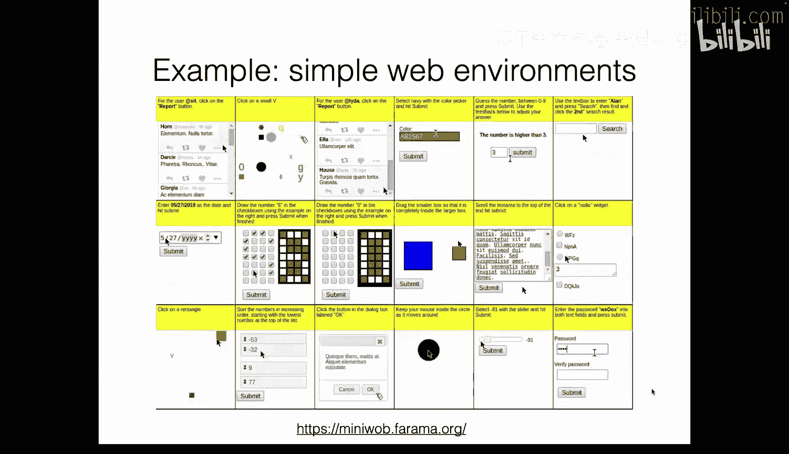

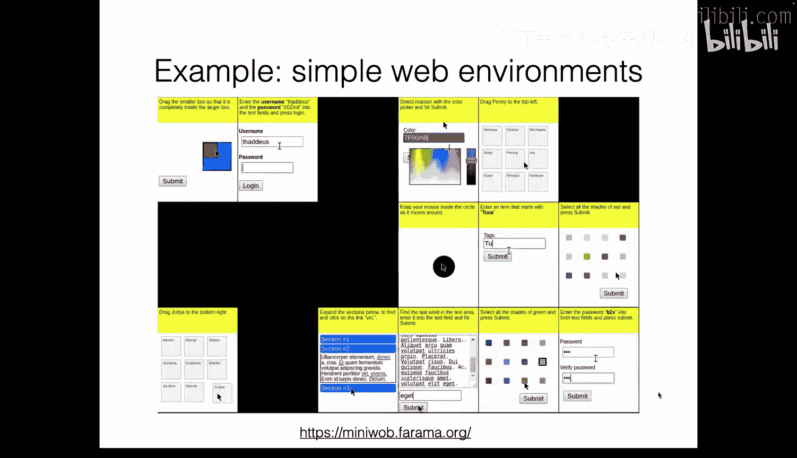

And each one of them is essentially a very simple web page。So。Like up here。

 you have some web page and it's very small， but up here， you have the kind of goal of the task。

And then the agent has to kind of point and click， or sometimes it has to type in things。

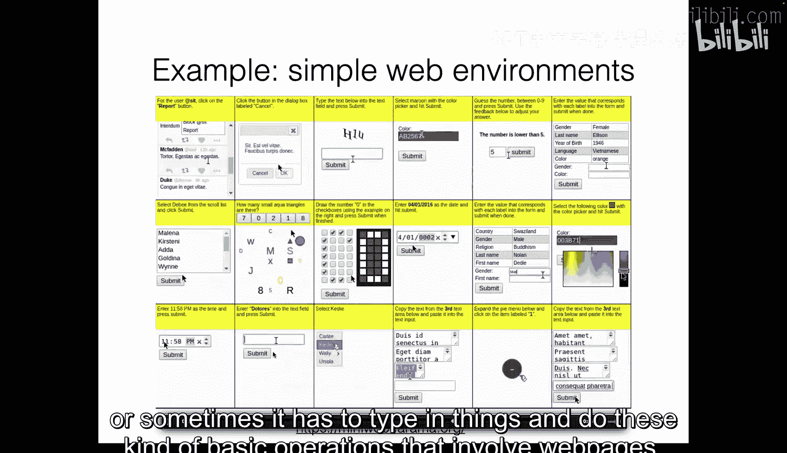

And do these kind of basic operations that involve web pages。

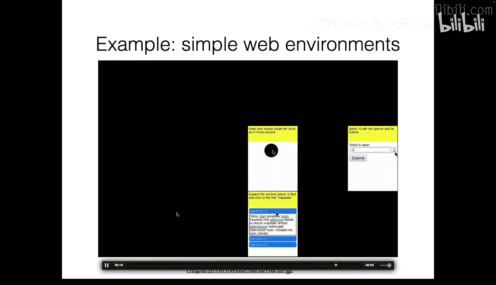

So if we look at one really simple example of this。Then。One task is called this click environment。

And you can see here that。The task description is indicated up here is text。

 so it says click button one。And really， this is actually a kind of simple web page。

 it's literally HTML and it's running in a browser。

And now your task is to click the indicated button。And。I didn't put the details of the reward here。

 but basically the reward is。You get a higher reward， the faster you perform the task。

 So if you take a long time to click the button， then you get a lower reward。

And if you like never finish， there's a timeout， I think， 10 seconds。Then you kind of fail the task。

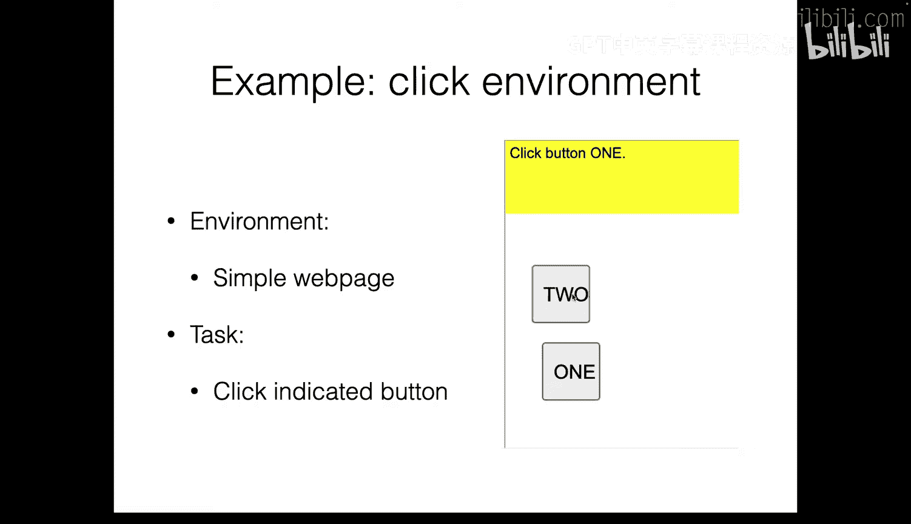

And so you can actually get this exact environment through this library。

And so I wanted to just show you that this is very similar to what we were talking about with reinforcement learning。

So here we have the environment， it's called Min ws。

 so Wab Santa World of bits was the name of the project。嗯。

And then you could basically get the observation。You can have some agent。

 which takes in the observation。Here it's also taking in the environment just so that it can get things like the size of the screen and things like that。

It gives you an action。And then you provide it to the environment and it gives you some new observation。

 it could give you a reward， it could tell you whether it's terminated or not。

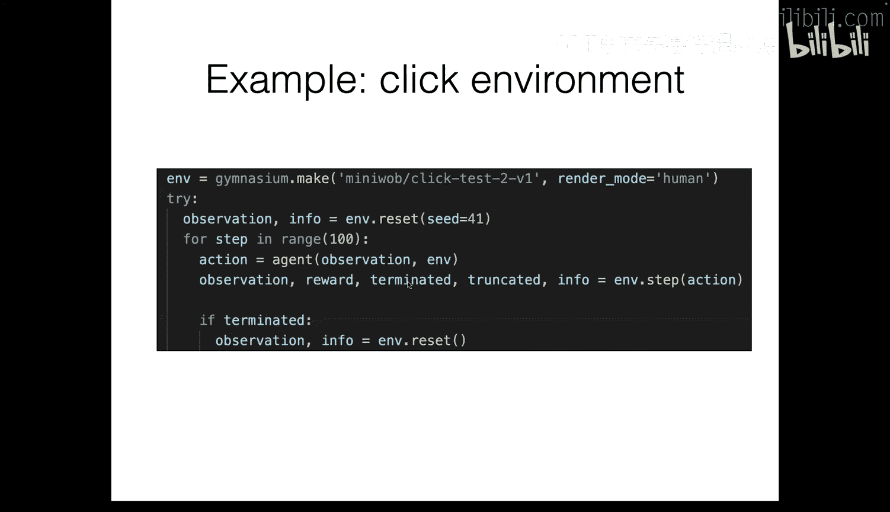

So。

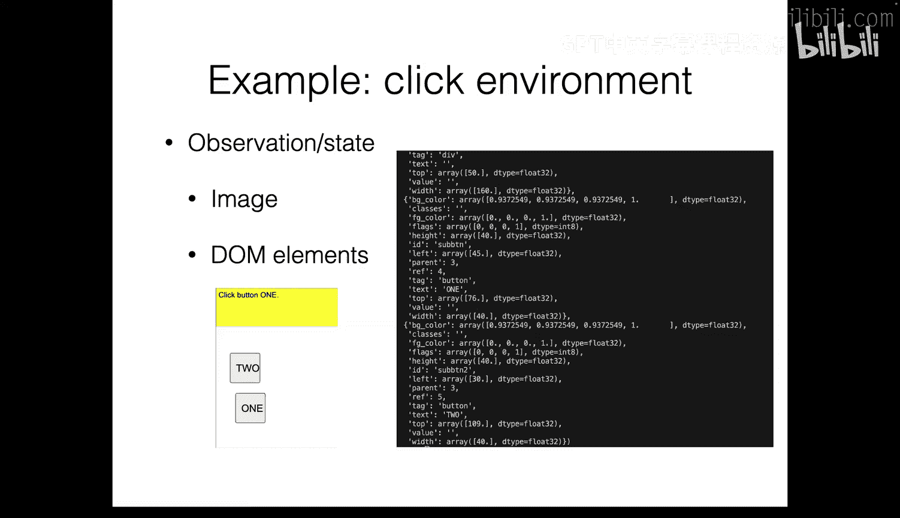

Before I tell you about agents and give some examples of the agents。

 let's look like very concretely at what these different parts are。

 And I want to just jump right into this concrete example， because。Yeah。

 this idea of an agent and things like that， it can seem very。Mysterious。

 but if we just look at an example， hopefully I can convince you it's at least conceptually kind of simple。

So for the observation here， you basically have two different options。

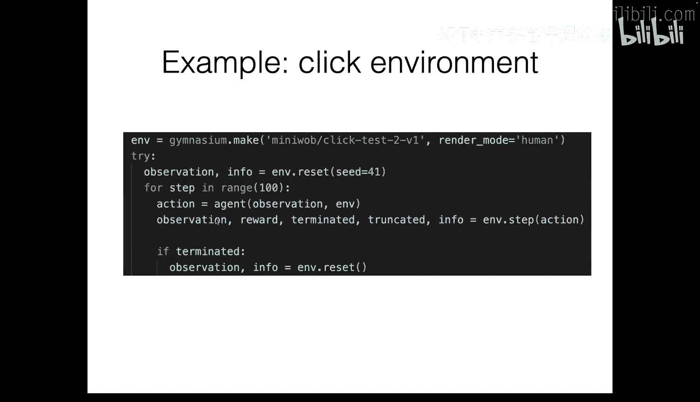

So one option is to actually take in this。Scrreeen as an image。And the environment will give you。

 will give you that。The other option is to represent everything is text。

So this basically takes the structure of the HTML and then it gives it to you as this kind of。

Dump of JO。And so you could see here， for instance， that like。

Over here we have the button and it says text one。嗯。Over here we have a button which is text too。

And so you can imagine like performing this task actually without even looking at the image and just using this as your observation。

嗯。And then the actions are determined by how the environment is implemented。Because， you know。

 the environment is just this computer program。 And so you you have to decide which actions are supported。

So here's the full list that are supported for these world of bits environments。So for example。

 you can like move the mouse to a given position。This one is very relevant for this task。

 so there's literally an action which is like click element and then some reference。

So if we go back here。We can see that this reference is four。So to solve this task。

 all the agent has to do is basically output an action that says click El。For in this case。

So that's the notion of observation and action for these environments。

And so now let's think about like， what are some agents that we could build to you know。

 solve tasks in these environments？

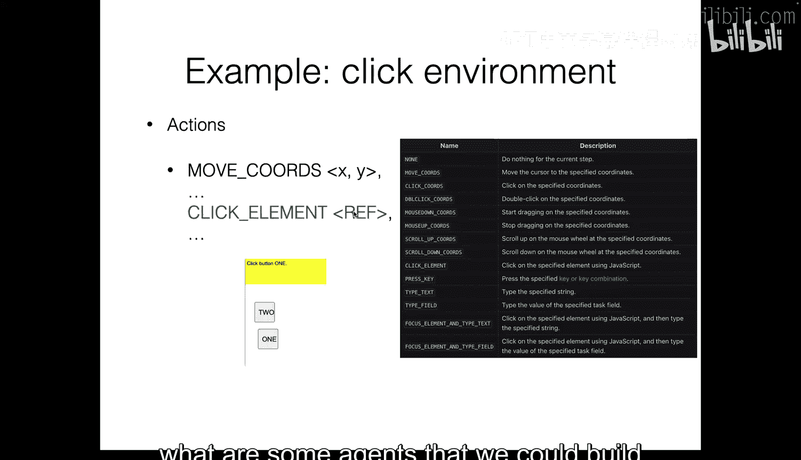

Well， I defined an agent as just being some policy。So if we really wanted。

 we could just hard code our own agent to solve this environment。

So we can look at the JSON and look for the element that has text one。Then we can get its reference。

 and then we could just output the action。Click element。Rough。And this would solve this environment。

So if you really want to do this， there's an implementation of it in the。In the code repository。

And here's， you， taking the observation and then here's creating the action。

And you have some extra code to actually like， make sure the action is。

Formatted correctly and all that。

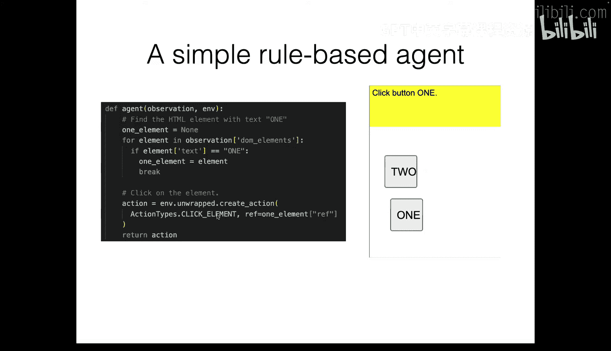

So we can take a look at this and。

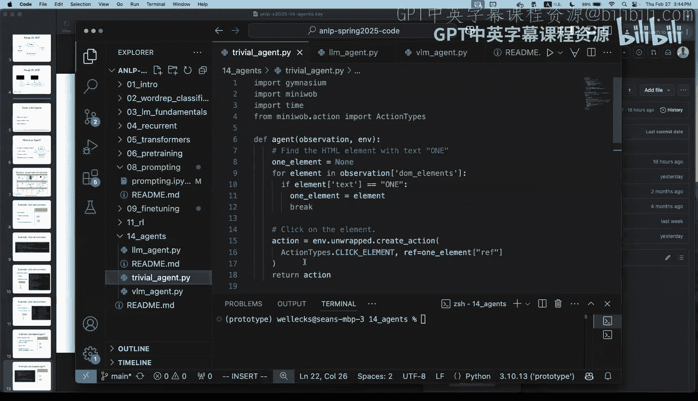

It's called here a trivial agent。And you basically have what I showed you before and then you can。

call it。And there it is。 And so here it's showing where it clicked and you can see that it's。

Clicking it and it's solving the task。So no language models， no machine learning needed。

 we actually have an agent that can do this web task。

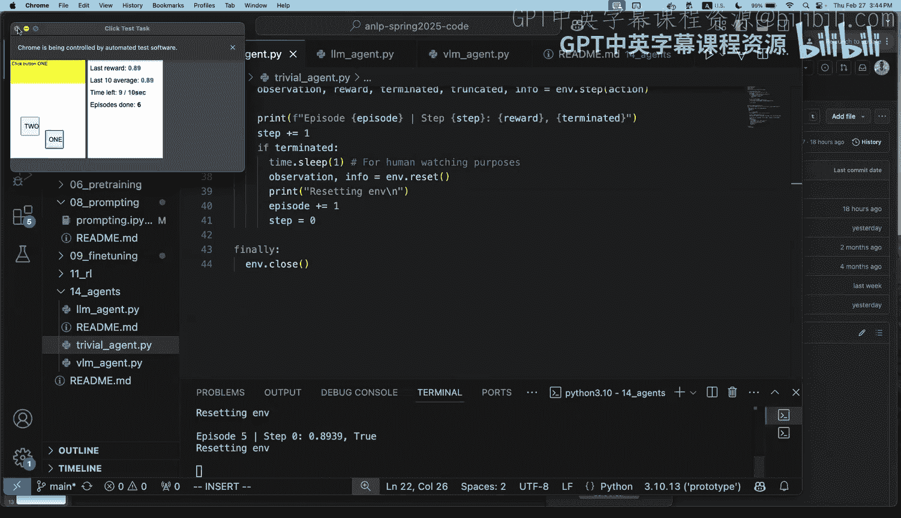

But of course， like。

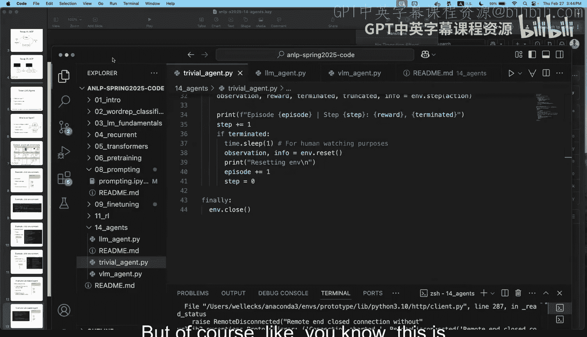

You know， this is not a very general purpose agent。It only works for this very one narrow task。

And so we want to somehow come up with a system for making agents that are more flexible so that we don't have to redesign agents for every task。

So one way to do that is to incorporate a language model into the agent。So again。

 an agent is just something that goes from a state to ina。

And then we can actually use a language model， you know， to。Produce the actions given the state。

And so this is what's called a language model agent or LOM agent。

 It's one that incorporates a language model kind of。In the process of determining actions。

So what would this look like？Well， if you don't want to train the model， then you have to prompt it。

So here's the full picture， you again have your environment。And now since it's just a text model。

 we represent the page as this kind of JO that I showed you before。

And then we have a prompt and it's kind of small， it says like。I mean， it's just one that I wrote。

 you are on a web page， here are your available actions and you describe the different actions。

You see the following elements as the observation。And then task， here is your task。

And the environment actually can give you this text here as。As text。

 and so you can just put that into the prompt。And now you could just call a language model and this one's calling a Gemini through the API。

And then you could get some output。And then you could say like， okay。

 if the language model output click element。Then， you get the。The element number。

 and you make an action。Okay， so this is like this this is a language model agent。And surprisingly。

 this is kind of similar， it's representative of the architecture that a lot of people use in most agent tests today with language models。

Of course， they're going to get kind of more complex， but the idea is。Yeah。

 you can represent things as text and then have your language model take these actions。

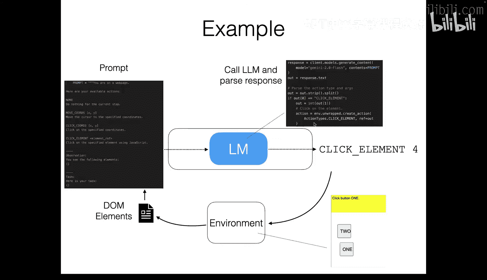

So here again， you can。You could take a look at this， it's in the course page。

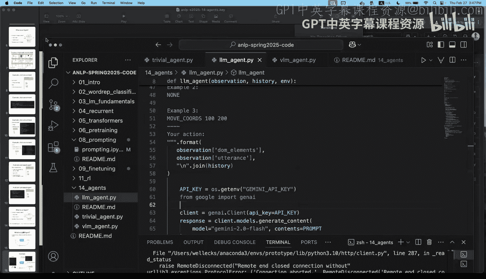

And。嗯。For this one， I actually use a more difficult environment because the other one it can do pretty trivially。

So let's take a look at this one。嗯。So this one's really small， but。

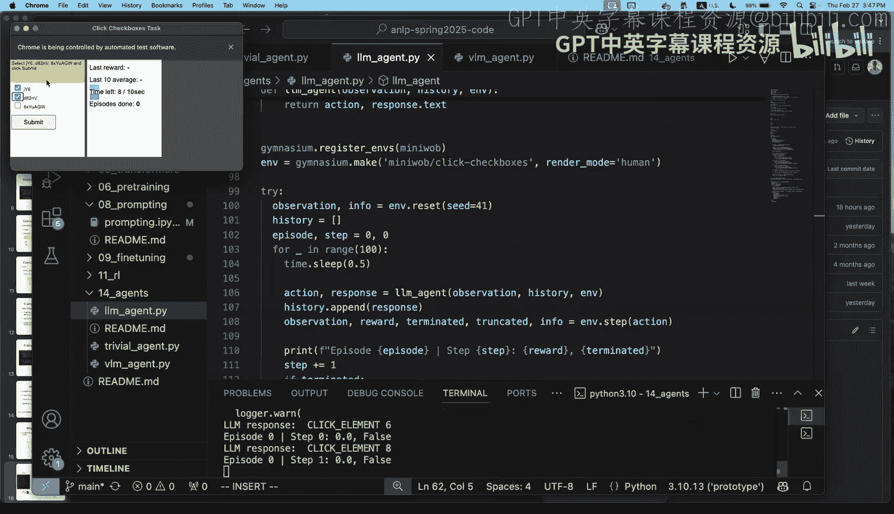

Basically， okay， it's really small。

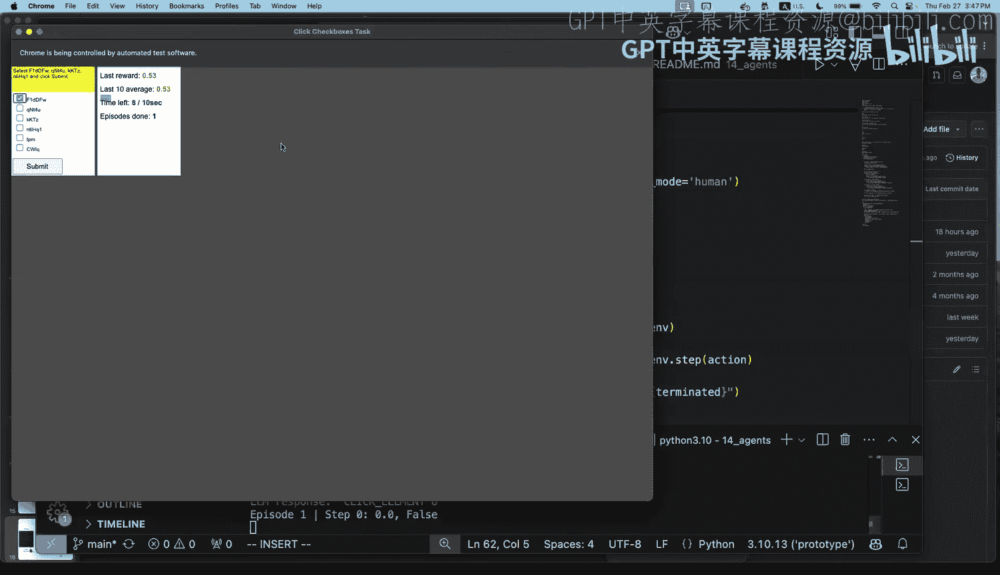

Yeah。😊，Yeah， okay， so this one it tells you these different boxes that you have to click and then you have to press submit。

And so this is actually running this Gemini agent。And it's able to， yeah。

 basically click the boxes correctly。And then， press themimate。And so here you can see。

Oh what it's clicking。And again， this one is a language model or text only agent。

 So it's doing this using the。JaSson representation。And then down here。

 you can see the different rewards that it's getting。嗯。So。Yeah。

 you have like a two step trajectory and then at the end it gets this reward when it finishes。So。

That's the basic idea。

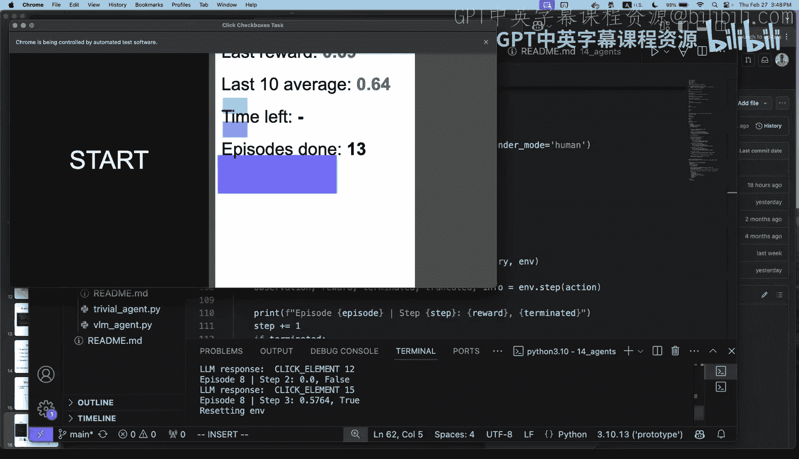

Does anyone have any questions。

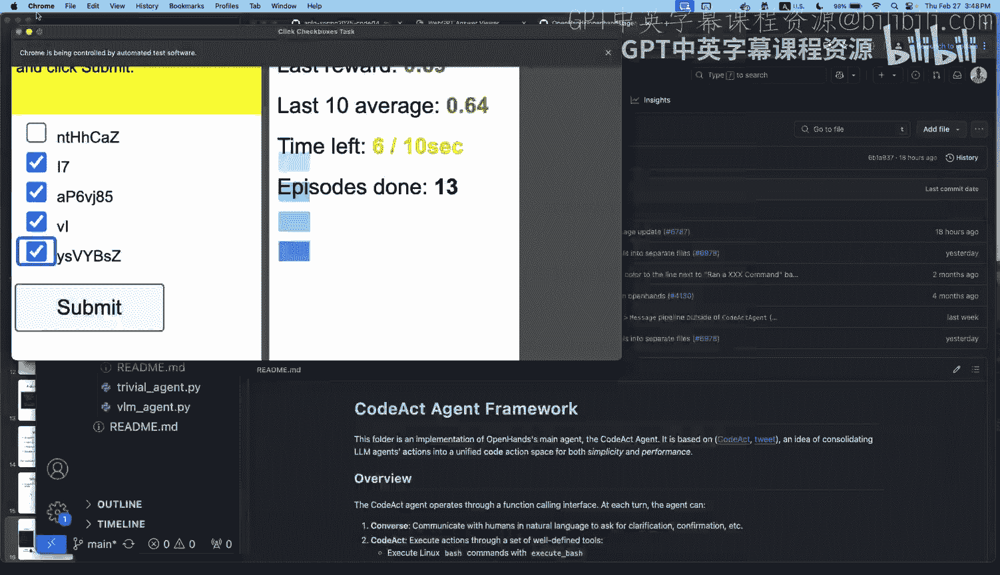

About。This so far， that oops。Okay， cool。 So then there's one more type of。

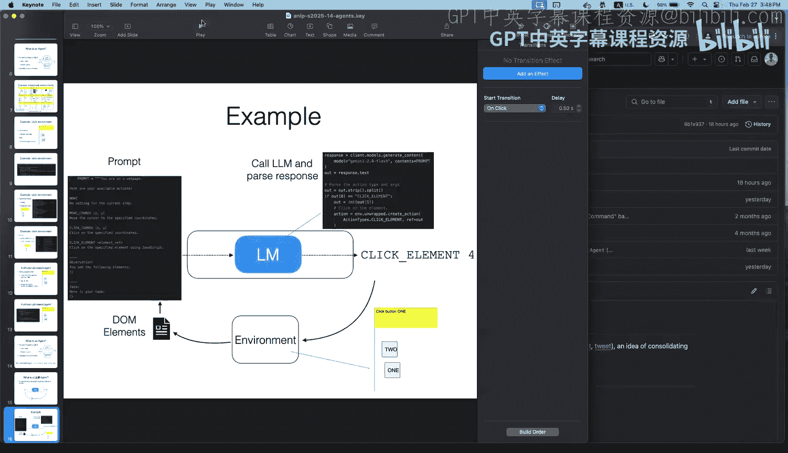

Of agent that we can look at， which is called a vision language model agent。And again。

 the idea here is simple。 so instead of having just a normal language model here。

 we have some way of taking in images as the observation。

And so we'll actually have a whole course on these multimodal models。嗯。Well， we have a whole lecture。

 there actually is a whole course that CM me if you want， but we'll have a later lecture on these。

But the basic idea is， you know， you could come up with some way of giving the image to your language model。

And so now you don't。Necessarily need to use this Json representation。

 Now we can just take in the image。 And you can see here it it uses different types of actions。 Now。

 it actually has to click the coordinates。That corresponds to the box。

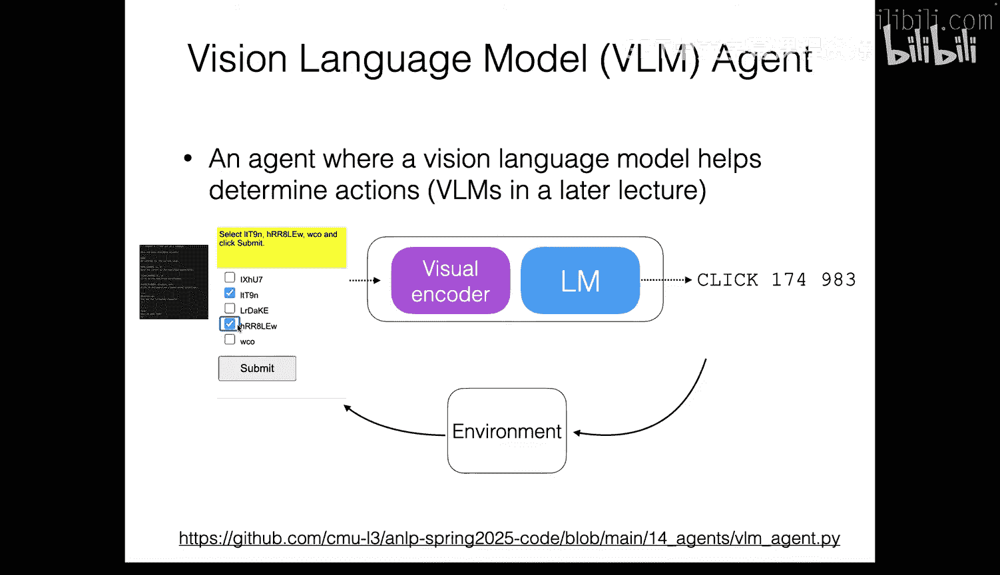

So again。You can try doing this with Gemini。So again， we have a prompt。And。Yeah。

 now we tell it about the clicking the coordinates actions。嗯。

And then here's where it's calling Gemini。And Gemini has a way of you could just provide it with an image。

So now we're using the images instead of the。

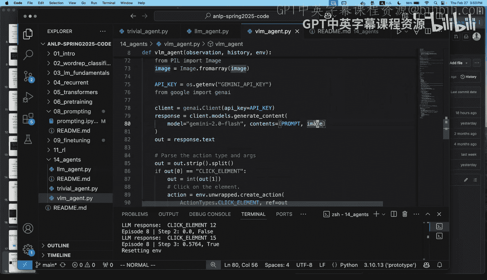

Jason representation。So let's look at how this one does。

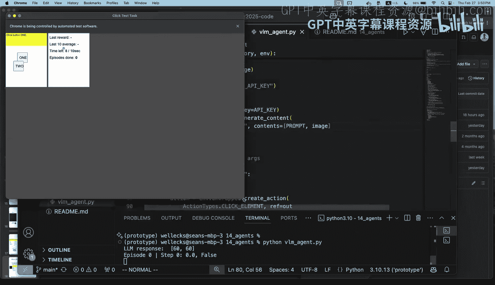

Yeah， so this one。I have to just use the simple environment。And it looks like it's still pretty bad。

嗯。Okay， so it got at that time， but yeah， so over here you can see where it's trying to click。

And the vision model is also slower。 So sometimes the。The Acologist takes you long。But anyways。

 if you play around with this afterwards， you'll notice that the model is actually。Yeah。

 kind of unreliable at just like clicking in the right place。 See here。

 it's like clicking slightly off of the box。So anyways。

 there's these trade offs to like operating on images versus operating on text。嗯。

A the coordinates like found does the visual encoder give the coordinates or does the LM Yeah so that's a good question。

 So yeah， I think part of the difficulty is that the model has to map these like you know continuous coordinates onto onto the image So the way it's done here is up here we we give the model the screen width and the screen height。

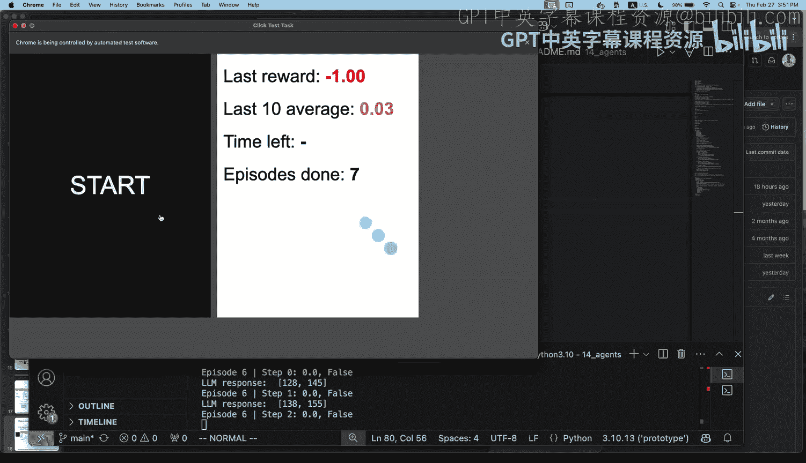

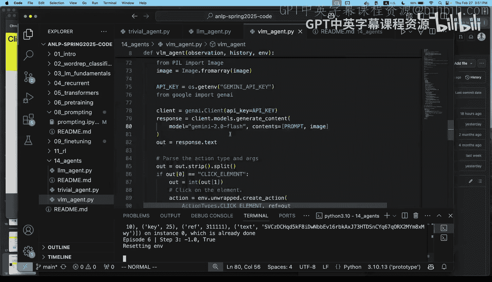

So then it could kind of reason and say like， okay， you know。

 the middle of the image is the height divided by two and things like that and then just outputs numbers。

有。But this is an issue that we'll talk about later for like the web agents。

 they're also not very good at this， so at least for now people use yes something else called set of marks that I'll talk about。

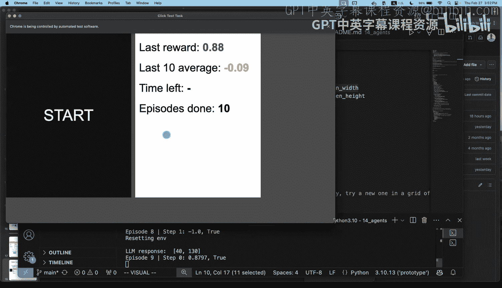

🤧嗯嗯。

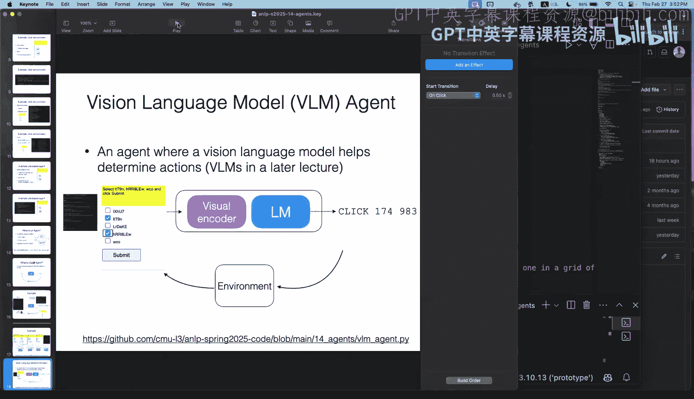

Okay， cool， so that's a vision language model agent。And so。嗯。This one。

This is a kind of emerging category， and in some sense， it is a vision language model agent。

But I'll give some examples later， where。You could imagine that like， okay。

 what if the agent was so general？That you could give it anything involved in using a computer。

 like just a screenshot of of any application。And then your actions are also so general purpose that they're not specific to a given environment。

So there are things like clicking， They're things like typing。

Then this you might call a computer use agent。Where the agent's observation space and action space can potentially work for anything involved with a computer。

And then at least， yeah， right now， typically you'll try to implement these with。

A visions language model in the loop。So I'll go over some examples of those later。And so to recap。

 we saw these three kinds of agents。Language model agents。

Assuming the language model doesn't take in， then those are kind of a type of text agent。

Visual agents and then computer use agents。Which if you want， they could be text agents or visual。

 typically they're visual because they might take in like the screenshot of the computer。Okay。

 and so recently there's been a lot of interest in agents and apparently particularly this year。

 there's going to be a lot of。Excitement， so it's a good time to take this course。

Here's a quote from the NVDO CEO。And anyway， some like。Areas。That。Are of interest here。

 and I'm not saying these are the only areas there're just a few of them。

One is for software engineering and so we'll see some examples of software engineering agents that maybe you could say like here's a GitHub PR。

 can you close it？Other ones that are becoming popular are for research。

 like compile a research report on how the AI industry has changed in the last four months。

And we'll see an example of how you could frame something similar to this as a kind of agent task with an environment。

And then these web agents， so instead of using the Toy website like I showed you。

What if you had an agent operating on the actual internet， then maybe it can， if you really trust it。

 it can buy things for you and send mail and things like that。

So the next two parts are going to go over。Environments and then some patterns。

Let me just pause here， does anyone have any questions or discussion points？E 25 was0 to patients。嗯。

😊，There's a lot of people working on it。Yeah。😊，But we'll see some examples。I mean， they can。

They have hints of doing non trivial things， so I think that's why there's excitement about it because。

Yeah， it's still at a kind of turning point and anytime something's at a turning point， it could go。

A variety of ways。嗯哼。😊，The are are the kind of the main challenges that Web agents are facing。Yeah。

 so I can maybe just like bring some of those up as we're going through the examples， yeah。

That's a good question now。Okay。So here I want to just go through three different types of environments。

 so text， visual and computer use agents。So for text environments。

One common pattern is to kind of create a text environment that's specific to a particular domain。

And as an example to see what I mean by that， we could consider。

 let's say you want to build a software engineering agent。Then by engineering environment。

 we mean you have to pick what are your actions that the agent will take。

So it could be like search a repository， execute code。Edit a file， things like that。

And then you basically have to build an environment that can implement these different actions if your agent was to call them。

So you actually have to like。You know， have some code that searches through a repository and then gives the results to the agent。

嗯。And so。As an example like。Here we could say。Let's say we want to find out how many commits from。

This person to this repository Lm lean。Then here the agent or the language model。

Could output this code。 And you could see it's wrapped in this kind of like。Identifier。

And this basically says that this is some action that the environment should take care of。

And so then your environment would actually execute this code and return output the output to the agent。

And then the agent would go to the next step and maybe it says like。

Read output and the number of commits there or something like that。

So that's the basic idea and this basic idea is like behind a lot of the work right now on these software engineering agents。

So let's take a look at some actual examples。So here's one， which is called SuI Age。

And then any agent has to operate in some environment， as I mentioned。

So this environment has this thing here and they have this fancy term called agent computer interface。

And it's basically what are the different actions that are available to the agent？

Here they're actually running the actions on a computer。

And then they have to format the outputs to give back to the agent。So in this case。

 the agent would take in the action outputs， the task instruction。And it has things like open a path。

 go to a line number， search a file， and so on。And so if you haven't seen this before。

And I apologize。I guess it's a bit small， but I can still talk through it。

So the task that they were interested in here is like closing poll requests。

So here we have our GitHub issues。So here we have an issue for some repository。

And it has the text of the issue。And。Then you give it to the agent。

And then their agent does some kind of chain of thought here。

 and then you can see at the bottom it's outputting its action and the action is find file sessions high。

Then you give that to the environment。And the environment will kind of。

Show you sessions stop high and it's been formatted in a nice way。So that's really the basic idea of。

A lot of these different software engineering environments for agents。嗯。And you could imagine that。

 like。Maybe for different languages or for different types of code。

 you actually have to build new actions to support different functionality。So for example。

 let's say that。We wanted to search for。methodethod inside of a class。Well。

 then like we have to provide that as a kind of action for the agent to take。

Or let's say we wanted to use a。What would this be decompilr or debugger？

Then you can add in these actions so that the agent can， you know。

 call a debugger or call the decompilr， things like that。

So how is the agent or policy actually updated based on？How does it change？有。Yeah。

 so here I'm just going into the kind of basics， so I actually don't really talk about training。

But the idea is。Yeah， so here I'll talk about models that are just prompted。And then the idea。

 though， is that if you have rewards， then you could， in principle。

 apply the different techniques that we've looked at in the class。So for example。

 you could have some trajectory and it ends in a positive reward and you can like save that and then do fine tuning on it。

Or you could use a reinforcement learning algorithm。And yeah。

 these are things that people are like actively figuring out right now。

Since an agent uses language model internally， what is exactly the prompt that goes to that language model？

Yeah， so we'll see that later on when we talk about the agent patterns。Well we'll take a look。

 but yeah， just at a high level， you give some instruction like you are a software engineering agent。

 you are really good at software engineering， then you describe the different actions。

So I did that in the simple agent that I showed you。You basically describe like， okay。

 you have access to the search class method。 Here's how you call it。 Here's a few examples。

Then you say when you output an action， you know， format it in this way。

 and then that's that's basically the essence of it。嗯。Yeah。

 I apologize I guess for these slides I put a lot of information。

 but let me just talk through this one， so this one's pretty interesting and it's from a few years ago from Open AI and it's called web GPT。

So although this one isn't doing research like I was telling you about before。

The idea is maybe somewhat similar。Here they're trying to answer questions。

Why did we decide that certain words were bad and shouldn't be used in social settings。

And then the idea is， they want to give the。Agent or the model。

Access to this environment that has like a search engine that lets you click on links。

That lets you quote different sources。And so the idea is it can go search。

 it can go collect information from different web pages。And then at the end， it can say， okay。

 I'm done。 I'm ready to。Move into the answering phase and produce my answer with the information that I've collected。

So yeah， this was called web GPPT。And they actually have this。

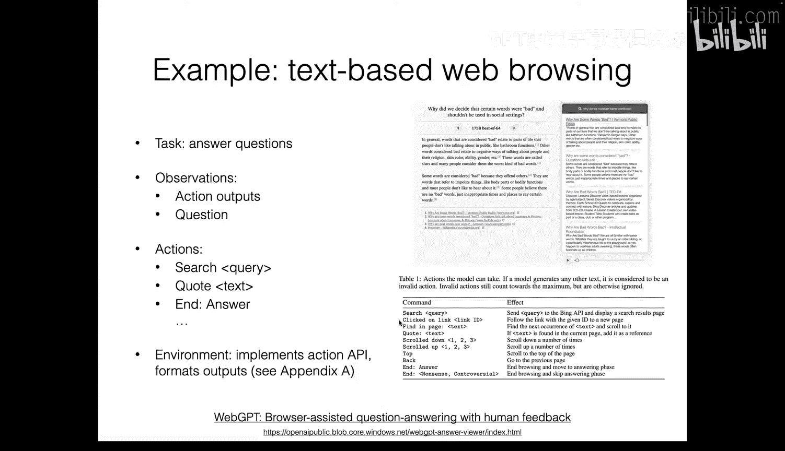

If you want to take a look at this， they have this nice answer viewer。So here's the question。

And here's the answer。And then on the right here， the cool thing is they actually show the trajectory that the agent took to get to the answer。

嗯。So where's the starting？Yeah。So here it like does some search and then it clicks on on this page。

 now it's looking at the page。Now it like saves this。Okay， now it's doing some more web search。

And so it's this kind of trajectory and then eventually at the end it'll say， okay。

 I'm ready to answer and then it produces this answer here。So yeah。

 kind of kind of cool idea I obviously don't know what they're using。

 but now Open eye has this problem。This product called deep Research。

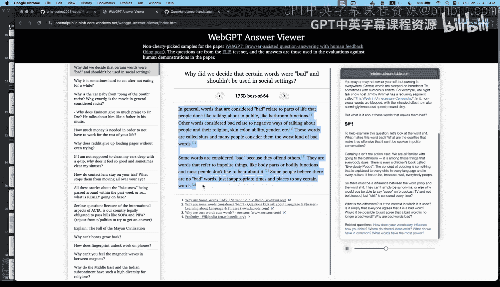

And it'll go and find like different citations and then compile some research report for you。

So potentially some of the ideas here are relevant to that。嗯。Okay， so。

Another thing you could do is web shopping。Here again， we're not considering the vision agents yet。

 but as we saw before， you can try to represent the webage as just text。

So this was a paper called Webshop that was really popular。And they do exactly that。 So basically。

 their environment simulates some e-commerce website。

And then they have different taskss that you can perform。Like， I'm looking for a small。

Folding desk that is fully assembled。It should have a khaki wood finish and priced lower than $140。

And then the model has this kind of specialized action space。You can see that it's kind of。Yeah。

 specific to their environment， you know， it has like choose product title。

And then the agent can go and try to perform different actions to fulfill the task。

Now something I've been forgetting to put up here is the reward。

 and so you also have to determine like how you evaluate whether the tasks are complete or not。

And so each environment has to think about that。I forgot exactly what they do here but you could imagine that like since they built the environment themselves。

 they have some way of。Looking whether the correct thing was purchased。And then if it was。

 that'll give you a positive reward。If it wasn't， then you get a negative reward。So。嗯。Yeah。

 so these are the tax environments。Can anyone think of like pros and cons。

 at least from the environments that I've？Told you about。好的嗯。啊。

SometimesBecause't how it chooses to website folks like website I think， yeah， that's a good point。

It has like。If it has if it has。Too few constraints。 Then， yeah， it could go to。

Other websites just compile information and come with some reporting。It's kind of， yeah。

 not good for a human。嗯哼。😊，I think like this exposes it to a lot of prompt injection vulnerability。

 like there could be some malicious sites and you em buried something over there。

When the agent copy paste artist reference to the particular site。

 maybe maybe some very malicious prom injection happens， maybe there sort of。

For getting going on that there could be a lot of。Yeah， yeah。So in some sense。

 there's similar flavor where， yeah， the agent could encounter bad information or could encounter。

 yeah， some malicious information。And so there's kind of new angles of。

Safety or security with these web agents， yeah。嗯。😊，嗯哼。😊。

Are we initiating an evidence call or what is the difference between when am I getting promote like what action am I thinking and is it based on an relevant call or the policy that's？

MYeah。Yeah， so the the policy will be some mapping between the observation and the action。

And so in their case， the observation， I think， is like the history of。The actions so far。

 so you start out with just the question， then maybe you've clicked on a web page and then it saves like one link and all of this just gets like built built up。

And then at each given time， yeah， you're giving all of this information to a language model and then the language model is outputting some action that will be taken next。

So the， the policy is。Taking the action， yeah， and then the way that the policy is implemented is to call and L to get the action。

 yeah。Yeah， so policy is kind of。Conceptual abstract thing。

 And then the LLM is like how you're achieving the policy。Does that make sense。But in a gender。

As policy for every possible state。And you could know what action you could take at any given。

But in this case， because we haven an other them and we're passing in the context of all our previous interactions。

 there's no way of。黄志贵开烧嗯哼。Yeah， I guess here the state space is just so large。

 it's like you know all possible strings of text， so yeah。

 you have to just give it to the language model and then it gives you some distribution。

Now sometimes you can be in a state， though。And you know that certain actions are not valid from it。

So a good example is like。嗯。Well， let's， let's look here。嗯。So maybe right when you start the episode。

This previous action doesn't is meaningless， so if you really want。

 you could like mask that action out or retry if it generates that action， yeah。

Your further question of info problems。That is at a lot of websites。

arere created to be like understood by humans and we're understanding by looking at it and it's all visual so if you get like the dom or just like the HTML it might not。

I could give you the same type of information and it might be much。

 much harder for them to interact with the website with that。Yeah， yeah。Yeah， yeah， exactly。

 So there's this choice you have to make of like， do you represent everything as text， Do images。

 Do you have some mixture of the two？ And yeah， it's not clear。What is best。 And yeah。

 certainly in some cases， it seems like。Since the webage was designed。To be represented as an image。

 it might just be easier to have the model interact with the images。嗯。So yeah。

 that's a great question and it'll lead into the second part。Okay， and then yeah。

 another thing to be aware of is that sometimes the environments can be。Specific， again。

 to a certain domain。So like here， if you train a really good model for this web shop environment。

Then it might be really good at webshop but。You can't really use it for anything else。So yeah。

 another thing you have to be careful of is how you actually design the environment so it's kind of expressive enough。

If you're trying to build a general purpose agent。Okay。

 so let's go to the visual agent environments and so here we just provide image observations as well。

So as we saw before， you can do this web browsing， and this is exactly what I showed before with this mini。

World of bits。And yeah， it was from 2017。Of course， here。This environment lets you also have the。

Dm the text based representation。Or you could treat it as a visual task。嗯。

Here's one with more realistic websites。So this is called Viual web arena。

And it's actually from people here at CMU。And。This。

 you could think of as being a super set of that web shop environment that I showed you before。

 so they have their own shopping。Cite here， they also have their own version of Reddit。

And these like classified ads， like if you' have ever been on the website， Craigslist。And basically。

 they build。An environment that simulates these websites。

 I think using like some open source version of them。Um， and then， yeah。

 you could come up with this action space， which is like click an element。

Type in a text box or something。Close the tab， things like that。 And so this action space is kind of。

It's fairly general， but yeah， it's also specialized to the web navigation。

And then you could perform these different tasks like。

Help me make a post selling this item and navigate to it。

Price it at $10 cheaper than the most similar item on the site。

And then here you could see them visualizing like giving it to the agent and the agent outputs some click action。

 and then you would go to the。The environment would actually perform the click and then your agent gets a new web page。

So again， you have to think about how you evaluate reward， so for each one of these tasks。

 if I'm remembering correctly。Humans might have created the tasks。

 and then they also specify some function that you can run to like check the reward。U and so yeah。

 in all of these cases， it could be a kind of multiple step task。

 and then you get roared at the end if you succeed。So。Yeah， that's all I had for the， for the visual。

Environments。And I'll actually in the agent part， talk about。

Some challenges related to like perceiving the visual page。Yeah。

 so I'll talk about that that briefly。And then finally， computer use。 So I mentioned this idea of。

Just having something that could not only do web browsing， but just anything on the computer。

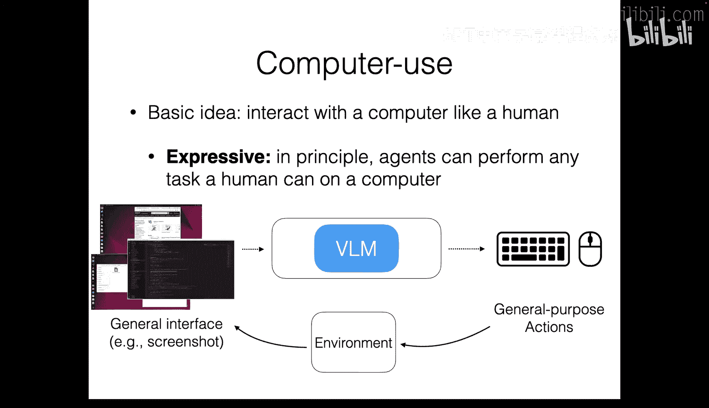

嗯。So here's one recently called OS World。

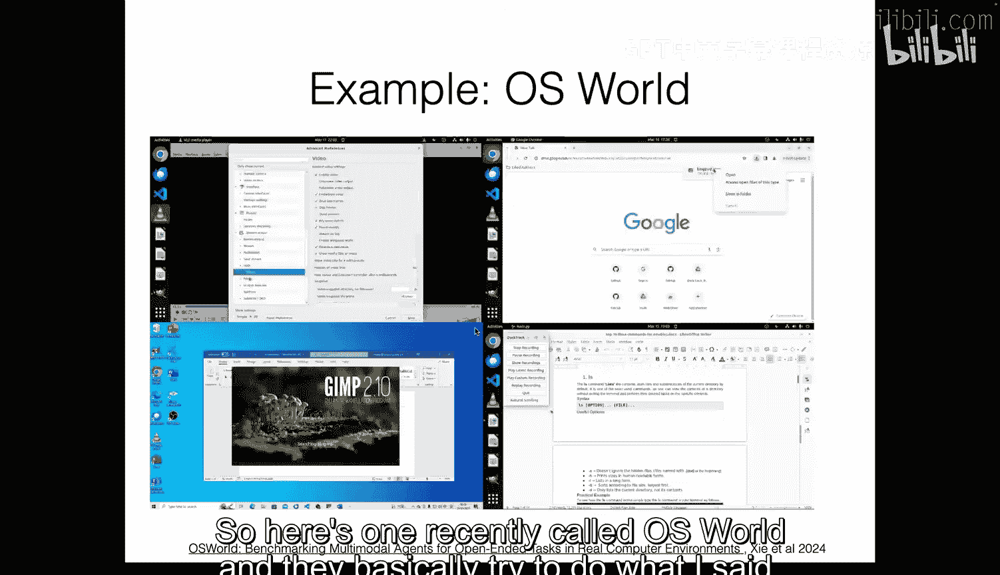

And they basically try to do what I said， so the environment now is just an operating system。

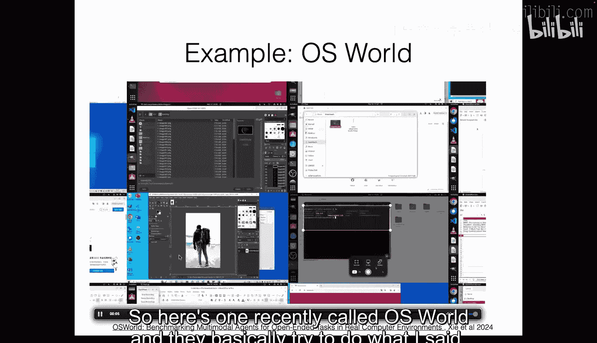

And so in principle， you could do kind of any。

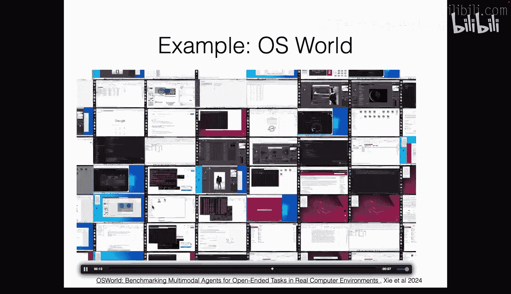

You could at least perform any task on the operating system。That， you know， a human code。

And then you obviously have to come up with some way of giving rewards and kind of make it into a self contained task。

So here's some examples。So on the top here， this one， the instruction is。

Update the book Keeping She with my recent transactions over the past few days in the provided folder。

嗯。And so here it opens up the spreadsheet。It looks at some received and then it starts filling out the spreadsheet。

And then over here it's。It's like adjusting this code in VS code。

And then you could see here that they basically engineered this environment where， yeah。

 you have an operating system， you have multiple apps running。And then again。

 they have to come up with these tasks。 And then they have some way of。Basically。

 the agent says I'm finished and then they run a script and it tries to check whether the task has been completed or not。

And then that will give them some reward。好。嗯就是。Yeah， so here a lot of these are still just prompting。

So。So it's kind of seeing like the feasibility with the prompted model。And then yeah。

 more recently and I think one thing a lot of people are working on is to train the agents specifically for。

Environmentss like us。嗯。

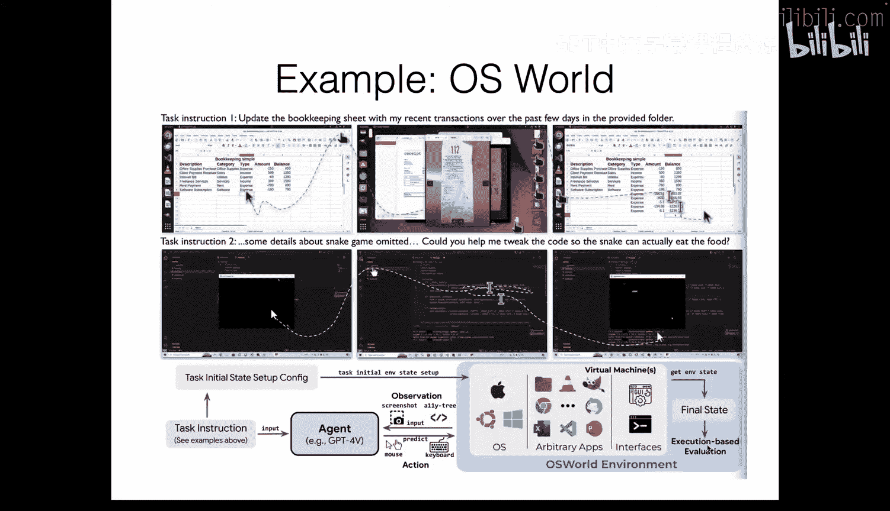

So yeah， here again， the observation is either a screenshot or an accessibility tree， they say。

So they have some results which show like which ones better。 what what are the trade offs。嗯。

And then here they have this extremely kind of expressive action space。

Of just clicking or typing on the keyboard。So then recently， well。

 we actually just released this yesterday， but this is work from our group。

So we are interested in these computer use agents， but then like specifically for software engineering。

So basically what we did is built an environment， which is VS code。

And then you could have a text based agent which gets kind of like makes tool calls and gets tool outputs。

But then the agent could also just go。Like screenshots of VS code。And so the potential benefit is。

 if you imagine in VS code， there's been all of this tooling implemented inside of VS code。

So like if you want to use a debugger， then all you have to do is like click on the debugger。

 things like that， if you want to do code search， then yeah you can use like command F or something like that。

And so the idea is maybe you can keep your agent fairly simple and expressive。

 but then perform all of these different software engineering tasks。And so again， to evaluate。

 you have to kind of specify task and then the agent has an action which says like， okay。

 this task is finished， now I'm going to run the evaluation and get a reward。嗯。

So that's all I have for the environments。Hopefully this gives you some picture of some common environments。

And again， these are ones that are。Trying to incorporate language models and agents is a very general idea。

 so these obviously aren't the only ones。Any questions here before I move on to the actual agents themselves instead of the environments？

ok。So here， like I said， I was just putting kind of bare bones， things to introduce。So first。

 I want to just talk a bit about。Prompting a model to be an agent and actually show you in。You know。

 a lot of detail how。One agent does this called Open Hand。

 it was developed by Graham Newb and others。嗯。Then I'll talk briefly about representing the screenshots and one technique that is popular now。

And then I'll talk about a computer use agent that's been trained by the company Anthropic。And。Yeah。

 give you a bit of details about。嗯。Not how they train it， we don't know that。

 but I just show you exactly what it gives you。

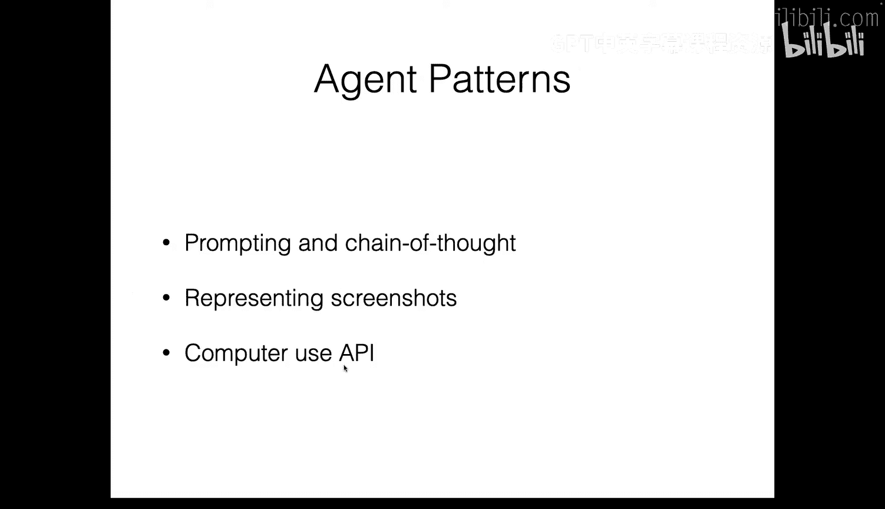

So here to the prompt the model， you have kind of three main things。So first。

 you again have this notion of a system prompt that we talked about in the prompting lecture。嗯。

And so this will just describe the task， it'll say， you know you are an agent。

This one says you are an open hands agent。And then they have some like important information like。

If user provides a path， you should not assume it's relative to the current working directory。

Instead， you should explore the file system to find the file before working on it。

And so sometimes this one's actually fairly short because they wanted to keep this agent very general。

But you can actually influence the behavior a lot through the system prompt。

One technique that's used is to basically。For this task of closing the poll requests。

You could actually say like， okay， break down the problem into localizing the error。

 then running the test cases， then making a fix。And so by kind of putting that in the prompt。

 you're in some sense like telling the model。You're giving it a hint on how to solve the problem。

Here again， they wanted to try to keep it。Kind of general。

嗯。And maybe I should give you a reminder here so in the very first lecture。

 I she this open hand system。

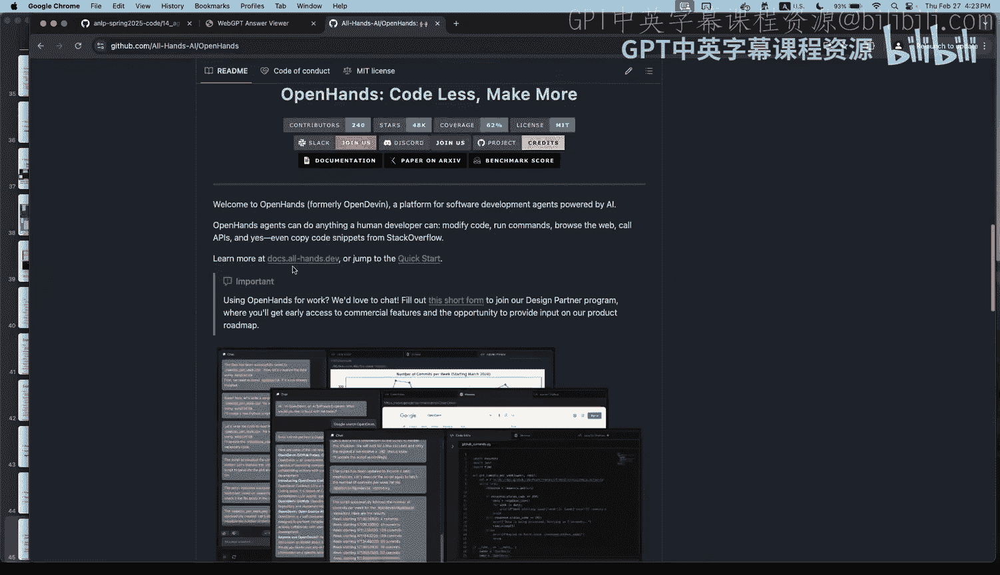

And the basic idea is， yeah， you have this kind of IDE。

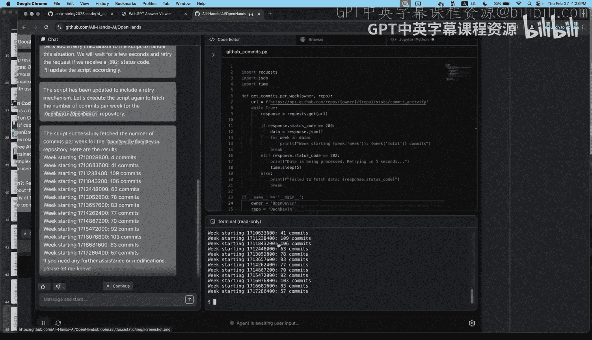

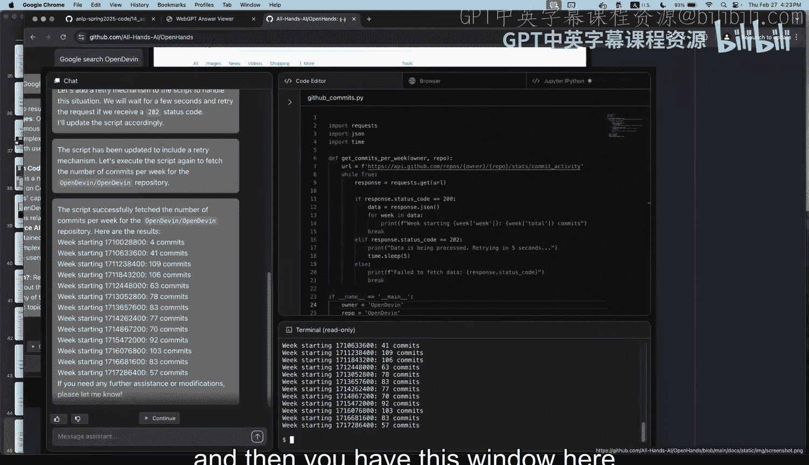

And then you have this。windowdow here where you can put in different things。

 and then this goes to a language model or to the agent。

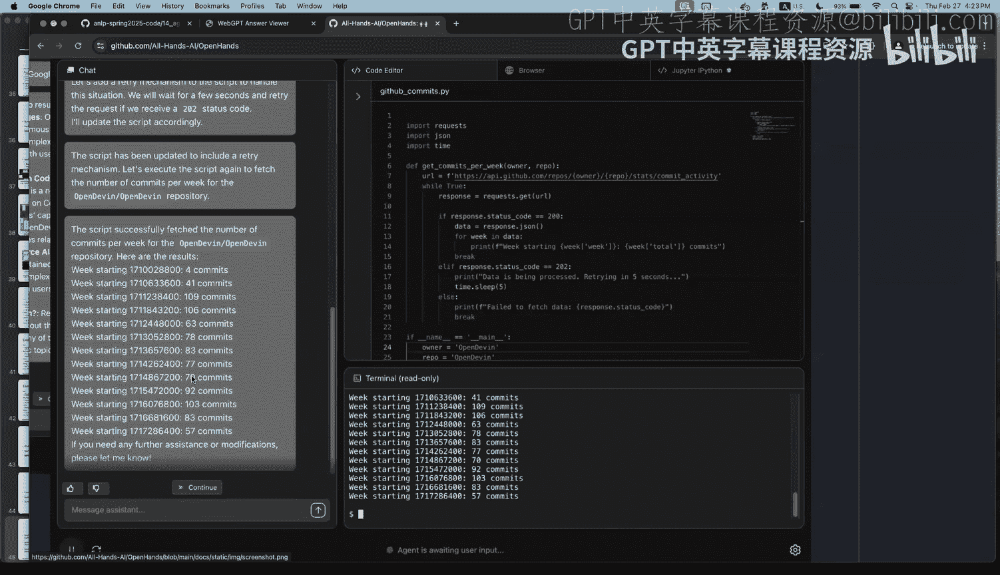

And so。Here we say like， let's add a retry mechanism to the script to handle this situation。

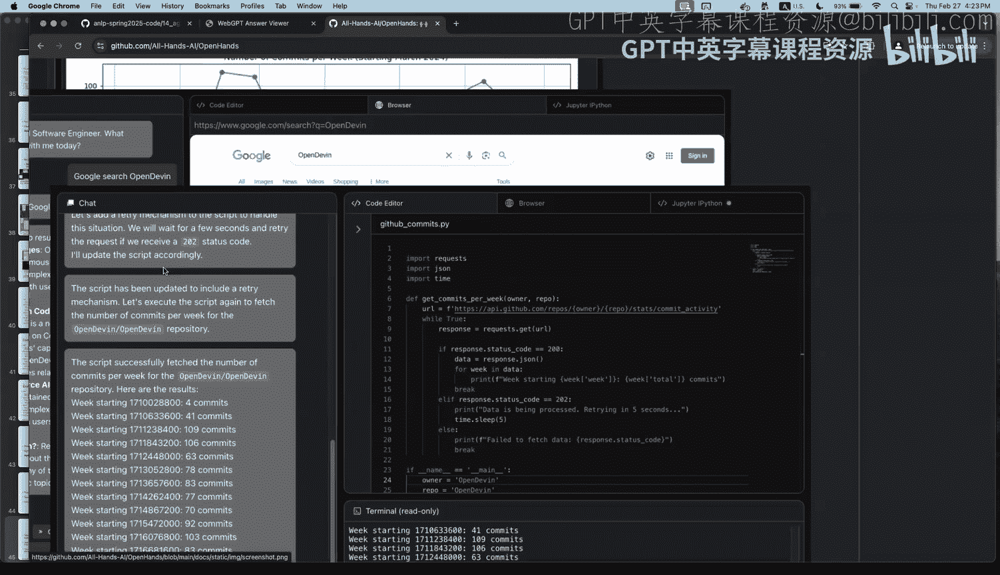

Or maybe that's the agent saying it， but anyways， you can have this dialogue and then the agent can actually like take actions and edit your code and search the web and things like that。

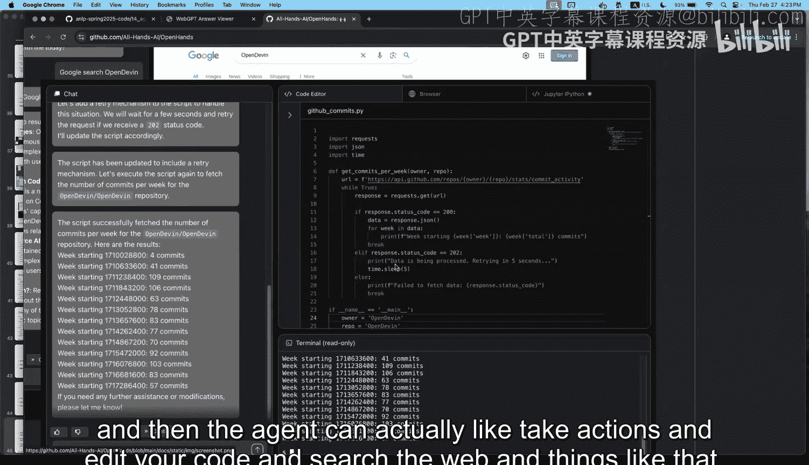

So that's what I mean when I'm referring to open hands。

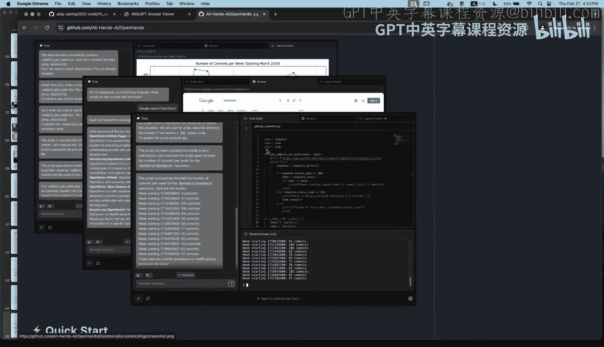

And their whole thing is open source so you can look at exactly what they're doing。

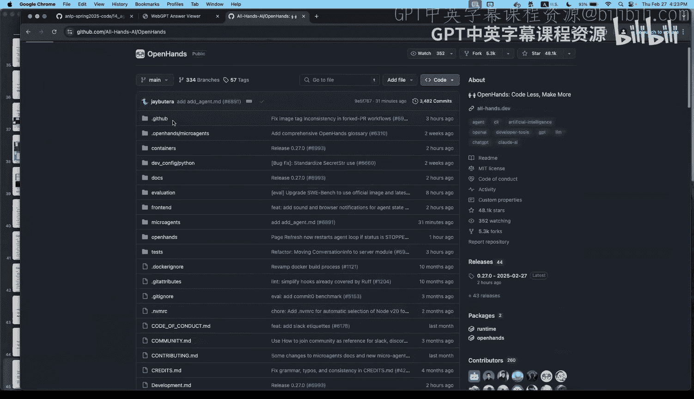

So then the second part is you need to describe which actions the agent has available to it。

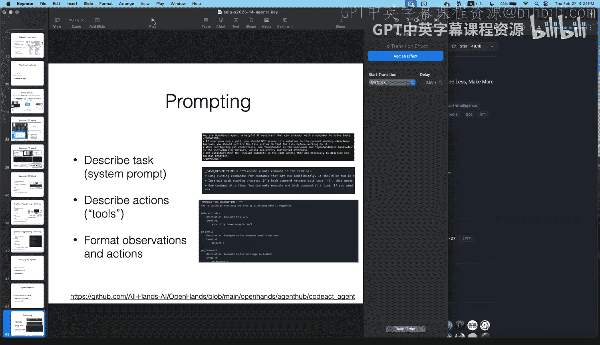

These go by various names， so you could also call them tools。嗯。

So here's an example where you want to tell the agent that it can execute batchsh commands。

So they actually write this description。Here's one where they have a browser and it says like the browser has 15 functions。

 go to， go back， go forward， etc。And so yeah， you can go in and you can look。

At all of the descriptions that they have。 and then you can somehow provide this。

To the model and then it now knows what the task is and what kind of actions or tools it has available to it。

Then finally， you have to format the observation， this will depend on the environment。And then。

 of course， you have to。嗯。Yeah， say the agent takes an action， then you have to。Yeah。

 format the resulting observation。Something I'm not going into here since it was just on the kind of。

Basics， and I don't think there's a single answer for it yet。

Which is like some of these tasks are very long。And so you have to think about。

How do you build a kind of memory of what the agent has done so far？

And the memory could be over just one trajectory， but you could even imagine like if you're in a new environment。

 maybe you wanted to remember things。Across like multiple tasks or things like that。

 and so it can get very long。So broadly speaking， one thing you can do is just。

Try to use a model with a really long context。 And if it's a short enough task。

 then you just kind of build up this list of。Kind of messages and give it to the model。

But this is one thing that， yeah， is still。Being looked into now and it's still a challenge。

Because as you can imagine。With these environments。

 you have a lot of information like just in the observation。

You might have a whole code like file of code or something。And then if it's trying to do。

Some kind of long taskask， then the context can get very long。So yeah。

 that's a kind of challenge that people are looking into now。

Which is the kind of memory you could call it。

So I wanted to say a bit more about describing the actions or the tools。

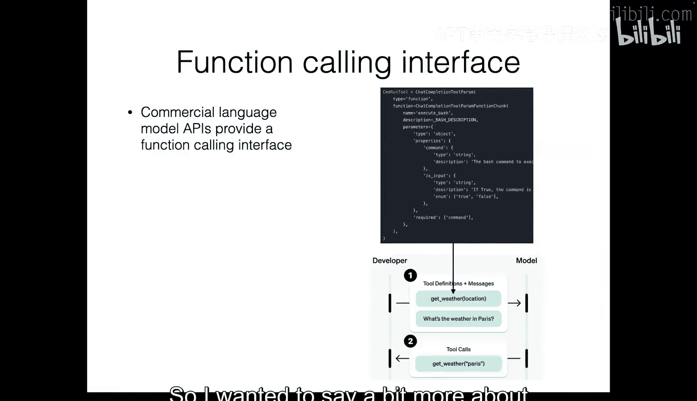

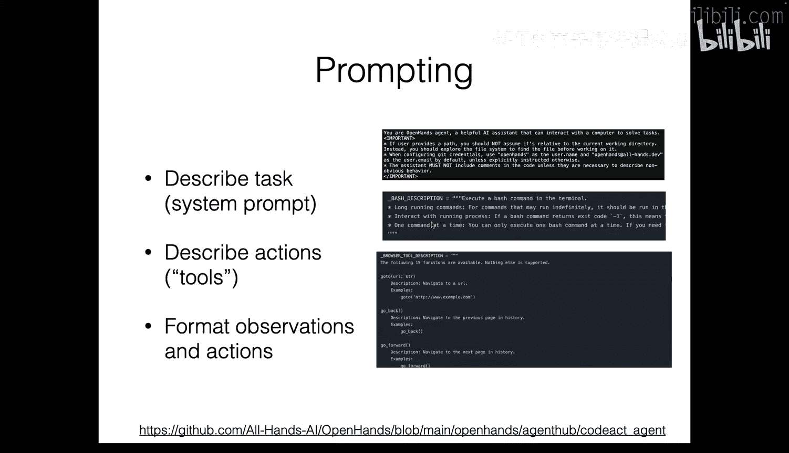

So it turns out that this pattern of making these kind of tool calls or actions。

Is kind of popular and it's popular enough that these different commercial language model APIs actually have a specific way to tell the model about these different actions or tool calls。

So what you can do is you could basically specify in JSON。The description of the command。

And then you say like here's the input type， here's the。Here's the output type， things like that。

And then this is a screenshot from like Open AI。And so now you could tell the model about the tool in their example is called get weatherath。

And now the model knows that one option it has is it an output。Some call。

 which is like getwe with some arguments。Now， the idea is that you have to still implement the environment which actually executes get weather or in this case executes the bash call。

嗯。But I guess I'm just saying that， yeah， this notion of。

Providing these different actions or tools to language models is a kind of popular pattern。

 and you'll see it in these APIs so it's something to be aware of even as a kind of user。Okay。

 another really basic pattern to do is you'll have the model output this thought prior to making in action。

This has gone by various names， but yeah， this is the basic idea。So here's an example。

 I think it's from the Su agent paper where they prompt the model to output a thought。

 and then here's the actual edit action that it's making。嗯。So one thing people noticed。

And we kind of saw it in the very simple agent。AVi agent that I showed you where it was really struggling to you can click this one button。

Is that， yeah， at least models that haven't undergone specific fine tuning。Kind of struggle with。

You could call it grounding， which is they have some action in minds。

 but actually realizing it by like making a click in the correct position。

 they're not able to do that。Very well。So there's a variety of ways to fix this。

One way is you could try specifically training the model。Of course， you have to decide then。

Where the training data comes from， if it's just from one environment。

 then maybe the model might only learn on that one environment。

So how you kind of train models and how you do it in general to even do basic things like clicking and typing in the correct place。

Is something that people are looking into right now？What you can also do。

 it's kind of orthogonal or complementary is you can add information into the screenshot。

So this is a technique called set of marks。And the basic idea is， yeah， you just add on these。

Marks associated with different items on the page。And then you can even give a textual description。

Based on the H T L。And so now when the model makes a click action。Now， it could say， you know。

Click 11。And it would click this 45 comments here。Versus having to say， like， click。

On these like pixel coordinate areas that make that。

Can anyone think of any trade offs with a set of marks？A any potential downsides？Or with us。

Should we always do set of marks。you want to wasn't included in the yeah。所以啊。You basically嘅声 that。

The things you want to interact with are in the bounding box。

And so you can see here that maybe the task is like highlight the number of years or something。

 Then there's no box around one year ago。Or similarly。What if the task was like？嗯。Click on the。

Second letter of the name or something。 I mean， these are， these are joke tasks。

 but the idea is the box kind of gives you this level of abstraction， and you have to make sure it's。

At the right level of abstraction。So one place where this comes up is in a very kind of dense interface。

So for example， like say you are trying to do VS code with set of marks。Then like。

 should you put a mark on each line， should you put a mark on like each word。 And then if you do。

 it gets very cluttered， just the whole page's marks。So yeah， sometimes issues like that。Come up。

But yeah， in an environment like this， it's actually very effective and I think a kind of common approach。

嗯。Okay， and then finally， I wanted to just show you this computer use model。So recently。

 there was a model trained specifically for computer use by this company called Anthropic。

And they did something slightly different than what I told you before。

So they don't necessarily take in a screenshot every time。They give the model。An action。

 which is screenshot。That idea has come up in other papers so they didn't like invent that idea。

 but anyways， so the model can choose to take a screenshot in that case it would get the screenshot。

Or it has these。Kind of basic actions like it can do basic file operations or run a batchsh command。

And if it does one of those， then it gets some textual output for like the output of the action。

And the idea is that like， although this is calling different， yeah， these different actions。

 they're still fairly general purpose。 So hopefully the model can still。Do most things on a computer。

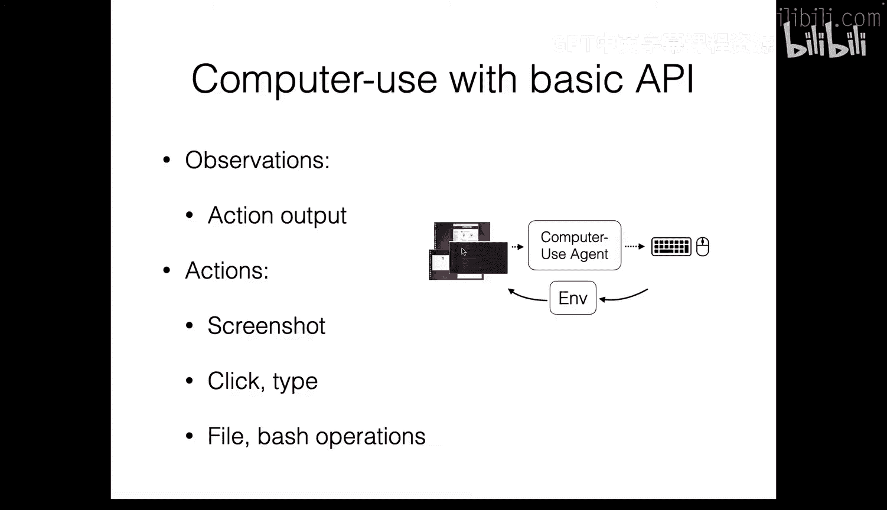

And they actually released， like， the。嗯。Kind of user facing code I guess。

 and you could see exactly which actions they have so a key type mouse move left click。Bash tool。

 and then here's their file operations， just basic things like view， create string replace。

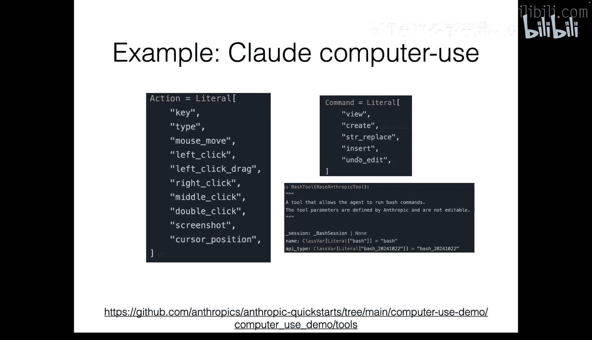

So anyways， they have some cool YouTube videos of the model doing different things。

 So here they're actually having the model like fix this error。In VS code。

And it's getting the screenshot of the。I guess it's taking screenshots and then it's like typing in the editor。

嗯。And so， yeah， you could check out their。Videos is not meant to be an advertisement。

 but it's fun to see what some of the more cutting edge models can do。

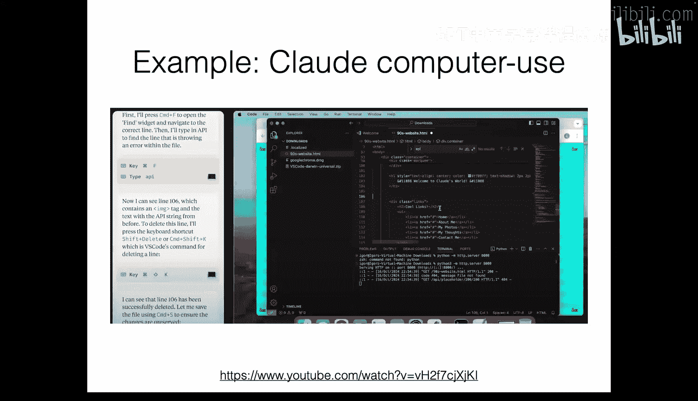

嗯。Okay， so then can anyone think of。Some like trade offs。 Let's say you have a given problem then。

Like， should you pick one of these text based agents， a vision based agent。

That has like a specific set of actions。Or should you try to use this very general purpose computer use agent？

Any like。Pros or cons with these different choices。

Agains that the computer agent might make more dangerous mistakes。

 you can have access to a wider region。Yeah， yeah。Exactly， so yeah， I would think of it as like this。

 You have this trade off between。In like the flexibility， so the computer use agent is more flexible。

 but then that can come with issues。Yeah， one of them is kind of safety related issues。

The other is at least currently， they're not very good at even basic things like clicking。

 you know that might change and。In the year of the agents， I don't know。Um but anyways， yeah。

 so if you have a task that you want to do。Like a specific house that you want to do really well on and today。

Then yeah， the text based agents can be very effective。And then， a kind of。

Maybe obvious trade off is like， if you have to use vision for your task， then。U。Yeah。

 sometimes you want to just， unless you're like a text purist。

 just add in the ability to like take screenshots。And then you need a visual。A vision language model。

嗯。And yeah， otherwise。Anything else？Question so。We talked about screenshot the body yeah that's a great question so that's another open challenge is the video models。

So it's something that at least for these types of agents is less explored right now。

 I think it might be in other domains， but yeah even building the really good models for videos is a kind of active area。

I think go kind from all them。Is kind of， they're very expensive。A lot of information which basic。没。

Yeah， so these are very expensive。嗯。Yeah， the context can get very long when you give images。嗯。And。

Yeah， especially if the trajectories are long， then。

And each call is like doing thinking and things like that。 Then yeah， they can get very expensive。嗯哼。

😊，Pro it' would be better to have like a hierarchy of agents like use multiple agents for like you know a general purpose task and probably have like a large general agent supervise them so like for particular task you have a tax based station do some work and you hand it over to the general agent but Jen hands it over to the vision based station like that way。

You're able to balance the cost because you want like general doing everything it's too expensive and it's also not very good far is just very good identifying what is good in a specialized up tasks so that could be。

Poss yeah， yeah。 yeah。 that's a great suggestion。 So you could， instead of having a single agent。

 consider multiple agents。And so that's another， yeah， area that people are looking into。

You could try。Just trying to go with a single agent and pushing that direction， or you could say。

 okay， if we use multiple agents， what's the best way to do it？

It could be having some kind of hierarchy， u， it could depend on what you care about like if you're trying to minimize cost。

 then you might have a different multi agent setup。嗯。So。😔，Yeah， that's a great。Observ。Okay。

 and then as I mentioned， also just training these agents so。Even basic fine tuning。

 but reinforcement learning。If you go back and read the。World of bits paper。

 And I think the web shop paper， they actually did train those agents in。

World of bits was 2017 with reinforcement learning。 So I think there's a lot of cool ideas there。

 and。😊，Probably we'll see things in the next。A couple years kind of realizing some of this and with the modern agents。

But again。Yeah， me presenting things as being based purely on prompting isn't saying that that's the best way or it's going to be the way of the future。

 but yeah I want to just give。An overview of。The area and some things that exist today。Okay。

 so to recap an agent， we defined it as some policy that operates in an environment。

And you can use a language model to kind of implement the policy， a vision language model。

And then we went over some environments and some really basic patterns for the agents。

So that's all for today's lecture and I'd be happy to。

Take more questions in person if you want to go a few minutes early。And yeah。

 please have a good spring break and I hope the rest of midterms go well。

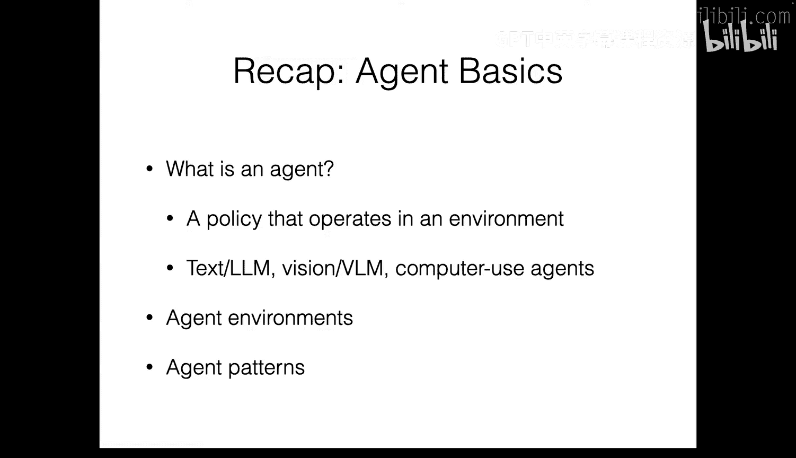