# CMU《高级自然语言处理｜CMU CS 11-711 Advanced NLP Spring 2025》中英字幕（claude-3.7-s - P14：-14-(15)_ Quantization (Guest_ Tim Dettmers).zh_en - GPT中英字幕课程资源 - BV1nYVHz7Eoa

Today we're yeah we're gonna to get started for today so I hope everyone had a great spring break and the weather here is a lot warmer so today we're really honored to have Tim Demers as the guest lecture so Tim is an expert in machine learning deep learning language models and especially things related to efficiency he's done really pioneering work on quantization if you know techniques such as the ones I presented briefly like Q Lauraura as well as the bits and bikes library。

 he' is a creator of those and so no better person to talk to us today about efficient foundation models via quantization。

Yeah， thank you so much， Sean。 and thanks everybody for coming at such beautiful weather。

 So you rather listen to quantization so。😊，SoToday I present you sort of part of my research that I did in past years talk then also a little bit about how models are used quantization used sort of an industry versus personal use and so my research is value driven I want to bring AI to the masses they want to bring I to the people so that they not only can use AI。

 but they can actually work with AI， make AI their own fine unit。

 adapted to their use cases and really learn to work with these models be own inference to yeah join the workforce with AI skills that they can develop。

And so for that the core part is making foundation models accessible and the main sort of problem that particular sort of happened in the last couple of years models got really。

 really good but also are really， really large and so with that it became very programmatic people could no longer use these models on their personal devices and you needed to have large cluster or lots of expensive GPUs to use them and so this is the main problem that I tackled and make these models more efficient more accessible to give people the opportunity to work with these models and make it down。

And so this lecture I talk about basically how we can use foundation models more efficiently。

 mostly through sort of quantization for inference。

 then how can we find human foundation models more efficiently， then I talk mostly about Korra。

 and then sort of some practical bits of sort of what is the future of quantization and how quant how does quantization make sense for users those companies。

And so it's also sort of important to talk about like if you do this research and you want to make things accessible。

 it's like who will be impacted in this research and for using foundation models is mostly people like you students。

 PhD students， researchers that do not have so many resources and they just basically want to figure out what these models can do learn from them and adapt them the fine tu is mostly interesting to researchers that don't have the research sources。

 mostly PhD students， a lot of PhD students use Clara and yeah that's useful for them and then sort of companies with this users there's certain perspectives and for you this might be if you join a company or as AI is progressing and you want to deploy AI in the future and the company that you work with。

 the knowledge that you gain here might be useful for that。

Let's talk first about the accessibility challenges of these sort of user groups and what I will do is give you sort of a brief intro of the problem。

 the solution that I developed and then we do a deep dive before the deep dive is a little bit of background section and at the end of the lecture there will be an interactive sort of session where I show you different in a simulate are different ways of doing inference and whether that means for the user。

 whether that means for the bottom line of the company and we will learn from that and so let's dive in if we look at the accessibility challenges of using foundation models that means inference then I hope Zoom is still working。

And then the main challenge there is the foundation models got so large。

 It's just really difficult to use them。 people who are no longer able to access them。

 And so we need to compress them。 but that has sort of another challenge that comes with it。

 And you want to maintain the prediction quality。And also you want to maintain the speed。

 It's not very useful if you can run the biggest best model on your laptop， but it's super super。

 super slow。 So we need a certain speed to make it useful。

 And so the main contribution that I made here was to take 16 bit foundation model。

 This was usual precision that you run foundation models in and compress them to 8 bit or 4 bit。

And this was previously best quantization method before I start my work and we see on X axis the size of the foundation model on the Y axis performance across multiple benchmarks and what you see is performance increases like usually if a scale foundation model。

 but then suddenly it drops down and actually drops down to random performance for very large models。

And this was a challenging problem People didn't know what was happening here why is it happening and how can we prevented and so I developed the solution which just scales normally just like 16 bit but they're actually use this mostly 99% of all computation is done in 8 bit and I could develop this method by detecting emerging outliers once you scale language models to a certain size。

 they change their computation patterns and then you need to analyze them to really understand what is going on how can I compress this computation to 8 bit whilem still preserving the important information in 160 bit we will get into the details of that。

If we look at the next group that wants to find tune foundation models。

 the main challenge is also quite similar memory for that I want to give you a little story and what we have here is foundation models for biology protein models and I talked with a cancer researcher and she was working with ESM1 which is not as good as alpha fold but it's open source so she can just take it fineune for cancer proteins and then she gets basically the structure of cancer proteins she can predict the new structure of cancer proteins and she got really really excited when ESM2 was released which was in many ways as good as alpha fold a lot slightly better。

But she downloaded the model， she downloaded the code and then she realized she couldn't find tune in it。

 It was just too big。 She didn't have enough GPU resources to do it and so that is basically the main problem that a lot of people face the models got really good。

 but also really big And if you look at the cost of the system required to fine tune the largest model at a certain point in time it costs about $7000 in 2021 and February 2023 it costs already $700。

000 to buy a system with which he could find you in the largest model。

And so what I developed was Qlera。This compresses some memory requirementss from like three large servers just to a single GPU。

 a consumer GPU。 And this is4 bit fine tuning where certain elements are still kept in 16 bit that preserves quality。

 but you have much more sort of less memory that you need to sort of an entire model as compressive four bit。

 and it reduces memory users。And then the last part here we will see more when I go through the simulation at the end。

 but what we will see is companies really care about making inference cost efficient they want to spend the least money possible to serve tokens to you and that has a very different structure from users you usually usually want the most tokens per second you just want to get information fast and they want to run on a local device so memory compress but as we will see you cannot have both and if you're a company you kind of need to satisfy the users with a certain speed but you mostly want to optimize for how cost efficientic it is。

And this is very important。 if you hit certain numbers and cost efficiency。

 there might be billions in revenue for these large companies。 So， so current estimates are that。

 for example， opening eye， most of the models that they serve， they have。Margins of 80% on that。

 So for every dollar that they spend yeah， they they get， well， I mean。

 what is it did like $5 back so that's that's pretty good。

 And most of it is because they're so cost efficient with inference。

Okay that was sort of a short summary and I also want to talk a little bit about how I work and so this gives you an idea of how I approach these problems and how certain thinking of these problems might be sort of good to tackle efficiency and accessibility issues so for me always starts we sort of first understanding the models and here the important part is not to understand this one model but understand what are general patterns of computation across all models we don't want to quantize this one model and compresses we want to do it for all models and do that effectively and so that's the first pattern do get an understanding of how these models work and process information the second step is actually implementing the algorithm how do we quantize with sort of maintaining the quality but also getting the speed of generational fine tuning maintaining that。

But then the third step kicks in， that is we have particular people that we want to serve。

And these people usually don't have big GPU classes。

 They might have desktop under their desk with the GPU in it And so how can we serve those people and we need to redesign our algorithms to basically serve those people best and that feeds in into the research then the last part for me it's not enough to have like a paper on archive I want to bring these things to people And so there we have to think about how do we packages how do we open sources and make it actually so that everybody can access this entire method easily。

And for that， I created the bits and Vites Library implements my research algorithms。

 the numbers now outdated， I think is growing at more than 2 million installations each month and is wisely used across industry。

And it's also widely used across all kinds of different sciences。

 like people realized these big models， they are good for a lot of different cases outside of computer science。

 and so they're now used in sort of many different areas with big success。

And yeah with that I want to give you sort of a little bit of background so give you a little bit of background then we do a deep dive into these sections with more details and everything will be pretty high level there will a couple of things where I go in a little bit more detail but this all of this is sort of designed to help everybody sort of stride along in this sort of lecture so it will not be go into all the research details。

At the end of the lecture， there will be in Q&A， so if you're interested in certain details。

 keep in mind， you can ask me later。And with that let's talk about three things。

 the first is where resource is used to neural networks this is an important question because if we understand this。

 we know where we can improve accessibility because we just need to reduce the resource use in those cases。

And it's actually pretty simple。This looks actually very complicated but it is very simple because this is a transformer architecture。

 everybody uses it as an AI， but if you break it down。

 has two modules and that you 60% of resources 35% of resources， if you dig down deeper。

 these are just matrix multiplication。And so the story is in AI。

 95% of memory and computation comes from matrix multiplication。

 so if you look at just this problem alone， it can solve most problems。

But it's a sort of challenging problem， as we will see later let's first look at basic details of neural networks。

 I think this will not be too difficult for you because you are an advanced NLP here。

 but I just briefly go through these details So how do neural networks work。We have inputs， X1。

 a vector， and then we have weights， and these weights basically multiply all the inputs to create an output。

 and often we create multiple of these weighted sum outputs and then。

It makes it we have a full layer that goes from sort of all inputs to all outputs all these weights are connected to all the outputs are connected to each input and this is a matrix multiplication x1 times W1。

 the weight that gives us the outputs x2 also a vector。Now。

 what End network usually have many of these layers。

 and so what we do is we pass the input vector from one layer to the next and we just go through all the layers and that the entry computer prediction。

And this prediction is a probability distribution of the next element usually。And so。

I told you that matrix multiplication uses almost all resources now the problem is it it's already pretty optimal like we cannot improve it much with hardware or with software。

 but what we can do is we can find approximations that make it a bit more efficient。

And not all approximations are created equal。 So we have， for example。

 some approximations where we have a low rank matrix。

 we just project down to a small dimension and project up to a large dimension The inputs and outputs have the same dimension as a matrix multiplication。

And so this reduces computation， we have smaller weights。It's faster we have less computation。

 but the problem is this doesn't preserve the quality。

 this usually leads to a big degradation of performance。

 this is not a solution that we can use to improve the efficiency of matrix multiplication。

Now another thing that a lot of people think about and it' very appealing as specific that means that we look at the weight matrix and we see there are a lot of weights that are close to zero。

 so if you remove them，😊，And we don't lose quality。 and in theory。

 we get better speed because of less computation and less memory because we removed weights。

 but in practice， it's not true。And spae algorithms are really。

 really tricky and they do not run efficiently on modern hardware。 And so in most cases。

 we are slower， way slower and in most cases actually also need more memory to solve sparse matrices because in these special formats So this is not a。

It's an appealing solution， but in practice often doesn't work。

And now let's look at quantization and quantization， instead of doing computation and 16 bit。

 16 bit inputs and weights， we can go down to eight bit。😊，And now we are twice as fast。

 we use half the memory。And the only thing that we need to do is maintain the quality to make this solution work and as I will show you sort of in the next sections is we can do this。

 it's a bit tricky but we can maintain the quality with this becomes a very effective solution。

Let's talk about quantization， some basics， so in quantization we take a sort of a high precision number with more bits。

 we want to compress it to a number with less bits， for example。

 if you have a 160 bit load it has arranged between minus 65，000 and 65，000。

And if we have a four bit integer， it just has to range between minus seven and seven。

And so if we have some normally distributed data between minus three and three。

 and what we do is we take this distribution， just project down to our target distribution。

 the forward bit integer， it would look something like this。

But here's a problem now you see each of these blue dots this represents a bit combination in the four bit data type has 16 bits。

 but we don't use most of them， so this is actually closer to a three bit quantization so we lose a lot of information。

How can we do better？We first rescale the 160 bit to use the exact same range as a target data type in this case。

 the four bit integer between minus7 and 7 and so if we project down now to the closest element。

 we use the entire data type and this leverages all bits and we get more precision。

And this is much more effective。 So this is basically universally used。

 There's no reason not to use it。But。There's a problem。If we have outliers。

 if we have very large values。😊，Then we cannot rescale。

 so here I inserted very large outlays at the end of the distribution。

And if we now basically rescale and project down， we have still the same problem as before。

 we use approximately three bits， even though we have four bit data type。

 and so this is a challenge and this is generally a challenge in quantization。

 there are outliers in neural networks， but unlike in in other engineering disciplines where people take the outliers and they just throw it away。

 we can't do this in deep learning， the problem that these outliers usually represent really important values。

 we need to keep them。Often we need to actually keep them in higher precision。

 so this becomes challenging， we cannot discard the outliers。

 but we cannot rescale the distribution effectively， and that is a very common problem。

So just to show you what that looks like， so I showed you we have normally distributed data and if we rescale it。

 we have something like this where an indirect quantization is actually very similar to histogram burningning。

Where you slice your distribution and 16 slices。And each of these slice is a histogram bin。

And then you just bin the data into each bin and this is equivalent to an integer quantization with 16 different bins now with an outlier it looks like this that you often see in histograms you have some bad data and have an outlier at minus 10 suddenly you don't use so many bins anymore for your entire distribution and that means you lose information in the quantization。

Just a visualization that will be helpful later。Okay， that that was sort of the background。

 happy to take a question or two now regarding a background and otherwise we can dive now a little bit deeper into the sort of matter and any questions at this point。

各位。M seems a silly question but we are scaling down 16 vi over so essentially like 65 of them versus 8。

That's a very small Australia losing that out themselves。咁方你什做好啊哋。Yeah。

 so the interesting thing is neural networks are very robust robust noise and some part is how they represent information so neural networks have multiple neurons。

And concepts are usually encoded by activating multiple neurons。

And so to recover information of the neural network。

 what you need to do is you need to distinguish one pattern of activations for the novel。

And so usually concepts are overlapping， so if you activate a cat and a dog both animals。

And so you might have like， I don't know， eight neurons， and for cat and do， we overlap a little bit。

Now， if you quantize， you wash these things out and sort of the differences you might like by accident。

 activate another neuron or turn one neuron off。But it doesn't matter unless so if you can still distinguish these two patterns the cat and the dog because it overlaps not too much it works but now if the overlap becomes almost identical we can no longer distinguish do I have a cat do I have a dog that's where the errors occur so the question is like how much information do we need in this entire representation of neurons to make this distinction and they are interesting scaling properties that I talk about later they' basically say there are limits。

These are empirical， they're probably information theoretical related。

And we can no longer go further than that because of sort of fe representations。

 how did you find out the outliers are really important for？I'll come to that sort of a little later。

Any more questions otherwise I move on now。Okay，Okay。

And basically we now directly talk about outliers and so I showed you the fontization method before。

 that was the previously best one， it fails at scale。And why fail at this scale。

 I could immediately see that the problem was outliers。

 but now we have this challenge that if the outliers are sparsely distributed。

 we cannot extract an algorithm that is efficient because we cannot extract the outliers in a sparse pattern because it's too inefficient to compute too inefficient to store so what we need to do is we need to see is there a structure in these outliers to really find a develop algorithm that exploits the structure to have something that's memory efficient and speed efficient while still sort of separating the outliers。

 if we can separate the outliers we can normalize the distribution use the full bits that we have and just treat the outerli separately and so that's what I trying to do but the challenge was can we figureiguring out a structure in these outliers。

And in the beginning， it was very hopeless and I want to guide you through sort of this process。

And what it looks like and it's sort of quite informative because we will see theres a certain threshold they suddenly things change and so what I have here is a representation of a neural network but a lot of layers。

And now what I have here is a red dot， and this red dot represents an outlier。

And so what I do is I have this neural network， it's already pretrained。

 I pass a Wikipedia article through it and then I look at where are the outliers and so I noticed some patterns and this is a small neural network。

 350 million parameters Of course it has much more layers but the patterns that I show you in outlineliers are pretty realistic that's basically what I saw in my data that's what I had to use with work with。

And so if you at a small scale you have some outliers here and outliers there there's absolutely no pattern so nothing you can exploit and so that was sort of a demoralizing result it looked like it wouldn't work but then I went to 1。

3 billion parameters a little bit larger neural network work and so if I looked at different Wikipedia articles I could see like hey。

 there's a little pattern there maybe there's something。And so then I worked with 2。

7 billion parameters。 This was already very difficult at the time。

 The software didn't exist to do this sufficiently。

 And so when I passed Wikipedia articles to that neural network， I saw in more outliers。

 And so then I rewro my entire code base to try and make it as she efficient to run larger neural networks and the first 6。

7 billion parameter model that I ran at this。All the outliers are in the same position at all layers。

And then I use a different Wikipedia article still the same。So for all data， for all layers。

In the entire network of the same position the outliers。Highly， highly structured。 And so at first。

 I thought this must be a bug。 So let's grab a different neural network。

And so I grabbed different neural network， it still outliers。It was trained with different software。

 It was trained different data， completely different， but it had outers just in a different position。

 and it also didn't change with inputs。 Then I looked at larger neural networks， same pattern。

 just a different dimension。 And so then I said， okay， okay， I think I have pattern here。

 Let's plot this。 And so this this graph hook like ages to create。

 And on the x axis we have language modeling performance and complexity。And on the Y axis。

 we have the percentage of layers with outliers。And so。This is a plot。

 we get a smooth exponential as language modeling performance improves。

 we hit a point where we hit 100% outliers And once we hit that point。

Every neural network has outliers all the time in the same position and in a certain position that is sort of random。

 but once it has this position， it never unknowns it。

 it will always maintain these outliers so that we now know the process of these outliers。

 It's related to language model performance。And if we draw a line at the perity where this occurs。

Now， now we look at the magnitude of outliers， Then we see that at this point。

 the outlier magnitude goes crazy will grow really， really large。

And what I showed you before was if you have quantization。

 you want to renmalize the most severe outliers are at the very end of the distribution。

 because then we can't rescale， and this is exactly this problem。

So these are the outliers is destroy the quantization and these outliers occur in every neural network at a certain scale。

 at a certain performance。And so now we understand this。And now we can develop an algorithm。

 The algorithm is very simple。 What we do is we look at the dimension where the outlier is it's different for every neural network。

 but we just need one input to determine this dimension once we have this dimension。

 we extract that dimension to a matrix multiplication in 16 bit that's 0。

1% of all values for all neural networks that are at tested about 0。1%。And then we take the rest， 99。

9%， we do an a matrix multiplication。Then we have these two matrix multiplication， one very large。

 one very small， and we add them together。With that。

 we can recover the full 16 bit matrix multiplication， but now 99。9% of computation is done in8 bitI。

And with that， we get these results and this graph doesn't have the 16 bit line。

 but it's basically identical to the blue line， there's absolutely no difference。

And so that means that we can run neural networks in very low precision if we keep the outlier separate and quant and don't quantize them and the rest we can quantize very aggressively to8 bit。

And thats that works really well and so that we could use models in lower precision。

 large models in lower precision。And so that。That LEDent me to sort of another question。 like。

 can we do in for bitd。 But then I ask a more interesting question。

 And that is a little bit more complicated。 How can we maximize the performance density per bit。

 And let me tell you what， what I mean by that。 If you have  two neural networks。

1 with 10 billion parameters and one with 20 billion parameters。And we quantize one in8 bit。

 the other in 4 bit。Then these neural networks have equal amount of bits， 80 billion bits。

But one of these will have better performance。And so without better performance permit。😡。

If you have a memory limited device you want to get the best performance possible。

 then the right question to ask is， how do you get the most performance per bit。

And then not necessarily how far can you compress it because if you compress too far。

 you lose quality and so you want to have the best trade off。

 how do I get the best quality with the bits that I can store And so this is the question and so I analyze this。

And this where lots and lots of experiments， thousands of experiments on the X axis。

 we have the model size， the total bits in the model。And if we quantize it， of course。

 the bits shrink， we get less bits on the y axis we have performance across several tasks。

And so what we see is this is a curve for 16 bit。And the top left is the highest performance density。

Now this is aId curve， we already know that aId is as good as 160 bit if you do it right。

 but it's half the size， so double the density。Now this is a four bit curve。

And we get a little bit loss a performance， but the memory footprint is half of8 bit。

 and so it improves still。AndNow if we go through three bit， we get instabilities。

 the quality degrades significantly， and this is no longer competitive and so this means the highest performance density occurs at four bit。

And I tested this on lots and lots of models and I found this is always true。

 we always get the best performance around four bit per parametermeter。

And so I looked at different qualities。That sort of matter。

 and I told you before that this is sort of a quantization。 you can see there's a sstogram。

This is an outlier。And now there's a method that works very simple。And what it does。

And this is basically the second most important。Quantization parameter， one is how many bits you use。

 the other is called block size and so what that does is you look at the matrix and then has basically in a matrix multiplication you have a you multiply a row vector by a column vector。

And what you can do is you can take this own column vector and shnk it in smaller and smaller sizes。

And normalize each of these chunknks， each of these blocks separately。

That means that if you have a vector of 1 thousand0 elements， the outliers in the first0。

 if you now chunk it into 10 segments， 10 blocks with 100 elements each。

 the outlier will just be in the first block but not in the others and then you get something like this that the outlier affects the first segment。

 the first block or all the other blocks and use all the information in the data type because they don't contain outliers and this is actually a very effective way to improve the quality of your quantization because with that you can isolate outliers。

With the algorithm before we could isolate outliers in the matrix multiplication because they are very structured。

 but if you have outliers that are all around， this is one of the most effective sort of ways of doing that。

By creating small blocks of elements that you quantize。 And so a question was。

 how large should this block be， Because if you make this block very small。

 let's say you make it 16 elements。Now you saw the normalization constant in 16 bit。

That adds one bit。 So if you apply to a four bit quantization。

 it suddenly turns into a five bit quantization。And so at some point we need to use quite a bit of memory to just store these blocks。

 store the normalization constant， and so that is what I analyzed and the curves look very close。

 but it's actually a very significant improvement I tested a lot of things that is one of the few things that matters。

And what we see is if we go to a block size around 64， that becomes very optimal。And right now。

 most algorithms use a block size of 32。And and Vdia's hardware actually now also implements this so the new blackwell GPUs。

 they use blockwise quantization and there you can go to 32 bit so if you use blockwise quantization software it slows things down。

 but now that's implemented on the hardware there has no drop in speed you're very fast。

 very precise that makes four bit much better。And with this， you might ask， okay。

 we went from 16 bit， then to8 bitI and 4 bit， and it seems to pretty easy。How far can we go。

And it turns out we can't go much further。if you look at AI progress。

 it was very much determined by how fast are GPUs。But GPU speed was mostly achieved by using lower and lower precision。

And it's a big problem if we can't go lower， if we can't go through four bit training and2 bit training。

 and so this is sort of a similar question at some point you degrade your performance and you might do the computation faster。

But if they don't have the same quality you need to do more computations so you have cheaper computations but you need to do more of them to achieve the same quality and at some point these advantages can out the question is where's this point。

 where do the advantages cancel out what is the optimal precision for training a neural network？

And so this is sort of a plot that shows you if you train a model in a certain position and then you deploy it。

 do inference with it， what is actually the optimal position？And on the axises。

 we have the token to parameter ratio。So if you look at modern models， it's around 100。

And we have your validation loss， so it means a lower is better。And so for model models。

 it seems that if your ratio is already at around 100 what we have。

 then if you don't do any quantization， you're better than if you quantize to six bits。

So it seems we are already at the limit for training。

 so if you train in six bits it doesn't have any advantages already at this point。

 you can improve the methods， but。You see that at some point。

 you can't squeeze more information out of the bits set you have。 We already did quite a bit of that。

 And so it seems that we coming coming to limits now。

This is another plot that's a little bit more difficult。

 but it gives you sort of some some at data points that are aligned with models that are already known。

 so these are lama modelss， I think these Al Lama 2， 405 billion 70 billion and 8 billion。And。

In this paper， they estimate the equations of when is which precision needed to train a model efficiently。

And so if you have a model so how to read this plot is， let's take the star。

 which is a 405 billionl Lama model。And now I want to train it on now I look at the X axis 10 trillion tokens。

AndThen you can read what precision is sort of the memo precision to give you the highest efficiency。

And so there we see we around eight bit we can do， so8 bit precision is okay if you 10 trillion tokens。

But now if you go to 10 trillion trokens， then you already need 10 B precision so you can no longer do a bit training and be efficient。

 You need more bits。And we see if we train smaller models。

We actually need a sort of morbid precision and to do that training so if you train an 8 billionllion model if you want to do it in eight bit then you will need to use less than a trillion tokens which is not much data and so that means that we will probably not make further advances in terms of quantization for training at the end and this has like wider implications of where we are going so if our computation speed is depend on the precision and the precision is basically we are done with it then we might have arrived at an age where computation advance slow down。

We will not get much， much larger models。Because it's just so expensive to train in higher precision。

That's the main takeaway here。And so this was the first session and here the main takeaway from this section is if you understand the fundamental information processing in these models。

 like the outliers， for example， that we talked about or how how the quantization affects everything with sort of position and processing and then you can make the processing much more efficient with understanding you can make things efficient and maintain the quality。

And with that， we move to the next section if you have a question or two， I'm happy to take it now。

I will take more questions at the end。Okay， then we move through the next section and this is fine tuning foundation models and this is mostly about Q Laurara。

 as I told you before， the main problem was models get so big that you need expensive computers to function tune them and that's not easy for PhD students that often need to do this。

And so let's talk about the basics of how to find tu model It's very simple。

 so I showed you before how we use neural networks， we pass data through them。

 pass them through the layers， generate a prediction at the end of it that often is predicting the next element Now in fine tuning we add a couple of extra steps we compare our prediction with the ground truth that creates an error and then we use the training algorithm for neural networks。

 back propagation of errors to pass this error back through the neural network this generates weight gradients and now we can use these weight gradients to update the weights just in the right direction to reduce the error and with that reimp the quality of the neural network and then we can pass the next data through the neural network。

 repeat the process， get the errors， update the weights。

 improve the quality until the quality no longer improves。And。

So I showed you the work that I did with forbi quantization of how to get the most sort of information per quality per bit and I applied all those principles to fine tuning as far like let's try it let's see if it works and so I took in 16 bit neural network I compress it down to four bit with best practices now I tried to find tunenet and so how that works is you generate a four bit computation with four bit error you generate four bit weight gradients then you update the weights。

 but what I saw is quality goes down doesn't work and the main reason is when I sort of inspected it carefully was。

That the gradients were actually very similar to the 16 bit gradients。

 but updating the four bit weights with four bit gradients is very noisy and that leads to poor optimization and the right optimization cannot be found at that position。

And so the updating the weight is basically the problem here。And there's one way around it。

 and we can do this with lowering adaptation。 And so how does that work and lowering adaptation。

 we take the model， but instead of passing gradients through the entire model and updating the weights。

 we freeze the weights so we don't update the weights Instead we add some new layers on top of it called adapters。

And these are just sort of tiny layers。 and so what we only update those weights and so how that works is we pass data through the neural network into the adapters and update those weights instead of the model weights。

Now we can combine this with forward bit quantization and this is what we call Kra。

So we again quantize the model from 16 bit to  four bit with best practices。

 but now we add 16 bit of data on top。And so now if we back propagate， we still have four bit errors。

 four bit gradients， but now they are flow into the 16 bit adapters and we can update these 16 bit adapters。

with four bit gradients and if we do that quality improves and it actually works so good that I thought like we are very close to having the same performance as 160 B fines unit。

 how can we get the last mile and for that I wanted to develop a new data type a data type that's information theoretically optimal。

😊，And you can cause this sort of sort of in various ways。

 and also like with optimal transport theory。 And but I want to give you sort of an geometric。

Interition here， that's a bit simpler to understand。

 and I showed you that inter quantization is very similar to histogram binning。

And where each bin has equal width， you slice a new normal distribution and 16 slices because you have 16 bits and then just take all the values in each bin and quantize the middle value of the bin。

Now， if you want to do the information theoretical optimal way。

 you want to slice a normal distribution also in 16 pieces。

 but now what you want is each piece has equal area that means that each piece has equal amount of numbers contained in it。

And with that， each bit combination always has the same amount of information contained in them that makes the information theoretically optimal。

And this is what we call the four bit normal flow because it's information theoretically optimal for normal distributions。

And I will not talk about that， we quickly can look at results。

And so what I have here is these ama models。Of different sizes and we look at 16 bit and four bit。

Fine tuning， so4 bit Qra and 60 bit standard fine tuning。Now the performance on this benchmark。

 this is actually MMOU， we see that sometimes 160 bit is better。

 sometimes fourbitit is better and on average this kind of cancel out。

 they have basically the same performance and so that we have shown that the four bit process。

 Q Laurara is as good as 160it font training。And this is not so so relevant anymore， very old models。

 but we created this gunaco model which was at that time pretty good。

 it was the best open source model at that time and also comparable to a shared GT on certain sort of language models as a judge benchmarks but yeah。

 that was a long time ago， things move fast。And。But yeah。

 the main takeaway in here is so forward bit fine tuning with best practice is difficult and it actually doesn't work。

 but we can make small adjustments but just passing it the gradient to the 16 bit adapters and then everything works and again here's of the learning is if we analyze everything deeply we see like where's the problem then we can fix it。

The fat I come to sort of the last part。 and this will look at sort of。Some simulations。关注。

So I guess you show the。You can keep the outdoor 16 bit and the gradient support it and it fine。

So does that idea also apply。To just train from scratch。

 like could you have your parameters and 16 bit and only have your gradients in the lower precision and maybe it saves a or is it still beneficial to have your gradients in your full precision？

Yeah， so。deepep sea did sort of the first open source successful aB training and there you have sort of a similar story and you still have main weights that are 32 bits and then you have computation weights that are lower precision you need to then to generate the gradients and therefore there's sort of a complicated thing where something 160 bit something 32 bit communications is just like in 160 bit but the story is very similar if you update something over time then precision is very important and for that yeah so you can apply it to training doesn't quite work for four bit and maybe on the new NV GPUs it might work for6 bit but。

Yeah， the same principles applied for training。Any other questions at this point？

G then just as like a as a user。The four bit trans hittingning。

Are there are there like sometimes gaps in the performance between the full bit and little bit that may be moret captured by the initial experiments like now yeah i'm mean there has been like a lot of debate and I very careful experiments and I couldn't find any problem。

For any task， but some people say like oh it doesn't work here and that seems to be often related to hyperparameters and often people use subopal hyperparameters just for Laurara fine tu and so if they use Laurara and16 bit or Laura or Q Laurara and4 bit。

The performance just goes down but that's mostly related to parameters some people told me about some problems that I couldn't investigate but they said like it just doesn't work I tried everything and so hard to verify so it might be that there are some problems I myself haven't encountered any a lot of people using for them it just works I mean even like four bit grP for example seems just work with these models which is like quite interesting so。

Yeah。Still difficult to say there are probably some problems。

But there's also a lot of things that you can do wrong and then there will be lots of problems。

Very yeah no so i guess你。The data type is optimal for normal distributions。

Do you actually look at the distribution？You knowA ways didnt get to neuralial network and is graural distribution for good？

So the normal distribution is a very good fit， but it's sort of theres some distributions are heavy tails。

 the tails of neural networks are very weird that in a sense that you have flag almost a perfectly sort of normal distribution and then you go a wide sort of space sort of in the distance and then there's a lot of values。

Well not a lot but a couple and so it seems that it's mostly normal dis plus some outliers and so the normal dis in itself is not a super good fit for these outliers。

formss all values forms all weights so interestingly even if you sort of sort of initialize them in a uniform way as you train it it will become a normal distribution so yeah the normal distribution is pretty universal but also the outliers are pretty universal。

Any more questions。Okay， let's move forward。These slides are a little bit less polished。

 I have to think about them again what I actually have here。 So if you have。

Efficiency versus users for this companies， it's basically one particular thing that for a user。

 what you want is you send one curve to a GPU and then you want to get your response back as quickly as possible with as many tokens of possible。

 but what a company wants to do is wants to maximize how much computation。

 how much tokens it gets out of a GPU per second。And if you want to optimize that。

 it turns out a single query will only utilize the GPU a little bit less than 1% of its total computational capacity。

 so if you use large GPU like an H100，And you send it just a single query which is sha over a chat interface。

 then you use less than 1% of the computational capacity。

 so it's 100 times more expensive to use in that way so companies want to prevent this so what they do is they batch a lot of people together enlarge many batches to serve all of these certificate ones。

And so what we will do when we look at the simulation is look at what are the trade offs if you have certain batch sizes if you do this。

If we talk about inference， that is sort of two different phaseless。Want a a prefill phase。

And this is basically your prompt。And a prompt because it sort of it's not generated to token by token that means you can generate the as you process the entire prompt at once。

 and this is very efficient so you can actually use so if you send a prompt to a single GPU as a single user you might get like 5% efficiency or 10% efficiency so you don't need a very large batch size because you can do all these computations in parallel and keep the GPU busy。

The second phase is is decoding token by token。And this is where you really lean in a large batch size to make it efficient。

What you also need to do is cache the previous tokens。 So in the key value cache。

 what you have is basically for the attention， all the previous values that you computed。

 you need to store it in GPU memory， to be accessible if you want to compute the attention for the next token and with respect to all previous tokens。

 So that step needs a large batch size and is very memory intensive。

 particularly if you haveve long sequences like the reasoning models。And yeah。

 I already talked about this， so for companies you want to just maximize how many tokens you generate per dollar。

 which means how many tokens you can generate per second per user and the users yeah they just care about the tokens per second。

 they don't care about how is your GPU sort of utilize。诶嗯。So。

Let's look at a couple of cases and this is， I will go through this with the script。

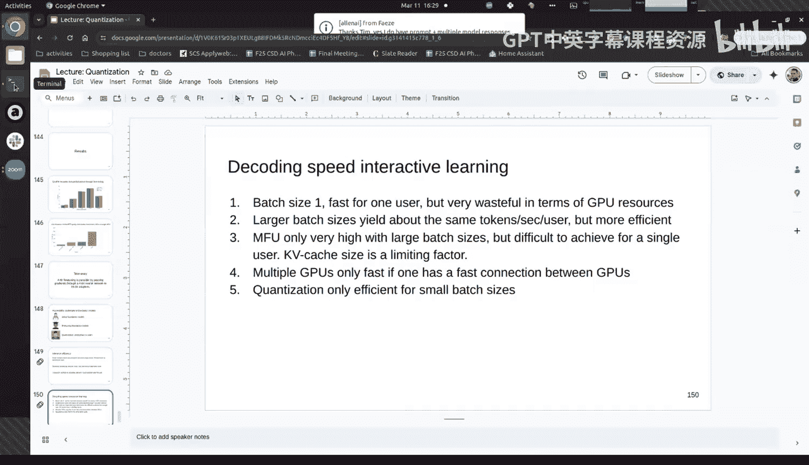

And so。The first thing that we want to do is batch size1。 we compare the user case。

 and so I have a script here。 that's a simulation of inference。

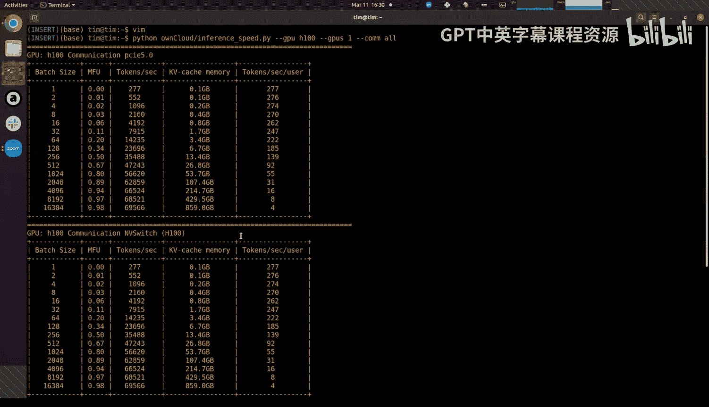

And what I have here H100 GPu， we just take one GPU。

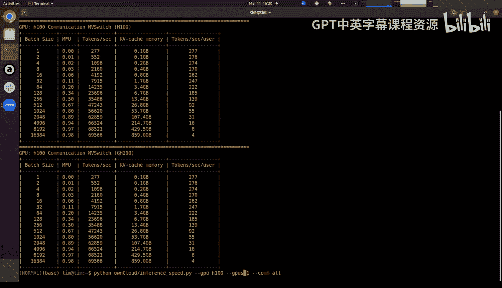

And we take like common， we take like different communication protocols。

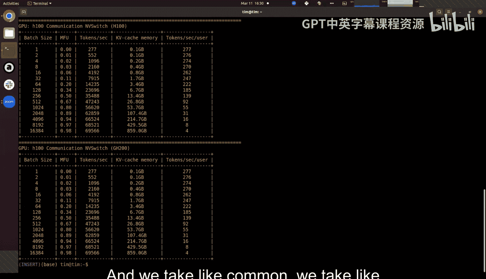

And you can ignore the communication protocols for once， but now we have a table here。

 and the table has multiple columns。 The first is a batch size。

 This is how many requests are sent at once to the GPU The second column is the most important for companies。

 It's the mean flops utilization That means how much computational capacity do you utilize from the GPU。

 So if it said 1% or 0。01， then you use only 1% of what the GPU could give you。

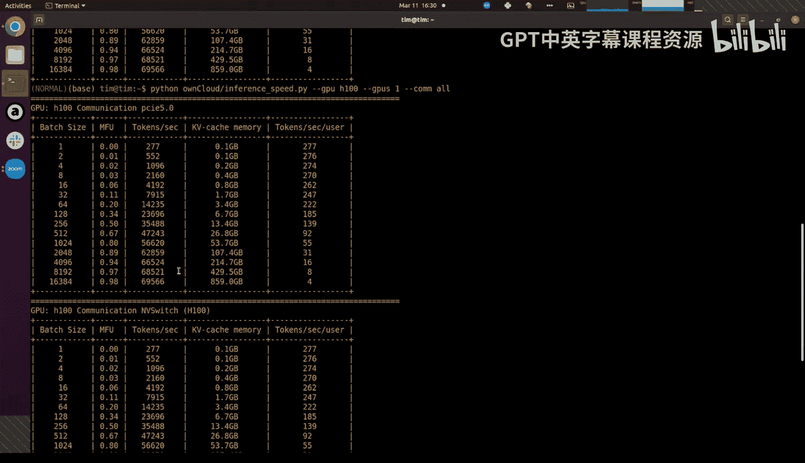

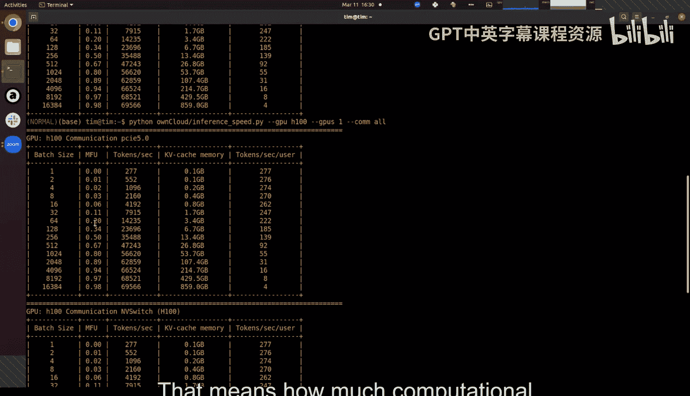

And the next is the tokens per second in aggregate。And then the last is tokens per second per user。

 so this is the most important for the user。And what we can already see if you look at the extremes better size one。

 you use the GPU less than 1%。So you pay more than 100 the price of what it could produce in sort of tokens。

 but you get 277 tokens per second。Now， if you have a very large brush size， 16000。

 you utilize a GPU almost to 100%。So you get most of the tokens that you can get from the GPU。

 but now you get four tokens per second per user too slow to be useful for most users。

 The other thing is you need to cache all the attention key value caches if you look at the size here it's 800 gigabytes and that's probably larger than the model that we're using and if you run a single GPU with 80 gigabytes is you can't run this doesn't work so the most that we can run reasonably in this case is probably on a single GPU batch size of 512 that gives you 67% efficiency。

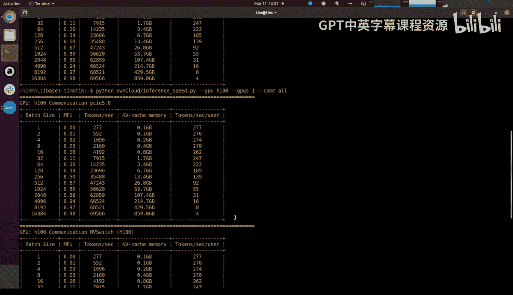

And it gets seen 9 totals per second。And so here， can we see if we make certain trade offs。

 we get certain basically points where users benefit or where a company might benefit in terms of efficiency。

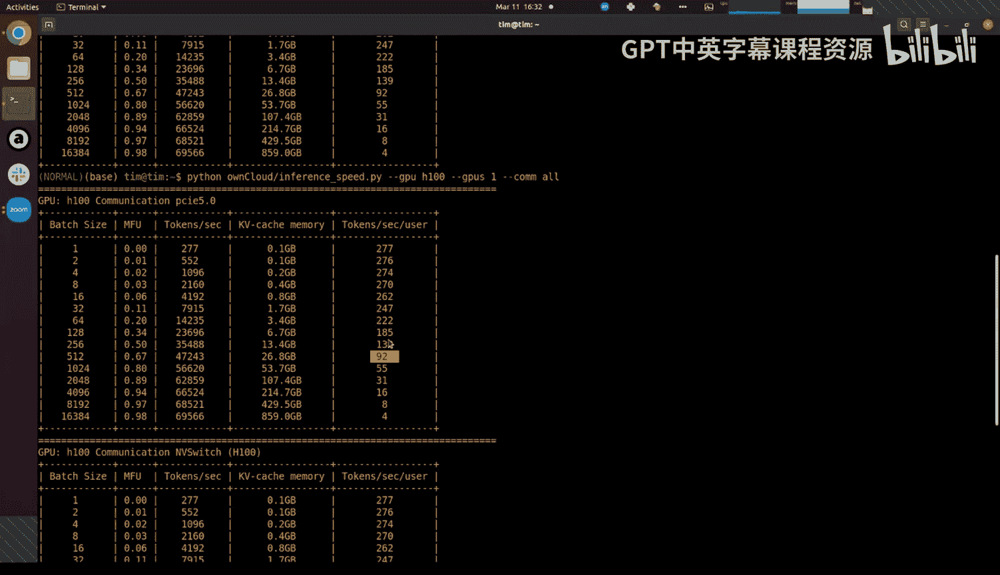

嗯。So we already talked about larger batch sizes， yield better tokens per second are more efficient。

 mean flops utilization is very high for large batch sizes。 Now let's look at multiple GPUs。

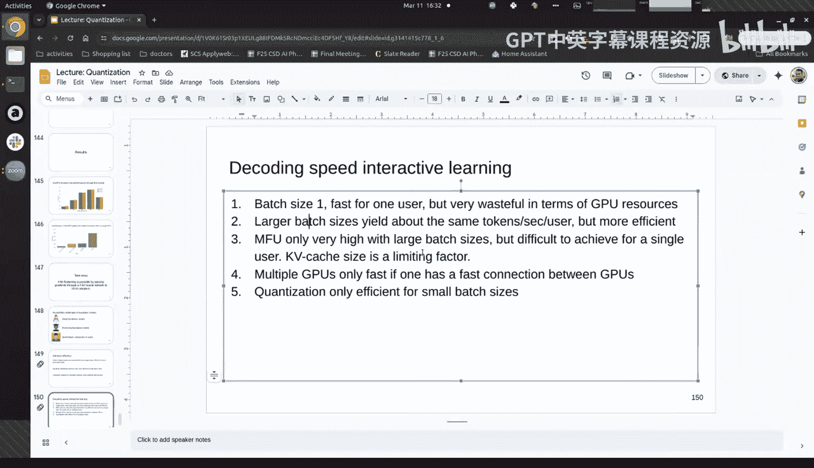

Very。朋要。就 this is a姓。This isn't actually running。Yeah。

 this is just a simulation Okay how do you compute the MFU， doesn't that depend on my field？

Particular library convincing yesum。

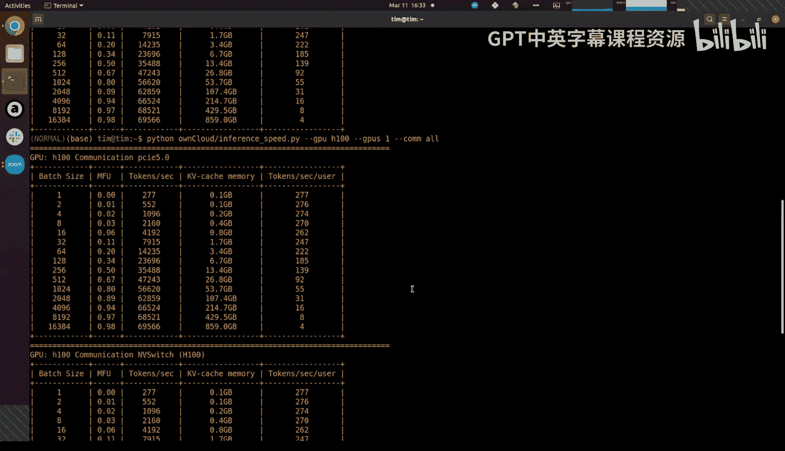

AndSo。Actually， I think here I have like 70 billion Lama model。

And so a 70 billion Lama model has 70 billion parameters and for forward pass you need two flops per parametermeter。

 so it will be 140 billion computations now if you have a GPU， something like an H100。

 I think has 110 ter flops maximum。And so with that， you can sort of calculate。

How fast can you in theory that's important so this is not considering software and everything how fast can you sort of calculate in theory and all these computations and then Lama model also has a certain memory size and then it's like how quickly can you move that memory through the GPU and so this is peak performance in most software frameworks that are open source you get about 10% of this。

Opening eye gets probably around 50% of this so they're a bit more efficient。

 it's very difficult to get very high percentages， particular for large models If you look at deep sea actually。

 they get very high percentages also I think it's also around 50% or so。So， yeah。

This is a theoretical model， but still helpful to understand。How these factors are related。good。

 let's move to HGPUs。

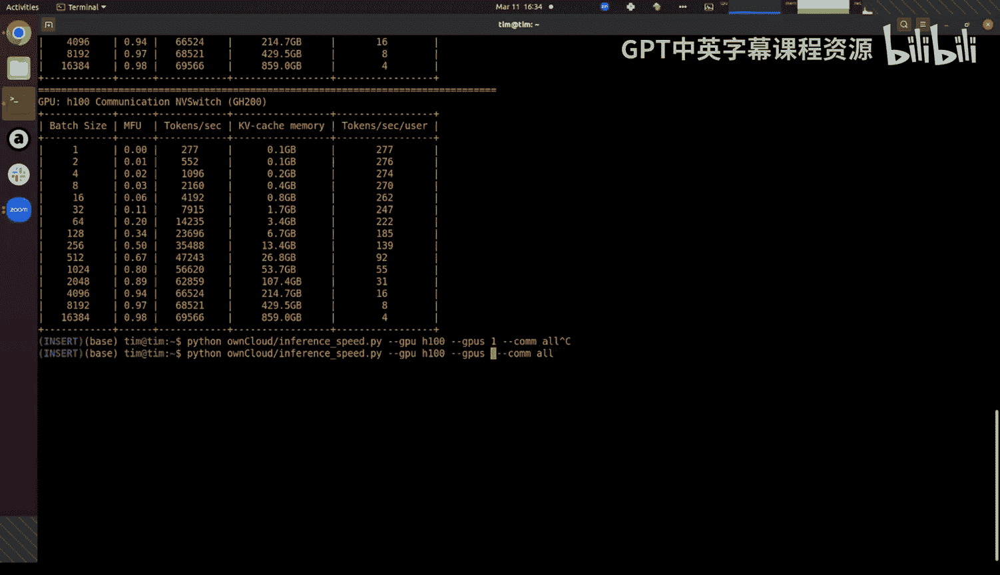

And so what we see here。Is that if we use small batch sizes。

 we get lots lot more tokens per second in the beginning we had like 277 now we get 2000 so much faster。

But and the interesting thing now is if you look at the batch size。

 we see the mean flops utilization， it's now very low， so if they have a very large batch size。

 companies can't deploy this efficiently。And what's the reason for this， the reason is networking。

It turns out for inference， if you have multiple GPs， you need to communicate between these GPUus。

 It's very， very expensive for inference。 You cannot overlap that easily the sort of other computation。

And so this uses an hardware interface PCIe 5。0， this sort of standard GPU slot。

 but then there is sort of special networking hardware that was developer and video。

 And so if you look at that， we actually get good meanflps utilization。

 So it turns out if you need multiple GPUs networking is super， super important。

 Otherwise you can't really paralyze a neural network for inference。

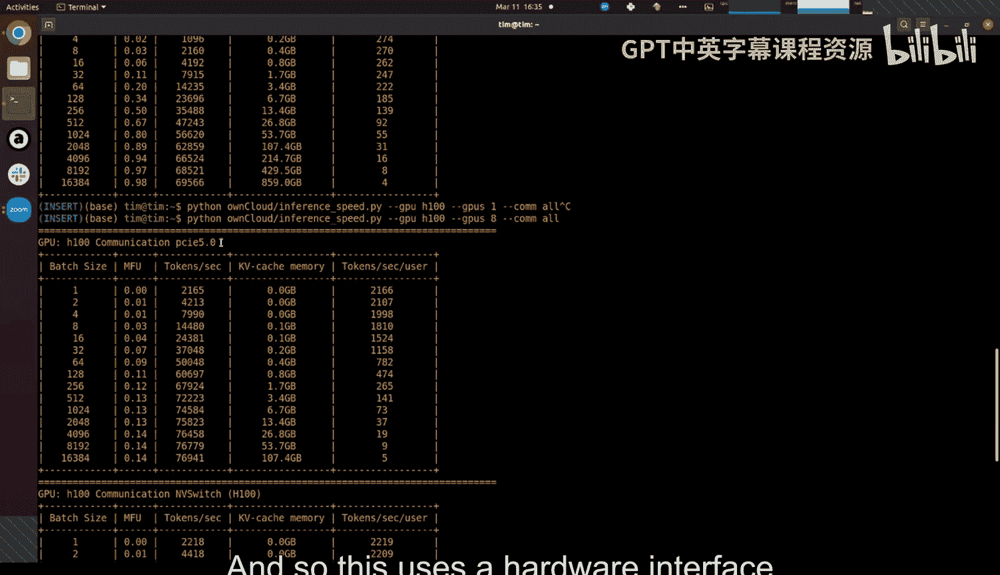

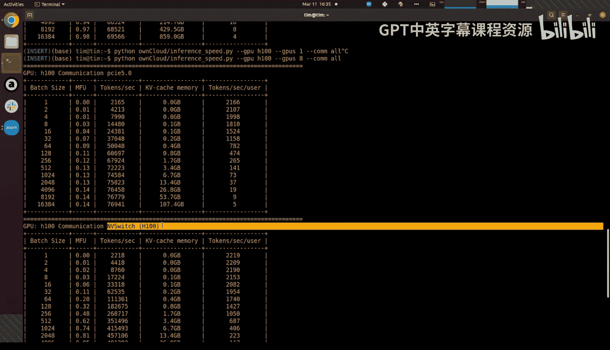

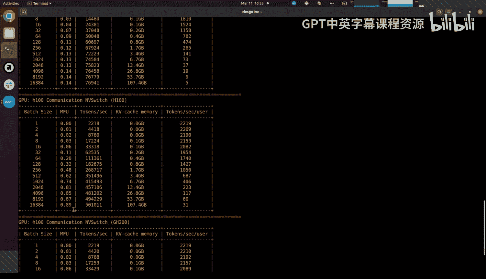

And there's also another one and you see at some point you have sort of overkill。

 they mean flops utilization is not much better if you have this sort of a very sophisticated hardware。

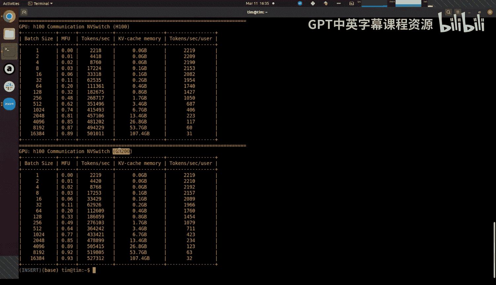

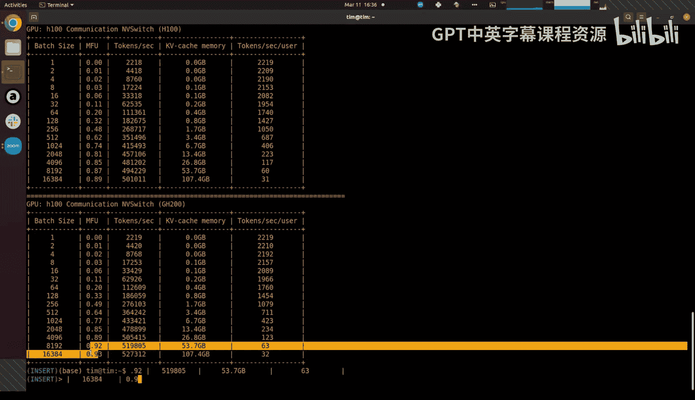

Yeah， so that's communication within single mode， exactly。

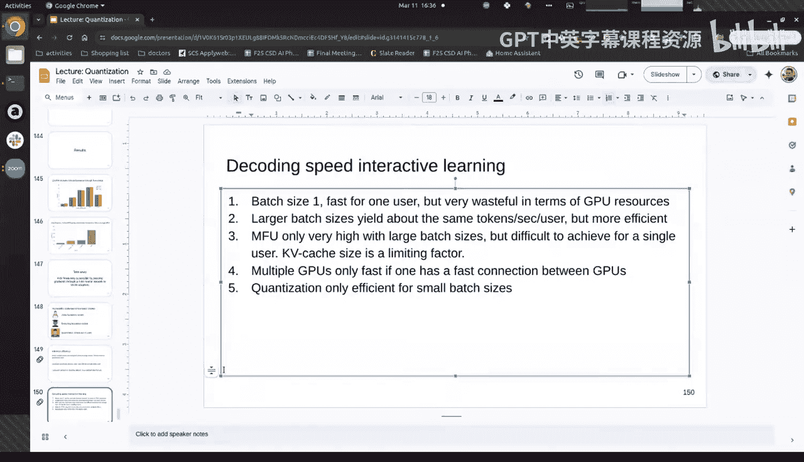

Yes。And communication between sort of multiple nodes， is's usually relatively fast。

 but it's more comparable to sort of this bandwidth so。

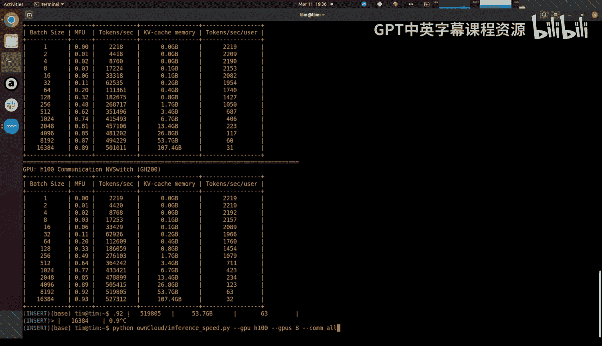

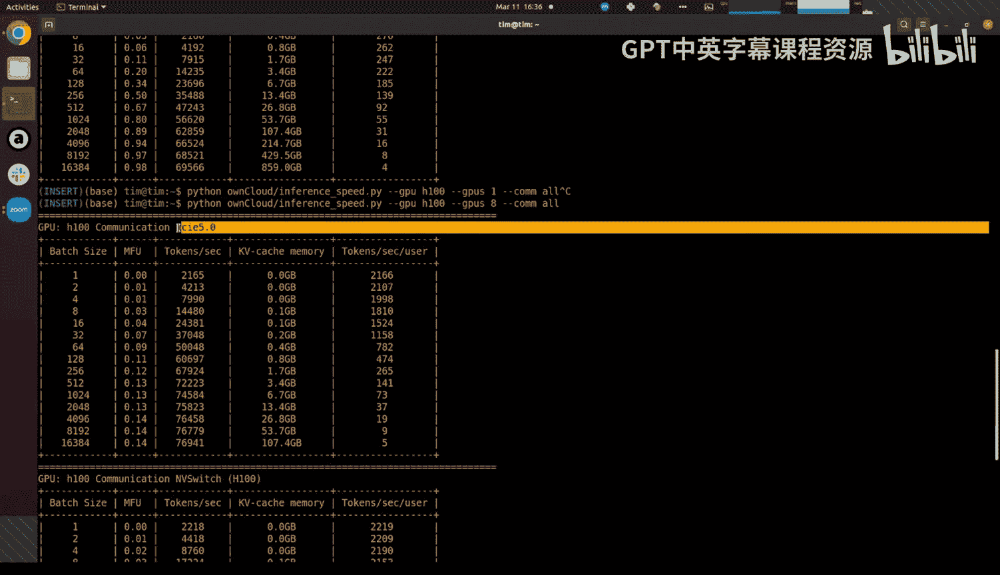

It actually gets very tricky once you go beyond eight GPUs。

A parallelization really matters and if you look at deepse， they figured it out how to do it。

 but you really need to think about how do I part all this computation。

 how to pull it together and what information do I need when it's tricky。

What you see that take away from this chart is there's no point posting your own influence。

 And as you have saved a hundred including users。Yeah， so so if I think about my current research。

 actually mostly based on this fact， so if you have a MacBook you can run some models。

 but you only use about 5% of the MacBook's capacity because you usually use it just for a single sample。

Now， if we develop methods it can actually leverage where a single user sends multiple requests at once。

 but then gets one back that's sort of higher quality。

 it can be through all kinds of different ways you can think about sort of sampling the best sort of response。

 but you can also think about something like agents where if have multiple agents doing different stuff。

 they try different solutions， then sort of they coordinate what is the best solution and then they give back your solution and if you use these approaches is actually required to make use of the hardware that you have as a user。

And so this is an advantage that actually we can use an open source。

 but I'm not doing this companies can't do this。 Comp can't deploy an entire GPU just for you。

And so that is an advantage step we can leverage。

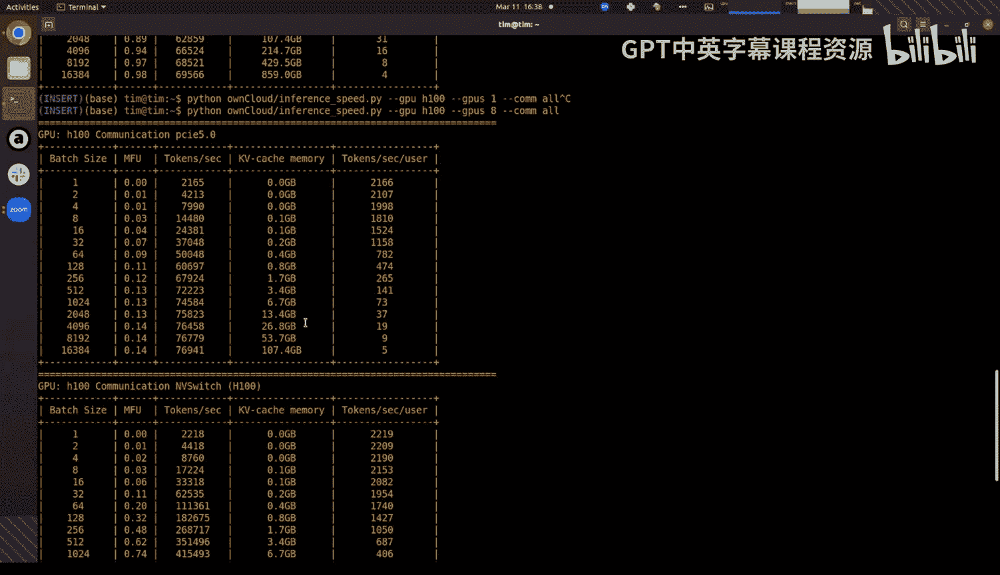

Good， I have like just one more thing。 and then I'm happy to take questions。

 so we have this is 16 the computation let's。

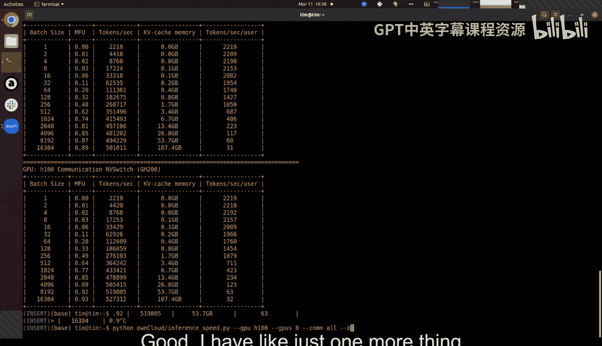

Yeah， let's use  one GPU。 Let's go down to4 bit。 So we have， first of all， let's go back to 16 B。

 There's one GPU 16 B。 We get 277 tokens per second。 If with a large batch size。

 we get 92 tokens per second， let's go to4 bit now。

And so what we are seeing is that we get much more tokens per second。And for small batch sizes。

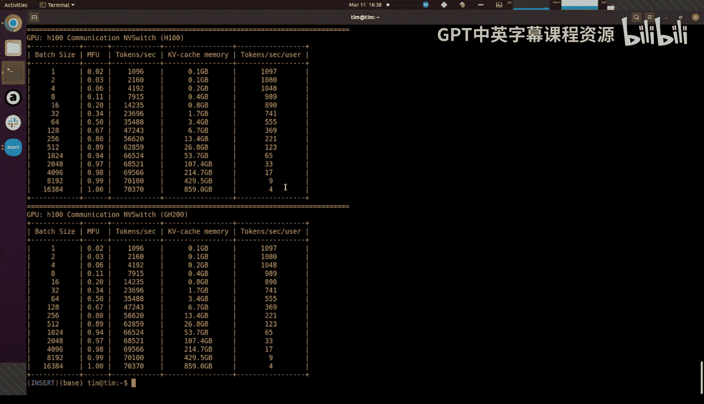

And in this case。

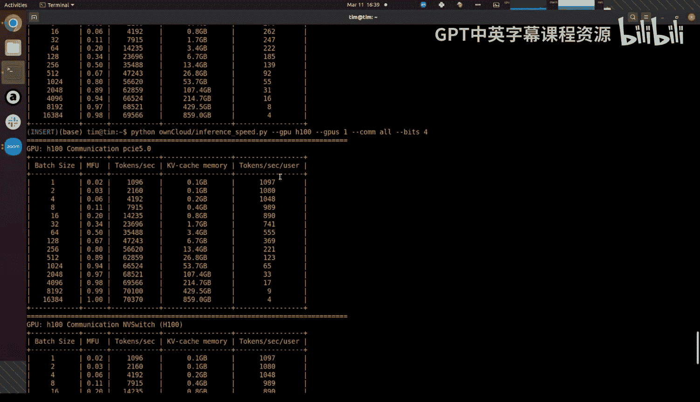

Let me check this again。😔。

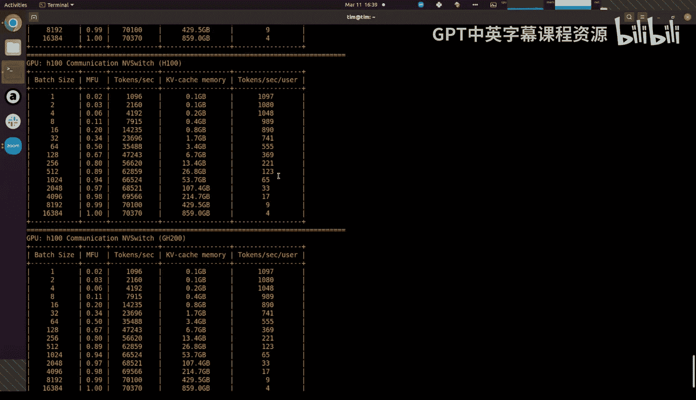

嗯。Okay， this doesn't doesn't have quite what what I wanted to show and I think this wasn't actually captured in the simulation that I wrote so the thing is。

If you have a large batch size then you need to do computations that basically leverage this large batch size and it turns out if you have quantization you need to do this decoetization step it's very expensive to do it for a very large batch size that means actually quantization is really good for consumers。

But if it's not supported by your hardware， it's actually very slow if you have large bed size。

 So quantization good， but if you want to leverage your hardware really get a lot of mean flops utilization quantization is only good if it's supported by the hardware。

 and that means you can't use forbibit， you can only use a bit。

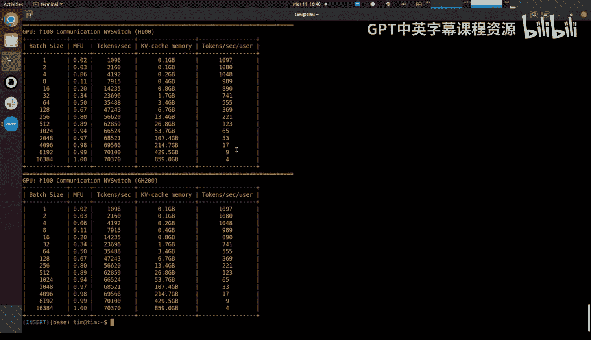

And the new GPUs also support four bit， but almost nobody has them because they have problems， so。

Right now， if you want to do inference with the large pledge size， for bit is actually very slow。

 It's very memory efficient， but very slow for inference。If you use it as a person。

 you use a fourbi as false， but only for that case will you send a single request and get a single request back。

And that is sort of， I think， the main takeaway。that is what I have thank you so much and happy to take questions now。

I dont have a question about our lawyers。

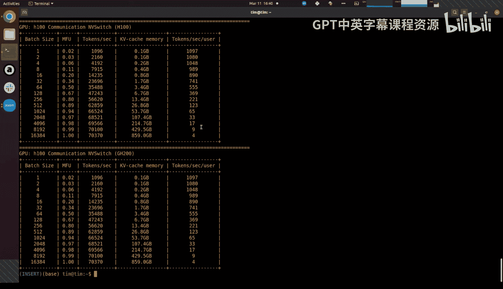

Do you have any intuition， I it's sometimes hard to interpret why the model does something。 Yeah。

 any intuition for why it's having Z letters and in consistent locations。 Yeah， yeah。

 so I actually did a little bit of research about this。 it didn't。End up sort of publishing it。

 but a very important quality neural network is to forget information。

And so you can sort of think about neural neural network。

 it gets some inputs and let's talk about visual inputs because it's sort of easier to visualize。

 you see sort of this animal and you say" this is the cat this is little dog and sort of what you do is you have this cat and dog features and you sort of expand them。

 but then you realize wait， it is the cat。Then you wanted to delete the dog features。

So not confuse yourself。 And that's actually a very important part of neuralne。

 you need to remove information to focus down on information that's actually more critical to the current information processing as you go from layer to layer and these outliers are the easiest way to do this。

 the easiest way to do this is multiply a negative number by a very。

 very large number and edit to your outputs。 And if you hit a nonlinear function that goes to zero and this is exactly what is happening。

 So these outliers are consumed in these nonlinear functions。And then they yeah。

 there they remove information and then they're really created in the same dimension and why are they in the same dimension。

 it's because it's easier for optimization。If the neural network can always rely on a big number being in a certain dimension and knows like。

 okay， if I need to remove information， I just multiply dimension 533 with minus-4 well a large negative number and so it can always realize this there's one dimension there will be this large number it always needs to multiply with a certain value and the part is also。

If you learn these outliers， they're either positive or negative， but once they have a certain sign。

 they never change and for the same reason， because you want to have this dimension that's reliable that you can rely on to remove information。

嗯分。You spoke about scale and levels for precision and how they kind of。Intribute to this。

Theig gains and compute yes。And so there's justs scing laws for a compute。

That have been working for a long time。But I'm just trying to understand exactly what you're saying when you say that precision。

 if the scaling levels of precision have helped。People will get these larger and larger models。

 Do you think that like since these are kind of。Running out there's not much more scaling position that you can do but the amount of size and models has to just not grow that much and you see other bottlenecks before the scaling of models Yes so a big part of progress in AI was and you could train larger models because the cost of training them went down the cost of training them went down because GPs went faster and faster why did they got faster mostly because of tensor costs and lower precision there was a point where people said like you train neural networks in 16 bit are you crazy you need like 32 bits there wasn't even the time we say like 32 bits why why you use 32s you should use 64 bits for the precision and now it seems we go into8 bit inferences already standard and four bits and sort of we do this because this just helped us to use more computation and we save costs and but if this no longer works。

No longer an area of improvement that we can rely on and it seems that's happening so we have this trend where everything got more expensive but GPUs also got faster now GPUs will no longer get faster and everything will get more expensive and you can see that it will quickly solve because just getting too expensive to scale further。

models like worry about I've learned aboutliers theers Yes， so I mean。

 it's quite interesting and this currently not captured in the academic literature what you can do is you quantize a model and really take good care of these outliers but what you do is you have some calibration data and you look at all this data and look at like where am I outliers and I carefully remove them for all my data and you try to make this data as general as possible but the problem is if you run into new data when you as a user suddenly you have some different patterns and the quantization breaks down and your model does some weird things and you decide what's going on now it work before and so this is a problem and so this is actually a nice thing about something like normal flow because it doesn't it doesn't rely on。

Data for calibration it's the same quantization for everything and so we get more robust sort of behavior if you use it wider range of sort of data and so this is the most tricky because if you look at benchmarks a lot of quantized models look good but then if you use it on your data suddenly doesn't work。

And it's very， it's not transparent， and we don't have benchmarks for this。

 We don't have a way of measuring this。 I thinks the most complicated problem。Yeah。

But if say I want to use very large bench style， I want to conize to like what memory。

 assuming that you still want to improve the embar。Yeah， so。

there are certain trade offs that you can make， for example。

 there's one vivarian that's interesting that says like I will still want to be very， very efficient。

But I don't care of how many tokens per second per user I get。

And so what you can do there is basically you have a jagged approach where you have two mini batches。

 you basically advance one and while you dequantize and you can sort of advance the next one in terms of computation。

 and so you have this pattern where you overlap one one one sort of mini batch where you waitful quantization with computation or the other。

And if you do this， then you use the GPU to its full extent， 100%。

And it's very easy to fully utilize your GPU， but if you do this it's also slower so you get less tokens per。

Now if you want to just get at very high speed that's actually more challenging and I mean it goes down back to sort of physical laws。

 you need to process information， you need to retrieve for memory and there's just a certain speed you can do it and and that's based on hardware so difficult to improve there。

I doing this fighting and force aizing and the department helpful。不是。

This will say one by one you mean this is Zag pattern yeah。

 so so you can you can use it if you need to process a large amount of information sort of you don't have much memory and you don't you didn't care about the infant speed so a good way of doing this is you have very very big data set you just want to run it overnight and get all the instance tokens and that's that's something you can do currently they not good software frameworks for this so so it's a bit cumbersome to do technically that's the more efficient way to use CG group。

哎以。Yeah so you talked about the performance for bits kind of plateauing at four bits yes so I'm wondering if you tried also looking at potentially applying the same logic for finding outliers to trying to find features that might be able to be expressed in like one or two bits or do you get kind of like diminishing return。

So。It's it's sort of there's sort of there's some things so you can actually go down a little bit further。

 so they are different kind of outliers if you treat them， you can go closer to three bit。

But then if you try to approach where I quantize this in one bit and this in four bit and this in five bit and on average。

 they' want to be better than four bit。Very very difficult to do it seems you can't really sheet neural networks I tried very hard on this and it's difficult to beat just for big。

You can be this if you carefully consider other patterns in the way。Other kind of oddli。

Any more questions？And I think we're also at time。你两个。

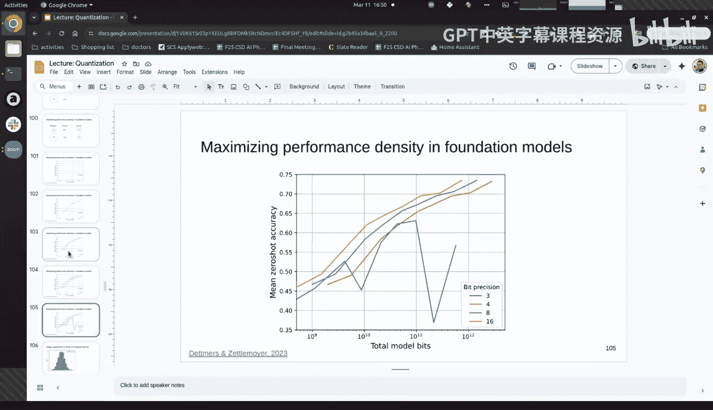