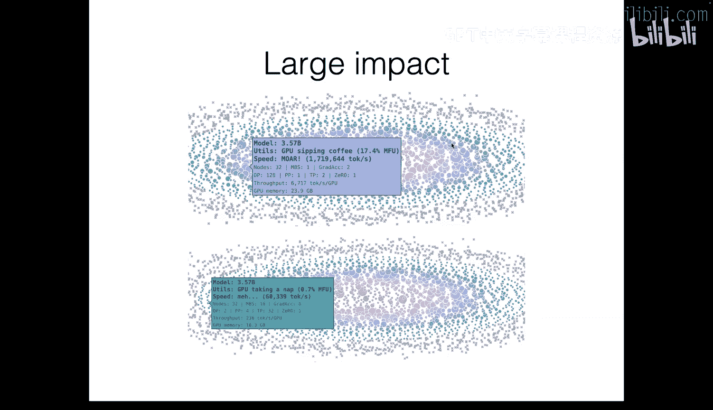
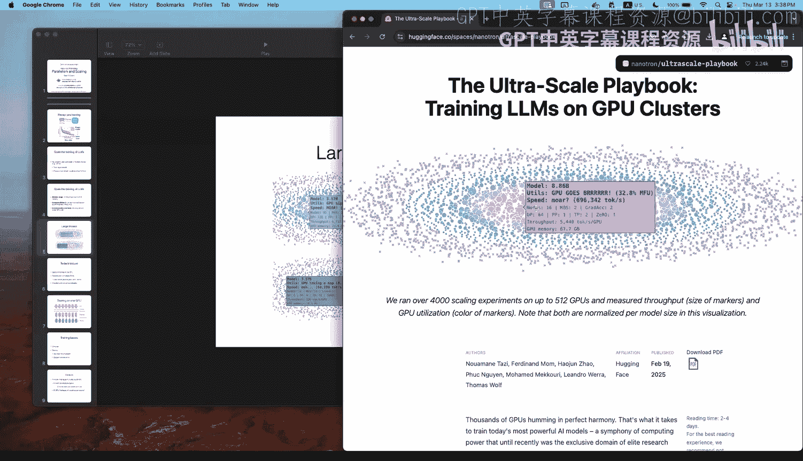
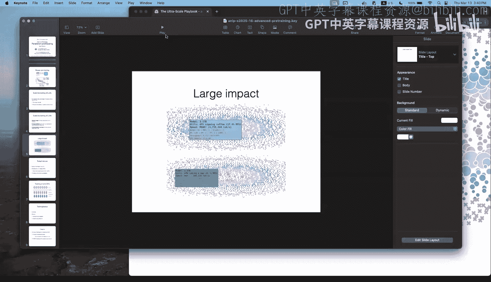
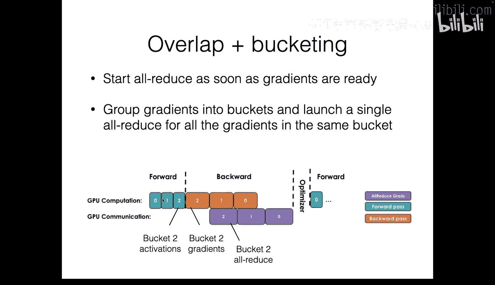
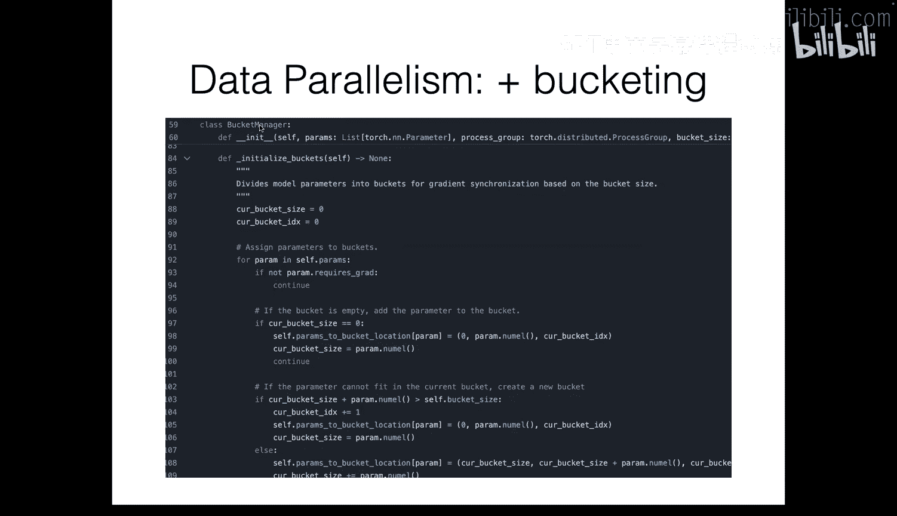
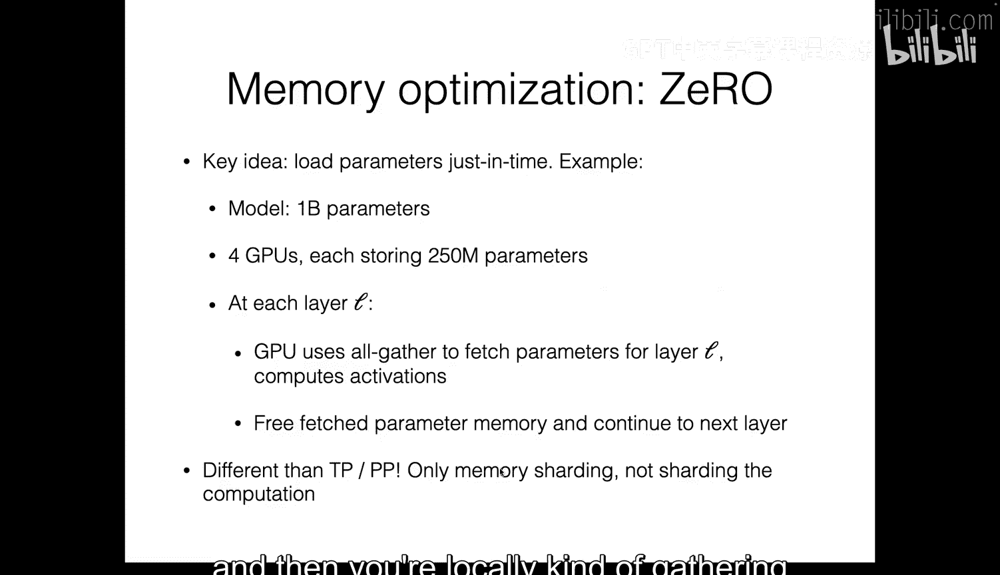
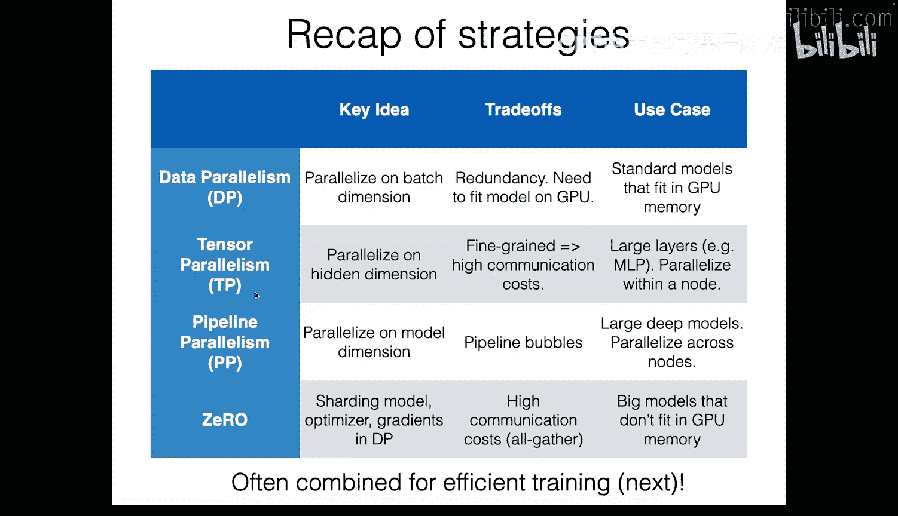
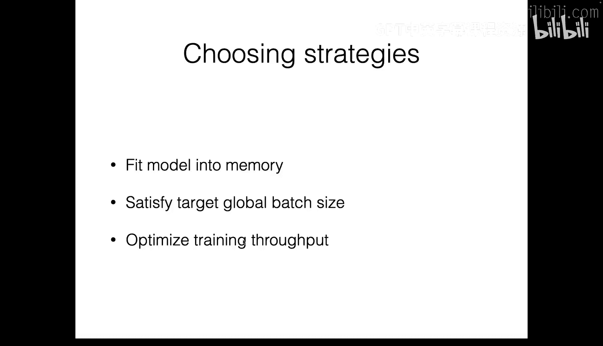
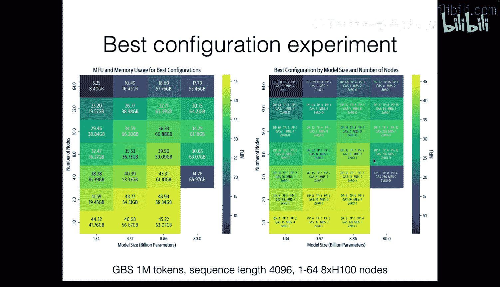
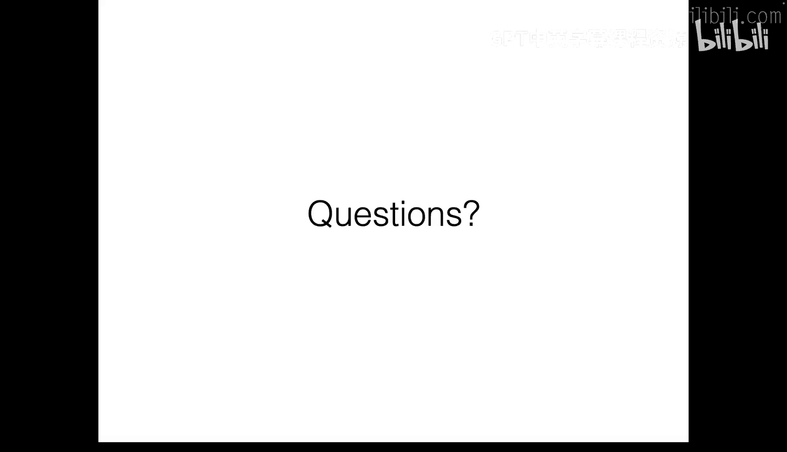

# CMU《高级自然语言处理｜CMU CS 11-711 Advanced NLP Spring 2025》中英字幕（claude-3.7-s - P15：-15-(16)_ Parallelism and Scaling.zh_en - GPT中英字幕课程资源 - BV1nYVHz7Eoa

Now we're going to have kind of advanced versions of topics that we covered previously。

 so today's relates to pre training。In principle， it kind of is just about how to train models。

But I'll go through some techniques for parallelizing models that are very important when you're training really large models and for a really long amount of time。

And really， these ideas are kind of just core ideas to know about。

And so hopefully by learning these things， it's something that will kind of stand the test of time as well。

So a lot of this content， the visualizations and the underlying content。

Is really based on this online book that I link to here。

So it just came out maybe one or two months ago， and it's by hugging face。

Which is the company that hosts the Huging Face Hub that you've seen a few times now。

And they did a bunch of experiments and wrote this really nice book。

 and I'll try to summarize some of the key ideas in this lecture today。So if we recap pre training。

 then at a high level， we have some data and then we。

Perform pre training with the maximum likelihood objective and get the base model。

And the kind of key thing that we observed in the lecture and that。

 you know we observe when we're doing pre training。Is that by spending more computation？

Whi is related to the size of the model and the amount of tokens that you're training on。

 so the amount of data that you have。You get a better model in terms of its loss。Right。

 so here's this plot that we saw and you can see that as you make the model bigger and as you train on more data。

 its loss is decreasing。So then the question becomes like， okay， if we look at this red model。

 for instance， it is 65 billion parameters。And we're training it on 1。4 trillion tokens of data。And。

You can imagine like this might actually be pretty expensive to do。And so the question becomes like。

 how do you actually do this in practice？And a kind of key underlying problem is that you want to assemble as much computational devices as you can。

 So GPUs， if you're at Google TUs。And then the problem becomes。

 how do you best take advantage of these devices to train larger models and process more tokens in a given amount of time？

Because certainly maybe it's possible to just， if you have like the 7 billion parametermeter model。

 just train it on one GPU， but then to get through 1。5 trillionions tokens。

 it would basically take way too long。So。There's a few different things that you have to think about and we'll go into these in detail in today's lecture。

But let me just mention them at a high level。First of all。

 the training steps need to fit into memory， so into your GPU memory in the first place。

So as we'll see， this 65 billion parametermeter model。

 if we just do a single kind of forward pass with it on a reasonably sized sequence。

 then it won't even fit in one GPU at all。And so we really have to take advantage of multiple GPUs。

Similarly， if we like increase our batch size really large。

 then even if we have a fairly small model， we might get a kind of out of memory error with a single GPU。

And then second， if we have all these GPs available to us。Then in some sense， we want to。

Have them spending most of their time doing computation。So this kind of goes with the third point。

 we don't really want the GPs to just be idle， say if we're like copying data from one or copying like the model parameters from one to the other or something like that。

So throughout today's lecture， we'll see examples of。Where these overheads in communication come up。

And the goal is to design different strategies that minimize the communication and allow us to utilize all of the computation that our GPU gives to us。

So。嗯。It turns out that like the strategies for using these different devices can have a large impact。

So at the end of the lecture， hopefully you'll understand everything or most of the stuff that's in this visualization。

 but let me just show it to you upfront。

What they did at Huging F is basically train 4000 different models。

And they always use the same batch size and the same sequence length。

And then they adjusted these different parallelization strategies that I'll tell you about。

And then you can see that each。Point has like completely different utilization or different speeds or different memory usage。

So for instance， this point here。嗯。See。There's too many points。Let's just look at this one here。

Then this one says that the utilization is kind of low。So we'll introduce this idea of MFU。

 we actually said in the previous lecture。And it's at 13%。

And this one is getting to about three million tokens per second。The throughput is 11。

000 tokens per second。And then there's these different settings here， DP， PPP， TP， zero。Great grad A。

MBS。So hopefully by the end of the lecture， those things actually won't seem too mysterious and you can understand what those are。

And then the idea is that like based on adjusting these things。

You can get completely different performance。So this one has even lower utilization， 7%。

The speed went from 3 million tokens per second to 70，000。

And so you can imagine that this has a huge impact on。

Like how well you're using your GPU resources and how long the pre training would take if you're trying to get through like a trillion tokens。

So that's the basic idea and kind of the motivation。

And so in today's lecture， I'll introduce some。Kind of core ideas， just。On a single GPU。

And the ideas will apply to multiple GPs， but maybe it's simpler to just introduce them that way。

Then we'll talk about some of the major strategies for parallelization on multiple GPUs。

So data parallelism， tensor parallelism， pipeline parallelism。

And then I'll also tell you about briefly this kind of sharding technique that is used with data parallelism。

Called zero。And then briefly at the end， we'll kind of summarize it at all and we'll look at that diagram again and think about like how do you combine actually these different strategies。

 which is what is done in practice？So if we think about training on just one GPU。

Then we can have the following diagram。So。What you do first is， you know， as we've discussed。

 do some forward pass and this is visualizing through layers of the model。

Then you do your backward pass。And the backward pass will give you gradients for each layer or each weight matrix in your language model。

Then you apply the optimizer。Typically we'll use Adamom。And。Then after doing that。

 you get these updated parameters and then you can repeat the process。Okay。

 so this is just some visual representation of these major stages involved in training。

The forward pass， the backward pass。You have to manage these gradients。You have to。

Do the optimization step and then you get some updated model。

So if we think about what's involved in this， then you could think about both the compute that is involved as well as the memory。

And then I'll tell you about two common techniques that are used。For handling the memory。

And you could even just apply these if you have a single GPU。

So compute we actually talked about in the previous pre training lecture。So by compute。

 we look at the number of floating point operations that are actually being performed when you do a forward pass through the model and a backward pass。

Right because like doing any one of these things， as Tim mentioned last time。

 really boils down to mostly matrix multiplications。

So then you can actually like count up the exact number of floating point operations that are involved。

And then here's just one kind of rough but widely used approximation。The amount of。

Compute that you're using is six times the number of model parameters。

And then the batch size will kind of add this multiplier so like if you double your batch size。

 the net will double the amount of compute that's being used。Now。

 one kind of confusing thing is that this term floating point operations。Ends in an S。

But then we have another term which is flops， and that's floating point operations per second。

So this is like if you measure some unit of time， say， yeah， say a second。Then you could say like。

 okay， on my GPU or on my device， how many operations actually get performed in this unit of time？

So sometimes it's confusing like people use a lowercase S for the floating point operations and this uppercase S。

Or floating point operations per second。But yeah， there is this distinction between those two things。

So。Then you could think about like， okay。What is some notion of utilization。

 so I mentioned earlier that we want to check how much of our GPU or how much of our computation is actually being used by our code that's running the training。

And so for that， the common。Statistic or metric is called model Fop utilization or MFU。

And it's pretty simple， it's just how many floating point operations per second are actually achieved when you run your code。

Versus what is the theoretical peak floating point operations per second of your GPU？

So you're probably wondering like， where do you get this bottom part？Well。

 like different GPU providers will kind of compute these and provide them。

So here is the actual theoretical peak flops for an H100 GPU。

 you could go on NVDIA's website and find this。And so you can see here that it depends on which。嗯。

Which floating point representation you're using？So 64， 32 or this B floatat 16。The B F at 16 is。

Typically used for。Pre training， but I'll actually share the details in a bit。

And so then you can get this number here， which is。1979。Terra flops。

And I thinkterra flops is like a trillion flops， so。This is。

2000 trillion floating point operations per second。So kind of a lot。And then the question is like。

 okay， why don't we achieve the theoretical peak？Well。

 these are some of the things we'll talk about later in the context of multiple GPUs。

But even with a single GPU， you could have communication costs for like managing the GPU memory。嗯。

This ties into the kind of memory bandwidth of the GPU。

 which is another thing that you can go look up on the NVIDo website。And then as I mentioned earlier。

 there's often idle time if you're kind of doing communication instead of doing computation。

So we'll have a later lecture on speeding up inference and for those I'll maybe go into some of the more。

SomeSome of the details for a single GPU and I'll talk about things like flash attention and managing the GPU's memory and things like that。

Today we'll mostly focus on what happens when you go to multiple GPs。So we'll discuss this later。

Okay， so that's compute and then if we think about memory usage。Well， at a high level。

 what memory is involved in training？Well， we have to store our weights of the model。

 you have to store the gradients。If you remember with Adam， you have this like momentum and variance。

Prameter or states， so you have to store those。And then as you're performing the forward or the backward pass。

 you have to hold the activations in memory。And then each one of these things just comes down to some tensor with a particular shape and then a particular precision for how you're storing the actual numbers。

So。If we look at a rough approximation of the memory usage that's used in a training step。

Just to get some sense of。Yeah， some approximation。

Then one thing you could do is you could store your model in this B floatloat 16。

And so 16 means you have two bytes。And then you multiply it by the number of parameters。

Then it one technique that's common and as we saw in the previous lecture。

 there's many different ways to do this this is just。Maybe one common example。

But you could actually store the gradients as well as an extra copy of the model in a higher precision。

So that would be another four multiplier of four times the number of parameters。

And then let's say that you're using atom， then you have to store these momentum and variance states for each parameter。

So that increases it even further to now you have， if you store them in 32 bit precision。

  four plus four times the number of parameters。And then I'll actually talk about them separately。

 but then on top of all this， you have the activations。

But you can see here that there's kind of a lot of。Memory usage when you're training a model。

So one cool thing is that you can actually visualize how the memory usage evolves as you're doing。

Training， so as you're doing the forward and backward passes。

So there's a kind of interactive visualization on the。The online textbook。

But just to show you some things here， so the different colors represent different types of memory usage。

So for instance， purple is the activations。嗯。So here we're doing some。

Some forward pass and then a backward pass and then an optimization step。In orange is the gradients。

So I think this is like the gradients。kindin of。嗯。For the different parts of the model。

And then in pink， we have the optimizer state。So right at the beginning of training。

 the optimizer state hasn't been initialized and then you can see it here and it kind of stays constant throughout training。

嗯。And then here， as you're performing the backward pass。

 maybe you can free up some of the memory from the activations。And then you start over again。嗯。

So yeah， this is kind of cool and it actually shows you that。

 you know things like the activations can use up a lot of memory and of course。

 even these optimizer states can be using more memory than your underlying model。

So it's good to remember that if this is like the。You know。

 first time thinking about where the memory is being used。

Then if we look at the memory and I think this is just the。

So it's not accounting for the activations。But if we just look at everything else。

So here we have models of different sizes from 1 billion to 400 billion。

And then here's two different settings for choosing the precisions。

 you don't really have to worry about the details for the slide。

But it's just showing you how the memory grows。And you could see that very quickly。

 even with this seven billion parametermeter model。

 you're not able to fit it on to even a single H100。GP， which has just 80 gigabys of memory。

So we have to come up with other ways of。Utilizing multiple GPUs in order to perform the training。

So another factor， aside from the kind of fixed memory usage of the model the。

Grads and optimizer states and things like that。Is as I mentioned， the batch size。

So if you have a small batch size， then you could think of this as adjusting the parameters kind of quickly but noisily。

If you have a larger batch size， then it's averaging over many different gradients to come up with an update。

So this could be at， you know， a high level， maybe less noisy。

And you take fewer steps to train on a given data set。Now， if your batch size is too large。

 then you could kind of imagine that maybe any particular sequence is not contributing that much to the update。

And so you can actually。Maybe like not have enough information in the updates if you have too large of a batch size。

So in practice， you have to kind of find some good batch size。

But typically they do get pretty large because。These pre training data sets are massive。

 they're trillions of tokens。And so we really want to just like process tokens as fast as possible。

So you could break down the batch size into the sequence length and then kind of if you like stack multiple sequences。

So this BST stands for。Token batch size or batch size of tokens。And yeah。

 typically ones that are used for pre training， if you look at paper some recent papers。

 they could be from  four to 60 million tokens。In one batch。So pen of large。And then of course。

 if we make it too large， we can get out of memory。

Because the batch size will increase the size of the activations as you pass it through the model。

So here you don't have to worry about the exact details。

 but here's an estimate of how much memory is used by these activations。

And you could at least see some interesting things that。

It'll increase linearly with the batch size or the and actually increases quadraically with the sequence length due to the attention。

And then here's just another visualization of how memory is consumed as you increase the sequence length。

So it's pretty interesting here， you could see that if your sequence length is like1 thousand00。

 then activations are relatively small proportion of memory。

But then if you go to a longer sequence length。You have this quadratic growth and you can see that。

Um， you know， the key kind of bottleneck is dealing with these， the memory from the activations。Um。

 so。I'll talk about two methods that you can use for getting much nicer looking plots。

 so kind of dramatically reducing the amount of memory from the activations。

But let me just pause here for a second if anyone had any。Questions so far。

I was wondering this is kind of the beginning of the lecture where the six comes from with the six times model parameters times。

Yeah， so I think this approximation was from the one of the early scaling laws paper。

And they actually go through and compute exactly how many floating point operations are used in a transformer for forward and backward。

 and you can do that by yeah， just looking at the different layers and things like that。

And then I think along the way， they just say， oh， if you group this into this approximation。

 and then at the end， they kind of do a final thing and get the six。

So I can't say exactly where it's from， but you can check out the original scaling loss paper from Open AI if you want to take a look at it。

嗯。Okay， cool， so I'll talk about two methods。 So the first one is called activation recomputation。

 that's what they refer to it in this textbook。 it's also called gradient checkpointing。

And at least in my experience， that's the kind of term I commonly see in like libraries and things like that。

So gradient checkpointing and activation recomputation are the same thing。So here。

 the basic idea is that。In order to perform the backward pass。

You need to use the activations that were computed in the forward pass。And so you can imagine that。

 you know， naively or just in the standard case。Maybe you perform the forward pass and you just keep all of these intermediate activations。

In memory。Then the problem is that blows up and you get an out of memory。

So this trick basically says like， okay， at different stages of the transformer。

 we will save the intermediate activations。And then let's say we have activations for right here where my cursor is。

Then during the backward pass， you can like only recompute this small window right here。

In order to get the activations for this weight matrix。Okay。

 so you basically keep these checkpoints at certain points。And then you step by step。

 just recompute the activations as you're doing the backward pass。

And so the idea is that this becomes more expensive from a compute perspective。

So it can take longer because you have to keep doing this recomputation。

But you can save a lot of memory because。Now you're just saving these intermediate checkpoints of the activations versus all of the activations in the forecast。

So there's different strategies for how you choose the checkpoints。One is you could just。嗯。

Checkpoint like before each layer。And then you could imagine that， like。You know。

 people are spending a lot of effort pre training language models。

 so people have looked at like what are the different， you know， good places to have checkpoints。

But that that's a basic idea。So。Yeah， you can get these kind of dramatic。

Improvements in the amount of memory that's being used or dramatic reductions。

So here's without the recomputation or checkpointing， and then here is with the recomputation。

And this is using some strategy called selective， so it's only keeping checkpoints at certain points。

And。Yeah， now you could see just kind of fundamentally different than。Without it。So you can keep。

 if you have enough GPU memory， then you would keep them in GPU memory。Yeah。Okay， so yeah。

 you'll see this， you'll see this term gradient checkpointing come up from time to time。

 and so that's what this is。And then the other technique is called gradient accumulation。And so here。

 the idea is。Let's say you have a batch of。Size 16。And you want to do gradient accumulation of two。

Then what you would do is you' would have two micro batches of size 8 so that they add up to 16。

And you basically do a forward and backward pass on the first micro batchch。

Then you do a forward and backward pass on the second micro batchch。

And then you average together the gradients。So you wait to do the kind of optimization step until you've gone through each micro batchch。

嗯。But in doing so， your gradient， your update essentially。Comes from this batch size， which is。

Based on a larger number of tokens。So in particular， it's usually called the global batch size。

And it'll be the size of your micro batchch times the amount of gradient accumulation that you want to use。

So this is visualized here and this just means these are like different micro batches and you're kind of going one by one。

 doing the forward and backward pass for each。Averaging the gradients and then you know。

 applying atom or the optimizer。So here again， if you just help one GPU。

 then you're not doing this in parallel， and so this obviously can slow things down because you have to now do like multiple forward and backward passes。

But since batch since the micro batchch size is a lot smaller， you'll consume a lot less memory。

And so the gradient accumulation can be combined with the techniques that I'll talk about later for multiple GPUs。

You could imagine that， like on any given GPU， you can further apply gradient accumulation。And。Yeah。

 I have this kind of。Sequentl。Tecique to。Simulate a larger batch size。So I didn't put the plot。

 but yeah， you can also get these kind of nice looking reductions in the amount of memory that's being used。

But then， of course， it'll increase the amount of time that's used。Okay， so。

Those were the basics for a single GPU， so I introduced this idea of compute。And。

The sources of memory use。And then two techniques that are used that you could use on a single GPU or you can add them to the techniques that I'll talk about later。

Actation recomputation and gradient accumulation。And then one thing to remember is like what happens if you get。

You know， more memory。Well， then you can kind of spend the extra memory that you have to increase the batch size and hence go through your data set faster。

Or you can spend it by training a larger model。So that's the first section and。

Any questions here before I start talking about the multi GPU strategies？O， cool。So yeah。

 I'll talk about a few common strategies for leveraging computation and memory from multiple GPUs。

So I'll start with data parallelism。So here， let me， there's diagram。

 but let me just say it in kind of English。Here the idea is you can have。

Multiple one copy of the model on each GPU。 So you replicate the model on several GPUs。

And then on each GPU， you can run the forward and backward pass on micro batchches。

And then you can average the gradients from the different GPUs。

So one way to think about this is that it's essentially gradient accumulation。

 but now it's in parallel。So now you have multiple GPUs performing these micro batchch。Computations。

 then you average the gradients at the end， and then you have to update all of the different copies of the model。

So here's what this looks like now， and as I mentioned it's actually the same diagram as for the gradient accumulation。

But now on the left hand side， you can see that here each micro batchch is being passed to or is being。

You know， performed by。An individual GPU。And then each one of these GPUs will have its own copy of the model。

So one thing you have to figure out is。How you。嗯。So after you perform the update。Then， you have to。

Sorry， after you compute the gradients。You have to gather all of the gradients from the different GPUs you know。

 so you can average them。嗯。And so that requires communication across multiple GPUs。

And it turns out that you can think a bit about like when you perform this。This communication。

And the operation is called an all reduce。 So it's basically taking all of the different gradients。

And then it's performing this reduction operation， and one example of a reduction operation is taking the average。

So it's referred to as an al reduceduce。And in the naive case。

 what you can do is let's say you can wait for all the GPUs to finish doing their forward pass。嗯。

Then you can wait for all the GPs to finish doing their backward passes。

And then perform the or reduce。Now you can notice here that。There is this。

Dead time here where the all reduces is being performed and your GPU is not doing any computation。

So that's what I was referring to before， this is like what we kind of want to avoid that would give us lower utilization。

So you can kind of come up with different tricks。So one trick is to overlap is to overlap computation。

So what this would look like here is these numbers are the different layers of the model， so layer 0。

 layer1， layer 2。Then you can notice here that like， okay， once we have the gradients。

For the last layer of the model。Since back propagation moves from the last layer to the first layer。

We can actually just start updating the we can start doing the all reduce for this last layer。As the。

Previous layer is starting to do its computation。Um，So yeah， in this sense。

 we don't have to wait all the way to the end。We can just start doing these individual or reduces early on。

嗯。And then also， there's another technique called bucketing。And this just means that。Yeah， you can。

 it's a kind of design decision to determine what are these different blocks。

So they could be layers of the model， or you could come up with better ways of kind of you know。

 partitioning them into these buckets。But the kind of key idea here that like you know comes up a lot in when you're thinking about these things。

 is this idea of overlapping communication and computation so that you're kind of utilizing your GPU at all times。

This， I want to just put some code here to say that the。Textbook that these slides are based on。

They actually built a kind of minimal library that implements these different strategies。

And so you can actually go in and see exactly how the different things are implemented。

Some of this stuff gets， you know， kind of tricky to think about because things are happening like in parallel。

But they do point you to the different。Code points and yeah。

 it could be pretty helpful for actually seeing how the things are implemented。

So this is just showing this。Bucketing thing that I told you before and yeah。

This is their bucket manager。

Okay。😊，So then in summary， if you are doing this data parallel。

Then you again have this notion of a global batch size。

And it'll be based on these micro batches that are computed by each GPU。As I mentioned before。

 you can still apply gradient accumulation if you want on each individual GPU。

And then this DP here refers to how many data parallel instances you have。

So like if you have eight GPUs and you want to have eight instances， then you would set DP to eight。

 for example。嗯。So then here's just a concrete example。

I apologize didn't put like transitions for the bullet points， so a lot of。

Text comes up on each transition。But anyways， let's just start at the top here。

 so let's say you have four million tokens。And your sequences are going to be length 4000。

Then you would want to use the batch size of you 1024 to make it a power of two。

And then let's say that each GPU can only fit two sequences。Then that would determine。

What our micro batch size is？And then let's say that we have 128 GPUs。

Now we would be able to have a batch size of 256。And so you would still want to use gradient accumulation of four。

To achieve your target batch size of 1024 sequences or  four million tokens。Okay。

 so that's actually showing how you would kind of think about like， okay。

 we have this target batch size and then。How do you actually translate it to。

Using data parallelism and gradient accumulation。If you had 128 GPUs。Okay。

So then we could think about like， okay， can you just keep increasing the number of GPUs forever and does the performance kind of smoothly scale？

Well， what happens is that the more GPs that you have。

 the more coordination or communication that you have。So if you're performing the Al。

 then you have to， yeah， do communication with more GPUs。

You could have like GPUs fail or they just start running really slowly for some reason。嗯。Or yeah。

 one is just slower than the other。And then another big distinction is like communicating within a single node。

Versus multiple nodes。So a single node will typically be eight GPUs。

So I guess this is always showing maybe multi node communication。

But your communication within a node will be a lot faster。嗯。

Then this kind of inter node communication， or at least they'll have。

Different types of communication for the two， so you have to be aware of that。

And so what happens is that with data parallelism， since you have these larger and larger r reduces。

There's actually kind of diminishing returns with the scaling。So on the Y axis here， we have。

What's called the throughput？So it's the tokens per second per GPU that we're getting。

And you can see that you in this kind of overhead of。Increasing the parallelism。Each time。And so。

Yeah， that's just like a general thing to know about。Now， the thing is is that this is。

On the Y axis per GPU。So if you multiply by the number of GPUs。

 you're still processing more tokens per second， but the idea is that the efficiency is dropping。

Okay， so then that's data parallelism， so there's a question here of like well one。

 can we get some more favorable throughput scaling than this？And then number two。

 one big issue here is that。Each one of these copies has to actually fit the entire model on the GPU。

And so if your model is too large， like this 70 billion parametermeter model。

Then this red line is showing a single GPU size。Then you just can't use this。

 at least the naive data parallelism。So I'll talk about the next method called the next two called Tensor and pipeline parallelism。

That can get around this。And then I'll also talk about this method that can be combined with the data parallelism to kind of shard the model or the optimizer or things like that。

So the next pattern， I guess， is called tensor parallelism。And so here the idea is。

You can look at how these matrix multiplications are done。

And then come up with different ways of splitting this weight matrix。

And basically distributing the computation across multiple GPs。

So we're going to look at this example， so here is our input X and you have this like4 by two matrix。

Then you have your weight matrix， which is two by two。

You do the matrix multiplication and you get some output。

So the first way to split things up is to split by the columns。

So now you can see that here we have kind of two different GPUs or two different groups。

And what we've done is we've taken one column of this weight matrix and given it to each GPU or each group。

So now you have to perform this communication here， it's called a broadcast。

To basically send the input， you know， to each GPU。And then the。

Kind of key difference here is that you're not doing a full。Kind of model forward pass。

 you're only performing computation for this like slice of the weight matrix。

And then you have to do another communication to combine the results。

So if you look at matrix multiplication， then here you can just combine things by basically concatenating these columns together。

So you can also split by the row。嗯。Actually， I think this is an error in the textbook。

 I don't think this is supposed to be a0 up here。 But anyways， it's showing the idea。

So here now we've split the weight matrix by rows。Now we get these two different。

Intermediate computations。 and they're kind of of the final size。

 So now we want to do an all reduce and add them together to get the final result。And again。

 you can kind of work through matrix multiplication to convince yourself that it's equivalent。

So again， the basic idea is now we're splitting up at this like finer grains level。

 splitting up the weights， and we again incur these communication costs。So unlike data parallel。

 yeah， unlike data parallel or you just copy the model with this tensor parallel。

 you have to think about exactly how you split things up。

So here's just showing you two examples of how people might do it in practice with transformers。

It turns out that。If you want to parallelze the feed forward layer in a transformer。

Then it might have two subsequent weight linear layers。

And so it's actually more efficient in terms of communication to do this like column parallel split followed by a row parallel split。

嗯。Again， I'm just showing you this to like give you the flavor of what you have to do if you want to use this。

嗯。And the idea， again， is you want to avoid these kind of communication costs that are involved。

And then for attention， you might use something else like split based on and。

Split based on the attention heads， so like each GPU handles one head。嗯。And then here。

 it's splitting by。By the row for the matrix multiplication at the。So here the benefit is。

That you reduce your memory requirements。So here you can see that if you don't use the tensor parallelism。

 again， the parameters are way over even a single GPU。Now if we use tensor parallelism of eight。

Now the parameters are just down here。And if we go to 16， now you can fit。The parameters， the。

Graadients， the optimizer states。And you can do some training with these sequence lengths。嗯。

So here is just showing the。Yeah， similar benefits， again， if you have kind of more room for memory。

 then you can have a larger batch size。So the drawback again， is these communication costs。

And so now you can imagine that like at each layer of our transformer。

 you have to do these all reduces and broadcasts。And so it's kind of even more expensive than the data parallelism because now it's just。

Go through your model， you have to do multiple kind of distributed communication operations。So again。

 sometimes you have to do a techniquecus to fit on one GPU。

 but you're going to start incurring these communication costs。

And then it turns out that the cross node connections are particularly slow。

So people typically use the tensor parallelism like within a node。

And then use other strategies for parallellyzing outside of the。Outside of one node。

So that's data parallelism and tensor parallelism， any questions？

So far before I move to the pipeline。Okay， cool。 so pipeline parallelism is a kind of interesting idea。

 I there a yeah。So here， instead of splitting like individual weight matrices。

We can just split layers。So for example， you could put layers one through four on a single GPU and then once that part of the computation is complete。

 then you like go to the next GPU， which holds layers 5 through eight。

So this again can be needed if your model is literally too large to fit on a single GPU。

And it's a bit different than the tensor parallelism in the sense that now it's kind of sequential in the sense that。

 yeah， you perform some operations on one and now you have to finish the later operations on another GPU。

And then not surprisingly， if you， you know， only have optimizer states for the layers on the GPU。嗯。

Then and parameters and so on， then you get these huge memory savings。So the key challenge here。

 and you can you have these like interesting diagrams with pipeline parallelism。

So the key challenge here is called the bubble。And it basically comes from the fact that since we're doing these sequential computations。

You now have this dead time， this idle time on GPUs that have completed their computation。

So for example， if GPU one does layers one through four， then it just waits until。

Everything else is done and then it finally does the backward pass for you know。

 layers one through four。So a lot of wasted time here or a lot of wasted utilization here in the middle。

And this is referred to as the bubble。So then the challenge will be like。

 can you come up with these clever optimizations to reduce this？

So these can get pretty like detailed and nuanced and it's still an active area of research so like。

The recent deepse model actually developed this like really clever technique to almost completely get rid of the bubble。

 it's like kind of amazing。Um， but let me just give you a flavor of what， you know。

 things like this look like。So here's a technique called one forward， one backward。

And so here the idea is to start performing a backward pass as soon as possible。

So now the numbers here are not layers， there are different micro batches。

And so let's say that you do like micro batchtch， one， two， three， four。Then you can see here that。

This micro batchch one can complete。And you can start doing the backward pass for it。

While the other GPs are still finishing the other micro batchches。

Then after it completes this backward pass， then this one can start。Computing Micro batchch2。

And it's a bit tricky to think about， especially just like looking at it quickly。

 but it turns out that you know this is kind of valid， it's equivalent。

 and you can get these savings due to overlapping the computation in this kind of clever way。

I don't know if I have another example。Okay， if you're interested in this。

 then again to like probably get all the details in your head right。

 you probably should read through the textbook and they actually go into a few more strategies and yeah they're。

Pretty interesting， and。They even discussed the deep Sequ one at the end。But yeah， basically， again。

 there's this theme of we want to come up with ways of minimizing the communication cost。嗯。And so。嗯。

What is this showing？Here， so okay， so this is using the one forward one backward schedule。

And as I mentioned， these numbers here are the micro batchches。And so the idea is。

If you set micro batchch to say one， then there's no。You can't use this method。

And this is basically showing that。嗯。Oh yeah， so this is showing with a small number of micro batches。

 if you increase the pipeline parallelism， then you get these huge performance drops。Um。

 whereasas here you have， you start off at a much better place with the smaller number of micro batchches。

Again， you incur costs， but it's kind of much better than。嗯。

If you don't take advantage of this kind of schedule。嗯。So yeah， this is using 32， or this is using。

Say like 16 minus1 or like  eight minus one。Okay， so those are three of the main ways to。

Do this parallelism， so there's other ways， and again， if you're curious。

 you can take a look at the book。I might cover one in a later lecture when we talk about the long sequence models。

It turns out that there's ways to parallelize across the sequence dimension。

So like if you have sequences that are length， like  one million。

Then you can come up with new techniques for parallelism for that。嗯。And then， as I mentioned。

 they also talk about。嗯。They talk about something else。

 which I unfortunately don't know if I'll have time to cover in the course。

 which is mixture of experts。And so if you have this mixture of experts， architecture。

Then you could come up with specific parallelization strategies for those。And then as I mentioned。

 they talk in more depth than I wanted to hear about these different optimizations that are done。

So now I want to talk about this。techniqueique。Where you shard things in data perilism。

And you could think of this as kind of being a memory optimization。So。

What you do here is if you remember in data parallelism。

 then each GPU is holding a kind of full copy of the model and full copy of the gradients and the optimizer states。

And in some sense， that is redundant because each thing literally has a copy。

So this strategy called zero redundancy optimizer or zero。In Pytorrch。

 it's called one setting of it is called fully sharded data parallel。

Basically tries to remove these redundancies only st by partitioning the parameters， the gradients。

 and the optimizer states。Across multiple GPUs。So here's a visualization and let me just walk you through it。

So again， if we're doing data parallel， then we copy everything on each GPU。

And then this technique called zero or zero redundancy Opr。

They have kind of three different settings for it。So one setting is that you can shard the optimizer states。

So now each GPU will only hold the optimizer states， so like the atom parameters。

For a subset of the model parameters。And so now you can imagine that in order to。Update everything。

Now you incur additional communication costs。Similarly。You can do this with gradients。

So maybe it makes sense like if you only have the optimizer state here。

 then maybe you only store the gradients on this GPU。And then this03 is the most extreme。

 So what you do is you actually don't have a single。You basically shard the model parameters。And。嗯。

This in。A lot of communication cost。Because basically what each GPU has to do is as it's performing a forward pass。

Then like for a given layer， it actually has to gather all of the parameters for that layer。

Perform the computation， then free the memory， then move to the next layer。

And so you're doing these kind of all gathers to have a small number of。

To have like the full parameters for a subset of the model at a given time。

But it gets very expensive in terms of communication。On the other hand， you can see here。あ the。

Benefit is that you can get。Yeah， huge memory savings。So yeah。

 these techniques are used in conjunction with data parallel。And the setting here at the bottom。

 where everything is sharded。You'll see this in Pytorrch and it's called fully sharded data parallel。

 and hopefully those terms should actually make sense now。

 you're doing data parallel and you're fully sharding things。Oh。

 this is just writing out what I was saying before。嗯。Yeah， if you shard the model parameters。

 then you still need to on each GPU like perform the actual computation。

 so what you're doing is you're kind of doing these gathers as you're performing the past just in time。

And so。Maybe it's a kind of nuanced point， but it's a bit different than tensor parallelism or pipeline parallelism。

Because you're not actually sharding the computation， you're just sharding where things are stored。

 and then you're locally kind of gathering everything to perform the full computation still。

嗯。Okay， and then here's the giant table summarizing all the different strategies。So again。

 with data parallelism， the kind of key idea is that you can parallelize on the batch dimension。

The trade offs to the downsides are the redundancy and the need to fit a model on a single GPU。

And a good use case for this is if you have a kind of small enough model that fits in one GPU。

Then you don't have to change。You know， anything in the internal implementation of the model。

 and it's a kind of， you know， straightforward approach to parallelize。The tensor parallelism， again。

 you have to actually go in and split up these tensors。

So you can think of this as being on like the hidden dimension。

It does have these individual communication costs like as you're performing。The forecast。

But it can still be beneficial if you have kind of very large layers and if you're using the fast interconnect within a given node。

Then the pipeline parallelism。This is， again， if you have a massive model。Typically。

 since this doesn't have as much communication as the tensor parallelism。

People will use this to parallelize across nodes。And then like within a given node。

 you can still use tensor parallelism。And here we talked about these pipeline bubbles and people are coming up with these really clever ways of kind of minimizing those。

Then I talked about zero， which is used for data parallel。To kind of shard where things are stored。

This also has these really high communication costs。嗯。But if you want to these data parallel， then。

You know， it's， it's needed if you have a big model。Now in practice。

 people will combine these different techniques。So I mentioned a few， you know。

 heuristics that are used， so one is like。If you have multiple nodes and a large model。

Then for parallellyzing across nodes， you might use the pipeline and then enter within the node。

 you might use tensor parallelism。But then going back to the visualization that we saw。Basically。

 like as you adjust these different。Types of parallelism into some combination that'll have some impact on your overall throughput and utilization。

Um so。A kind of high level way to think about it is。First。

 you have to make sure that your model fits into memory。So if it doesn't， then you have to introduce。

Let's say you're not using the zero。Then you have to use either tensor or parallel。

Then once you fit the model into memory， you want to think about how you satisfy the target global batch size。

This could be by adding in data parallelism， even adding in the。Gradient accumulation。嗯。

And then there will be multiple ways to satisfy the global batch size。So then maybe you use。

 you perform some experiments or you have some like。Patterns or insights that。

Help you ultimately optimize the throughput。

So then here's some， I guess I don't have the visualization from the starting of the slide。

 but here's a table。 and this is again， looking， I think at。You know。

 all of these 4000 or it's summarizing a lot of these experiments that。They did。

And so on the left hand side， we have。The utilization， the MFU and the memory usage。

For the best configuration。And so this is with a given model size and a given number of nodes。

And so here the utilization， this lighter so like yellow is better and the blue is worse。

And so you can see a few kind of interesting things here。嗯。Just to take one。

 like let's look at this 8 billion parameter model。Then as you increase the number of nodes。

You could see that the utilization is falling and this is per GPU。嗯。

When you look at the really large model， you could see that these。

 it doesn't even fit into memory when you have one or even two nodes。

And if you have two small amount of。Nos。Then you actually get lower utilization than with a larger number。

So here one reason for this is that the model might be fitting into memory with。Fort with 32 GPUs。

But the GPUs are being used at like right at the edge of their memory capacity。

So now there's like a lot of internal memory transfers and things like that。

 and so that actually hurts the utilization。嗯。So yeah。

 there's a few more interesting things if you look at this for a while。

And then this is actually just showing the best configuration。So it's really small。

But now this has these different terms here， and hopefully you should be able to understand these。

 So let's look at this square。It's saying。You have an 8 billion parameter model。

 You have eight nodes。And you're setting data parallel to 32， tensor parallel to one。

Pipline parallel to two。嗯。Gas is gradient accumulation steps。

 So they're using this eight steps of gradient accumulation。

The micro batchch size is actually just one。And they're additionally using this like01 sharding。

And so this is showing the best。Configuration for this model size and number of nodes。

So kind of cool， they did， I think， like 4000 different experiments。

And then you can see these different。Kind of settings that emerge from them。嗯。

Okay， so。That is it for today's lecture， so yeah I went over these ways of parallellyzing training。

 went over some of the key concepts。And。Yeah， hopefully you have some idea of how you scale up these really large models。

For things like pre traininging。So I'm happy to take questions either now or in person。

 any questions said。pe you do some of those stuff that you can use Yeah yeah so I should have gone back and collected some of the libraries。

 so the one that they used for this book it was developed by Huging F is called Ntron。

I think it was aimed at kind of education。But they did run these like you know large experiments with it。

 so if you want just an understanding， you can look through that。And then yeah。

 there will be a different there'll be different libraries developed for the large scale training and they'll have these features implemented。

 so it'll be much different than like a fine tuning library。

But yeah maybe I can collect some of the examples here。And then probably， you know。

 these different companies， they'll have their own in house thing because as I mentioned。

These optimizations can。嗯。Yeah， they're itself like a advantage or like a research topic。

 and so they're not necessarily implemented in all the different libraries。

