# CMU《高级自然语言处理｜CMU CS 11-711 Advanced NLP Spring 2025》中英字幕（claude-3.7-s - P16：-16-(17)_ Long-Context Models.zh_en - GPT中英字幕课程资源 - BV1nYVHz7Eoa

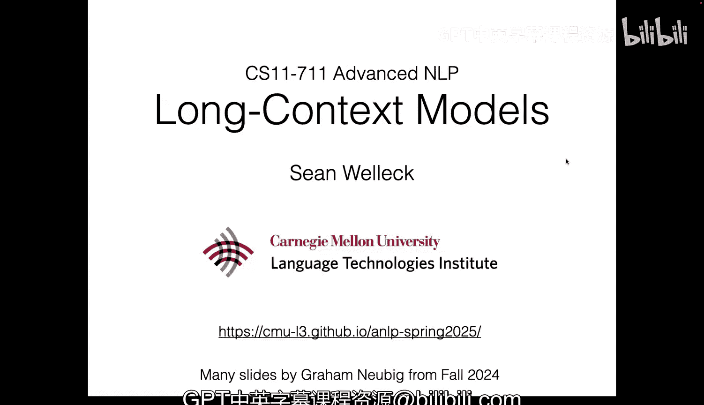

Okay， I think we can get started for today。So thanks everyone for coming to today's lecture。

We had a kind of I swapped the schedule around fairly last minute。

 but I think it's for a good reason。 so following up on the parallelism lecture where we talked about different ways to parallelize models like data parallel。

 pipeline parallel，And tensor parallel。There's actually another way of parallellyzing models related to when you have really long sequences。

And so I thought it would be good to just put this lecture right after talking about some of these efficiency。

Style topics。And so， yeah， today we're going to go over。Moodeelling long sequences。

 or you could call it long context models。And this is a really interesting area。

 really active area of research。So we'll see a lot of different ideas in today's lectures。

From different communities to even like systems community。嗯。

New architectures that have been developed。 willll actually see a few examples from people that will either soon be at Zmu or are at Zumu right now。

So this is really the place to be。And so yeah， I guess we can get started。

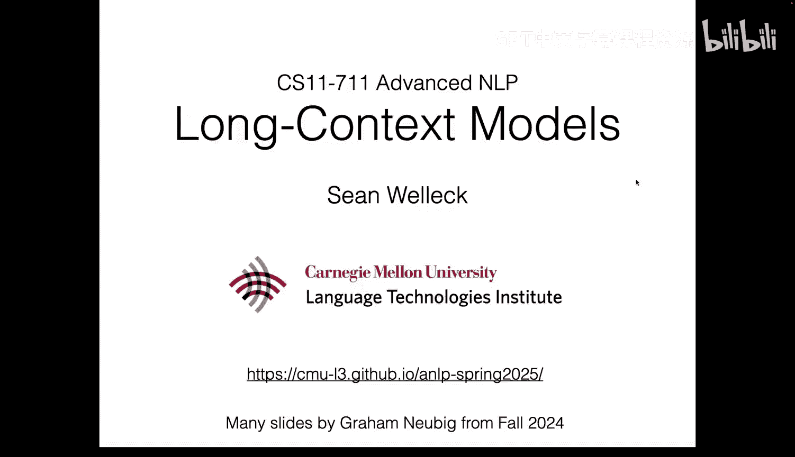

So first， I wanted to just motivate the problem of long sequence modeling or long context model modeling。

So if we look at one sentence， which was maybe traditionally what a lot of NLP was focusing on。

Then with that， you know， we only have 20 or so tokens or in that order of magnitude。

If we look up to a document level， then maybe we could have somewhere on the order of 100 tokens or 10。

000 tokens。If we look at a book， of course， books vary in length， but maybe we're looking at like 50。

000 to 300，000 tokens。If we look at a video， now it's getting much longer。 So， of course。

 videos also vary in length。 You could make this 1 million token upper bound。Um， much longer。

 but just having， you know， a full movie or something like that。Also， if we look at a code base。

 so instead of just generating or trying to understand one functioned or even one file。

Can we have a system that operates on， say， a brand new code base？

Then you start to run into these long sequences。Ranging from， say， 20，000 tokens。To let's say。

 you have the entire。Codebase for Google。嗯。Then， you know。

 you could be looking up to even a billion tokens。And then of course。

 I guess there's one example here with video， but we don't necessarily have to limit ourselves to language。

 a lot of the technologies we talk about apply to other types of discrete sequences。And in fact。

 towards the end， I'll talk about a method well I'll show some results on this kind of problem of modeling genomic sequences。

And so these get extremely long， you could have you know millions of tokens， billion of tokens。

 if you frame this as a kind of discrete sequence modeling problem。So basically。

 if we have methods that only work on， say， 1000 or 4000 tokens。

 which is what we've talked about in most of the class。

Then we really miss out on a lot of these kind of exciting and challenging areas。

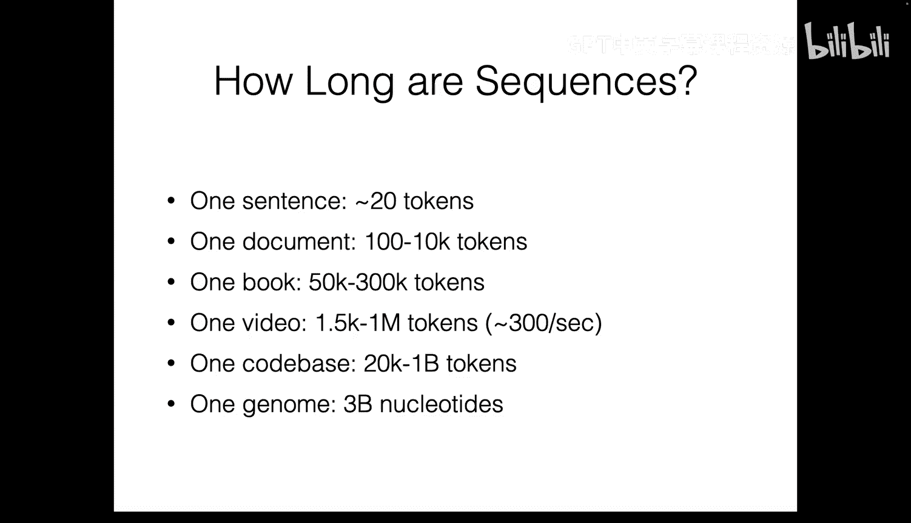

So why is the problem of modeling long sequences difficult？Well， some of the major factors are first。

 the memory complexity。So we talked about memory a lot in the previous class in the context of pre training larger and larger models for more and more tokens。

But certainly as the size of the sequence length grows。

 and we did see examples of this in the previous lecture。

Especially these transformer models can scale quite poorly。So in particular。

 we'll talk about in detail how the transformer model scales quadraically in the memory requirements。

And how this leads to different issues and also some interesting methods for overcoming it。Also。

 the transformer models scale quadraically in the amount of computation。

So if you think back to the attention again。You both have to store these。

Intermediate matrices in memory， but you also have to actually do the computation。

And so we'll go over the。Computational complexity again in this lecture。

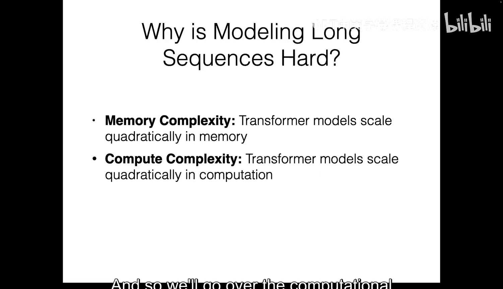

And then also training。 so when you think about it。

 like I mentioned a code base with 1 billion tokens in it， but actually maybe there's not that very。

 there's not very many of those。 and so when you actually look at all the training data that we have available。

 maybe not much of it。Is actually long context or it's very difficult to kind of get it into a good form relative to all the other data。

So again， we'll talk about this and I'll share some concrete examples in the lecture。

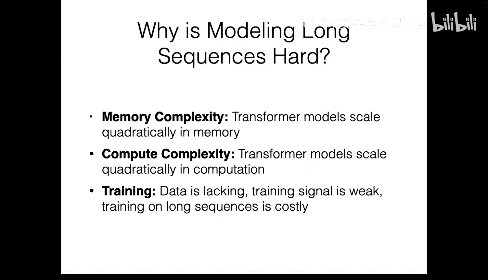

So what are some different use cases and these are just some examples。

We can look at a couple different benchmarks or ways that people measure performance on long context tasks。

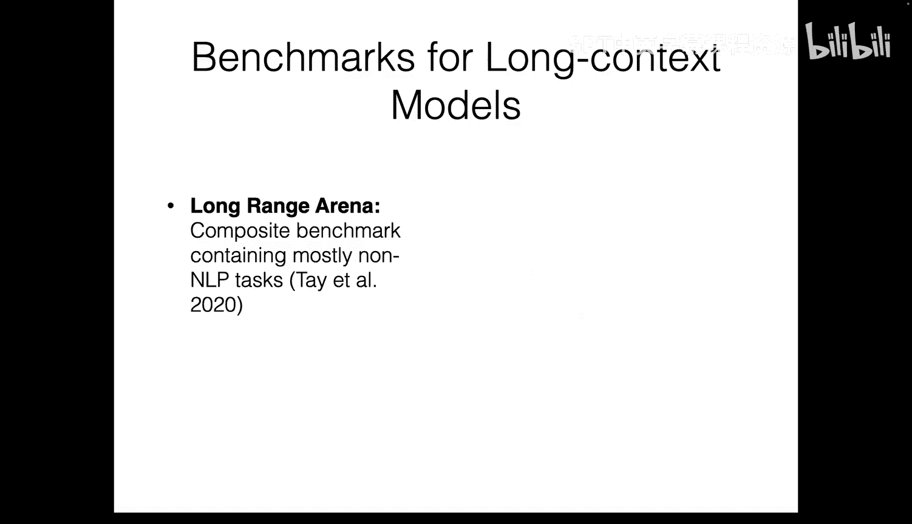

So one is called long range Arena。And they basically come up with a wide range of different tasks。

 mostly non NLP， that have some kind of long range dependency。There's also NLP specific benchmarks。

 one of them is called scrolls。So here you have， you might have。you know。

 some really long document or some long sequence in general， and then you have to summarize it。

 you have to answer questions about it and so on。And so here you can see like the。Yeah。

 words for input。For these various tasks in the data set。And I guess here I'm actually not。

Showing too many concrete examples， but we'll see some examples just when we see plots for the different methods。

As I mentioned。These different domains can raise。Kind of challenges for long context modeling。

 like modeling， images， videos， genomic sequences， things like that。

It's like what are those individual shapes in the graph represent present？

So this is the distribution of for a given input， how many words it has in the。Yeah。

 in this like subset of the data set what do the word like what exactly does the bird line represent？

Oh， yeah。 So these would be the context length for these different models， yeah。So yeah。

 you can see that kind of out of the box， you really can't。Do you。

 you have to like truncate the seation thing， yeah。Okay， yeah， great question。So yeah。

 maybe just talking through some more examples， another one is with the agents that we talked about in the previous lecture。

So there， let's say that you are keeping track of the history of the agent。You know。

 you start off on some webage and then clicks something， know you have a new web page。

And if you keep kind of concatenating this， the context was up very quickly。So yeah。

 the idea of long context as a challenge。Really became a lot more popular as the language models like GPT3 started being more capable in different tasks。

But now with this new wave of interest in agents， it's again kind of a really important problem to tackle。

And then yeah， on the previous slide I mentioned the code generation。

 so again there's a lot of interest in being able to have a system that works on your code base。

And so there's a lot of different ways for。Trying to tackle that。

You could use things from ideas from retrieval。But at least as a first pass， one thing to try is。

 can you just represent the entire code base as a sequence and try to give it to your model？

And in practice， maybe you want to do something kind of in between。

 but you it becomes more and more useful to have a model that can kind of accept and understand a really long input。

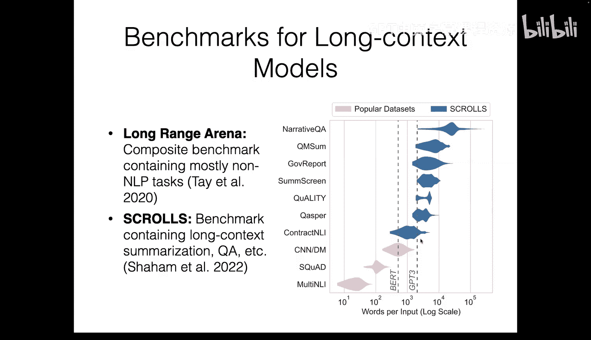

So those are some of the use cases and so we can look at some analysis that has been done in some different tools。

So this was a paper in 2023， and it was looking at this model， GPT 3。5 Trbo。

And the specific version of it。And what they found was that， although this model had。

A longer context length than other models at the time， maybe。

It actually wasn't very good at actually using the context。So here again。

 context means that we have some sequence and we are providing it。As input to the model。

And so here they have this task。And they show that the model is good at。

I think this is question answering。 The model is good when the。

Relevant context for answering the question is either towards the beginning or towards the end of the document。

But if it's actually somewhere in the middle， then the model wasn't very good。In fact， it was like。

Worse or equal to a model that actually doesn't get the context at all and just answers the question based on its parametric knowledge for pre training。

Now， as we'll see， and as you might imagine。Once this problem was identified， kind of the community。

嗯。Well， it's either correlation or causation， but since then maybe some of the more recent models don't have this problem。

But it's a kind of interesting thing。 and one thing to always keep in mind。

 which is even if a model can accept a long context。

 is it actually able to leverage it for different tasks？

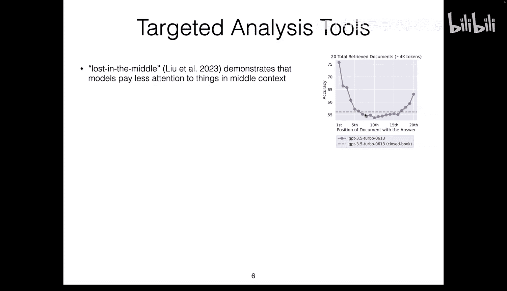

So on that note， there's this really simple diagnostic task that's used。

And it's called needle in a haystack。And。To be honest。

 I forget the exact question or task that they have。

 but the basic idea is they have a really long document。And it's just about some general topic。

 and then they put this statement in there。That really requires just like retrieving the statement。

 it might be like the magic number is 2，4，6，8 or something。

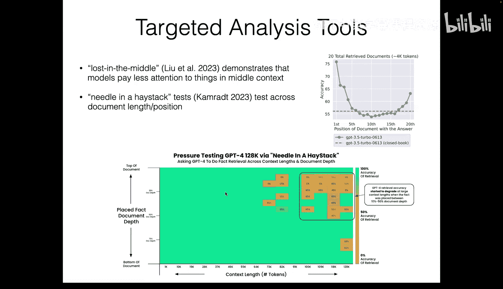

But I think it's actually something about Paul Graham， this venture capital guy。嗯。But anyways。

 it's basically constructed so that you have to kind of look in the context， get the information。

 and then produce an answer。But it's also very simple。And surprisingly， when this came out。

 models would have these kind of。Od failures where they actually weren't perfect。

 even at this very easy task， where they just have to look at the information in the context。

So this became a popular diagnostic to use if you developed a new model which claimed to have a long input context。

Now， if you look at recent papers again， you'll see mostly like a green box。

So there have been other variations of this that require like looking at multiple pieces of information。

 maybe synthesizing them in some way。And in fact， there's this paper or kind of a benchmark called ruler that compiles these different needle in a hisystack tasks。

But again， these are kind of diagnostics。 Ultimately。

 you do want to still perform like a more sophisticated task like。I don't know。

 providing code suggestions in a long repository or something like that。

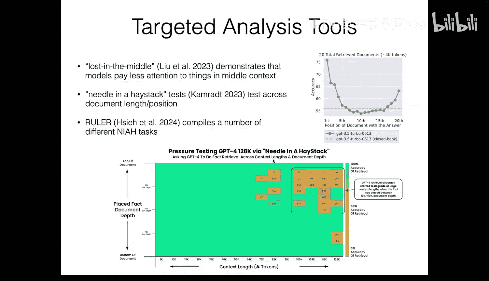

嗯。And then the other phenomenon that is interesting to think about if you have a long context model。

We actually talked about this in the prompting lecture。But it's this idea that you know。

 potentially you can do in context learning so you can train a model on a new task。

Without actually fine it or updating its parameters。In particular。

 you can kind of give these input output examples and give a lot of them to the model。

So in the prompting lecture I showed a different paper， but basically at the same time。

 there was this reallyiness paper from here at CMU， and if you recognize the name。

 it's by Amanda who gave the decoding lecture in this course。

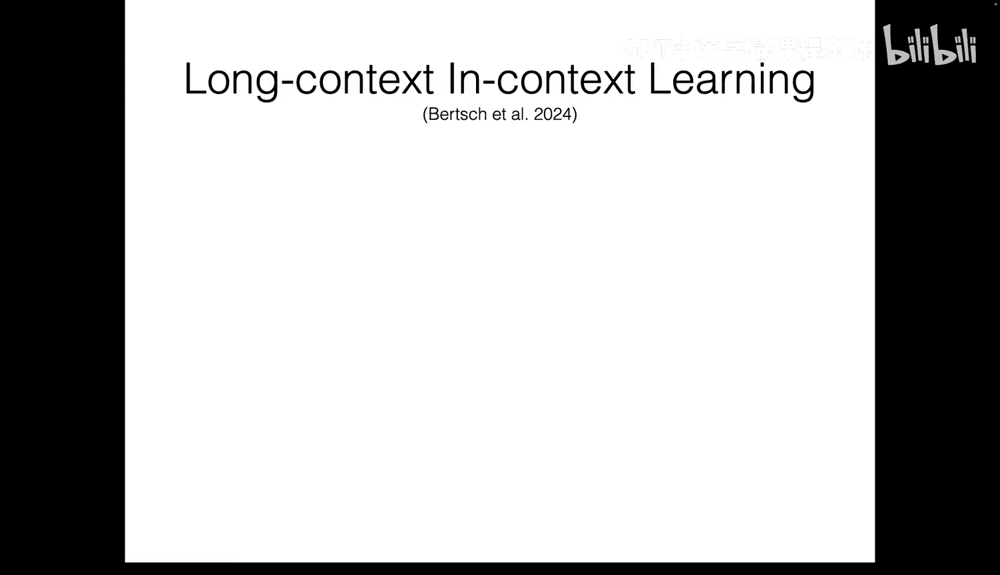

And yeah， they have these nice results which show that on various tasks as you increase the number of examples in the context。

You see these performance gains， you know， almost as if the model is being trained on more and more data。

And most of the time， it's actually better than fine tuning on the。Corresponding amount of data。

In some cases， like here you can see that。Yeah， fine tuning ultimately does start to overtake it。

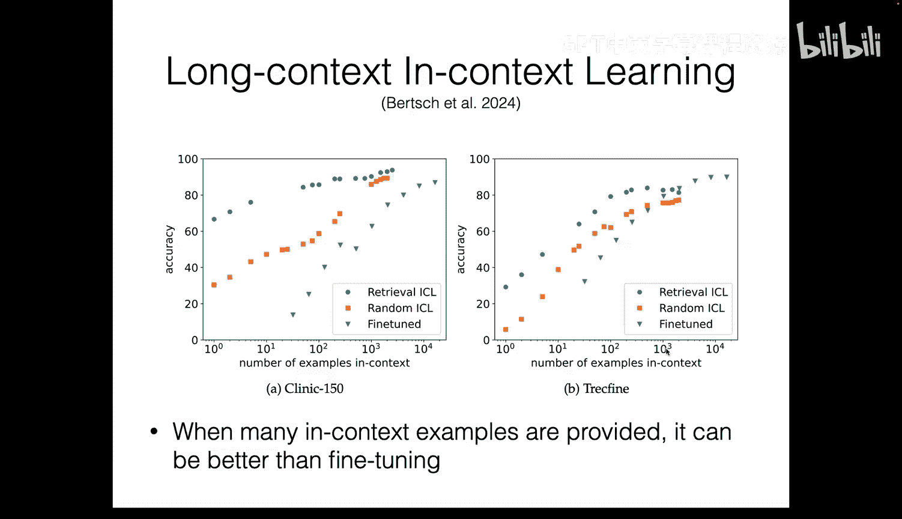

But it kind of shows that， you know， this。Paradm of。

Providing a lot of different examples just in a to a long context model could be a way of kind of quickly adapting to a task。

 let's say if you have like 100 examples or less than1000 examples。

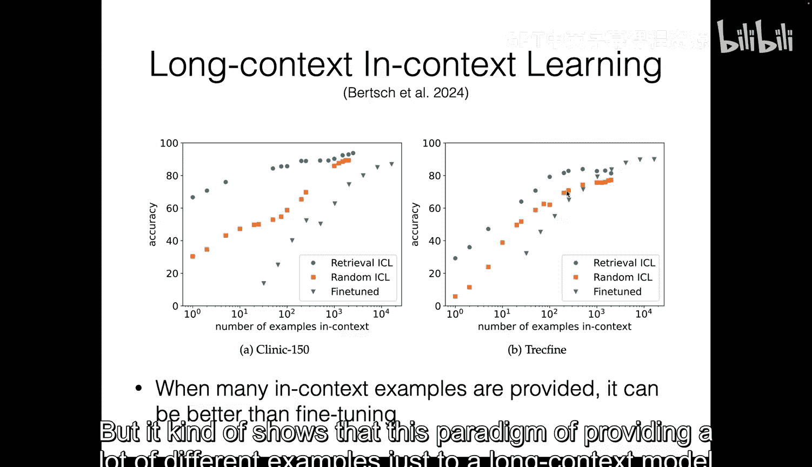

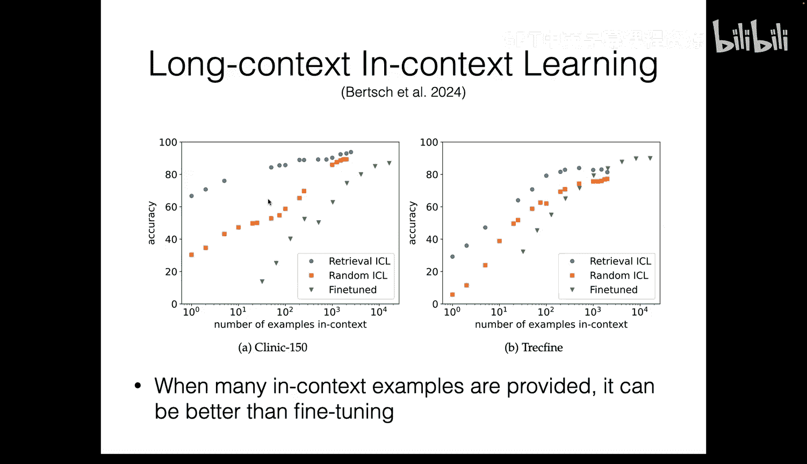

嗯嗯。And then another example is long context dialogue。

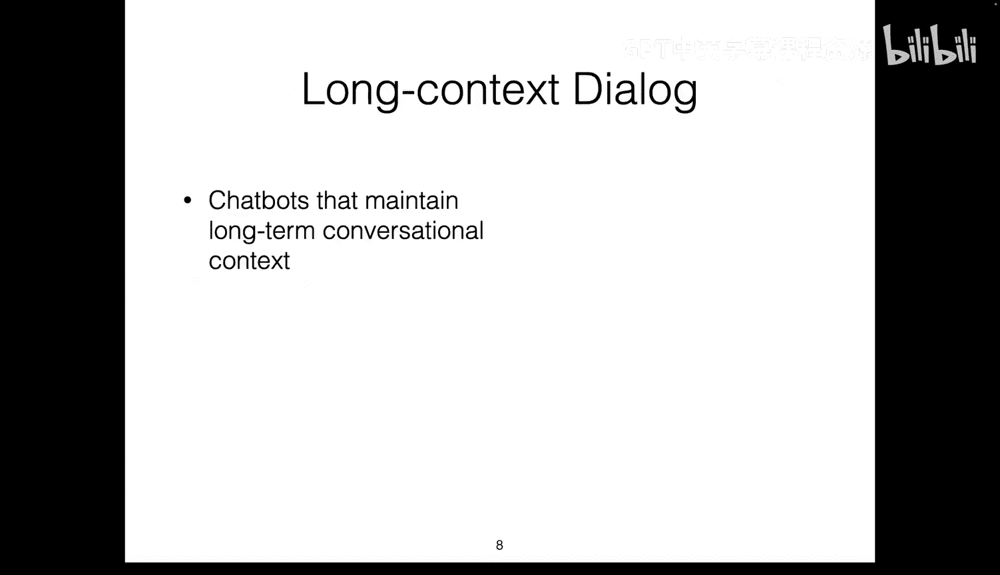

嗯。So here， I mean， we're probably。Um， you know， if you use chat GT or something like that。

You're not familiar with this idea of having a dialogue that just keeps going。

And maybe you want the system to be able to。Use or refer to things from previously in the dialogue。

Or maybe even from like multiple dialogues。So there have been some corpora or some benchmarks trying to evaluate these things。

Of course。You know。Evaluating different aspects of a conversation is itself really challenging。

But yeah， as a starting point， if you're interested in this， you could check out this corpus here。嗯。

So yeah as I mentioned， evaluating conversation is difficult。

 so one thing they do is to basically you create tasks related to the dialogue like you can answer questions about it。

 you could summarize it or you could just generate the following response。

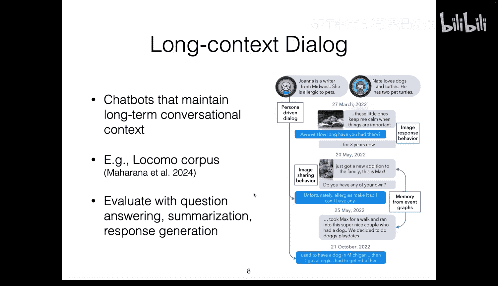

So that was a kind of。Brief introduction of long sequence modeling or long context modeling。

 as well as some applications and some tools and benchmarks。

So the next part of the lecture will go into different methods。For doing long context modeling。

So in the first part， we'll look at the transformer architecture。We'll look at。Again。

 why it is weak in terms of scaling up to context length。

And a variety of ways to try to overcome it while still using a transformer。Then at the end。

 we'll talk about a different architecture， so no longer using transformers。

And it'll actually draw upon some of the ideas we talked about earlier in the course in the recurrent neural networks lecture。

And so in particular， I'll talk about these state space models。Which were yeah。

 pioneered by Albert Gu， who's now here at CMU。And so yeah。

 hopefully I can tell you about some of the key ideas in those models and it's a kind of another really exciting active area of research。

So before going to the second part， any questions or topics for discussion about this first part？

Yeah， I apologize， I had a meeting right before the class today， so I'll do it right after。Okay。

 cool。 Actually， one more application。 So I know at least one group is doing kind of audio processing。

For their project。And again， there， if you have like a long song or something like that。

 or you have like a long transcript and you frame it as。This auto aggressivegressive modeling task。

 that's another place where the sequence length can quickly increase。

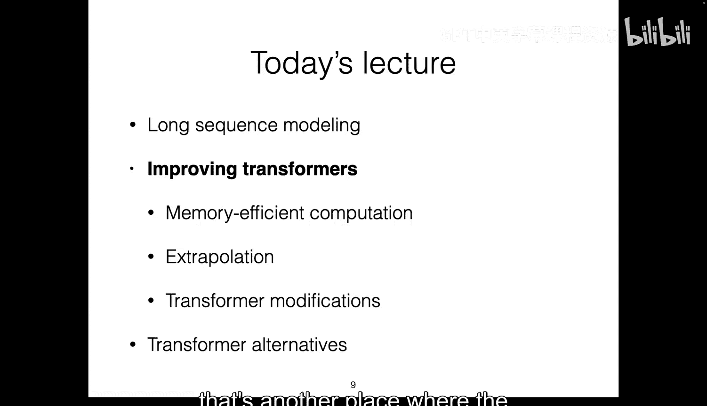

Okay， so now if we recall the transformer attention。

So hopefully this is familiar we had it in the lecture as well as in the homework number one。Then。

Here's the formula， right， so we have。The softm， and then we have the queries and the keys。

 these are both matrices。You have this normalization term。

And you have the values and so essentially you do the softm and then it's doing a kind of weighted sum of the values and then you get the output of the attention。

So if we take a look at the different operations that are involved。

Then it turns out that this one here can be pretty expensive。So here we have a matrix which is。

Sort of sequence length S。By the hidden dimension D。And then of course。

 you have the batch size B as well。And then you have this matrix and it's transposed。

 so after doing the transpose， you have the hidden dimension and then the sequence length。

And so when you multiply them together， you get something that is sequence length by sequence length。

And then， of course， with the batch size。So when you do a matrix multiplication like that。

The computational。The time complexity or the amount of compute。You're doing will be as follows。And。

What I'll kind of show you on the next slide is that actually in practice。

 what happens on GPUs is that the matrix multiplication is quite efficient。

So actually performing the computation。They have like these specific tensor cores designed for making the matrix multiplications very fast。

And so it's actually the memory that becomes the bottleneck。 And again。

 I'll talk about this in the next slide。So when I say memory， when you think about it， like， okay。

 before you do the softmax， you have this intermediate value here。

 which is batch size and then S squared。So once you have that。

 then you still have to multiply it by the。By the values。And again。

 you have this matrix multiplication。And。嗯。Yeah， this one is maybe less problematic for the memory。

 so we really want to focus on this and ways to potentially speed this up。

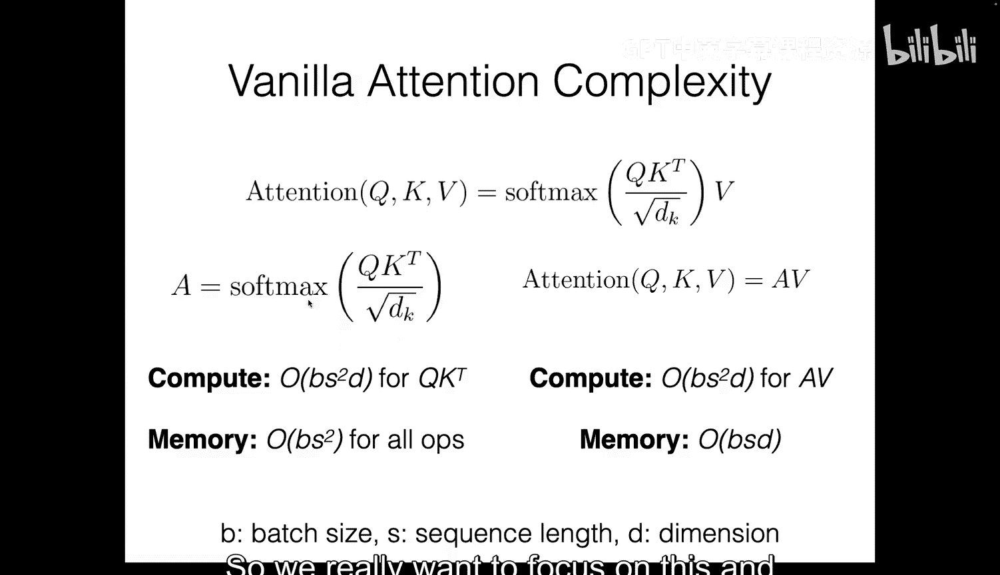

嗯。Oh， before I tell you about the the memory issue。

 it actually gets worse if you have multiple heads。So here now you add on an additional kind of head。

 right。Cost。For the for the memory。

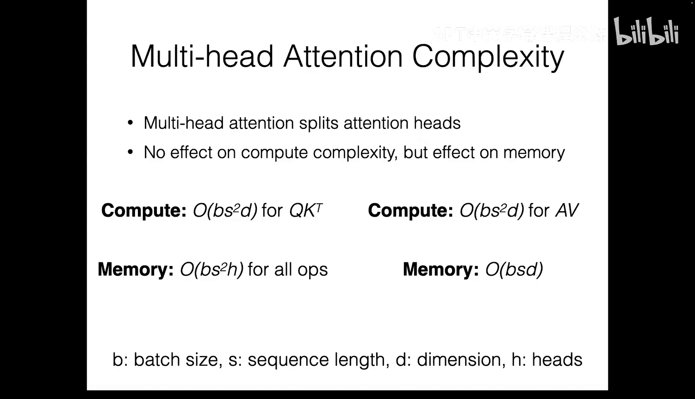

Um so。So why does memory turn out to be the issue？Well。

 here's a cool diagram and it's from this paper you may or may not have heard of called plush attention。

And it's basically showing in a kuda GPU。The three types of memory that are in the GPU。

And so the basic idea is up here， you have very fast memory。But a very small amount of it。

 so you have like in this example， 20 megabytes of memory。But it has this bandwidth。

So it can transfer data at like 19 terabytes a second， so very fast。Then down here。

 you have this middle layer HBM。And so here you have much more， you have like 40 gigabytes of memory。

So you might be able to fit like an entire model， you know， in this part。

But you can see here that it's much slower or much less bandwidth。

Then the kind of worst case is if you have to offload things to the CPU。

Now you can see here how slow it is to transfer things from the GPU to the CPU。So。Yeah。

 here we're looking at gigabytes a second instead of terabytes a second。

So this is basically you want to try to avoid this， you know， at all costs。But if you do use CPUU。

 then you could get a lot of memory。So the basic idea is that in practice。

 if you have this kind of quadratic growth in memory。

 then as your sequence length gets longer and longer。Then eventually。

 this attention operation becomes too big to fit in the really fast memory。

 and you start to incur these costs or communication costs。So in the last lecture。

 we were talking about communication costs like between multiple GPs or multiple nodes。

But here you actually have these costs that you get just from going between the like really fast memory in your GPU and the sorry。

 the slightly slower one。And yeah， it turns out that this is one of the key issues leading to kind of slowdowns in。

The transformers。And then of course， also， sometimes if the sequence length gets too long。

Then it's not even about speed necessarily， it's just that you run out of youP your memory and it crashes。

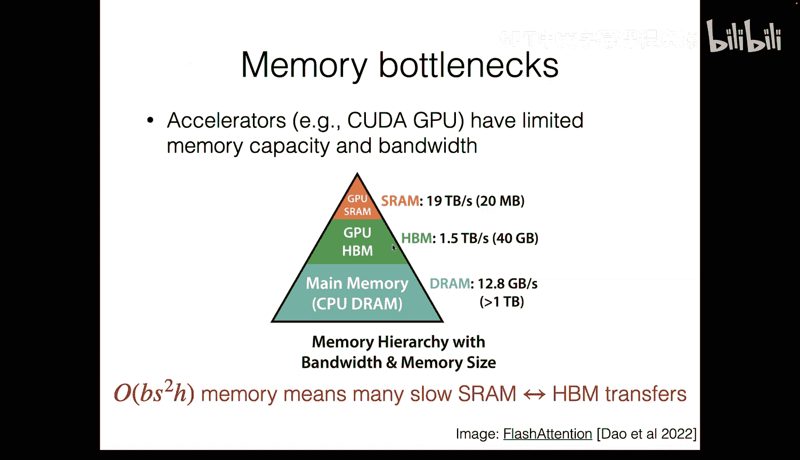

Okay， so hopefully that gave you some kind of appreciation for the memory bottleneck。

Sorry， and so the idea is， we'll try to think of some ways of getting a better complexity here。

Which our priori seems kind of tricky， right？

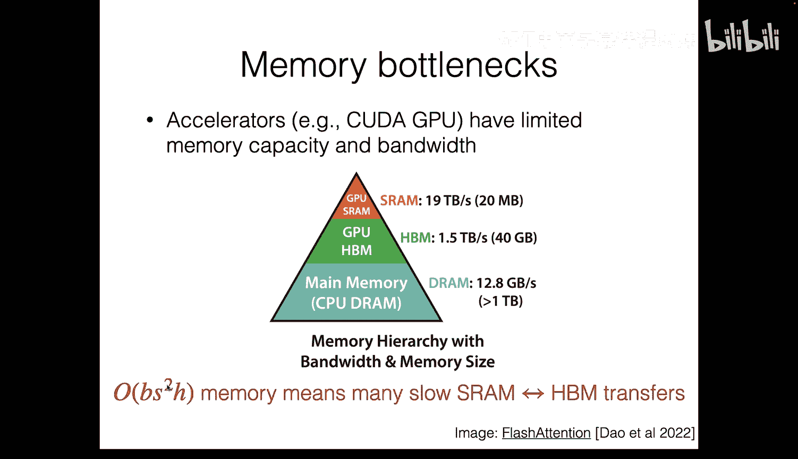

And so again， if you think about like what are the implications of this？

It becomes very expensive to pretrain a model with long context length。Because in the last lecture。

 we argued that your goal is to basically get through as many tokens as you can in a small amount of a time。

And so if these communication costs are slowing us down。Then in practice。

 it might just be better to like pretrain with a shorter but faster context length。And then it。

 of course， it becomes expensive to generate， let's say you want to like generate in real time or you want to serve a lot of customers at once。

Then if you have these slow communication costs， it again becomes a bottleneck。

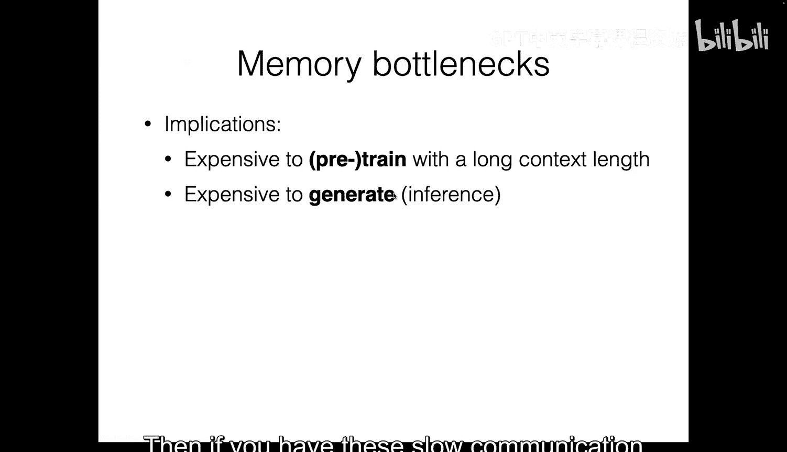

And yeah， again， expensive could mean either slow or you just run into of memory and it's infeasible。

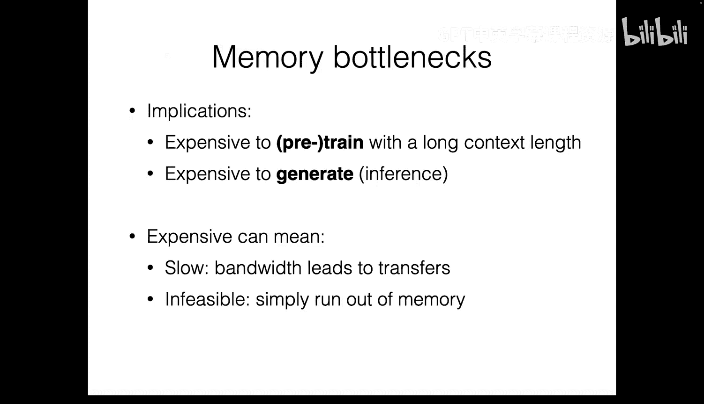

So there's a cool trick that you can use to compute the attention。

And so I guess the underlying trick was from at least 2019， I mean。

 there's probably some older papers that did this。

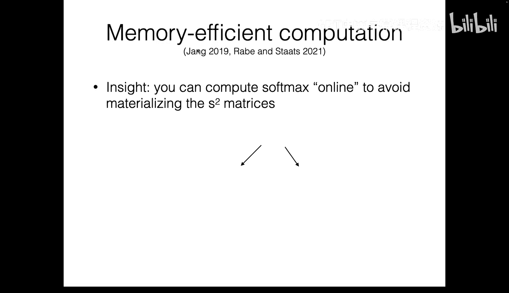

And then， one of the。First papers that I'm aware of that incorporated this into transformer inference and training。

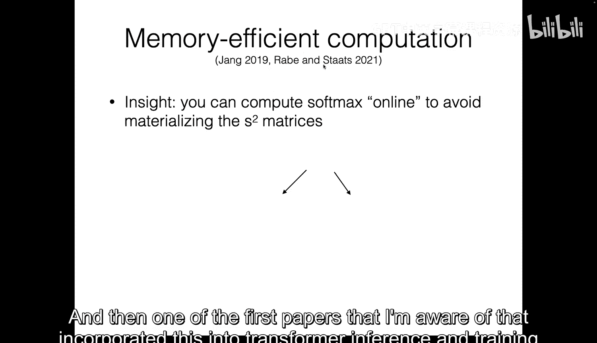

Was this paper here from？To researchers at Google。It's actually just an archive paper。

 it wasn't even published， but。But anyways， the idea is that it turns out that you can actually compute the softm in a kind of online sequential fashion。

And in doing so， avoid。Storing these matrices in memory。

And so I'll show you how that's done because at least to me。

 it was kind of surprising that you could do this。So I apologize for the animation order。

 so the idea is what we want to do is decompose this attention into a numerator and a denominator。

So if you remember， softmax has this numerator where you exponentiate everything。

And then in the denominator， you kind of sum over everything。

 And so that you get something between0 and 1 that that sums to1。And so the idea is。

 can we speed up these computations？Or make them more memory efficient， sorry。And it turns out。

 as I'll show you in the next slide， that you can do this in a way where you only have to store。

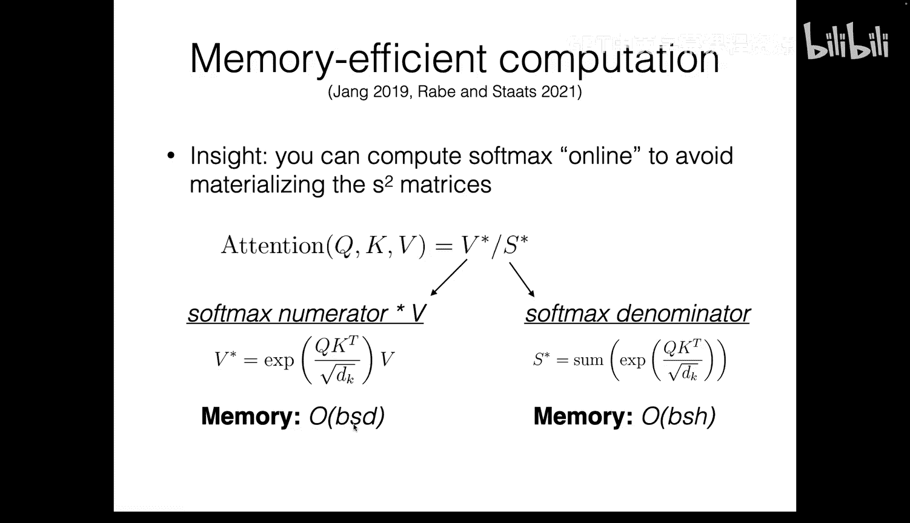

This kind of linear。Amount of memory in the sequence length。So you remove the quadratic。AMemory。

Constraint。So。

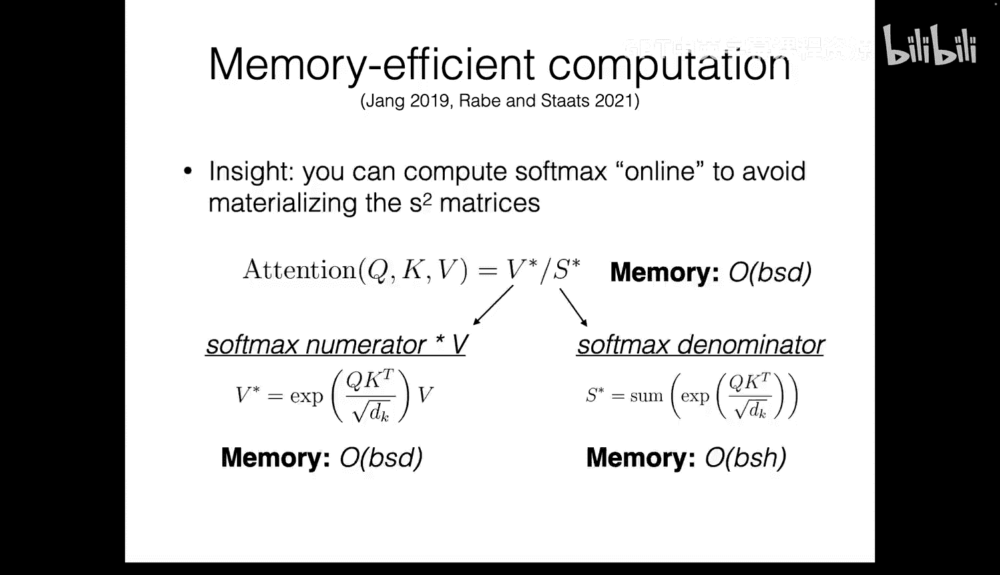

The idea is。You can do this in kind of full form， but maybe it's useful to see it if we imagine we had a single query vector。

So again， in practice， you have multiple query vectors。But let's say you have a single query vector。

Then the idea is you can have this sequential computation。

So here it's saying for each position in the sequence。You can form this。

 you can take the dot product of the query as well as the key for that position。So yeah。

 now you have this。And then here you have a vector， which is the value。

Time times this weight that you got。And you kind of incrementally add to this value vector。

And then down here you have the denominator， and so down here you're kind of incrementally building up the sum。

And if you do this over the positions。Then it turns out that this is equivalent to taking the soft Mac。

So you can frame your attention。As being this like V star over S star。And so again。

 the idea is that now you have this way of computing the attention and you only have to store these kind of vectors instead of storing the sequence by sequence matrix。

Now so this is the kind of key idea and of course you can get more creative with it instead of just looking at a single position。

 you can look at different chunks or tiles or blocks。

And people kind of figure out what is the optimal way to perform this computation？

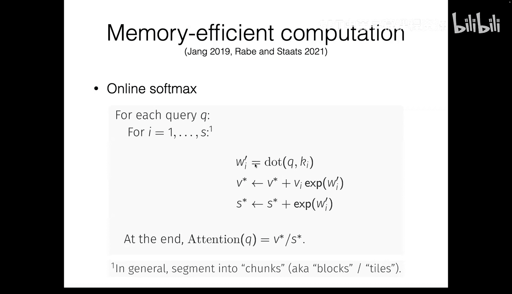

But that's the kind of key idea and here is one of their results from 2021。And so yeah。

 even back then， this was on TPUs， actually。You can see here that。

They were able to get one million tokens at entrance time。

And you could see the memory overhead of this efficient attention。

 It's using about 256 mebys with 1 million tokens。Whereas if he's the standard attention。

 it's actually just out of memory so you can't even do it。So yeah， really cool result。

 of course you do have to think about like okay， now that things are sequential。

 does this slow things down？But certainly in this case， it's not even possible， you know。

 to do the inference without the。Incremental or online computation of the Som。

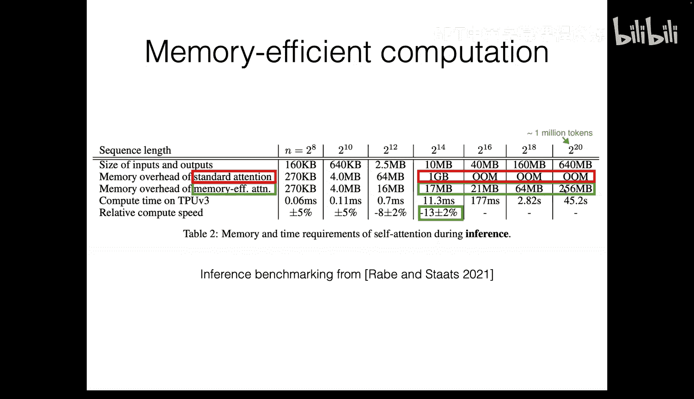

People what is think one to each of these jobYeah， so this is。So S here could be the sequence length。

And so yeah， again， like usually you have a key query and a value for each token。

So this for loop is going over like for each token。

 you do the dot product and you increment these two values。Yeah。

 and then you can imagine that maybe that's slow。 So instead。

 you can kind of go like in these chunks， like window， yep。

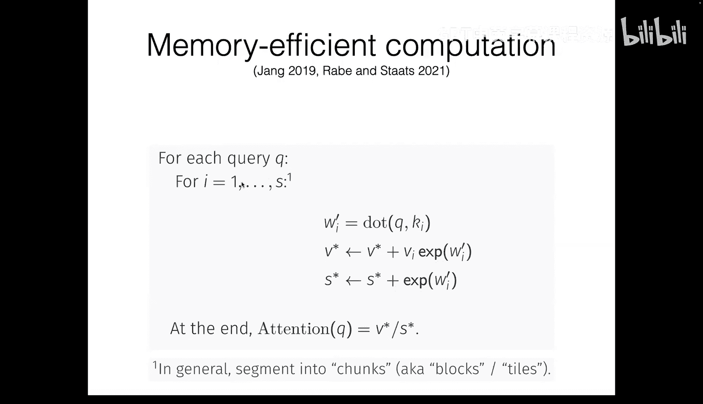

So yeah， that was cool and they also showed similar improvements for training。

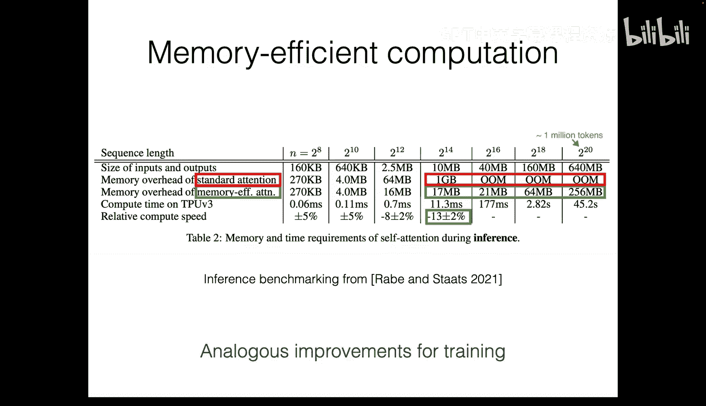

So this idea has been kind of expanded upon。The flash attention method that I mentioned earlier。

it's a really amazing paper and they do a lot in that paper one of the things they do is incorporate this online Somax trick。

And they actually write this Lauda kernel that manages the GPU memory really well。

And this really helped speed up both inference and both training for the language models。

And then on the next slide， I'll talk about this method called ring attention。

So here they distribute this online computation across multiple devices。

So like if you have an extremely long sequence length。That you just can't fit on one GPU。

And maybe a large model as well。Then they come up with some way of， yeah。

 framing this online computation as kind of communication between multiple devices。

So this paper is by How Liu and he's going to be starting as a professor in the machine learning department here at CMU。

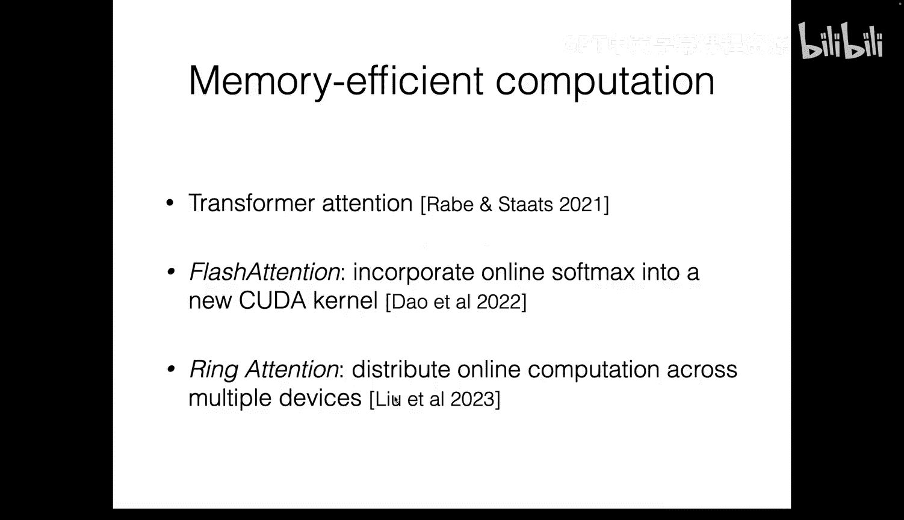

So。The key idea of this ring attention is kind of clever。

So and it actually connects with the previous lecture， as I was saying before。

So you can view this as a kind of new kind of parallelism， like context parallelism。

So now you have your really long sequence and the idea is you want to split it into different blocks and then have each GPU manage kind of one block of the sequence。

And so the idea is you can have each GPU be responsible for kind of one query vector or one query block。

So a really simple example is let's say we have four tokens。嗯。

And we're going to have each GPU kind of in charge of one token。

So this GPU1 would have the query vector for token number one。Similarly。

 this GPU2 would have the query vector for token number two and so on。

And so then if you remember this kind of online softmax just requires taking the dot product between just like one vector at a time。

And so you can come up with this clever way of like performing the local computations。

 then communicating the intermediate results。And eventually。

 if you kind of go in this like circle or ring， then all of the GPUus can do can。Eventually。

 compute the full。Attention， computation。So there's this animation here。

 and it's basically showing like， okay， you are computing these。Or let's， let's start it over here。

 So K1， V1， Okay， now it's being sent to GPU2。 Now GP2 is going to incorporate that into its like computation so far。

And then it's going to send them to GPU3 and it kind of goes around in this ring。

So maybe the exact details of what's going on， you kind of have to look at the equations。

 but hopefully you can get the kind of intuition here that you can come up with this way of distributing the computation。

And then again， you can get kind of creative with it and think about like what is the best strategy for splitting up things so that you're minimizing so that you're overlapping computation and things like that。

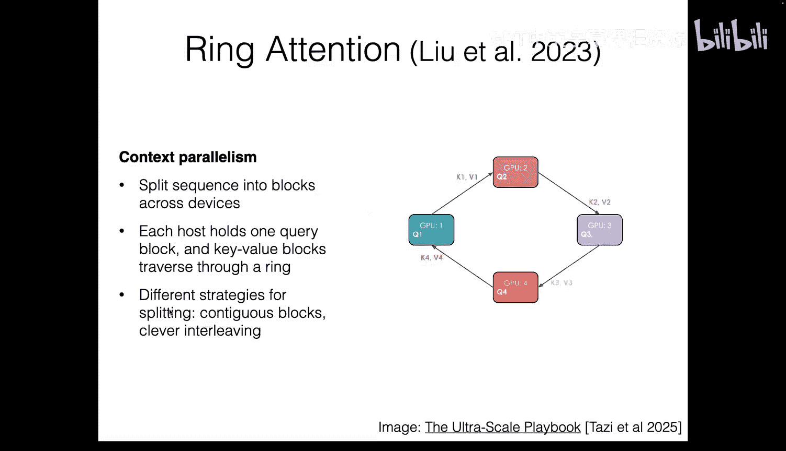

And by doing this， you can get these really nice gains in memory efficiency。

So here on the left is no parallelism， here is using tensor parallelism， but。呃。

I think context parallelism， one would be no context parallelism。But in any case here。

 we're seeing it up to four and now you can see these big reductions。So for example， 16。

000 sequence length wasn't feasible。Now we actually have a lot of memory left， we can almost fit 65。

000 sequence length。Right here， and this is again for training。So yeah。

 so this is really cool and again， it kind of adds to the portfolio of methods that I told you about in the previous class。

So， now you have this。Aspect of parallelizing along the sequence dimension。

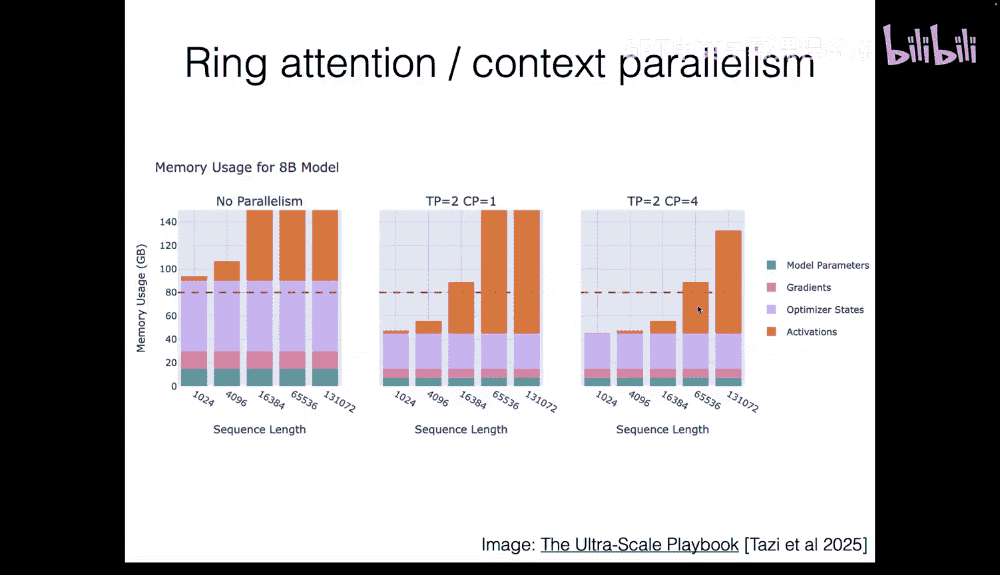

So any questions so far otherwise we'll kind of keep going through the。

The issues that come up with transformers and different ways for tackling them。

What was the name of this online version of attention Le to？

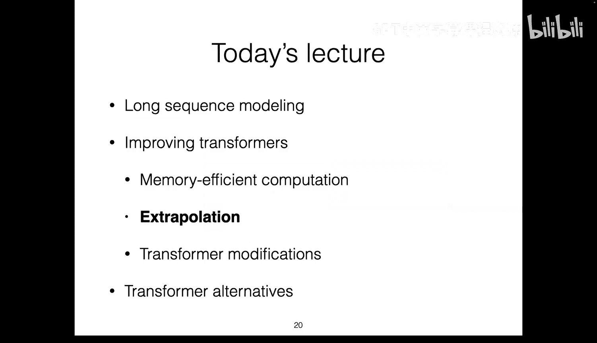

Yeah， so I think it goes by different names。

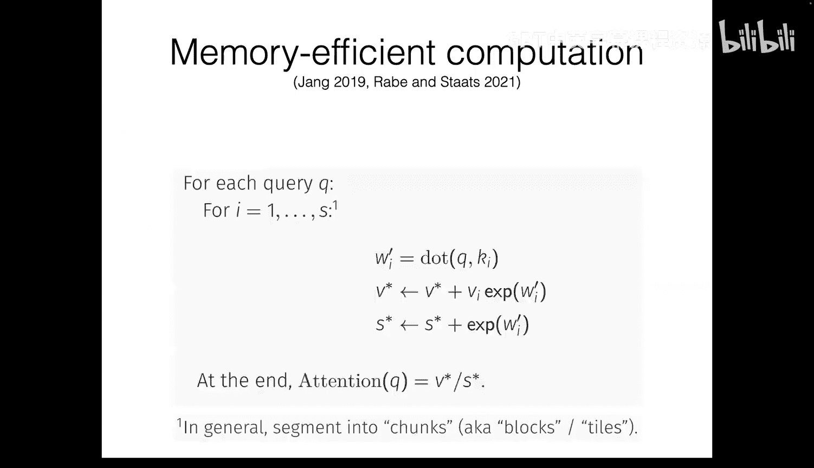

Sometimes it's called online softm， I think in this Jg。2019， it's called lazy Sonax。I think so， yeah。

But you can definitely look at this paper here and I'll add it to the website。

And look at different things that it references if you want to， yeah， find the original。

O， cool。嗯。

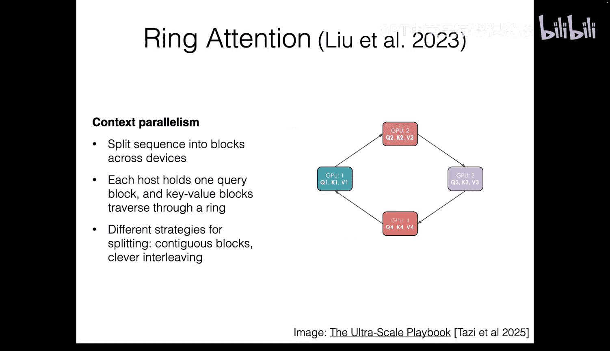

So okay， so next I'll talk about extrapolation。

So if we look at a trained model。Then。As I mentioned。

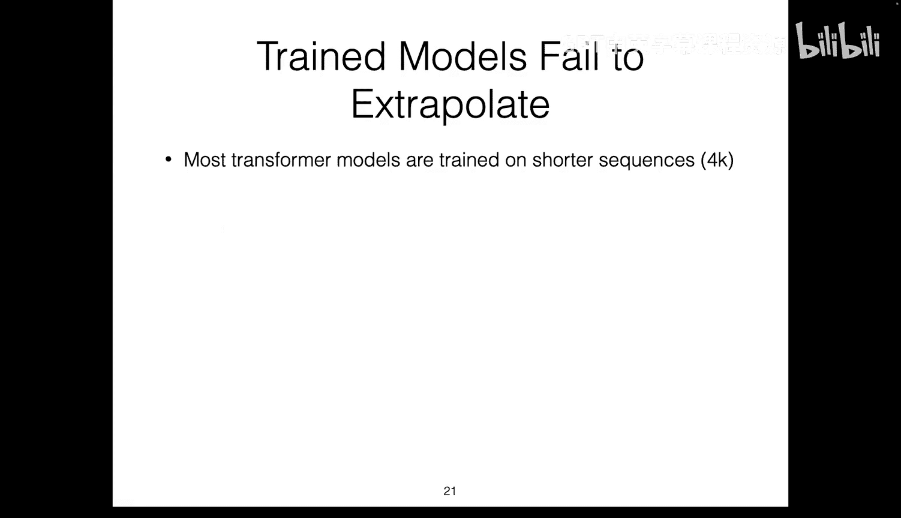

You know， sometimes it's beneficial for cost reasons or maybe the models were trained without access to these。

New techniques。

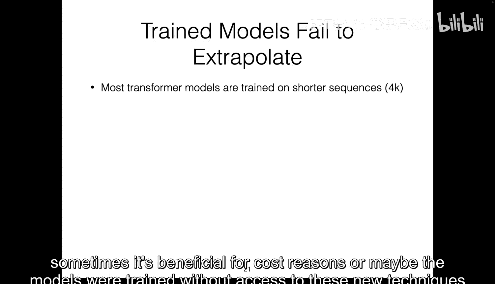

To pre train a model or train a model on shorter sequences， say 4000。So then the question is like。

 what happens if you encounter a document that's longer than 4000？

Does the model just work out of the box， so does it extrapolate to this longer length？Well。

 it turns out that the positional encodings can lead to different issues。

So we talked about learning these absolute encodings， so say you learn like one， two， three。

 four all the way up to 4000。Then pretty clearly， the model has never been trained on like 4001。

And so the embedding that it gets is kind of untrained and it goes out of distribution。嗯。Similarly。

 the fixed absolute encodings， so these cosine style encodings if you remember the transformers lecture。

Those have these kind of periodic patterns in them。But then in practice。

 it actually like since the model maybe is encountering a new pattern that it hasn't seen before。

 it's just again， kind of going out of distribution and the models don't work very well outside of their training domain。

Then even if you look at the relative encodings， so like the rope embeddings that you implemented in the homework for example。

Or simpler ones that say like， you know this。These two tokens are like three tokens apart。

 or something like that。Then in theory， it seems like those should extrapolate。

But I think what happens is that the model is actually very clever and it figures out。

Somewhat what position， what absolute position things are in in the sequence。

Based on like sentence structure， based on frequencies and all of these complex features that these models can learn。

And so in practice out of the box， even those methods don't really work well on the longer sequences。

So here's an example， so this method was。Trained on 32000 context。

And then they're training it on this kind of question answering dataset。

That goes all the way up to 128 k。And yeah， interestingly， it does actually extrapolate a little bit。

 this is using rope。So potentially like the you know。

 periodic structure in in rope or the relative embeddings can。Help it have some。

 but then it just falls off this cliff and clearly doesn't work out of the box。

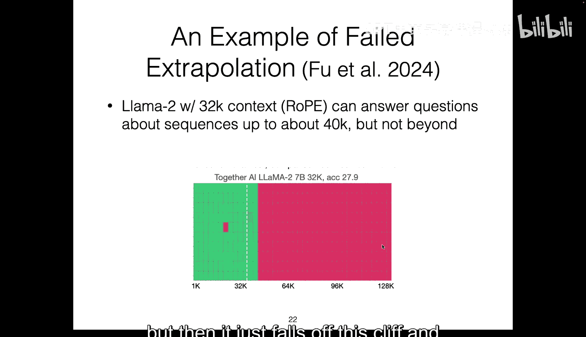

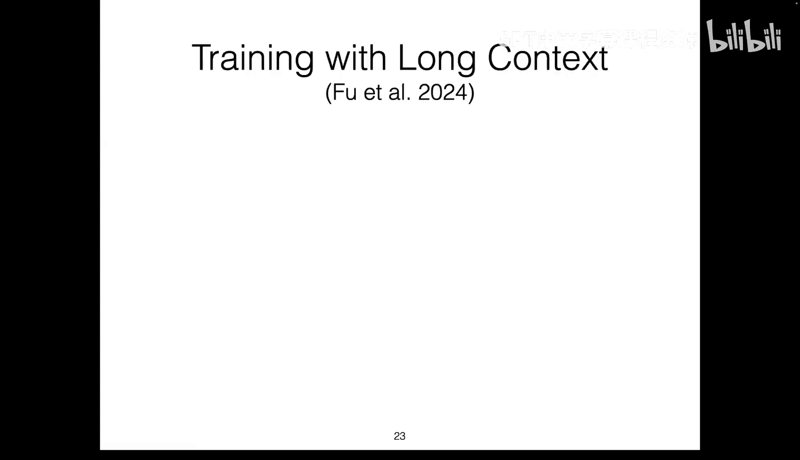

So I'll talk about two different。Kind of compliment things that you can do。

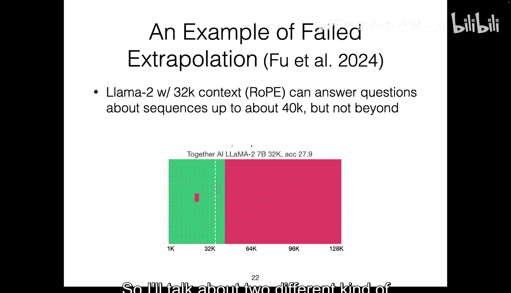

The first is maybe。

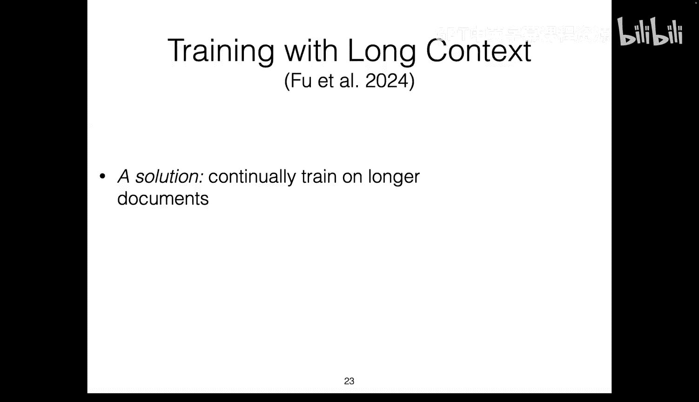

If you have this model， it was like this designs you deal with。The32。Awesome Dunkins。

How can you possibly give it a longer sequence？What does it do does it do？Yeah， so I guess the。

So the transform， like if you think about like literally the code that's implementing the transformer。

 then you can always just pass it a longer sequence。So what weights this means？嗯。So， the。At tent。

 so everything in the transformer is。Independent of the。嗯。It supports variable sequence length。Right。

 like you could give the same transformer。If it's trained on a thousand tokens。

 you can give it things with like 500， 700， but then you can also just give it more。And then yeah。

 I guess what I'm saying now is that， yeah， the one part that is actually dependent on the sequence length are the embeddings。

And so yeah， you can see that those， the weights are learned。

Kind of in a way that corresponds to the length that it's trained on。

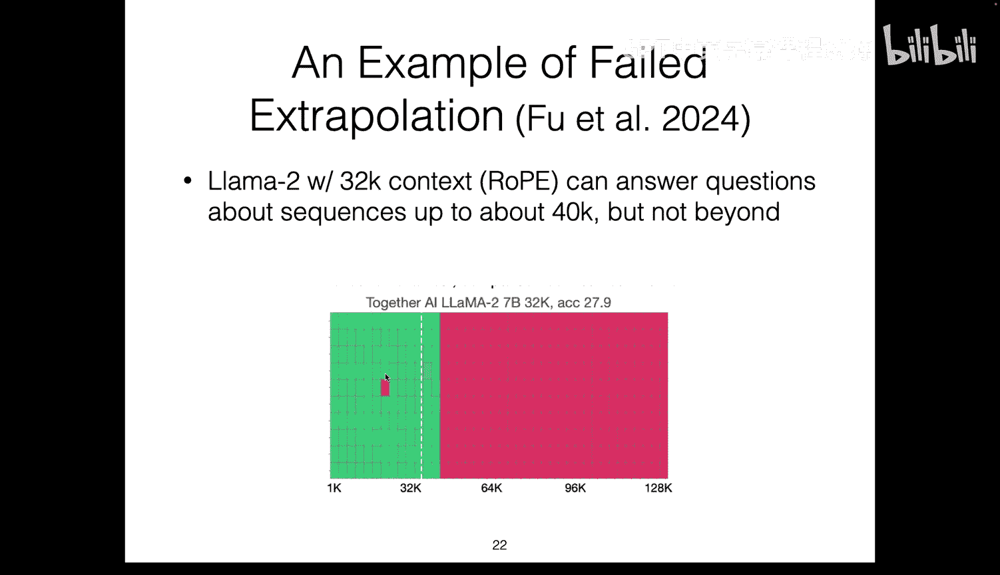

Okay， so the first one is maybe obvious， at least in retrospect。

 but you basically just train the model on longer documents。

So maybe one surprising thing is that people found that， you know， to some extent。

 you can pretrain the model and then kind of post train it on longer documents and the model can somewhat adapt to the longer sequences。

So here you in practice have to think about where you get the longer sequences from。So， of course。

 there's been， you know， a variety of。Things people try。

 one is you can ups sampleample longer documents。One thing you want to make sure is like。

 if you have multiple domains， then。Some domains might naturally have a lot of documents。

 so you have to be careful about like making sure that you have。

Long sequences from different domains。There's other techniques that just like synthetically create long sequences。

These kinds of techniques were。Use or reported in the。Lama three papers。And yeah。

 but the basic idea is， you know， construct some data and then continue training the model。

And so here it's showing that after they post train or fine tune on。Things with 80 K。嗯。

It's actually a lot better。So。

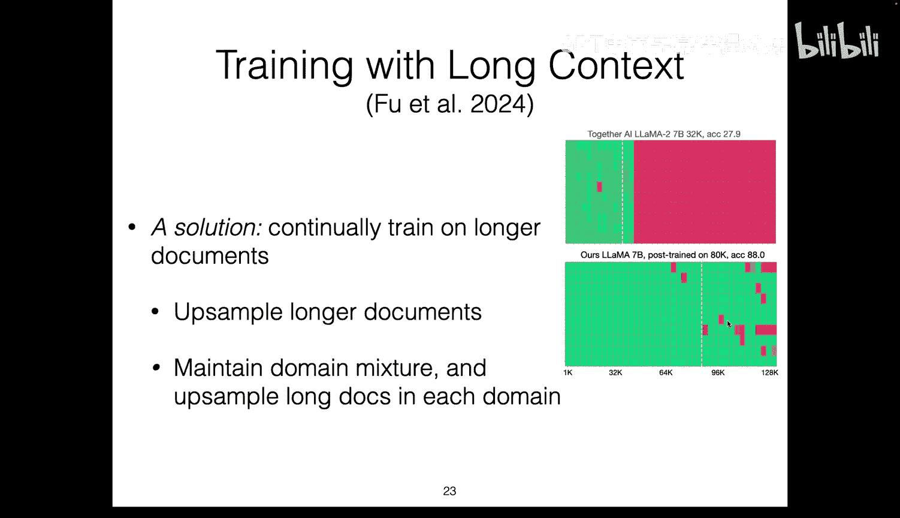

This thing about the rope embeddings， though is a bit。

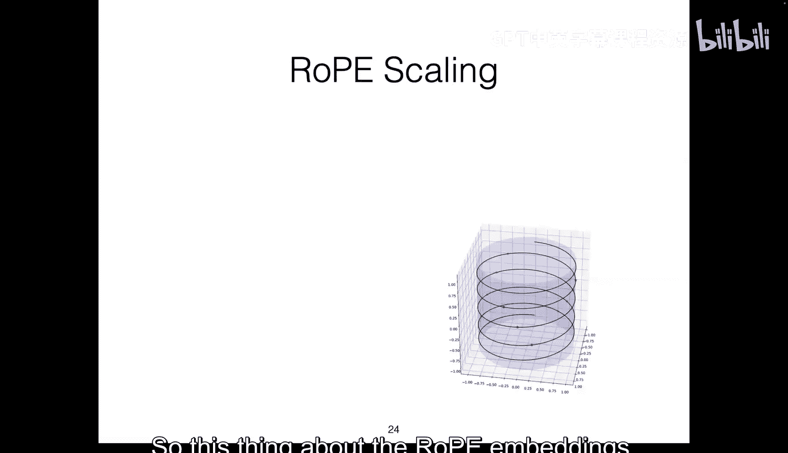

Maybe mysterious， so yeah， people have oops。OK。So if we think about these again， then just briefly。

 these embeddings have。This kind of periodic structure。嗯。And right。

 you have these like cosines and signss。And that you have this parameter theta。

 and that will influence the frequency or the period of the。嗯。Of the embeddings。

So one way to visualize this is like， yeah， you have a sphere or you have like the cylinder and by adjusting this data。

 you can either make this kind of revolve faster or slower。So in particular。

 one way people typically do this is you have this parameter B， which is like the base frequency。

Let's say you said it to 10000。Then you have these other two things that are dependent on the dimension。

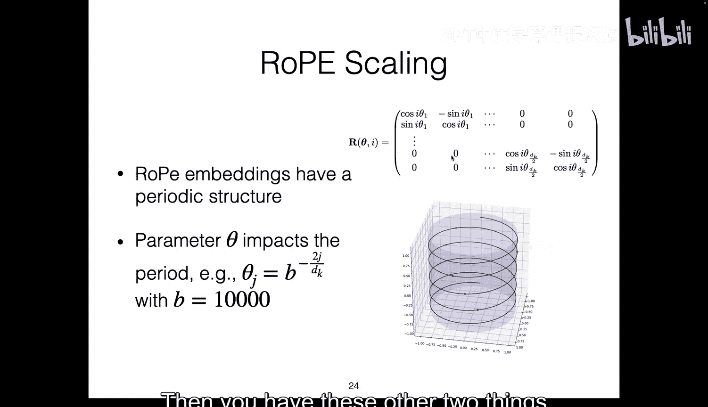

And there's been a variety of techniques or one thing that people notice is that。

The kind of standard or default setting that people were using。Would actually decay very quickly。

So that's shown here in blue。And so maybe this explains the behavior that we were seeing where the model can actually generalize a bit。

But then maybe it's decaying so much that the kind of impact of the embedding is smaller just due to the distance between the query and key getting larger and larger。

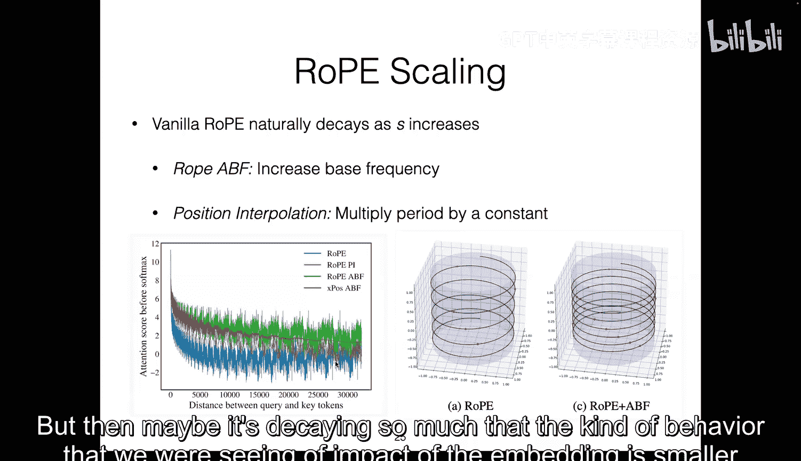

So there were yeah， different techniques of trying to get around this。

One is that you can just increase this base frequency from the one that was used during pre training。

So that would be this rope ABF here， Shennon Green。

So now it'll kind of decay slower and then you can find tune in the model。And yeah。

 this was incorporated into like。I believe one of thellma models。

There's another method that multiplies this theta by some constant that depends on the maximum sequence length。

And yeah， people also found that that was。Yeah， kind of effective。

 it's called position interpolation。So here again， I think， you know， this was。

Or is an interesting research area so there's other techniques beyond these。

Hopefully that gives you some flavor。

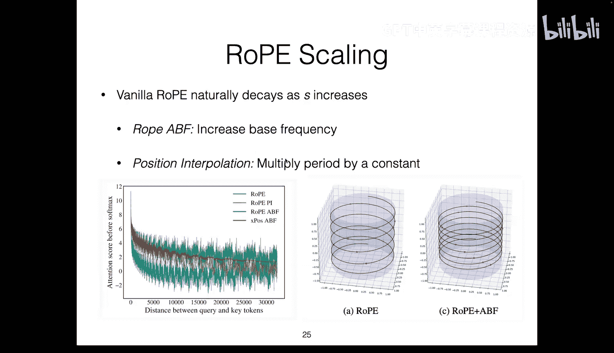

So yeah， that was the issue of extrapolation and some ways that。People might try to mitigate it。

Any questions so far？Before I go into the next part。

Which one？

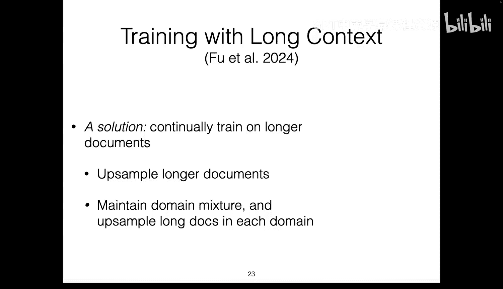

This one like those three problems。

嗯对。That's one， I didn't actually understand the problems like what exactly。Is it problem。

 Why is it possible like Okay， yeah。Yeah， so let me just talk through it。 Yeah。

 maybe it would be helpful to have some， some notation or something。 But okay。

 so the first one it's saying that suppose you have。An embedding matrix。And each position。

 each row in the matrix is a position， so like  one， two， three， four， five。

 all the way up to let's say 4000。Now you train the model and it learns these embeddings for positions one through 4000。

Now， if you give it a sequence， that's length 5000。Now the embeddings。Now， you have to like。

 expand the embedding matrix。 And now your embeddings for 4001 through 5000 are just random vectors that haven't been trained。

And so that will kind of throw the model out of distribution and the behavior is kind of unpredictable。

Yeah。This one is， if you think back to the transformformers lecture。

 we talked about these like sinus soal positional encodings。And so there。

 I think the argument is that although the signss and cosines have a kind of repetitive structure。

If you look at a position that it hasn't been trained on。It's， again， still some unique。

Kind of vector that the model hasn't seen before。And so in practice， yeah， these。

The susoidal encodings don't work very well either。And then the relative encodings。

 I guess the rope is one example of that。Where it seems like it should be able to extrapolate。

But I think。You know， one intuition is the models very kind of clever， or it learns these very。

Sophisticated representations， and maybe it actually does use notions of absolute positions that it learn during training。

And that if it sees something longer than those kind of features。Aren't incorporated or， but yeah。

 that ones more fuzzy， but yeah。

Oh yeah。This one also the next the other one should the decaying thing yeah。

 this particular thing over here。

嗯。Yeah。The distance are inring key tokens like wait， hows it computed over here？

So this is saying like if you， so again， in your embedding， you're embedding。

You're producing some embedding for each pair of tokens。And so let's say you have a length 30。

000 sequences。Then， you know， somewhere you have。Some pair that has a distance of 30000。

 And so this might be looking at the average。 So I guess the。Max sequence like is much longer。

 And maybe this is looking at the average。Thanks。有。嗯。

Or maybe it's actually just looking at the exact yeah position and then plotting for each yeah。嗯。

What does the rip？The red one。这个换。OK。嗯。So I think this is just showing so。Cosine and sine or。

 you know， whatever combination of them is used in ro is a continuous function。

 And so this is just showing different。Samples of the function。啊，对不可。

It even the relative distance in Florida so during inference， you can have relative distance。

 what is depend is larger than the relative between were。

And even these rotary skills don homework work。Yeah， that's true actually yeah。

 so almost the same argument that I was giving for the absolute ones might apply that yeah。

 the model's going out of distribution， yeah。

我过。嗯。So。This last 1， I was planning to actually skip to make sure I had time to。

Go into a bit of detail on the state space models。嗯。But yeah， some or， you know。

 a lot of the slides are based on gra slides。So he had these various modifications。

Like sparse attention， sliding window attention， compression， lower rank approximation。

So after if you're you know interested in。In this area or in learning more。

 you can just be aware that， yeah， there's these additional modifications you can make。

But yeah， just due to time， I'll skip over these。

Okay， so yeah， I wanted to be sure to save。Well， hopefully it's enough。

 but a non trivialal amount of time for the state space models。

So here， if we remember the R&Ns back from lecture four。Then this was the picture we were looking at。

 right， You have this hidden state。You produce an output and then this hidden state gets past to the RNN and kind of gets updated over time。

And at least in theory， this model can kind of have an infinite context。You could imagine， like。嗯。

Yeah， at any given point。All you need is this hidden state and then you can just keep applying it longer and longer。

Of course， in practice， you basically have to store all of the information in this hidden state。

We also talked about when you go to train one of these models。

 you might get these vanishing ingredients。So that motivated some of the RNN variants that we talked about。

So although in theory， it's infinite context。It does get tricky in practice。

And then kind of what I just said that if you go to do inference or generation。

Then to generate each next token。It's actually independent of the sequence length in terms of memory。

Because all that you need to generate the next token is the current positions hidden state。

So that's a lot different than a transformer， which at each position has to kind of attend over everything and gets this quadratic dependency as a result。

However， I briefly mentioned during the R&N lecture that it's difficult to parallelize this。

So in particular， like for every given position。You have to kind of。

 you know incrementally compute the previous ones。And so it's a lot less clear how to parallelze this compared to a transformer。

And so when you're really trying to pretrain a large model or something like that。嗯。Then， yeah。

 that becomes。A kind of very undesirable property。So the state space models that I'll talk about will try to use this nice property of the memory efficient inference and infinite context length。

But it'll also try to be parallelzable。

So。嗯。Yeah， we'll have to wait and see how it's done。So in order to make it parallelizable。

 it also draws on ideas from these convolutional models。So we didn't go into these in detail。

 but the basic idea is that for a convolutional model， you define this kind of window。

So here the window size is size3。Then you perform some computation that is a function of things in the window。

So like if you come up with this hidden vector， then it'll depend on these three things。

This one will depend on these three and so on。And so you can see that this one is doesn't have infinite context。

But you can kind of very clearly just break this apart into two parts and then just compute both at once or parallelze it however you want。

So this is just showing， you know， you could use it for。嗯。

As an auto aggressiveive model by not looking into the future。

So the state space models are models that have the following form。

And I'll show two different diagrams， so hopefully it'll become clear。So you can see here that again。

 we have this notion of a hidden state in an RNN。We also have our input X。

And so it's saying that like the next hidden state will be the current hidden state multiplied by some matrix A。

Plus， your current input multiplied by some matrix B。So very similar to the RnN。

Then your output that you get， so your kind of output layer will be the hidden state。Multiply by。

Another metric C。And then you can have this kind of skip connection where you introduce a dependency on the current input。

And so the key idea that we'll see how this is done is that。

We will end up having some way of computing this hidden state in parallel。

So that we can get this fast training or parallellyizable training。

And we'll actually have the same kind of inference that we have from an R&N。Where again。

 regardless of the sequence length。All that we need is the hidden state to predict the next token。

And so。

Here's just another way of visualizing it。So up here is this kind of skip connection。And so。

We can kind of exclude that and consider the state space model to be this part down here。

So you can have like a state space model plus a skip connection。And again。

 you have this input matrix B。You have this matrix which is controlling the updates in some sense。

Then you produce an output by multiplying by a different matrix。And that's the kind of。

St space model。Now you probably notice that there's actually no nonlinearity in this model。

So unlike the R&N， we don't have like a tan0 H or a reello or an nonlinear activation function。

And that's actually going to be very important because then everything will just become these kind of matrix multiplies。

 and that'll actually enable the parallelization。So we'll see that in a bit。

So again， this is just writing it in another way。Where again we have our input sequence and then you have this kind of block。

 which is the state space model。And it has this equation， which is updating the hidden state。

And it's having an equation that produces the output。Now。

 of course Im not don't have time to like go into the full history and derivation of these methods。U。

 but these models actually come about in these kind of continuous settings where you have like differential equations。

And so in order to translate this to the discrete setting， they had to kind of， you know。

 make the argument for how you go from this continuous model to the discrete model。

The idea is very， fairly simple， so let's say you have this continuous signal。Then you can have some。

 like， discretization parameter。And then just take the point at that given kind of time point。

And now you have this discrete signal。嗯。And so now you can move to the kind of land of。

That looks like now getting close to the R&Ns。So now you have some like vector。

 which is your discrete hidden state for the current step。You have some discrete input。

And then you have some discrete output。Now you could see here that there's these matrices A bar and B bar。

So it turns out that like when you introduce this step size。

You want to think about like what is the exact form of the matrix T is？So again。

 I won't go into details on this， but this is what it ends up。Looking like。Or， or one way to。

Kind of drive。Matrix。that's the exponent of the difference。Yeah。

 so you have this deelta term here and then you have a and X on it。

So I think the important part for for this lecture is to just tell you about these two different。

If you use that you can get of the state space models。So first。

 you can view this as a kind of recurrent network。Where yeah， we're kind of unfolding it in time。

So now it looks pretty much like an R&N except without the activation function。So we have some input。

 say token。We have our hidden state， you can produce an output。

Then you transition or update the hidden state。And you have this kind of familiar looking diagram。

And so now we can have this very efficient inference。Where， again， regardless of the sequence length。

We can kind of produce the next output or next token only given the previous hidden state。However。

 as we talked about kind of a priori， it's not clear how to parallelze this。

Because each one of these hidden states requires all of the previous ones。But it turns out that。

The way that these are formulated， you can actually come up with this clever trick， which。

Allows you to do the parallel training。

So to do that， you can kind of take this view of。The convolution。So up here you have some input。

 it's like an input sequence。And then you have some kernel。

 which is like the width of the convolution。So here this is three。

 but you can imagine this could be like 4000 or something like that。

And what it's saying is that like to produce an output。

You are essentially applying this kernel at each location in the sequence and kind of sum summing things up。

So here's an example you have my name is。And then you have this kernel here。

And then you're producing this output。And the output is。Is shown here。

So it's incorporating this information from。All three tokens。

And you can see that it's of this form that involves the different matrices that I was telling you about earlier。

So at this position， you're taking this matrix C times the Sp bar。Here you're doing C times A bar。

 B bar。And then as you go back in time。It turns out that。

The state space model is equivalent to having this kernel that looks like this。

 So it's basically like C times this a matrix， which controls the update。

And you exponentiate it according to like how far back in time it is。And then this other matrix。

So again， I'm not going into like how you get to this point。

But this is the kind of key idea that with a single model。

 you can view it in these two different equivalent ways。One way is as this recurrent model。

The other way is that you have this kernel。I guess in principle， it could be like an infinite kernel。

And the kernel， as you can see， is computable in parallel， like at any given position。

 you just have to do these kind of matrix multiplications。So anyways， yeah。

 this allows you to get the fast training。If you。If you go to use this at inference， then yeah。

 it's different from the recurrent view where you just have your previous hidden state。

But the idea is you can kind of switch between them based on whether you're training or doing inference。

So that's the kind of cool thing behind these state space models。

So given this kind of abstract or maybe like the vanilla version of state space model。

There's been different innovations on top of it。So a really popular one was called S4。

So they took this discrete stasis model。And then here they found that it was actually beneficial to have this matrix a。

 which controls the hidden updates。Be in a particular structure。So again。

 I won't go into the details here， but they came up with this technique called hippo。

The one of the P and O is for polynomial。 and basically involves this like argument with polynomials and。

They kind of show or argue that this helps like memorize information or retain information。

So it's S4 because。Structured。State space， well they add in structure， so it ends up being four S's。

嗯。Then recently or I guess it was in 2023， so some time has passed。There was this model called Mamba。

And again， both of these were developed or led by Albert， who is now here at TU。

And here they wanted to look into this idea that。You know， with the state space model。

 you have to basically memorize or compress everything into this single hidden vector。

And so can you somehow selectively retain important information？And in doing so。

 do better on a variety of tasks。

So。Yeah， each one of these， I'll show you a bit more details about them。

So the S4 here， you again have this structured form of the matrix A。

So you can check out the paper for for what it looks like。 Maybe I should have put the。

You know the equation here。But you could see here that they have a and they say this structured matrix。

Then you have these other matrices that I showed you about on the previous slide， B and C。

Then you actually have this。Delta， which they treat as learns parameter。So ultimately。

 it's something that， yeah， is goes into this equation here so it can kind of control。嗯。

This weighting of the matrix。And they basically just learn that and yeah， treat it as a parameter。

Yeah， then you have this discretization that I showed you before。

And then you kind of put these matrices into the state space model。

And so the kind of key thing to identify here is that this is time invariance。

 meaning that these weight matrices are staying the same。Regardless of what position you're at。

So what this MMba model does is it tries to incorporate information more selectively。

And so kind of conceptually， what I mean by that is。Yeah， on the left hand side here。

 you have this extreme case。

Where you have the state space model that's compressing everything into a single vector。

And the weights are not changing over time。If you think about a transformer。

 then at any given position， it can kind of selectively use information， you know。

 using the attention mechanism。And so Mommba is trying to kind of do something in between you know。

 at a conceptual level。

So。To give some intuition for why like this is useful。

 what they noticed is that the state space models would work well on a task like this。

So the task was， okay。The first four positions， for example。

 you just have to copy them and return them as the output。And with the fixed weight matrix。

 the model。You could imagine some strategy， like。You know。

 ignore everything with a positional embedding larger than four or something like that。

Whereas if the positions were varying， then just the vanilla state space model was starting to fail even on this kind of selective copying task where yet the things to copy are kind of spread across the sequence。

There's another task called induction heads where you have to look at some previous position and report back。

嗯。And again， yeah， without some kind of selective retention of the history。

 they were noticing that the models were failing on this。

So the basic idea of the MMba is， well within MMba， they now have a new thing called S6。

 so now they have selective structured state case models。

And here you can see that the key difference is that these parameters are going to actually be dependent on the current input。

So in practice， you can like take your input and you can have， for instance。

 a linear layer or whatever you want。And that'll actually produce a weight matrix。

And then you can just throw that into everything that we sold before。

Like discreteretize it and then put it into the state space model block。But again。

 the key difference is that now these parameters can kind of change as a function of the input。

So I'm going through this kind of quickly。It turns out that if you introduce these kind of time dependent parameters。

Then it gets tricky to parallellyze things。So they had to come up with this thing called a parallel。

 or they had to adopt this algorithm called a parallel scan。To get some amount of parallelization。

So just really quickly in like one minute。But you could basically break apart this computation。

So that things are， yeah， computed in parallel。嗯。And yeah， in turn， get this kind of speed up。

So again， to especially if you haven't seen this before to really grasp all the details。

 probably need to spend a bit more time on it。But anyways。

 kind of getting all of this to work and in particular。

 getting it to work efficiently on GPU were some of the additional contributions of the MaMba paper。

And then Mamba itself refers to the kind of full architecture。嗯。And so， yeah。

 they self to determine like or sorry， it refers to like a full block that incorporates these ideas。

So they still have some design decisions on exactly how they do that。

And then the cool thing is that the model is able to work。For these very long sequences。

So in particular here is ont data and you can see this purple line here。

And you could see that here we're doing pre training and as you get spend more flops。

 you see the same scaling law relationship that we see with the transformers。

And then at least at the time， like the transformers didn't even work on these like human genome tasks。

Where the sequence length is going all the way up to 10 to the6。And you can see that the model。

 the maba model is getting。You know， low perplexity。

And this was like one of the previous methods up here。

And then here's another example of audio sequences。Again， here。

 I think they were saying it could operate with like minute long。Audio sequences， I believe。but yeah。

 just showing that again here， these long sequences come up and their mava model was able to。Yeah。

 get lower perplexity or bits per byte。

Okay， so kind of a quick overview， but hopefully you saw some of the key ideas so you can explore further if you're interested in these state space models。

So again， at a high level， one thing they do is combine insights from the recurrent models and convolutional models。

This helps you get both efficient training and efficient inference。

And you get this kind of linear scaling in the sequence length。

And then as a whole， we talked about the problem of long sequence modeling。

Talked about various ways to try to overcome this with transformers。

And then kind of one family of approaches for coming up with a new architecture， you know。

 partially motivated by the problem of long context。

So that's it for today's lecture and we only have like one or two minutes。

 so yeah maybe I'll take questions just here in person for a bit。

