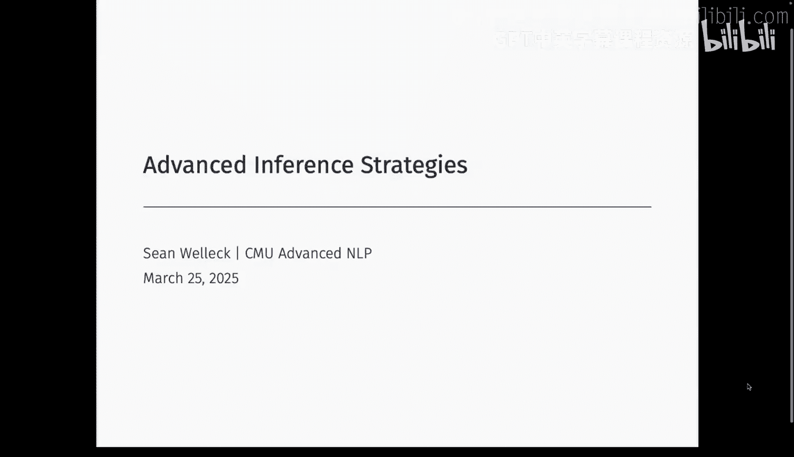
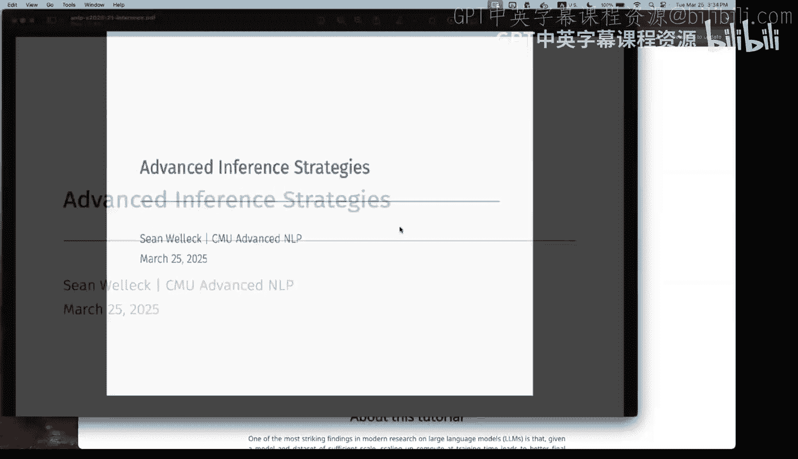
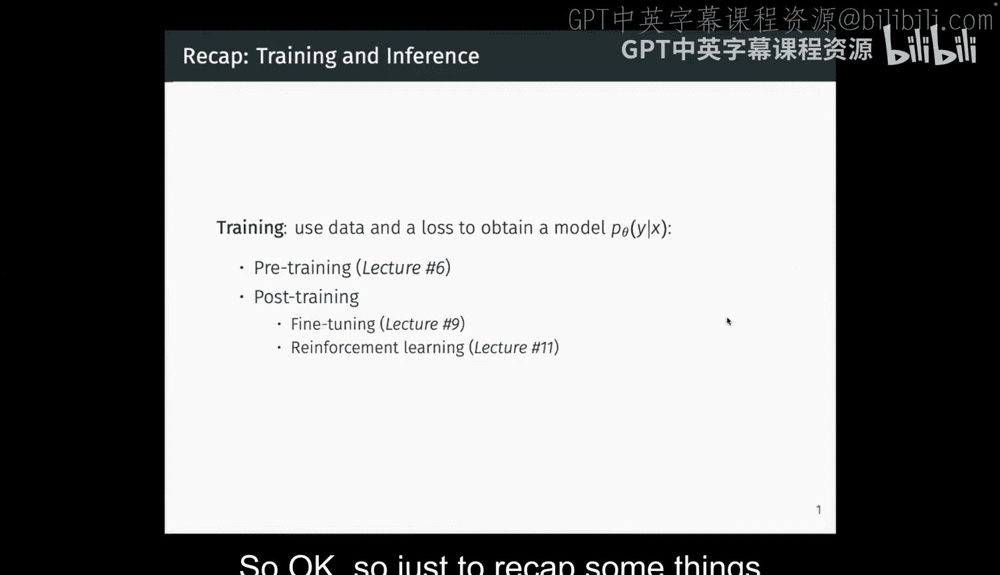
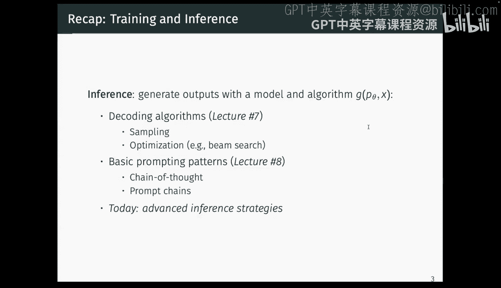
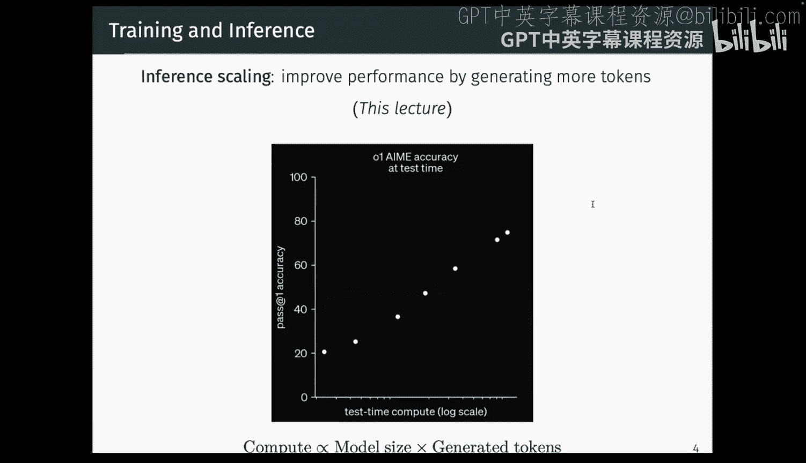
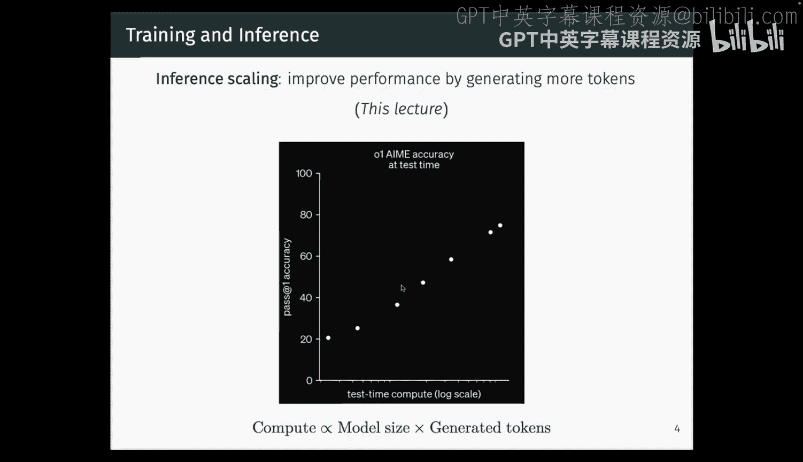
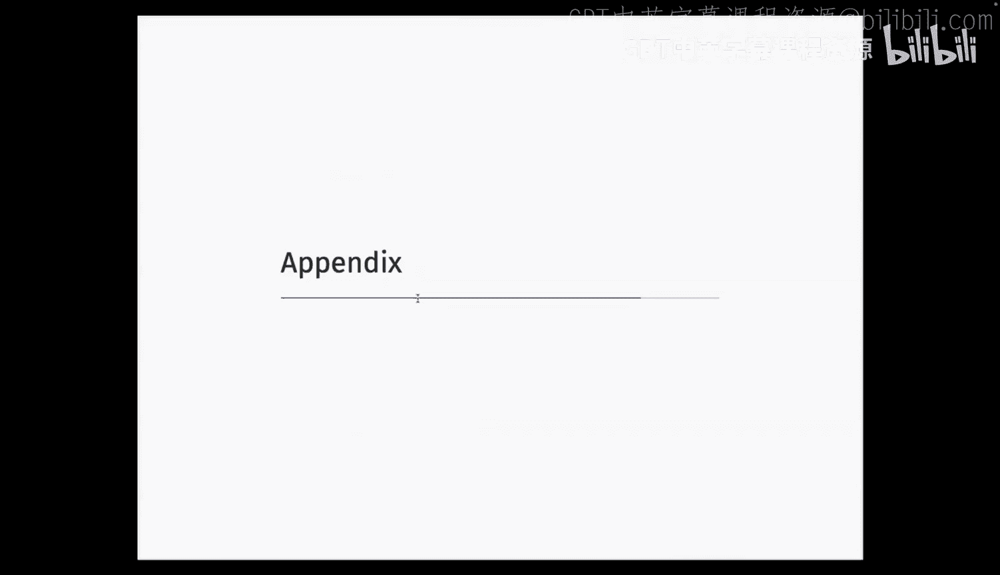

# CMU《高级自然语言处理｜CMU CS 11-711 Advanced NLP Spring 2025》中英字幕（claude-3.7-s - P17：-17-(18)_ Advanced Inference Strategies.zh_en - GPT中英字幕课程资源 - BV1nYVHz7Eoa

对。So today we're going to go over advanced inference strategies。

And these slides are in a different kind of format。

 so we had this NS tutorial in December on inference algorithms for large language models。

So a lot of the underlying slides are based on that， but I've changed them。

 I've updated them and so yeah， hopefully it'll be an interesting lecture and you'll learn a lot。

So。Okay。

So just to recap some things that we've talked about in the course and how they fit into today's lecture。

We talked about kind of two main stages， so training and inference。

And so at training time at a high level， we use some data and we use some loss function to ultimately obtain some model。

And we talked about various phases of training。Like we talked about pre training and lecture six。

Then we talked about post training and two different kinds。

 so fine tuning as well as reinforcement learning。We'll actually have one more lecture on advanced post training strategies。

Coming up fairly soon。But you know， so far we've seen a variety of techniques for ultimately producing some model that you can use。

We also saw。This relationship， this kind of scaling relationship。Where at pre training time。

 you can improve the performance in terms of the test laws by increasing the amount of compute that's used during pre training。

So here compute is proportional to the size of the model and the size of the data。

 so the number of tokens that you're pre traininging on。And we saw these scaling laws。

 which kind of give you these predictable relationships for increasing the compute。

 either by increasing the model size or the data size and in return getting better test laws。

So today we're going to talk about the other phase， which is inference。

So this says that given some trained model， it could be trained， it could be pre trained。

 it could be post trained， we want to actually use the model to generate outputs。And so for this。

 we can use some algorithm， we could denote it as G。

To take in the trained model as well as some input and then produce one or more outputs。

So we actually already saw some algorithms that you used during inference time。

 you actually implemented some of them in the homework。We saw in lecture 7。

 these decoding algorithms。We saw sampling algorithms like temperature sampling。

 other variants like top K and top P。And then we also saw these methods that do optimization。

 so they try to find the most likely sequence from a model。And a good example of that is beam search。

And so you could think of these as at an abstract level as being something you call and then you get a sequence back from your model。

We also talked about。A few of these basic prompting patterns。So this says that， okay。

 given a model then。Regardless of which decoding algorithm you use。

 you can kind of structure the calls to the model in different ways。

So we talked about how you can prompt the model to generate this chain of thought。

We also talked briefly about this idea of chaining together prompts。So this was in lecture8。

For instance， you could have。A prompt that says， you know， generate some sub question。

Then you call a search engine， get an answer back， and then you have another prompt which says， okay。

 now given this answer， try to generate。A final answer or another sub question。

So at the end of lecture  eight， we looked at a couple of those examples。And again。

 these are things that you do at inference time in the sense that you're using a trained model。

So today we're going to talk about other advanced imprints strategies。

And they'll fall into two different categories， which I'll mention in a bit。

But using these inference strategies， we can actually come up with something that。

At least resembles the scaling laws that we saw for training time。

So this is a kind of really exciting and active area of research。

Where we try to scale up the amount of compute that's used at inference time。

And tried to get better performance。So here， now the compute will be proportional to the size of the model。

And instead of looking at the number of tokens that the models trained on。

 we look at the number of tokens that we are generating。And so you can get different plots like this。

 and we'll see a few in today's lecture。Where on the X axis。

 we have the amount of compute that we're using at inference time or test time。

And you can see that as it's increasing。This model is getting better performance on this mathematical reasoning benchmark。

So this is a plot from Open AI， we don't know what methods they're using。

 but luckily the research community has developed a variety of methods and we can look at exactly how they work。

So these inference strategies are going to fall into two main categories。

And they really boil down to a kind of simple statement。

 so one is that we can take a generator like a language model plus a decoding algorithm and just try to generate multiple times。

So here， for example， we generate multiple possible solutions。

And then we try to incorporate some kind of evaluator model or verifier。That scores the outputs。

 and then maybe we select the best one。And so the idea is that this here is just one potential。

Kind of algorithm that you can use to generate multiple times and incorporate something like an evaluator model。

And so the idea is today we're going to look at different patterns for doing this kind of thing。

And if you use strategies like this where you're generating multiple solutions and then somehow picking one。

You can see these performance curves that look like this。

So this is showing on the X axis how many generated solutions you have。And on the Y axis。

 you see the solve rate on， again， a math benchmark。

And so we can see that as we kind of scale up the amount of solutions that are generated。

The performance is increasing。And then we can also see that the performance kind of varies based on which strategy you use。

And so in today's lecture， we'll see actually all three of these strategies。

That are being used in the plant。And then the second kind of class of methods。

Is you could just generate a longer output。So now let's say you're not even necessarily generating multiple times。

 you're just generating one sequence and it just keeps getting longer and longer。

And when you think about it， this is in some sense。

 using compute because you're generating more tokens。And the kind of。

Cllastic example of this is this chain of thought method。So here we say like， okay。

 instead of answering a question directly。Why don't we generate these intermediate thought tokens？

Prior to generating an answer。And there's been a lot of kind of innovation on this idea。And recently。

 there's been kind of exciting work where you train the model to generate this very long chain of thought。

 and it can kind of。Perform search， as we'll see within the chain of thought。

And so you can use a very simple kind of inference algorithm。And again。

 see these different scaling behavior。So here， for instance， with these methods shown here。

 you can see that。As the number of generated tokens is increasing on the x axis。

You get these improvements in the pass rate。And so I'm going over this kind of quickly just to give you an overview of things that we'll talk about today and then hopefully by the end of the lecture。

 you'll have。A good understanding of。The methods that on July the plots like this and a kind of framework for even thinking about new types of methods。

So yeah， in the first part， we will go over the methods that involve generating multiple times。

These go by various names， so one name you might have seen on the name of that tutorial is called Me generation。

So the idea is you have some generation。Algorithm， and then you have this kind of higher level algorithm that is calling it multiple times。

So yeah， there's different patterns for doing this and we'll go over some of the major ones today。

And then in part two， I'll talk about this idea of just generating a single longer output。

And that is again goes by various names， one is long chain of thought。So yeah。

 let's go to the first part。And so here we're going to again take this kind of abstracted view。

Where we have a language model， and。Say a decoding algorithm。

And we can view it as a kind of generator。Where we give it some input。

 and then it can produce an output sequence。So for example， we could like give it。You know。

Mathematic problem， and then it can generate some output sequence。Or we could give it。

A conversation so far， and it could generate the response for the next turn of the conversation。

So again， you could think of this generator as being like a call to a single。

A single call to a language modeling API。And again， here's like some notation。

Where you have some generator G。It takes in your model and some input。

And then these are like any hyperparameters。And then it produces some output。And again。

 you could think of this as being some decoding algorithm， like greedD decoding。

Or it could be temperature sampling。And then your hyperparameter would be the temperature and so on。

So then today we're going to talk about these kind of higher level algorithms。

Which you might call metagen algorithms。And so we already saw an example of this where here we take a generator。

We generate multiple times。And then now we incorporate this evaluator model and select the best one。

So again， you could imagine like maybe there's other strategies you can do other than this。

 and that's exactly what we'll go over today。And so here the notation， you could say like， okay。

 this takes in an input， but now it takes in this generator。

And then maybe it takes in some other things like the temperature for the generator and even this like evaluation model。

So there's a few different patterns or strategies for doing this。

So one of them is actually the chaining method that we saw in lecture 8。

 so I won't go over that one again。But three that we'll go over today are this kind of parallel generation tree search。

And then refinement， or it's called self correction。So in parallel generation。

 the idea is like what it sounds like。So we have some input。

And then we call our generator model to generate these multiple candidates。

Then we pass those to some aggregator or aggregation function。

And it ultimately decides what is the final output。So。You can kind of decide like how do you。

 like which aggregator should you use？And there's a few different like design decisions to do here。

So a really simple one is called Best Even。And the idea is， we basically。Look at every output。

And then we come up with some way of assigning a score to the output。So like here。

 we're generating meth solutions and。This one says two plus two equals 5， so it gets a low score。

This one says two plus two equals four， so gets a high score。

And then we just choose the one with the highest score。

So this is actually what we saw on the previous slides just in a bit more detail。

And so we can denote this scoring function here。As V。

And you can see that this best event is just saying， okay。

 generate n outputs and then take the Argm output。So this。

Way of assigning a score goes by various names。One way that you'll see it nowadays is that it's called a reward model。

You can also view this as like an evaluation model or just a scoring function。

 you basically just need some way of taking in an output and assigning some number to it。So。

Just to show like another concrete example and also get some intuition for why you would want to do this。

Here， again， we want to solve this math problem and you don't have to read through the details of it。

 but we have some input X。 you have this intermediate solution， Z。

And then you have some final answer， why？And one question is like。

 what if we had actually a perfect reward model？So the ro model would look at the solution。

 and then it would tell us like perfectly whether the answer was correct or not。

Then it turns out that these language models are often capable of generating a perfect solution。

And the question is like， how do you actually select from among the generations？

So here we can see a variety of language models。And what's happening is we're generating more and more output solutions with them。

And then we're using our perfect model to say。Does the correct answer occur in any of these outputs？

And again， the kind of interesting thing here is that。You can see that， yeah。

 by generating more and more， some of the models are actually finding some correct answer after， say。

 a thousand generations。Now， the thing is is in practice， you don't。

 if you're trying to solve a math problem， you don't typically know the answer。

And so the key question is like， can we learn a reward model that is pretty good？

And maybe we can get the kind of same type of behavior where， you know。

 we generate more and more with the model， and then we're able to pick out the correct solution。

So that's actually a common thing that is done。So here we want to train a reward model。

To take in a solution。And then predict whether it is correct or not。So。

Here we could train this in a variety of ways。And building the good reward models is kind of an ongoing active area of research。

The simple like a simple way is let's say you generate a lot of correct and incorrect outputs on your training set。

So on the training set， you can check whether an output is correct or not。Then from that。

 you can assemble a training data set。For your reward model， which says。

 here's a solution and then here's a label of whether it is correct or not。

And then you could basically， yeah， train the reward model in that way。

So actually we saw the same diagram， and I think I said that exact same thing。

In the reinforcement learning lecture。嗯。So yeah， the idea is。

This is called a reward model because you can also use it for reinforcement learning here we're using it to kind of select good outputs that are generated by the model。

嗯。And again， yeah， these can go by various names， so a reward model evaluator。Critic verifier。

Value function， scoring model。 Sometimes you just have to get used to like， yeah， different names。嗯。

And then the thing is， is that like this technique is not specific to。

Mathematical problem solving or even anything that has a 01 outcome。Of course。

 you could train a different type of scoring function or reward model。For example。

 we saw these preference based reward models， again in the reinforcement learning lecture。

And so here you train the model to assign higher scores to， for example。

 pairs and input that is preferred over another one。And the idea is then once you have this model。

 you can use it inside a best event。So if you have a chat model， for instance。

 you can sample multiple。嗯。Next turns in the conversation。

And then you can use one of these preference models to like pick the most preferred kind of output for your chatbot。

So。Is there any questions about anything so far？嗯。😊，So。I'm curious about how this works with them。

That there is that。All of the time the LLM kind of understands maybe the underlying concepts of the mathematics。

 but this reward model。How like is are the underlying concepts understood or is there sometimes a chance of like like a typical format of an answer being prepared early？

Yeah， that's a good question。嗯。So one way to think about the reward model is。Well。

 we can look at like a typical approach to training it。

 so typically you'd start with a pretrain language model。

And so the pretrain language model maybe has some， you。

 understanding or some ability to solve mathematical problems。

And then you'll fine tune it for this reward modeling task。And so the hope is that the kind of。

Problem solving ability from pre training。Combined with this additional supervision of like this problem is incorrect。

 this problem is correct。Results in a model that can， yeah， kind of verify a solution。Um。

 and so the hope is that like some solutions are kind of easy to see whether it is correct or not。

And that's actually easier than like a generator generating the correct solution。

So that's the kind of intuition for。Using this reward model。And then what it ends up learning is。嗯。

Yeah， it's kind of it can learn a variety of things and so as we'll see on pretty soon。

The ro models often aren't perfect， or they're pretty much never perfect。

 So you can actually find these exploits in the model where it will assign high scores to things that aren't actually correct。

And sometimes it could be you know， a trivial thing， like an empty solution or something yeah。

So it is possible for them to pick up on kind of spurious cues。嗯。😊。

Does the choice of the report module depend on your generator？Yeah， that's a great question。So yes。

 so typically what you'll observe is that if you have a reward model that's much。

 let's say it's the exact same model and then it's like the larger version。

Then you can get this big boost in best of end。Because your're， yeah。

 your generator is like generating all these candidates and then your reward model is even more powerful。

You can still see some gains if they are the same size。And again。

 maybe that comes down to this idea of like generation versus evaluation or like how well you've trained the model。

嗯。And then another thing is like sometimes。Some research group or something will train a reward model。

 and then you'll just download it。 and it's just kind of separate from your model。 So yeah。

 in practice， there is a kind of。Disccrpancy between the generator and the award model。Anything else？

Okay， cool。So just I kind of like this argument， so it's， let me just go through it。

So then even though this best event is very simple， we can think about kind of what it's doing。

So what it's basically saying is that you have this two step approximation that's happening。So。

Best event is saying we're going to generate n outputs， and then。Select the high scoring one。

And so by only looking at n outputs， this is approximating doing the maximization over all possible outputs。

So that's the kind of first step of approximation。And then second。

 you're kind of assuming that your reward model is modeling the kind of true underlying reward。

So like if you're solving math problems， you're assuming that your reward model is kind of modeling whether it is actually correct or not。

And so the cool thing is that this approximation here gets better as you generate more。Because again。

 it's saying that by only taking end samples， you're approximating the maximization over all possible samples。

However， this goes to the question that was just asked， which is that。

This approximation here can actually lead to issues。

If your reward model doesn't actually model the reward will。So to see this。

 we often see plots that look like this。So here we're scaling up the number of generations。

 or this was opening out this plot。And then after a certain point。

 the model finds things that get a high score according to the reward model。

But the sequences are actually not correct。So it's kind of finding these like weak spots or these like exploits of the board model。

And so your performance actually starts to drop， so this is called sometimes called over optimization。

And。Yeah， you can fix this in various ways， one is you could train a more robust reward model。

But yeah， sometimes you'll see this。A curve that looks like this， and it's kind of unintuitive。嗯。

Unless you've kind of。Yeah， heard about this。So that's called Best event and this is actually， yeah。

 really frequently used。And you can see that you can get kind of large performance improvements in it。

And it depends on how good your award model is。Another common strategy that's used is called voting or self consistency。

So here we assume that our outputs are kind of decomposed into some。Some sequence。

 you could view it as like some reasoning path。And then some kind of answer at the end。

And then the idea here is to just take the majority vote。So here， for instance。

 this answer2 appears two times and the answer four appears one time。

Let's say these are the only outputs。Then in this case， we would select the answer too。

So kind of simple， intuitive idea。And yeah， this is called self consistency and it also can lead to these nice performance improvements。

 as we'll see on these style of tasks where we have some answer at the end。

You can also incorporate one of these reward models into the voting。

So this is called weighted voting。And you can see now we basically， as it sounds。

 weight each vote or each sequence。So for example， here。

We would have a tie with majority voting like there's two， twos and two fours。

But now we use our reward model and get some scores。

And then we basically sum up over the different answers。So here 0。8 plus 0。9 is more than this。

 so we would still pick the answer too。See yeah， this is called weighted voting and the key difference is you're now incorporating this reward model。

And so here is the plotta we saw earlier in the talk。

And you could see that this weighted voting procedure is doing better than the majority voting or the best event。

And so again， if you can。Yeah， have a good reward model then this weighted voting can actually be a better way of kind of aggregating the outputs。

And so we can think about like a bit more precisely about why you would want to do this weighted voting。

And there's a kind of cool or nice intuition for what's happening。

So what happens is that you can kind of show formally that if you were to take the number of candidate outputs to infinity。

Then the accuracy that you get with the weighted voting。Converges to the accuracy shown here。

And basically what it says is it's the accuracy that you get if you kind of sum over or marginalize out all of these intermediate reasoning paths。

So it's saying like for every possible intermediate reasoning path on a way to an answer。

 you like aggregate over all of those and then choose the best answer。

So it's a kind of nice intuition for what's happening。Again。

 the voting procedure is kind of taking into account information from all of these paths to a particular answer。

嗯。And then if you stare at this for a bit longer， there's some interesting conclusions。

So one question is like on this plot， if we keep going further and further。Will we solve everything？

I mean， maybe you can kind of tell from just looking at it that we're pretty far from 100。

But you can actually show that or this basically shows that you are going to converge to some accuracy with infinite samples。

So as long as you have an imperfect。Scoring function V or generator。

 then your accuracy will stop improving。Also， you can see when the weighted voting is better than voting。

It's better when this。Reward model times the generator is giving more total mass to the correct answers than just the generator。

So again， a kind of intuitive idea， but it's kind of nice to write it down formally。

And then if the weighted voting converges to this accuracy。

Then there's basically two ways to make it better。So you can either improve the quality of the reward model and that will push up the upper bound。

And or you can improve the generator。By training a better model or using a better algorithm。

So that's the weighted voting and some analysis for it。And as I mentioned before。

 this idea of improving the reward model。Is a really active area of research？

So here's a recent paper or it was very recent when we did the tutorial in December。And。

ItsThey kind of use this idea of parallel generation in the reward model itself。

So it's basically saying， okay， given some problem and some solution。Your reward model。

 your verifier says， let's verify step by step。And then it comes up with like， no， it's not correct。

 Yes， it is correct。 And then you can see that they're drawing multiple samples and taking the average。

So they're kind of using inside of the reward model this idea of parallel generation。So anyways。

 kind of yeah， interesting area of research and people are figuring out what is the best way to。

Train these and then to get them to generalize to other tasks because as much as we love solving the math problems。

 it's not the only thing that we want to do with language models and so we also want。

Reward models that generalize do a variety of things。

So that's the parallel generation and again the key idea is you're kind of exploring the space of outputs。

And we can see large performance gains。And then ultimately。

 it's bounded by how good your evaluator or reward model is and your generator。So yeah。

 any questions here before I move on？Yeah。什么。Yeah， so here with the best event。

 it's slightly starting to occur。 it goes from like 46。6 to 46。5。With voting。

 I think one difference is that with best of end， you just have to find one output that kind of exploits the model。

 the reward model， whereas for the voting， you have to find it's aggregavating over multiple outputs。

And so maybe it's a bit more robust to， yeah， these kind of adversarial sequences， yeah。Okay。

 so yeah， one insight is that this best event only uses the verifier or reward model at the very end。

And so the next class of methods we'll try to use。Evaluation or some score as you're generating at a kind of intermediate stage。

So that's gonna to be the research methods。So here the basic idea is you decompose your generation into this tree。

So like at the first step， you call your generation model。

And let's say it generates the first step of a mathematical solution。Or this might be。

 you know an agent and it generates some action。Then you transition or then you try to assign some score to the step or to the state。

And so we'll look at an example of how that's done。

Then you have some algorithm for like picking which one to explore next。And then， yeah。

 you transition to the next step。So for example， if you're generating a math solution。

 you generate the next step of a solution。If this was an agent environment。

 then the environment would give you the next state and so on。And so the idea is that。

You can try to frame the problem that you're working on as this kind of tree。

And what you have to do is determine， like， what are your states or what are the nodes。

What do these different transitions mean？How do you come up with the scores for each state？

And then what search algorithm do you use to actually traverse through the tree？

So you can use like breadth for search， depth for search， or any like research algorithm。

So this is the kind of general design space of the research algorithms。So yeah， one example。

One concrete example on the math problem solving again。

Is what you can do is you could train this reward model， which is called the process reward model。

And the idea is like instead of just taking in a full solution。

It will just take in the steps of the solution so far。

So here each node in the tree again is like one step of a solution。

And then this will give us a score for each one of our nodes。

So there's a variety of ways to train these models and again， this is another area of research。

One way that was done by Open AI and kind of popularize these。

Is to actually hire human annotators and say， okay， is this step correct or not， if it's cracked。

 then like move to the next one and so on。So like here， the steps says t plus two equals 5。

 and so the person would actually annotate that this is incorrect。

And then you would train your model on a data set of these annotations。

So then if you have such a model， then you can try performing a research。

So here's one example algorithm。That you could use。

So this is one from one of our recent papers called Rebase。And the idea is。

 let's say you generate some potential next steps for the solution。

Then you can look at the scores that your reward model gives you。

And decide kind of how do you allocate the budget？To explore next。So here， for example。

 let's say that each step at each step you want to expand。

A total of six like generate a total of six expansions。Then here。

 maybe we would explore or expand this node more because it's more promising。

 according to the reward model。This one we wouldn't expand at all because it says t plus two equals 5。

And then this one maybe the reward models not share about it so we can expand it a bit。

And so here's the exact like。Criitterion used for the expansion。

 and it's basically saying take the softm of all of the scores at the current。Exploration。

In the current like exploration frontier。So yeah， there's a variety of tree algorithms that you could use。

 this isn't the only one。嗯。But what you can do is you can kind of combine this with the idea that I told you about before。

What you can do is you can run the tree search and then get kind of multiple solutions。

And then still use majority voting at the end。And the key idea is that。

By using these intermediate scores， you can hopefully do a bit better than just the best event。

So in particular， like your tree might be able to backtrack。You know。

 one path doesn't turn out to be promising。You can also control the exploration based on the generation so far。

So， for example， like。We saw this one has2 plus 2 equals 5。With best event， you would。

With like the full sequence best event you just keep generating here。

 whereas here we're able to use kind of better exploration。

So it is possible to outperform just the parallel sampling with the tree search algorithms。

So here's an example where this is showing test error， so lower is better。

And you can see that this rebase method。Is kind of doing better than the parallel sampling。嗯。Now。

 the key with these research methods is that you have to be able to decompose the task into this kind of tree。

And then， you often need。You know， really good scores for the intermediate states。

And so it is tricky to incorporate the research into just general tasks or tasks where you don't have a kind of good scoring function。

So two different areas that they are being used or explored。One is called formal The improvingroving。

So here we have， we want to prove this theorem。And it's essentially in this kind of source code in this programming language called leanan。

And what Lean will do is it gives you this proof state which says here is the current state of the proof and what you have left to prove。

And then what's typically done is you ask a language model to just predict the next step of the proof。

Then you can pass that to Lene。And it can actually tell you whether the proof is complete。

Whether there was an error or it could give you a new state。So this is kind of。

Amenable to the tree because it's nicely decomposed into this kind of sequence of state and then action or next tactic。

So in fact like。Many of the state of the art methods in this area do use research。Um。

 so what you do is like you ask the language model to generate multiple candidates for the next step of the proof。

Then you somehow come up with a score。嗯。This one had the best score， so it was explored。

 but then you could see that the model actually backtracked and then chose this one and ultimately got。

To a complete proof。So again， I'm not going into all the details here。

 especially on how you at the scoring function， but I'm just showing you another example of where you see this。

嗯。Tse beam search previous Yeah， so so there's different options。

 So best for search is slightly different from beam search。

So beam search has the property that the beam at the current step will be a certain layer of the tree。

Whereas you can see here， what happened is it。Best for research selects a node to expand。

 and then it can actually backtrack and select something even like far back in the tree。

So they're yeah， related， but slightly different。And then here's another example again I won't really go into the details but。

Yeah， people are trying to you know investigate whether the research algorithms。

Are useful in this agent setting？So this is a paper from people here at CMU。And they were looking at。

 yeah， using best for search， so actually the same search algorithm that I just showed you。

In this kind of web agent setting。Okay， so for research。

 the key difference is that you have the ability to backtrack。

And you can use these kind of intermediate scores to explore。However。

 you really want to make sure that your task is kind of amenable to tree。So some properties。

 one is you want it to decompose into different states。

And then you want to be able to train some really good value function or scoring function。

Which often requires some really good kind of reward signal in the task。Okay。

 any questions about the tree search before I move on？

Did the authors sent the agent they show that they had really positive results？Yeah。

 so showed they showed some improvement over the parallel sampling。I think in this paper。

 they were just prompting a model to get the value score。And so I think like， yeah。

 one future direction was potentially。Can you train a better value function and then do even better？

So what do the blue dash lines？So I think this is showing backtracking。

So it's showing that the model goes down。Let's start here， so the model goes down this path。

And then you can see that it gets a value of 0。4。So the next best thing to explore is actually 0。45。

So then it explores this one next。And similarly， it goes down this path。 Now it's 0。5。

 so it keeps exploring 0。55。 Now it gets to a bad state，0。3。

So it actually backtracks all the way to this one。So when so this agent have two，3。

6 at the same time。Yeah I believe so， yeah。Yeah， so here another limitation， by the way of the tree。

 is that， yeah， oftentimes you have to keep around these like multiple states。

Or you have to have the ability to。Yeah， like rewind your backtrack in the environment。

 which isn't always the case。But yeah， in general， like it's still an open question。

 I' would say to continue your question， whether you can actually do better with the tree search versus just like scaling up parallel sampling。

I think a lot of it will come down to kind of how good your value function is。Okay。

 so then the next pattern is called refinement or self correction。So here the idea is。

You start off with some initial output could be generated you know by language model。

And then you want to have some model， which is like a correction model or refinement model。

To basically take in this output。And produce a better one。So。And then you could repeat the process。

 so this is a kind of this could be a loop。So here， for instance。

 let's say the model starts generating two plus  two equals 5。

Then maybe your corrector or refinement model can actually correct it and get it back on a correct solution path。

So it turns out that if you yeah， try to design one of these refinement or self correction systems。

Then there's a few different design choices。So one design choice or one like approach。

Is to try incorporating some。Source of feedback into the correction or refinement module。So here。

 for example。Let's say that we had some magical feedback module which told us that two plus2 equals 5 is wrong。

Well， then the job of the correctctor probably becomes much easier。

It knows that the generation is incorrect。And so it could， yeah， try to produce the correct one。

And again， this， it's not showing the loop， but you can imagine like repeating this over and over。

And so in some sense， this could resemble what you might do with ChadGBT。If， you know。

 it produces an output and you say like no， fix this or this doesn't look good and you kind of have this extended sequence。

So the question is like， can you build a system that yeah operates in this way？

So the key question is going to be， where do you get this feedback？

And it turns out that the quality of the feedback that you get can be very important for whether this refinement model or correction model。

Can actually improve your generations。So one area where you can often get some source of feedback that。

Kind of add something useful or add something new to the generation system is in code generation。

U so well， first I want to say that， yeah， so usually when people look at these refinement methods。

 you can break them apart into extrinsic and intrinsic methods。

So an extrinsic method means that you have some source of external information being passed to the refinement model。

So it could be like a code compiler， it could be you know， some agent environment。

Something kind of external to just the model。And then intrinsics is you don't have any external information and you want the model to kind of like self improve its outputs。

So as I mentioned， like one source of this extrinsic or external feedback is in cogen。So again。

 this is an example from one of our papers。And we were looking into the setting of what's called verified cogeneration。

So here we take in some， our goal is to generate like a rust program。

And it turns out that for some rust programs， you can have this formal verifier， it's called Vris。

And what the formal verifier does is it checks whether the program actually meets the formal program specification。

And then if it doesn't meet the specification， it can give you these very detailed error messages。

So it's kind of small here， but it says like error， and then it even highlights in line 23。

And in line number 9。Something that is failing。And so you can imagine that like this information is。

Could be very valuable for the refinement module。First of all。

 it says that the code is definitely incorrect， so definitely should refine something。Second of all。

 possibly it's even helping to localize the error。And so we found that， yeah。

 doing this kind of iterative refinement with these really informative error messages。

Could actually improve the performance a lot。Yeah， I think in this case。

 it actually does add code right before this line 23。U so yeah。

 and so here's an example of we looked at like whether you could just keep doing more and more parallel generation。

And it does improve at first， but then the kind of performance just flattens out。

And then if you add in the refinement after doing like 256 parallel generations。

It actually adds this additional kind of capability。So yeah， one of the。

Kind of success cases that popularized this was in code by this paper here。

It's called Excel debugging。And there's been other success cases of this these refinement models when you have kind of external information。

So for example， you might have a retriever that actually provides you with new documents。U。

Graham has this。This kind of tweet where he looks at。An agent environment。

And I think the task was to。Like like refactor or rewrite a paper so that it's in a certain length。

And if you just have a simple environment that tells you like。Current length or something。

 then it actually did much better than this like powerful01 model。I might be getting that wrong。

 but anyways， the idea is that you。Can often have some external information that the refinement module can use。

 and in those cases， this kind of method works pretty well。

What is more of an open question is the intrinsic refinement methods。

So here we have some language model。And we want to just basically repromp it。

So we prompt it once to generate an output。And then we repro it again to say， you know。

 look at this output and generate some feedback for it。Then we repromp the same model again。

To correct the output or to stop based on its own feedback。So here it's， yeah， kind of。

Everything is self contained， and there's no information， new information coming to the model。

And here， the results can vary a lot based on the task and the property of the task。

So one place where this can work well。Is in tasks that are very easy to evaluate。So for example。

One thing is like， let's say you're generating a paper like a literature review。

And you want the literature review to have exactly 15 papers or something。

Then maybe the first time the model generates a pretty good literature review and it has like 13 papers。

Then that's very easy for the model to self evaluate and say， you know， there's only 13。

 let me refine it and add into more。On the other hand。

It's often less clear whether this works for something that's kind of pushing the capabilities of the model。

So in particular， in like mathematical reasoning。So there's this paper。

And it was using models that are now older， so I would be interested in the newer models。

But what they found is that on these math problems。

The model would just as often go from a crack solution to an incorrect solution。

As it would go from an incorrect solution to a correct solution。

So basically like the feedback that the model was providing for itself。Was just too noisy for it to。

To really improve。So yeah， there's a kind of fun toy example that you can construct to simulate this。

So here the task is to generate this name， Taylor Swift。And the generator is just a single。

 it just generates one character at a time， independent of all the other ones。

And so basically if you sample， you know， whatever。6 plus。

1even characters just independently of each other。You're almost never going to get。

Taylor Swift as the answer。And so in this case， if you just do， yeah， this best event。

 then you never solve a task。However， let's say you have some feedback and it tells you exactly which characters are incorrect。

And if the characters are correct， then you don't resample otherwise you only resample the incorrect ones。

So it's a kind of oracle feedback， but if you do that。

 then you can have this kind of perfect refinement system that gets the answer at the end。

And then what's interesting is you can basically add noise to the feedback and basically control how good the refinement is based on how noisy the feedback is。

And so in some sense， this might be simulating what is happening with the language models。Where yeah。

 if you have this really high quality external feedback， then the refinement works well。Otherwise。

 if the feedback is too noisy， then it might even be worse than best event。But yeah。

 this is also a very kind of active area of research and people are still trying to figure out。

Where these work well and what are the best kind of ways to build a refinement model？Okay， so yeah。

 as I mentioned， you have this distinction between extrinsic and intrinsic and you see the performance variations。

Any questions here on the refinement？Before going to the next part。OK。Um so。Yeah， I wanted to also。

Cover this idea that I mentioned at the starting。That with the inference methods。

 we can now have this new notion of a scaling law。Where we increase the amount of compute that's being used。

And in return， get better performance from the system。

So if we remember these pre training scaling laws from lecture6。Here we had this configuration。

 which was the model size and the number of training tokens。

And so each line here is going to be a different choice of model size and number of training tokens。

Or like each position will correspond to a different number of tokens that have been processed so far。

Then we had this idea of the compute optimal configuration。

So it's saying like at a given compute budget， what is the best test loss among all the different configurations？

And then we talked about how if you come up with some formula for this compute optimal frontier。

Then that is what that is one example of a scaling law。

Where here we have a scaling law in the amount of compute that's used。

And it tells you the kind of Teslas。So we can think about what is the analogy with the inference methods。

So here now our compute cost is the size of the model。And the number of tokens that are generated。

And then you want to use some inference strategy。So one question to ask is like。

Let's say we try a bunch of different configurations。

So you could have like a small model and generate more with it。

Or you could have a larger model and generate less。Then for each given compute budget。

Kind of what is the compute optimal thing to do？And so again。

 you can get this notion of a scaling law。Where， for example， you try different model sizes。

You generate more and more tokens with them。And then you look at each compute budget。

 kind of what is the compute optimal choice？So here's an example of one of these scaling laws for the inferenceprint strategies。

So this is looking at various model sizes again。And generating more and more outputs with them。

And then you can look at each position kind of what test error are you getting？

And one kind of interesting thing here is that sometimes it's actually better to use a smaller model and generate more with it。

Then it is to use a larger model and generate fewer times。

And one reason why this is interesting is because like if you only look at the training scaling laws。

 maybe you would think that， the larger model is better。

But then you can have this other axis of like how much you're generating given some generation budget。

And so this idea of like compute optimal generation is another thing that people are looking into now。

So one thing you can do is。Yeah， try to design better inference strategies that use your compute budget better。

Another example of this is from this paper here， which is also from people at CMU。

 they look at like based on a problems difficulty。Try to select the best inference strategy。

And they found， for instance， that， like， sometimes。Parallel sampling is best。

 sometimes refinement is best， and it like varies based on the problem or based on its difficulty。嗯。

So anyways， that was really quickly the idea of the inference scaling laws。And yeah。

 they basically say that when we allocate the compute better， we see these kind of。

Similar improvements that we see at training time where if you increase the compute。

 you can get a better performance。And then it's important to note that like based on your inference budget。

The best model size or the best strategy can vary。And so yeah。

 sometimes like one concrete way that you see this now is。

These different companies will train different model sizes。

And then let's say you want to deploy a model on your phone。

Then you might use a you know a smaller model because your compute budget is lower and the question is like。

 yeah， for a given budget， what is the best kind of configuration of model and the inference strategy？

嗯。Okay， so。That was the strategies that involve generating multiple sequences。

So we saw the parallel generation， the tree search and the refinement。

And I talked kind of briefly about。Ways to choose a method based on both its task performance and its kind of inference cost。

So in the last 10 minutes， I wanted to talk about this very recent and emerging area of research。

Where we just generate a single long sequence， and this sometimes goes by the name of long chain of thought。

So here the basic idea is that we're going to train a model so that it generates this thought prior to a final output。

And then at inference time， we don't use a sophisticated strategy like tree search or refinement or even parallel sampling。

Instead， it's a kind of cool idea that。Maybe within this thought sequence。

 the model can actually kind of perform self correction， perform backtracking。

 perform whatever it needs to do in order to。Achieve a kind of in order to solve a task。

And so this would be。Yeah， potentially useful because。Yeah。

 then you could use a simple inference algorithm and maybe get these performance gains by like making sure you have long enough thought。

So that's the basic idea and then I might go into more concrete detail on this in the post training lecture。

But the typical approach for。Training a model like this。And I say typical。

 it's like the past couple months is to use reinforcement learning。

So here your policy is a language model， it's given a math problem。

 let's say you're doing math problems， it's given a problem X。

And then it has to generate a thought and an answer。And then your reward is just。

 is the answer correct or not？And the idea is in the reinforcement learning process。

The model is free to figure out how to best use this thought in order to maximize the reward。

So here's the kind of plots that were observed in this， at least this paper。So first of all。

 you could see is training。Goes on。We see these improvements in accuracy。

So the model is learning to solve the problems better and better。

Here this is actually showing the blue is just sampling once。And the red is doing the。

Majoity voting was 16。So you can see that the majority voting is still useful on top of this type of method。

And then the interesting thing here or you know， one interesting thing was that their response length was actually increasing over the course of training。

And so this chain of thought was getting very long up to like 10，000 tokens long。

And then if you look at the chain of thought， it might look something like this。

So here they have this think token。And then here there's like dot， dot。

 dot because it could be like 10，000 tokens long。And you can see that the model is learned to kind of。

Yeah。Solve the problem。And then the interesting thing here is like it says， wait。

 that's an aha moment I can flag here。And so then it says let's reevaluate this to identify if the cracksome。

h blah， blah， blah。So in some sense， this is doing some kind of。Self evaluation。

 it's doing some kind of backtracking where it's going down a solution path and then you know。

 choosing to do another one。Or you can interpret this as kind of self correction where it says。

You know， wait， let me do this now。and。Yeah， actually one of my PhE students Weihua looked at a bunch of these outputs and I think he used the language model to like analyze the patterns in them。

And so it turns out that inside of these chains of thought， you do see some consistent patterns。

So the model learns to like express uncertainty， like wait， hold on or wait actually。

 does this formula apply here？It does learn like branching， backtracking， and retrying。

So like alternatively revisiting。Wait， let's try again。嗯。It does show this like verification。

 Let's check if we made an error。Let's test this with， et cetera。Key points。

 so like key takeaway clarification and then synthesis。So anyways。

 this is just being like what is in the the tokens。

 and then we're kind of assuming that the model is using it in these ways。

 but you could at least see these patterns in the。In the chains of thought that it's learned。So yeah。

 kind of interesting。So then recently， yeah， one question is like。

 can you have this kind of scaling relationship？Between the amount of tokens that are being used and accuracy。

So this was a method， a really recent method。Where they came up with this way of。

Basically forcing the model to。Adhare to a certain length budget。

So they either force the model to say weight， and then it keeps generating more if it's too short。

Or if it's getting too long， then they put in like final answer。

And force the model to generate an answer。And so they can get these kind of， yeah。

 smooth trade offs between。The thinking time and the performance or the accuracy。

Thinking time just meeting like the number of tokens that is being generated。And so then， yeah。

 recently we also looked into this。And so we train this model called L1。

And instead of like putting in these tokens， we train it with reinforcement learning to not only generate the correct output。

 but to also adhere to length constraints。So for example。

 you're in the prompt you say like use up to 2000 tokens or you know any。Randomly selected amount。

And then a reward， which is the correctness。As well as some length constraint penalty。

And so here's the model up here and you again have this。

Kind of correlation between the number of tokens used and the performance。

And then here's the S1 model that I mentioned before。So and then finally， as I mentioned before。

 the sequential and parallel scaling， so sequential being generate the long chain of thought。

The parallel being something like majority voting。Oftentimes you can still use majority voting on top of the sequential model。

UmSometimes though， like if you actually look at the number of tokens that are being generated。

At least with these particular models， it's better to just keep generating a longer chain of thought。

But anyways， this area is， yeah， really。Early and like active area of research。

 so probably for next semester or next year's lecture。

 we'll have a lot better understanding of these techniques。Okay。

 so that was a kind of quick overview， but we did go through get through it。So again。

 in the second part， we wanted to train a model so that at inference time。

 it just produces this long sequence。And the finding so far is that at least on some problems。

 the models can internally kind of。At least it seems like they're performing backtracking。

 self correction， et cea。But this is really early an emerging area of research and people are still kind of figuring it out。

And then to recap， yeah， in this lecture。We talked about these advanced inference strategies。

And the idea again， is to take a trained model and try to improve its performance。

And so you can do this by generating tokens according to some strategy。

And then also incorporating other types of external information。

Like we talked about how these ro models might。Take advantage of this idea that it's easier to evaluate than generate。

And then we also talked about how if you have this really good environment feedback。

Then you can possibly do things like refine a generation。

And then we talked about two kind of complementary strategies。

So one is calling the generator multiple times。And then the other， again。

 is just generating a single long output。So I think I'm right at time for today。

So happy to stick around for a couple questions in person。

