# CMU《高级自然语言处理｜CMU CS 11-711 Advanced NLP Spring 2025》中英字幕（claude-3.7-s - P18：-18-(19)_ Efficient Inference.zh_en - GPT中英字幕课程资源 - BV1nYVHz7Eoa

So today is going to be one last lecture on efficient inference。

I wish we could do more because inference is really interesting。But anyways。

 it'll kind of build on the previous lecture， but focus on different areas。 So in particular。

 the idea of efficiency。So these slides are originally also based on this tutorial that we had at NIs。

And Haley Shokoff。Who was at Aluther AI at the time and is now at Anthropic， made most of the slides。

And so yeah， I've adapted them a bit， and I've also given some more references to like practical tools。

That could be useful for your projects or even if you want to like run language models on your laptop and haven't seen the tools before。

So hopefully it should be a combination of kind of entertaining and interesting lecture。

Like a lot of lectures in this course， it's structured sort of as a survey。

 so any particular area or any particular method， we won't have time to go into all the details。

But rather， hopefully you can get a kind of overview of the different ways that you can think about efficient inferences。

 and then we do have a few additional courses here， even at CMU if you're interested in it。

Next semester， there's going to be actually an entire course on inference algorithms。

 which is pretty exciting。And then we also have the systems course。And the instructor。

Or one of the instructors， Tianchi？LED the development of one of the tools that I'll talk about at the end。

So anyways， yeah， we can get started for today。

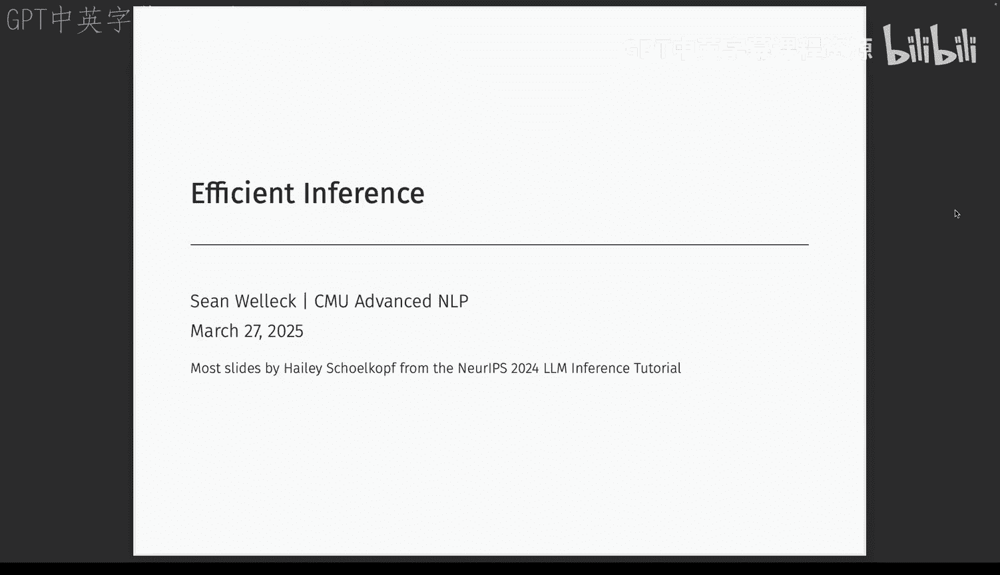

And so when we think about efficient inference， I wanted to go through a few just very concrete examples where this comes up。

So first， there's this tool。

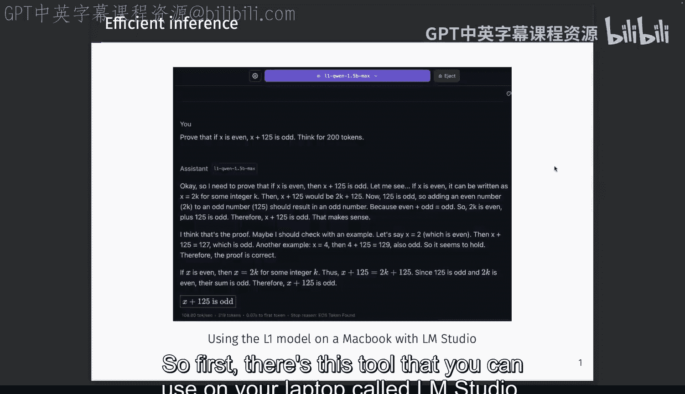

That you can use on your laptop called LM Studio。

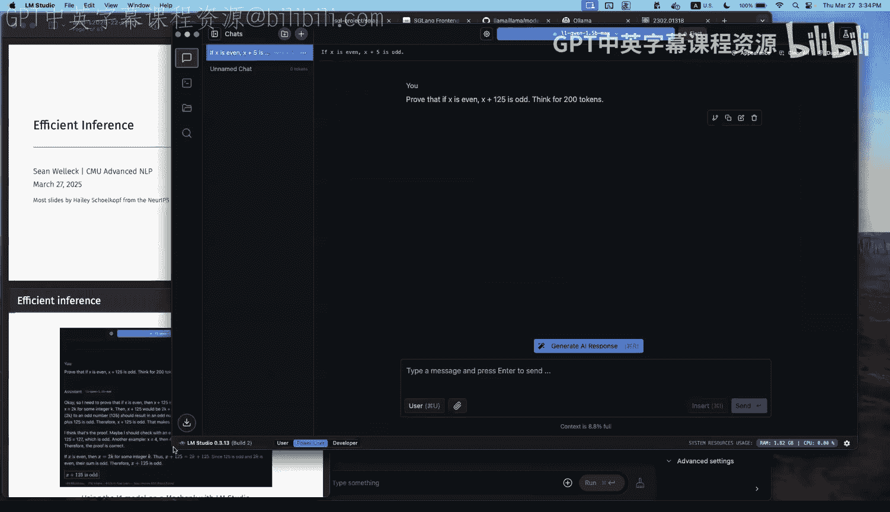

And so here I have a MacBook Pro， I guess this is kind of a nice MacBook Pro。

 but this is going to be running on my laptop。And here I've taken the， I apologize kind of small。

 I don't know if I can yeah， zoom there we go。I've taken this model that I told you about at the end of the class。

 it's called L1。And so it's one of these reasoning models and it's 1。5 billion parameters。

And as I mentioned， we can kind of give it some。Problem or some thing we want it to like prove。

 and then we can tell it how long we want it to think。

And then you can actually just run this on your laptop。

So this is all like actually being run on the laptop， you can see it's pretty fast。

And it actually does some thinking and comes up with。Probably a reasonable proof。

Of this thing that I asked it。Then you can also like。四。😔，啊 maybe。Let's think for 2000 tokens。

And then， we can generate。And so you can kind of see the speed of generation on the laptop。

 and it's kind of cool like you can actually run this language model on the laptop。

You can do all this thinking。And then。The few times that I ran it。

 it comes up with the same proof in the end， but it just keeps thinking if you tell us to think longer。

But anyways， that was kind of the point of the previous lecture， the point of this one is， yeah。

 we want to be able to run language models sometimes on our laptops and sometimes it's just。

 you know us interacting with it， it's not a bunch of people interacting with it at once and we want to somehow optimize the performance so that it's fast。

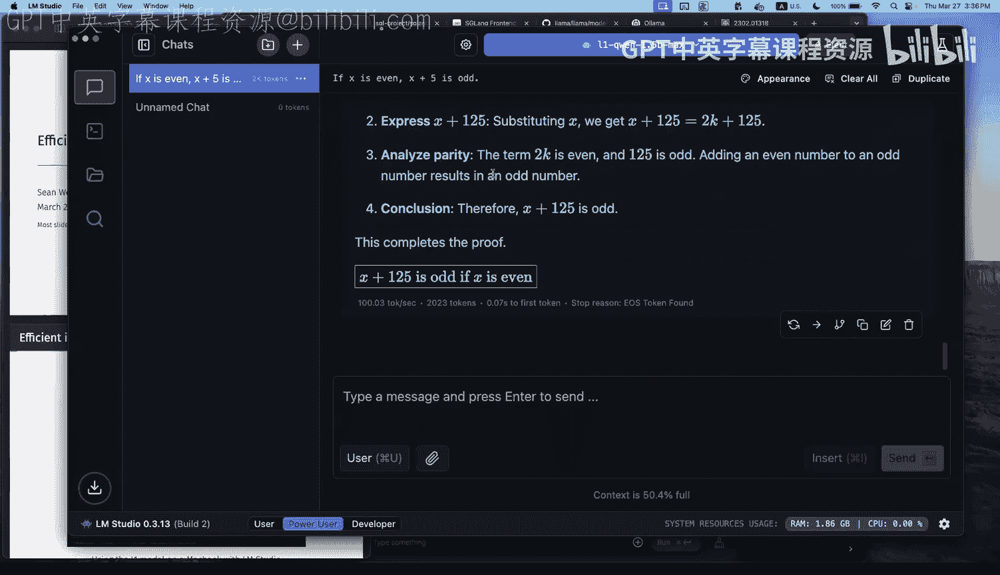

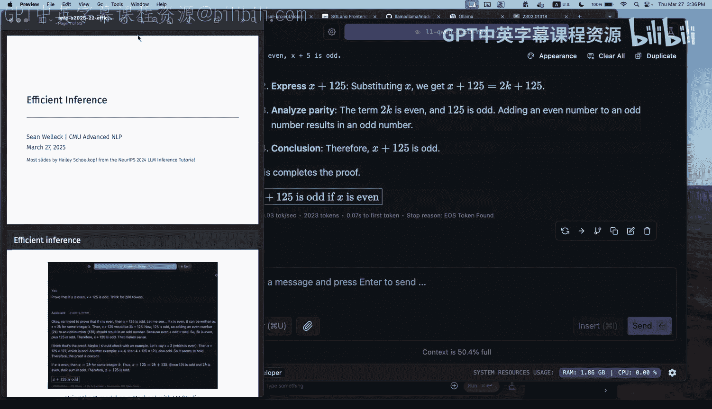

A different setting is。We can use one of these language modeling APIs。

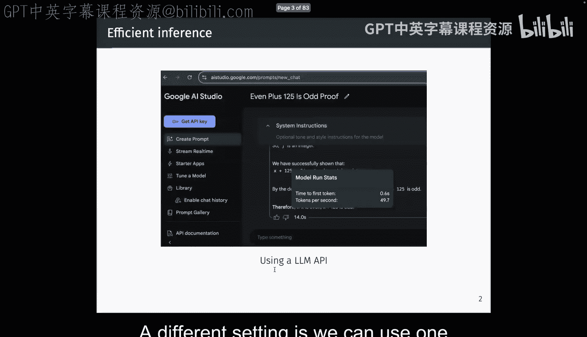

So let me actually do this live because it's kind of interesting。

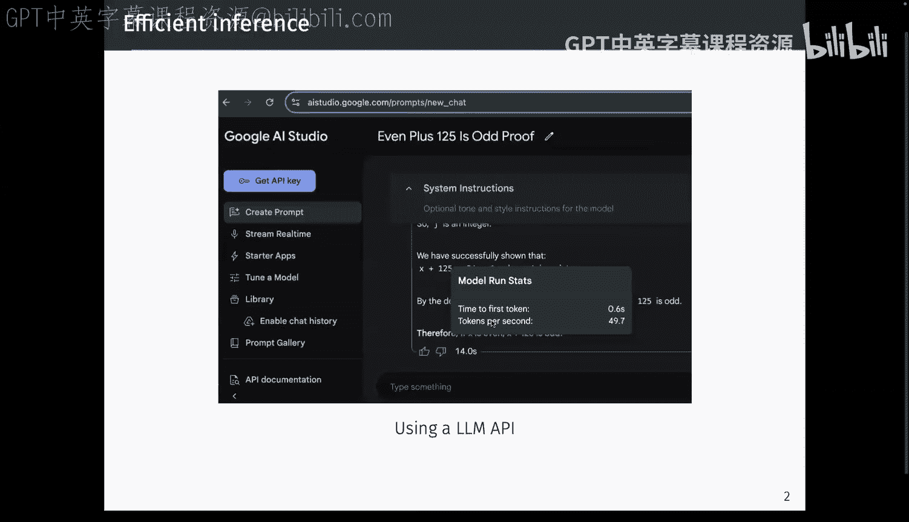

So here we have this Google Gemini API or here's their chat interface。

And they have this new model that they just came out with two days ago。

And so now we can give it the same problem。We of that if x is even。X plus 125 is odd。

Think for 200 secondskens。And we can see what happens here。

So it starts thinking and it's actually thinking for a while， so。呃。10 seconds of thinking so far。

 Okay， now it's finally generating。And it's generating。And the full generation takes 18 seconds。

So you can see that this idea of like efficient or fast generation， it's a very real thing。

 and depending on。The setting that you're in and what they have chose to do。

You could get different levels of efficiency。So here， for instance。

 it took 18 seconds to get the answer to this query。And then down here， I apologize it's small again。

Down here， we can actually see some things that I'll talk about today。

We see something called time to first token。So that's basically like I send it the prompt and then it's the time that it takes to basically encode the prompt and start generating。

So here I had a fairly short prompt， so that was pretty fast。

And then you can see this metric called tokens per second。So that's just saying like， okay。

 averaging all over all the tokens， how many is it doing per second？

And so we'll talk about that and see that as a kind of metric that people use for efficiency。

Obviously higher is better， you want the model to generate more tokens per second。

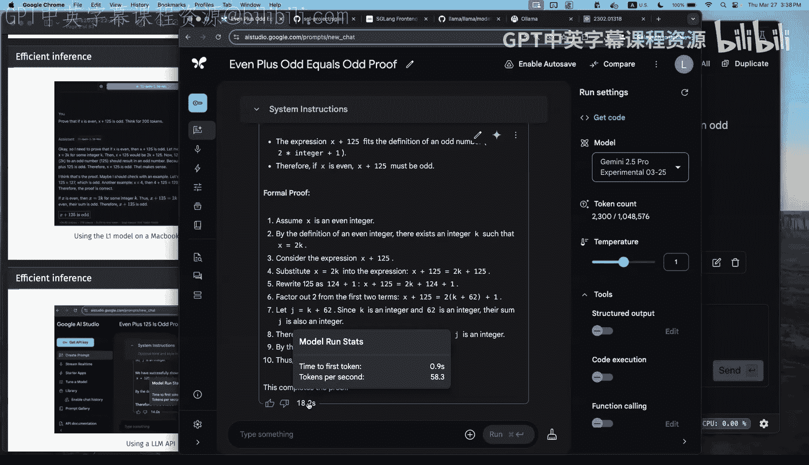

Actually， here it says， yeah。 so here you can see on my laptop， this model was roughly。

Twice as fast as the Gemini model。So it's kind of unintuitive at first。

 but if you have a small enough model and it's， yeah， being run in a different way。

Then you can actually。Yeah， you can pay attention to like what is actually the most efficient for your use case？

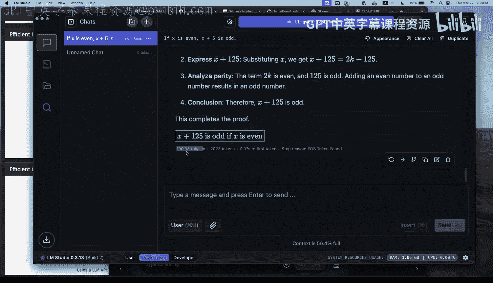

嗯。

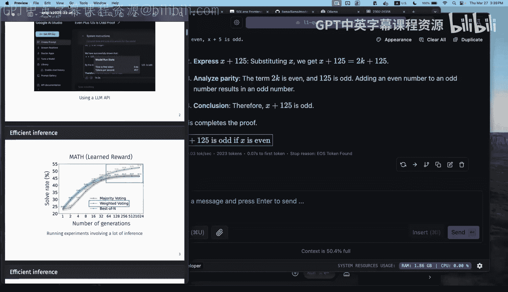

So。Now I can just go to the slideshow。 So another use case that we saw in the last lecture。

Is oftentimes we want to run experiments and it might be over like a whole data set。

And especially with the methods I was telling you about last time， like best of N。

 where you're generating multiple outputs。Her input in dataset。

Then oftentimes you want to just like batch a lot of predictions together。

And do things kind of at scale。And this is very much like a real world thing for a lot of us because yeah。

 a lot of us are doing research or we're doing the course projects， and we actually want to generate。

 say， on a whole data set。

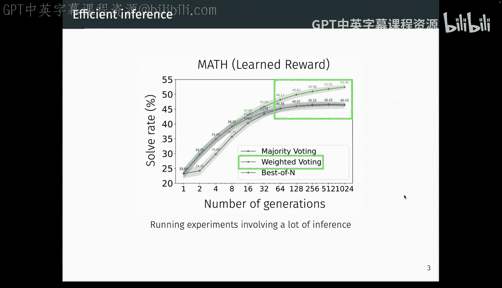

And then finally， you could consider like using a language model in an application that is presumably getting a lot of users or customer requests。

So I don't know if Google is actually using a language model for this， but you know if they are。

 then this Google AI overviews feature is probably getting a lot of different requests。

 like diverse requests and just a lot at once and so they have to think about okay。

 what is the best way to efficiently answer these requests for a large number of customers？

And you can maybe imagine that the kind of design choices are different than if I'm trying to have this language model run on my laptop quickly。

Okay， so all of these real world things fall into the concerns of efficient inference。

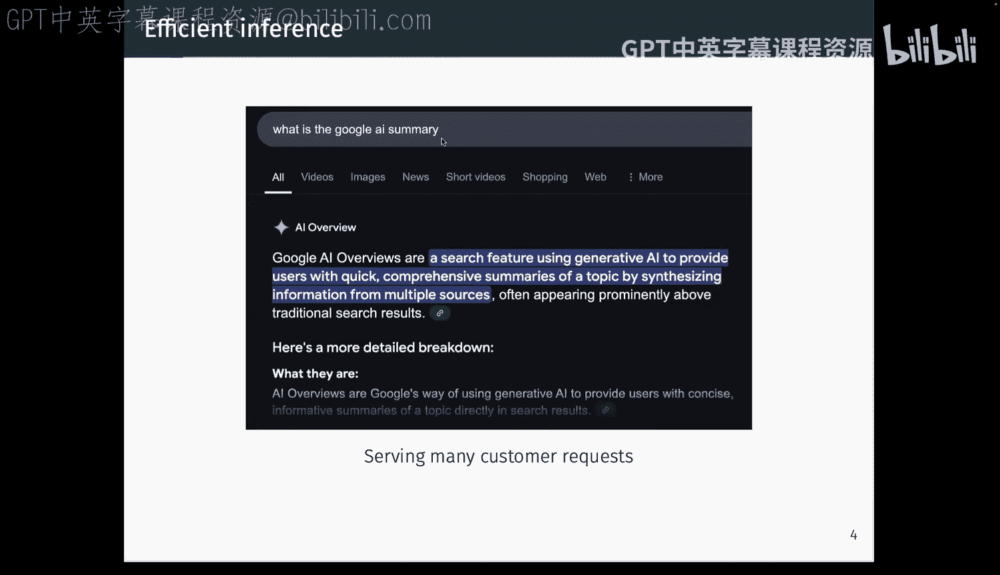

And so yeah， in today's lecture， I'm just going to go over some of the basics and some of the main approaches so that you have some。

Some sense for things in this area。And of course， like this area is。

Interssecting with language models with。Machine learning systems and there's often like multiple communities involved。

 so it's actually like a fairly large area。But hopefully， yeah。

 we can get some understanding it in just one lecture。So to recap inference。

 so in two different lectures we saw algorithms for generating a single sequence with the model。

And we use these auto aggressivegressive models， so generating a sequence involves generating one token at a time。

And then in the last lecture， I talked about these strategies that involve generating multiple sequences。

 so like best of N， voting。Treese， refinement， things like that。

So these are different inference strategies that we want to do efficiently。And so one question is。

 how do we measure efficiency in the first place？And so there's at least two major factors that you consider。

So one is called latency and this is， how long does a user wait？When they submit a request。

 like I submitted that prompt。Until they get a full response。

And so what are some things that could impact latency， well。

 you might have this overhead in the startup。So we saw this metric time to first token in the Gemini interface。

And then of course， if your system generates tokens very slowly， then this will hurt latency。

 it'll take longer for you to get a response。And so for that。

 you can measure like the time per request。Another one is throughput。So。

It's sometimes kind of subtle， but it's slightly different than latency。So this is saying。

Looking across multiple requests， how many requests are completed in some unit of time？

So now we're not concerned with any particular user's response。But instead， kind of。

Averaged over multiple requests and responses。Like how many are we able to process？

And so this will get into things like how well the GPU is being utilized。And aspects of parallelism。

Like， we might want to batch a lot of。Inputs and and outputs in order to。

Process many requests at once。We also might want to leverage multiple devices and things like that。

And so here， yeah， one common metric is this tokens per second。So you could say like， yeah。

 I have multiple requests coming in and kind of on average。

 how many tokens per second am I processing？Irrespective of how they're assigned to like one individual request。

So yeah， these are the two major things that。Or two of the major things that。

We're concerned with latency and throughput。And so then also， there's， of course。

 the quality of the model。And oftentimes you have these trade offs between quality。

 latency and throughput。So an example of a trade off between latency and throughput。

Let's say that we have a system and it basically waits a bit until it gets enough requests and then puts them into a batch。

 completes all of them， and then sends them to the user。Then on average。

 that might actually lead to better throughput。But for a particular user。

 maybe their request actually gets delayed a bit so that it can be batched。

So that's an example where。Yeah， by optimizing throughput， you might give up some light。Some latency。

Can anyone think of another trade off？On this kind of triangle。

When you're kind of trading opportunity quality and latency。

 if you ask your model to think the quality is going to be higher。

 but the latencyencies no longer accessible。Yeah exactly， yeah。

 so one of the most common trade offs is trading off quality for efficiency。So as we saw that。1。

5 billion parameter model actually ran faster on my laptop than the Gemini model。

But I think it would be a bit of a stretch for me to claim that that model is better than Gemini at everything。

So that's an example where you might trade off some quality in order to have this model that you can like run。

A bit faster and locally。And in general， like another place you see this is you might have different。

Sized language models say you might have like a 7 billion model， a 1。

5 billion and a 70 billion parametermeter model。And the 1。5 billion will run the fastest。

 but the 70 billion parameter one will have the highest quality。So， yeah， these。

Tys of tradeoffs come up。So one key problem for。Making the generation inefficient。

Is to take a look at the actual hardware that you're running on。And a lot of it boils down to。

 you know， you have this neural network。And you want to as efficiently as possible。

 execute the operations that are needed to perform generation on the given hardware。

So when I say it that way， it's almost like like。Trivial。

 it's like this has to be the case because you have the network and you have to perform these feed forward passes given your available hardware。

And then some things you can do is like try to reuse computation that comes up。

 so we'll see some examples of that in the lecture。

You can take advantage of the hardware advantages that you have。

So like a GPU or a TU or the particular。Hardware that is on this Mac versus a non Mac device。

 et cetera。And then you can try to minimize different bottlenecks that I'll introduce in a bit。

So what are some ways in which hardware can impact the generation efficiency？First。

 there's the issue of how much data we can keep on the device。So， for example。

If our GPU holds 80 gigabytes。Then this is a kind of hard constraint。If we go over it。

 we have to do something else like offload things to CP， which might be really slow。

Or it can limit the batch size that we use。Or the sequence length that we can generate。A second。

How many operations per second the device can perform？

So we saw this in the other lecture where we were talking about parallelism。Where， for example。

 for these different GPUs， you can actually go look up their theoretical maximum floating point operations per second or flops。

And so this will give you another kind of constraint。On the efficiency。And then second。

 how long does it take？Or do you have these different communication costs。So this is an example。

 like how long does it take to send things from GPU memory to the processor and back？

And so one kind of quantity people look at here is called memory bandwidth。

 so basically how fast can you move things from like different levels of memory in the GPU。

So concretely， some situations。So let's say you're loading inputs or activations from memory。

 like in your model's forward pass。Then a potential bottleneck is the memory bandwidth。

So if you have a very small memory bandwidth， then this loading step will be very small。

So you'll have to think about how do you minimize this bottleneck in your kind of inference strategy？

Similarly， loading weights for memory。Also。呃。You know， incurs costs related to memory bandwidth。

When you're performing the actual computation， like these large matrix multiplications。

There you're dealing with。The floating floating point operations per second that are。

Enabled by your hardware device。And then if you're communicating across devices， then yeah。

 you really have to worry about these different communication speeds。

So a lot of the different parallelism tricks that I told you about before。

U especiallyspecly this like tensor parallelism， where if you have a really large model and you split it onto multiple devices。

Those incurred the same communication costs at inference time that I talked about in the parallelism lecture。

And so one way to think about this is that you can look at the different operations that are involved in your model。

And you can think about which ones are what's called compute bound and which ones are what's called memory bound。

So for example， if you have some operation and it's not loading or transferring anything from memory。

Then that might be compute bound， whereas if another operation is loading some huge matrix。

Then that might be memory bound。And you can actually kind of express these quantitatively。

You could say that on the left here， we would have something that's compute bound。

Where you have the floating point operations involved in the operation。

And then you have your device's kind of maximum floating point operations per second。

And so if you exceed that， then you incur some cost。And then if you're transferring a lot of data。

 then here your bottlenecked by the memory bandwidth and this term will increase。So then basically。

 based on which one is higher， you can either be compute bound or memory bound。

And then one more or two more kind of basics。And then I'll pause for questions。

So if we look at the transformer language models。Yeah。

 so this in particular is with the transformers。Then。

There's this idea of what's called the key value cache。

And there's also this idea of having two different stages of generation。So in the first stage。

 it's called the prefi stage。So here what we do is we take in the prompt and we process it。

So for example， like when I gave Gemini that prompt with the math problem。

 then it would have to process it。In this prefill stage。And at the end。

 you get these different queries， keys， and values inside of the transformer's attention matrix。

Corresponding to the prompt。So here， for example， the prompt is like eight tokens long。

And now you have the， yeah， queries， keys and values。Then you could say like， okay， as I generate。

 actually the prompt stays the same， the prompt is not changing。

So what we could do is just consider the actual generation as being a kind of separate stage called the decoding stage。

And what you can do is you can take these keys and values that were previously computed。

And actually cache them so you don't have to recompute。And now for your next token。

 now you can just only perform the attention to like get the new value。For this for this new token。

So in other words， here we have already performed the operation for these first eight tokens。

We can use the cached keys and values。And then just look at our new token and perform this kind of weighted sum and get our new value。

Okay， so this is known as the key value cache。And it's really important because otherwise you would have to recompute this kind of quadratic attention as you're generating each token。

So this is something that you want to do in any transformer implementation。

And one thing to note is that。The size of the Kv cache can actually get quite large。

So you can see here that it depends on like the batch size。The context size。

And then you have two because there's keys and values。And then this is basically the。

The actual size of the data and the format that the data is in。And so yeah， in practice。

 managing this Kv cache memory or storage can actually be a big thing because this grows as like the batch size grows or as the context of this grows。

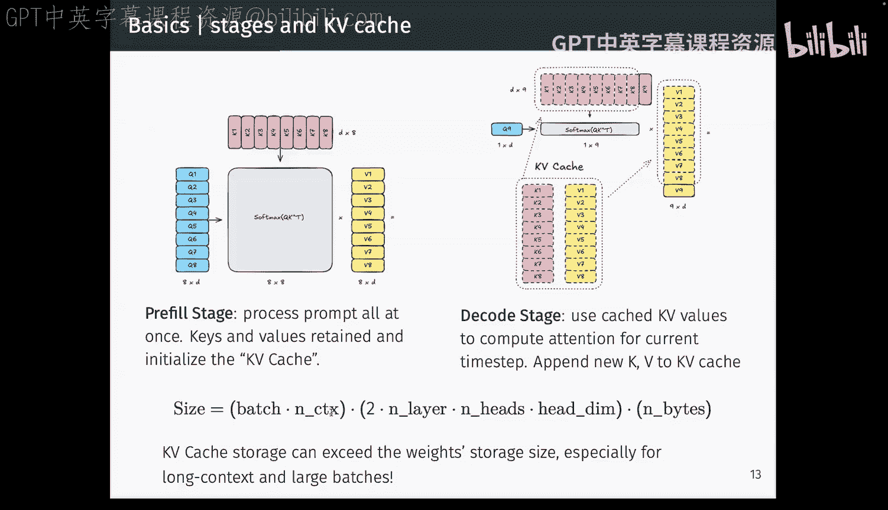

And then as I mentioned， yeah， this is in kind of most transformer language model implementations that you'll see。

So it should have been in your homework， I believe， but just as a recap。

 here is the actual Lama3 inference code。And you can see here， that。What they have here is this cash。

And。What it's doing is。嗯。It's adding this key and value that was just computed。To the。

 to the cashier。I think there's actually a couple extra lines of like relevant code。But yeah。

 you may have seen this before in the homework and if you haven't。

 maybe take a look at the inference code again。

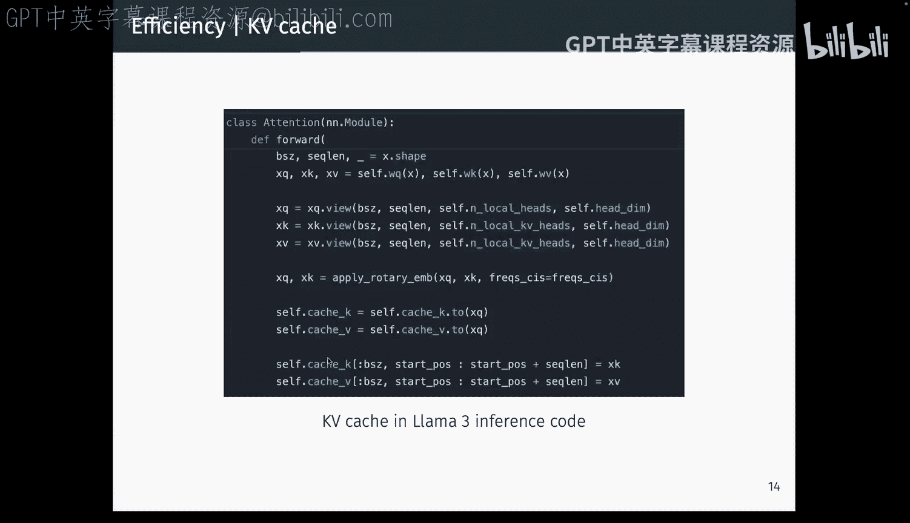

And then， yeah， one more kind of basic。So there's this idea of batching。So here。I mean。

 the concept of batching is not changing， it's the same as when we've talked about it throughout the course。

But the idea is， you know， you have instead of one sequence at a time that's processed by your model。

You can process multiple sequences at once。And then this becomes just a matrix multiplication with this new batch dimension。

And so since the GPs are optimized for matrix multiplications with like special cores and things like that and the way theyre。

Optimize for parallel computation。Oftentimes， you can sometimes even get。Operations for free。

Like the difference between like batch size one and a small batch size might even be the same latency。

 or you can have a kind of reasonable growth。嗯。Sorry， in the， in the。

Time associated with the actual computation。So in practice， if you're able to batch。

 then this could be important。And one interesting thing to think about here is like when does batching actually matter at inference time？

So the screen might be a bit hard to read。Yeah， imagine you had。A language model API。

 or you had some product that a lot of people were accessing。

Or you're running one of those experiments like I was showing you before。

Or let's say that you're doing reinforcement learning and you want to like generate outputs for many。

Different input instances at once。Then these would be settings where the batching is suitable and very important。

Because yeah， what you can do is combine multiple input prompts into a batch and then process many of them at once。

And so here， throughput is typically the main concern。

You look at like how many tokens per second can you process across all the sequences？

On the other hand， in the setting that I was saying where I'm just running the model on my laptop。

And basically， just interacting it。As a single user and interactively。Then in some sense。

 there's only one thing happening at a time。And so their batching maybe isn't as important。So yeah。

 you might have a single user chat。You might have these streaming outputs。And as I mentioned before。

 it's possible that your kind of batching scheme might involve like waiting or it might wait until all the sequences are complete until returning it to the user。

So sometimes you either don't need to think about batch if you literally have one input or output。

Or you face this potential tradeoff。And so again， as I mentioned， like generating on my laptop。

 maybe the latency is the main concern。Okay， so those were some of the basic concepts and then in the next part I'll go into different methods。

So any questions so far on the kind of。Concepts related to inference。O， cool。

So the methods are grouped into three different kind of stages。So when you think about it。

 you can think about。Speeding up inference。At each part of the kind of generation pipeline。So first。

 you have the model itself。And so you can try to speed up just how long it takes to do a forward pass or just a single step of generation。

Then you could say like， okay， let's say I'm generating a full sequence。

 maybe there's some clever algorithm or optimization that I could use to speed it up。

Or I might be using one of these strategies or be in a setting where there's multiple sequences。

And maybe I can leverage some kind of shared structure between the multiple sequences to get some speed ups。

So for the single token。We could think about。Memory bandwidth。

So trying to shrink the data that we need to move around。

We can think about ways to better utilize the hardware so we can get closer to this theoretical maximum of the flops。

Or we could even try to change the model somehow so that it actually uses fewer operations to perform the single step of generation。

So one way to reduce the costs associated with memory bandwidth is to do quantization。So yeah。

 Tim gave a kind of lecture， whole lecture on quantization。

And so this was the idea that you can instead of。Sttoring your network's parameters， as。

 for instance。32 bits。You could quantize down to something like int4。

And so now the amount of memory needed to store the model， the model's weights。嗯。Reduces。

And so as a result， you have less cost associated with these memory transfers。And so at first。

 it might seem like， you know， this quantization is just reducing the size of the model。

 and maybe that wouldn't lead to a speed up since you still have to do matrix multiplications。

But since we have this issue of the memory bandwidth， the quantization can actually lead to speedups。

So oftentimes， like in this case， where I was running that language model on my laptop。

That one's actually been quantized down， I forgot exactly the precision。

But it's a really common thing to do in settings where you're trying to run on， yeah。

 something like a laptop， then you'll quantize the model down。嗯。Also， this is just one bullet point。

 but it's frequently used today。So you could also try to somehow compress or distill the model。

So here you have。Here you're trying to reduce the。Total number of parameters。

So an example of this is like you could start off with a。70 billion parameter model。

And then try to create a kind of distilled version of the model that's much smaller。Say like 1。

5 billion。And in doing so， hopefully you can retain some of the quality of the larger model。

 but now it's much smaller， so it's reduced the number of parameters and therefore reduced these costs that you have from the memory。

So again， that model that I ran on my laptop was a distilled version of this deepseq R1 model。

And yeah， it had been distilled down to 1。5 billion parameters。Um， and yeah。

 that helps to speed things up。Just one more comment on this， there's， yeah。

 this is again frequently used in practice and I remember one of the Ge models from Google。

 they used this token level distillation。To distill from a larger gembo model to the smaller one。

And so I talked about that briefly in the fine tuning lecture。

 if you want to go back and take a look at that。But yeah。

 these different distillation methods become relevant for having a faster model。

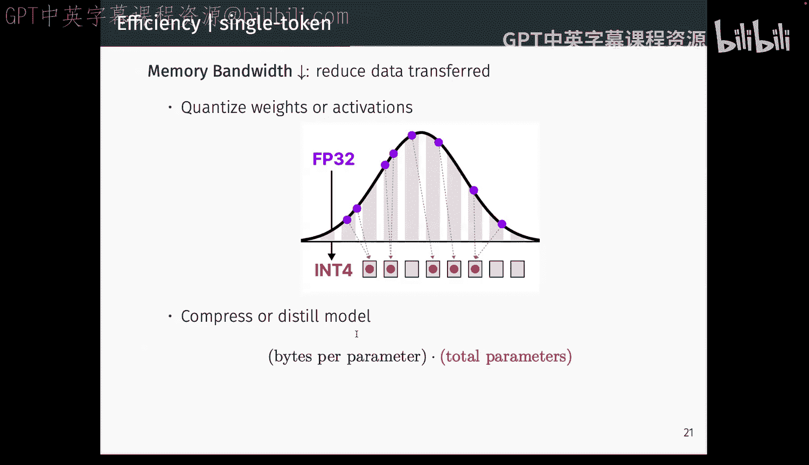

So here's some concrete numbers， these have to do with the quantization。

So this is a cool library called GPT fast， and it was made by the Pytororch team。

And they basically make a kind of minimal， simple implementation for showing these different fast inference techniques。

So it's really good if you're curious to learn more to like read through this code。But anyways。

 here they did some benchmarks。And you can see that as you quantize。

You're getting better tokens per second， like almost double。

And then here you can see the memory bandwidth， they actually measure it。

And you can see it reducing here。So yeah， pretty cool。

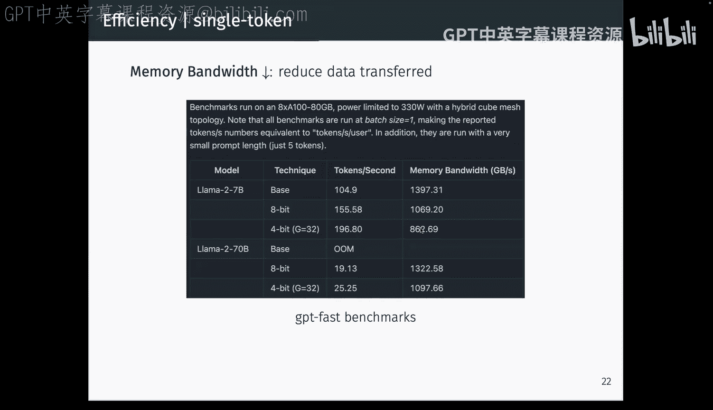

So second， you probably remember this。Idea called grouped query attention。

So we saw it again in the homework， I believe the architecture used the grouped query attention。

I also talked about it in the transformformers lecture as a kind of。

Better transform and add on to the transformer that was created after the original transformer。

And you can think about the benefits of this in terms of inference speed and in terms of memory bandwidth。

So what it does again is to reduce the number of heads in the transformer。So yeah。

 now here you're going from what eight to four？And so now your key value cache。

 this is the formula that I showed before， is now being reduced in size。And as a result。

 you can save some costs associated with like loading and。

Transferring the key value cash during generation。So actually， yeah， it's， yeah。

 it's kind of interesting。 I mean， at least like the first time I learned about this that。

This reduction of the heads speeds things up。 And part of the reason is because of this like these memory transfers in the key value cache。

Another thing you can do is actually quantize the key value cache itself。So as I mentioned。

 it takes up a lot of space so you can apply the same quantization idea there and again get some efficiency gains。

So then the other dimension， other than the memory bandwidth is to better utilize the hardware。

So like if your GPU can potentially be doing a lot more computation。

Then how do you best leverage that potential？So this method called flash attention。

 I guess it does multiple things， so they also discuss you know the issue of memory bandwidth。But。

One thing that they do is basically look at the computation of attention。

And they use something similar or they use the trick that I showed you before about computing the attention online。

And then if you do that， you can basically break apart the attention computation。

And do it very efficiently。Based on the memory constraints of the processor。

So I'm not going to go into all of the details of this method just due to time。

But it's a really nice read， I find they give a nice kind of setup of the problem too。

 so you can get some additional insight into the problem。

And another thing they do is to actually create a。Cutto kernelnal。

 which fuses some of the operations together。So in this way。

 you're able to kind of better take advantage of the hardware， get better utilization。Um， and yeah。

 this is part of the reason that they get these speed ups with u flash attention。

Now there's a follow up to F attention called F Attention 2。

So when I looked for different inference benchmarks， most of them were using plus attention too。

But here's one from the hugging face documentation。

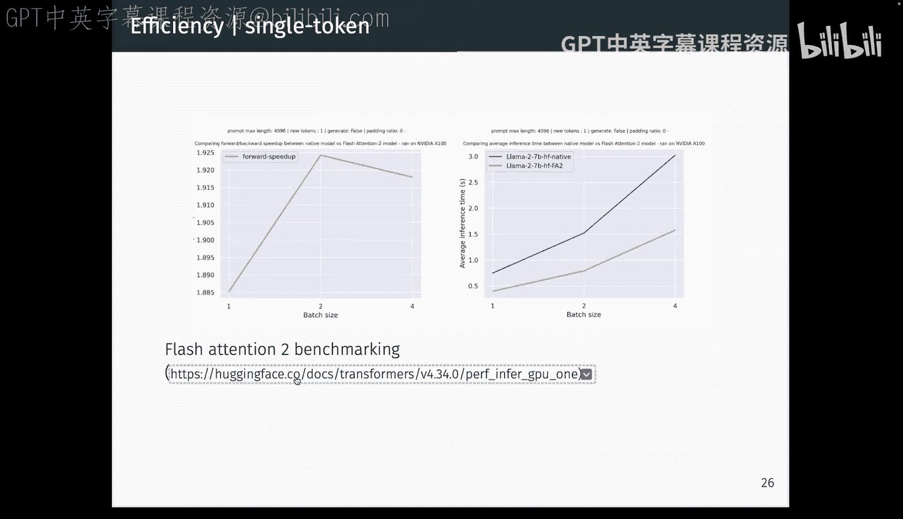

And yeah， you can see here that。嗯。With blue here is the non。Flelash attention to。

And then here's the flash attentiontion2 model。And then this is the inference time。

 and you can see that adding it in has， yeah， led to a faster inference。

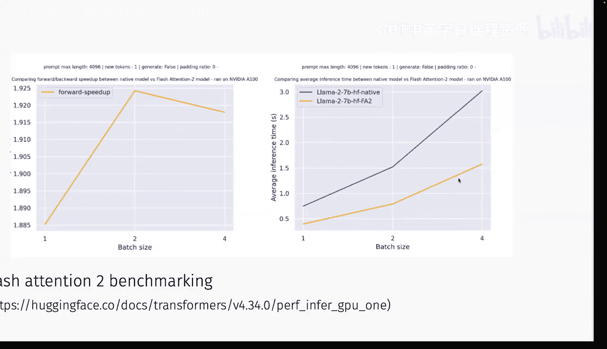

Okay， then the other thing is you can try to reduce the number of operations involved by like changing the architecture。

So this is an architecture that we unfortunately didn't have time to go into in detail。

But it's this mixture of experts architecture。So here， for instance。

 you can break apart the really large feed forward layer in the transformer。

Into these different parts。And then you could have this router， which says， okay。

 as I'm performing inference， I'm going to pick。Just this block here or this expert to perform the inference with。

And so how you do the routing， how you train it， and all that is kind of why it would be good to have like a full lecture on the mixture of experts。

But from our perspective of speeding up inference。What it's doing is it's basically reducing the number of floating point operations as you're doing the feet forward pass。

Because you're only performing computation with a subset of the parameters。So yeah。

 these architectures are also really popular and they can lead to the fester inference。Okay。

 so that was kind of at the。Most core level， maybe where were trying to just speed up the core operation of generating a single token。

So before I go to the next part， any questions or things to discuss here？Okay， cool。

 so next I'll talk about generating a full sequence。So。Here you might say like， okay。

 if we generate each next toekenor。Then isn't that sufficient to speed up full sequence generation。

 like how could there possibly be other optimizations you can make？

So you can get additional speed ups。And one kind of clever idea。

Is this idea called speculative decoding？So here the underlying idea is that some tokens that you're predicting are actually easier to predict than other ones。

And so potentially we can actually use a smaller model。To kind of propose next tokens。

And then we can send them to our larger model and do a kind of forward pass in parallel。

And check if the tokens would have been generated by the larger model。So in particular， yeah。

 the idea is called speculative decoding。So here normally we would just have our single model and decode one token at a time。

But then in speculative decoding， you have your larger model and some smaller， more efficient model。

And what it does is you use the smaller model to start generating。Up to some look ahead length。

So here， for example， it is generating。Five tokens ahead with a smaller model。

And so the smaller model has to go step by step， it has to like use the key value cache and all that。

And then the idea is that given these tokens， you can just do a single forward pass。

And get all of the kind of next token los。And then you can look at these and say， for example。

 does the most probable token match the one that I got from the efficient draft model？If it does。

 then I just save it。And then if it doesn't， then I actually have to perform。

The next step of generation with a larger model。So hopefully。That。

You can kind of get the key idea behind the speculative decoding。Where yeah。

 you have some draft model， and then you use your larger one to verify。And if you choose to reject。

 then you actually have to generate with the larger model。

So there's many different design decisions or like variations you can do on this。

I think there's actually like a whole survey paper about speculative decoding。嗯。

So one kind of cool thing is that。You don't have to just look at the most probable token that you get。

You can actually still do sampling and still do like top K sampling and top P sampling。So yeah。

 one of the there were two major speculative decoding or speculative sampling papers。

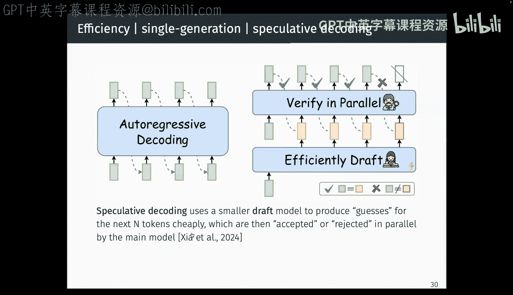

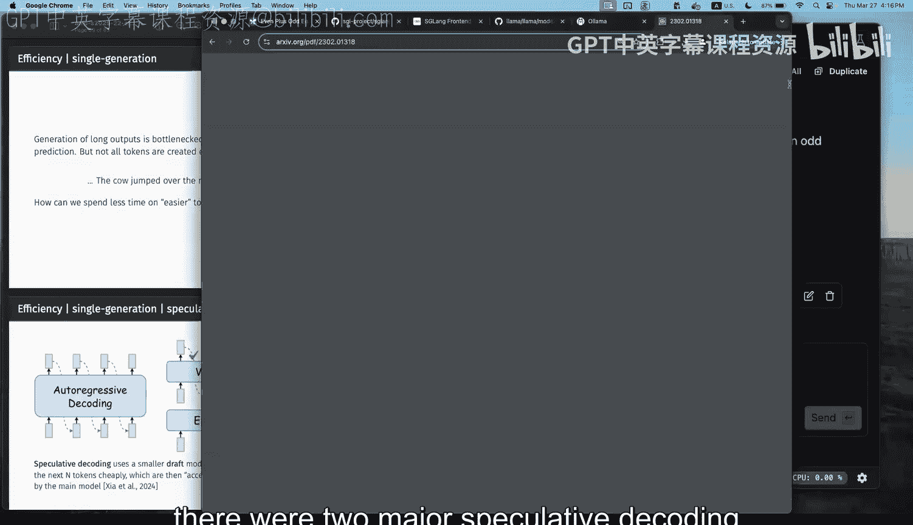

嗯。Not sure why this， yeah， if you take a look at this one here。

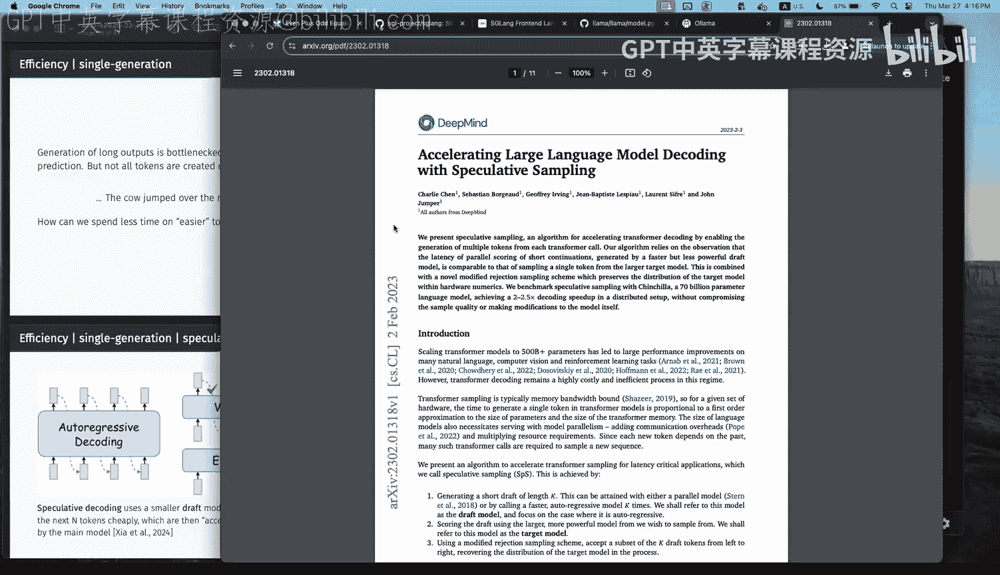

Here they give this algorithm for doing speculative sampling， so sampling from the model。

And the kind of cool thing is that if you do this in the right way。

Then you can actually guarantee that you get a sample from your original model's distribution。

Even though you're using this kind of draft model to propose the tokens。

And so the key underlying idea is to use what's called rejection sampling。

So here your draft model is this kind of proposal distribution。

And you could frame this as rejection sampling。And so you can either choose to accept。

Or to kind of do this adjustment if you reject the tokens。And so again。

 just because this is more of a survey style lecture， I won't go。through like that slowly in detail。

 but if this seems interesting and I personally find it interesting then maybe take a look at this and yeah I found it kind of surprising that it's possible to kind of get a sample from the original model distribution。

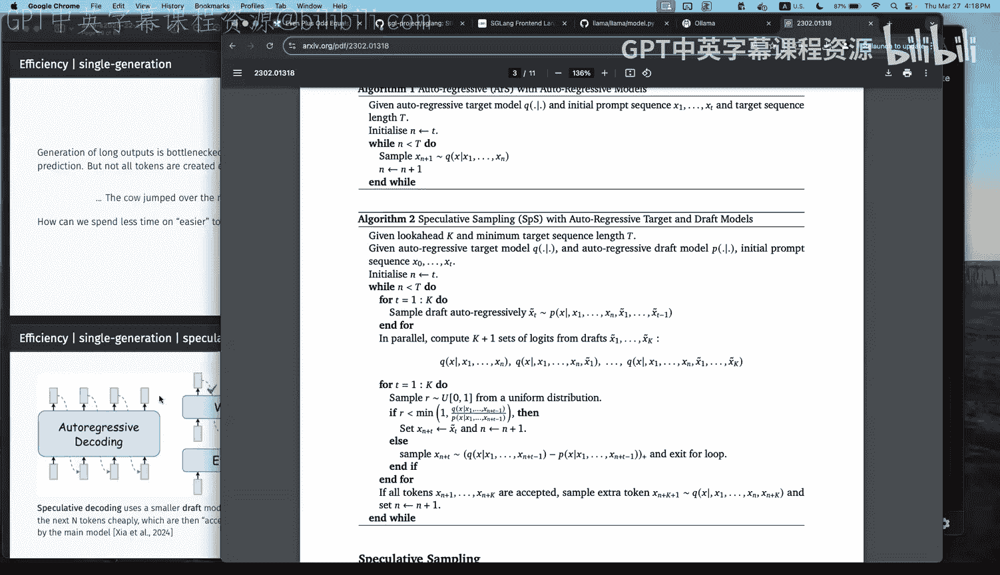

And so yeah， we can take a look at。

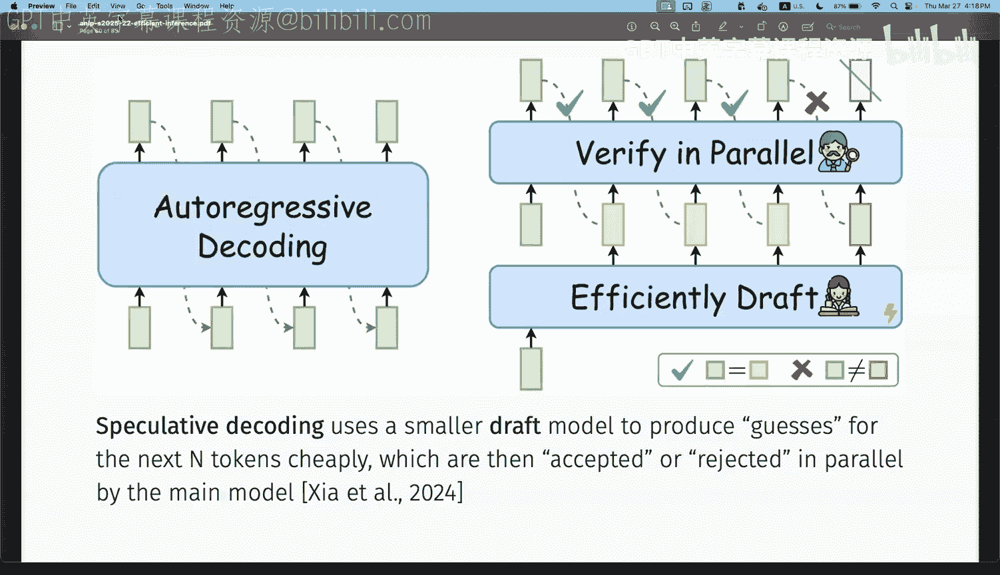

The implementation of this。

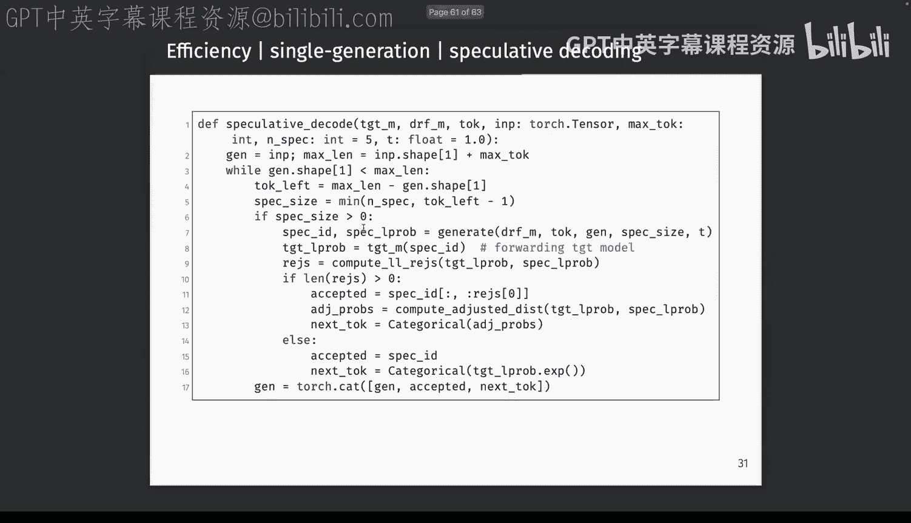

So。Here， the speculative decoding would take in your target or larger model and the draft model。

And then it has this。Prameter for like how many look head steps you want to go。嗯。And so here's。

TheThe relevant part， so if your speculation size is greater than zero。

Then here you can see that it's calling generate with the draft model， not with the larger model。

Then here you would have something which is like of length five。

The token IDs and their probabilities。And then you can see here that it's doing this forward pass with the larger model with kind of all five IDs at once。

Then here， this will be on the next slide if you want to look at it in detail。

Here it's actually determining whether we're going to accept or whether we're going to reject。

And so if you。嗯。呃。If you accept all of them， then you just say， okay， accepted equals all of the IDs。

嗯。And then if you reject some of them， then you have to。Yeah。

 choose the ones that weren't rejected and do this adjustment that I mentioned。So anyways， yeah。

 I'm going through it kind of quick， but if you look at implementations， it it's。Yeah。

 it's fairly manageable to you know understand what's going on and then here is like the specific details of this rejection sampling that I was showing you before。

So yeah， you can take a look at。嗯。At this， if you're kind of interested in exactly how you would implement this。

So yeah， for the tutorial， we had the actual implementation of speculative decoding。

And then did some experiments with like really good and fast implementation。

And you can see some kind of interesting phenomena。

So here this is showing the number of or the rate at which the smaller models tokens are being accepted。

And it's kind of cool here。 It's basically saying that on these easy problems。

The draft models tokens are being accepted more often than on the harder problems。So it's kind of。

 yeah， gets at this nice intuition that。Yeah， this draft model is being used to maybe predict kind of easy things。

Yeah。So yeah， you can take a look at this code here and there's some additional。

Pretty interesting analysis that was done。嗯。Yeah， another thing is that sometimes the speculative decoding。

 you only really see the gains if。You are in a kind of like expensive generation setting。

So like if you have a really long context。Then。Yeah， then you would see these。嗯。These gangs。

But if you have like a really short context and here they were showing that sometimes it could actually like hurt performance。

Okay。😊，So that was the main algorithm that I wanted to go through for generating the full sequence。

Where yeah， we somehow take advantage of the fact that you're doing this kind of sequence sampling and come up with an equivalent but faster algorithm。

So in the last part， I wanted to talk about。These multi sample strategies or meta generation strategies。

 I called them in the previous lecture。And also settings where you might be like serving an LLM and having multiple incoming requests at once。

So the basic idea here is that you want to somehow leverage redundancy across your different generations。

And somehow try to reuse computation。And in doing so， get more efficient generation。

So one of the most。Common or straightforward types of redundancy that you'll see。

Is having this shared pre prefix in a prompt？So for example。Here， let's say we have a system prompt。

Well， then the system prompt might actually be shared across like millions of requests， right？

And so there's no reason to， for instance， like， you know。

 recompute everything for this part of the prompt。We want to be able to like better take advantage of it。

And then the system prompt is not necessarily the only thing that's shared。For example。

 when we're doing the best event sampling。Then also like the input prompt will be shared across you know。

 the multiple samples。嗯。so。There's a method called page attention。

And what they notice is that in this kind of batched generation setting。

There was fragmentation or kind of redundancy in the memory storage。

So like sometimes it would allocate， you know， a bunch of memory and then only some of it would get used for for one of the。

For one of the sequences。And things like that。So at a high level， they came up with a。

More clever and more efficient memory management strategy。And it's based on this idea of。Paging。

Where you have these kind of non contiguous。Storage blocks and then different pointers to them。

And yeah， by doing this， you can get these kind of huge gains in efficiency by having better memory management。

So this method pays attention。Was the kind of initial method in this library called VLLM。

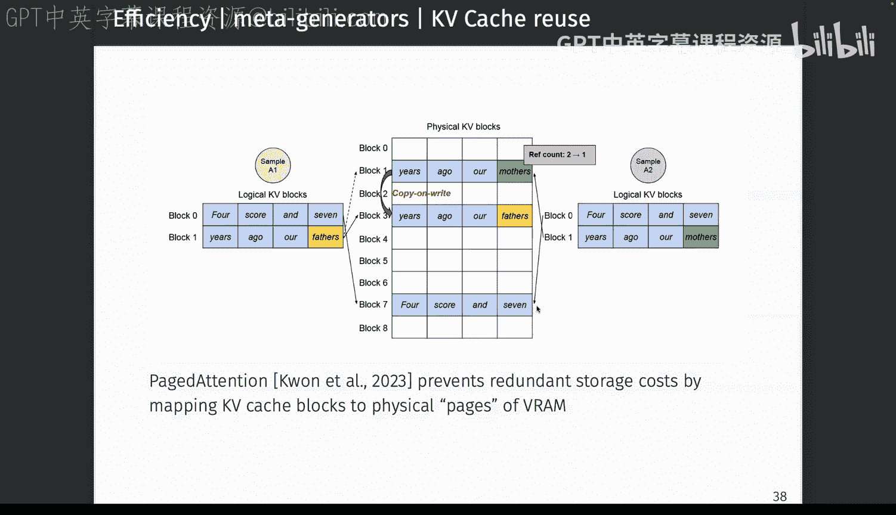

So you may have heard of this if you haven't， then this is a really good library to use and practice if you're you writing code to generate with language models。

So yeah， as I mentioned， originally it was。Built as a way of kind of putting page attention into an inference library。

And at the time， you would get these like massive speedups。

Compared to like the hugging face generation at the time。And so it was really surprising。

 And it actually like unlocked new types of experiments you could like run on。

A much larger test set you could do best of N with larger values of n and things like that。

And since then you can see it has like 40，000 stars， they've kept developing it。

 so now it has a bunch of different features。It has the speculative decoding implemented。

So in the code for the tutorial， we actually ran the speculative decoding analysis using VLM's implementation because it's been fairly optimized。

So definitely check it out if you haven't heard of it before used it， it could be useful。

 for example， in your projects or research。

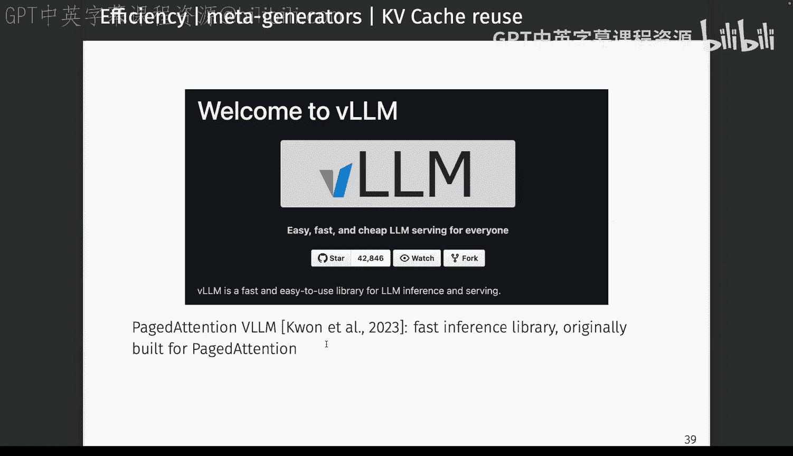

嗯。And then as I mentioned， you could have these more maybe nuanced forms of prefix sharing。

So for example， some you might have the system prompt。

 but then you might have some like few shot examples that are shared across multiple queries。嗯。

And so yeah， the question is like， can you better take advantage of sharing when the sharing is kind of split up or in a more kind of elaborate pattern than just a single prompt prefix？

So one。Yeah， kind of influential or major method for this。Is called Redix attention。

So what they do here is they have this data structure called a Raix tree。

And it can basically efficiently store these prefixes。

And so what they do is they store the key value cache for different prefixes in this tree。

And then they come up with some strategy of like evicting the cache。

 so removing things from the cache for example， the strategy that they use is just evict the least recently used block。

So to show exactly what's happening， they have this kind of example in their paper。

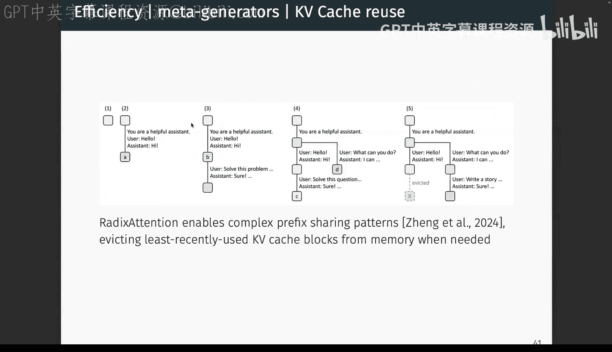

So here we get some query and it says you're a helpful assistant。helllo， hi。And then the user says。

 okay， solve this problem， assistant says sure。Now there's another user that queries the model。

 and you can see here that it has the same system prompt。

 so that has been stored in the ras in the data structure。

So now we don't have to recompute the key value cache for these things。

But the user asks something different， so now we have to kind of store something new in the tree。嗯。

Now it asks it to write a story and maybe our tree is getting too big so then we get rid of this thing。

嗯。And this actually covers a lot of。Yeah， kind of interesting cases。

So now suppose that your LM API gets some few shot examples。

So now it doesn't even use this system prompt maybe， and you have to create a new thing in the tree。

嗯。And。Let's say you're evaluating on a data。Then those might use the same few shot examples。

So we can like take advantage of the caching and only。Do the keys and values for these new parts？

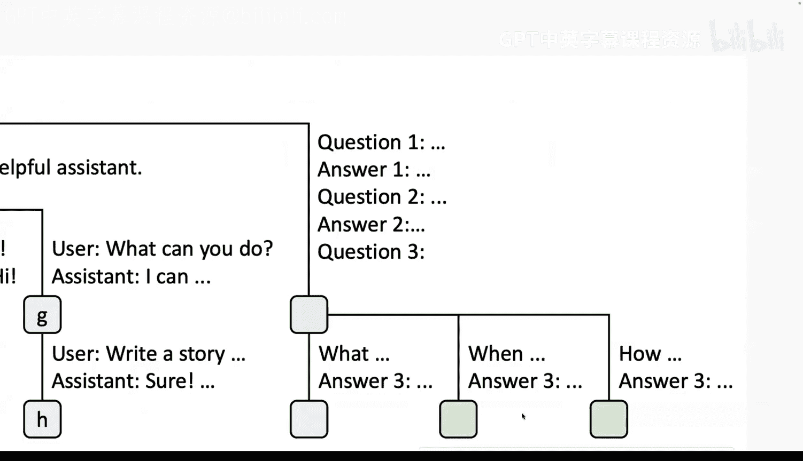

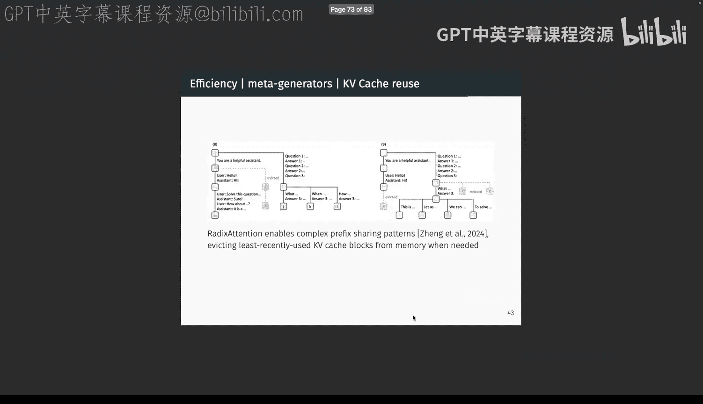

And then the last example is。So this is just showing like expanding this other users' query。

And the last example is for a given input， we could do something like best of N or majority voting。

 where yeah， basically everything， including the current input has been cached。

And then we're generating multiple outputs for it。

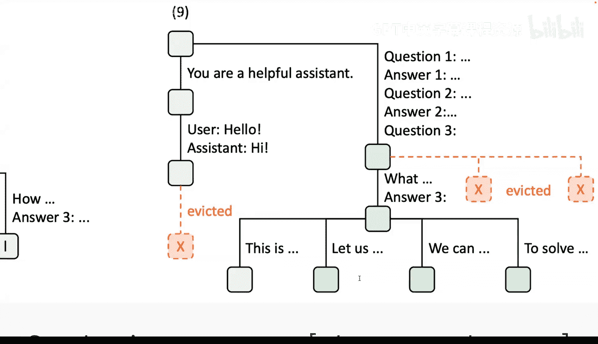

So it's kind of cool like many different use cases， you can take advantage of this shared structure。

By storing things in this data structure。And in practice， this can lead to。Yeah。

 really big speedups even for these kind of flexible use cases。

So this was from their paper and maybe Viil and his been。

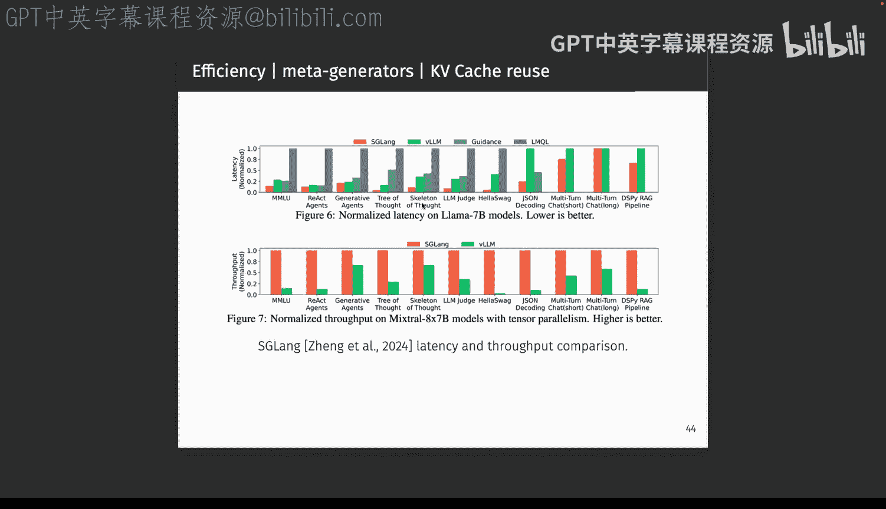

Updated， I'm not sure what like the current。Competition is， but at least when they wrote their paper。

 you know the SG L was much faster than GL。And you can see that they tried it in these different like creative settings。

Like this tree search， treere of thought。Something else called skeleton of thought。And yeah。

 a variety of settings。And then here I wanted to just show that， yeah。

 the things I told you about before， latency and throughput are the kind of metrics that people look at when they're trying to look at the performance gains from a given method。

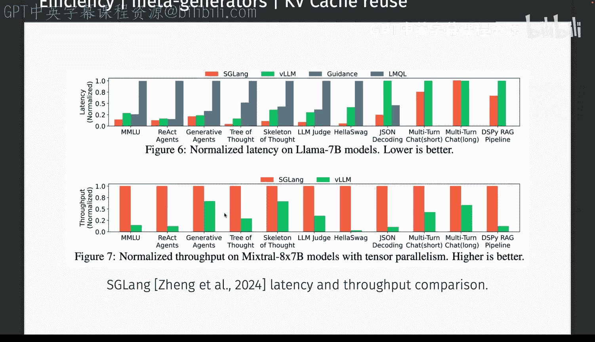

So this has also been turned into a library that you can use。

One interesting thing is they have this kind of front end language。

So the idea is you would start up your SG L inferenceprint server and you can like submit。

APpiI request to it or whatever。But then you can also interact with it through this kind of high level language。

嗯。Where you have these like different operations。Like， I'm。

Assistant might take care of the assistant formatting for the prompt。U。

Here it's actually generating with like maximum tokens of 256。And then here it's doing this fork。

 so it's seeing like multiple generations at once。And so the idea is like。Yeah。

 sometimes or for some users， it might be intuitive to write things as one of these kind of language model programs。

And then the hope is that with this caching mechanisms mechanism。

 it'll actually end up being pretty performant。So anyways。

 that's a unique thing for SGL and it's also a really good library to know about for your projects or if you build a product or whatever。

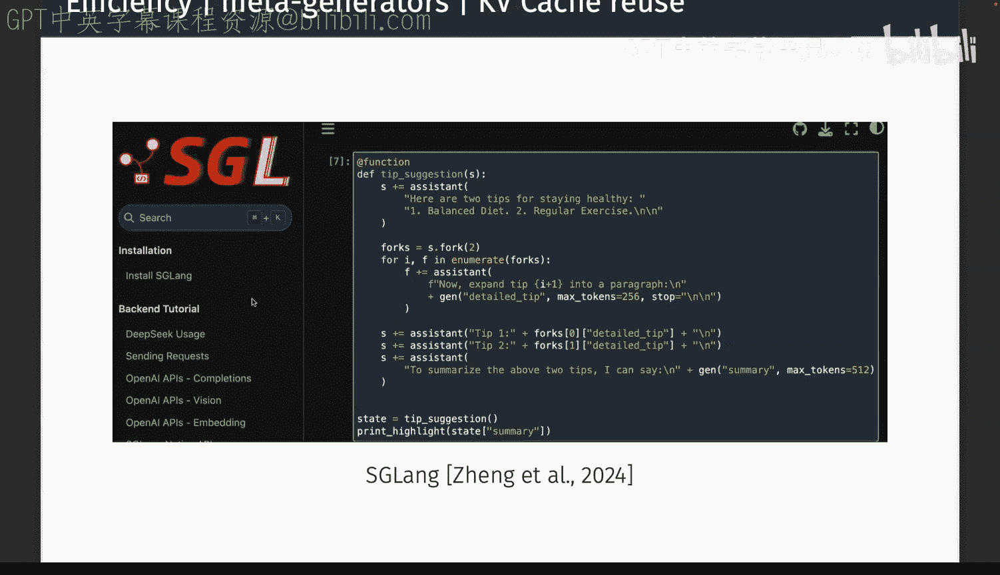

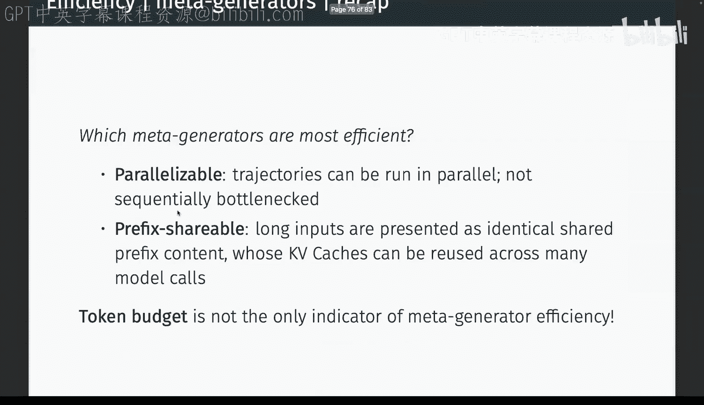

嗯。Okay， so。That's most of the content I had before like a brief recap。

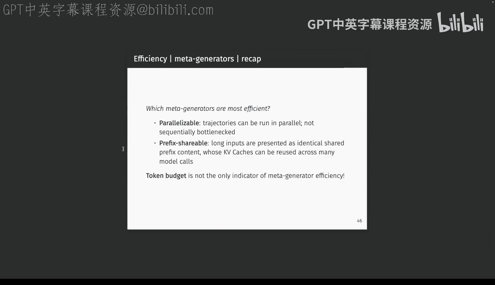

So one thing is out of these different multi sample strategies that I told you about。

In the last class， we are looking at the token budget。

But you can actually look at the kind of structure of the strategy and it might be more efficient just due to the structure。

So in particular， if you can parallelize things。Like you can easily parallelze best event。

But sometimes like a tree search， it's not as clear how to parallelze it。

Even if they're generating the same number of tokens， the best event might be a lot faster。

And maybe a bit more generally， you want to at least have some kind of。

Or if you have some kind of prefix sharing， then you can take advantage of this caching and reuse some computation。

So yeah， this is a recap of the different things we talked about。And then just briefly at the end。

 I wanted to just summarize some of the tools。So these are by no means all of the tools and I'm not getting。

I'm not sponsored by any of them。But yeah， just the ones I'm familiar with。

So if you want to just run an LLM on your laptop， then here's two different lags。

 one is the LLM Studio application that I showed you。Another one is called Oama。And so， yeah。

 these will have。Some kind of interface for managing the quantize models。

 you can like easily download models that other people have quantized。And then depending on， yeah。

 which one you're using， they'll have different。Kind of hardware。

 aware inference libraries that they're taking advantage of。

So it might actually be taking advantage of the fact that like you're on a M M is it three or four。

 Mac。For example。嗯。And then if you're actually you know writing code。

Then here is the library that I mentioned， which was developed by yeah。By people here at CMU。

 like it was led by Tianchi。It's called MLLC for Ma learning compilation。

And so here the idea is they come up with。嗯。Yeah， this library that allows you to basically write code for a wide variety of devices。

So you could even write for like a web browser to have a LLM and do inference in the web browser。

They have support for different types of。Like iOS or Android。And yes， you can check that out。

If you're just operating on maybe more like standard GPUs。

Then these two I mentioned are pretty useful VLM and SGL。And yeah。

 I believe that is all the content for today。

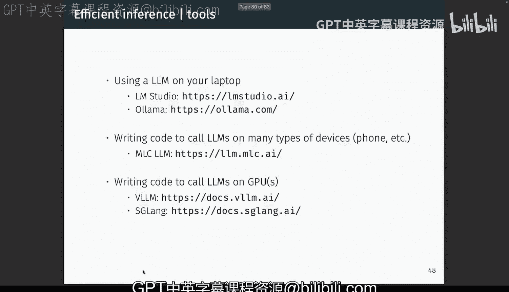