# CMU《高级自然语言处理｜CMU CS 11-711 Advanced NLP Spring 2025》中英字幕（claude-3.7-s - P19：-22-(20)_ Advanced Post-Training.zh_en - GPT中英字幕课程资源 - BV1nYVHz7Eoa

Or today， in terms of logistics。And so now we can move to the lecture。

So today we're going to go over advanced post training。

 So this will combine ideas from various lectures that we've seen throughout the course and just present it in a different perspective and also going into。

Some more detail。So in particular， we'll talk about things that came up in the reinforcement learning lecture。

 we'll talk about things that came up in the instruction tuning lecture。

And we'll basically take the perspective of。Not looking at reinforcement learning as its own kind of idea。

 but more can we take a language model and improve its performance further with things like reinforcement learning？

So。To recap again， the idea of pre training。We take a bunch of data and then we use the pre training objective。

 maximum likelihood， and we get this base model。And then you can adapt the base model to a variety of tasks and in a variety of ways。

So we've talked about prompting。 We've talked about。Fine tuning， instruction tuning。

And we've talked about reinforcement learning。So today we'll take this perspective of。

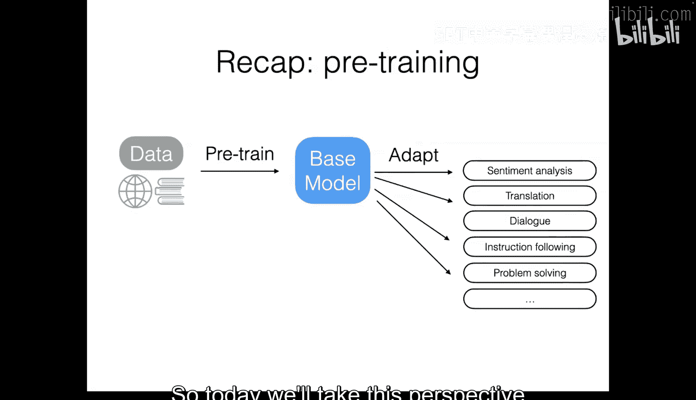

Doing what is called post training。So taking all of these methods with which we've talked about kind of individually and thinking about what are some recipes or some pipelines for taking an existing model and then making it better for downstream use。

So better as a chat model， better as a problem solving model， et cetera。So as I mentioned。

 we'll see some of the ideas that we've already seen。

 but in some cases I'll go into a bit more detail than before。So in particular。

 we'll focus on how you can use reinforcement learning to improve a model further。

And so we'll look in some detail at this pipeline or recipe。

 which is now known as RLHF or reinforcement learning from human feedback。

And we'll actually go into a lot of detail just so you've seen exactly how this works。

And we'll see that it's actually not very specific to human feedback。And that in fact。

 you can just use a similar pipeline for other types of reinforcement learning。

Then I'll talk about what's called direct preference optimization or DPO。

So this is specific to this preference based setting or human feedback setting。

And it basically gives you an alternate。Learning algorithm。

For adjusting your model according to the human preferences or human feedback。

So those are the two kind of main categories of things that we'll go into today。

And so let's take a look at the first one。

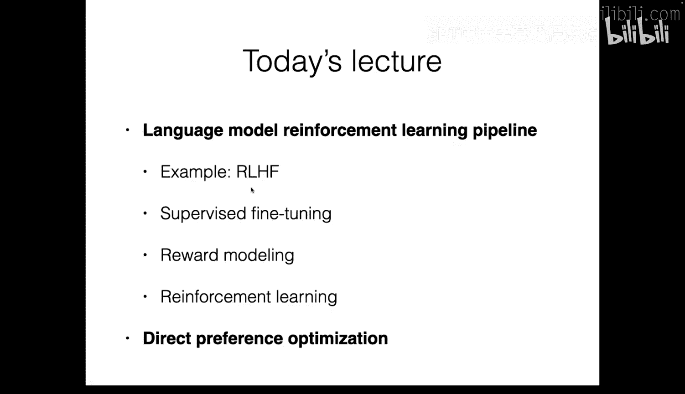

So to recap again， this was the slide from the reinforcement learning lecture。

We saw that in the context of language models。A picture that comes up is like this。

So we have some inputs to the model and then we actually perform generations with it。

Then we have some kind of reward function which scores the quality of the generations。In this case。

 the one on top is low quality and the one on the bottom is high quality。

And then we use the feedback that we get from the reward to update the model in a kind of loop。

And so the kind of underlying idea is to keep training the model so you start with a base model and then do this reinforcement learning using some source of feedback。

So here the feedback is with reward function and the algorithm might be something like policy gradient。

But we can also think about kind of what are。Different ways of incorporating feedback。

 reinforcement learning is one， and in the second part of the course part of the lecture。

 we'll see this direct preference optimization which takes a different approach to incorporating some type of feedback。

So here we'll look at using reinforcement learning when we have preference feedback。So again。

 preference feedback means that we have some input and let's say that we get two different outputs for the same input。

Here， for instance， we get one output which says hello， you're awesome and this other output。

 which starts using offensive language。And perhaps we would prefer if our system outputted or produced an output that looks like this green one。

And so sometimes it's actually easy to。Ask a human to say， you know。

 is this one preferred over the other one versus asking them to assign some kind of numerical score to each one of them。

And so we want to be able to leverage this kind of feedback to improve the model。

So one pipeline that has been。Developed for doing this is called reinforcement learning from Human feedback or RLHF。

And really， there's three main stages involved。So the first stage is called supervised。

 or it's referred to as supervised fine tuning or SFT。So here we take some pretrain model。

And we fine tune it on some data set and the data set has both inputs and outputs。

So like your input might be some prompt。And your output might be a human written response。

Or it could be a model generated response。We'll actually see some concrete examples in a bit。

Then the second stage is called reward modeling。So here what we do is as part of the stage。

 we assemble this preference data。So the preference data again will have some input。

And then it'll have at least two outputs associated with one input。

And one output will be judged as being better than the other one。Okay。

 so here we have the input denoted as x that might be a prompt。We have this y+。

 which is the preferred response。And we have y minus， which is the。Less preferred to response。

And these might be。Genrated。By the SFT model， for instance。We'll again see a concrete example where。

You don't necessarily have to have these generated by the SFT model。But。

Let's just go with that for now。Then given this data set。

 we want to train what is called a reward model。Which can take in an input and an output and assign some numerical score to it。

So although we have preference data， we now want to have a model that just gives us some number。嗯。

And then we'll use that in the next stage of reinforcement learning。

To further fine tune the language model using this reward function。And so in particular。

 we start with some initial model。This will typically be this SFT model that we've trained up here in stage one。

And then we'll run some reinforcement learning algorithm。Using this reward function。

 reward model as a reward。And then we'll have to use some input prompts for running the reinforcement learning。

Okay， so again， we have some prompts。We have a ro function。

And then we run the reinforcement learning algorithm and we get our final model。

Now you could use a variety of algorithms as the reinforcement learning algorithm。

One popular one is called PPO。And so each one of these three steps。

 I'm about to go into a lot more detail， but this is the kind of outline。

I understood the SFP far regarding the reward molding part。Is it some kind of again。

 a transform model that just gives some sort of binary prediction or does it？

I violate the text in natural language which is going is from like how does it work in？Yeah。

 so it will so I don't show like the actual architecture that's used。

 but we'll go into detail on the objective that's used to train it。

 and so the model is trained to produce a scalar score。So yeah。

 it'll be a language model and then you'll typically add on this output head and the output head will go from the hidden dimension to one。

And so the one is just some number， and that will be the reward score。

Poibly some sort sort of state more activation towards it yeah， yeah exactly。So nowadays。

 you could have your ro model produce some chain of thought。Prior to outputting the score。

 but then you'd still train it again。To ultimately produce the score somehow。对。

And the reason is that the reinforcement learning algorithms just assume that you have some scalar reward function。

Okay。So here's the the if you want to see it visually， then this is from one of the open AI papers。

Again， you have the three steps， you collect this supervised data for supervised fine tuning。

Specifically， what they do is they have some prompt。

They have a human labeler actually write some response or one or more responses。

And then you could build up a data set in this way。Then here。

 what they do is after doing the supervised fine tuning， they have some initial language model。

And so you could have the model generate multiple outputs。

Then they have a labeler actually rank them from best worst。And train their reward model。And then。

 they take。Some prompt。And then here's where they're running PPO with the reward model as the reward。

Is the SftT step required it seems disconnected from the steps two and three yeah so it's not strictly required so。

Nowadays when people are training the model。To like solve reasoning problems。

They've noticed that you can even skip the SFT step。嗯。I guess here it seems to still be useful。

Because you are taking the pretrain model and at least showing it the kind of format of the task that it's doing。

So yeah， this is more of a pipeline than like a strict， you know like。

This is necessary to perform reinforcement learning and theory。Okay。

 actually there is one reason to do this and we'll see in a bit that oftentimes we constrain the model to actually stay close to the original model and so if you start off with original model that's not built for the instruction following then。

The notion of like proximity is a bit weird。Okay， so in this first step， SFT。

 we fine tune the language model on this data set。And so。Some example data。

 so one of the so there was these early works from Open AI that kind of showed this pipeline and they weren't openly available。

So various groups in the community started。Trying to build pipelines that gave you a model that was kind of similar。

So one of the early ones was called Alpaca。And they have this data set of 52，000。

Prompt and response outputs。So here you could see it has some instruction。

 brainstorm some creative ideas。And some output。And again。

 these were just generated by a model at the time they were actually calling GP to。To generate these。

So it's just saying that you could have humans create it。

 people have also looked at just using model generated data。

And actually we had a whole lecture on this stage， so in lecture nine we looked at a variety of ways for building these instruction tuning data sets。

So I won't go through all of them again。But just to link this with the past lectures。Basically。

 you know， most of the things we talked about in lecture nine are for this stage of the pipeline。

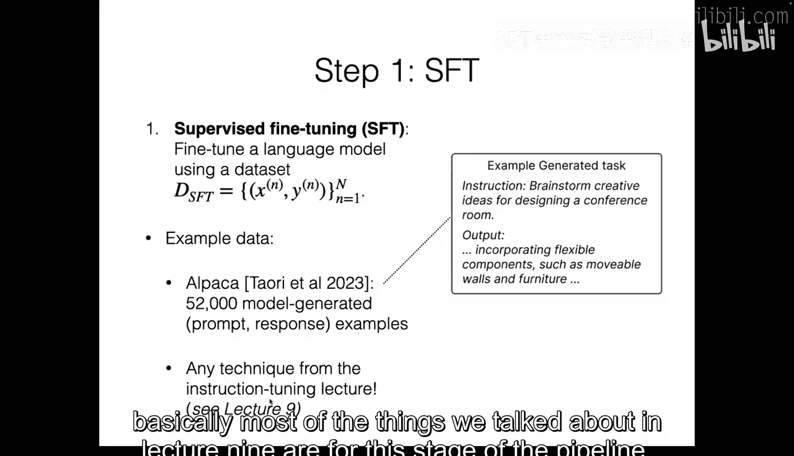

But I did want to just give one concrete like really recent example， so this is from AI2。

 they train this model called2lu3。And so for their SFT stage， they have 900，000 prompts。

So 57% of them， they went around and collected these various data sets that have been developed。

So there's been a lot of other data sets since this AlPAca paper。

Then they also 43% of it is synthesized data so they use。

Proprietary models to generate both prompts and responses。And specifically， they did that for， yeah。

 instruction following math and code。嗯。And then I won't go into the details。

 but they also adjust the mixture。 So what they did is actually select tasks that they cared about。

And then they notice that if you change the mixture of the SFT data。

 then performance on different tasks will change。Or they needed to add in like more math data if it wasn't as doing as well on tasks。

So probably inside of these different companies， this type of thing is happening as well。

 but AI was making everything open and so yeah at least they were doing this kind of。

Adjustment of the data based on some tasks。A professor like go how does。I mean。

 is there a deviation mental performance， models straightness in data when you have like weaker models outputs of getting mixed into the training system like I'm just curious how how much is it possible for you to improve by training upon your own data？

Yeah， so that's a big question and it's still being figured out so one is if the model is a lot better。

 then you can think of it as being some type of distillation from a better model。

But the the question is more nuanced， so sometimes you can have two models and one model is actually better at。

Gets better task performance， but then it actually ends up being slightly worse for being a synthetic data generator。

嗯。And so some things can come into play like how like what is the diversity of the outputs that are being produced by the model。

 some models will tend to produce like very difficult outputs and then they're not useful for learning。

So there's no like unified answer and it's one thing that。

People are yeah trying to get a better understanding of from your own experience working these that so like have you observed any like。

Any limitations in this approach？Of training upon in dedicated。So I mean。

 one limitation is that especially if you have， say mathematical problems。

Then the difficulty is getting an output that is correct。 So if you start training on a lot of。

Incorrect， synthesized solutions。Then your model might not actually get good at solving math problems。

 for instance。Same with like training on buggy code。 So ensuring that the。Yeah。

 quality of the response is good， is difficult。And then the other thing is。

You notice here that they have like 900，000 prompts， so a big thing is yeah。

 increasing the coverage or the diversity of the input prompts as well。

So that's another thing people are。Trying to figure out what the best methods are。嗯。😊。

Okay so so yeah that's the SFT stage so now assume that you've trained your model on all this data and it's you know pretty decent at different tasks now we want to still improve it further。

So here the step is called reward modeling。And so again， we collect this preference data。

And then we want to train or then we want to obtain。Sorry， in order to collect the preference data。

 we have to collect the outputs y， and then we have to collect these preference judgments to decide which one is better than the other。

And then we want to train this reward model。So。One strategy for getting the prompts。

 sometimes you just reuse the。Prompts from your SFT data。

Sometimes people split the SFT data set and save some for reward modeling。

And then sometimes people introduce their prompts。So it's really a case by case basis。

 but at the end of the day， you have to get some prompts for this reward modeling step。

So some examples， this alpaca farm， so their goal was to basically reproduce this entire pipeline that I'm telling you about。

And so what they did is just save 10，000 of these 52000。Proms。Only for the reward modeling stage。嗯哼。

😊，嗯。2。Re also to do the comparison if we even if we reserve the 10k samples。

 but what about the another because we only have one label outcome what we mean another so usually how do we generate。

Yeah， so what you do is so here you're saving the input prompts。

And then you can take your SFT model from the previous step and then just generate outputs。

 so say you take your model and you generate two outputs。

 now you have an input prompt and you have two outputs。What， what is the model these two。

It's the model that you trained in this step here， yeah。So here we yeah， okay。So yeah。

 generate with SFT model， some people also just generate with other models and then yeah。

 associate each input with multiple outputs。So can you send correctly like your SFT DSF had these x and Y pairs here we're just keeping the x right we were dropping all the Ys and the Y are replaced with the generation from the model。

Yeah， I mean everything's a design decision， so you could also keep this one response。

And include it in your preference data， you just have to。

 you have to at least generate one more then you'll have to。Yeah。So this is the type of thing like。

 you know， there's probably whole teams at these companies trying to perfect the stage。

 so they're probably trying out all these different little combinations。

But some of the papers do write in detail what they do， I might have an example。So yeah， now we need。

The preference ratings。And we need some methods to train the reward model。

So to gather these preference ratings。There's two main approaches。

 so the first is you hire human labelers。So for example。

 Open AI or Me or some other company might recruit people and have them。

Either label whether one response is better than the other。Or。

They could have them order multiple responses。Another approach to using human labelers is。

I maybe should have put it on the slide。You could have some online service。

 so there was one that was launched by Berkeley。And I think it was associated。

 it was right after the ElPalco project。And they basically made alpaca available to anyone。

But when someone was using the model， they said， like which one of these two responses is better and then maybe you could get some data from that。

Um， but anyways， yeah， you could try getting these judgments from human labelers。

The other is to try to use a language model， so a strong language model。So in Alpaca Farm。

 what they did is they used a GPT model。To rate responses that were generated by Lama。Again， here。

 there's this issue that you're ultimately using some imperfect model。And。So yeah。

 potentially there's noise introduced in the process。But yeah。

 so basically here's the diagram from their paper， they have Lama generate some outputs。

 and they just ask GPT which one is better than the other。

And then how specifically how you ask it can get kind of detailed。

 you can like give it a whole rubric for what it should look like， et cea， but yeah。

 I won't go too much into the details there。So then here's the example I was mentioning before。

Here is from this AIT paper， so first they select prompts for the stage。

They yeah have all these prompts and then they don't just use one model to generate responses。

 they actually use 22 models。And so now they get a bunch of responses for each prompt。

And then they use this GP4 model and it has these different like categories that it should look for and then you finally get。

Like which one is chosen and which one is rejected for。Different pairs。Okay。

So assuming you've done this， now you have some data set of preferences。

And so now we need to actually train the reward model。So。Here I'm going to stop showing X just for。

 you know。More compact presentation。So here's the loss function that's used。So again。

 here you have your ro model and this is typically a language model that you add this output head onto and it outputs the score。

And then you train it with this loss here。And it's basically saying， give a higher score to the。

Preferred output， compared to the。Non preferred output。

And then you go over your whole data set and minimize this loss。So I wanted to。

We actually saw this in a previous lecture， so here I want to go into a bit more detail on where this comes from。

Just so if you see it come up in the literature， then you've at least seen this once before。

So it's kind of interesting， it starts with this probabilistic model called the Bradley Terry model。

So this is from 1952。And it basically。You know， poses this model for。

The outcome of a pairwise comparison。So it says given two items I and J。The probability that。

The pairwise comparison I is better than J is true is given here。

And it basically just says the probability of I over。The probability of i plus J。

So very simple model。And so if we look at this。With our reward。Then you could define this PI or PJ。

As being just take the exponent of。Your roared。And so now you have something that looks like this。

And it says the probability that Yi is better than Yj is this thing here。

So now we can do a bit of kind of rearranging to get it into the final loss form。So first。

 we can divide by this R theta of。Y I， so this turns into one， this turns into one。

 this turns into this here。Then we could rearrange this event。

And the reason we do that is because now this is， oh， sorry。

 now this is in the form of the sigmoid function。So sigmoid is like1 plus exponent of minus z。

 so we have one plus exponent of minus this thing here。

And then now we see this term that's appearing the loss function。Where you have a。Sigmoid， and then。

This reward difference here。So there's still one more step， so then we could say， okay。

 given that under this model， the probability that YI is preferred for Yj is of this form。

Now we could try to。Maximize the likelihood of observing all preferences in our data set under this model。

So we could write out this likelihood function and it says across all the pairs in your data set。

Here's the。Here's the probability。And then to maximize。

 you can also minimize this negative log likelihood。And so just taking the log， you now get this。

And if we go back here。This should be。Yeah， the exact loss function that we saw。So in summary。

 this loss function is。Finding the maximum likelihood solution。Under this Bradley Terry model。

So it's kind of nice because it's kind of principled loss function to have。

From where do we get Y and Yj？我都知话。So Y I would be like y plus and Yj would be y minus。

 so Y I is the one that's preferred， Yj is the one that's not preferred。

So is it based on tumor allocationnotations or something？Yeah。

 so those are from this step here where we gather the preference ratings。So yeah。

 here we either humans or we use a model。To get the preference ratings。

 and then that gives us this data set here。Okay， so。Oops。So then that's a reward modeling step， oops。

And so yeah， nowadays people， a lot of people have trained these different reward models。

In a previous lecture。It was in the reinforcement learning lecture I actually showed an example of a ro model that's on Huging face so now that you're familiar with that。

Site I've shown it in a few lectures， you could go search for R model and a lot of them are trained in this way that I mentioned。

So any questions about this before I go on to reinforcement learning？O。So。

Now you have some initial model， your SFT model， and we'll call that P0。

And now we have this ro function that we've trained。

And so now we're going to use reinforcement learning algorithm。

To update the model and get our final one。So here's again， the picture。Where you have some prompt。

Write a story about frogs。Now the inside of the reinforcement learning algorithm。

 the model is generating an output once upon a time。The reward model gives it the score。

And so some of these will be high score， some will be low score。

 and then the algorithm will update the model based on the scores。

So there's a few things that are important in practice and if you use any one of these reinforcement learning libraries。

 I'll actually show you specifically at the end to convince you that that's the case。

 it's good to have at least seen these details once。

So I'm going to go into a fair amount of detail in the next slides。

 but I do think it's good to have at least seen once。So the first thing that's important in practice。

At least for this setting of tuning a language model to be a better chat assistant。

Is to somehow prevent the model from moving too far from the original model。

So this is often referred to as catastrophic forgetting， or it could be a form of reward hacking。So。

 basically。What we have here is this reward model， which is a kind of imperfect neural network。

So sometimes the reinforcement learning procedure can find ways to kind of exploit the roar model。

And get these weird outputs。Um， so one thing to do is， yeah。

 if you force the model to kind of remain close to the reasonable SFT starting point。

 then you could prevent that。And then similarly， you don't want the bottle to like forget all of the knowledge that's learned during pre training just that it can maximize the reward。

So this is something that's done。So。The one major way that this is done。

Is with this kale divergence constraint？So again， I did mention this briefly in the reinforcement learning lecture。

 but let me go through it in detail here。So what we want to do is。

We actually don't want to just maximize。Roared or expected roared。

We actually want to introduce this penalty。Which penalizes moving away from the original model or the original SFT model。

And so by moving away， we'll use this notion of kale divergence。

That we've seen a few times in the class。And so then we can have some hyperparameter here。

 and it basically says。If you set this beta to be higher like。0。6。

Then there'll be more pressure for the model to stay close to the original one。

Whereas if you lower it down to like point。0，0，01， or even0。Then the model becomes more。

 it has more freedom to just maximize the reward。So yeah， you can kind of control。

The extent to which the model stays close to the original one。

And so the common approach to actually do this is。Yeah， well。

 one approach is to introduce this penalty into the roar function。

So you would basically have the rod from your ro model， and then you just add in this。Kol roared。

And here's what it looks like。So here you have this beta term。

And then you have log and you have your models。Probability on the the output that's been generated。

And then down here you have your original model。And the output probability that it's generated。

So you could see here that if。These are。TheIf this starts to get far away from this one。

 then the penalty will increase。And so it's basically， yeah， penalizing the model for assigning。

Probabilities that differ from the original model。So I'll actually show in the next slide how this relates to this scale of divergence。

But one practical thing is that in order to compute this。

 you have to keep a copy of your original model。And this can actually be a big deal because。

 you know， this is a language model and it could be very large。

And so this makes the training more expensive because you have to keep the original model and you actually have to do a forward pass with it to get this number right here。

So。This。Penalty actually ends up。Being an estimate of this scale divergence。So here it is right here。

 here's the definition of kale divergence。You're summing over this or it's an expectation。

Here's just writing expectation。And then what it's basically saying is that you take a single sample and you're approximating this expectation with just a single sample。

So it could be a very noisy estimate of the kale divergence， but nevertheless。

 it does give you some approximation of it。So for the whole pipeline。

 this SF act link that kind of inches the model closer to what you wanted to do then。This kind of。

Is the final cherry on top， is that how it operates and then？Yes， I yeah。Yeah， yeah。

 so one way that this is referred to is alignment or aligning the model。

So you're not teaching the model to do everything from scratch。Rather。

 you're given a pretty good model， and then you're just kind of。Realignning its probabilities。Yeah。

 you could also view it as like this ym Laoon views it as this cake。

 and then the reinforcement learning step is just the cherry on top of the cake。嗯。Actually。

 funny story when I started my PhD in 2016 was the first time he gave that talk if you've seen it。

 he uses this analogy of like reinforcement learning being the cherry on top of a cake and he's been using it for you。

Nine years now。But anyways， yeah。Here going back to the previous question。

 you kind of are assuming that you have a reasonable model to start with。

And then now we're just adjusting the model。And even constraining it to remain kind of close to the。

SF model。So I should say you don't have to do this reward penalty in the different libraries now。

 you could also just add in another loss term that computes the kale divergence。

Or an approximation of it。Um， but anyways， it's good to have at least seen this and know about this K divergence。

嗯。Okay， so one other bit of。One other interesting thing and it'll actually come up later when we're talking about。

The direct policy optimization， DPO。So you can actually show that。Optimmal policy for this objective。

This is called the KL constrained reinforcement learning objective。

The policy that maximizes this objective has this form here。And it's kind of interesting。

 it basically says that it's your original model。And then reweighted by this reward。

And then the amount that you kind of care about the reward is modulated by this beta term。嗯。So yeah。

 it's kind of this nice idea that again， the optimal policy is actually related to your initial model。

And then you're kind of adjusting it using this ro function。So anyways， we'll come back to this。

 but this turns out to be important for driving this other method called DPO。

And I find it interesting for interpreting what this RLHF is doing。Okay， so。Any questions on this？

Professor I was curious about like the relative complexity between the reward model and the modeling optimize like is there any particular ratio which ist observed that like you know these two models if they have these many parameters of respect each other that's best for training。

Because like a very simple reward model， which is like one rule。

 would be immediately relevant and exploited by the human。

But example it just too complicated now I might be completely useless， I'm just curious but what？

Yeah， yeah。So yeah， I mean， in general， it's useful to have a better reward model。

 it'll maybe be exploited less， it could give a good learning signal for more difficult prompts。

So typically if you're able to have a reward model that's bigger than your generator model。

 then yeah， that's a good thing。Yeah， so most of them can be so the problem of developing a perfectly robust ro model is it's not solved so there will always be exploits。

And。It's hard to say what the exact minimum is， you might want to look in papers。

What the different configuration is。I would say typically if they're。

Kind of training or aligning a new model。Then they might be trying to。

 they might be operating kind of at the frontier， so they might be training like the first 70 billion parameter model forllma 3。

 and so they'll try to use。Yeah， the best possible model also is the reward function。

 and so they'll at best be kind of equal size。嗯。So， yeah。They might。

 if they're aligning their smaller model like the 8 billion one。And they use the larger reward model。

 then you could see a gap where the reward model is actually better than that。The policy model。Okay嗯。

So yeah， so now I'm going to go into some more details on these algorithm variants。And again。

 at the end， I'll show you these different libraries and these different things come up in libraries。

So in the reinforcement learning lecture， we introduced。These policy gradientding algorithms。

So here's the simple one called reinforce。Or this is policy gradient。

And you can have this loss function， which is。Some wait for the given token。

And then you have the log probability of the。Token， given the context， this is like at one time step。

And then when you take the gradient， it's basically saying that we're weighting the gradient of the log probability。

Times this waiting term。So in the RL lecture， I talked about。嗯。

This could be the reward for the given step。But on the next slide。

 we're going to look at various options that you have。

For actually choosing how you use the reward in this update。And then here again in the RL lecture。

 we talked about PPO or proximal policy optimization。So here they come up with this more clever。

A loss。And it basically involves this ratio here。So you have your。

So basically the way it works is you have your current model， you generate some outputs with it。

And then you can do a couple updates。And so now you have like your old model and your new model。

And you'll have this ratio and the reason you have this ratio is to say we don't actually want to move too far from this old model inside of the update。

So I did talk about this。For a bit in the previous lecture。

Here we're going to focus more on how you do this waiting here of the updates。But again， yeah。

 you have this clipping term。And it basically prevents the update from being either too large or too small。

And as a result， in practice， using this PPO loss。Can be a lot more stable than using this policy gradient up here。

So then one remaining thing is how do you actually use the。Rewards within one of these algorithms。

And so here there's different choices。So one thing to do is you can just use。嗯。Well。

 you could just use the reward at each step。And what happens is imagine you're generating a long output like a full summary or something like that。

Then your reward model might only give you a score on the kind of full sequence。

And you have to determine how do you assign rewards to each individual token？So again。

 in the reinforcement learning lecture， I talked about this idea of discounting。

So it basically says start with the less token that will get the full reward。

And then as you move back in time， you can discount the ro and it'll basically decrease over time。

And if you remember， we were talking about。Training a model to like， play Atdi games。And maybe there。

 it makes sense because like a game that a。Move that you make at the beginning of the game doesn't really contribute that much to the final result。

But in text generation， it's less clear kind of whether this is the best way to assign rewards to individual steps。

Another thing you can do is to use a baseline。So here you have your reward。Again。

 this could be at a time step level or it could just be at a full sequence level。

And then now you want to subtract this baseline。And so the idea here is that like as your model gets better and better。

Maybe it's always getting kind of positive reward。And so you want to periodically you know。

 adjust the updates so that you're still improving it further。That's the kind of intuition and then。

It turns out that doing this also reduces the variance of the。Policy gradient。

 so it's also good for stabilizing training。So one popular choice for this baseline is to learn what's called the state value function。

So let me talk about that on the next slide。So the state value function basically predicts how good。

The current state is。So the current state might be， you know。

 you've generated some tokens and there's still the remaining sequence to be generated。

And now you want to predict like how good is this generation so far will it eventually lead to some good reward？

Of course， there's multiple possible ways to complete the。Sequence， if you stop like。

let's say your state is like halfway through。So in theory。

 at least it should measure the expected reward given that you're at this current state。In practice。

 the way to train one of these value functions。Is you basically generate a bunch of rollouts so you。

Generate multiple outputs and you get rewards for them。You can use discounted rewards if you want。

And then you train a model to predict。Yeah， what is the return from this particular state？

So concretely， you can take your language model and add on this extra output head。

 which again outputs some scalar。And then you could add in this extra loss function， which says。

 given my current state， is it correctly predicting the return from this state？

And then you could use this as the baseline。And it has this nice interpretation。

It basically says that in order for there to be a positive gradient update。

The reward or the return has to be kind of better than average。So again。

 if you learn a really good value function， it's saying， you know， in expectation。

 what is the reward from the state？And so if this was positive。

 it would mean that this observed return is actually better than expected or better than average。

Is this process where you learn your state value function？Don't at the same time as you're doing the。

Like the other optimizations yeah， so sometimes people will initialize this。Using a reward model。

Or they'll initialize it using， yeah， one technique is to initialize it with a reward model。

 but in general， yeah， you keep updating the value function as part of the PPO training。

Or reinforcement learning training。Okay， and the reason I'm going through all of this is because yeah。

 if you go to use one of these libraries。You'll see things like value function。

And the value function is sometimes a separate copy of the model。 So it'll also， it could like。

 double your。Memory requirements and things like that。Okay， and if you're still with me。

 I wanted to go into one more thing， which is that you could take this kind of generalized view of what I just told you。

Using this notion that's called an advantage。So the definition of an advantage is here。

 so you say that the advantage of a state and an action。

Is equal to this function Q minus your value function。So the value function again says。

 what is the expected ro from a state？And then this Q function says。

What is the expected reward from the state？If I take action A。So it's kind of subtle。

 but it's basically saying， okay， given that you take AT， what is the future award？

So this actually kind of formalizes this idea that I told you about before， a bit in general。

If this advantage is positive。Then it's basically saying that this action AT is better than average in the sense that the expectation after taking the average is higher than just you know。

 in general。And so ideally， this would be really nice if we could use as this waiting term。

But in general， you don't know this cu and。嗯。Yeah， you don't know how to compute this exactly。

So there was this nice paper from 2015 or 2016， and it's from the same author who created PPO and the algorithms that PPO is based on。

And they basically showed that the following options。

 actually the ones that we already saw are different estimates of this advantage。So in particular。

 they like don't add any additional bias when used in place of the true advantage。

But they might have really high variance。So yeah， you could use your discounted return。

 you could use a baseline。And then there's something else called TD error or temporal difference error。

And it basically says that， yeah， you have the reward and then you go forward one step and measure the value。

And then you subtract the current state。And if you look at for a bit。

 then it kind of starts to look like this advantage here where， yeah。

 you're subtracting out this value function。Okay， the reason I'm telling you about all of this is。

There is a method that is used kind of by default in most PPO implementations。

And it's called generalized Adv estimation。And so you'll see this come up and you'll see these different hyperparameters come up。

Um， so yeah， that's why I wanted to be sure to make it all the way here。

So what they do is generalize this idea of temporal difference error。

They come up with this advantage estimator here。And it basically has these two different knobs you can turn。

 so both gamma and Lambda。And like if you set lambmbda to zero。

 then you get back this temporal difference error。Which we said is， you know， in some sense。

An estimate of the advantage。If you set this lambda to one， then you get this here。

 which we saw when we use like the value function as a baseline。

And then you can basically interpolate between them and like control。

Whether you introduce like bias or a variance。So anyways。

 you'll see this as the kind of default that's used in PPO。

And so you'll see these two different hyperparameters。Even like when you're launching some PPO code。

嗯哼，你搞过来。So this will be the discount factor。Yeah。Okay， and then one more actually。

 so recently Deepse created this model that uses reinforcement learning and they actually don't use this generalized advantage estimation。

They do this kind of simple thing where they draw multiple samples。

And then they just set this weight to be the。Kind of normalized reward。

 so subtract the mean across the samples and divide by the standard deviation。

And so this is referred to as。Group relative policy optimization when they use these kinds of advantages。

And one reason that they argued for doing this is that。Yeah， in order to compute these advantages。

 you have to have this extra value model。So you have to like store the parameters in GPU memory and can if you have this being like a full language model。

 then it could really increase the size of things。Also， sometimes in practice。

 it's difficult to learn a really good value model。So it's not clear like。

How or whether it's contributing to training。So you can see here that they get rid of this value model and then they just do this kind of group computation。

And so again， if you're ever reading through these papers。

 I hope that now you have at least some familiarity with these different things that are coming up。

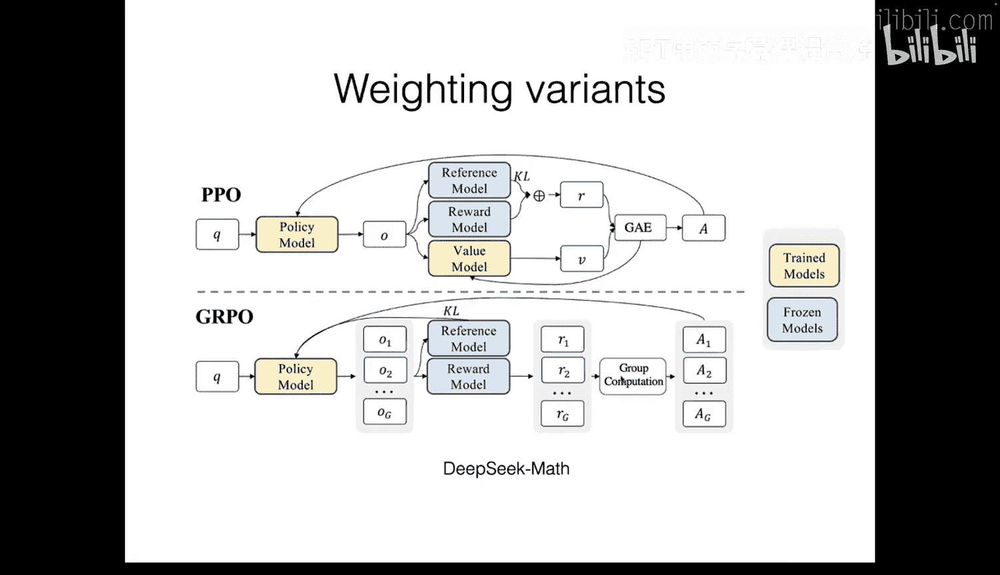

So to recap， there's different ways to weight these gradient updates。

One is this discounting and discounting could be used within any the other methods。

The other is this method from GRPO。And then there's these two other methods we discussed that introduce this additional value function。

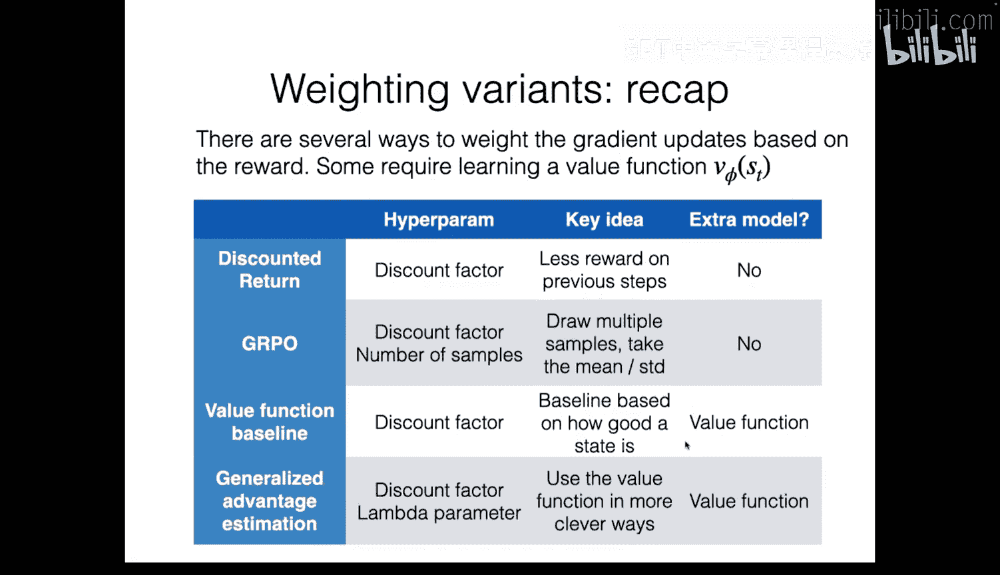

And then just to recap everything again， if you view this as a kind of algorithm。

You start with your initial language model and some data set of prompts and your reward function。

Then inside the algorithm， you're generating responses。You're computing these advantages。

 which can involve multiple things。And then you're computing this loss and updating the model。

And then if applicable， yeah， also updating this value function。

And then this is what I was saying at the starting that if you look at this algorithm。

 there's actually nothing specific to human feedback。

So let's say you wanted to use this for solving math problems。

Then you could use a different reward and different prompts so your reward could say look is the。

Output answer correct or not， and your prompt could be a math problem instead of like a dialogue。

UIn practice， people are playing around and saying like。

 is the KL penalty still needed for things like math and so on？Um， but yeah， in general。

 like the framework is kind of。

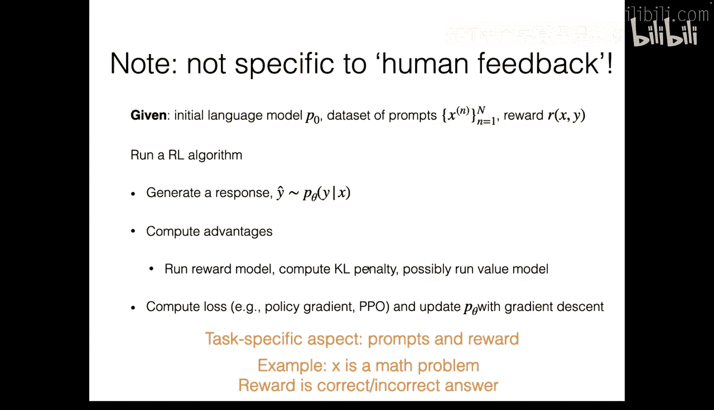

Pretty general。And then here's some concrete examples of these different stages I mentioned。

 so this is a library released by a Huging face called TRL。So here they're doing this SFT stage。

So they load data and then they've abstracted it into this trainer。

So here they're fine tuning thisquin model。

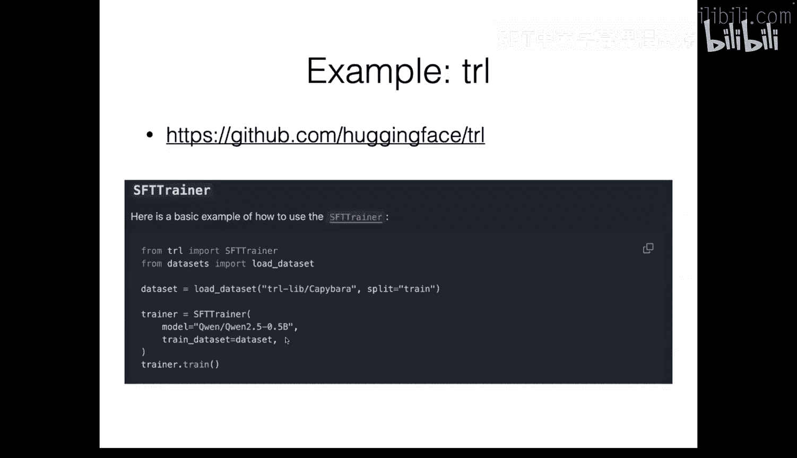

Here's the reward。Moodeeling step， so this assumes that you've collected your preference data set。

So here they have this preference data set called。Ultra feedback binized。

And then they've again abstracted this training， the reward function into。This trainer。

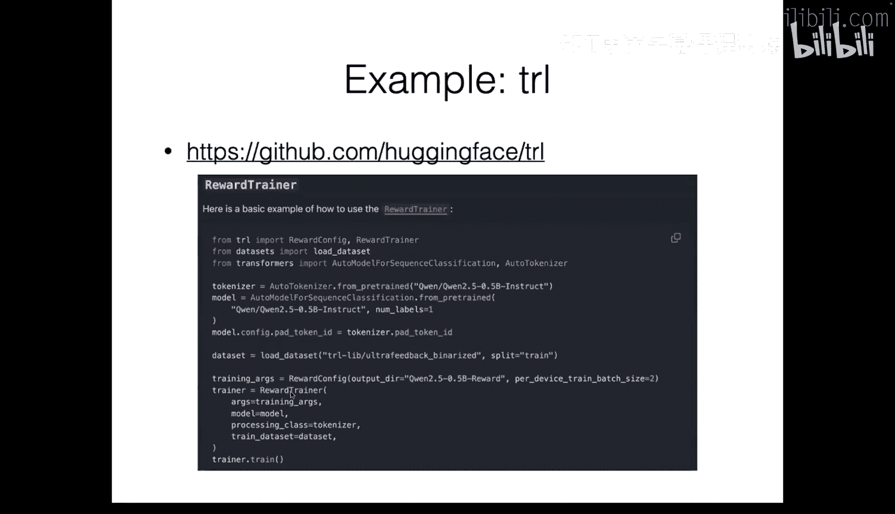

And then here they， I think they used to have PPO on the front of their page。

 but now the trendy one to have on the front page is this GPO。And so again， here， you need some。

Roward function， I guess this is a toy example。 they're just counting the number of。

Unique characters in the completion， so I guess the model just learns to generate。😊。

Things with a lot of unique characters。U and then again。

 they've kind of abstracted all the stuff I've talked about into this trainer that you could run。

On some。Again， you need the input prompts too。

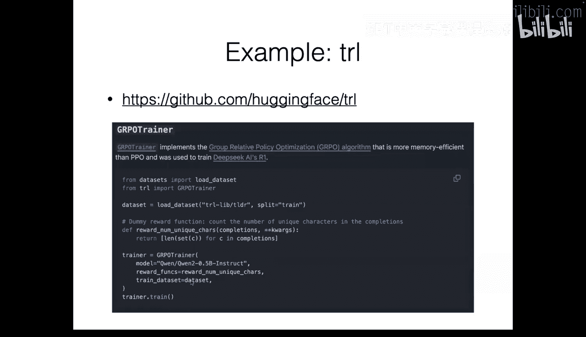

Another one that's。I've heard really good things about and people in my group are using a lot is called Veril。

So I think it was developed by dance。And yeah， they have some really nice tutorials for getting up and running with us。

They have this kind of fine grained configuration you could do of like moving certain things to certain GPUs。

And then here's where I wanted to show you that these various things that I mentioned do show up。

So here you have the gamma and Lambda term for the generalized advantage estimation。

You could change the advantage estimator to be GRPO。These are two other ones。Yeah。

 they're fairly simple， it's like you。Generate multiple outputs and。Take the average。

 roughly speaking。And then here's the various options。

 but definitely read the details if you're going to use it and then here's the KL penalty。

 so they actually have multiple options， but you can see that this KL penalty is involved。Okay。

 so that's all the content on the reinforcement learning and the RLHF pipeline。

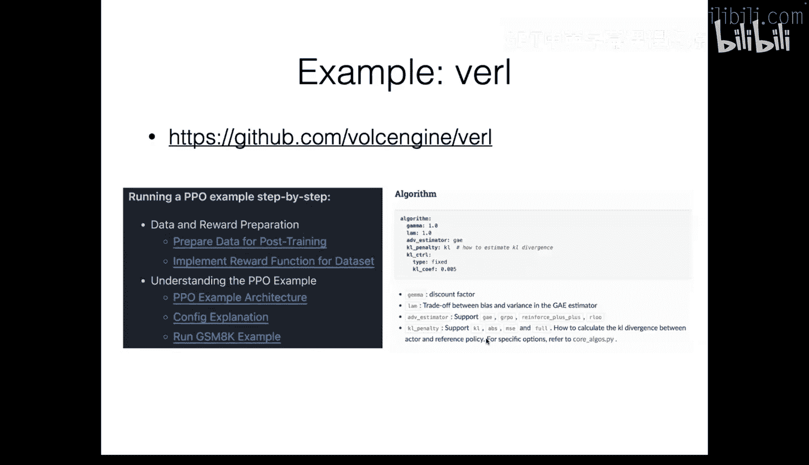

So as time permits， I wanted to go through this other popular algorithm called direct preference optimization。

We only have about 14 minutes left， so maybe if there's one quick question， otherwise。

 may I'll just try to get through the material。O。So。Here there's an interesting question， which is。

 let's say that we don't care about all rewards， we just care about these preferences。

So like we want to create a language model that is tuned to this preference data。

Then can you actually skip all of this？Complicated stuff that I told you about。

With reinforcement learning。And just。Directly optimize a model using this preference data。

So here the key idea is to actually use the stuff that I told you about before。

And we could look at how a reward model is trained。 and then basically。In a clever way。

 end up training just the policy model。Without a separate reward model。

So here was the Bradley Terry model that we saw before。

And you could remember that I told you about this optimal policy that you get for the KL constrained reinforcement learning problem。

And it has this form。So then the trick that you could do is you could take this equation。

And you could rewrite it so that this reward here is on the left hand side。

And then you could basically insert this ro into this equation here。And then， get some loss function。

For training the model。So it's a kind of clever trick and let me just show you that。Written out。So。

Here is the equation from the previous slide and now I put a star here because this is like the optimal policy。

And if you just do some rearranging， then you could get this R here to be on the left hand side。

And now you have an expression for the reward。In terms of this optimal policy and this initial policy。

And we'll call it the reference policy。Then you can plug this into the Bradley Terry model。

And after you kind of simplify some things， then you get this quantity here。

So this cancels out this normalization term。And you just have like， yeah。

 this beta and then log and then。Here is。The kind of preferred response and here's the dis preferred response。

嗯。Now we could replace this P star with some model that we want to learn。

And then if we hold everything else fixed。Then we could try to maximize the likelihood by adjusting the parameters of this model。

And at least at the optimum， if we kind of solve this， then we will have recovered this。

Optimmal model or optimal policy。So it's a kind of clever argument。

And that's the basic idea behind this method called DPO。嗯。And so yeah， thisops。

This year turns into this loss function。Um where again， we see this like log sigma。

 and now we have this term in here， which has like the winning sequence or the preferred sequence。

And then the losing sequence or non preferred one。And then you can see that we're going over some data set of preferences。

And so the key difference here is， again， we don't have to explicitly train some reward model。嗯。

Instead， it's using this kind of clever parameterization or reformulation of things。嗯。So。Yeah。

 if we look at the gradient， it's also a bit interesting。So now again。

 we can get this what's called the implicit reward。嗯。And yeah。

 if you remove the additive normalization term， then this is what we saw in the previous slide。

And yeah， if we take the gradient of the loss， you get this。And it basically says that。嗯。Over here。

If the reward model is assigning a higher basically if the reward model is incorrect。

 then we're going to increase the kind of penalty。嗯。And。Over here， it's saying that we can。

Increase the probability of this winning sequence。And decrease the probability of or likelihood of the losing sequence。

嗯。So， so yeah， that's kind of。Quickly， but in some detail， the direct preference optimization。嗯。

So I will say that after the original DPO paper。People started creating different variations of this。

So for instance， they notice that it's good to normalize by the length of the outputs。嗯。Additionally。

 they notice that when you use this for reasoning tasks。

 it's good to add in an additional just next token prediction loss。So in practice， it can take。Yeah。

 sometimes you have to use one of these variations。And it could take。

A little bit of work to get to work。But in the best case， you can use just the standard DPO。

 and it could be。A good alternative for aligning to this preference data。

So I didn't put like a screenshot or anything， but that2lu3 model that I mentioned before from AI2。

 they actually just used the standard DP loss on all of the preference data that they collected。

 actually instead of using the reinforcement learning for this step of the process some of these two。

Yeah， so this is good if you have this， just this offline data。So if you have a really big， okay。

So if you kind of look at this， then what does it depend on， well。

 it depends a lot on the data that you have。So if you have some really good。Pference data set。

 then yeah， this could be really stable， it doesn't involve like generating with the model and so the training can be fast and things like that。

嗯。One tricky thing is that if this doesn't cover everything。

 then you're never like regenerating with the model to get new data。

Whereas with reinforcement learning， you have this loop of like， now that you've updated the model。

 you generate more with it。So it's like online versus offline。But yeah， this can be good to。

 good to try。

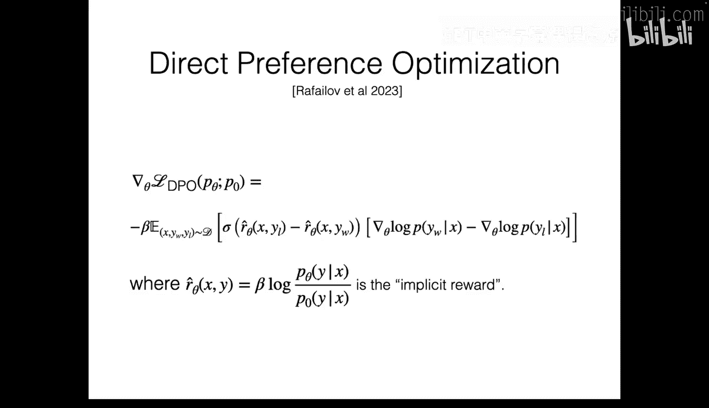

So then here's kind of what I was saying， so this DPO is referred to as an offline method。

 meaning that all of the data that's involved is created prior to learning。

Whereas these RL methods are online in the sense that they are updating the model and then generating more data with the model and so on。

DPO is specifically designed for this preference data preference rewards。And again。

 it uses the policy model and the reference model， but doesn't require like the value function。

 designing a good reward or anything like that。So yeah。

 sometimes it's good to at least try for your application。The RLHF。嗯。So specifically。

 if you include the HF in here， then it usually refers to using this preference reward。

So you also need to， yeah， get a good ro model。And you could have multiple things involved。

 so the policy model， the reference model， the value function and the reward。but in general。

 I've kind of showed you that there's various design decisions that you could take。

Sometimes you don't have a preference ro and you're like trying to solve math problems。

So you don't even need to train a reward model。Sometimes you could come up with。

Ways to not have to use a value function， like with GRPO。And。Yeah。So there's kind of flexibility。

Here。Okay， so that was the overview of these post training methods。

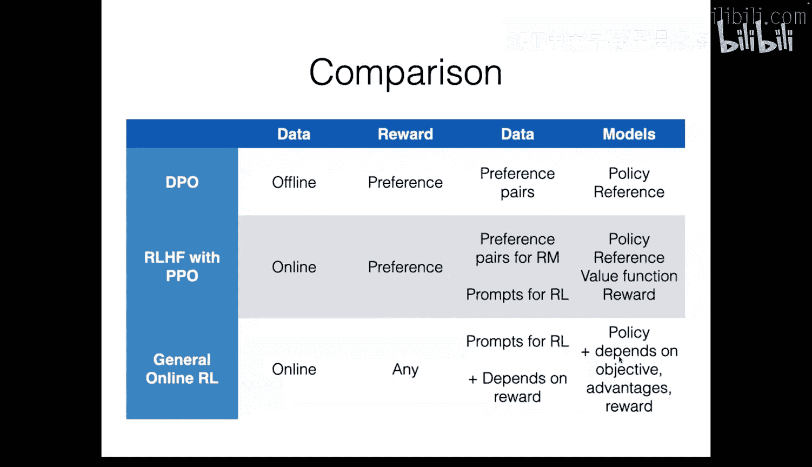

And here is just showing yeah so DPO now again is kind of widely used and so it's in these different libraries。

 so here it is in this TRl。嗯。

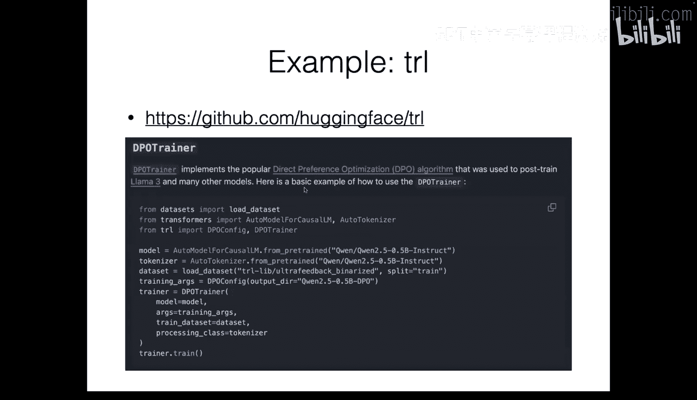

And yeah， that was the overview of these post training methods。

So reinforcement learning and direct preference optimization。

And then we also talked about this supervised fine tuning step， which you usually do before these。

And so I think I'm just about at time for today。So I'm happy to take a couple questions in person here。

