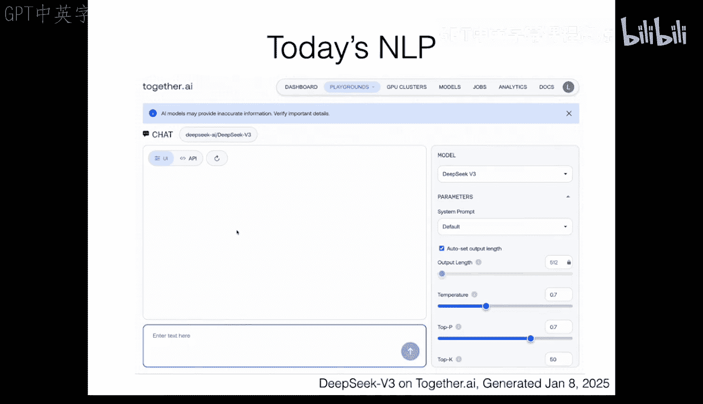
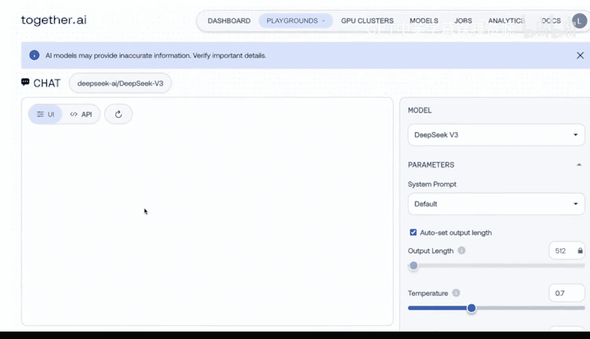
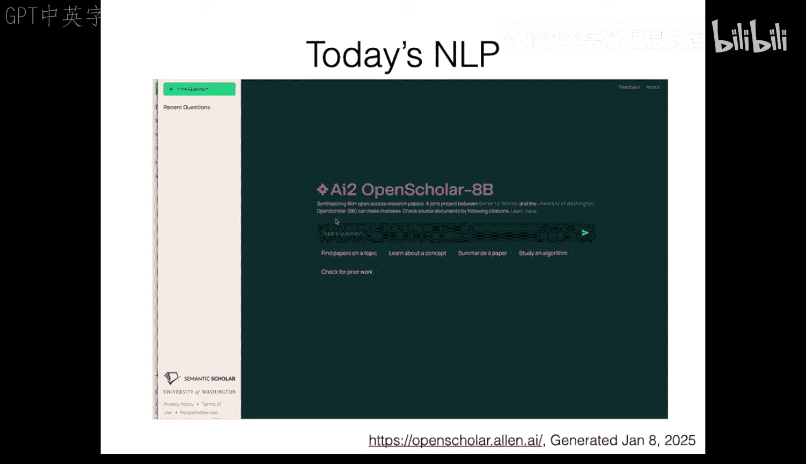
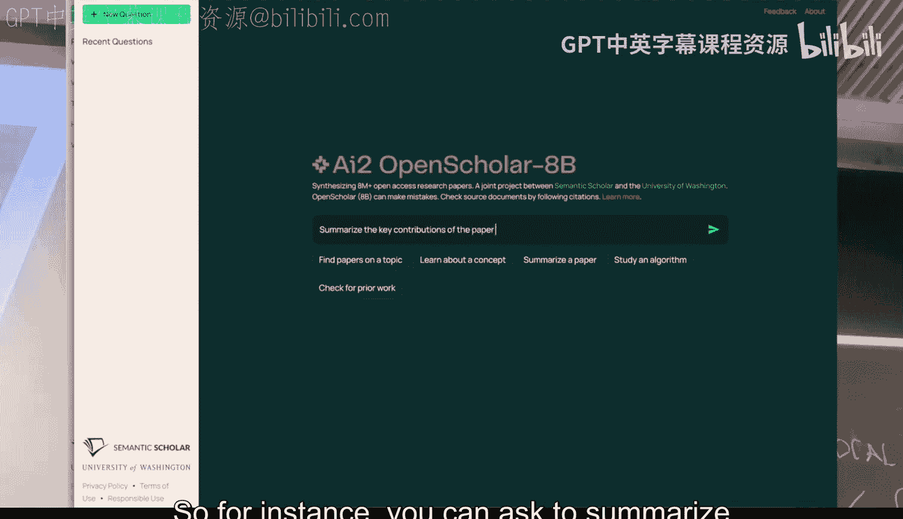
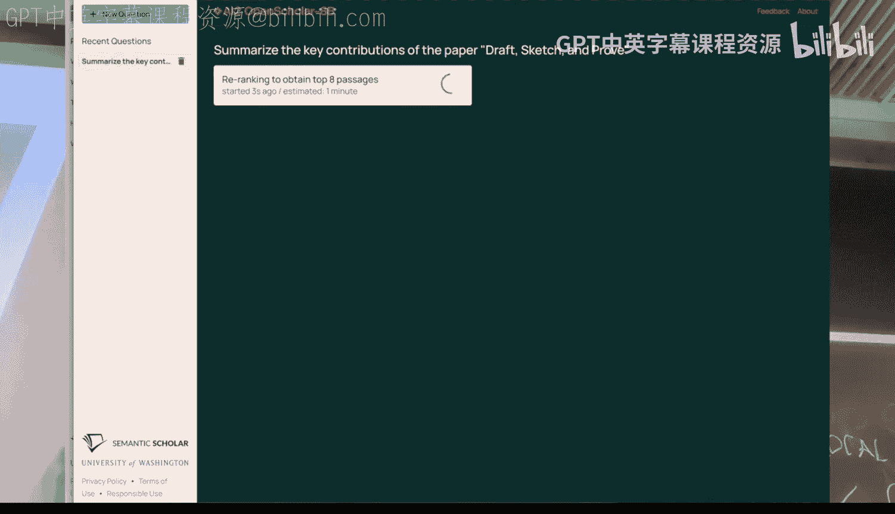
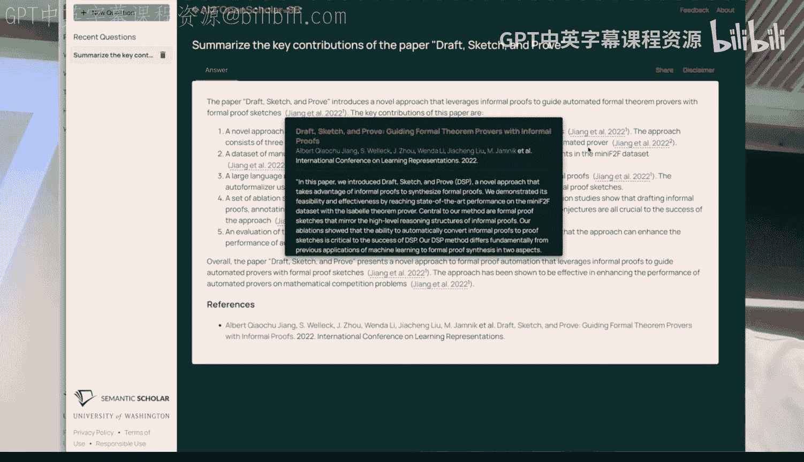
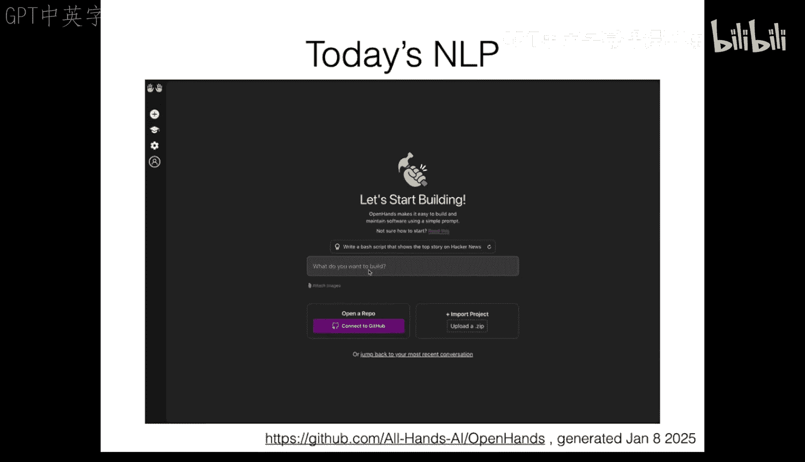
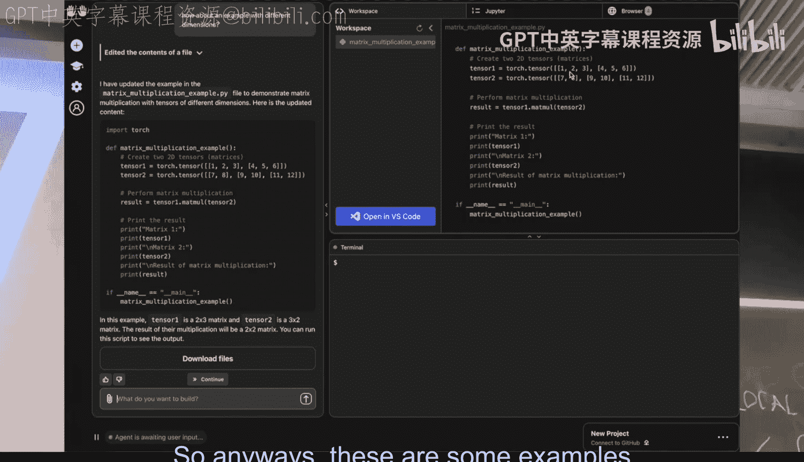
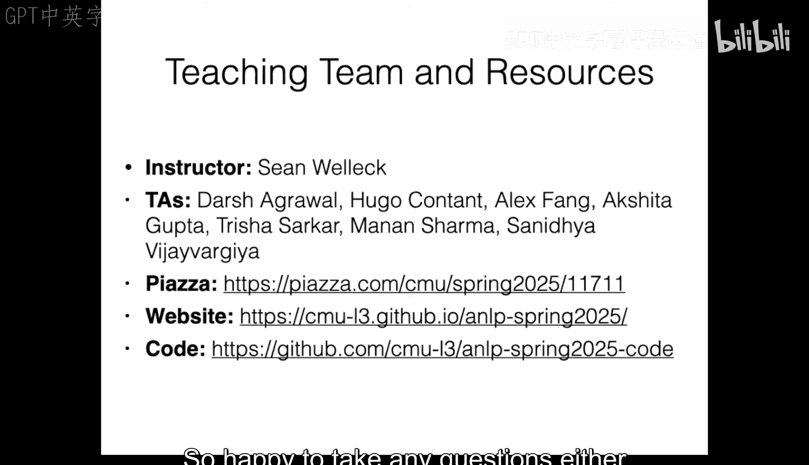

# CMU《高级自然语言处理｜CMU CS 11-711 Advanced NLP Spring 2025》中英字幕（claude-3.7-s - P1：-01-(1)_ Introduction to NLP.zh_en - GPT中英字幕课程资源 - BV1nYVHz7Eoa

Welcome， everyone to。It should say， oh yeah， advanced natural language processing， 11711。

So we have a full house here， it's great to see all the excitement in this area and I think we're going to all learn a lot this semester。

嗯。I wanted to start the class by actually introducing five of the TAs here here。

 so we'll have seven TAs in the course。Five of them are standing back there。

 the other two are traveling now， but just want to start with introduction so do you maybe just want to go down the line and introduce yourself yeah starting with Hugo。

は。My research area and I end up like to potentially to exp for like benefit creation navigation。

 and I'm a lot of like self supervisorvis learning。D have Chaice， I。My research。Our。I'm San。

 you guys see calledi， I'm like a masterism Health system program。

 and my interests are agents for co generation and multi。对，是吗？发。同意。下次。So I'm a， andm super my energy。

 my learning and even conditions sometimes models and lifestyle time。😊，Okay。

 awesome and we still have Manan and Darsh who are still traveling。

 and so I'm sure all of you will be speaking with the TAs a lot throughout the course and everyone will get to know each other。

嗯。So okay， so yeah I think we can begin with with the first lecture today。

 so today I want to just yeah give a brief introduction to even the question of like what is natural language processing。

 what does it mean especially in today's day， I'm sure most of the people that who in this room has used something like chat GPT。

嗯。I should almost ask who hasn't used it， so what is NLP in today's day？

And then we'll actually go back and think about before the。

Deep learning tools that we'll really focus on in this course were available。

 what did building an NLP system look like， and this will really give us a firsthand look and kind of motivation for the deep learning systems that we'll focus on throughout the course。

So first what is natural language processing well I don't think there's a single definition。

 so here I just came up with something kind of on my own and you know in some sense it has it's some kind of technology that enables computers to process。

 generate and interact with language language such as text。And some key aspects are。

 we want to have ways of learning useful representations of language。

That are somehow useful for downstream tasks。Like as humans， we might read you know a text on a page。

 but for you know a computer it might actually be more useful to come up with a different representation。

 some of the ones we'll see are based on these kind of not really interpretable distributed representations that are learned from data for instance。

Another aspect is that we often want to be able to generate language。

 so create language like text or even like a programming language like code。And again。

 we want it to be useful in some setting， things like dialogue。

 things like translating one language from another or answering questions that you have。

And then the third one is you could think of language as being kind of one part of some larger system where the system involves things like interacting with an environment。

 getting visual observations from the world， and then ultimately taking actions。

So like an example is， if I ask you to， you know， write code for a specific task。

 then I might use language to convey the task and the requirements。

But then the actual writing of code is like you know interacting with this computer and typing things and so language is just kind of a part of that whole process。

And I thought it'd be fun to look at some examples of today's NLP systems， so I have three here。

 the first one is one of these large language models， so this one's called deepse V3。

And here I've gone on this website called Togetherge。AI。

 anyone can go on there and sign up and get like a free API key and play around on your own。

And so let's see what happens here when we start typing with it。And I basically said， hello。

I'm showing an example of LOMs to my class。Can you generate some cool looking text？

That shows off your capabilities。Maybe something brief。With English， Japanese and Python code。

So kind of unique combination and here it could actually type a lot faster than I can and it comes back with something in English about language models。

 bridging cultures， it comes back with a Japanese translation。

 and then it even writes some Python code， the functions called deaf bridge cultures。

And then it actually runs the code and shows you the output。

And then at the end it says that this example demonstrates multilingual fluency cogeneration and the abilities to combine language with programming concepts。

 so pretty impressive and things like this didn't really exist a few years ago or especially like you know when I was getting started in NLP。

 so it's been really exciting to see things like this。

Here's another example called open scholarol， so this was a recent paper from you know from an academic group at the University of Washington working with。

This company area too。

And here you can basically type in。Things about like scientific literature。So for instance。

 you can ask to summarize the key contributions of a paper。

Here I put in a paper that I was part of so that I could check the output。

嗯。And you can see here that it's it's actually。It's you mentioned this word retrieval。

 so it's actually retrieving from some data store coming back and then using a language model to come up with the summary。

And I can kind of attest that it's a pretty good summary。

 it basically gives you the kind of key contributions of this paper and then as you saw you can click and actually see the document that it is grounding its generation and so you can like as a human。

Look it up yourself to make sure that， it's high quality。

And then here's one more example， and it's actually from the previous instructor of this course。

 Graham Newbig here at CMU。And he's been working on something called Open Hand。

And so here we want to do like software engineering and so here I'm typing into open hands。

 I want to learn about matrix multiplication in Pytorch。

You know get ready to get ready for the course。Now on the bottom here。

 you can see it takes some time to start up。So it's waiting for the client and then it starts running this agent。

 so agents something we'll talk about towards the end of the course。

And the agent is browsing this URL， it's the Pytorrch Dos。

 it comes back with some documentation on matrix multiplication。And then I basically ask it， like。

 can you make some simple example in a file？嗯。So let's see what it says。嗯。Still waiting。Okay。

 so now you can see here there's like matrix multiation example do high。

 and it's come up with this example。Then one more thing like how about an example with different dimensions So here you can see these are like two by two kind of like。

Trivial。And let's see what it does。嗯。嗯。Okay， so now it actually change it to like。诶。

But it will be three by two or two by three。So anyways。

 these are some examples of like things that you can do today and actually all three of these examples。

 the reason I chose them is that all of them have kind of academic papers describing the system。

So， you know you can look up how these things are made。

And the idea is that like in this class we'll actually cover the fundamental concepts that underlie all three of these and a lot more types of NLP systems and the fundamental concepts。

 they can often last a long time and so if you really learn these things well。

 you could use it to build things that even don't exist yet。

And so some things that we'll ask in this class are like what goes into building state of the art NLP systems？

And then where and why do current state of the art NLP systems still struggle？And then finally。

 how can we make improvements if the system still struggle and achieve whatever we want to do with NLP？

And so first， I want to just start with this kind of really high level overview of building NLP systems。

In general， what we want to do is create some function that maps some input X into an output Y。

And the X and Y involve some kind of language。So some examples here。

 one that we'll talk about is language modeling， so here we have some text as input and we want to have a model that just continues the text。

Translation where now our output is in another language。

One that we'll talk about early on is text classification when we want to just take this text and assign some label to it。

One thing like you know， traditionally studied in NLP is this task of language analysis。

 so extracting a structure from some text。And then of course。

 like you don't have to limit yourself to just text simple examples like image captioning where your input is an image and your output is a text and so again we'll go over multimodal models towards the ends of the course because we'll talk about some of the like state of the art systems in that area。

And if you think about three different common methods for creating these systems。The first。

 which we'll briefly go into in this first class is based on rules。So here you kind of as a human。

 you use your own domain expertise and knowledge and you try to basically define this function yourself。

So let's say we're trying to classify some text。Then maybe we just like write down these sports keywords。

We write this like Python loop， check whether the keyword is in this text and if it is we consider it a sports document。

 otherwise we consider it not a sports document。So this is a really simple classifier right。

 and in some sense we've declared the rules that are underlying the classifier。

A second one is called prompting， so this is a relatively recent form of way to build a NLP system。

Here we have some really kind of general purpose language model。And we provide it with this prompt。

 so we just say if the following sentenceus is about sports， reply sports， otherwise reply other。

And then we have the language model generate and it gives us some answer。

So this is like a completely different way of building this classifier。

And then the third way is to actually have some data for the tasks that you care about and actually train the model。

 so like adjust the model's parameters using the data。

So here you would collect some data of sports sentences and non sport sentences。

 and then you would hopefully be able to learn this function somewhat automatically from data。

And so I've mentioned data， what are the different data requirements for these three。

 what are some different data requirements？One is that you can write down rules and just prompt a model based on your own kind of intuition。

And in principle， you actually don't need any data。

Like we could come with that list of sports keywords without any kind of data set。

That also doesn't really give you that many guarantees on the performance。

So what you can do is you can do these kind of spot checks。

 you can create a rule or you can prompt a model， you can look at the output， and if it's not good。

 then you can like adjust your rules or adjust the prompt， it's called prompt engineering。

And when you think about this， this actually requires some data for doing these spot checks。

You could also do this more systematically and have what's called a development set。

Where you have some inputs and some outputs。And now you run your system and you make an adjustment if it like performeds poorly on your development set。

And so now this requires a bit more data。嗯。And then the final is the fine tuning that I mentioned。

 here you also need this additional training set which is used to learn the parameters of your model。

And typically with the methods we'll be talking about。

 kind of the systems will get better as you get more data for your problem。So again。

 we typically will split the data into a training set， a development set， and a test set。

And just to make sure this kind of idea is clear， I'm going to walk through a really simple example of building a rule based system。

And while it might seem simple， the overall process of building this is actually kind of holds true regardless of what kind of language system you're building。

So the task is going to be sentiment analysis。So it means we're given some here it means we're given some review on some review website。

And you want your model to decide whether the label is positive， negative or neutral。

So like if it says， I hate this movie， which label would that be？对。Excellent， yes。

 I love this movie you would be positive and maybe I saw this movie is neutral。

And there's going to be three different steps， so the first is extracting what are called features。

So we're given the raw text， like the movie review。

And we ultimately need to turn this into some like vector of numbers or some data structure that we can process to make a decision。

🤧呃。And so the second step is once you have your features。

 you want to calculate a score for your different classes。And then ultimately。

 choose one of the classes， based on the score or the scores that you have。嗯。So formally。

 if you want to like assign some notation to this， this feature extraction step。

 you could see as a function from your raw input。To hear you know， this could be a vector H。

Then you have what are called weights。That you'll。You could， for instance。

 like take the dot product with your feature vector and that will give you some scalar score。

The scalar score， you could then say like， you know， if it's。If it's greater than zero。

 then put the class as one， it's less than zero， put the class as negative。

And then you can also generalize this to multiple classes。

Where instead of just a single weight matrix， you could multiplies this vector by。B a matrixtri。

 and now you get a score or for each class。And so let's look at a code walkthrough of this。

And we'll see these kind of。Different steps here。So there's a link to this on the course webpage。

 and so you can go through and run this yourself。And this is really based on code from last semester that Graham made。

So here， again， we want to build this sentiment classifier。

And here is the function that I mentioned that will extract the features。So here we get some input X。

And here we're kind of manually deciding what are the features。

So you can see here that what we've done is we have some like list of good words like love， good。

 nice and great。And we have some list of bad words like hate， bad， terrible， so on。

Then then we go over and we see。嗯。Yeah， we go over and we basically count。

 you know how many good words appear and how many bad words appear。嗯。

Then we return that as our feature vector。Okay， now for the weights that I showed on the slide。

 this was like the W now we're just going to like manually set this。

 so let's say we have a weight of one for good words， we have a weight of negative one for bad words。

And we have this like bias term， which is 0。5。So now we can read in a data set and here's what our data looks like。

The rock is destined to be the 21st century's new conan。Anyway， something here。

 and then the label here is one， so I think one means positive。

So now we can actually run our classifier that we defined above with Python code。

And actually extract features for our input。And then come up with some score。

And you can see here that the score is。It's basically multiplying the feature weight。

Times the value and taking the sum。And then here's our decision function。We want to say。

 like if the score is positive， we'll return the positive label， negative， will return negative。

And if it's exactly zero， we'll return neutral。嗯。Okay。

 so then this is looking at like in our data set， what's the different， how are the labels balanced？

So it's often something you want to do if you're doing one of these supervised learning problems。

 here we can see that like roughly the positive class and the negative class are pretty balanced。

But we do have a few less neutral classes。Okay， so now we can run and calculate the accuracy。

And it looks like we got about 43%。Like this classifier is able to correctly predict 43% of the classes in the data set。

And also it has this like dev and test accuracy of 42%。Okay， so that's good。

 but then we want to get like some insight into how this is failing。And again。

 this is something you want to do know with most systems you're designing， so it's a good exercise。

So here this is printing out examples where the model misclassifies。

And you can see like where some of the mistakes are being made。So here， for some reason。

 this example just consisted of ending dot。And had a true label of。Zero and predicted one。

So does anyone know why it predicted one in this case？Yeah， exactly the bias term。So in some sense。

 like we hand coded in that bias term， but our kind of intuition about the bias term。

Didn't seem to like it can lead to these kind of unexpected you errors。嗯。Let's look at this one。嗯。

This picture is murder by numbers and as easy to be bored by as A B C's。So here again。

 I'm not sure if any words have occurred in here， so maybe again this is the bias term， yeah。

So what's one way we could fix this？Yeah exactly so in this case the way to like improve this classifier is to keep making this。

Is to keep like building out this list of good and bad words。And you can imagine that， like。Yeah。

 this could help to some extent， but you might keep running up into these like edge cases， right？

So this kind of give you some sense of。Of yeah， what it looks like if you do everything kind of by hand in maybe like the most naive way possible。

So let's think about like some。嗯。Some limitations of this classifier。

And the thing is is that like these are actually pretty interesting because like the deep learning methods that we'll talk about well you know to some extent address these and so these errors in the simple classifier although it might seem like a silly exercise。

 it actually gives you some kind of understanding for you know some things that the deep learning system is。

Is bringing us。And the techniques we'll look at pretty soon。

So one is if we have really low frequency words。Then we might not actually remember to put them into our list。

Like， you know， we might not remember to put tenuous or report in the list and then our classifier kind of won't pick up on those。

嗯。These are more yeah， low frequency words。And so one thing you could imagine doing is like。

 you know， start incorporating external dictionaries and things like this。But in some sense。

 it's kind of adding more to the system and the complexity of the system is what would start growing。

Another is conjugation。So let's say we put entertaining in our list。

And then you have like entertaining Lee。Well， I guess in that case。

 like maybe the Python string matching will like take the substr。

 but you know there's cases where like you just have the word stem and then you have these different endings and in some sense our simple classifier there like didn't really account for those。

m so another option is like maybe you can do some kind of。

morphological analysis to just get the root form。But we'll talk about some other ways in the next class actually。

 based on having different kinds of tokenization。So a tricky one is negation。So here。

 like we have the word dreadful。But then it actually says like not nearly as dreadful。

And so you can imagine that like in even more complex sentences， there's like these kind of complex。

 you know。Underlying logic going on， and in some sense our classifier isn't really capturing those notions。

So one way to， you know， maybe start fixing this is you could start writing more rules like， okay。

 if there's a no before the word， then you know， do this and so on。Um。

 but then that in some sense also requires some kind of like insight and some rule that really like generalizes to to all of the text。

So it could be， could be hard。And then here's another hard one。

 which is like metaphors and analogies。So let's see。

Puts a human face on a land most Westerners are unfamiliar with。嗯。

So that's something you have to kind of like， you know。

You kind of have to like think about it for a bit and it's not just evident from the surface text。

 and so it's not really clear how to build this into into the classifier that we had。And so。Yeah。

Okay。😊，But we will see methods in this course that。嗯。You know。

 to some extent can start capturing things like this。Okay， well， here's one other difficult one。

 which is like， what if we build this entire。Classifier with this like amazing word list。

 and then we want to use it in another language， we basically have to redo everything。Um and so yeah。

 nowadays we want， well， I mean， I guess we always want the systems to support a wide variety of language languages。

And now in particular that they're being used by so many people， this is like， you know。

 really something that。People are putting a lot of effort them two。Um。

 but this kind of first approach doesn't really give us a way forward other than just like redoing all the work。

Okay， so let's talk about machine learning based NLP。So in machine learning based NLP。

 we'll have some kind of data set， here's one example of a data set。

 this isn't the only format you can have。But here we have some inputs X。

 and then we have some outputs y。And again， we've split them into a training set， a development set。

 and a test set。And so now just at like a really high level abstract level。

 we want to run some learning algorithm。And the learning algorithm will actually give us this feature extractor。

嗯。So yeah， again， now we have a feature extractor。And instead of like writing all the rules ourselves。

 we'll hopefully learn it from this data。And then you could remember that like we set those weights manually。

 it was like negative 1，1， you know， zero， so we also want to learn those because， you know。

 maybe we're not very good at setting weights and maybe the algorithm can actually learn better at weights。

Then we'll refer to the decision making part as the inference algorithm。

So this means like we've trained our feature extractor， we trained the weights。

 now we want to actually use it to do classifications。

So we'll use this term inference for that kind of procedure。嗯。And so。嗯。

Yeah I just realized I think I forgot to adjust the animations but it should be fine so here is a kind of first attempt at a machine learning based system and it's called back of wordss and we're going to kind of build on this actually in next lecture and it actually gets really interesting and and it can it can show you a lot of the key ideas in。

In the learning based systems。But let's think about like the simplest possible thing we can do。

And so here what we're going to do is we're going to represent each word， or I'll use the word token。

Using a vector。And the vector is just going to say， okay， for every possible token in our vocabulary。

We're going to put a zero if it's not the token we have and then we're going to put a one。

 if it's the token we have。 So like here the token is I。

 so we have a1 next to I and0 next to everything else。

Does anyone know what these vectors are typically called？Yeah， one hot vector。

And so what we do is we look up all the one hot vectors and then we just take the sum and then we get this feature vector here。

 I've kind of done the transpose and you can see that it has the four positions。

And now we can learn this weight vector over the vocabulary dimension。

And so each weight is learning some number associated with each vocabulary element。

Then we can take the dot product and get some score at the end。So。

Does anybody have any ideas on like what problems？This might solve。

Like does this like the problems we had with our hand design classifier， does this actually solve？

Any of them。Like this still has problems， don't get me wrong。

 but does it give us something over the hands designed one？你把这个写车。

I wider data provide usability of like words。Yeah yeah yeah so one thing is like we no longer have this notion of like a good list and a bad list so it's a bit more general yeah now we're just like summing up words and then it's kind of learning the accommodation that leads to the score yeah so it is a bit more kind of general purpose。

嗯。So yeah， just to like give。Give a bit more concrete sense again。

 we're going to have a score associated to each token in the vocabulary。嗯。And as I mentioned before。

 you could generalize this to multiple classes， so now instead of a weight vector you would have a weight matrix。

And so you can see here that it's saying like， okay， for each class， so for each column。

 we're going to assign a。You know， a score to each vocabulary element。

Then if you were to take the dot product。Or if you were to multiply the vector by this matrix。

Then it would basically you know sum up everything and you'd have a score for each class label and then for instance you could like。

Choose the class label that has the highest score。Okay。

 so now you can do this multiple class classification using really similar system。And so here。

This is the only time in the course we'll use this this algorithm。

 but just to show you that like other things exist than the。

Like the back propagation algorithms that we'll focus on in the course。

Here's one called structured Perceptron。And it kind of uses this kind of intuitive idea。

So here you extract your features， you make a prediction。And then if the prediction is incorrect。

You're going to update your weights。So if you look at this， it basically says that like， okay。

 you're going to update the weight in a positive direction if the label is one。

 and then you're going to update the weight in a negative direction if the label is minus1 because you're multiplying by this y here。

So kind of intuitive idea， if you get a prediction wrong， you know， adjust the way it's。

And so you can actually implement this， this is again based on yeah， based on Graham's。

Grahamm's code。And so。Yeah， you can implement this here， it's fairly simple。

 here's like the one update。And now we can actually have one of these classifiers with a learned weight matrix。

So train pretty quickly。And now let's look at the accuracy。

 so does anyone remember what the accuracy was before？Yeah， so this is doing a lot better。

 75% on the training set， 58 point。8% on the。On the dev set。

So yeah that that's pretty good and so again you can look at the look at the errors that's making。

And here you can kind of do something interesting， which is like。When we look at an error。

 we can look at the weights， we can look at the vocabulary and look at the weights that it's assigning to items of the vocabulary。

And possibly you can get some sense of， you what is contributing to the classification。

So let's see here， so here it predicted minus one。嗯。And it looks like。There's some。Yeah。

 for whatever reason feels has you minus six weight and so does might。So。

So this is actually interesting if you noticed above there was this difference between the training accuracy and the development accuracy。

So can anyone kind of give a story that？嗯。Kind of explains explains this like might is getting this high score and then we see this gap between training and dev accuracy Does anyone know what I'm getting at here？

Okay，In the training data set， there's more views that are negative the word might end。Exactly， yeah。

 yeah， and so this is kind of some suggestion of what we call overfitting。Where。Yeah。

 the model has learned something which might be a kind of a spurious feature。

And possibly that could be contributing to a performing really well in the training set。

 but then on this heldout data， it's not performing as well。And then this was kind of fun。

 you can also like look at the highest scoring and lowest scoring words。嗯。So again， yeah， solid。

 appealing， remarkable， but then。I guess eyes is。Positive。嗯后。So yeah， stupid， worst， but then。

 you know， like TV。嗯对。But kind of cool， I mean like that the learning algorithm is really simple。

 you can run it in like a second and a laptop， so some sense I don't know。

 I think it's kind of satisfying still。but anyways， this process is kind of one you know。

 you go through as you're building the NLP systems。

And so if we think about what's missing in this version of bag of awards。

 so bag of awards just refers to discarding the order of tokens， and so here we like sum them up。

But next class， we'll actually see like more sophisticated versions of da of words。

But in this version， what are some things that are missing？Well。

 we didn't really deal with this issue of conjugation。Right。

 like if love is in the vocabulary and we learn a wait for it。Then we see loved。

 Then it'll just have a weight of。It could have a different way。嗯。Also word similarity。

And then here's a kind of tricky one， which is like combination features。Um。

 so if you have like don't love andum don't hate or something like that and you have to like combine multiple。

Yeah， multiple things into a decision。And then also。

 there's not really much handling of sentence structure aside from like。Yeah。

 you will get some score contribution from the word but。嗯。But it's kind of like， yeah。

 it's not really incorporating the sense and structure too much。嗯。

And so we can think about like what is a。嗯。What is a better attempt that's a kind of step up from here？

And so here we can think about using neural networks。And so the idea here is。嗯。Before we， you know。

 we just like。Had these word identities as one hot vectors？And then we just summed them up。

And so instead what you could do is you could add more learned components into the pipeline。

So first learned component you can add in is looks like I lost my mouse。But it's at the bottom here。

And you can see that like we're no longer using these one hot vectors。

 but maybe you could have some kind of learned vector that represents each each token。

 so we'll talk about that next class。And then you can like pass these vectors into some complex learn function。

 which is a neural network， and then maybe that can actually learn a better feature representation than just taking the on。

Okay， so actually like really， really deep idea， really， really cool idea。

And it's kind of one of the key things behind like using these neural networks。

Like even the language models that we were looking at。In some sense， they're doing something similar。

 you give them some tokens。They compute some representation。

 and then you just multiply that representation with like this output matrix。And so in some sense。

 this diagram actually captures like very state of the art systems。And so as a roadmap going forward。

 we'll have a few different themes or topics throughout the course。

The first one will focus on kind of modeling sequences or especially language modeling。

So we'll look into how do you represent words， so we'll talk about tokenization。

 which is like a really important thing in today's NLP systems。

We'll talk about the problem of language modeling， so we saw an example language model at the beginning of the course。

 like deepse V3 is a language model。And we'll kind of build these up from scratch。

 so we'll start with like very simple language models just based on counting。

And then fairly quickly get to state of the art models。

And so the idea here is that you know underlying these state of the art models。

 there's actually some core like concepts and ideas that you know are good to understand and so in the process of building up we'll learn about those things。

嗯。We'll also look at sequence modeling architectures。So yeah， in particular。

 recurrent neural networks， like that's what's visualized here。

And then we'll also focus on the transformer architecture， which is widely in use today。

You'll actually build a language model involving a transformer， the allma model as a homework。

And then later in the course， we'll talk about more sophisticated kind of， you know。

Cutting edge architectural variants that have been developed。

We'll also talk about training and inference methods。

 so here we saw this like really simple well we saw structured perceptron and we saw this simple inference algorithm。

 which is like choosing the highest score。But we'll talk about how you do this with modern systems like language models。

It's actually pretty interesting， I've spent a lot of you know my time as a researcher working on this。

 so I think， I hope you find it as exciting as I do。

And then we'll talk about this idea of in context learning or prompting。So this is something kind of。

Intriguing with these newer models that。We can have this new paradigm of both just prompting the model or having it kind of quickly learned from a few examples。

We'll talk about pre training， which is a really key stage in things like language models。

Fine tuning， which is like what you do after pre training。And then also reinforcement learning。

Finally， we'll。coverovered topics related to evaluation。

 but then also like some key skills to have just you know as a researcher or if you're planning to go into industry。

 like if you're taking on you know a large machine learning project。

So one is on the topic of evaluating language generation systems。

Another is we'll talk about good practices for experimental design。And human annotation。

And then also debugging and。Interpretation or interpretability techniques we cover。

So the first part of the course is， yeah， again， really teaching the fundamentals sometimes well be kind of building up from scratch。

And then the second part is a kind of survey of。The things that are closer to active research areas in NLP or things that are actively very important for systems that you'll encounter if you you're going to go into industry or things like that。

So we'll talk about， we'll have basically like advanced versions of pre training， post training。

 so that's like fine tuning and reinforcement learning as well as the inference algorithms。

We'll talk about retrieval and retrieval augmented generation。

 so that was the open Sch system that I showed you at the beginning of the course。

 you might have noticed that it was calling this retriever。So you also learn about that。

 it'll also be the topic of a homework， so you'll learn about it through that as well。嗯。

And then we'll talk about， you know， if you have really long sequences。

 kind of what are different strategies？That you can take。

We'll cover a few things related to efficiency， so things like quantization and distillation。

And then also if you have a kind of system that consists of multiple parts。

 how do you best ensemble them？Or how do you build this kind of intuition of you know。

 having multiple models actually into the model architecture itself？It's called mixture of Exp。

And then we'll throughout the course， cover various applications and various implications for society。

So we'll cover complex reasoning tasks， language agents。Multimodal NP。Mulilingual NLP。

As well as bias and fairness。So yeah， these， you know have dedicated lectures and then we'll also just talk about them。

 you know， they'll come up as we're introducing their methods throughout the course。

And so the format and structure， in terms of content， again。

 we want to learn in detail about building NLP systems from a research perspective。

Learn basic and advanced topics and machine learning approaches to NLP。

And then we'll see several case studies of applications and kind of how to identify unique problems。

So the format， I would say like a really key resource is the coursese web page。

 so you know visit it frequently。And essentially on the course webpage。

 you can see that we have two different kinds of readings。So in both cases， they're， well。

 in the first case， it's kind of a recommended reading。So。

We're putting it there where like if you read through this。

 you'll either gain a deeper understanding of the topic or you can come into the lecture with you know some initial understanding。

Or if there's kind of gaps in what was covered in the lecture。

 then reading through that might you know， more like formally set the problem up and explain things in more detail。

So that that's the first tier of readings and i'm forget the forgetting the exact wording on the website。

 but it says like。Recommended reading。Then there's another。

 which are just like the references that like I used or Graham used to put together the lecture。

And so sometimes there's like a long list of papers， don't get intimidated。

 but if you do want to go read it or get some more clarification， that's why those are listed。

So during class。Yeah， I mean， we have a lecture。And。I'll try to。

Do a good job of pausing for questions。嗯。This is my first time teaching the course。

 so if I'm not pausing enough， just raise your hand if you have a question at any time。

 I maybe could have paused more at this time。嗯。But there's kind of extra time usually built in to discuss questions。

And then sometimes as you saw today， we'll have a code or data walkthrough。So sometimes I will。嗯。

Go through the code and just show the kind of key parts。嗯。

Sometimes it's at the end of the lecture and so depending on the time we can actually go through in more detail。

And then the link to the code is online。So again， if you want to get like a deeper understanding or clarify something。

 sometimes the best way is you know， going and running the code on your own。So yeah。

 especially for the first few lectures， I've tried to make some code associated with the lecture。

And personally， I think it's kind of instructive to go through it。Okay， then after class。

 there'll be a quiz about the class。And so these will be posted by the end of the day of the class。

And then you'll essentially have till the end of the next day to complete it。嗯。Yeah。

WchQuz for update comments。嗯。That's a good question so so they're meant to be like if you attend the lecture then hopefully they should be like fairly fairly quick。

To say an exact time， I guess since this is my first time doing it， I can't say the exact time。

 but since they are every class， it's not going to be like a huge。Yeah。The there。

The quizzes will start on Thursday。O。嗯。Any other questions before I go to the assignments？Yeah。

 so similar to last two semesters。We'll be putting the lectures on YouTube， actually。

And then i'm recording them through zoom， so I can also share the。Yeah。

 share the Zoom recording as well。Anything else。What it office size？Yeah。

 so we have office hours for me as well as seven TAs。

So they will be posted both on Piazza and on the website。嗯。

So I would probably just check those instead of me trying to go from， yeah， from memory。But yeah。

 each TA will have their own office hours and I'll have my own as well and office hours will start next week。

We're still getting like room reservations for everyone。Okay， so the assignments， they're structured。

 if you looked at the core syllabus or something for last semester。

 they're structured very similarly。So in the first assignment， you'll build your ownllma model。

 so allma again is。Is this like a pretrain language model？

And you're given kind of a lot of scaffolding， and then you have to kind of fill in key partss and fine tune it and things like that。

And so that'll be individual， then we'll have a homework which is based on kind of like building a complex NLP system。

So it will be one of these retrieval augmented generation systems。

And so here it's kind of about like。嗯。You know， if you' were going to go do a research project or if you're in industry。

 then the complexity involved in an assignment is more than just like filling it and you know code that we hold out and so this is supposed to give you experience with yeah。

 the things involved in building one of these NLP systems。

Then the next two assignments are focused on the final project。So first。

 you'll do a literature survey。And the idea will be to either reimplement or run the author's existing code and reproduce kind of baseline results from a paper that is on the topic of your final project。

Okay， so here again， like one option is to look for a project that has open source code。嗯。

and try to reproduce baseline numbers sometimes it's better or you prefer to kind of write the code on your own and then the idea is you now have like baselines and you've kind of decided a topic for your final project。

And then the final project consists of， yeah， designing some， yeah。

 some like question for the investigation similar to a research a project。

And then your goal is to either like improve on some state of the art。

Or apply a model to a kind of unique task。And then you'll kind of write up for report and present a poster。

 so it is a kind of like many you know research type experience。And yeah， it could be， you know。

 a lot of students like learn to from this kind of project。

So we'll obviously go into more specific details about the assignments。

 but it's like throughout the course and as we get。Closer to them。嗯。

That's an overview that any questions I can answer right now and as I mentioned。This obviously。

 the details will come up later as well。What about the wait list like you clearing it now or is it as it are you clearing it or will it be automatically clear as people read the class？

Yeah， yeah， so it's automatically cleared as people leave the class and yeah。

 due to the amount of interest in the course， out of fairness， it's just， yeah。

 it it's done automatically。Okay， so you met the five of the Ts already。I'm Sean Wellock。

 I'm the instructor。I guess I didn't introduce myself， I'm a professor here at CMU and LTI。

 I started roughly or like exactly a year ago。And so yeah。

 my research lab is called the L3 La learninging languagenguage and logicg。

So I personally worked on language models for a while now， like eight years， something like that。嗯。

Working on like the core algorithms， learning， inference evaluation。

 and then recently been really interested in things related to reasoning。

And trying to use these models in areas like mathematics and code generation。

So we also have a piazza for the questions related to the course， as I mentioned。

 check out the website and check out the code repository。Okay， so it's about 430。

 so happy to take any questions either while people are sitting or yeah。

嗰哋三。