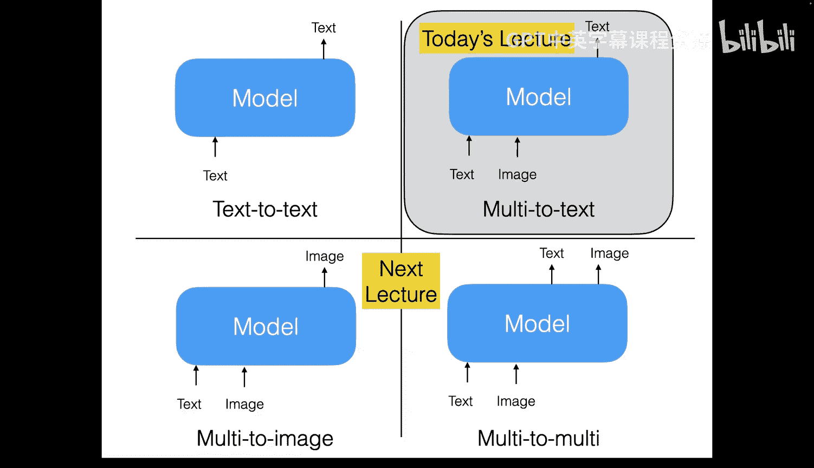
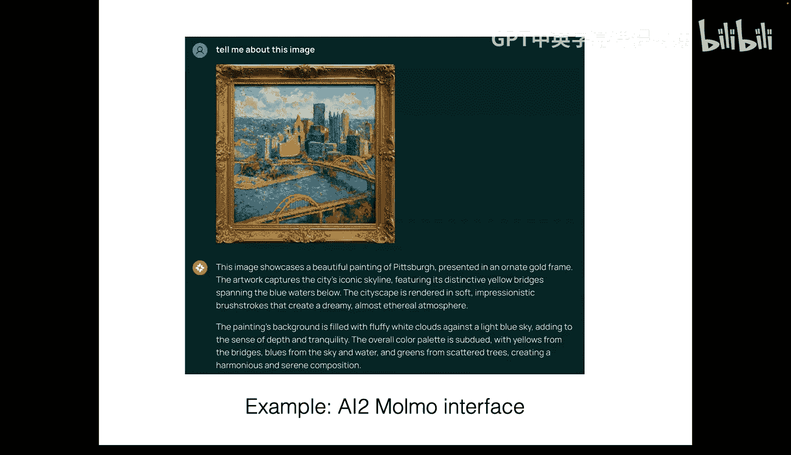
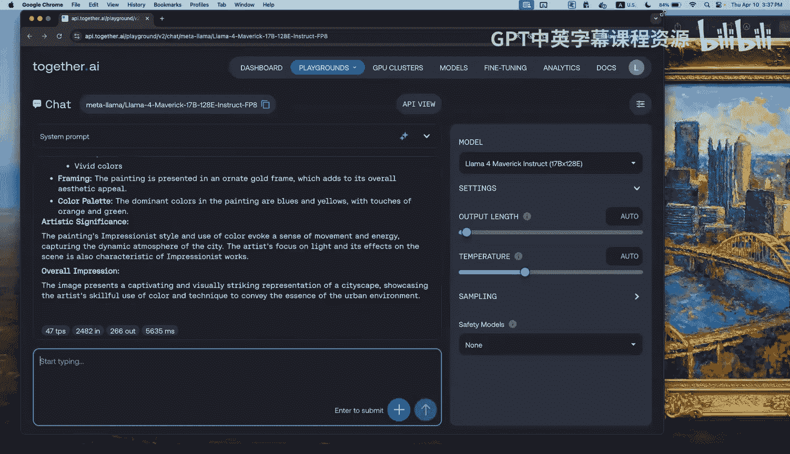
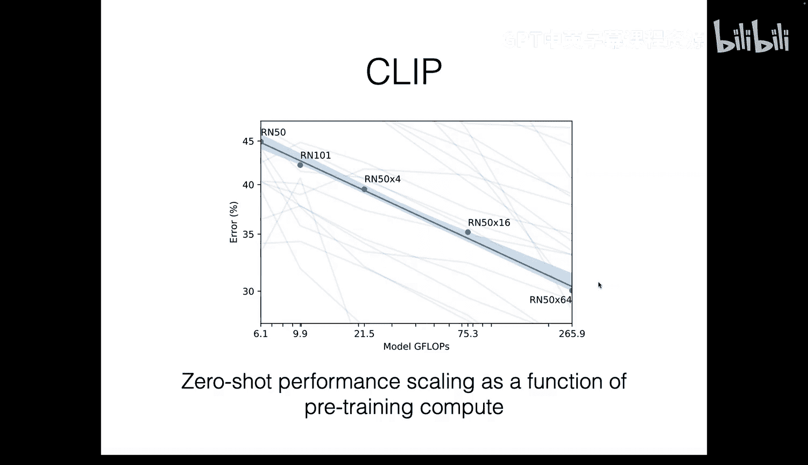
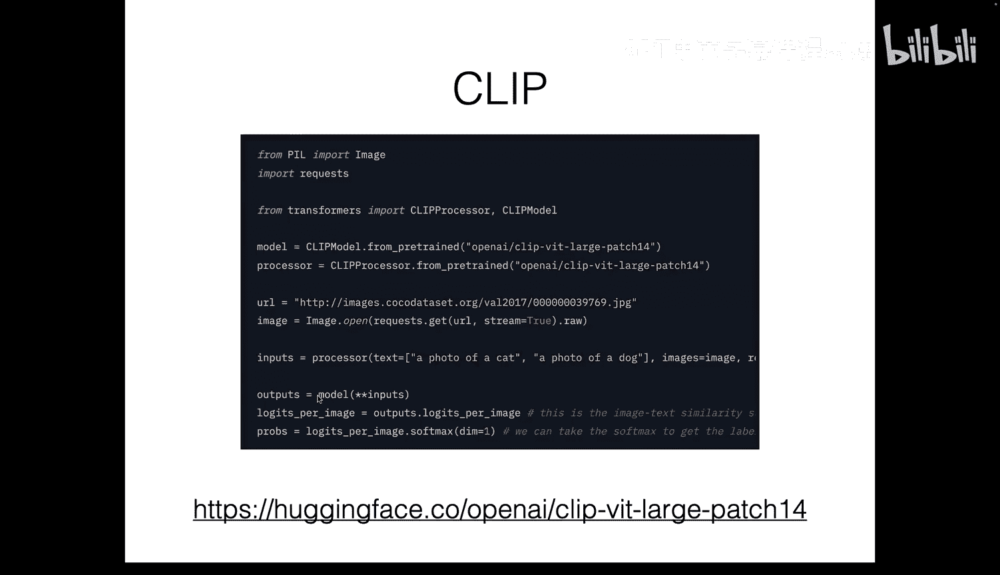
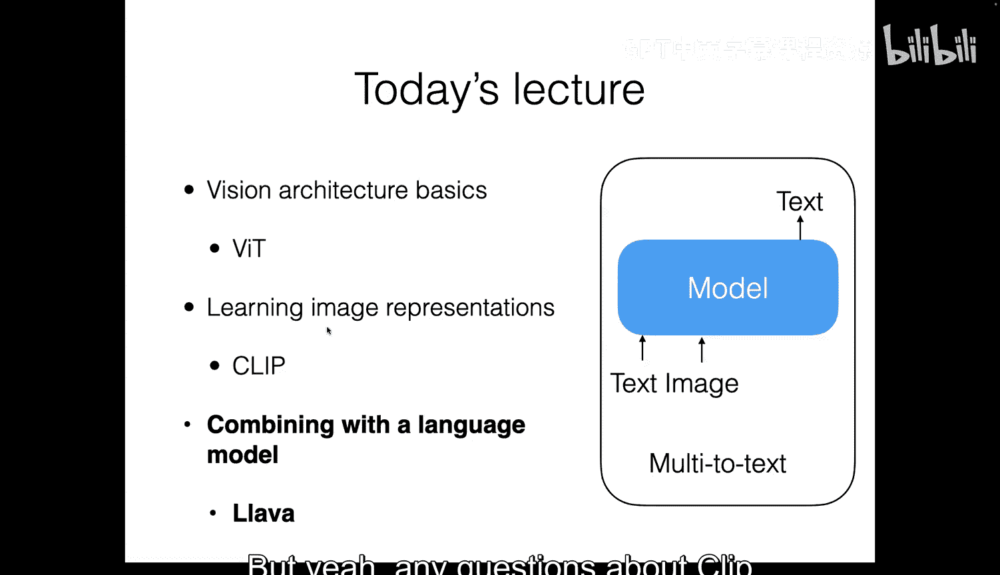
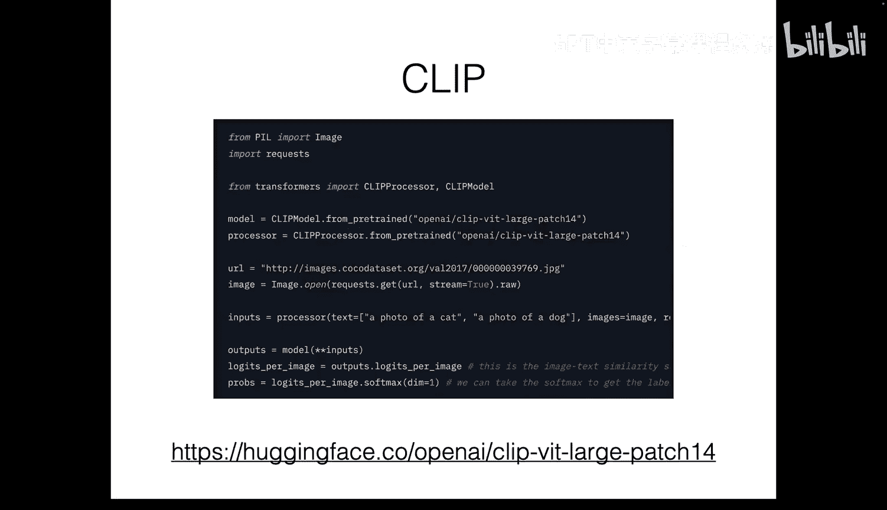
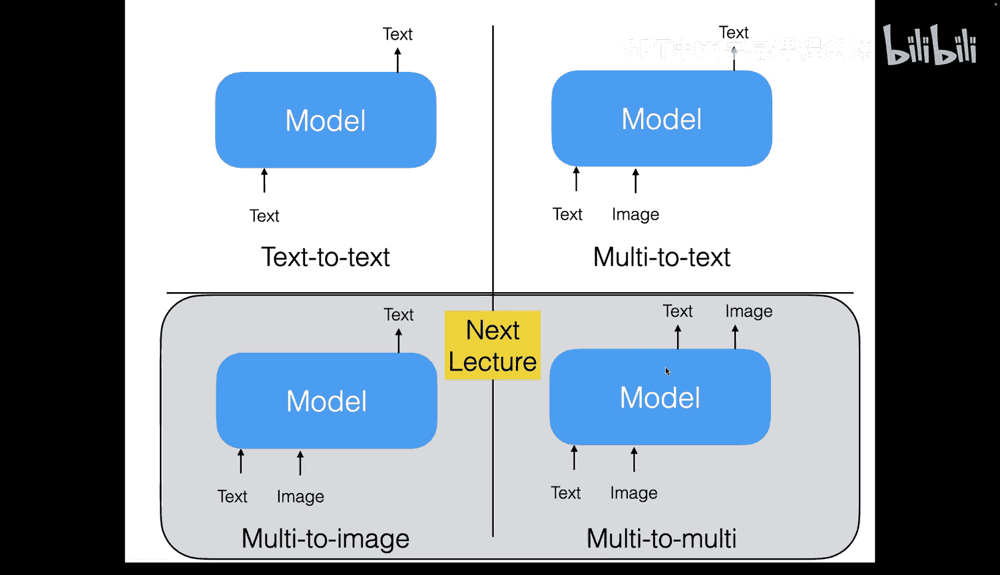

# CMU《高级自然语言处理｜CMU CS 11-711 Advanced NLP Spring 2025》中英字幕（claude-3.7-s - P20：-23-CMU Advanced NLP Spring 2025 (21)_ Multimodal Modeling I.zh_en - GPT中英字幕课程资源 - BV1nYVHz7Eoa

Okay， we can get started for today。So we're getting towards the end of the class。

 but we still have a few more lectures left。So on the topic of multimodal models。

 I actually wanted to expand it into two different lectures。

I thought that the intersection of multimodal models and advanced natural language processing。

It's pretty large and there's a lot of interesting ideas， so I thought it deserved two lectures。

And hopefully as a result， we can go into a bit more detail and talk about a bit more interesting things in depth。

So today will be the first lecture and we can go ahead and get started。So so far in the class。

 we've mostly with the exception of maybe the agent lecture。

 been talking about models that take in text and output text。

But there's other variations when you start to incorporate images。So one。

We could call it multi to text like multimodal to text， So here you take in text and an image。

And in general， it could be a kind of interleaving of the two。

But your model only knows how to output text。You could also have multi to image。

 so here you could take in text like a prompt， you might also take in an image。

 and then your model only knows how to output images。

And then you could have the kind of most general thing where your model can support taking in。

A sequence are alternating text and images， and it can output both text and images。

So in today's lecture， we're going to focus on this one up here where the model can take in text and take in an image。

 but it only knows how to produce text。And then in the next lecture。

 I'll go over some of the models in these families。

 so ones that can take in text and then output an image。

Or these kind of general purpose ones that can output both text and images。And as you can imagine。

 each one of these boxes is a fairly large research area in and of itself。And so。

We'll only be able to see some of the methods， but hopefully I can at least show you some of them that you're familiar and we actually have a whole course here on multimodal machine learning if you're more interested。

So an example of this， what was I calling it multi to text？Let me go through some examples。

So here we can go on one of these language model APIs。

And maybe I'll actually do one live on a different one that that's the AI2 MoMO model。

 which we'll actually see later in the lecture。Here's this togethergether。 AI again。

And this is actually oops。Sorry about that。 This is looking at。

This new Lama model that was just released over the weekend。By mad。

And so this is one of these models that can also take in images。So here's this image。

 and I actually generated it with chat GT。So let's see what the Lma model thinks of it。

something like this so you could say， tell me about this image。And it starts talking about it。

And here it is a bit bigger。So it says。It's a framed painting of a cityscape， like Pittsburgh。

 Pennsylvania， as suggested by the distinctive yellow bridges and the presence of a river。

 the artwork is rendered in an impressionist style， characterized by short。

 broken breaststrs and vivid colors， key features。So anyways， it does actually a pretty good job。

 I think my prompt to the chat GT was。😊。

Generate a framed picture of Pittsburgh in an impressionist style。 so not bad。

I was actually wondering if this bridge is a hallucination， but anyways。So that's the idea。

 And you could imagine like。Yeah， having these conversations that involve images and kind of framing different useful tasks in that way。

Also these web agents that we saw in the agents lecture。

These are often naturally of this form where you maybe have a screenshot。

 you maybe have some description of the task or maybe the thoughts that the model is generating。

 and so you have this mixture of an image and text。

And then the model is outputting these textual actions， so things like clicking， typing。

 pressing buttons， whatever。And。You could also frame different kind of reasoning style tasks。

Or refines different reasoning style tasks that involve images。

 so there's this entire benchmark called Math Vista and they come up with these different tasks that depend on actually looking at an image like here you have to look at this function and kind of reason about it in different ways。

And of course these aren't the only ones， but I'm just trying to say that， yeah。

 having a model that takes in not only text but also images， even it can only produce text。

 there's a lot of kind of interesting and。Good use cases for it。So yeah。

 this is what we're going to go over in today's lecture。😊，And so first， I wanted to talk a bit about。

Basics of vision architectures。And here I'm going to basically ignore a lot of past research and just jumped to what is being used in a lot of these current vision language models。

 at least as part of the pipeline。So I'll talk about these vision transformers。

And then with those vision transformers， we can talk about the method that is often used to learn representations that are then provided to the language model。

So I'll talk about clip， which was this really influential method for learning image representations。

 given also some textual supervision。Then I'll talk about one way of combining these image representations with a language model。

So then you could have a model that we saw before that can both take in text and take in images and an output text。

So actually， at the end， we will look at some of the details in this MoMO model from AI2。

It actually builds on， it actually uses these exact same ideas。

 but then they try to kind of build a state of the art model and they make everything open so you can see exactly how they do it。

So hopefully by the end， you'll have a good picture of how some of these state of the art vision language models are actually built and what the kind of important pieces of them are。

Okay， so if we kind of think about this， if we want to input both text and an image into a language model。

 let's say we want to use the same transformers that we've been using to generate text。

Then what we do with text is to embed the text as this sequence of vectors。

 so sequence of these token embeddings。So the idea is， can we come up with some way？

Of turning this image into a sequence of vectors。You could view them as like a sequence of tokens。

 maybe that represents the image。But really ultimately， it's some vectors。

And if we have some sequence of vectors， then we can give them to a transformer。

So the key question then becomes， how do we kind of represent the image？

As these vectors and how do we kind of learn high quality vector representations？

So we'll be talking about- I'll just use this word encoder。For this function that goes from an image。

To a sequence of vectors。We'll actually look at the starting of just looking at learning one vector with this clip method。

And then I'll talk about how we can just have a sequence。So in order to do this。

 we need two different things。First of all， we have to be able to in this encoder。

 we have to be able to take in this raw image。So we need some different neural network architecture than the ones we've been using for text。

At least it seems like that。And then second， we need some algorithm so that we can get meaningful vectors that represent this image。

So those are the next two next things we'll talk about。So first for the architecture。

 I'll talk about what are called vision transformers。

So these historically come after a kind of large body of work building different architectures for images。

So one of the influential ones was these convolutional neural networks where we talked briefly in the class about。

Convolution for text， they were actually designed in the context of images。

Where you have this kind of 2D window that moves across an image。

 and then you can like stack them and learn kind of higher and higher level representations。

Then another influential method was the ReSNe or residual network。

So we talked about these residual connections inside the transformer。Before transformers， yeah。

 there was these residual networks built on those ideas and they were built for vision。And so then。嗯。

Came along this vision transformer and the idea was very simple。

 the idea was to essentially keep the transformer exactly the same。

And now we want to just try to come up with a way of。嗯。

Basically providing the images input to the transformer。And the trick is again very simple。

 we want to divide the image into these patches。Then we're going to flatten each patch into a vector。

 so now we have a sequence of vectors。And then we could just use a standard through transformer。

So we'll go through this in detail and walk through like a numerical example just to make sure everything's clear。

But let me just show you the figure from their paper first。

So down here we start out with our original image。And then we split it into patches。

 so here we have nine patches， so three by three。Then we can just kind of unroll these into this sequence。

Then each one of these is a matrix， a 2D matrix， so we can just flatten that matrix into a vector。

And then project it with。With a weight matrix into whatever dimension we want。Okay。

 so now we have a vector for each one of these patches。

And then we could just put maybe the simplest thing possible。

 a position embedding which just counts in this kind of， you know， rest or scan， it's called order，1。

2，3，4，5， six，78，9。And then here this isn't strictly necessary。

 but they do the thing that we talked about with the BRT model， they prepen this extra token。

And they use it for different classification tasks。So you don't have to do that。

 but here they were just following this paradigm or this idea that was kind of created with those burnt models。

And then the transformer stays the same， so here you see the same layers。

And then you get some vectors at the end and you can attach this output head and train it for classification so our features are divided with same number of measures。

好了，可以把你个成一。So again are the pictures in the training set are divided into the same number of patches because if not then the position andbedding line not actually captures the。

悲什。不见。Yeah， so。In the， yeah， in the simplest case， you just train the model on the same。

You'd patch it the same way during both training and inference。

We'll see you later that there's different。Tricks you can do so you can also provide the model with you could provide the model with a full image。

 but then also like a crop of the image and then just add on more vectors。Um so。Yeah。

 there's a variety of tricks you can do to make it more flexible。 But yeah， in the simple case。

 and even I think what the。CP model well do is you just keep the training and the test time the same。

嗯。😊，Professor so what is the embering that goes into the wellP so like in bird model we would probably take the eming of the last token like the last token after the embering or we would average them what is the embering that goes in here Yeah yeah so here in this original paper they have this extra token which is right here it's shown as a star and that's similar to the CS token which was in the bird model。

So then when you pass through the transformer， you'll get a vector for everything。

And here what they did in this paper is to take the vector corresponding to this first token and pass it to the MLP。

But you could imagine that。Over the years， people try a variety of things。You could。

Average them together。 You could even do a weighted sum to get a single vector if you want。嗯。Yeah。

 a variety of things will end up working。So at least the first time I saw this。

 the exact dimensions of everything， I had to kind of work through an example just to convince myself that I understood it。

 so I thought we would walk through one。嗯。So here what we do is we start with an image。

And so the image is going to be。Some height and some width。

And then what you do is you have these different channels。So。A basic version is each channel。

 you could have these like RGB， so you have three channels， one for R， one for G， one for B。

 and then you could represent the colored image。So typically when you're dealing with these images。

 you have this extra dimension， which is called the channel dimension。So as an example。

 let's say that our height is 120 by 120 and you have three channels。

And then this patch size is going to be 40 by 40 pixels。So now at the next step， well， first of all。

Yeah， first of all， let me show this。The reason that we have nine patches。

 you could probably just do it in your head like 120 divided by 40 is three。But here's the formula。

So since our patch size is 40， you end up with this three by three grid。

And so now we're going to start flattening this into these vectors。

And so the way you do this at first is to say， okay。

Each vector or there's going to be one vector for each patch so。Hopefully there's yeah。

 there's nine here。So each one of these will correspond to one of these patches。嗯。

And then if you flatten it， it'll be kind of each po。Flaten down， so that'll be p times p。

And then you have to do it for each channel， so this will be a kind of pretty long vector。

 it'll be p times p and then three different times。So for example， with these numbers here。

 this dimension would be 4，800。嗯。So now you have this matrix or you can view it as a sequence of nine different vectors and each one is this yeah kind of long vector。

So now what we want to do is。呃。Project this so that it's in maybe a smaller space or just the same embedding dimension that we want to use in our transformer。

So here you would introduce this weight matrix。And it would be whatever dimension you want。

Times this p squared times C。So P squared times C again is the size of this one and then this D is the size of this vector here。

And so this would be our。Kind of representation of the image。So like in this case。

 maybe we want size 1024 vectors， and so we would introduce a weight matrix of the size。

Now these exact numbers I just picked because like。

40 divides 120 and it ends up with three we'll see later the exact patch sizes people use。

I think one of。I think the size with the clip model is 14 by 14， but we could see that later。

But anyways， this was just showing you how everything cut off。workss out。

And so these are referred to as patch embeddings。And then I'm not showing it here。

 but you also have to somehow embed the positions just like we did with text。

So you can do this very simple approach of having like 012。Three， et cetera。

I think there's also an analogy to the rope embeddings， but for the。2D images as well。

So is everything making sense so far， any questions？但是我一直都都少你一直都有来过。W。😔，Oh。

 this is the same thing as W。 Yeah， sorry。Okay。USo yeah， again。

 just to drive the point home again here， you have these vectors that correspond to different parts of the image。

And then。Yeah， you can train。This for any task that you want， you could train it for classification。

And yeah， one ways to save this extra token， but you could also average them together if you want。

Okay。So just to show you a bit more about this， it's， I mean， it's a really nice paper。

 really influential paper， this vision transformer and they do a lot of kind of careful。

 interesting experiments。 So here they were looking at。😊，So throughout the class。

 we talked about this idea of pre training compute。

You could see that the same idea is here in vision。

 where you want to look at how your accuracy varies as a function of pre training compute。

And here they're trying out the different architectures。

So the one at the time was this resnet architecture。That'll be in gray。

Up here in blue is the vision transformer。And then what they did as a kind of。

Baseline or investigation is they created some combination of res and transformers to try to see if you could be just the transformer。

It turns out that at small amounts of compute， this combination was doing better。

 but then at larger amounts of compute， it kind of didn't matter and it's just as good to use the kind of simpler transformer。

嗯。So。Yeah， that that's， that's one of the things。Here's another interesting thing。

I don't know if you've seen with these convolutional neural networks。

 one kind of cool finding was that。You could actually look at the convolutional weights at the filters。

And it turns out that like the filters at lower levels of the network would have these kind of edge detectors and like pattern detectors and things like that。

 and then the ones higher up in the network would have kind of more abstract。Thanks。

So here they were just kind of trying to maybe draw some analogy。

 so they were looking at this initial weight matrix， which is used to go from。

The raw image to the initial vector to the model。 So this will be at the lowest layer。

And they looked at the different rows。So each row will be p squared times C。

So maybe here they're looking at like one。One of these P squared things here and visualizing it。

And you could kind of see these interesting patterns that it's learned maybe it helps detect like edges and other things I'm not sure how to exactly interpret it。

 but you could look at exactly what they wrote and surely there's some kind of structure here that it has。

just to be a bit more precise， they actually find the principal components of the weight matrix and then visualize them。

M biggest one。嗯。Okaym sorry that yeah yeah， so this is saying。

 so if you remember for the language models we had these plots of like as you train the model on more and more data。

 what does the loss look like this is kind of drawing some kind of analogy here it's saying okay on the X axis we have the amount of pretraining compute。

So pre training compute could depend on the amount of data or could depend on the size of the model。

So here I forgot exactly what they did， but they're probably increasing the size of the data and also plotting different model sizes。

And then you could just consider them both as being increasing compute。

And what it's basically saying is that。嗯。Well， the transformer seems to do better than the Resnu at all values of pre training compute。

 so at large values and at small values。And then this was like their best attempt to try to be the transformer。

And it looks like you you can maybe beat it if you're only operating with a small amount of pre training compute。

But maybe their argument is that like ultimately we'll just use large amounts of pre training compute。

So maybe it doesn't matter and we should just use the transformer。这一个。Yeah。

 I forgot exactly what they did， but the general idea was they took elements of the Resnet and some elements of the transformer。

 I believe， but I would have to go back and look。Okay， cool。U。So here's another fund visualization。

 so here they're looking at okay so here they use these position embeddings， which are。

Maybe seemingly naive or you have 2D data， but then you just label them zero，1，2，3，4，5， six7，8 nine。

嗯。And what they are doing is。They are looking at the cosine similarity。

Between different position embeddings。And what they're finding is that it actually learns some notion of 2D position。

Because you could see that as you kind of move in this 2D view when you take the cosine similarity of the two。

Yeah， it kind of follows this 2D pattern。So there's some kind of underlying 2D structure that's been learned even with these kind of naive。

You know， sequential position embeddings。嗯。That said。

 I'm not aware of exactly what's used in state of the art vision transformers。

 but similar to the text transformers， I'd imagine maybe there was some innovation on the exact position embeddings that are used nowadays。

And then here is some fun visualizations。So。This is looking at。

The regions that have high attention score。I forgot out which layer of attention they're looking at。

 but anyways， then they're just kind of superimposing it on top of the image。

And it's just showing that， you know。It is able to learn to attend to regions that are kind of important for the task here was classification。

So if you're a computer vision person or you've seen this before。

 these might be like the most boring visualization to see， but if you haven't before then。

 yeah it is kind of cool to see these types of things with the vision model。

And then this was just another interesting analysis they did they looked at。Okay， forgiven attention。

Where。嗯。What they came up with some notion of distance of which。嗯。Attention scores were high。

So for example， if all the attention scores are localized to like one patch。

 then that would get a low score。Conversely， if it's more diffused or spread on multiple areas。

 then it would get a high score。So they found that like these heads。

 different heads at the earlier layers were kind of varied。And then as you move up the network。

 they would tend to just look at kind of wide or disparate areas of the image。Mmhmm。😊，The last slide。

 what paper was that from？So these are all from this vision transformer paper。Yeah。So yeah， again。

 just cool， I think it's cool how kind of dramatic the pattern is。嗯。And yeah。

 hopefully these give you some intuition for things that it's learning。

So that was the vision transformer， any other questions here before I move to the Cl model？Okay。

 cool， so now we're going to talk about learning the image representations。

And so this paper was from 2021 from Open AI， and it's called contrastive languageage image pretraining or CL。

So it's turned into one of these kind of classic papers。 So if you haven't read it。

 I highly suggest reading it。 The writing is also really good。 It's almost kind of。Philosophical。

 and you can tell the authors have kind of this grasp of the field overall。

 and I really think it's a good paper。So anyways， and then it's very influential as well and widely used。

So here the goal is to come up with some pre training objective for learning image representations。

So I guess at the time。This was 2021， and so GPT3 had already come out。

So it had become clear that this kind of large scale。

Unsupervised pre training for text being just like predicting the next token。

Was having kind of dramatic impacts。And so I think they were。

Really thinking about like what is something analogous to do for images？

So one goal was to try to learn from signals that are present in text。So at the time。

 what people were doing was they would take a huge classification data set。

So like one of them is called IageNet。And there would basically be millions of images。

And then they're just paired with one class label。 So like the image of the dog that we saw before。

 it would just be paired with the label dog。And so their hypothesis was that。嗯。

Maybe there's only so much learning kind of signal that you could get from this single。

Textual class label that's associated with an image。Instead， let's say you had。

 say like a whole caption or a whole paragraph。Associated with the image。

Then maybe it could provide more information for learning a good representation of the image。

Maybe it says like the black dog runs in the field quickly or something like that。And then second。

 this was opening eye， but aside from opening eye， it seems like having something that you could just apply to more and more amounts of data and have it get better seems like a good thing。

And so again， with these classification data sets， they were kind of。

 you know roughly speaking limited to this hand label data。

And so they want to come up with something that。They could just apply to large amount of data and kind of show that it gets better as you。

Add more compute。So this was their attempt at this and they came up with this method called C。

And the idea was to learn these image and text representations jointly in a shared space。

And I'll kind of。嗯。Talk through what this means and show you some more details if this doesn't mean that much right now。

So here we want to learn two different encoders or two different。Representations。First。

 we want to learn this image encoder， so it'll take in an image and give you some vector。

And then second， we want to learn this text encoder。

 which will take in some text y and give you a vector。

And the idea is we want the representations for an image and text that are paired together。

 like an image in its caption to be close or to have a kind of high score。

And then you want representations for an image and some irrelevant text to be far apart。

And then we want to apply the method over a large data set of image and text pairs。

So here you can't just run it over the whole internet。

 you do have to kind of still get these image and texts。

So what they do is they do a kind of web scrappe。And they filter down images， I think。

 according to some keywords that appear。And ultimately。

 they come up with this data set of 400 million of these web images paired with text descriptions。

And probably since this work， you people have tried to scale this up to more。

 but here's what they did。So yeah， you might have this picture of a dog and now instead of just saying class label dog now you have。

A pepper， the Aussie pop。嗯。And then for this image encoder。

 we're going to use one of these vision transformers that I just introduced。And for the text encoder。

 we could just use a transformer like transformer language model。

Then the key idea of their learning objective。Is to take。And different。

 so take a look at a batch of image and text pairs。

And then you want to essentially classify which image is paired with which text。

So what this looks like is。You have n different texts here and n different images。And for example。

 this dog is paired with this text， but it's not paired with the other ones。

So now you get some vector for each one of the texts and some vector for each one of the images。

Now let's look at this image right here。What you can do is just take the dot product with each one of the texts and that will give you some number。

And so the idea is we want to basically increase the score of this one and push down the score of the other ones。

And that can be seen as a kind of classification task where， yeah， you're trying to。

Increase the score of this kind of class and push down the score of these。Similarly。

 if we look at one of the texts。We want to increase the score and then push down all of these ones。

So you have this kind of， yeah， T way argument where。Yeah。

 you want to both classify the image and classify the text in some sense。

So then it forms this matrix and you can kind of come up with a learning objective that does this。

So here it is written out and let me just talk through it。

It actually turns out to be similar to loss functions that we've seen before。

 like in the retrieval lecture。And these style of losses aret called contrastive losses。

So here again， we have our N XY pairs。And let's just look at this term here。

This is basically taking a softm。Over these different scores， so again。

 here we have the score from our image encoder。Sorry， the vector。

 here we have the vector from the text encoder， we take the dot product and get some number。

And then this is saying， okay， if you go over all of the different values of the image。

 you get some score。And it amounts to taking the softm。And then similarly。

 you have the same thing here for text， where now it's just summing over a different variable。

So if you kind of reason through what this is doing， if you minimize this loss。

 you'll want to kind of maximize this because you have minus here。

So you'll want to push up the dot product of this corrected pair。

And then everything has to be everything has to sum to one。So if you push this up。

 then this will go towards one。And so everything else has to be pushed down because it all has to sum all the scores have to sum to one。

So this is kind of the effect that doing this has it pushes up the score of the correct pair and pushes down to other ones。

And similarly for the text。And then just one more interpretation。

Here we have this softm and you can see like log of the softm。

 so this is actually can be seen as a cross entropy loss。

Where your probabilities are proportional to these scores。And your ground truth is kind of。

Putting all of its mass on this correct or the pair that's labeled in the data。Okay。

 so those are some different interpretations of this so if you yeah if you。

Haven't seen this before or you havent want to kind of get a better understanding。

 Then it's sometimes useful to look at at both。 One is this kind of higher level perspective of。Yeah。

 coming up with these。And then here's the exact form that it takes。Here， this is from the clip paper。

 I think they want to just emphasize that it's pretty easy to implement。Yeah。

 let me just finish this one， so here they're actually just writing out the code that's used。

Maybe I won't walk through。All of it， but you can see that it's kind of short。

 it involves doing the dot product and then。Here's where they're actually implementing it using a cross entropy loss。

 like I said， and they're summing over one of the axes。

 so maybe like the image access and then the text axis。嗯。

So while training the models are we back propagating to both image encoder and text encoder or is it just image encoder and also what's the task thats what we are trying to do here so during the inference what is the task specifically or this is just some form of retraining yeah yeah those are great questions so for the first one the first question is do we back propagate through the image encoder or the text encoder so it's both so you have。

Yeah， you have both of these and then both of them go into loss and they both have parameters and you'll back propagate through them。

And then the second question is， what do you actually use this for so that's actually on the next slide。

Any other questions about like the loss at first though？

I have a question about like the parent space。Are they particular the dimensionality for the Her space for images and tunnels？

Yeahum。I think they'll just pick some， they'll pick like 1024 or 512 or just one of these numbers。

 yeah。So here's an example of how they use it。So yeah， at the end of the day。

 you get this text encoder and image encoder and they just give you vectors。

So then what they did is they， I guess this was maybe the first time that this was done or the first time that it was had very convincing results。

They create this zero shot setup。So what they do is you could basically create a classifier。

Using these encoders。So let's say we have this image and we want to classify it as either plane， car。

 dog， bird， whatever。Then you can turn each one of these classes into a sentence。

 so like a photo of a plane， a photo of a car， etc。And get some vector。

Then you can get some vector for the image。And you could just pick the class that has the highest score。

So here， for instance， the highest score would be with dog。And。Yeah。

 I guess they call it zero shop because they're not actually fine tuning or training any model for the classification。

 they're just using the scores that they get on these different dot products。嗯。And so surprisingly。

 you know， at the time。Here they're actually comparing it with。Using a supervised model。

 so one that had been。Actually specifically trained for the classification。And in a lot of cases。

 I guess beating this model at all would be。Surprising because it was purely zero shot。

 which is something that people wouldn't do at the time。

So it was pretty surprising to see all of these wins here for this club model。

It still did lose on some data set。And they talk about it a bit in the paper。

 some of these are more specialized tasks。Where。Yeah。

 you might have to actually like additionally prompt the model to describe the task。Or some of them。

 the clip model just might not be good at those kinds of images。嗯。So then here's another core result。

They made another one of these scaling plots。And so here they're looking at， yeah。

 as you train on more data or use a larger model。What is the average error？

So you can see that the error on any particular one task fluctuates a lot。

 but I guess when you take the average， it does have the smooth。Scaling behavior。

And then， yeah， so they did， they didn't open source all of the data and all that， but。Yeah。

 the model is available and so you can， yeah， still go on Huging face and get the model。

This is one that's typically used so it's。You can see here that now you can understand some of this stuff。

So you can see that it is one of these vision transformers， VIT。It was the large version。

And it uses a patch size of 14。And then what can you get from it again here。

 they're loading in an image。And then here they're doing this photo of a cat or a photo of a dog。And。

Then you can。Yeah， do you a afford pass？And then it actually returns these similarity scores。

So I actually don't know the answer here， you either have to go look at this。

UmImage or maybe you can try writing the code and post the answer on Pelta。Okay。So。That's clip。 So。

 so now we have a model that can basically。So it's trained on these image taxpayers。

400 million million of them。So it definitely wasn't trained on all of the images in the world。

 and the text is fairly short。But it can give you maybe some vectors that are useful in some sense。

And so surprisingly， this model from 2021 is still used in the pipeline of these vision language models like the ones I'll talk about next。

But yeah， any questions about。

Cllip before I move on to the next part。

嗯哼。😊，Oh which which one。哦，有。This one。😊，Yes。Yeah， I can't see the page numbers。Oh， this one， yeah。有 I。

😔，Oh， this might be the so you want to make sure the。

So the text encoder and image encoder might have different output dimensions。

So you just project them so they're in the same space so that you could take the dot product。Yep。

Okay。Any other questions here？Okay， cool。 so now we're going to talk about actually combining these things with a language model。

 and I'll talk about this method called not Lava， but lava。So lava， the idea is very simple。

 so let me just start with this diagram does I have。So here we have a language model。

 normal language model。It could be， I mean， this is a pre trained model。

 so one that we've seen in the class。So nothing specialized for images or anything like that。

And here it's producing some response as a sequence of tokens， this is visualizing。Tokens。

 I don't know why they use that shape， but。嗯。And so now you can see here that we have some textual instruction。

This might be a good description of the task。And now we have these tokens or vectors here for an image。

And so what they're doing is。Maybe what I was hinting at at the beginning of the class。So。

You can ultimately start with an image。And then you can flatten it and pass it through one of these vision transformers。

And then the vision transformers give you just some sequence of vectors。

And so that this is what is being kind of shown in this blue box here called vision Encor。

And then you could just make sure that they're in the same dimension as the language models embedding dimension with this projection W。

So this is really what's happening， so you take one of these pretrain clip models。

And the clip model is a vision transformer。So although the clip model is trained to produce one vector。

 you could just take the kind of transformer and take this sequence of vectors。

And then just put them into the same dimension as the language model and then。

Findine tune in your language model。So here what they do is they collect different。

TaskTask data where they have images， they have instructions and responses。And then， yeah。

 they'll fine tune the model on these。So that's really， that's this lava architecture。And。

Here's an example then of what you can do once you have the model。

So here they give it this image and it says what is unusual about this image？

And then Lava gives this explanation。So any， yeah， any questions about this？This是有去。I don't know。

 Yeah， it's。嗯。So then in general， you could kind of maybe。Try to adjust the different parts of this。

 So in general， we want some way of going from the raw image to。SomeSome vectors。

Before going to the transformer。So for instance， you can split it into these patches and turn it into vectors。

We want some way of encoding the images， such as using a pre existinging clip model。嗯。

It turns out that you can get creative with which layer you choose the vectors from。嗯。

Like in the loveva paper， they actually found this better to use the second to last layer。

And in the Moa paper that I'll talk about in a second。

 they actually take vectors from like two different layers and average them together。

I don' I don't exactly know why， but。They probably justify it in terms of the task performance。

Then we want to provide the encodings to a language model。So here we showed this in lava。

 we showed the simple approach of just linearly transforming the vectors。

This is mostly what people still do， but there were a lot of follow up papers trying different things。

And then we want to train or fine tune on the data that has text in the images。

And let's say that you're。You're computed the loss because when you feed through the sequence。

There'll be positions corresponding to text and corresponding to images。For now。

 the model's just gonna be capable of producing text。 So we'll just like skip over the。

Output steps for the images。Next class， we'll talk about how to train the model to actually produce the images as well。

So in the last part， I wanted to just go through this other case study of this。Oh， sorry。

 go through this case study of this really recent model called MoMA from AI2。

And you can see here that they follow this exact recipe or pipeline that。I've told you about today。

So， here they have。Some task and its point to Mount Reinier。And there some input and an image。嗯。

Then they give。This we'll talk about this in a second to a vision encoder。嗯。

This they call the connector， but this is like the weight matrix or maybe they use a two layer network or something。

Now you get these tokens and you just give them to the language model and you tokenize the text。

And then here again， it's not outputting an image。 It's outputting。嗯。Some texts like Mount Reinier。

 And then。Literally like the coordinates for this point。Or。Mat Reinier is actually， yeah right here。

And then they're just showing it on the image。So。Yeah。

 they had a kind of big team working on this and they wanted to reach the state of the art。

So they did a few modifications。So one is that they noticed that the clip embeddings。

We're not necessarily good at the details。嗯。This is probably for multiple reasons。 So， first of all。

 the clip model was trained on。A certain resolution， I think， like 336 pixels。嗯。

So what they did is to give the model multiple versions of the image。So first of all。

 they give it this kind of global version。And maybe it's a bit fuzzy due to the resolution。

But then they also give multiple kind of zoomed in crops of the image。

Then they turn them all into tokens。 so now you have tokens for your global images and you have tokens for all the different crops。

 and the number of tokens kind of just grows。嗯。And then if we want to look at specifically what they did。

So here for imaging coding again， so they're using this clip model。

 the one I actually showed you on Huging F。It has the St 36 pixels。嗯。So yeah。

 and it uses the 14 by 14 pees。So if you look at 14。Pixels and then， you know， do the division。

 then this would be a 24 by 24 grid。Actually Cha EBT was able to draw this grid too。

 it was kind of cool。OhSo。So this is what it looks like divided up into the grid。

Then they do this other kind of trick， which is。Probably because this turns into a very long sequence。

They actually pool together each two by two window。

So they'll have a network just like combine each two by two window into a single vector and that will reduce the the。

The token length， I guess。嗯。So then ultimately each version of the image is 12 by 12。

 and then they do these multiple crops， so they do the full image and even 12 different crops。

And then a large part of their。Paper and probably the performance benefits is through the data。

So I won't go into all the details， but they come up with these four different categories。

Some of them have involve having human annotators， I think just。Talk through the image。

 and then they transcribe it。I forgot the。The justification for doing that instead of just writing a description。

 but I think they write about it in the paper。They have models kind of。Come up with annotations。

And then they try to create a lot of data for pointing at things。

So here it's like pointing at different objects and yeah I think they have a human even labeled on。

And they come up with these synthetic tasks for， I think things that。

They observed vision models tend to struggle with。Like these captions。Reading the time， I guess。

 and code。And then just to show you just in detail some of the training data。So here's an example。

 I believe this was human， like a human ended up writing this or it was transcribed。嗯。

So here they have like generator caption about this image。

And it says this black and white sketch depicts a vote。嗯。And so on。Here's one for the pointing task。

Or I guess it's counting also。So how many musicians and then the training data basically teaches it too。

嗯。Point by generating， you know， the textual ordinance。And then I think， at the end it。

It counts how many there are。嗯。This is maybe why the model is good at， like the。

Tasks that I asked it like what do you think about this picture so this is saying what kind of donet is this so just like asking about pictures。

And then they had these different things that might be just kind of useful of like looking at data or trying to analyze data this one just amounts to pointing at the right place。

 so they also have the pointing in there。So anyways， that's it for this MoMA model。

And so as I mentioned， hopefully you have some understanding out of。

How some of the state of the art models or at least this kind of。

Common pattern for creating the vision language models works。So first of all。

 we talked about these vision transformers。We talked about one way for learning the representations and then how you can combine them with the language model。

So again， in sorry about all the animations in the next lecture， we will go over。

Methods of this form where we're also generating an image。This is actually just the image。

 sorry about that。嗯。And， of course， if you're。Familiar with like image generation。

 this itself could be a whole course， so we're not going to get through everything。

 but again I'll try to kind of work backward from some of the state of the art models and make sure that we see at least some picture of how they work。

So that's it for today。