# CMU《高级自然语言处理｜CMU CS 11-711 Advanced NLP Spring 2025》中英字幕（claude-3.7-s - P21：-24-CMU Advanced NLP Spring 2025 (22)_ AI for Mathematics.zh_en - GPT中英字幕课程资源 - BV1nYVHz7Eoa

Okay， so now we can get started with today's lecture and it's on AI for mathematics。

 and in particular， I'll focus on this area called formal mathematics。

So at a really broad high level， we talked about things like AI agents， large language models。And。

Potentially， these can be very impactful in many different areas。

So we saw examples of like using an AI agent to navigate the web or to even control your computer。

Or to help in the process of like software engineering and co generation。

Another interesting question is like in a particular domain that people care about。

What is going to be the impact of agents or large language models？

So this could be a scientific domain， it could be an area like finance， medicine。

 or the one I'll focus on today is mathematics。So you could。

Kind of brainstorm for a second and come up with a lot of potential ways to use the techniques that we've talked about in this course。

You might want to have like an open ended dialogue with a system。

It might help you come up with like counter examples or help you write proofs or solve problems。

 it's basically up to your imagination。So then a really key thing with math。

Is actually how the math is represented to the language model or to the agent？

So there's this decision that you can make， which is。

To represent things as either informal or formal math。

So informal math refers to representing math as kind of raw data， so as text， as images。

 or even as speech if you're like having a conversation about math。

And so this is extremely flexible and probably for most of you。

 this is how most of you encounter or use math。Even if you consider like a homework solution that you submit as latex。

Or a paper that's on archive。We would consider those to be an informal representation。

The key difficulty with these informal representations are that there's no guarantees on whether things are correct。

So for example， here we have a language model output a solution to this problem。

And the answer that it gets at the end is actually correct。

But then it makes these really subtle mistakes in the intermediate steps。

And so if you have really easy math， then this might actually not be an issue。

You can just read through it， Maybe it's wrong。 You generate again something like that。

But if we consider using these kind of autonomously in mathematical research。

Or if you really want to trust it as you're like learning math。

Then this can start to become an issue。Finally， if we wanted to do reinforcement learning with this。

Then again， you can't really check the correctness of these intermediate steps。

So the other end of the spectrum is called formal mathematics。

So here the math is represented as source code in a specialized programming language。

So here you can write a specification or a theorem or lemma， like one plus one equals 2。

And then you could write a proof in the provinging language。

And then the cool thing is that essentially if this code compiles。

 then you have a formal guarantee that the proof is correct。

So unlike the informal math here we have this really nice signal of correctness。

 so again you can kind of write a theorem and then you can write a proof and if it all compiles。

 then you know that the proof is guaranteed to be a correct one。

So there's a few of these steer improving languages that have been developed。Here are some examples。

I'll mostly focus on this language called leanan。There's been a lot of exciting progress。

Within the mathematical community， as well as within the language model and AI community recently centered aroundline。

I'll also mention in one of the parts of this talk， this language called Isabel。

 because it has some nice features that make it amenable to writing proofs with language models。

So if you haven't seen leanan before， I want to actually give you a short demo just so you can see what I'm talking about when I say formal math。

So here we want to prove this really simple thing。That if r is a subset of S and S is a subset of T。

 then r is a subset of T。So this is this transitivity。

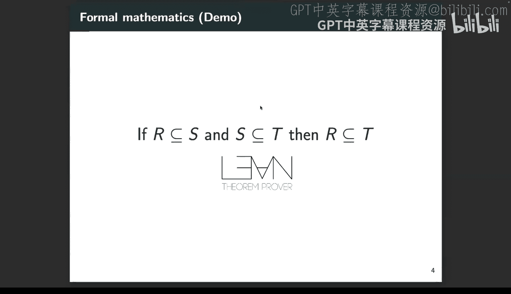

So here is what it looks like to right lean。

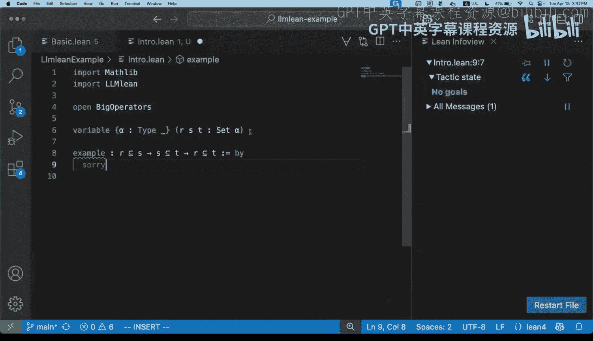

So again， here I'm in Vs code。And so it's exactly what I was saying， it's literally code。

And here you have this way of expressing the thing that I was telling you before。

So here it says if R is a subset of S。Here， it's usually this arrow as a kind of and。

And if s is a subset of T， then r is a subset of T。Now。

 these are usually called interactive theorem provers。

Because what happens is as you're writing this proof， it will actually keep track of。

 oh here's copit， it'll keep track of the current state of the proof。So over here。

 you can see that we have these three variables and then here is what is remaining to be approved。

Now， if you have some kind of expertise with the system， some like basic expertise。

Then you can write these different lines。嗯。So this compile is kind of annoying。

How do you turn it off。😀Yeah。😊，Anyways。So here I wrote this this line and you don't have to worry about like why I need to do that。

 but here you can see that it introduced it modified this state。 So now we have a different state。

And now we want to like prove this。Then again， if you have some familiarity with us。

Then it turns out that this transitivity is actually already programmed into leanan or more specifically into this library called MathL。

And so here I'm basically saying like the proof is trivial because it exactly follows from this thing that already exists。

So here you can see that there's no goals， so that means that the proof is complete。

So lean is like automatically checking the proof and now you have this nice indication that it's complete。

Like here， if you put H。3， then there's an error。So that's the basic idea and。First of all。

 we had to have some expertise and knowledge of the system to write this。And then second of all。

 this doesn't necessarily look like a normal proof that you'd see in like a textbook or a normal homework。

So we're going to return to those ideas throughout this talk。

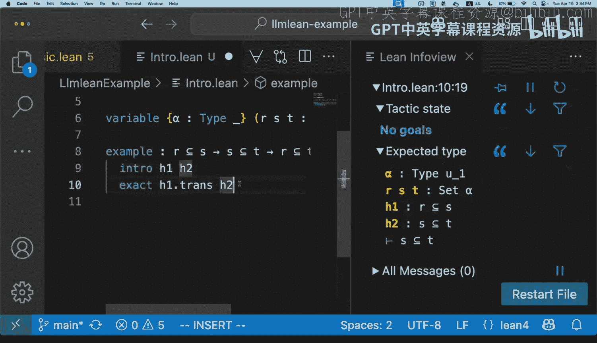

嗯。

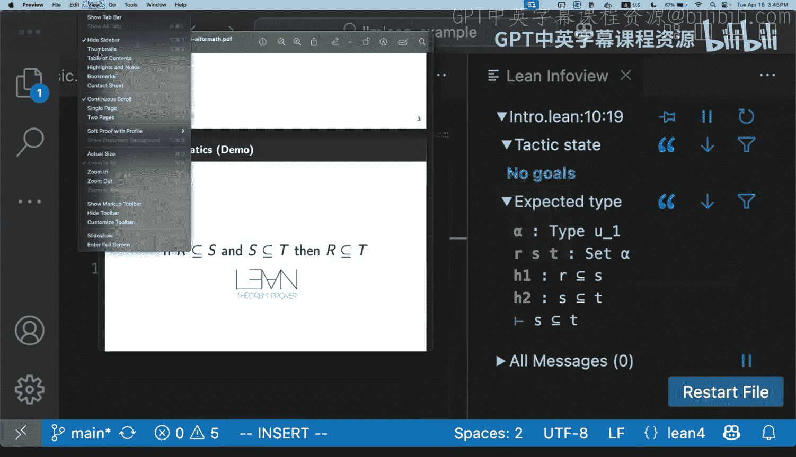

so。I showed you this pretty trivial example。But it turns out that lean is gaining some。

 interest in the mathematical community as well。So here's the mathematician Ternce Tao。

 and recently he formalized the proof of Ethereorem from one of his actual papers in Lean。So， again。

 they had this。Paper， everything was written kind of informally。

 and then they actually came up with a formal version of the proofing lie。

Part of it is due to this project that I mentioned called MathLB。

 so I'll mention it a couple times in this lecture。

And the basic idea here is you could have a lot of people contribute these kind of basic facts and slowly build up this foundation so you could have things like transitivity like I showed。

 but then more complex stuff as well， and this makes it easier to formalize math because you don't have to write everything from scratch。

Some reasons that。Members of the mathematical community find this interesting。

 one is that it gives you this new way to collaborate。

So I'll talk about later in the talk how you can break down one of these big。

Theorems into like multiple pieces。And then the idea is anyone can write code and solve one of the pieces。

 so like write a proof for it。And then since everything is checkable。

 you can kind of trust the code regardless of who it's from。

And so this is much different than the typical way that you would collaborate on some project。

And then as we saw it， it gives you this kind of instant feedback。

 which can be helpful and guarantees on the correctness。

So that's why it's interesting to the mathematical community。

 but why is it interesting for AI for language models？Well。

 one key thing is that we have something that is verifiable。So this could be used to prevent。嗯。

Hllucinations or incorrect math， or even code generation。

And then we've talked about in the course how nowadays we train things with reinforcement learning。

And so you can use this correctness signal that you get from the proof assistant as a really good signal for a reward function for improving the model。

Also， you have this。Spectrum of reasoning problems that you can test models on。

So you could have them do really easy things like one plus one equals two。

And you could basically construct like arbitrarily difficult reasoning tasks that relate to math within the formal system。

So if we look at the history of language models and formal math。

One of the pioneering works was from these two authors at Open AI。And in 2020。

 they trained this model called GPTF， so not GPT4 or3， but GPTF for formal。

And the basic idea is that the language model was able to generate next steps of the proof。

And even back then， they were able to get some pretty non trivial。Results。

So what they did here is they had the model proof theorems。

 and then they submitted them as pull requests to the actual kind of formal library。

And then here's some comments from the library maintainers。

The system was able to find shorter proofs than the ones they had。

 and one person even said it's philosophically more concise。And so even back then。

 they were able to kind of show the promise of using language models to generate these proofs。

Since then， there's been a lot of excitement in the language modeling community。

 so there's now workshops at NIps。There's various benchmarks。

 and there's a lot of research in this area。And as a result。

 we've seen this rapid progress in methods that are based on language models。

So here's a common benchmark that's used based on competition problems。

And this is from a few months ago， but it's actually pretty out of date just yesterday。

 there was a model released by a startup that gets 80% on this benchmark。

So here's an example and you don't have to read through the details。

But here's an example proof from a method called deep seek prover。

And this one is actually the solution to one of these international math Olympia problems。And again。

 you don't have to read through the details here， but。

It's just meant to give you some sense that the outputs from these language model based proves are starting to get pretty non trivial。

And actually， the ones coming out since this deep sea cr are even producing even more。

Kind of nontrial proofs。And then in the math community， for instance。

 Terrencetown mentioned that he was using coppit during the。The formalization process。

 and it was able to anticipate some of the routine verifications and things like that。

So then there's a question of why doesn't everyone and why don't language models and AI systems purely use formal math？

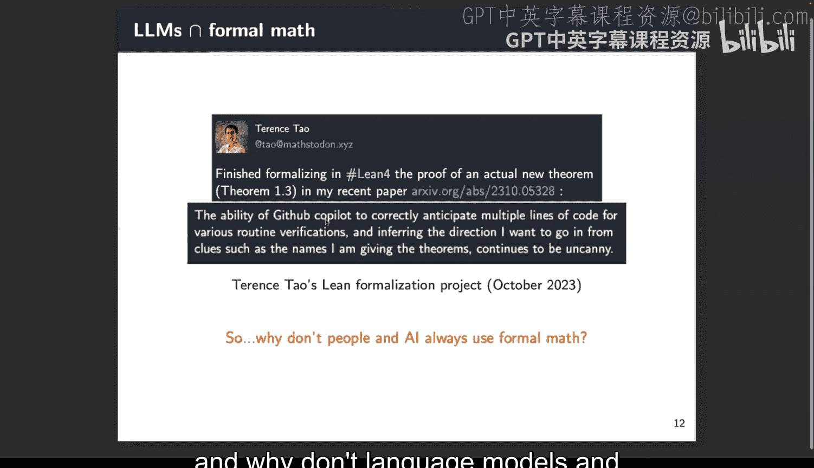

And。I'd like to kind of argue that the reason is that there's still a huge gap between this notion of informal reasoning and the formal reasoning that is required by the system。

So there's just so many informal ideas or intuitions or even the way that you write a proof。

In in like lateteEC。That are just very difficult to express in the formal system。So in lean。

 you have to explicitly spell out each step of reasoning。And。

As we saw even in that really simple example that I showed。

 it often requires a kind of deep knowledge of the system。 So I had to know that。

The name of this transitivityllma， for example， and I had to know kind of the syntax of lean。

So then this talk or lecture goes over。Some themes related to bridging these two areas。

So trying to build systems that can have the flexibility of informal reasoning。

And then have the benefits of formal reasoning， so have things that are checkable， verifiable。

 and things like that。So there's three different topics。First， I'll talk about informal thoughts。

 so training models to think informally as they're producing these formal proofs。

And I'll talk about a paper that we'll be presenting at ICL called Lean Star。

Then I'll talk about informal provers and informal proofs。

So here we'll have methods based on sketching out the high level steps of a proof and then filling in the gaps。

So I'll talk about two different methods， one called draft sketch proof。And another that。

Is under review right now， which is called Lean hammermer。And then finally。

 I'll talk about maybe some future directions that we're taking initial steps towards。

So in particular， can we assist in these research level projects like when someone wants to turn their archive paper into a formal version？

So I'll talk about some tools that are already available to help with this。

And a new benchmark which will again be presenting at ICLear called mini CTX。

So first going to the informal thoughts， it's based on this paper here and it was done by Heohan。

 who was a visiting undergraduate from the time from Tinghua。

So here we're in the setting called neural Theorem provinging。

 so here's the theorem that I showed you before at the top。And then as I showed you in the demo。

 you could think of this as kind of an interactive process。

So the lean will give you the current state of the proof。

Then what we want to do is give that to a language model and have the language model produce the next step of the proof。

Once we do that， we can feed it to leanan and then Le will tell us whether it's cracked。

 whether sorry whether the proof is complete， whether there's an error。

 or it'll give us the next state of the proof。Then as we saw。

 you can kind of do this for multiple steps until you either finish the proof or you give up because you。

Spend too much computation or too much time。So in that sense。

 you can view a proof as just being a sequence of these states and next steps。

 and they're called tactics and lean。So the idea is to train a language model to do this。

So to train a language model， you have these inputs and outputs or to fine tune it。

So one example input is like what I showed where you take in the proof state。

 and then you have the model output the next step or the next tactic。

And typically what you do is you get a data set of these by looking at a large collection of theorems and proofs and then just extracting all of the states and next steps。

So what you could do is you could take like the entire mathth lib project that I mentioned。

Or you could even have models generate their own theorems and their own proofs and then use that as training data。

Then to generate proofs with the model， one typical thing that's done is to use this kind of tree search。

So。Here is an example of best research， which we talked about earlier in the course。

So here the basic idea is you can ask the model to produce multiple candidates for the next step。

Then you can choose the one that has the highest score。嗯。

Then you can expand it further and choose the one with like the second high score and expand it。

And like here it。Eventually finds a correct proof by going down this path。

So I won't go into the details too much here because I'll actually talk about some alternatives to doing this。

 but one tricky thing is how do you come up with these good scores？

So you could use the language model's probability， or you could train a separate model to kind of predict scores like whether from a current state。

 the proof will eventually succeed。So then what we're interested in is whether you can augment this process with informal thoughts。

So instead of just having a model trained on formal code。

Whether be trained to generate these informal thoughts prior to each step of the formal reasoning。

Why would this be interesting， well， first of all， it can give the model a chance to plan out what it's about to do。

It can reason through different strategies or different steps。And if you look at the formal code。

 there's often a lot of underlying reasoning that kind of leads up to writing the code in the first place。

And so， that's the idea of。Having the model try to produce that。In kind of informal language。

In practice， we're going to train it with reinforcement learning。

 and it's basically free to decide what is the best way to kind of use these thoughts to prove theorems。

It can also help to diversify the search space。So instead of searching for proofs in just the formal space。

 we're going to search in the formal space augmented with these thoughts。

And we'll see some results on that actually later。And then I mentioned this earlier in the course。

 but when you add in these chain of thought。These chains of thought。

There's been some really interesting work that shows that the computational capacity or the kind of expressiveness of the generation model increases。

So potentially this could allow the model to just do more non trivial things。嗯。

So we have a few good reasons to try this。And the key thing is that nowhere on the internet is there these lean proofs paired with these nicely formatted informal thoughts。

And so we have to design an algorithm。For。Producing some initial model that can generate these thoughts and then basically training it to generate better thoughts。

嗯。😊，Is there particular reason to choose natural language for the thoughts why， for example。

 not just like。In lean， have you gene formal adults in lean or in cold or in foreign mathematics。

 like why natural language？嗯。😊，嗯。I guess the question is like why not natural language。

 so the natural language is pretty flexible， so if it wanted， it could also generate lean。嗯。So yeah。

 here are the idea to just leave it。As flexible as possible。And。

Another reason is that if you look at lean code。Often it'll have these。Yeah。

 it might look like something like this and it doesn't actually reflect the underlying kind of reasoning process that's going on。

Sometimes you have to look at the proof state and like how this line like transitions the proof state to actually see its kind of impact。

On the on the proof。whereasas when you look at a natural language proof， like by definition。

 you're kind of making all of the reasoning explicit。Thank you嗯。

So then here's the algorithm that we developed and it's called leanan Star。

 and it's based the name is based on this method called star， which stands for self taught reasoner。

And so the basic idea is we want to learn to generate the thoughts via reinforcement learning。

So here we have two different stages， first we have to produce some initial model that can generate the thoughts。

Then we want to improve it further。So to come up with the initial model。

We use this kind of clever trick， which is instead of like prompting a language model to just generate a thought given a state。

 you basically give it the step that follows the state。And so in some sense。

 it's retrospectively creating a thought that describes the transition。

From the state to the to the step。So we noticed that， yeah。

 if you just ask language models to give a thought followed by a next step。

Then they weren't very good。 Sometimes they would just generate meaningless thoughts。

 but they were pretty good at。Kind of retrospectively producing the thought。

So then we can do this on a data set。So here we're using like the MathLb library that I mentioned earlier。

And you can get some initial training data and train your model to take in a state and then produce the thought and the next step。

So then we go into this kind of loop where we want to generate these thought augmented proofs with the model and then use leanan to check whether they're correct or whether they're incomplete or thrown error。

Then we can use some kind of algorithm to improve the model further using this feedback that we got。

So what we need to implement this is some method to generate the proofs。

 and then we need to actually pick a learning algorithm。

So what we noticed is that when you add in these thoughts。

 it was pretty difficult to get kind of reliable scores。So when we tried using the standard method。

 which was the best for search， it wasn't working that well。

So what we did is design this parallel sampling method， and it's pretty intuitive and simple。

The idea is each one of these chains will be trying to generate a proof。

And if at any step you get an error from lean， then you just try again。

And so you just set a maximum budget for each different chain and you're allowed to like keep retrying until you exhaust the budget。

So in this way， at each one of these transitions， you're just sampling from the model。

 you're not depending on any kind of score to prioritize what you explore next。Yeah。

Then for the algorithm， we use the kind of simplest possible algorithm。So right now。

 we and other groups working on this are using the online reinforcement learning algorithms that we talked about in the class。

 but here we want to just do the simplest thing。So the idea is we just generate these proofs and then we just save the ones that succeed。

Then we can add those to the data， retrain the model， and then repeat the process。

 so generate more proofs， add them to the data set， retrain the model。So this algorithm。

 it goes by a few different names。It's called expert iteration。

 it's also called RE EM for expectation maximization。It's also called rejection fine tuning。

And it's often a kind of simple algorithm that you can use。

 and sometimes it's actually pretty competitive with a reinforcement learning algorithm like policy gradient or PPO。

So the way that you evaluate these models is typically on these math competition problems。

So here the model's been trained on MathLB。And then here is the benchmark that I mentioned earlier called mini F2F or Form to Form。

So they take these different competition problems like here's one from the IMO。

And then they write this formal version of it。And so the model is just given the formal version。

 and then it has to produce proof。And then the proof can be checked and lean and if it gets a cracked then。

You count it， otherwise， you don't count it。So here's some results with an initial model that we had in this project。

So in red is the model that we start off with。And then in black is the model after we do the initialization step。

And then in gray is the model that we get after we do that extra iteration。

And so here you could see that it took the model from being kind of worse than this baseline method。

 which is based on this GP4 agent。To being better than it。Then we at the end of the project。

 took the best available the improving model at the time and kind of reran the whole pipeline。

And again， it gave you improvements so going from this gray to the black。

And at the time that we did this， this was the kind of state of the art the improvement model。

And the field moves really fast， so there's now even better models than this one。

So I'll actually talk about those better models in a bit and show that yeah。Show you some examples。

But here's some interesting analysis。 So first we noticed that when you add in these thoughts。

 the model benefits more from scaling up this inference budget or search budget。

So here we have on the x axis， this is proportional to the number。

 like the total number of steps that you're taking。As you're trying to generate the proof。

So you could either scale it up by sampling more， by like retrying more or by using the tree search as a baseline。

And so what we can see here is that the method with thoughts kind of has more favorable scaling behavior as you scale up the search budget。

So this is some indication of what I was saying before that adding in the thoughts can help with the kind of。

Diversifying the search space。And then here's some examples and you don't have to read through them right now。

 but if you're curious， you can check out the paper。

So one thing that's interesting in this one is if you look at the code， like for this one。

 for instance。There's actually reasoning that like is relevant that is surfaced in the natural language。

 but isn't really evident from just looking at the lean code。So it's a kind of cool example of， yeah。

 how augmenting just the formal code can lead to some other types of reasoning that are probably useful for proving these theorems or kind of learning to prove them。

And then， here's a more。A longer example。Partly because it's impressive and it shows you that like。

With these longer proofs， the outputs start to get pretty non trivialal。

So then one exciting thing is that this idea of incorporating the thoughts。

Is quickly becoming like a standard thing that you add on to your LLM Theor improver？

So this was that deep sea proveer model that I mentioned。And yeah。

 they incorporate these informal thoughts before each step of the proof。

And then this was a model that came out yesterday from this startup or nonprofit。 I forgot exactly。嗯。

What Numina and。jiim米 your。But anyways， they train this very good model and it has the same idea of alternating between the informal reasoning and some sniet of code and they kind of do it multiple times and then what they do is like produce the final proof at the end。

And then here they're also training their model with reinforcement learning and they're using one of these online algorithms that we talked about in the class。

And then this one， as we talked in the class， yeah。

 these reasoning models is it seems like generating these chains of thought is currently you know。

 one important part of training a good language model that can perform reasoning tasks。So to recap。

 I talked about this method， Lean Starr。And one observation is that training on just the formal code might not be sufficient to kind of learn the underlying thought process that's needed to produce the code。

And then we give some algorithm for training a model to generate the thoughts。

So any questions here before I move on to the next section？

important you can express meaningful problems like other problems that kind of expressed in the theological language。

what was the question And to express。So you to show your own kind of research model my competition but can you apply boost for everyday problems just using the airline to come up with meaningful。

So can you use it for everyday problems， So I would say that。So first， the most。

Natural use case is for math because it's kind of built the abstractions that you're working with。

Like directly you reflect the underlying domain that you're working with。嗯。

The next application is to code。So like leanan is a functional programming language。

And so you can write any code that you could in any other functional programming language like Ha school or Ocal。

But then the nice thing is that you could potentially actually write proofs about the code。

So you could guarantee that something holds for all possible inputs。

So it's a bit stronger than a test case。So that's the second kind of natural application。

I would say if you use it for domains outside of that。

Then one thing you have to consider is whether the kind of formal abstraction is losing a lot of information。

So for instance， if you think about like trying to formalize something that involves common sense。

Then it's almost impossible to write down like all of the underlying assumptions or objects or inferences that are involved。

So for your problem， you'd have to decide like whether this loss of kind of information。Is。呃。Yeah。

 look whether it's a kind of deal breaker。But if you're able to formalize it。

 then you can use the same types of techniques。呢个话心级扣我。嗯哼。😊，Yeah yeah， yeah。

 so lean is it's a full programming language so you could yeah， you could write code。

 you can even have normal test cases， but then the new thing is that you could potentially write these like proofs about the code。

Which is， yeah， why some people are interested in that side of lane。

You think know that there is actually a reason going on and not just some bad definition because of that paper last week wherein after the USAAO came out。

 then like I think our Google researchers just tested all of the soOtime models like 0。

7 thinking on it and I think the highest score of them is 5%。And like it's sort of like1，6， one。

7 that is seen for the benchmark like is there actually any thing going on or is this just like data leak the data leakage just Yeah。

 well a couple things to do is like one is you can look at the outputs of the most recent models。

And a lot of the times， like those style of proofs don't。First of all， they can vary a lot。

 And second of all， they don't necessarily even look like ones that exist on the Internet。

So sometimes the models， especially the ones with the tree search。

 will do these like extremely long proofs。And they're just kind of like odd。

Other times like this recent model from yesterday， it generates these like very structured proofs。

And most of the lean code on the internet actually doesn't look like that organized。嗯。

And then another thing you can do is just make sure to evaluate the model on kind of things that aren't in its training data。

So there's one of the common benchmarks now is called Platinum Ben。

And a lot of those problems just haven't been formalized in lean。

So it would at least have to do the reasoning of like translating the informal solution into the formal one。

 which is pretty non trivial。嗯。So。Yeah， I mean， it it's a big， it's a big question。

 there's probably like different aspects。 you can go into it， but it's， it's not purely。Memorizing。

 I'm fairly confident about that。Yeah。😊，Okay， so next I'll go into。

Incorporating informal provers and informal proofs。

And we'll talk about methods based on sketching proofs and filling in the gaps。

So here the overall idea is to combine elements of high level reasoning and low level reasoning。

So one motivation for this is to think about like， how would you actually write this informal proof here？

As a formal proof。So again， you don't have to worry about the details。

 but here we want to approve the statement。And then the relevant part is that we can kind of break apart this informal proof into three different steps。

And so it turns out that here we're looking at a language called Isabel。

But there's a way to write these proofs in。Something that kind of resembles the informal proof。

Of course， it uses the the language so you don't have all the the。Kind of English text。

But here you could see that like this 10 times 2 80 divided by 40 appears here。

This turns out to be a kind of way in Isabel， to say。Okay， let's just complete the proof。

And so we do see some kind of alignment here。So what this is doing is it's creating these kind of intermediate statements。

And then you have to still create a proof of each one of these statements。

So here we can see that the proof doesn't really look like the natural language。

Here it's like calling out this S&T solver and。Providing it with some fact here。So yeah。

 we have this decomposition between these kind of higher level aspects and these lower level aspects that kind of don't appear in the informal proof。

So let me actually talk about these lower level steps a bit more。

So in Isabel and in some of the other interactive theater improvers。

There are these automation tools called hammers。So the one in Isabel is called Sluledgehammer。

And these can be very useful and very powerful for kind of proving these individual steps。

So the basic idea is they take your current state of the proof。

And then they call out to external automated approvers。 So things like。

One's based on first order logic or higher order logic or the S&T solves。

And so these could be very useful as you're like writing the proof as a human because you can write these kind of higher level steps and then just not worry about the details by calling the slideshammer。

What these don't work well for is if you want to prove an IO problem。

The reason is that the search space of possible proofs just gets way too large for this kind of symbolic system。

UAnd if you imagine the proof being like these different high level statements and the low level statements。

The slidehammer also just doesn't have the functionality to create those high level。

 they're called have statements。So what we want to do is try to combine two different types of provers。

 so combine some type of prover that could generate these high level steps。

With one of these low level proveers that can kind of fill in the gaps。

So here I'll talk about a method。Called Dr sketch proof。And so we presented this one at ICA in 2023。

 and most of it was done towards the end of 2022。And so here the idea is we want to draft an informal proof。

Then we want to translate it into a formal sketch， a kind of high level sketch。

And then we want to use a low level prover to fill in the gaps of the sketch。

So specifically here we start with some informal theorem and you also give the system a formal theorem。

 formal theorem statement。The reason for that is that once we start translating things。

 we don't want the model to cheat， so we still wanted to approve the formal statement that we wanted to prove。

Then we either have a human produce an informal proof or we could use an LLM to generate an informal proof。

And we'll call this the draft。Then we have the LLM generate a formal sketch。

So here it's basically what I' was showing you before。

Except now we're going to just leave these lower level steps kind of marked out for now。

And in the final step， we try to fill in the gaps， so we use some kind of lower level prover here we are actually using the sledgeham prover to try to fill in the gaps。

 and if you're able to fill all of the men，Then you have a complete proof and you know that it is correct。

So now the process of generating a proof is much different than what I was showing you before where you're going like step by step。

Now what you could do is you can generate multiple possible informal proofs。

You could also generate multiple possible translations or sketches。

And then you can just try to fill in the gaps of any of them。

And if any of them successfully gets completed， then you know that you have a complete proof。

So kind of much different approach than these step by step methods that I was telling you before。

So here's some results and what this is showing is what happens as we do this kind of inference time scaling that we talked about in the course。

So， here your'。On the X axis， you're calling the whole pipeline multiple times。

 and on the Y axis we're seeing the number of successful proofs on this mini F2F benchmark again。

So you can see that if you call it just once， then it proves some things。

 but maybe it's not very good。This blue line is showing if you have a human written informal proof and you just generate multiple possible kind of translations。

And then these other ones are saying we're going to have the language model generate multiple possible informal proofs and then one translation for each one。

So you can see the performance improve as you kind of scale up the amount of sampling。

And then interestingly here， we actually reached this like crossover point where it was better to use the language model produced in formalal proofs。

Compared to using the human written informal proof。

So this was pretty exciting and like surprising at the time。Now that language models are much better。

 we could probably make that transition like a lot earlier。

Here's an example of the pipeline address sketch proving one of these IMO problems。So here， again。

 the language model produces this informal proof。Then the language model produces the sketch。

Here we actually put in these kind of informal comments even back then。

And then here we're filling in the gaps with this hammer。

And you could see that sometimes the hammer is using some kind of like non trivialvi thing here。

 like it's calling this S& T silverr。So if you're curious to run this yourself or just learn more about it。

 I made this tutorial for the The improving。So it goes through the step by step methods that I mentioned。

 and it has a version of this dress sketch proof。And it just calls out to in language model API so you could try it out with any recent model that you want。

So I talked about this method， Dr sketch proof。And it kind of relied on having this low level proveer called sledgehammer。

So then one thing that we've been interested in is whether we could build one of these low level provers or hammers for the lean proof assistant。

Because Lane doesn't have one of these。If we were able to build it。

 then potentially we can enable this kind of sketch based proving。

 both for language models and also for humans as the writing proofs。

So this is based on ongoing work and it's currently under review and the paper is not public yet。

And yeah， it's by Thomas and Josh here at CMU in collaboration with Jeremy and Albert。

So a bit more about what these hammers are， so there's a bit of tricky terminology here。

So a hammer integrates an automated theorem prover into an interactive theorem improver。

So an interactive Theor improver is like one that I showed you like leanan。And at its core。

 it's basically a programming language that can check proofs。

But the language on its own doesn't give you any way to produce proof automatically。

So then an automated theorem prover is something that tries to automatically find proofs。

And traditionally， these are based on this kind of higher order logic or calling out to an S&T solver。

 like I showed you。So as I talked about before， the automated theem improvers really struggle with this large space of possible proofs。

So a problem that you can kind of solve to improve their performance is called premise selection。

So basically the way that you call these automated theorem proves is to provide them with a bunch of definitions and theorems and lemmas。

That are useful for approving the theorem。And if you give them kind of really useful things。

 then their search base gets reduced and they could possibly find a proof。

So the most naive thing you can do is just give them all the premises and there's just too many for the prover。

 there's like around 250，000 just in the lean maththlib。

So we want to try solving this problem of premise selection so that the automated theor improver becomes more useful。

So here's what a standard hammer pipeline would look like。So here。

 let's say we're in lean and we have this goal to prove。

Then we have something that selects these premises。

Then we have to translate it into the language of the automated the improver。

Let's say that the automated theor Pror finds a proof。

Then we actually have to reconstruct it back into lean。

So that's what happens in this reconstruction step。

So here there's been prior work on various parts of this pipeline。

So there's this tool called leanan Auto that takes care of translating from lean into the higher order logic。

This is an example， automated Theor prover that has been around for a while。

And then this is a project which was by Josh， who is part of the Le hammermer project。

So this was done here at CMU looking at this reconstruction stuff that I mentioned。

So then here we want to do two different things。First of all。

 we want to try to solve this premise selection problem。And then second。

 we want to actually put all of these things together。So when I kind of show it on a slide。

 it might look easy to just combine them。But in practice。

 it's actually not clear what the best way to do this is。So for premise selection。

 we use an idea that we talked about in this class， which is retrieval。

So essentially you can train one of these retrieval models to retrieve relevant premises。So here。

 like we talked about in the course， what you would have is some input or some query here we would give it the goal to prove。

And then the model would produce this embedding。Then over here， instead of having like web documents。

 we have these different premises so they could be like definitions， lemmas， theorems。

And the model would produce embeddings of those， too。And then just like we talked about in the class。

 you would train this with the kind of contrastive loss。

So you have some state and then you collect some positive premises and some negative premises。

And here we can use a model like Bt， here we actually used a really small model。

 like 100 million parameters was the biggest one。And yeah， train it like these retrieval models。

It turns out that there's a lot of nuance in exactly how you format things。

 whether you like simplify terms and things like that in lean。

 and there's a lot of variation based on how you choose the positives and negatives。

So I won't go into the details there， but at its core， what we're doing is， yeah。

 this technique that we talked about in the course。

So then we can incorporate this into the hammer pipeline。

And what we do is something a bit different than this like chain that I showed you。

We actually incorporate this into a tree search that will interact with the premise selector and with the automated the improver。

So there's this symbolic research， which is called ASO。And basically。

 we wire it up so that it can use the selected premises and call out to the external prover。

Or it could try applying these different tactics。Using the selected premises as arguments。So here。

 all this stuff is kind of symbolic in some sense， and then the neural part is this premise selector。

So then as a user， you can use this by just issuing this command at any step of the proof。

So like here we have this theorem and then we invoke the hammer and it will do all the stuff that I said and then give you this proof。

So here I also have a demo。

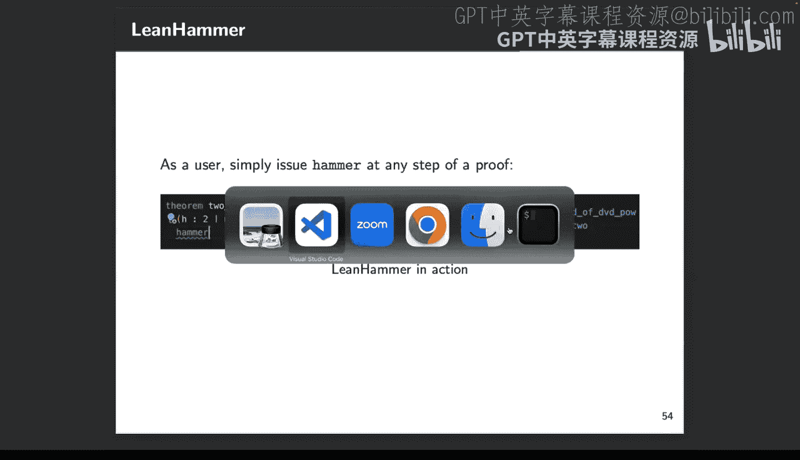

And here what we want to do is take an actual proof sketch from one of these textbooks。

 so there's a few textbooks written in Lina。

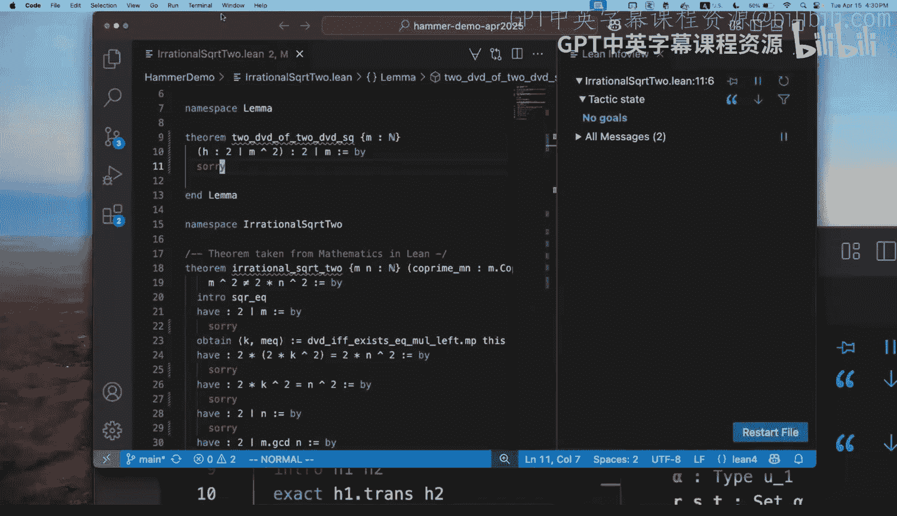

And so sorry here means that the kind of lower level proof hasn't been written yet。

And so here's the kind of higher level steps that were present in the proof。

So this was a proof of the irrationality of square root of  two。

UAnd so we want to try to use this hammer to kind of fill in the gaps。So here we can call the hammer。

And hopefully it's still running。But basically we have the there it is the retriever running on just one GPU and then it's going and。

Yeah， running the research and communicating with the prover like I was showing you before。

So here we should be able to run it。On each different step。And I forgot out one of these is。

Fd of interesting。 You'll see this one。So basically， yeah， this one's kind of interesting。

 So here it's calling this external prover so you could see all of the premises that it's kind of retrieved。

And then here you can look and see this reconstruction tool that I mentioned Duper and the call that I found。

So the basic idea is that， yeah， as a human， this could be really helpful because。

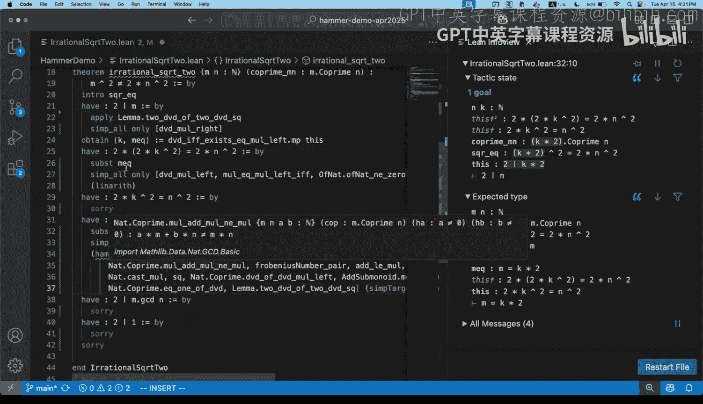

Hopefully， you know， as these get better and better。

 you can start to write these kind of higher level steps of the proof and then not worry about the more specific details。

 like the specific names of things in Le。So it turns out that yeah。

 you can fill in this whole proof and here is the parts filled in by the Hammoish and and purple。

 and then here was what you would write if you're you know a human writing the proof。

So one thing that's important is to have a good retriever。

So here we're varying the retriever and you can see the performance differences。

So here's what happens if you don't have any premise selection。

This was a prior retriever someone that a group had trained for leanan。

 it's part of this cool project called Le Djo。This is actually a symbolic kind of retriever。Yeah。

 it performs surprisingly well。Here's the one that we trained。

And one interesting thing is that it's kind of complementary to this symbolic one。

 So if you just take the union of premises that they retrieve。You could do a bit better。

And then the interesting thing is that the performance starts to approach the performance that you get if you just use the premises that occur in the human written proof。

So these aren't necessarily the best premises for an automated theor improver。

 but it is pretty interesting that you could start to kind of approach that performance。

So to recap here， I talked about two approaches for combining informal informal provers。

I talked about draft sketch proof。And this project called Leanhammer。One interesting thing is that。

 yeah。Even if you kind of use a small neural network in a clever way。

Then it can do some non trivial things as we saw it。So in our case。

 this retriever was just less than 100 million parameters。And so finally。

 I wanted to go maybe a bit quickly through。Research level mathematics。

 so talking about as a kind of future direction， how we can build tools that actually assist in these more complex projects that go beyond just the competition problems。

😊，So an interesting question is I mentioned at the start of the talk that different mathematicians like Terrence Tao are trying to use Lan to create formal versions of their results in papers and things like that。

So what does this actually look like？So we can look at this blog post that was written by Terrence To。

And he describes this kind of three step process。So first。

 he started with his paper on archive and picked one of the main theorems from it。And then he。

 along with other members of the Lan community， as a first step。

 come up with what's called as a blueprint。So a blueprint。

Just in kind of informal math tries to carefully think about like。

 how would we actually structure a formal proof of this result？So in particular。

 you want to say like， okay， in order to even state this kind of final theorem here。

 we would need different definitions that aren't in lean yet。

We would want some intermediate lelemmas that we could call in order to prove it。

And you can see here， I'm not zooming in， but the kind of dependency graphs of things that you need to state and prove the serumorem is actually pretty pretty complicated。

So then once you've created the informal blueprint， you think about like， okay。

 how do we actually program this in lean？And in practice， there's some back and forth。

 like you might have to revise the blueprint。But what this boils down to is you come up with some set of definitions and some set of dilemmas and theorems。

And then you have your kind of final theorem statement and you write the proof for it。

So a question is， where could a language model or like an AI agent or something help in this process？

So a really ambitious thing would be you start with the archive paper and just send it to the agent and it comes back and all of the formal code is perfect and it's done。

So that might be possible one day。Um but we're curious about like。

 what is the simplest possible thing you can do to kind of help in this process。

And something that you can kind of trust the AI system to do。

So one thing you could do is to look at this blueprint that I mentioned。

And just try to fill in kind of small parts of the blueprint。

So you might have these kind of helperlemos。That are needed for the final proof。

But are maybe tedious for the human expert to kind of spend their time on。

 and so it' would be useful if we could just send these to a language model and have them completed。

So there's kind of two gaps to making this happen。So first。

 when we have these different theem proofing papers。

 they're not necessarily accessible to actually use to produce proofs。

So there's a really famous system now I didn't talk about it much in this talk called Alpha Pro from Deep Mind。

And it can create these like very non trivial proofs and solve these IO problems。

but it is kind of not accessible to us and it actually takes two days to produce a proof。So。

 so it's not necessarily the thing you want， especially if you have a kind of just like small gap that you want to fill in。

So kind of related to that， you also want to take into account the runtime if you're running some like huge tree search or something like that。

However， there already are some tools available to。Yeah， try to automate some things。

So the lean hammer that I mentioned that is will be early soon， but here's another one。

 a tool that we built called LLM leanan。So the basic idea here is to just create this interface so that within lean。

 you can call out to a language model。And then the cool thing is that when we get different generations from the language model。

 we can actually check them and lean。So we can like filter out bad ones and we can check if things complete the proof。

So the idea here is you can run a language model on your laptop through one of these different libraries that's been developed。

 so I showed you ElM studio in other lecture， there's another one called O Laama。

Or you could call out to one of these language model APIs and basically have it from within leanan。

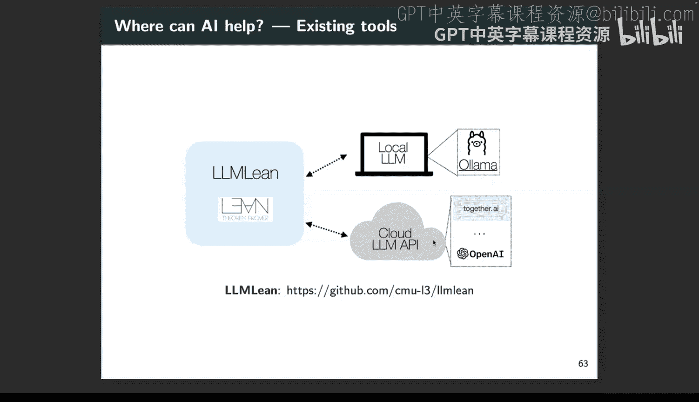

So here I have one more demo。

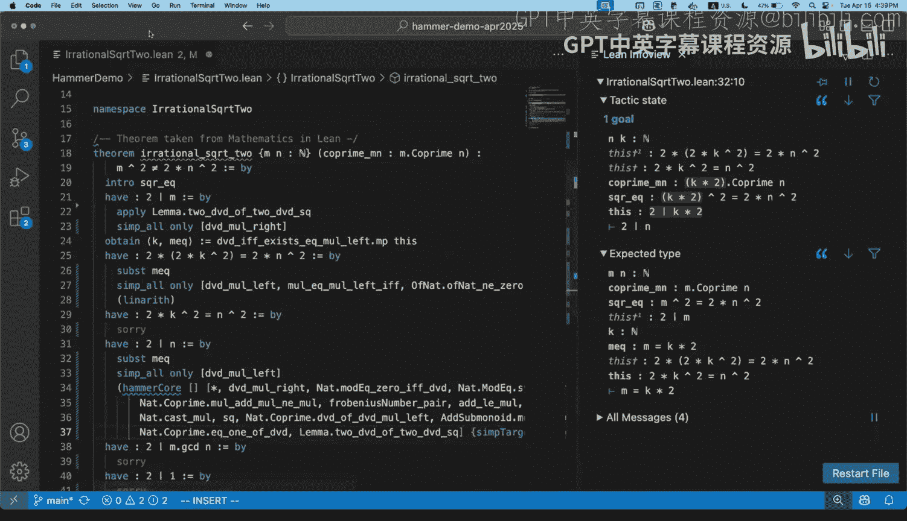

And。We could go back to。The simple example。And call this tool， which is。啱。ALM step。

So here this just got a prediction from a language model。

And you can see here that it actually generates the same commands or steps that I showed you before。

嗯。Here， instead of using a copil suggestion。You could。You could call this。

And then here the cool thing is that unlike Copilot。

 we could actually check whether it's valid and completes the proof so then we can like highlight it or filter out ones that lead to an error。

You can also prove it， try to prove the whole thing。So there's this other command LM QED。

So here's like a foolproof。And。If you want， you could say。你ction。Thispro。

So now it gave us some alternatives which are shorter。And actually， it turns out we can just。

Preve it with this one command。

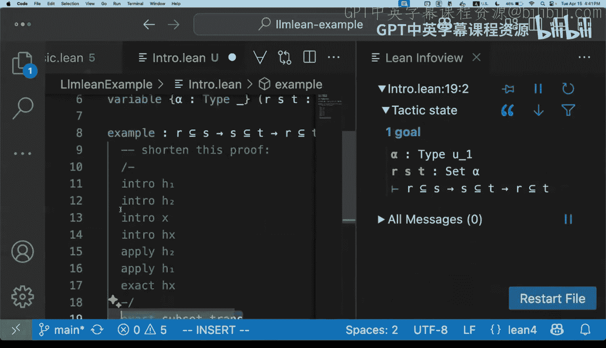

So anyways。Yeah， this is if you're curious if you're trying to learn lean。

 this is something that you could use after the class if you want。

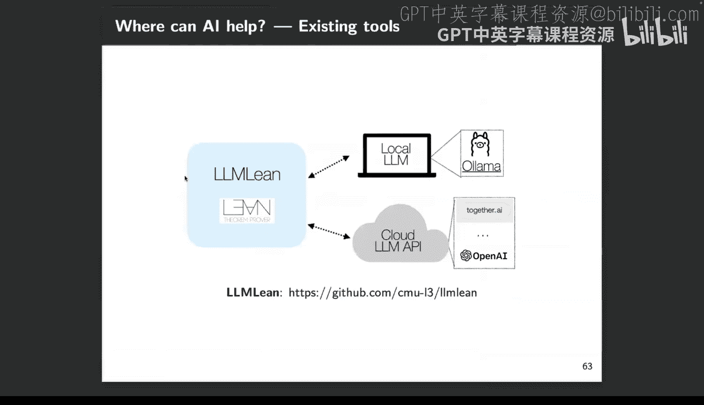

And I went through one of the files from this Ternce Ta project。

 and it turns out that already with today's language models you can actually fill in some of these helperlemmas。

 so this is the one I showed you before and L M Le is able to come up with a short proof。嗯。

On the other hand， if you try to prove very long theorems with the models。

 then the key bottleneck is that the models are still kind of not good enough。So the question is。

 how do you actually benchmark models so that they get better at these types of proofs？

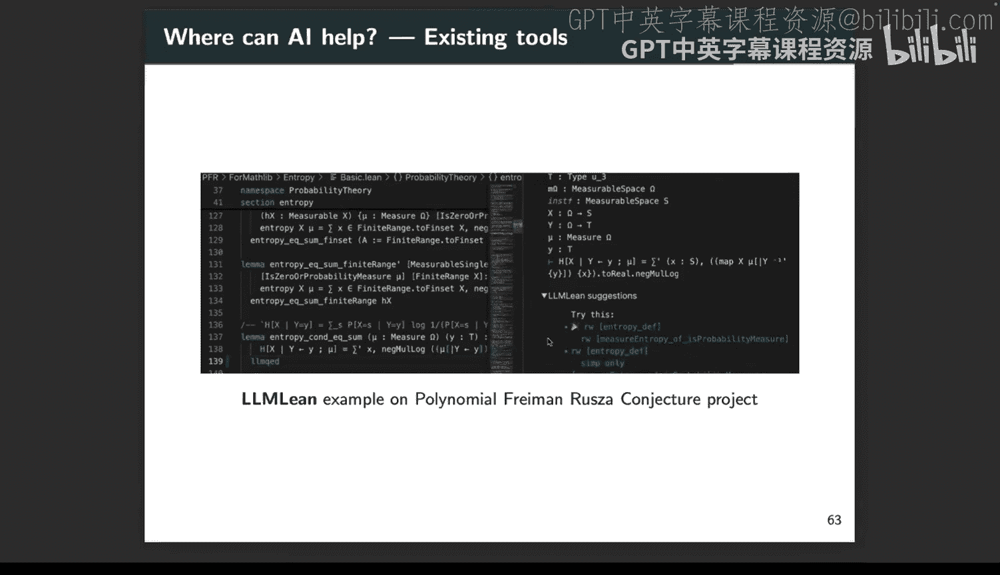

So another issue is that a lot of the benchmarks in this area are based on these math competition problems。

So here's an example， sorry small from the International Math Olympia。

And these will have very like creative and complex proofs that will kind of test various aspects of reasoning。

But they're kind of self contained， so like here you could just state it in one line with really simple like natural numbers and multiplication。

And these are kind of designed to use standard results。 So there's kind of a。

A kind of small set of things that you would expect to use in one of these proofs。

 and again it's very non trivial to produce the proofs。嗯。

But you can kind of draw on a standard kind of set of results。

If we contrast this with one of these projects。Then as I talked about。

 you have to actually create these new definitions and new lelemmas。

And so when you go to prove something， it can actually depend on these things that the model has never seen during training。

And so it's a kind of different setting than the math competition problems。

So this is one last paper and G and Thomas will be presenting this at ICLA as a oral presentation。

 and it's about a new benchmark for this kind of realistic proofing setting called Min CTX。

So here we made the observation that I just told you about so basically when you look at these real world projects。

 they will depend on different types of context， so like the repository of code。

 new definitions or different lemos。And so we built a benchmark that will test models on actual projects。

And so one interesting thing is we can look at， we can set a time cut off。

And then look at like new theorems that have been added to the maththlo library。

And so proving them would require like actual generalization。Similarly。

 we can look at projects that were developed after the time cutoff。

And aside from like similarity between different projects。

 the model would again have to kind of generalize。To prove things in this new project。

And so the idea is we can periodically update the benchmark as to stay ahead of the language model training cutoffs。

So like we've already created a version two of mini CTx that has projects from like the last couple months。

So then we could look at the different types of dependencies involved in these proofs。

 so we look into theorems that just require things in the preceding code in the file。

And then we look at theorems that require things across multiple files。嗯。And yeah。

 I guess I have to go a bit quick here， but we test models that just take in the proof state。

Versus also taking in the preceding code in the file。

And one interesting thing is that if you purely just evaluate models on competition problems。

Then taking in this additional context， like the preceding codet really doesn't really matter。

The reason is that again， for the competition problems， they don't really depend on any context。

 so you're just giving the model like the import statements。

But here this is showing that the approach， the performance can like vastly differ when you're looking at the more real world projects。

So here you benefit a lot if your model is actually taking in some external context。

And so the observation here was that a lot of are basically all of the state of the art provinging systems。

Don't take in any sort of kind of context from the project。Similarly。

 you could again do the premise selection。And this turns out to help looking over here when you have these kind of cross file dependencies。

And here these were just baseline methods and there's a kind of wide space of approaches that you could do to kind of improve this further。

So we did also provide the model that we trained that can take in the kind of preceding code in the file。

We provide it on this Olamo so you can download it and run it inside of Le if you want and get different suggestions with it。

Yeah， and then all the。Data and all the code and evaluation code is also made open source。

So here I briefly went over two of many challenges in automatically formalizing the research level math。

So I talked about the importance of keeping in mind the actual tool you would use。

And the how you benchmark models and kind of measure progress。In summary。

 I talked about these three different areas， so informal thoughts。

 informal approvers and research level math。And all of these are kind of being actively explored by us and others in the community。

 and so hopefully if you weren't familiar with this research area， you learned a bit more about it。

And I know there's at least one course project actually on this topic。

 so come to the poster session and maybe you can see some new breakthroughs as well。

So yeah here's all the collaborators and the different works that I talked about and I think we are right at time。

 so I'm happy to take a couple questions just。

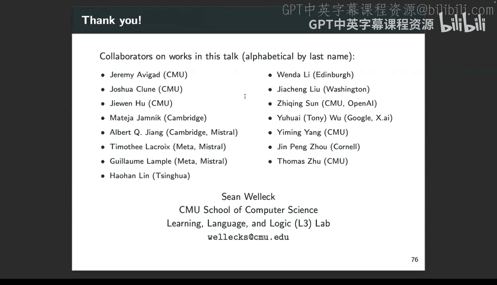