# CMU《高级自然语言处理｜CMU CS 11-711 Advanced NLP Spring 2025》中英字幕（claude-3.7-s - P22：-25-CMU Advanced NLP Spring 2025 (23)_ Multimodal Modeling II.zh_en - GPT中英字幕课程资源 - BV1nYVHz7Eoa

On multimodal modeling。So the first one was last Thursday and we're going to continue today。

So if you remember in the previous multimodal lecture。

 we focused on this type of model here in the top right hand corner。So a model that can take in text。

 it can take in images and output text。So in this lecture。

 we're going to talk about even more flexible methods that can take in text and images and output both text and images。

Or just ones that can take in a text and an image and output an image。Let me get the door。🤧嗯。

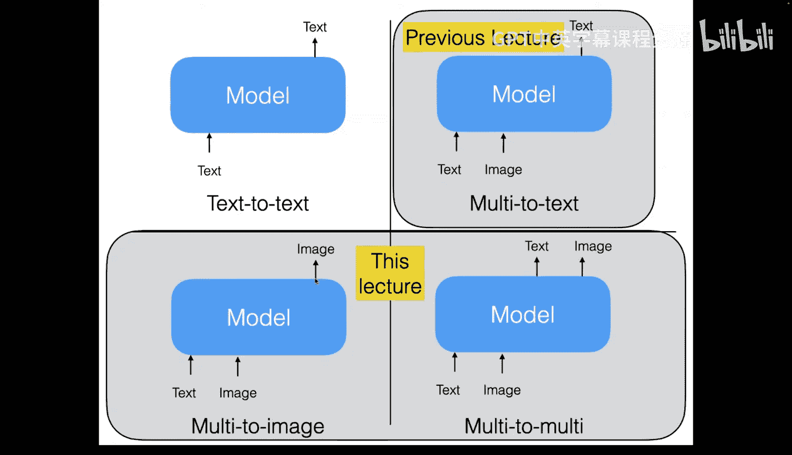

Okay， so some examples of this， if you've used chat GPT before。

 then now you can generate images with it， so here I'm asking it to generate this framed picture of Pittsburgh and an impression of style。

This is actually different， I ran it again since the last lecture and I think this is definitely some hallucinated stuff here。

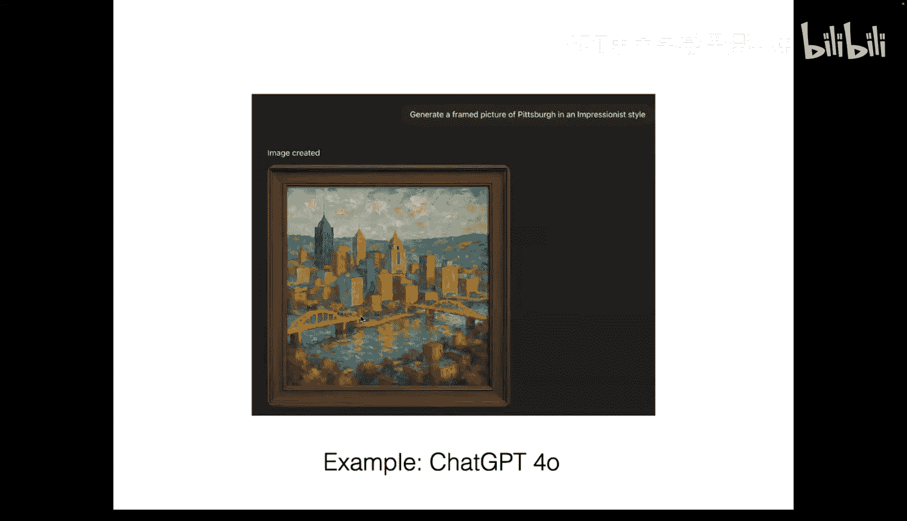

But anyways， pretty interesting。Here's an example where the demo is accessible。

 the code is accessible and the paper is accessible。

So I'll talk about this method at the end of the lecture。

So this one's not as good， obviously as GP。

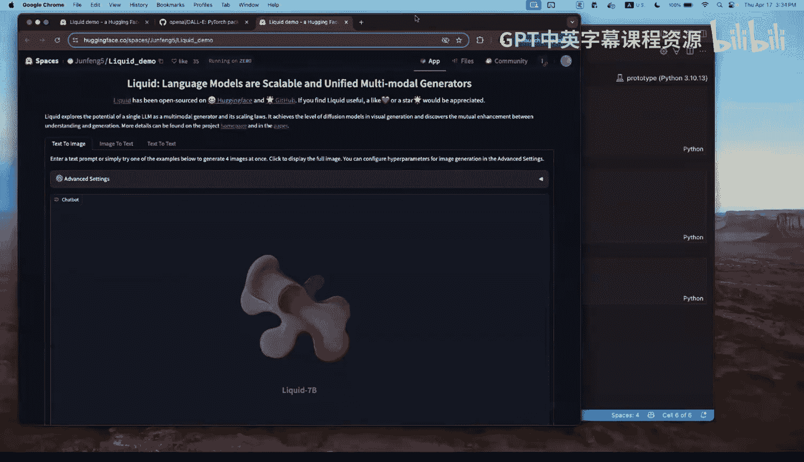

The one on chat GT。But they have this demo。 And so you can。四啊。An image of。It'sburg。

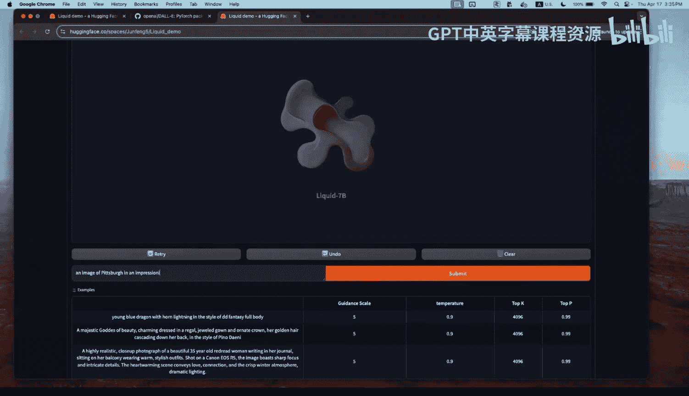

And then it's also pretty slow。

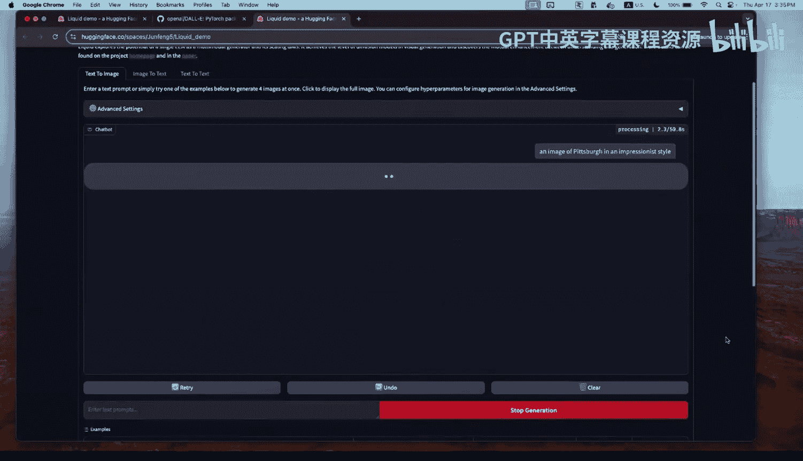

But maybe I can come back and。

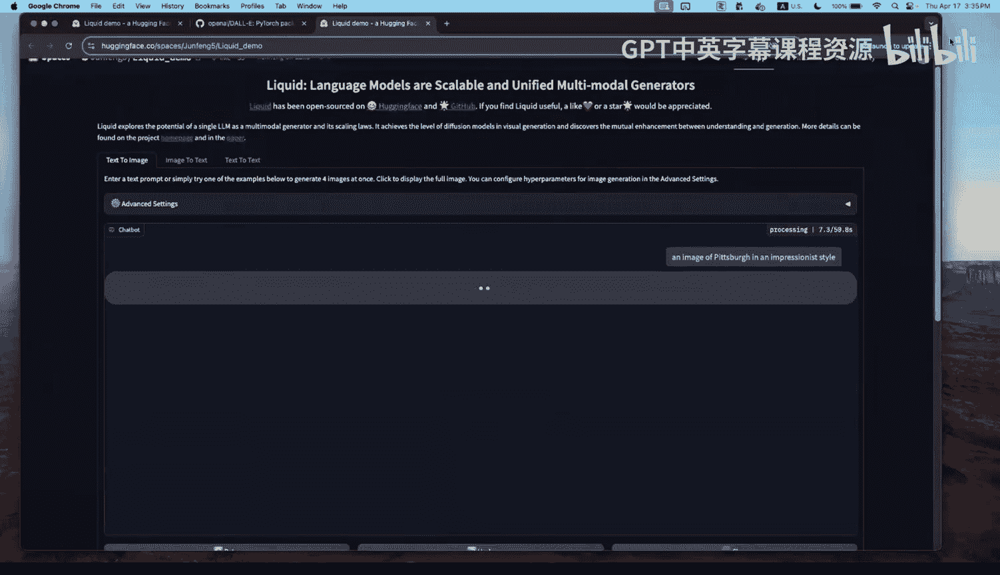

In a bit here。

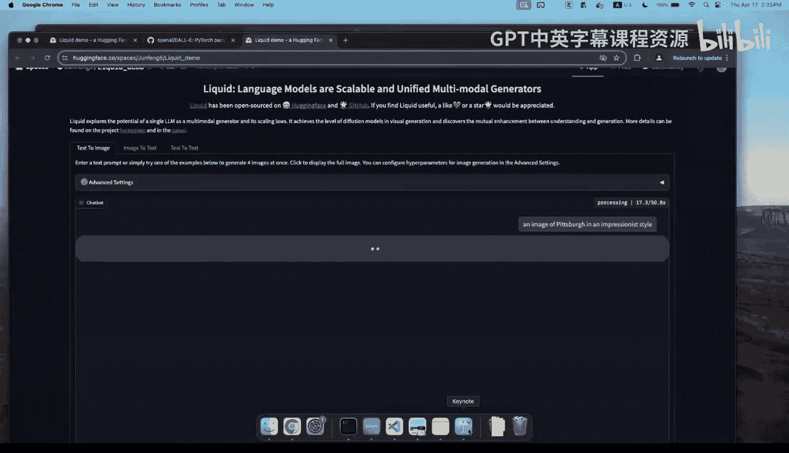

So I'll come back in a bit。So here I just gave it this textual prompt and then this one is just generating images。

 but as we'll see later， it's just using a standard transformer language model。

So it's fairly fairly flexible and so we'll see another version that's very similar so again just a transformer language model and it can generate kind of interleaved text and images。

Unfortunately， that one was also by Meta， it's called chameleon。

 and so they have a nice paper about it， but you can't access it as far as I know。

So let's see if this， okay， here we go。So you can see it didn't really get the。

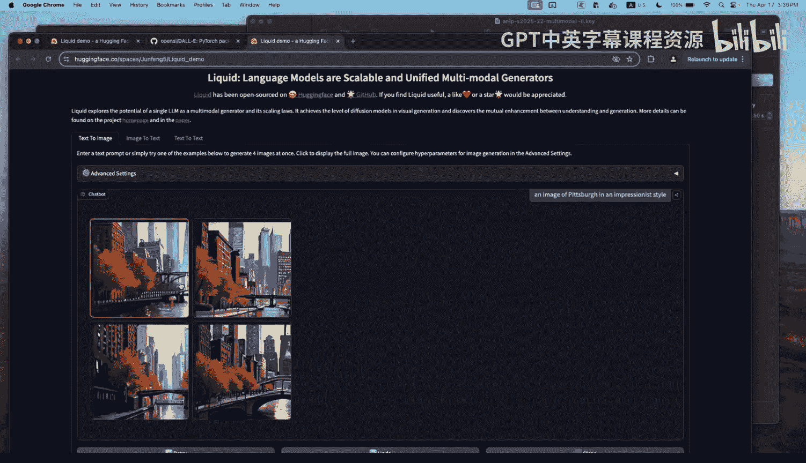

Exact buildings， right， I guess it doesn't really look like Pittsburgh。

 but at least they got the fact that it's a city and maybe it's starting to approach an impressionist style。

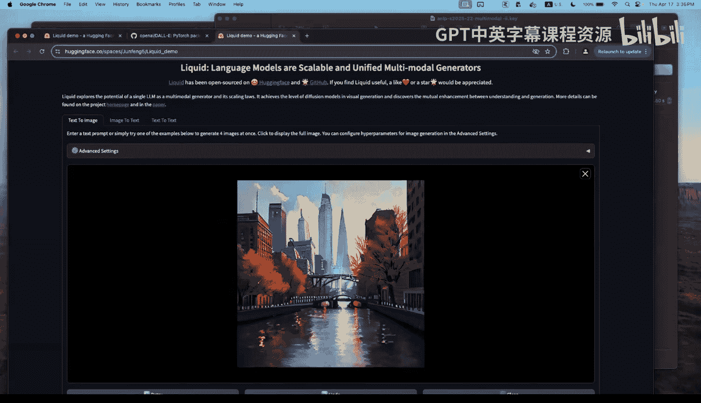

And then if you scroll down， they have really good examples。

 I'm not sure maybe it's more related to the training ghetto。

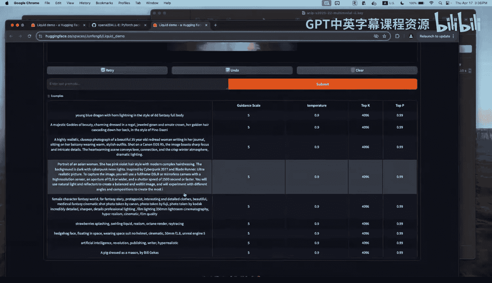

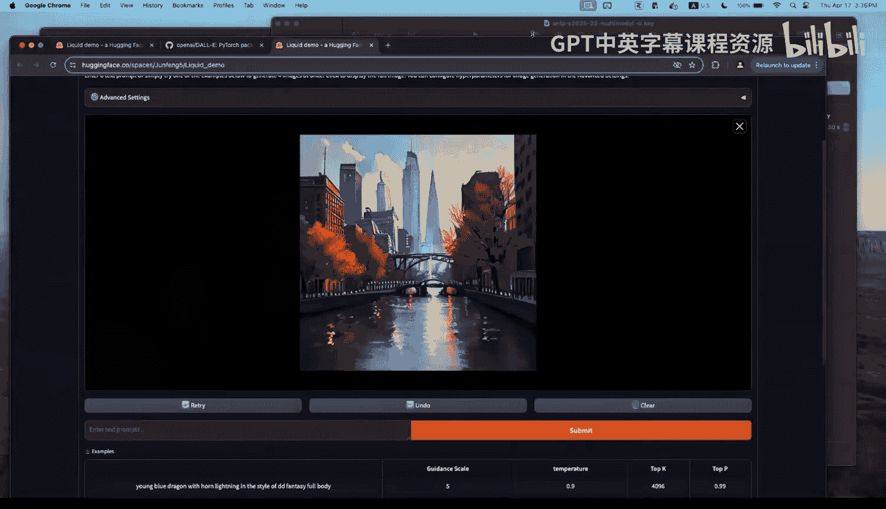

But anyways， the idea behind today's class is to kind of see get some sense of how you do this and。

Specifically， I'll focus on methods that are kind of close to standard language models that we've seen in the class。

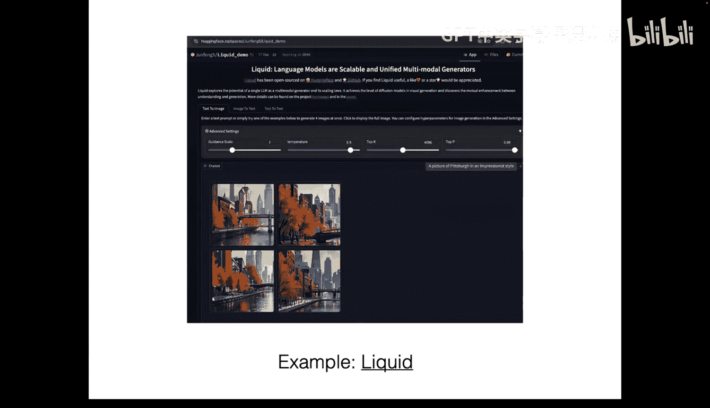

So first， since I'll be mentioning different modeling paradigms in order to describe the methods。

I want to first just give a very high level overview of four different generative modeling paradigms that you could use。

You'll see these come up in you know when you're dealing with images。And really。

 there's a lot of different trade offs between them。

And so it's good to at least have heard of all of them。And then as we'll see in today's lecture。

 we can kind of bolt on different components and you'll see what I mean by that。

Then we'll take a very， we'll make a kind of extreme attempt。

 which is what if we just treat the image as a sequence of pixels and try to just learn a language model over the pixels？

And people have tried that and we'll kind of see what happens。As a spoiler， it doesn't。Work too well。

It might work in the future。But instead we could take this other approach of still coming up with some way of coming up with these image tokens。

 so now instead of generating the raw pixel values we'll be generating some kind of tokens。

And then briefly at the end of the lecture， I don't there's not time to go into the details。

 unfortunately。嗯。In case you haven't seen diffusion models before， I'll just do a very quick。

 just screenshots of papers so that at least if you want to look into them after this class。

 you have some starting point to see what the major papers are。But the idea of this lecture is。

 again， to。Try to stay close to the methods that we've seen in the course and then think about how could you adapt something like a language model to be able to support outputting images？

So first， just at the high level， so in this course we've talked about generative models。

 we've talked about these language models。And a couple of times I referenced this idea of having some underlying data distribution。

And then you learn something like a language model over the data distribution。

And that is what a generative model is。So the same idea， of course， applies for images。

So here you might have some distribution of images， it looks like it has animals here。

 so cats and dogs。Then you want to train some generative model。Then given a generative model。

As we've seen in the course， you want to like generate text Similarlyly。

 you could try to generate images。And if you have this kind of probabilistic model。

 then that corresponds to generating samples from the model。So。There's at least four， I mean。

 there's more than four， but I'm going to mention four different kind of ways of thinking about this。

So the first is the one that we've talked about a lot in the course。

 which is auto aggressivegressive。And then there's these three other ones， VAE。

 GNs and diffusion models。So， auto aggressive。Is。Yeah。

 the standard set up for text generation these days。And so here you have some notion of a dimension。

 like in text， it'll be a token。As we'll discuss later。

 you could have tokens for images or you could have a pixel and you generate or you model the distribution over kind of one token given the previous ones。

And due to this chain rule of probability， this actually corresponds to learning a model over the full sequence distribution。

So this is just kind of a visualization of its supposed to show one pixels all at a time。

 but it's impossible to visualize that meaningfully。😊，But you could imagine。

 like maybe there's other ways of doing this。So depending on your background。

 what research or what courses you've taken， you might have seen this come up before。

 but if you haven't， there's this other kind of approach called variational autoencors。

So at a high level， what you want to do is have these two different components。

So you want to take in your image from the data distribution。Then you want to learn this encoder。

And the encoder basically learns to compress the data into this vector。I mean。

 it doesn't necessarily have to be a vector， but it's this kind of latent variable。

Then you want to learn a decoder which learns to reconstruct the data from the latent variable。

And if you set up this problem right， then you could essentially learn a model that kind of encodes images into a kind of nice latent space like a Gaussian distribution。

Then if you want to generate data， you can kind of start off with just like a random Gaussian sample。

And then you could feed it through your decoder and get some image from the data distribution。

So this one will go into a bit more detail today because it turns out to be relevant。

 actually for building the tokenizer and the kind of detokenizer for language models。

So then there's this other approach that was popular， especially in like， I don't know， 2016 to 2020。

Called generative adversarial networks。So here it's a bit different， so now again on the right。

You have something that looks like the decoder。So you start with some latent vector and try to produce an image。

But now you have something a bit different over here， what it's saying is。

You want to have this discriminator， which takes in a true image and takes in an image that your generator generated。

And it tries to detect whether the image is real or not。So sometimes you put in a real image here。

 sometimes you put in a generated one。And then you can use the signal to basically train the generator。

So the generator's goal is to produce。Images that look real so that it could fool a discriminator。

And the discriminator's objective is to do a good job at kind of detecting the fake images。

So these are called GNs again I'll briefly mention these because you can also use these to build this kind of tokenizer for images and we'll see how to do that。

And then the final one is diffusion models。So again。

 these are just being described at a kind of high level。

So the intuition here is that you can set up this process。

So here you start with your original image from the data distribution。

Now you have this noing process， which gradually adds noise to the image。

And so here you just get to some distribution that is。Kin of simple， like a Gaussian distribution。

And then now you want to learn a model that can reconstruct or kind of dennoise this into a real image。

And so again， if you want to just generate some image from the data distribution。

 then you start off with some Gaussian noise， and then your diffusion model can kind of generate a real image。

So。So you could probably see that these different these are different approaches。

 but you can get these models that can generate things。And for some of them。

 you can get these kind of nice latent representations of images。Okay， so now the question is。

 if our goal is kind of taking the language models that we've talked about in the class and adding on the ability to generate images。

 where do these different things fit in？U。So of course， there's a wide space of possible methods。

But here's one that we'll talk about today。So the goal will be to somehow have a tokenizer for images。

It'll end up looking a bit different than what we did in last class。

So here the goal is to literally represent this image as these discrete token， so like numbers。

So like this image might be like 3， 82，1，7。Similarly， text tokens。

 you know just start off as numbers， they're like the vocabulary indices。And so if we can do that。

 then we can just use a standard transformer。Similarly， when we are generating with the transformer。

When we're generating text， we can generate these numbers， which are the indices of the text tokens。

If we can do the same thing with images and just generate these kind of token inheses。

Then if we have some way of kind of detokenizing it into an image。Then we can generate an image。

So it sounds。At least to me it was kind of crazy the first time I heard about this。

 maybe it doesn't sound crazy to you， but hopefully we'll get some understanding of one way that you could do this。

And again， the goal here is for this set of methods， yeah。

 we want it to kind of use a transformer and look like a language model。So first， just for some。

Like an initial attempt。We could just try using a standard language model and don't worry about this tokenizer and detokenizer。

So here we could just treat a model as a sequence of pixels。

And then we could just generate the individual pixels and just like you know。

 reshape them into an image。And then attempt to， maybe I shouldn't have put it here because it's a spoiler。

 but so instead of doing this， one kind of modern way of doing it is to learn this discrete tokenizer。

And it turns out that there's ways of learning a kind of discrete VAE or discrete GN that will give you this ability。

So first with the autoaggressive model， again， here we want to just treat the image as a sequence of pixels。

So we can， for instance， flatten it。And then each position can correspond to like some color value。

And then we can just use the same learning objective or loss that we use for language models。

Given some data set of image sequences， just maximize the likelihood。

tThen we could have a model and we could use any generation algorithm that we talked about in the course。

 you could use sampling， you could use top K sampling， whatever you want。

So this was actually done back in 2016 with RNNs。So here's a model called Pixel R&N。

And you can see here that here they give the model， this is their learned model。

This like 50% of an image and it's able to somewhat fill in the details。

U and you can see here they're operating on these kind of really small images。

 I forgot the size maybe 32 by 32 or maybe even smaller than that。嗯。

Then these the method was like developed further and。The same， at least same first author。

 kind of same group。Used convolutional neural networks instead of the RNNs。

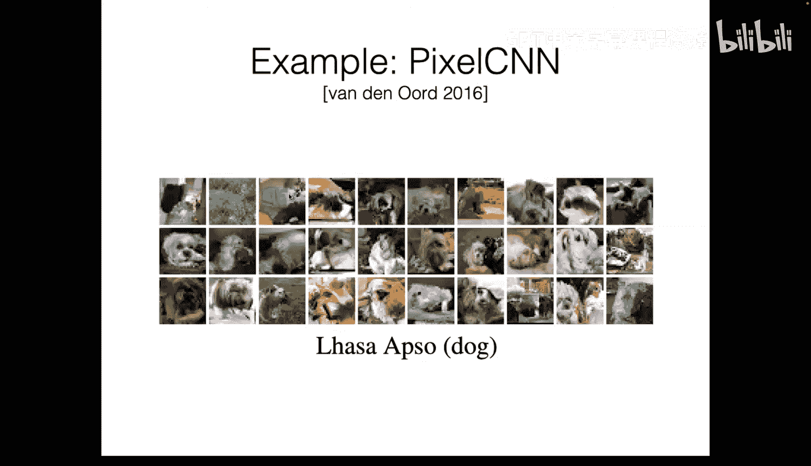

And maybe the quality improved a bit。Then the same idea was kind of attempted with transformers and here is the image transformer。

And so here are some like full samples from the model。

Maybe they're starting to look like I don't know， dogs or horses or boats。And again。

 you can kind of give it part of an image and then it goes in this。

Kind of row by row order of generation and can fill in the gaps。

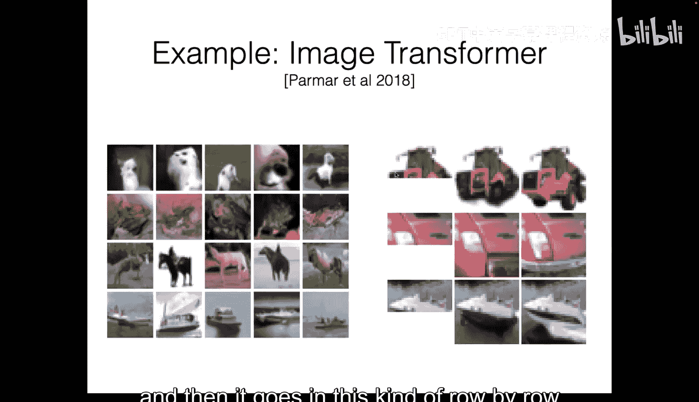

So one key challenge here is trying to scale this up to larger images。

So if you imagine like trying to do this with 1024 by 1024 images。And you have like three channels。

 one for each color channel。Then that would be three million tokens。

And so if you imagine having like an agent， maybe it wants to keep multiple images in its history。

Then this would start to get pretty expensive and pretty memory intensive。

So I'm kind of just going over this one in broad stroke so that we could spend more time in the other ones。

But typically， if you go back and look at these papers。

 they'll often involve some kind of modification to the architecture due to the kind of explosion in the sequence length and the transformer's quadratic attention。

So here they were doing。Yeah， something here， there was another paper by Open AI doing this kind of sparse attention。

And so。It's not that this is not possible， it's just a challenge that you run into if you try taking this approach。

So now we'll go to the second。Kind of class of methods。

 but maybe let me pause here if anyone has any questions。O。

So now we want to try to learn a some discrete tokenizer and detokenizer。

And we'll talk about two different methods and they're very similar。So here's the picture。

 so again we want to learn this tokenizer that will actually turn this image into just these discrete tokens。

Then as I mentioned， we can pass it to its standard transformer。

 the transformer can generate these tokens。Um， and then we could learn this kind of detokenizer that turns it back into an image。

Now the benefit here is， for example， let's say that you have 8，000 possible numbers， so 8。

000 possible tokens。嗯。Then what you can do is kind of compress the image if you learn kind of good representations of the tokens。

So for example， the methods that we'll look at， they'll typically treat us an image as like  a thousand tokens。

So a lot less than， say a million， you know。And so the key question is like。

 can you learn to kind of compress things into these tokens such that they can be eventually kind of decompressed into a meaningful image？

So the first approach I'll talk about is called VQ VAE or vector quantized variational autoencoder。

So here we'll be dealing with these VAEs that I mentioned。So again， you have this encoder。

 you have this latent vector， and then you have this decoder。

And so first we're going to start with just the continuous VAEs。

 so these aren't going to be the ones that we use as the tokenizer。So typically。

 if you have a continuous vector here， then what I was saying before is like you can。

If this continuous latent space is kind of well behaved if it looks like a Gaussian。

Then you can generate a new image by just sampling from a normal standard distribution。

 standard normal。And then feeding it through your decoder and it will produce an image。

So if we look at this one， so these were。Kind of invented and they kind of exploded in popularity starting in around 2013。

So here the goal。One of their motivations was to actually learn these really good latent representations of images。

And so here the assumption is to kind of， well， first you formulate this as a generative process。

So under this model， you assume that you first sample this latent variable Z。

 like I showed you before。And then you turn it into data X with your decoder。

And so now the question is， if your goal is to get good representations of images。

Then you basically have to go in the other direction。

 it's saying that given some image you want to produce a good latent representation of it。

And so this would correspond to the kind of posterior distribution。

So here I'm not going into all the。All the details I wasn't sure how much time I would have。

But here it turns out that obtaining the posterior distribution， if you kind of learn this decoder。

 for instance， is intractable。So you actually have to learn this approximate posterior distribution。

And that corresponds to this encoder that I was showing you in the image before。So in summary。

 it's just what I was showing on the previous slide， you have this prior over latent variables。

 you have this decoder， and then you have this encoder here。

And then you can derive an objective and here's what it turns out to kind of end up as。

So the objective has two different parts。So one part says that you want to be able to reconstruct images well。

 given a latent vector。So for that， you have this kind of conditional likelihood or reconstruction loss。

So again， it's just saying increase the probability of the data given your latent representation。

And then as I mentioned before， we don't want to pick just like random latent representations。

 we want to keep the latent space kind of well behaved so that we can like sample from the model。

So for that， you have this regularization term。Which is the kale divergence between your learned encoder or learned posterior and this standard Gaussian。

 or this is like the prior distribution。So again， yeah。

 this is the having the effect of kind of keeping constraining the latent space to stay close to this standard Gaussian。

So in the end， you can get this loss。Here and it has these two different parts。

 it's saying that in expectation， if over the latent variables produced by the encoder。

 you want to be able to reconstruct things and then you have the。

You have this kind of constraint term。嗯。So this turns out to correspond to a lower bound on the log likelihood。

So。If you're interested， you can check out the like the derivation and formulation of this。

The original paper is kind of nice to read。And maybe if we have time at the end of the lecture。

 then in future semesters， I'll actually talk through this。

 I just wasn't sure how much content there was there would be in this lecture。But anyways。

 so here the idea is we come up with some objective and then we're able to learn some encoder and some decoder。

So again， here we're just talking about this continuous space。

 so we're not talking about tokenizing images yet。But if you haven't seen these before。

 this is from the 2013 paper， but still it looks kind of cool。So this is looking at。

 so since the latent space is kind of well behaved since it's close to Agaussian。

You can kind of just search around and like interpolate around and kind of see what the latent space reconstructs to。

So here you could see that yeah you can kind of interpolate between like six and zero and two and seven and one so kind of yeah kind of cool and a cool intuition and then here you have the same thing appearing but for faces so like yeah obviously based on the data distribution that you're learning to compress your latent space will correspond to different things。

So these have been built upon a lot since 2013 and I'm not aware of like the current competitors for state of the art but at least for。

At one point it was like VAs versus GNs and like one group would release a VAEes that state of the art。

 one group would release a GAN and then diffusion models came out， but there's been a kind of。

Huge amount of follow up work on these variational autoenrs。

So one question that people were interested in is instead of learning this kind of continuous space。

 can you learn a discrete latent representation？And that'll actually turn out。

To be relevant for our goal here。So if you think about it， then yeah。

 these standard VAs give us a way to encode and decode from a continuous vector。

So if we had a discrete VAE， then maybe we have some way of encoding an image as a discrete sequence。

And then decoding an image given a discrete sequence。So that's the connection here。

 it turns out that yeah， we can possibly learn this discrete VAE and then just use it as our image tokenizer and detokenizer。

So the method for this is called VQ VAE or vector quantized VAE。So here again。

 you have this encoder and decoder setup。嗯嗯。没。Why was it necessary to go from continuous to discrete if the embedding for words end up being continuous anyway？

嗯。Yeah， that's a good question， so。What can happen is。So what can happen is the continuous space is。

It's very large， right， it's like all possible continuous values。

And so it can actually get tricky to to decode like your model might produce something that is kind of close to one vector。

 but it's not exactly corresponding to the。The vector for thelect to token。

And so then you have to do some kind of。Like nearest neighbor lookup or something like that。

And then that breaks the differentiability。So。Yeah， it like people have looked into it。

 but it's it's kind of for that reason you want your model to just output the。Um， the yeah。

 the token because the latent space is like two too flexible。

But this idea that you just mentioned is actually going to kind of occur inside of this encoder。嗯。

So here you yeah， you again have an encoder and you go from。

 say an image here we're just going to consider。vectors for a bit。

 Then I'll show you what it looks like if you have a kind of two dimensional latent space。

So here we go from our input x to this vector。嗯。Then you introduce this idea of a quantizer。

So the quantizer here maintains what is called a codebook of different vectors。

So basically like as a hyperparameter， you declare how large the codebook is。

So examples could be like 8000 or 1，000。Here I'm just visualizing ape。

And so you'll basically have these eight different vectors。

Then you want to choose one of these codebook vectors。As the output of the encoder。So for this。

 you could just use this， for instance， like L2 distance。So you could look at， okay， which vector。

 which codebook vector is。This encoding vector closest to。And that will correspond to an index。

 so here like one through eight。And so now you've associated this image with like one of these vectors and with some discrete number。

So for instance， here， let's say that the model outputs this yellow one。

Then we've kind of represented this as the number of five。Now， of course。

 you want to output more than one number for an entire image。

 but this is just showing you the kind of concept of doing this lookup。

So you can think of this as being this kind of degenerate probabilistic encoder that is putting all of its mass on for this given input X on this selection that was made。

Then your decoder is pretty standard because now this is a continuous vector and you could just learn a decoder that learns to kind of reconstruct images。

So this is kind of， I still find Dick a bit crazy that this works。

 but maybe first let's talk about how it's trained。嗯。

So here's the loss that's used and it has three different parts。

So here is the reconstruction loss that I mentioned， it's just saying， okay。

 given this output of your encoder， you want to be able to reconstruct the image。

Then this one is basically responsible for updating these embeddings。So here。Sorry for this， so here。

It's saying that you。Want to look at the output， sorry， look at this embedding。

And basically make the one that was selected close to the embedding。So again， here。

 you're doing this kind of nearest neighbor lookup。And then if it eventually gets selected。

 this loss causes this to kind of go closer to the encoder vector。And then conversely。

 you want to make the encoder kind of commit to one of these choices。

 so they have this other loss here， which kind of goes in the other direction。Here， sorry。

 I didn't explain so SG is stop gradient。So it's basically saying don't pass the gradient through here。

 kind of use it as a target。And then' for this lost term， you're like just updating。

 just passing the gradient through this term。So in summary， yeah。

 you have this reconstruction loss and then these are aimed at kind of making the codebook and the embeddings line up in some sense。

嗯。Then if you look at this for a while， you'll notice that this selection operation。

 so like looking at the closest embedding。It isn't differentiable。

So they use this gradient estimator， which is called the straight through estimator。

And what it basically means is you take the gradient from this output here and you just use it for the gradient of this embedding。

So this idea wasn't invented in this paper like is。It's a kind of noisy gradient estimator。

 but people do use this in different settings。And it's kind of saying you you do the selection and then you just pass the gradient kind of straight through the selection。

 that's maybe why it's called straight through estimator。嗯。So since this original version。

 people do use other types of gradient estimators， there's another one called Gumbell softftmax。

So I won't go into the details， but like that's the one that the Dolly paper uses to learn their VQ VA。

But again， the kind of high level picture is。Yeah， you have these different terms and then you need to account for the fact that。

You have this kind of selection operation in here。So one more image and then then I'll。

Maybe pause for questions。So then one last thing is like， how do we actually。

 I showed you how to do kind of one number for an entire image。Here's one way to come up with。诶好诶。

Kind of grid of。Tokens for an image and then you can of course， flatten it。嗯。

So here you would just use a different architecture that kind of maintains the。The2D。Or a 3D volume。

And then for each one of these grid positions， you basically do exactly what I said。

 so you do a lookup for each position。And you can see that like for this position。

 it got the codebook vector one。For this position， it got the codebook vector3。And so on。嗯。

So then those each。呃。Sorry， codebook indices， then those indices correspond to the actual vectors and you can pass them through a decoder。

So anyone have any questions about。About kind of what's going on here。O。

Here's an interesting question。Let's say our vocabulary space here is。1000， let's say it's 8000。

 That's what Dolly Dolly uses。 So here you have like， you know。

 one through 8000 could be your options。Can anyone see any issues with this？

Might be too general for a question。Okay， so the crazy thing here is。

The image is is in the continuous space， so it's this like extremely high dimensional continuous。

If you flatten it， it's like a very high dimensional continuous vector。

And what the VQ VAE is saying is it's saying that we want to be able to reconstruct an arbitrary image in this huge continuous space。

Given only a few discrete points。And so。Just by definition。

 like there's much fewer discrete points than there are in the entire image space。So somewhere。

 this has to lose like some expressiveness。mThe question is， though， like。

 do images actually lie on kind of？Some low dimensional or。Yeah。

 some like slice of the entire continuous space， and that would make it possible to actually reconstruct from just these discrete numbers。

I think one。Potential issue with this is， if you can imagine。

 imagine that there's a ton of text in the image。Then you basically have to learn to reconstruct these kind of tokens of text。

Just using this like small number of discrete numbers。嗯。So。Yeah， I'm not sure if this is the reason。

 but like even in this really recent paper from Me that we'll see later。

 they mentioned that the model struggles with text， it might be one reason。

 but I'm actually not sure。But I'm mostly saying that to just be。

 it is interesting to think about that with this， you have to kind of learn to reconstruct images given only some kind of discrete points。

 which is kind of interesting。嗯。

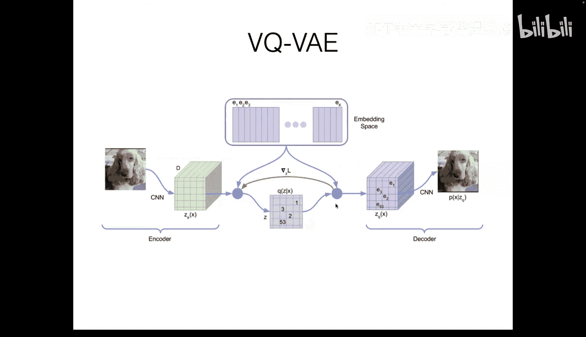

Okay。😊，So here's an actual example， so this method is kind of widely used。

 and so you might have heard of this method called Dolly from Open AI。

 so they had Dolly and Dolly2 and Dolly3。I think。By the time they got to Dolly3。

 they stopped publishing the details， but it kept getting more and more impressive。But so for Doli。

 they actually released their image tokenizer。And you can go and run the code yourself。

So here they have a notebook that you could run here I just modified it so you can print out the actual tokens。

So here you could see they're running this encoder。嗯。

Then here's the actual tokens corresponding to this image。And then they're passing it to the decoder。

 and it's basically able to reconstruct the image just given the discrete tokens。So yeah。

 I think it's pretty cool。Here again， I'm not going into the details。

 but if you read the paper here they're using this Gumbell softm gradient estimator that I mentioned instead of the straight through。

Esimators， so they did kind of improve upon the。Original VQV a bit。Okay。

 so then you could also what happened is。

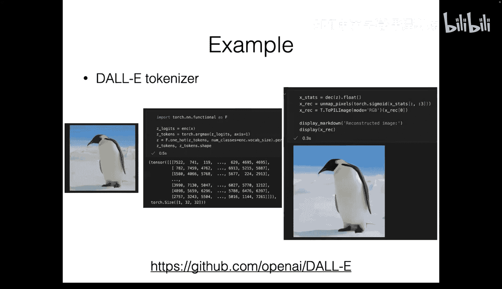

People also reformulated this as again， instead of a VAE。嗯。And so。

Here you again have basically the same concept。So again you encode your image and then here you can see it's doing it has this code book and it's doing this nearest neighbor's lookup。

And you get this discrete representation。And then you pass it to a decoder。

The only difference here is that now you have this different objective。

And it's the one that I told you about before where you have this discriminator and it's basically trying to detect。

Whether a patch is real or real or fake。Then what they do is， okay。

 given one of these trained encoders and decoders。They actually start to get at this idea that maybe we're interested in this lecture。

 which is they just train a。Language model essentially on these discrete codes。

 like a big data set of them。And then they use it to generate images。

So let me just talk through this a bit more because this will be， you'll see this， you know。

 appear in papers now and there's like pre trained VQ GN。Encoderrs and decoders。

So here again is they modify the objective。And then another thing that they demonstrate is that it's possible to train this autoaggressive model or language model kind of on these discrete codes。

Have it generate new discrete codes and then turn them into nice looking images。

So here they have this adversarial setup。So the encode sorry。

 the decoder will be called de generator。And the we'll call ther encoder。

And you have the same setup as before。 So you encode， you select， and then you generate。

And then if you haven't seen these generative aversarial network or GAN losses before。

This is what it ends up looking like。So you additionally have this discriminator。

That will take in an image and a generated image。And try to increase the score of a true image and decrease the score of a fake image。

And then it's this kind of joint optimization problem where you have the generator involved because it comes in here and you have the discriminator。

And。If you do it naively， it can be unstable to train， but people do。

 they are able to train it and they have these kind of。Ding objectives。

Where the discriminator is trying to get better and the generator is trying to fool the discriminator。

嗯。So then the second part is， yeah， they demonstrate that it's possible to train the language model。

So again， here they flatten the image into this sequence of the discrete tokens。

And then you can do this on like a full data set of images。

And then just train the standard transformer。So this is just writing out。嗯。

I don't know why I put instead of a Psm， but anyways， I read this quickly。

 but this is just the standard kind of next token prediction loss that we're familiar with now。

So an example is， yeah， here in some of their experiments， again， they used。

This discrete representation， which was 32 by 32。 So ultimately you're able to represent。

Even like a large resolution image as just 1000 tokens。嗯。

Here they were modeling these image net images， which were 256 by 256。嗯。So actually。

 you would probably multiply this by three because of the different channels。

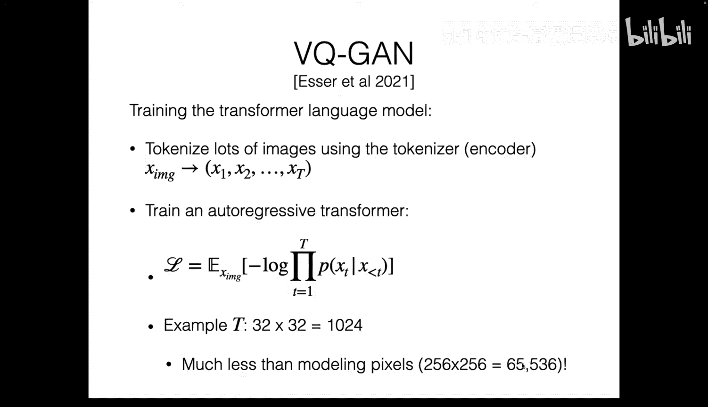

So again， here， they're showing the ability to generate。So not just like reconstruct。Images。

 but they're actually sampling these discrete codes from the transformer。

And then passing them to their generator， and you get some images here。

So now they're starting to look a bit more reasonable。This one actually looks like a rabbit。

The faces are a bit odd。But yeah， starting to be pretty good and then the cool thing again is that these are relatively higher resolution and they're all being constructed from this kind of discrete space。

 which is kind of cool。So then， oh， here they're additionally conditioning it on some class。

So they might have I forgot how many， like  a thousand classes。

And they would just have a token which indicates， you know， frog or bird or hamburger。

So then when you think about it， if this is possible， then instead of just having one class。

 then potentially you can just have like a sequence of text and that would actually achieve the goal that。

We set out to do， which is have a transformer basically that can take in text。

 it can take in these tokens for images and it can generate images。

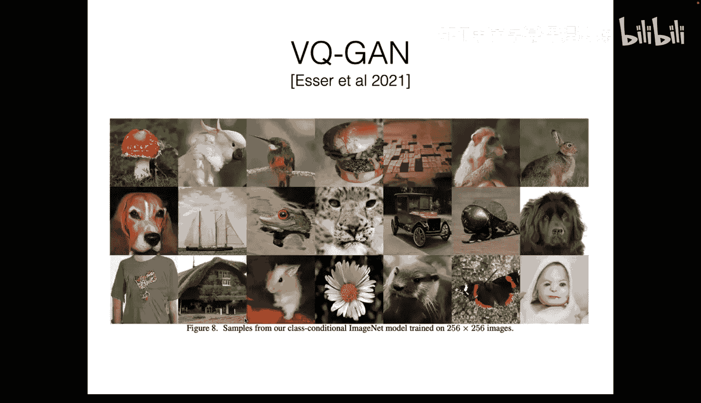

嗯。Oh， this is just showing also they tested instead of just a class label。

 you can condition on other things。Um， even this like kind of scene u scene graph and things like that。

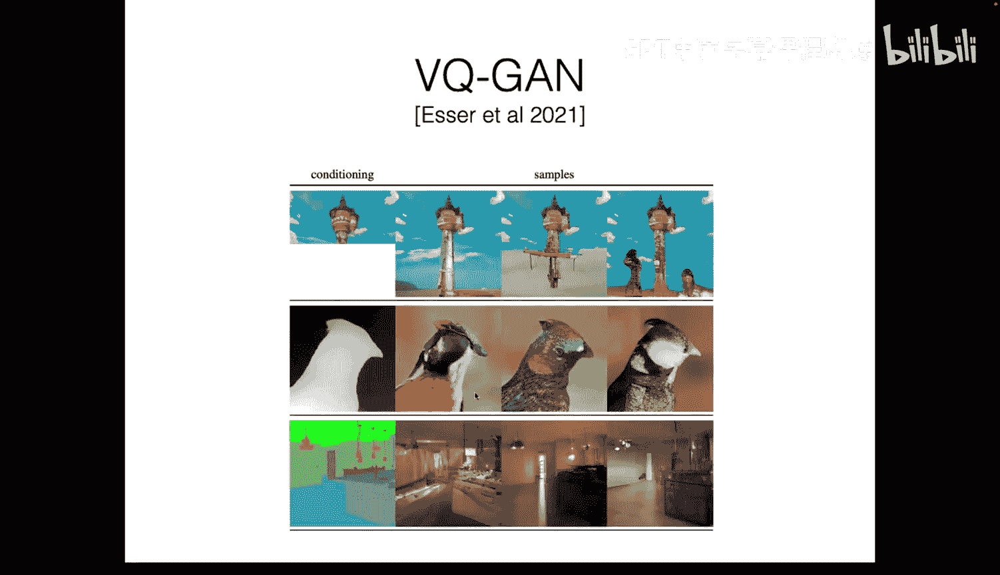

Okay， so to recap， here we have this tokenizer。Which corresponds to the VQ。So， up here。

 VQ VE or VQ G encoder， and you have the detokenizer， which is the decoder。

And so next we can do the final step， which is to just take a language model and add these， say， 8。

000 tokens to its existing vocabulary。Then we could take data， which has both text and images。

And basically tokenize it all。 and then just learn a model on all of this data。It could then。

Generate both text and image tokens， and then we can use this detokenizer to turn them into actual images。

So here's an example and this is like really， yeah， really recent， so end of 2024， I believe。

And they just updated it recently， but this is this model from meta called chameleon。

And they got these really impressive results， but like if you look at the details， then at its core。

 it's kind of doing all of the kind of ideas are contained in what I've told you about so far。

So basically， they take this VQgan tokenizer and detokenizer。

So here you can see it's called image tokenizer and image detokenizer。嗯。And then， yeah。

 you also have。Text， which you could obviously tokenize。

And then the idea is they collected 10 trillion tokens。

And a lot of them had kind of both text and images interleaved， you can imagine like。

 I don't know websites and actually having the images there， something like that。

And then just pre traininging a。Huge model from scratch， and that is their chameleon model。

And so here's an example of what you can do。So here they give it a prompt and they give it this image as well as some text。

And here it generates a response and kind of halfway through has an image。

 and then it keeps generating some more text。So it's basically the goal that we had at the beginning of the lecture。

hich was to have a language model that can kind of interleave that can both take in text and images and produce these kind of interleaved text and images。

And then the other example is this one。This was partly picked because I saw it was like recently updated and people were talking about it and then I noticed that you can also have this demo and go look at a bit more details than you can with the Me one。

So here this is again， this is the demo that I showed。

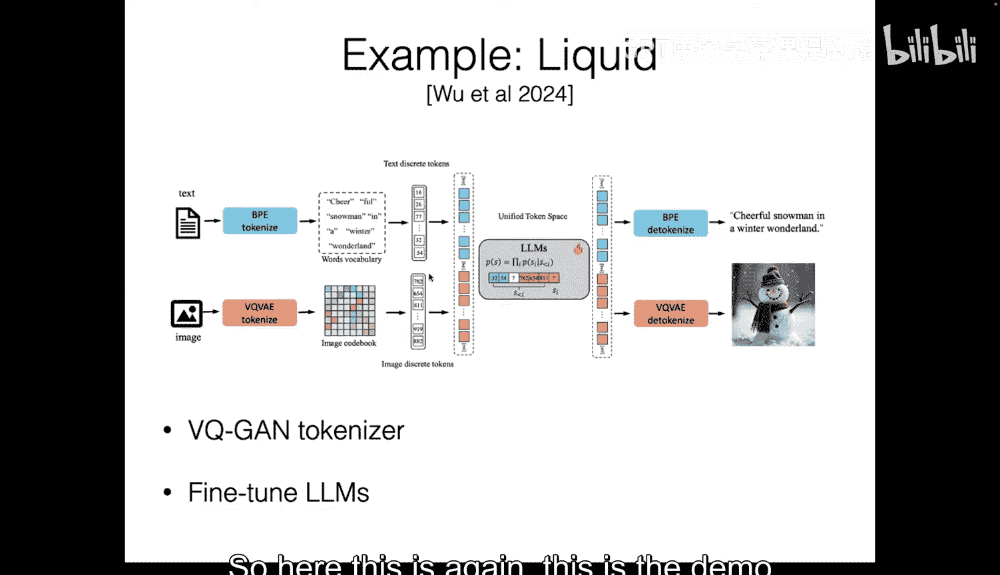

This liquid model。

And here you could see， again， the ideas that I've talked about。So in image it says VQ VAE。

 but they actually use VQganN， but essentially what we've been talking about right so you tokenize the image。

 you tokenize the text， and then you learn this autoobive model。

Here the difference is they showed that you can even just find tual language model。

 so the chameleon model did the training from scratch。

But here they were kind of adapting a model so that it could yeah operate with these vision tokens。嗯。

So that's it for this type of method。Any question here before I do？This。Unfortunately。

 extremely quick overview of diffusion。嗯。😊，嗯。F of the silly question。

 but what does a token mean when it comes to image so for text we know that token is probablyably at the part floor or sub but。

What does a token really represent in an image？Yeah。Yeah。

 so I don't have a good sense for exactly how to interpret them， maybe in some cases。

People are able to。Kind of interpret exactly what they correspond to。

I think one thing that can happen is， let's say there's a lot of regularities across the training images。

Like。There's pictures of animals and they're always in a field different something thing。

Then you can represent like an animal's head using like one token。

Or like the identity of an animal as one token。UAnd the idea is it just learns to kind of distribute the tokens so that they can be reconstructed by the deco cutder。

Okay， so is it kind of like analog to the kind of teachers that a CNN learns？The a teacher math。

So like the closest analogy is it's。The closest analogy is。This。

 so here the model learns to compress images into this continuous space。

And so then here you can kind of search around the continuous space and get some sense for what different points correspond to。

So it's doing the same thing， but now you have a kind of discrete vector。Um so。

I'd have to go back and look， but probably people have actually looked at。

Whether they could find kind of structure in discrete screen space but。有。Okay。😊，嗯。So。

That was these cluster methods。 and I think it's cool。 There's definitely some cool ideas here and。

I find this idea of going between like continuous and discretereet still。嗯。

Kind of crazy that it works。Um at the same time， you still have this kind of two part system right where you have to train the tokenizer and the de tokenizer。

So it seems like in the long run。

Probably a more end to end system might went out in the end。

But we saw a couple examples where these kinds of methods are at least being explored。

So then a big missing class of models when it comes to images that I didn't have time to talk about。

In the future， I probably want to do an entire lecture on these is diffusion。

So here there's been a lot， especially of these text to image models。

So recently people have tried to combine them with models that can also output text。Um。

 but certainly these are like very well known and very uh well performing for this case of like taking in a text。

 uh taking in text。Or taking in text in an image and just producing an image。

So you might have heard of things like stable diffusion and yeah， dolly and things like that。

So here I just in case you're interested in learning more as a starting point for other courses。嗯。

I wanted to just give you an overview of some of the early references so that you could have some starting point for doing some reading。

So the original， there's basically two somewhat simultaneous works that proposed ideas related to diffusion。

So this was one of them。In 2020， and it was these three researchers from UC Berkeley。And here they。

 yeah， proposed these denoing diffusion probabilistic models。Um， and again。

 I won't go through the details， but it's kind of the picture that I was showing before。

You have some noising process。And then what you're learning is to oh sorry。

 noing process going from right to left in this picture。And then。

You set it up so that you're ultimately learning this model that can denoise。

And so they have this really nice and principled way of setting this up and then it boils down to actually a kind of。

Simple loss function that really corresponds to kind of doing this denoing。

So here's like one of the early pictures and again it's kind of cool。

 you can see the learned model can go from the kind of Gaussian noise up to different images。

And then the other one， which is proposed at a similar time。

 is called these score based geneative models。So here they're basically learning these kind of gradients。

And then they sample by。It's called Laevin dynamicsys。

So you can like start with some noise and then you can take the gradient and the gradient is in the direction of things that are kind of high probability under the data distribution or probable under the data distribution。

So then again， you can have this kind of model that can start off at noise and then kind of。Do this。

Yeah。呃。SStastic following of the gradient， so it's long of dynamics to get to a final image。

So then since then， people found that these two models are actually connected。

 they're kind of the same thing。So there's a lot of interesting work kind of expressing these in terms of differential equations。

Showing how they're related。So can't get into the details here， but it's really a。

Kind of fascinating area。So then there's the ones so like given these initial papers。

 then you have to kind of make them practical and make them better and better so of course there's been like many different papers but here's one that I'm familiar with and I think got a lot of attention。

So at the time， these GA models were the kind of state of the art for image generation。

And then this paper from these two authors at Open AI。

Kind of made a bunch of modifications and improvements to the diffusion training。

And they were actually able to produce these really nice images that were able to outperform the GAN models。

So a lot of people kind of started paying attention to the diffusion models。

As a potential alternative or replacement。And then here's just one kind of like chain of applications。

 I think I just have two papers。

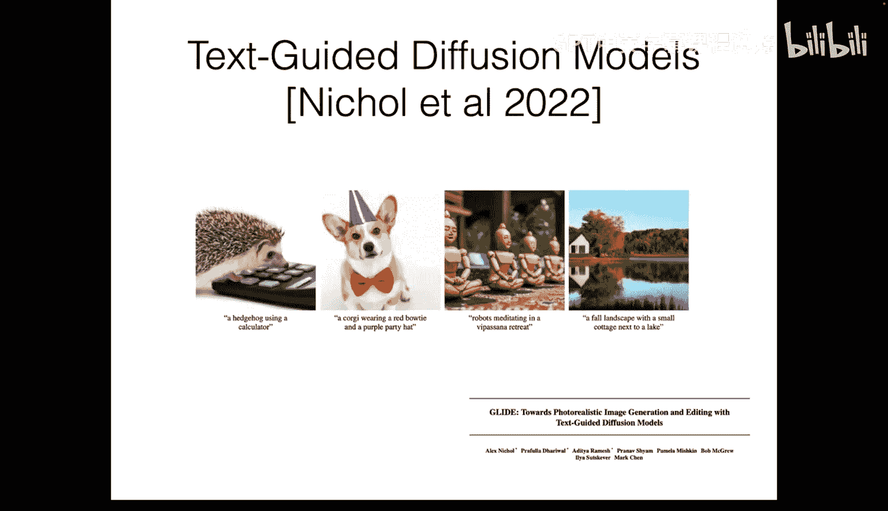

So then you can see here it some of the same authors。

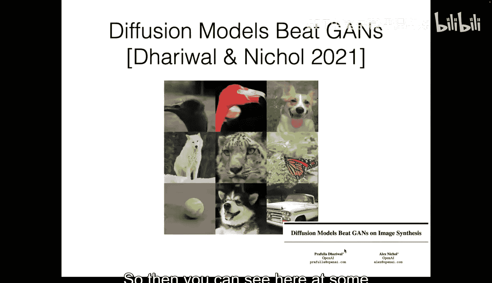

嗯。From Open eye。They developed these text guided diffusion models。

So you started to see these examples here where you're now conditioning it on text and it can generate some nice image。

And then they were able to show this kind of。Yeah， compositionality in the sense that like maybe you never see these images in the training data。

So this was called Glide and then they had Dolly and then here's an example of Dolly too。

And so here they're taking these latent vectors that were learned。

With a clip model that we mentioned in the previous lecture。

And then they have this kind of diffusion decoder。And so now they have this text condition model that's。

Comp produce even better images。And it's now 2025， and as you can imagine。

 the field moves extremely fast。So I kind of stopped here at 2022。U。

 but hopefully this gives you some sense of， yeah， some initial papers if you're interested in the diffusion and then here's some stuff since it's advanced NLP where it's actually using text。

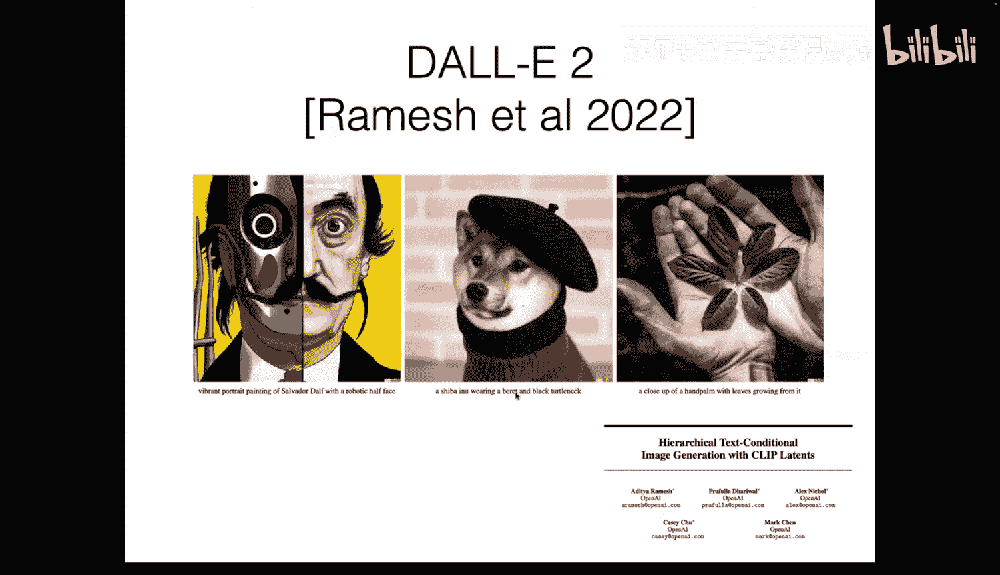

Okay， so to recap， I talked about these four different paradigms for generative modeling。

Autaggressive models， GNs， Vs and diffusion。And then we saw some ways that they can kind of be， yeah。

 combined in some sense。And so in these two multimodal lectures， again。

 we saw these different types of models。And actually， based on the assumptions you have。

 it actually did lead to different methods。So in the previous class， the methods。

Didn't work for producing images， but they could be pretty good at taking in images。

Some of these diffusion models。Sorry would be able to produce yeah。

 this is error for to fix this is meant be image， some of them can produce images but not necessarily produce text and then you have these flexible models that can try to do everything。

So here's what we talked about。Today and。

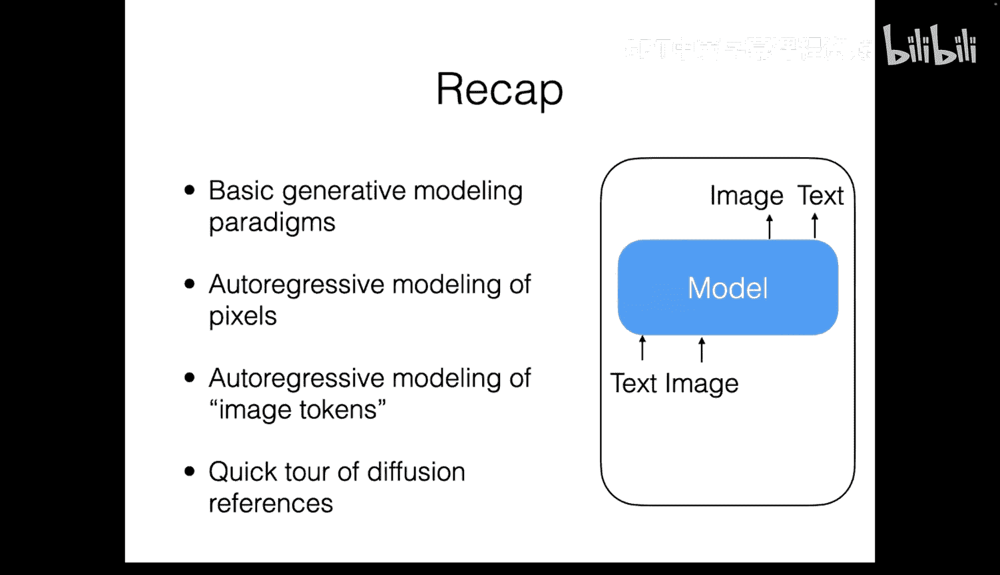