# CMU《高级自然语言处理｜CMU CS 11-711 Advanced NLP Spring 2025》中英字幕（claude-3.7-s - P2：-02-(2)_ Neural Text Representation and Classification.zh_en - GPT中英字幕课程资源 - BV1nYVHz7Eoa

嗯。So yeah thanks everyone for being here this is lecture number two so there's been a lot of questions about the waitlist so we obviously have tons of interest in the class which is really cool as a result we can't really favor any particular person on the waitlist and so it's an automated procedure and it's out of my control。

Now we do have the quizzes， so if you're on the waitlist。

 then you're not able to join the piazza or Canva yet。So if you miss quizzes。

 then we'll drop up to two quizzes for people on the waitlist and then if you look at the grading for the course you can have your lowest three quiz grades dropped so in principle you could you know recover all of your grades even if you miss five quizzes if you're on the waitlist。

Um， if you get off of the waitlist， then send the Ts and myself an email so that we can add you to Piazza and Canvas。

And then finally， to get the quizzes dropped， please make a piazza post and we'll handle it through there so we won't automatically drop the quizzes unless you make the piazza post。

嗯。Okay， so that's that's about the logistics so now we can get into the fun part which is the lecture so today we're going to talk about neural text representation and classification。

So we actually have a lot to cover today along the way we'll kind of introduce basic loss functions that will actually come up throughout the course。

We'll actually talk about。Deep learning， you know， some background on deep learning a bit。

We do assume that you've know maybe seen some of this stuff before。

 so if it's completely new or out of distribution， then perhaps like set aside some time to learn about things like high torch and automatic differentiation。

 but you'll kind of see that in the lecture。And then next class。

 we'll start talking about language modeling。And again。

 we'll actually use a lot of the ideas we talk about today， so it's a kind of nice progression。嗯。So。

Can I move this？嗯。OK。So if you recap from last class。

 I introduced this really simple classifier called bag of Words。

And we represented the tokens as just these one hot vectors and then took the sum。

 and that was our feature vector。And we talked about some kind of symptoms that you observe with these models。

 which are like， what some things that are missing？We talked about conjugation or compound words。

Handling of word similarity， so a word like love versus adore。

Handling combination features like don't love and don't hate。

And then also handling sentence structure， so here's an example shownn here。

So this is the stuff we talked about in the last class。

 and today we'll cover kind of four different techniques。

 well actually three and the next class will be the fourth。For overcoming some of these。

So first we'll talk about what are called subward models。

 which can help with this problem of conjugation or compound words。

We'll talk about these continuous word or continuous token embeddings。

That can capture some forms of similarity as well as do a lot of other things。

And then we'll talk about neural network models， which again will give us various benefits。

 one of which is being able to capture these combination features。And then in the next two courses。

 actually， we will go over methods that kind of model full sequences and are able to capture sentence or you know document level structure。

So first， we'll talk about subboard models。And for this one， if you。

 I probably won't have time to go through the full thing， but I put together this notebook。

And the notebooks actually based on a really cool video by his names Andre Carpathy。

 so he's kind of a wellknown researcher in machine learning， deep learning。

 and he has a really nice teaching style to really hands on。

So you could check out the video and then this is the。The notebook for our course。

 which is kind of based on it。Okay， so here the basic idea is we have our sentence and we've been talking about words and the basic idea will be to split these words up into multiple tokens。

So here's an example， we have the and we don't split up the in this example。

 but then we split up companies into these two tokens shown here。

This is just visualized with this like underscore so that you can remember to。Put them back together。

And then again， you you might want to split up expanding and you can see here that now this like ending is is kind of chopped off and so maybe we can have some like shared structure across different forms of the word。

Expund。So again， the hope is that we will be able to share parameters。

 so if we have like a vector associated with each token。

 now the representation can possibly you know share some parameters between these different word variants。

And then also you can potentially reduce your parameter size and save on compute and memory and this one might be become clear once I kind of talk through the details。

So it turns out that this idea of subwords， there's a kind of core underlying problem。

And the problem is called tokenization。So the general problem is like we have some sequence of like raw text。

And then we want to transform that sequence into a sequence of tokens。Okay。

 and so then the set of all possible tokens is called the vocabulary。

And so you can see here that there's like multiple different strategies that you can use for tokenization。

So one is the strategy of splitting on just this white space。Which is what we did last class。

One would be the strategy that I showed you on the previous slide。

 I haven't said yet how to implement it， but you know that's one strategy。Another strategy is to。

 let's say， like tokenize by just selecting each character。

 and then you also have to have like white space as a token in your vocabulary。

And so you can think about this for a bit and some things that you want in your vocabulary or in your tokenization strategy。

Well， first， we're going to use these models with a lot of different types of text。

 not only English text， but text from other languages。

We want to be able to use them with like programming languages， basically， you know。

Whatever is like on the internet even。And so we want our scheme to be expressive。So for example。

 if we only have like these English characters in our vocabulary。

Then we might not be able to represent Japanese， for example。

And then you want the vocabulary to be efficient。So if you have a really large vocabulary。

So let's say like every possible English word， every possible you know， a Japanese kanji。

 then this just keeps growing and now you have to like learn parameters for each item of the vocabulary and that's going to be very。

Could be inefficient。On the other hand， let's say we're just doing English and we choose a character level of vocabulary。

Well， now our sequences will be very long。Um right。

 like if you have a full document and you tokenize it into individual characters。

 then it's going to be very long。So in practice， you kind of want something in the middle。

And so let's look at like what actual state of the art models are doing in terms of tokenization。

 and so there's this cool website called tick tokenizer。versll。 app。

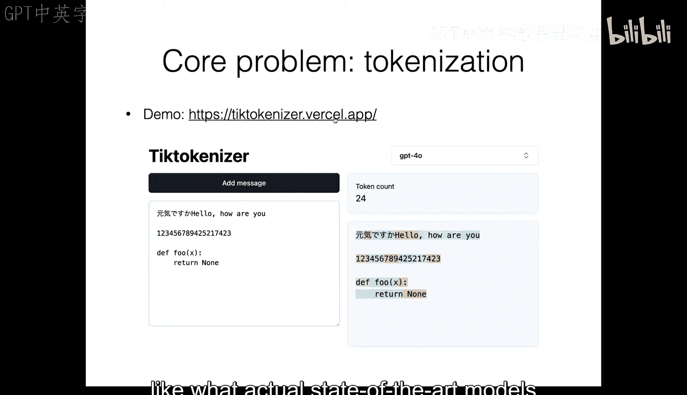

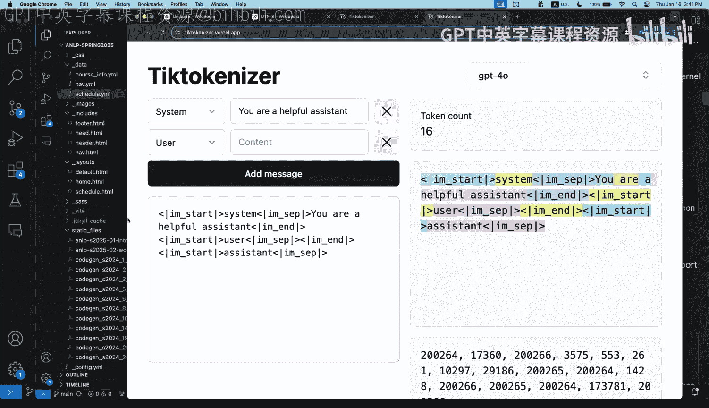

And you can basically on the left here， like type in text and then select different tokenizers for different language models and see how things are tokenized。

So like here you could do hello。How are you？And then， maybe。Like types Japanese。

And you can see how it's tokenized by GP4。So here like hello got it a one token。

And then the question mark got its own token。And then it looks like， you know。

 this character here got its own token， but then this one got grouped up。Okay。

 so this is like an example tokenization another interesting one is like numbers。

So let's like write some numbers。And so。It looks like the GPT4 tokenizer is actually choosing to group every like sub sequenceequ of three numbers into a token。

So actually， I wonder like， what if you just have a two digit number。

And then it looks like they have like specific tokens in their vocabulary for two digit numbers too。

嗯。So let's let's look at how。Some other model does it， let's say。Coode lama。Okay。

 so does anyone notice any differences？The itself every38 study every。Yeah。

 so it looks like they do this digit tokenization。JapaneseYeah， yeah， so now these are separated。

And then you can see that the token length is actually longer with this one as a result。You know。

 probably， I mean， yeah， it's splitting these and it's splitting the numbers and so now you have more tokens。

And so you can do this。Another interesting one is like with the older GP model if you。

If you write some Python code。Then。It will actually come up with individual tokens for each space。

 so it's like very inefficient with code。But then let's let's take a look at。呃，扣服了吗？Yes。

 you hear it group two spaces into one okay for example， so maybe I was supposed to have a。Anyways。

 yeah， so you can see how they they vary across different models and then you get like different length sequences。

 you get like different handling of numbers and different languages and things like that。

So kind of interesting。

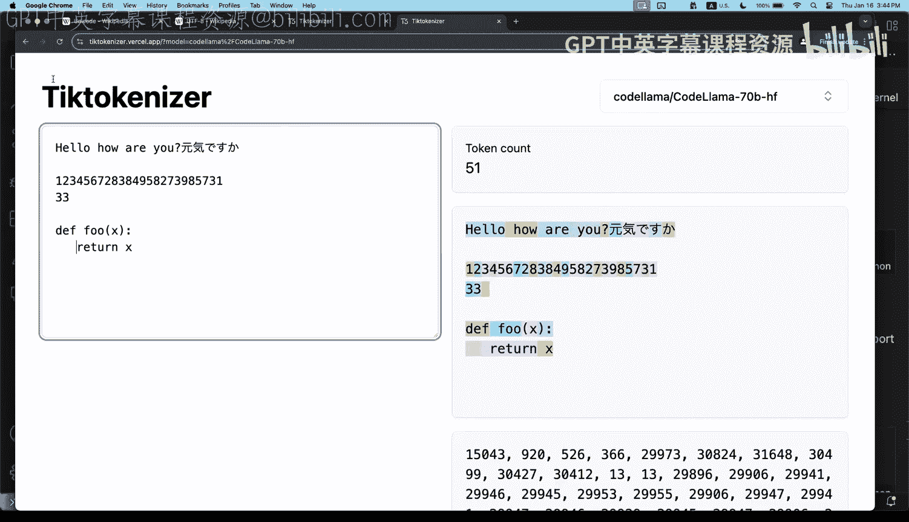

So let's talk about how you actually do this in practice。So first you have to decide。Well。

 so the overall idea is like we're going to come up with some vocabulary and then start combining the elements into these subboards。

And so the first step is like， what do you choose as your initial？Vocabulary。

And so one idea is to use what's called UTFA。So UTF8。Is there's kind of two steps。

So one is you can express like any type of text pretty much using what is called UniIcode。

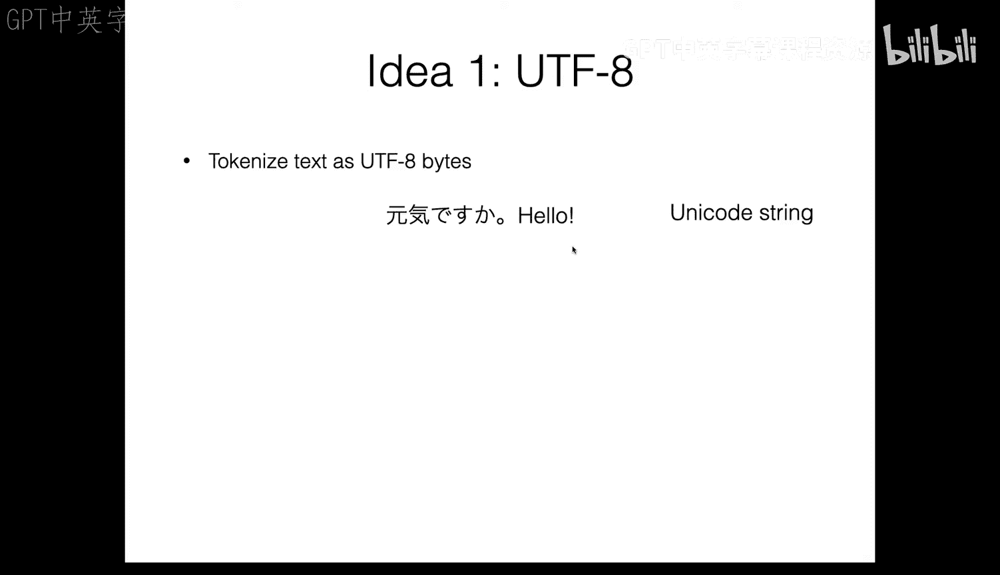

So you can go on the if you want to read more about this。嗯。

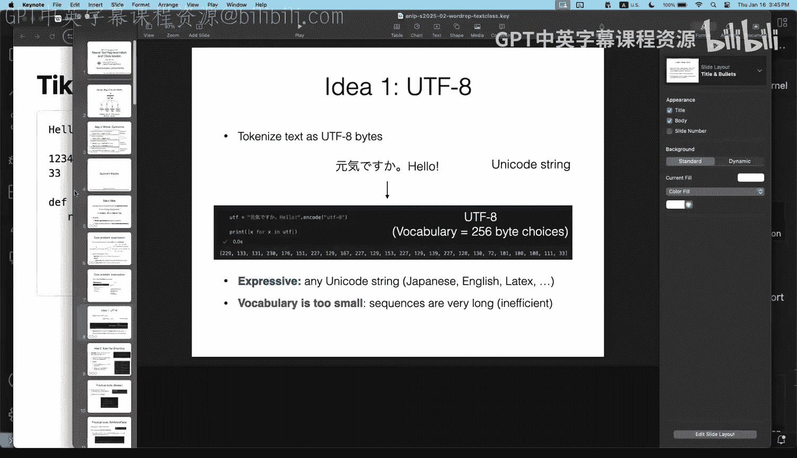

Though I mean， the Wikipedia for Unicode is kind of decent。

And you can see here that there's essentially like 150，000 different UniIode characters okay。

 and so this will be expressive like you can express different languages， you can express code。

 whatever you want and they kind of like keep adjusting it to ensure that that you know。

Almost everything is covered。Can anyone say a downside of using each Uniicode character as your vocabulary？

And I've actually already mentioned it。Yeah， so this is actually like the worst of both worlds because like your sequence length will be very long and your vocab size is at least 100。

50000。So we have to do something a bit better。And if you scroll down to this part of the Wikipedia。

You can see that like UniIcode text is actually processed and stored as binary data using some encoding。

Okay， so basically like the computer is actually representing UniIcode using just like bytes。

And so the encoding that he uses is called UTFApe。And。

You can go down here and it basically is able to encode all possible like Unicode characters using just four bytes。

And so。And so what you have at the end is you have this like minimal vocabulary of just 256 possibilities。

 for the byte。And then you can basically express any UniIcode using this encoding。And then therefore。

 like express any type of text。

So。So so it's kind of cool like you can， here's， here's some Python code showing that you can convert this string into these UTF8 bytes。

And now you have this like really minimal vocabulary of 256。Okay。

 so now the problem is obviously that this vocabulary is just too small and so our sequences are going to be like extremely long because now each like UniIcode character is you know up to four bytes。

So the second key idea， and this is the algorithm used in a lot of state of the art systems is called Bte pair encoding。

And so here the idea is going to be， we start with minimal， some base vocabulary。

And then we have some training set。And then what we do is we like iterate over the training set and we find the most common token pairs。

And whatever is the most common， we turn that into a new token。So like we start out with 256。

 for example， we go over and find the most common pair， and then we add a token number like 257。

 and then we can like replace you know two tokens with this new one。

And then you just repeat the process and it has the effect of combining new tokens or merging tokens over time。

So here's an example， and here I wasn't using。UTF8 I was just using characters to make it clear。

But we have this training set， and it turns out that on the first iteration。

 the most common pair is E and space。And so what you do is you declare a new token。

Or maybe it was using GTFA。And now you replace the text with it and repeat the process。

 so now like the next most frequent thing is T in space， then E and R， T and H， and so on。

And so you build up these vocabulary of these kind of subwords。

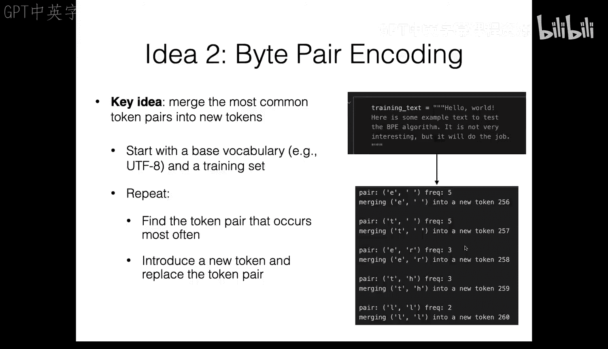

嗯。😊，I would say that when you start explaining UTF， there were un there were like 150。

000 options and when you went to UTF8 it dropped down to 256， what happened with the rest？Yeah， yeah。

 So the idea is you can， you can have this minimal vocabulary of these byte sequences。

 and then if you design some encoding procedure， then you can imagine like encoding。

Each Uniicode character using some sequence of bytes。

Does that make sense and so for any given Unicode you can encode it using up to four bytes？Yeah。

 and so all you need are the bytes and then the like encoding scheme， which is called UTF8。Yeah。

And so yeah， and so that's really the basic idea and if you want to actually see like the code for doing this。

 it's fairly simple and it's in that notebook I mentioned。

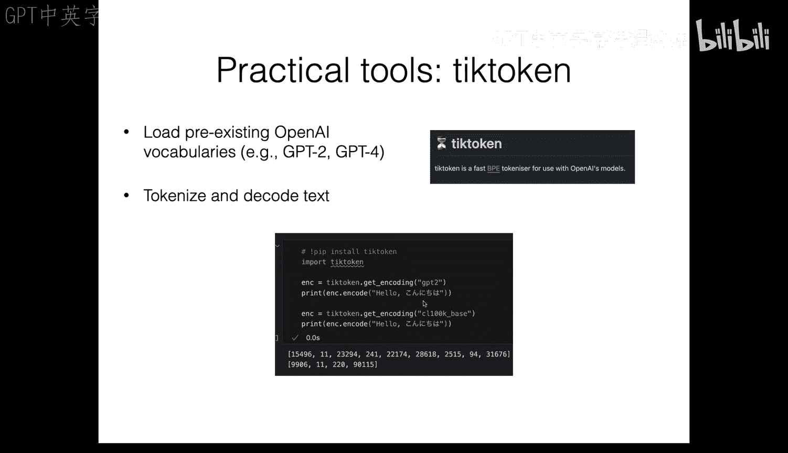

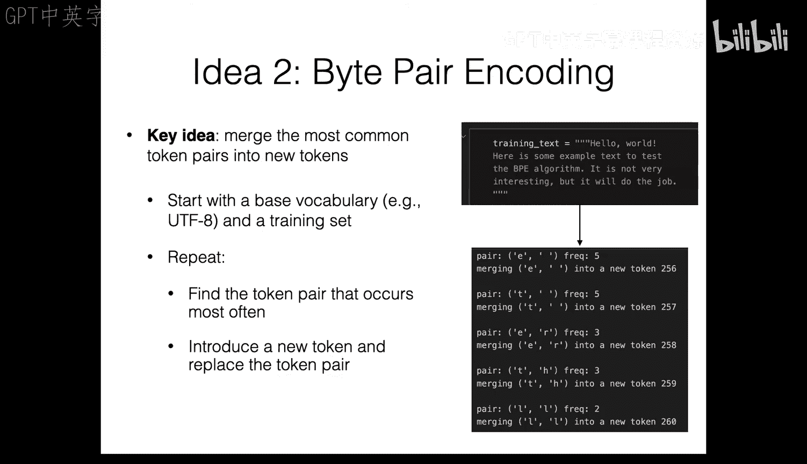

嗯。But yeah， so that's the key idea。And then so there's a few practical tools that you can use for this tokenization might be helpful in like projects and things like that。

This one called Tk token is written by Open AI。And you can essentially like load their tokenizers that they've already trained。

And then here you can see like encoding these different strings into different tokens。

This other one called sentence piece also supports training a tokenizer。

So like you have some training set like the example I showed。

 and then you can like train your own BPE tokenizer。嗯。This has actually been around for a long time。

So it turns out that they actually use UniIcode as the base vocabulary。

And then you can set this option to like， if some uncode character appears it's not in your merged vocabulary。

 then you fall back to the UTF A bytes。So these are kind of like maybe a bit too much detail。

 but you know this library is actually very useful and again the notebook that I have actually shows you an example of like training the tokenizer and it's just a few lines of code so you can do it pretty quickly。

Okay， so when you do this tokenization step， a really important thing is that the vocabulary that you get or the subboards that you get depends on the BE training data。

And so in particular， if you have like languages that are underrepresented。

And they're not in your training data。Then these will never get like merged together。

 and so your sequences will be very long。So what people do in practice is to like make sure that the BPE training data is。

 you know， hopefully balanced。So like an example is for code Lama， they probably made sure that。

 you know， a bunch of different programming languages are in their BPE training corpus。

So then you can get this like really good tokenization。s。Also as we saw it。

 like these are somewhat arbitrary， so you know， like one， two。

 three could be tokenized in many different ways。There are techniques at like learning time to try to make your model more robust to different segmentations。

And then usually in order to to like overcome some of these weird behaviors。

 you'll just hand to find some rule。So actually like the code Lama paper that I model that I showed you。

 they actually hand to this rule that like number tokens should always be just individual digits。

Yeah， so let's say you have some training data and you're about to run like sentence piece on the training data and let's say it has like one Japanese document and 10 English documents。

Well， then you can like。Just like repeat the Japanese document if you want。Um。

 or probably a more realistic thing is like you have tons of data and then you have to decide what to put in your BE training set。

Then one way to do it is just like uniformly sample documents and then put them in your BE training data。

Another is to like sample them such that the different languages are equal。Yeah know， yeah。嗯。

Do depend on you said for the？Yeah， so I mean， it's going to be like a case by case basis。

Some of the times it's a fairly large data set， and so you have to make these kind of coar grained just categories。

 you know， either race like language or yeah， math data or different types of code。嗯哼。😊。

In this slide。Multiple segregations are in China。That statement sub legalization samples I don' want similar that state means。

What exactly does that the line mean you some examples Yeah yeah， so this， I mean。

 like one option was to like not include this line in the in the lecture because。Yeah， like。

TheThe point wasn't to like fully describe their their method。

 but it just gives some sense that like。There are what there has been research done to make the model more robust to different segmentations。

 so like concretely what you might do is like in your training data。

 just segment multiple ways and then train the model on like multiple segmentations。

Fectively they handd various segmentations during the training time so they ensure the model is able to handle no matter what segmentation government is able to work with it。

 how does that differ from not being bypapointing them the first one？

Take from hand using multiple segments， then its the same as me not having done V first by。

Not necessarily because like if you don't do the BP in the first place。

Then you don't have any subboards。Exent skill， yeah。Okay， cool， so just as a recap， the yeah。

 the tokenization and subboard stage is is really important in basically when training any NLP model。

You have to think about how we represent the textual sequences。

And so the method I described builds up this vocabulary based on the frequency of tokens in the corpus。

Okay， so next we'll go to continuous word embeddings。First。

 any other questions on tokenization before we do that？Okay。

 the questions have been really great so yeah keep them going so here we we actually have another code example。

That you could check out。And。Yeah， let's get started。

So the basic idea here is instead of representing tokens using these one hot vectors。

 you might call these sparse vectors。We're going to have these dense vectors or continuous embeddings。

So here what we have is for each token， you're going to have this vector。

In we can call it like D like D in RD。And so now our lookup procedure is like given a token。

 get this vector。And concretely， what you do is you have what's called an embedding layer。

So an embedding layer is a matrix。And one dimension is your vocabulary dimension。

 so you have like all your different tokens， and then you have for each different token。

 one of these vectors。And then when it says look up on these slides。

 it just means like select the column corresponding to that token。So。Pretty simple。

 pretty simple idea。And then it's good to just point this out that like you can view this as multiplying this matrix by a one hot vector。

Um， it typically is like more efficient to just implement it using，um， you know。

 using like ray indexing or something。Um but， you know。

 sometimes you'll see this pop up like this and like conceptually it's it's kind of useful sometimes。

So。If you have these continuous vectors， then the next kind of step up from bag of words is called continuous bag of words。

So now we embed our tokens and we got these different vectors。

And we're going to again just sum them together。And now you get this new vector and we'll call it a hidden vector H。

Then so this H is in RD， but you ultimately want to get different scores for the different classes in your classification task。

So to get those scores， we'll multiply it or we'll pass it through what is called a linear layer。

And a linear layer consists of multiplying the vector by some weight matrix。

And then adding some bias。So here sometimes I'll flip you know。

 from like horizontal to vertical just to make things present easier。

But here you have like your hidden vector in RD， and then you have this weight matrix in R K by D。

Okay， so now you have this new architecture and it gives you scores。

And then the parameters that we would want to learn is you actually want to learn these embeddings。

You also want to learn weight yeah， the weights。And then you also want to learn this bias right here。

Okay， so now instead of just this like white vector at the end。

 we have like multiple learned components。

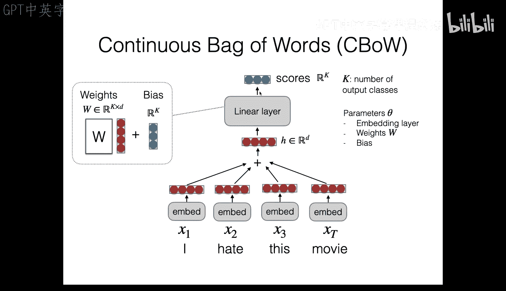

And then if you haven't seen this before， here's an example in code of implementing this embedding layer。

So again， you declare some weight matrix。Here this is writing this out with an actual like one hot vector and then multiplying it by the weight matrix。

Again， the the code examples are not meant to be like efficient or anything like that。

 they're just meant to like make concrete， you know。

 things on the on the slides and things like that。And in practice， you know。

 this is implemented in different libraries like Pytororch as the embedding layer。

Then you can define this continuous bag of wordss architecture pretty easily。

 so you have your embedding layer， you have the linear layer， the output layer。

And then it's just like four different steps， so you embed the tokens。You sum them together。

This is just like reshaping the dimensions。And then you pass them through the through the output layer。

Okay， everything good so far。

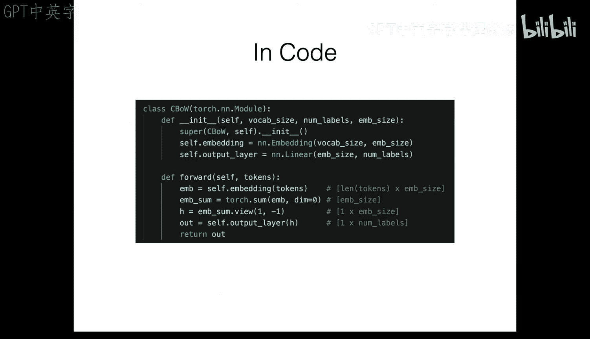

Okay， and so now the interesting thing is like now we're in this continuous space and so ideally we would want like vectors that kind of have some notion of similarity。

So if two words are similar in some sense， then maybe they'd be close in vector space。

And then moreover， you can interpret this like high dimensional space like each different dimension or each vector element could represent some feature。

嗯。RightAnd it's kind of up to the learning algorithm to learn some feature representation that is ultimately useful in the architecture。

Now， in reality， you know， we'll set the dimension to be。512 or 1024。

 so you would actually have to use some visualization technique to。You know。

 to put them onto a two dimensional plot。I think in a later lecture in the course。

 I'll go into some visualization techniques。Okay， so that's the basic idea of having these token embeddings where we represent the tokens as learned continuous vectors。

So any questions on this part？Okay， cool。So next we'll talk about neural networks。

So if you remember last class， we kind of ran into this issue of combination features。

So if you have things like don't love， nothing I don't love。And so on。

You basically want to do these like more complex operations over， you know， multiple。

Multiple parts of the sequence。And so one way of achieve it or like a good way to achieve this is through a neural architecture。

 and I'll talk about why in a couple slides。And so the next step up in complexity is called deep continuous bag of wordss。

So we're going to start with our bag of wordss like before where we're summing things up。

And then now we're going to have multiple layers， so it's going to be this like deeper neural network。

And then at the end， again， have this linear layer that goes from the hidden dimension to the number of classes that we have。

Okay。😊，And so now the key difference is that， yeah， we have these multiple layers。

We also have more parameters right so each layer here again has this like a weight matrix and a bias term。

And then you can notice here that it has this 10 h function。And so the question is like why like？

Why is 10 H there。And what fundamentally is this doing different than the architecture I showed you before？

Is it like the stacking， is it you know exactly what was written here？

And so it turns out that like one really key thing is that introducing this function 10 H or in general。

 some other activation function。Introduces a linearity into the network。

So all the operations that I talked about before， like a matrix multiplication or adding a bias。

Those are just linear operations。And so adding in the nonlinearity increases the expressivity。

 so the patterns are the functions that the network can model。

And then the idea is like once you introduce one linearity。

 then you're like doing a more complex transformation。

 and so if you start stacking these complex transformations together。

 then the whole thing becomes very nontrivial。Okay， and so just to like drive us home。

 if you don't have the nonlinearity。And you just stack two linear layers together。Well。

 then that's actually just the same as just having another linear layer because you're just multiplying you know two matrices together and you get another matrix。

Okay， so that's a kind of key thing that the deep architecture is giving us。

And there's a lot of different activation functions so sigmoid Relu is is a popular one and you can like take a look at this pietorrch list for for some other ones and throughout the course will。

You knowWhen I'm introducing an architecture， you'll see like which activation it's using。

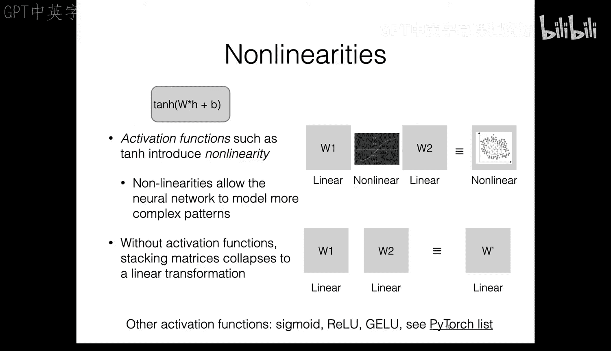

Okay， so now to implement this in code， I guess I just made a one layer that there's like one hidden hidden layer。

But as an exercise， you could like turn this into a。Two layer or however many you want。

And the only difference here is， you know， now you add in this linear layer and then in the forward pass you're adding in。

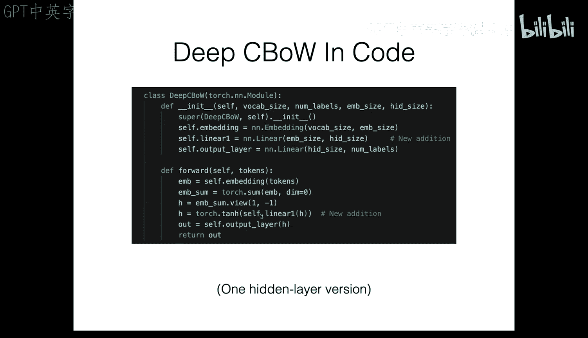

Yeah， what I showed on the slide。Okay， and so now when you think about this。

 like this network can start to learn these different feature combinations。So for example。

 like in the second layer， it's receiving inputs from the different dimensions of the hidden vector。

And so one element in the hidden vector might represent some feature that's like related to not。

 and then another feature might be related to like。Positivity or or negativity and and hate。

And so the second layer is able to combine those。And transform it into， yeah， these。嗯。

These kind of like nonlinear transformations of the features。So a bit of hand waving there。

 but hopefully you kind of get the sense of yeah， what we're getting with the neural model。

So any questions on that？And then we'll talk about training and loss functions and things like that。

嗯。😊，Do repeat why the single layer was uncapable of capturing those relationships between the teachers？

Yeah， so。So the single weight matrix， I guess， would still。Yeah。

 it would still be able to compute a feature that's a function of like multiple hidden dimensions。

 yeah。And then the non linearity just allows you to represent like potentially more complex。

 more complicated features。I这是。啊啲没好。Oh， yeah， so as I mentioned， if you like。

 as long as you have a weight matrix， then it will be doing some function that involves multiple hidden dimensions。

And so that could actually be sufficient for some combination features。

And then we don't know exactly like which one the nonlinear function is is。Is learning。

 we just know maybe that like it can learn more complicated things。Yeah。Okay。嗯。So yeah。

 let's talk about training。And。When we train a neural network model， so we use gradient descent。

And there's kind of three different steps。So first， we write down a loss function。

Then we calculate the gradients of the loss function with respect to the parameters。

And then we adjust the parameters in the direction that reduces the loss function。

So the gradient will give us like the direction of steepest ascent or you know descent。

 and then we just make sure that it's we like put the negative sign correctly so that we're reducing the loss function instead of increasing it。

And then how you do the how you actually perform this movement。

Turns out to you know there's different strategies for it。

 so let me go through each three of these parts。So an example loss function。

 I'm going to go through two different loss functions。

And the reason I'm going through these two is because they're very popular in practice。

And so actually like the second one will be used in you know most of the language models we talk about and so I do think they're like really good to。

To know and even if you've seen this before， probably review。

So the first one is called binary cross entropy。So here our task is just binary classification。

 so let's say we want to classify tweets as either positive or negative。Well。

 then we can have our model output。Some number that we interpret as a probability of the positive class。

Okay， so in order to be a probability， it has to be between zero and1。

And does anyone know how to make a neural network？Output a number between zero and 1。Like。

 how could we take the。Solftmax and sigmoid okay， so yeah。

 softmax we use for multiple dimensions so that'll be in the next slide。

If you just have this like one scalar， then yeah， you can use what's called the sigmoid function。

So the formula is here， and yeah， this just gives you some function that ensures that things are between zero and one。

嗯。And then let's say that you know we're training and so we have some ground truth label of whether our tweet is positive or negative。

 so that'll be y either zero or one。So here's the binary cross entropy loss。

 and let me just talk through it。So it's useful to look at like one label at a time。

So let's say that the ground truth label is one。Then that'll be this kind of yellowish curve。Here。

And what happens to the loss is if y equals1， then this part goes away。

And so our loss is just one times the。Log of the probability score from our model。Okay。

 and then you can see that plotted here。And so it's basically saying like， okay。

The ground truth label is one， but if our model gives us a probability score， that's low。

Then the loss is really high。So kind of intuitive idea。

Like we want to penalize the model a lot if it's wrong。

And then as its probability score is increasing， the loss is going to zero。Okay。

 and then the other case is basically like， you know， symmetric or something like that。

So let's say y is zero， now this term goes away。And now you have like a log 1 minus P。

And this is what it looks like， say your model gets a high loss if it gives a score of one and a low loss if it gives a score of zero。

Okay， so this is the binary cross entropy loss。And then we could think about like what if you have multiple classes。

 so we might call this one just cross entropy instead of binary cross entropy。

So now let's say that the task is to classify the tweet into positive， neutral or negative。

And it turns out that like what I'll say it could be any number of classes， it could be like 50。

000 classes， doesn't have to just be3。And let's say we're giving some training example， X and Y。

And so now our model outputs a probability vector。嗯。

So does anyone know how you get the probability vector？

Softmax exactly yeah so heres softmax if you haven't seen it before。

 so you have these scores sometimes those scores are called actually very frequently these scores are calledlogitts LO G ITS so you have to kind of get used to saying that that word。

And then the softmax transforms it into a probability distribution。Using the formula here。

And so probability distribution just means that everything is between zero and 1。

 and then the sum is one。ok。😊，And so now we could view this ground truth label as like a one hot vector。

 so here it's saying that the ground truth class is positive。

And then the cross centroppy loss looks like this。So it basically says， okay。

 some over all of the different class dimensions。And then you have the log。

Of the probability score from the model。And you can notice that like all of these will actually just zero out except for one of them。

So it's this， yeah， it's basically saying like what is the log probability of the target class？

And so if we think about what this is doing， again。

 let's say that the model assigns high probability to the correct class。Well。

 then P I will equal one so log。Of that will equal zero。And so you'll have a really small loss。

 so kind of makes sense。And then conversely， if you have a low probability assigned to the correct class。

Then it'll be near zero and your loss will actually go towards like negative infinity。

Okay so kind of。If you like think about it， then kind of intuitive idea。嗯。

But like where does this actually come from and especially if we're going to be using it in language models and all this stuff。

 then yeah， we want some like deeper deeper understanding。

So there's this idea in information theory called kale divergence。And it's。

Some way of measuring the divergence between two different distributions。

 So like if two distributions are more similar， they'll have a lower divergence。

If two distributions are different， they'll have a higher divergence。

And then this is just like the formula。 It's， it's just the definition of。Kale divergence。

Then you can do this like two line simplification。So here it's just expanding out the log and so now you have like two different terms。

And then you can see that if we're trying to minimize this kale divergence with respect to the second distribution。

Then this term here actually doesn't matter because it's just constant。

Regardless of what we choose P2 to be。So minimizing this is equivalent to minimizing this。

And this is actually the cross entropy loss。Okay， so like as you minimize proroppy loss。

 you're making two different distributions kind of closer to each other。So kind of a nice idea。

And so here in our example， your distribution is like one is your target vector and one is your model's probabilities。

 and so by minimizing the cross entropy， you're trying to bring those together。Kind of nice idea。

 I I kinda like that one。And we'll actually see this argument come up when I talk about language models。

 it's slightly different form， but same idea。One more thing then I'll pause for questions。

 so here's some code actually implementing the cross entropy loss。So nowadays。

This loss is like so popular， it's just implemented in the libraries and it's very optimized。

Here's one possible implementation。Where again， you have the logits， which is like the scores。

And then you do these two different operations。So if you haven't seen this before， then maybe。

Go through and like。You know， try to understand what's going on here。

So does anyone have questions about loss functions before I go to gradients？

Okay yeah other thing is that like obviously these aren't the only two loss functions there's there's there's many more and so one thing you could do is like look in pietorrch and look at all of the different losses that are implemented there and then i'll give you some like。

Some way of doing like a quick survey。Okay， so next we want to calculate gradients of the loss function with respect to the parameters。

And so here I just want to warn you that the next slide is a bit tedious。

 but it's motivating the idea later that after this slide we'll compute these gradients automatically with things like Pytorrch。

But I do think it's like a good review or if you haven't seen this before。

 we really want to see like the full optimization procedure。Okay。

 so now what we want to do is we have our we have our model。

And we want to find the gradient of this weight matrix so that we can adjust it， you know。

 so that we could lower our loss。And so let's say we have a really simple model。

 which is just like Wx plus B， and then you pass it through the sigmoid， like I mentioned before。

And let's say our loss function is binary cross entropy。

Because this one will be like the least painful for computing the gradients。

And then the key idea like this is actually really important。

 the key idea is that you're going to leverage this chain rule。

And so what you can do is like you want to find the gradient of the。

Loss was the gradient of the weights。And that expands out into these three different terms。

So one of them is like the gradient with respect to P。

 which is kind of like the output of your network。Then you go one layer or one step kind of in the network and look at the gradient with respect to Z。

 which is thising here。And then you go one step more and look at the gradient with respect to X。

And so it's kind of cool that like， yeah， you can just decompose。呃。This into into these three terms。

And then if you were to work out the details， then you could compute each one of these three terms。

It turns out to look like this。This one turns outs a look click this。

And then this one's kind of simple。You're just finding。The gradient。嗯。Of this with respect to W。

 which is just x。And then you multiply them together。Okay， and so now like if you really wanted to。

 could you don't have to use Pytorrch， you could implement this and now you have a loss function。

 you have some model and you have the gradient so you can do gradient descent。So the next step。

 as I mentioned， is we actually want to move the parameters in the direction that reduces the loss function。

And the most basic thing you could do is stochastic gradient descent。Like standard， yeah， SGD。

And so here we get our gradient of the loss。And then we update our model's parameters by taking a step in the direction of the gradient。

So here's our current parameters， we take this step。

How the magnitude of the step is controlled by this， which is called the learning rate。

And then you get some new parameters and you can kind of like optimize your your loss in this like iterative iterative procedure。

嗯。So like there's been different variants for doing this。I think it's in next class， I believe。

 I'll talk about one that is commonly used in practice called Adam。嗯。And you。

 the one way to think about it is that like。These different strategies are。

Like implemented in your neural network library and then you can like swap them out and sometimes get。

You know， better optimization dynamics than you get with this like simple SGD。

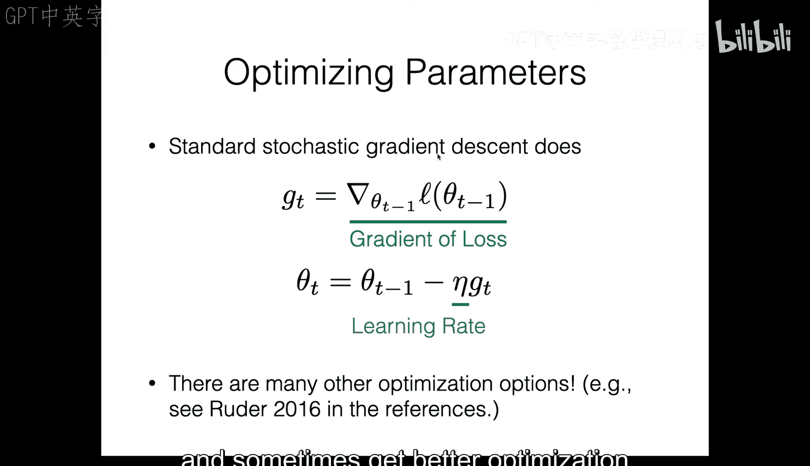

And again， I'll show one example next time。So here's what this looks like in code。And yeah。

 if you haven't like seen something like this before。Now you could have the loss just implemented。

 you could set up SGD as the optimizer。And then you could have this like training loop where you iterate through the training set。

You get yourlogits from the model。Passsses to the loss。And。嗯。Then yeah， take this take this step。

 so this is like the SGD step from the previous slide。

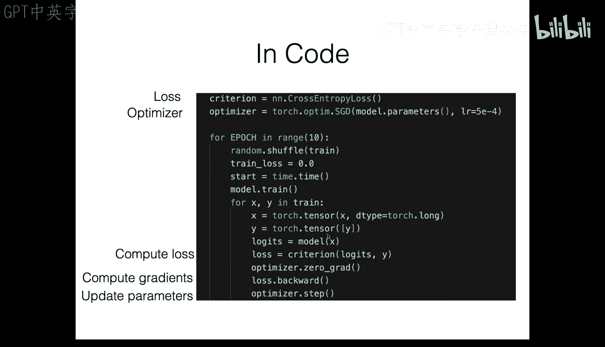

So any questions about this， the next few slides will give some background on the automatic differentiation that's in things like Pytorch。

Okay， cool， and again， yeah， hopefully you've like seen at least some of this at some point because you will be training training models in this class and yeah using these loss functions and obviously using things like Pytorch。

Yeah yeah， so just for completeness， and I also think it's pretty interesting。

What is actually going on in？These libraries like Pytororch。

And how do you actually think about a neural network like representing it to the computer？Well。

 nowadays， you represent it as a computation graph。

And the computation graph will allow you to automatically kind of keep track of the execution of the network。

And then efficiently perform the gradient computation so that you can optimize the network without having to drive the gradients by hand。

So the key idea here is you represent your network as well as like any operations with it as a graph。

So a node at the kind of leaf level is。嗯。Some kind of like data like scalar， vector matrix or tensor。

And then you can have these nodes which are operations。

 so here this node corresponds to the transpose operation。Okay。

 and you could have other nodes for like matrix multiplication。Yeah， things like that。

And then the edge into one of these nodes represents the argument to the function。嗯。And yeah。

 this bullet points is kind of saying the same thing。

And then the key thing here is that the computation graph knows how to do two things with each one of these function nodes。

So first， it knows how to。Actually like compute the function， so that's the kind of forward pass。

So in this case， like you're actually performing the transpose on the input。

And then it also knows how to compute the gradient of the function with respect to its input。Okay。

 and then the really cool thing is that again， you can use this chain rule。

To basically use these local gradients， so the gradient of a particular node in the graph。

And then basically like chain them together by using the chain rule。So concretely。

 at this point of the graph， you'll have some like incoming gradient from the chain rule。

And then you'll just multiply that with your local gradient that the node knows how to compute。

And then through that， you can get like。The gradient of the kind of end of the function with respect to this node's inputs。

So again， like if you haven't seen this before， then you might it's a kind of concise slide。

 but this is like really the key idea that，You have these nodes。

 they know how to perform the forward pass and the backward pass。

 and then you can kind of like chain things together due to the chain rule and compute gradients throughout your whole computational graph。

Okay， so just to show like a little less more than one node。

 you could kind of build up this computation graph and up here you could see the expression that it's representing。

嗯。And here's a kind of complete graph。 And at the end， it's like taking the sum of。Of these inputs。

And then this is the expression that this graph corresponds to。嗯。Oops。And then yeah。

 you could come up with like different variable names and these are just associated with。

The like intermediate computations in the graph。So again， just to like drive the point home more。

You have these different stages， so you obviously have to construct the graph。

And then you perform this like forward pass or forward propagation。

So here you start with the leaf nodes and then you move up in this topological ordering。

So here you would do do these two。You could notice that， like。You know。

 you could possibly leverage parallelism somehow because you can compute both these at once。

And then you do this until like every node has been computed。And then now you start the。

The backward pass or back propagation where you go in the reverse order and again calculate the gradients using the chain rule。

So。Yeah， for example， here， you would compute the gradient of this sum with respect to its inputs。

And then you would start kind of propagating downwards in the graph。And for example， this node。

 you would take this incom ingredient that you just computed。

And then you compute your local gradient。And then just multiply them together。And again。

 that's the kind of key idea。 So now you can like， go all the way down the graph and get。

Whatever graings you need。So really， yeah， really cool idea。Kind of like the availability of。

Of these graphs and libraries that can compute the gradients。

Have really allowed people to experiment with different neural architectures。

And you could imagine like at one point people were computing the gradients by hand and so any like new loss function that you tried you had to write out the gradients and things like that and so this is really like part of you know helping deep learning take off。

Let me check what is。Next， oh， this is just a summary。 So again， you create this graph。

You calculate the result。And then if you're training， you do the back propagation。

So does anyone have any questions about this？Okay。So concretely， yeah， nowadays。

 these kind of ideas are implemented in different frameworks。

And you can kind of realize these ideas in different ways。

You also have different companies interested in these frameworks and so as a result。

 there's like a few different options。So some of the major ones are pie torch。And。

Tensorflow slash jackX。So Pytorrch is developed by。Well， at the time it was Facebook， now it's meta。

And Tensorflowlow in JX is developed by Google。 So Tensorflowlow was kind of first。

 I think it was around like 20。16，15， I want to say。And then JX is a bit more recent。

And these are actually graham slides， but I mean， I agree with his takes。So。嗯。

The pietorrch is maybe like the most widely used in NLP。

And you typically will see Tensor flowing jacks used in projects associated with Google。

And so that's just like a。Like Graham made this slide， so， but I mean。Yeah， like roughly speaking。

 you do see a lot of projects in Pytorrch， and then maybe you see a smaller number in Tensorflow and jacks。

But they're both really cool and they actually offer different trade offs。

So Pytororch was built to favor dynamic execution。So maybe to say with that as first。

 let me talk about TensorF， so like TensorFlow， the idea was you declare upfront your entire computational graph。

And then you just like send it to TensorFlow and it runs。嗯。And so the thing is， is that like。

One tricky thing is you have to kind of declare everything up front， you can't like。You know。

 put a debug statement halfway and just like run part of the graph。

UFD actually like build in some stuff to do that into Tensorflow and it's kind of unnatural。

Another tricky thing is like using control flow in Python， so if you have like a for loop。Then。

 you know， you could just like use pie torch to keep。Multiplying。You know， matrices together？

But then doing that stuff in Tensorflowlow requires like， yeah。

 kind of building it into this like graph building procedure。

So this often goes by the name of like dynamic versus static。

And then JaX is kind of like motivated from a different programming paradigm。So pieytorrch。

 you can think of being like。Maybe like Python， so it's imperative。

And then JaX is aimed at kind of like functional programming。So here again。

 you have some like upfront declaration。And then everything， everything is kind of like a。Ideally。

 like a pure function。So then this actually makes it really easy to parallelize things。

So you often hear Jacks come up in the context of like。Yeah， parallelism。

It it also turns out to be easier to do higher order gradients。

 so if you need to take like the second derivative third derivative。

 so you'll sometimes see jacks come up in like scientific computing applications， things like that。

And then， I mean， I was kind of joking， it's also used to train， you know， even like really large。

Networks and not only at Google， so that was a bit of a joke。嗯。So。Yeah。

 I guess that's all there is for today and。Look I said。

 there's a code notebook corresponding to this section of the lecture。

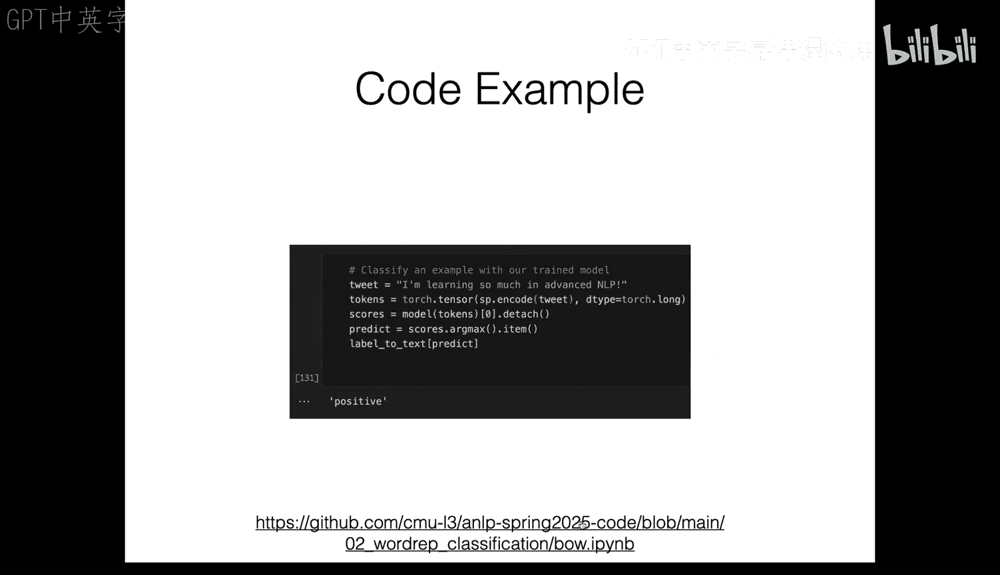

And so you can go through and。

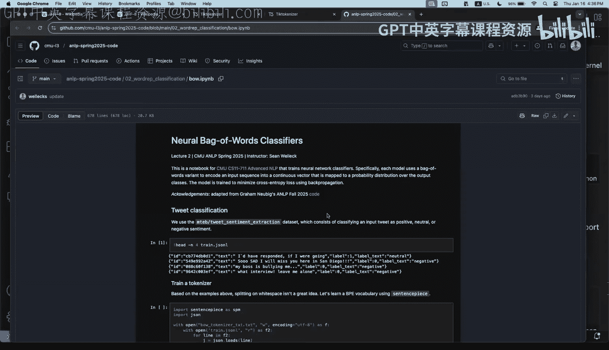

嗯。For whatever reason， for fun to clarify the ideas to see how this is done。

It actuallys the task is classifying tweets。It actually trains a tokenizer like I mentioned with sentence piece。

And then implements these different architectures that I told you about so like。

Continuous back of words and deep back of words。

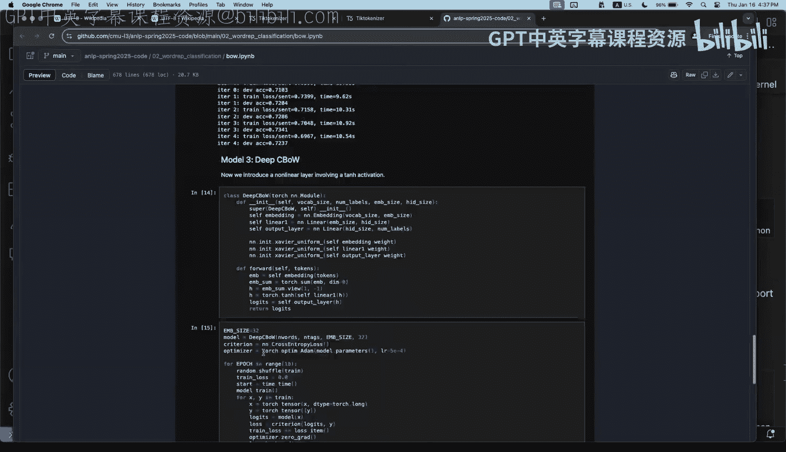

And you could see that the Deepbackg of Words model ends up doing a lot better。

So you can play around with that a bit if you want。

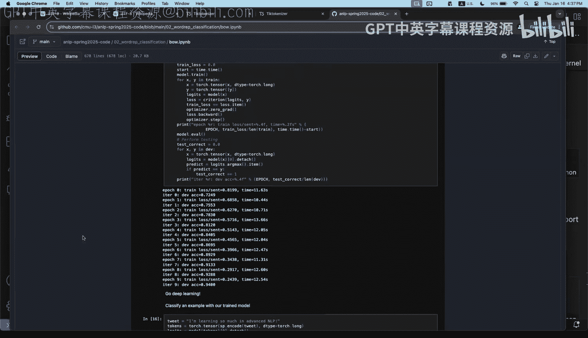

So yeah， that's all there is for today and I'm happy to take any more questions。

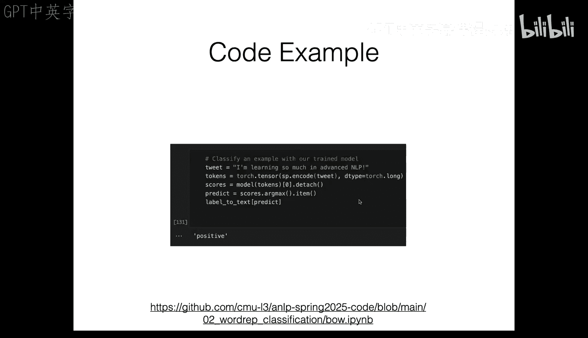