# CMU《高级自然语言处理｜CMU CS 11-711 Advanced NLP Spring 2025》中英字幕（claude-3.7-s - P3：-03-(3)_ Language Modeling Fundamentals.zh_en - GPT中英字幕课程资源 - BV1nYVHz7Eoa

Today's lecture is I'm pretty excited about it， so we're going to start talking about language modeling and so language modeling is increasingly a very important topic。

 for example， in the first course we saw these examples of language models you've probably played around with language models on your own or learned about them。

So we're actually going to have a few lectures dedicated to language models and so today's kind of goes over the basics of what is a language model and starts with very simple language models。

And the reason we do that is we can really see the core concepts that apply to any language model。

So first just to contextualize this with things that we did in the previous lectures。

So you can think about different types of predictions。Binary， multiple multi class and structured。

So binary classification again， is taking in a sequence and outputting one of two different classes。

Multi class classification， like it sounds， is you have more than two classes。

And then what we're going to start talking about is goes by the name of structured prediction。

So now we have this like exponentially increasing set of possible outputs。Um。

 and if you allow for outputs of like unbounded length。

 then you could even have infinite possibilities。So here's a kind of classic example。

You have the sentence here and now you want to assign a part of speech tag to each word in the sentence。

And then here's another example where we have the sentence and we want to translate it into another language。

And so let's say that we have tokens and the vocabulary is of size V。Then how large would the。

Space of possible output to be for this example here。Yeah， and so in general。

 if you have like a sequence of length t， then the number of possibilities is going to grow exponentially as the sequence gets longer。

So this becomes very difficult and you kind of need a different approach than the ones that we took in the previous class。

嗯。And then one other distinction to make is between what's called unconditioned prediction or unconditioned modeling and conditioned prediction。

So in unconditioned prediction， we want to just predict the probability of some single variable。

So we'll see this in a second with language models。

And then you'll see this term conditions prediction。

 and that just means that you condition on some input variable and then you want to predict some output。

So a fairly straightforward idea。So now we can talk about language modeling。

So what is a language model？Well， at its core， a language model is a probability distribution。

And the distribution is over all possible sequences， so some type of sequence。

And so we're going to denote a sequence here as x， this could be a sentence， it could be a document。

 whatever you're aiming to model with your language model。And so。

What is a what's an example probability distribution well here's an example discrete probability distribution and it has like two different outcomes。

 so this is like you flip a coin and 40% of the time it gives you zero 60% of the time it gives you one。

So the basic idea is a language model does something similar。

 but now we're looking at the space of like all possible sequences。So here。

 like a square is one sequence like a cat sat or a period。

And our language model assigns some probability to each one of these sequences。So really， I mean。

 this might sound exciting it might sound boring， but at its core。

 this is like what a language model is。So then the question is like， why is this useful？Well。

 one thing you can do， and this was done， especially with like early language models。

 is you can use this to score different sequences。So like here we have this sentence and it's pretty grammatical。

 Jane went to the store。And we have this one that's not grammatical。

And you could use the language model to score these and then maybe like filter out the ungrammatical one。

Okay， so already it's like kind of useful by just giving scores to different sequences。

And then another thing you can do is you can generate。

So if you have like one of these probability distributions， then you can sample from it。

So like in the case of a coin， you can like flip the coin and actually get some outcome。

And with these language models， what you can do is you can generate from the space of different outputs。

So how can this be useful， well you can actually turn this into something that's useful for different input and output tasks。

 what you can do is you can condition the language model on some input context。

So sometimes this goes by the name of a prompt。And then you can just generate some continuation of the prompt of the context。

So like a concrete example is maybe your context is a sentence in English。

And then you have this generation， which is a sentence in another language or say Japanese。

And then when you think about it， this is actually like really， really general purpose。

If we had a model like this， then we can actually frame a wide variety of different input and output tasks in this form。

For example， your context might have some instructions on like what task we want to perform。

Or you might have some like input output examples， and then you provide it with some input and have it generate an output。

Or you can just do this like text continuation if you want。

So it turns out that the language modeling is like a fairly can give you a lot of different things if you're able to learn a good language model。

So again， just some more concrete examples if you want to answer questions。

Then you could go the scoring route and try to score multiple answers with your language model。

Or you could have it generate given some prompt， which has a question in it。

You can also do classification， which we spent the previous two classes talking about。Again。

 you could either have it like score multiple。Multiple pieces of text。

Or you could like give it some prompt and just have the language model generate an output label。

And then as we saw in the previous slide， we can do things like correct grammar by either scoring or again generating。

And really the space of things you could possibly do with the language model is much bigger than these。

If you remember the first class， like I asked a language model to。Generate a cool looking example。

 for instance。嗯。So does anyone have any questions on those， it was kind of just a high level。

I love Val， okay。So then the question is like， if we have this really large space of possible outputs。

 how do we actually go about like building a language model？And the conventional ones use。

This idea called auto regressiongress or autoregressive language model。And here。

 this is just like a simple fact from probability， it's called the chain rule of probability。

And it says that if you have some distribution over this like joint distribution over， say。

 a full sequence。Then that's equal to the product of these conditional distributions。

And so here what this is saying is that。You have a distribution。

 which is the preceding tokens in the sequence。And then， the next token。Okay。

 and so the cool thing here is that it actually decomposes this problem of modeling a full sequence。

Into the problem of just modeling the next token， given some previous context。Right。

 because like had if I was able to predict all these next tokens。

 then you actually get this full distribution here。So then the key question is like。

 how do you build a good model of next tokens given preceding ones？

So the roadmap we're going to look at a few different ways of doing this。

The first is maybe like you know， one of the simplest ways and they're called bygram models。

Then we'll talk about NGRAM models， which are a step up。And then we'll get to neural language models。

And then in the next two lectures we' look at recurrent models and transformers and by the time we get through transformers you'll have kind of all the understanding needed to。

Understand like the key modeling approach behind the recent language models。

If there's time at the end of today's lecture。I also have some just extra slides on important things to keep in mind if you're doing。

Deep learning experiments， for instance， like the better optimizers that I mentioned in the previous class。

And so on。But yeah， we'll see how the time is。Okay。

 so now let's look at one of the simplest ways to build a language model and it's called a bigram model。

So here what we do is we make this kind of naive assumption and we're going to say that。

We're only going to try to model the probability of the next token， given only the previous token。

So we're going to ignore everything， everything before the previous token。

And so that's called bigram because there's two tokens here。嗯。

And so how do you learn or how do you like train one of these bigram models？Well。

 first is like just learning what is the general setup when you're training a language model。嗯。

And your goal is to learn this language model that models what I'll call a data distribution。

So your data distribution is kind of whatever is in the data set that you have。

 and then you want to build some model of it。and so that's what this is saying here in in reality you don't have like a probability distribution。

 you just have this kind of data set of different examples。

And then you have to split your data into a training set， into a validation or a development set。

 and a test set。And then the problem of language modeling is like。

 how do you build this model given access to these training examples？So to train these bygra models。

 we're not using neural networks or back propagation here。

 it just uses a simple idea based on counting。And so you basically say that the probability of a token given the previous one。

Is based on the frequency of bigrams in the corpus。

So what you do is you go up over your training data set。And you count the， yeah。

 different occurrences of， you know this token followed by another one。

And then your probability is just the relative frequency of。This token XT relative to other options。

And the reason I put this theta here， so in the future this will be like neural network parameters。

 but just so you can view this all as like the same thing kind of。

You could view each one of these estimates here based on these counts as the kind of parameter of the model。

And so this model， for example， will have， let's say you have V tokens options in your vocabulary。

This model will have like V times V。Different parameters。Okay， and then in the。

S here what are the arguments for the ground function。So yeah。

 so here you're counting in your corpus。If token， so say you have a sentence like the cat sat on the mat。

Then you would have account for the cat。Like that's a one bigram so you'd get plus one for that and then in your denominator。

 you would have both the cat and the mat。Right because like the word though could be followed by either cat or Matt So then cat here would have a probability of 0。

5 So all combinationations of the vocabulary。Yeah， exactly， yeah。

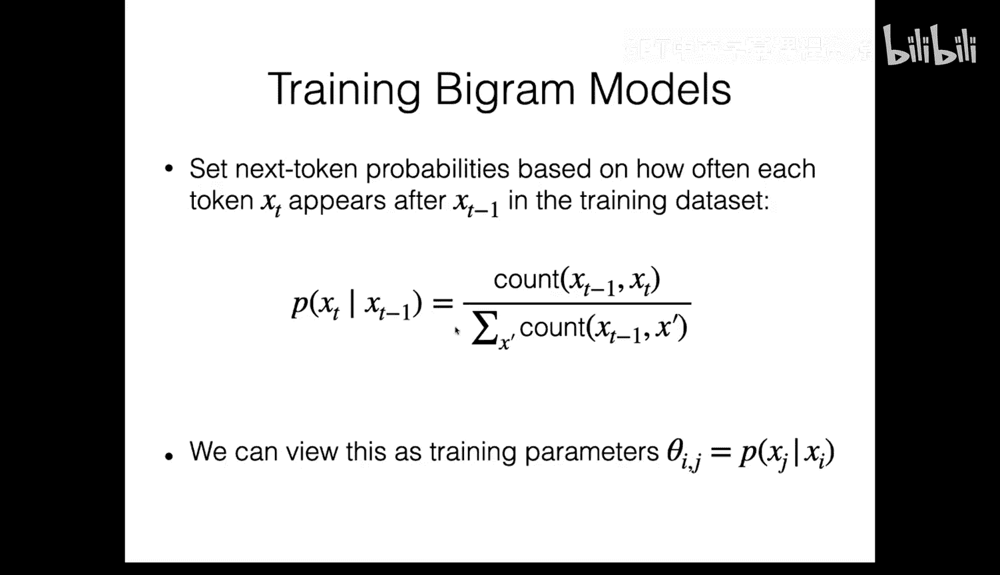

嗯。And so here's actually a code example， and maybe I'll go through it a little bit if the font is not too small。

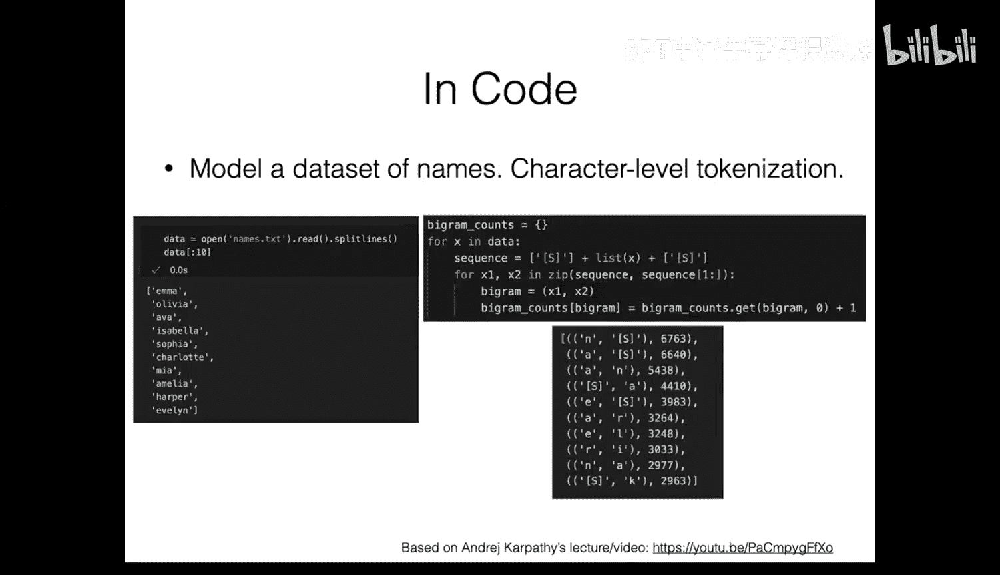

嗯。But yeah， you could go through this notebook， which is on the H website。And train one of these。

 So here our data set or our like data distribution is the distribution of different names。

And so you have this data set and kind of each example is a different name。

And then here's showing the tokenization。So here we're just going to use this like character tokenization。

And what you do when you're doing language modeling is you have the special token or to denote like the start of a sequence and the end of a sequence。

The reason you want to do this is because you want to model the probability of the very first token in the sequence。

And so for that， you need like a previous token， you know， to give your model。And then similarly。

 for like ending a sentence。

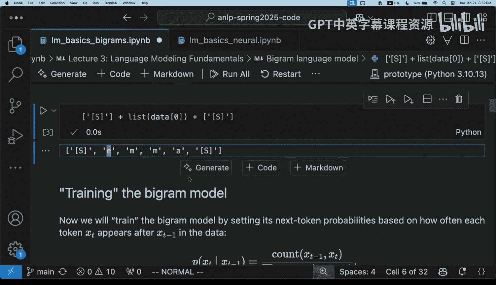

And then here's the learning algorithm or the estimation algorithm that I showed。

And if you were to read through the code， you could see that it's literally like you know looping through the sequences and then here's your bigram that I mentioned。

 it's like one token followed by the other one， and then you increment account。

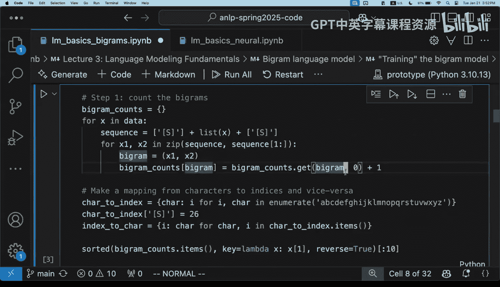

mSo if you do this， you can see that like。The most the highest occurrence in the corpus is the letter N followed by the end of sentence。

Then a followed by ends of sentence。And then A N。And so on。Okay。😊。

So then what you could do is you can like normalize these。

 so divide by the denominator that I was showing in the slides。嗯。

And then it's kind of cool you can actually just like visualize。

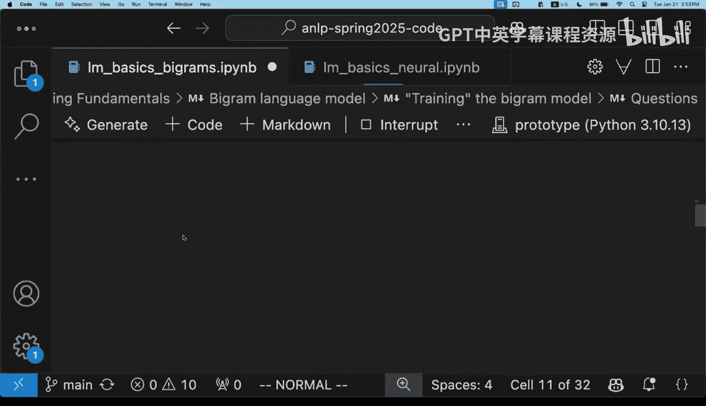

All of the models， different probabilities。So here I have this back on the slides。

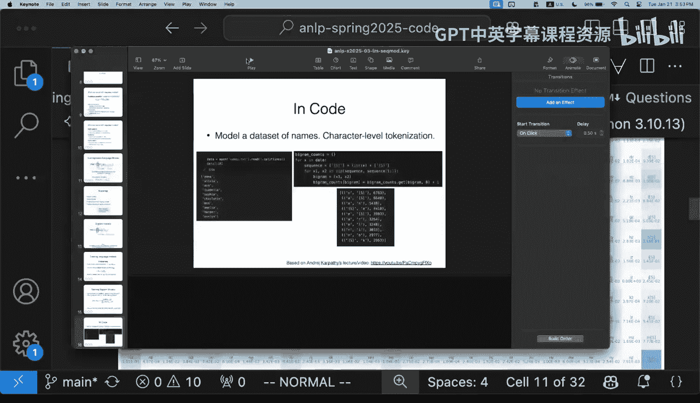

And it' too small to see individual ones， but I highlighted some here。

But this is basically showing like for each first token option and for each next token option。

 what are the probabilities assigned by this byG model？

So you could see like if you have the letter Q， the most probable letter to follow it is U。UmFor J。

 it's， it's a and you can do things like look at。What is the most。

Probable letter to start to name or end the name and so on。

So that gives you some concrete sense of a really simple language model called a bygram model。

And one cool thing is that like the ideas for this are basically the same。

As the more complex models will there are ideas that are in common with the more complex models we'll talk about。

So one is this idea that's called maximum likelihood estimation。

So it turns out that this counting procedure corresponds to yeah。

 what's called maximum likelihood estimation。And maximum likelihood estimation。

Finds parameters that maximize this quantity here。And you can see that it's kind of something kind of intuitive。

 it's saying okay， for each。Sequence in my training data set。

 I want the model to assign a high probability to that sequence。And then you take the log。

 I'll talk about that later， but basically for numerical reasons。Okay， so you want to， again。

 train the model so that it assigns high probability to the training data。So fairly intuitive idea。

And this is called maximum likelihood estimation。Now I'm not going to like go through the proof of why the count procedures。

 but maybe you can look it up or go through it。For fun， but I don't think that's， yeah。

 we have other stuff to get to。And then the question is like， why do we want to？

Do this maximum likelihood other than the like intuitive idea？And basically。

 what this is doing is it's solving the problem that I mentioned earlier。

It's actually making this model match the underlying data distribution。And so again。

 this is like a five lines of math。And you might。Not have to like revisit this。

 but in the future you might kind of wonder again like you know what are we doing when we're training a language model and this is a really useful argument to at least seen once。

So what you have here is in the last class， I mentioned this kL divergence。So kL divergence again。

 is some way of measuring the like divergence between two different distributions。

And then this is just the definition of it， so like you could go to Wikipedia and look up the definition。

Then similar to last class， if you expand this out。

You get a term on the right which only involves the P star。

So when you're minimizing with respect to the parameters， you can kind of ignore that term。

Then this is just another definition， so this is the definition of expectation。

So it's just saying that we want to choose parameters that in expectation over sequences from the data distribution。

呃。Minimize the minus log or like maximize the log probability。

And then here's the part that I think is kind of cool。It's basically saying that the data set。

 so like the finite data set that we have。Is some approximation of this like expectation？Okay。

 so here we're trying to fit the full data distribution。

 but we only have access to this like small data set。Okay。

 and then you just flip around the signs and then now you have the equation that I showed you on the previous slide。

 which is maximum likelihood。So again， I find this kind of useful argument to revisit from time to time because it's basically saying that when you train a language model。

 you're trying to fit some underlying distribution of sequences。

And then we do that by like collecting a data set and maximizing likelihood。Okay， so。

You probably noticed that we've been using logs and so this is a trick that you'll see come up over and over again in machine learning and with language models。

So the key thing to remember is like if you take the log of this product， then you get a sum。

And so with the language models， we have this like product of next token distributions。

And if those are really small probabilities， then when we multiply them together。

 then we'll get like very small numbers and they can even like underflow the。

Like the float representation that we have in the computer。

So one reason for using logs is like this numerical stability。嗯。Okay。

 so any questions on this so far？Okay， excellent， so now we'll talk about generation。

And so we'll have a full lecture on generating from。You know， from like neural language models。

 but with these bygram models， you can actually do similar things。

So what you could do is you could like start with this beginning of sequence token。

And then you could generate from the model by providing the token and then sampling from the next token distribution。

And so this is nice because the next token distribution is just this like。

Categorical distribution over the vocabulary。And so you can sample from it very very efficiently。

So we'll talk a bit more about this in lecture  seven。

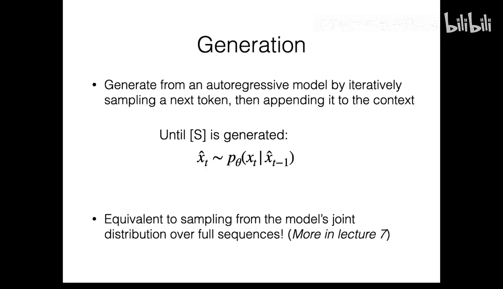

But yeah， for fun in this notebook， we could actually do it with the model we learned。

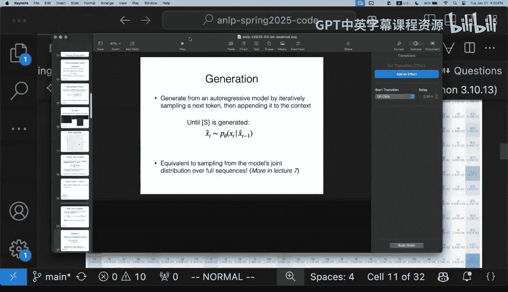

And。Here's an example of just looking at the first time step。

So here we have the model's probabilities。And we look at， okay。

 like conditioned on the start of sequence token。You'll get some next token distribution。

And then sampling is just calling this like torch dot multinomial。

So these are like different options for the first letter of the sequence。

And then you can generate a full name by。Doing what was shown on the slide。

 so you essentially do this。This loop。And you got the current character。嗯。

You get like the token index。And then you draw a sample。And you。

Feed it back in and continue until you get the， the end of。Sequence character。

And if you generate from this model， it's， oh， it actually got this the name Dan。

 that's pretty impressive。You can see that they're not very good。

And so what are some reasons that this model might not be that good？Comtplex is too short。 Yeah。

 exactly。 So basically all that it can do is just predict these like little local。

 local chunks of of two characters。U，So occasionally you can get lucky if you have like a， you know。

 a two two letter or three letter name。嗯。But here's an example of like qualitative evaluation。

 you could still have a baseline of just uniformly sampling characters until you get an end of sequence。

And you could see that even the simple bygram model is like much better。Then the uniform baseline。

So clearly， it did learn something。

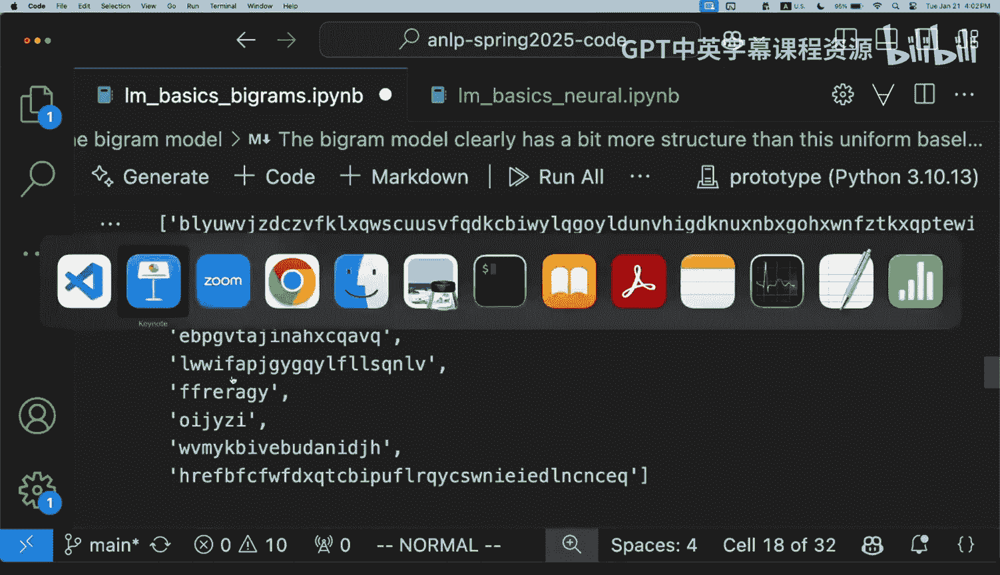

O。So。So that's generation， and as I mentioned， we'll have a full lecture dedicated to this to talk more about this。

And so now we could go to evaluation。And so here we're just going to talk about like how you evaluate a model。

Based on its ability to model a data set。 So we're not talking about。

Like how good it is at performing a task， like answering questions or we're not even looking at like how good it is at generating names that actually gets kind of tricky when you think about it。

So now we're just going to look at like how good it is， how good is it？

At assigning probabilities to a data。And so your data set could either be your training set or you could hold out a test set。

And two really common metrics that are used。Are the log likelihood or log probability？And perplexity。

And so these are used like even when training these extremely large language models。

 you'll often track one of these metrics。So in some sense， yeah。

 we're again seeing ideas that apply to any language model。

So the log likelihood is kind of as it sounds。So what you do， again。

 your model is able to assign probabilities to different sequences。

So you can go over some data set could be the test set or training set and basically count off like what is the total。

Log probability that the model assigns to this data set。And so if it assigns higher probability。

 then that's that's better because in some sense it's。You know， modeling the data well。

And then what's common to do is different data sets will have different sizes。

So what you can do is you can divide by the number of tokens or yeah， it says words。

 but number of tokens in the data。And so now you're basically reporting like what is the average over tokens。

 the average probability？Normalized by the number of tokens in the corpus。Okay。

 and so usually people will report negative local likelihood。Because this has。Yeah。

 like lower is better here。 And so this is like the loss function that's used in。

The maximum likelihood。And this was like very effective for。

Either keeping track of progress as you're training or evaluating it。

Then what's common to you also report is called perplexity。

And so perplexity can be computed using this word or token log likelihood that I mentioned。

And you basically just like exponentiate it。This is another interpretation that I won't go into the details but。

There's this notion of entropy。And so if you take two to the entropy。

 then you also get the perplexity。And so perplexity has this kind of interesting intuition about it。

Ultimately， we're just rescaling the log probabilities。But here。

 like suppose we have this context and you want to generate our next token。

Then what are some different options for the next token here？There's a reason I'm actually asking。

Run。O， okay。So。B， no， that's a bit weird。Maybe that's an error， this is Graham's slide again。

 but the interpretation of perplexity is it basically tells you on average how many guesses you'll need。

😊，To correctly predict the next token， if you just sample the next token from your model。

So this is saying like on average， you'll need to sample like three three or four times in order to get this token B。

 I guess。嗯。But so it has this nice interpretation in terms of like。Yeah。

 like sampling next tokens and your model。嗯哼。😊，In behind words well heavily。Yeah。

So there again we want the model to assign high probability to sequences or full corpus。

And then one argument is that you just normalize her word so that the range is a lot more controlled。

So like if you have a really long data set， then the likelihood will just keep decreasing just because like probabilities are。

Or the number will keep like growing just due to the corpus being larger。

 whereas if you divide by the number of tokens， then the ranges could be more。Yeah， controlled。

Otherwise， you could interpret it as like。Yeah， you still have an idea that like higher is higher is better for next token distributions。

 and so this is saying like on average， how good is the next token distribution？Okay。So does this。

This也没 make sense。Okay， so then again， you can。Oh sorry I misspoke earlier。

 so the probability here is 0。3， but then actually when you do like the X and everything。

 then the perplexity is 28， so you need like 28 guesses。

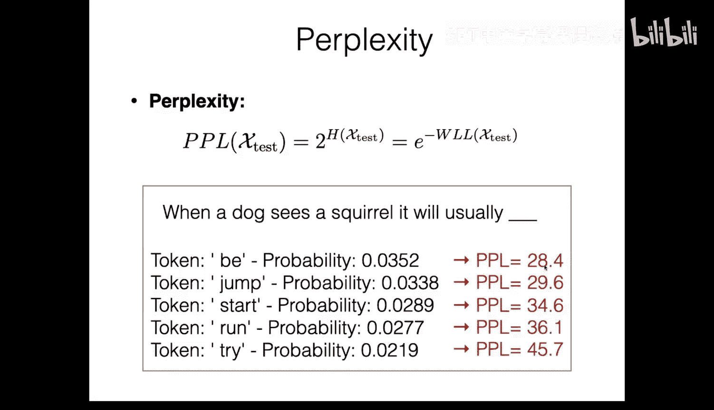

Okay， and then if you want， you can actually compute this for this bigram model。And again。

 you can see here that it's kind of looping through and then literally checking the log probability。

And。🤧嗯。😊，You can see here what I was saying about the ranges。 So over the full data set， it's。500。

000， whereas when you divide by the next token， it's 2。4。

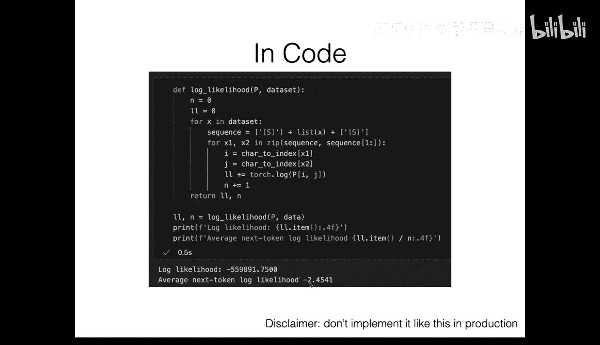

And then yeah， perplexity just have this expon。Okay。

 so that was bygram models and so this was a very simple language model。

 but I'd kind of argue that we actually saw several very important concepts。

So we saw the idea of maximum likelihood estimation。

 which is kind of the objective that we'll use for training the language model。

We saw this idea of like using operating in log space。

We actually saw autoaggressive generation and evaluation。And then I think yeah。

 someone gave a great answer， which is a really important limitation of these models。

 is that they have this limited context size of just one token。

So what you can do is you can try just expanding the token context。

To now have the notation gets a bit clunky， but it's basically just saying like an n gra model。

 you have n minus1， sorry， this should be n minus1 tokens in your context and then you have the next token。

And then you can again use some analogous counting procedure to train these models。

So can anyone see a potential issue with this， let's say we make n like very large。我在食州记度。

Yeah exactly so if we just rely on this counting then n grams after a certain n will be like very rare and so we might have either like very few counts for a particular context。

Or we might even have zero。And that's a kind of inherent。

Thing that you run up to in the counting based model。So for the case of zero probabilities。

There's a trick you can do， which is you can add in this like fake count。

So for for given context for each possible next token， you could add in this like fake count of one。

 so then you at least never get zeros， for instance， like when you're evaluating the model。

And so this like doing things like this was actually a big research area， you know， for a while。

And these techniques go by the name of smoothing。So you might from time to time see， yeah。

 this word smoothing come up， like additive， smoothing。Laplace smoothing。

 and there's like sophisticated smoothing methods。In the British slide， what would be the size of be？

Is that the like if its characters is's like 26。Yeah， yeah yeah that's yeah。

 so I didn't define this V。 so this is like our token vocabulary and the sides of it。

 So if your tokenization is character based。Then it would be， yeah， 26。

 but then we have to add in that special end of sentence token， so 27。ok。嗯。

And so here's some problems。So one thing is that。When you think about it。

 this can't really share any。Probability mass or strength if you have similar words in the corpus。

So like if you have， she bought a car and she purchased a car。

If you just have a account for bought a car， then your probabilities for like purchase a car won't get affected at all。

And the neural network models we'll talk about in a bit kind of help overcome this problem。

You also have this other problem， which is。嗯。The counts， again。

 involve all of the tokens in the preceding context。So you can't like， share any。Strength again。

like you have to take into account the middle word in the context。

 and so this sometimes goes by the name of intervening words or intervening tokens。

whereasas the the neural models that we'll talk about， they could kind of do you know。

 get complex features or complicated features from the sentence， and so they could in principle。

 like learn some relationship between like just Dr and Smith。Given these examples。

And then another thing that we've mentioned now a few times is these can't really handle long distance dependencies。

So like here， in order to predict the word racket。You have to like you probably need to know this word tennis。

But this is， I'm not going to count it， but you know。Several tokens away from rackcet。

 and so this Ngram model wouldn't really be able to capture this long distance dependency。

So actually we're going to have to wait till next class when we talk about recurrent neural networks。

 the ones that I'm about to talk about actually won't solved this yet。嗯。So with all of this said。

There's been a lot of research on NG models and they are used still in some use cases。

So one thing is they're extremely fast to either train or use。

And then the other thing is that they kind of perfectly memorize things from their training corpus because they're just based on this counting。

And so sometimes， these two properties could be useful。

I guess like one example that I'm familiar with is sometimes if you have an extremely large data set and you're trying to do some initial step of preprocessing on the data。

 like to train a language model with like， you know， one terabyte of data。

Then you just need something like extremely fast that can filter out like， you know。

 really bad documents。And so sometimes Ngram models are useful for that because they do give you some probability estimates and you can like filter out the really bad ones。

嗯。So if you want to use one of these， there's this really good toolkit called KenLlum。And again。

 if you go to use it， you'll see this word smoothing come up and you have to accept the smoothing that you want。

 so just yeah be aware of that。Okay， any questions on these before I move on to the neural model？

Smoothing that Ken and are there other options？你。Yeah， so another popular one is called。

 I might get the pronunciation wrong， but Kneer Nay， a KN ESER， yeah。So that's another popular one。

 and I actually wouldn't know off the top of my head what the trade offs are or what recommendations to give。

But yeah。Yeah。Okay。So。Now we're going to move to what is called， well。

 we're going to move to a neural language model。And it's based on this paper。

 which is shown down here by Benjiio Eel in 2003。And people call it different names。

 I'll call it feed forward neural language model。And it's a nice paper if you have time to read through。

And basically what it does is it still has this Ngram assumption。So we're only going to have。

 say like you know， three or five tokens in our context。

And we're going to again predict the next token。But now the difference is going to be that instead of counting。

 we're going to have a neural network predict the next token distribution。Okay。

 so our neural network will take in。Again， this like relatively small context and then predict。

A distribution of her next tokens。So here there's another notebook if you want to take a look at this。

And again， this was like if you read through the paper。

 they go through the motivation of this in the context of these Ngram language models， which were。

You know， very popular at the time。And again， a key motivation is that by just counting。

 you're not really able to take into account the similarity of different words or contexts。Um。

 so like if you say the cat was walking in the bedroom。And the dog was running in a room。There's no。

 like。Transfer， there's， there's nothing shared between these two sentences。

Whereas like you could imagine， maybe if you observe the cat was walking in the bedroom。

Then the dog was walking in the bedroom should also have。You know， a non zero probability。

And so the idea is to use what we talked about in last class。

 which is to rely on these like learn distributed representations。And so here's the method。Again。

 we start out by embedding the tokens and we get some token embedding。Now。

 instead of summing together the embeddings like last class。

 now what they do is just concatenate them。Right so this will be your n minus1 gram context。

 so here it's showing two。And you'll just concatenate the embeddings together。

Then you can pass this through one of these nonlinear layers and get a hidden vector。

You can stack the layers together， of course， and you could have more than one。

 it's just visualizing one here。And then you again have this output weight matrix。And now。

 in some sense， our classes are all of the different possible next tokens in our vocabulary。Okay。

 so now your model outputs some score for each token in the vocabulary。And as I mentioned last time。

 this often goes by the name of Lojas。And then you take the soft Mac。嗯。

And now you have this probability distribution。Okay， so pretty cool。

 you can give the model some context and now you get the next token distribution。

And then just to like look at this from one additional perspective。

You could think about like this stage of the network。As being some feature extractor。

So if you remember like in the previous course， I said previous lecture。

I mentioned that you could think of language models as being extracting some features and then just multiplying them by some output matrix。

And so this is how you can think of this。In that way。O。😊，Now， in order to train this model。

 we're going to again use maximum likelihood estimation。So this is just the formula from before。

 where again we want to train the model's parameters so that it assigns a high probability to the training data。

And if you expand this out using the chain rule。Then， you get。These terms for each step。

 so here we have like the next token given the previous ones。

And so if we turn this into a kind of loss function。Then we have this loss here。

 which is like minus log。Probability of the next token given the previous ones。

And so you could see again， a kind of intuitive idea that our loss is encouraging the model to increase the probability。

Of the next token that's in our。sequence from the training corpus。ok。嗯。Can anyone tell me。

Whi loss function this is？Yes。So that's， that's a good observation。 So that's what the next slide is。

 So it turns out that。This maximum likelihood estimation。

Actually just corresponds to using cross entropy laws。To predict the next token。And so to see this。

 you can use- this was from last lecture。And cross Entropy law said you sum over all of your classes。

嗯。And then you take the and this is like a one hot vector， so only one of these is one。

 and then you have the log of the probability score from your model。

And so in our case of language modeling， this YI again is some one hot next token。

And so all of the other terms， except for the next token， will cancel out。

And then this PI is the probability that our model is giving to the next token。

And then our output classes， so this is like numb classes are just。All of the possible next tokens。

 so this will be like the size of the vocabulary。Okay， and so。

I think the thing that's really cool about this is that。

We've basically taken this extremely difficult problem of language modeling。

 so learning to model this like distribution of sequences。

And we've basically reduced it to classification。So you're basically training this model that can correctly classify the next token in the sequence using cross entropy loss。

And if you go through the arguments that I mentioned before。

 this actually corresponds to fitting this model of some data distribution。

So really cool ideas and this kind of gives some foundation for doing language modeling。

 and this will be the same foundation that you use you know for a really large language model that we'll talk about throughout the course。

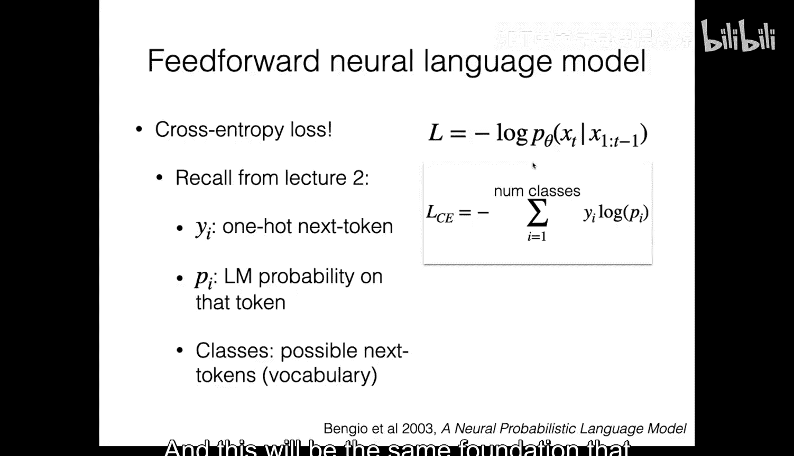

So here's how you would implement this in code and again there's a notebook for it。So again。

 you just have this embedding and you have a couple layers。And。Now you embed your outputs。

And then this here is basically doing the concatenation that I mentioned。

So you can see that the dimensions go from context size， hidden size to。Contact size， times。

 hidden and size。And then this is the nonlinear layer。

So fairly simple when you look at it in terms of this code。

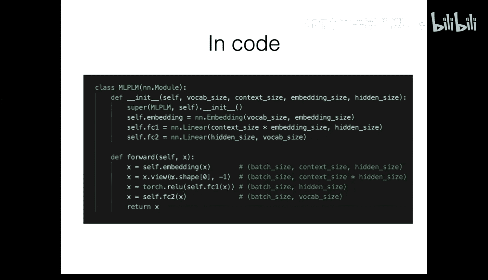

And then this is just to convince you that the language modeling comes down to using the cross entropy loss。

So this is the training loop you would use。You have this like crosscentro POS from Pytororch。嗯。

And then you assemble these different examples。And do the optimization。And let me actually。

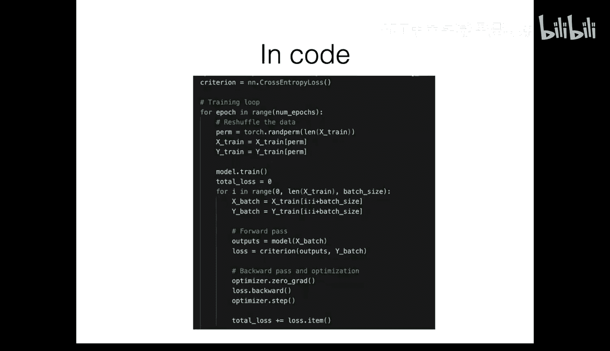

See， we could look at the。The quality of names from this model。

So the notebook does it in the same corpus。And。😔，Yeah， so here's the names you get。

Here's some generations from the model。And you could see that there are。Yeah， I mean。

 I think they're better than the。Thenhan the bygra model， a lot more kind of well structured。

But still like far from。Some of them know far from perfect。And then again。

 the idea is that you can actually compare this to the bygram model。

By evaluating the perplexity or the blog likelihood。And。Yeah。

 you could see numerically also that it's a better language model than the bygram model。

And then here is this conditional generation。So you could have a prompt of like different letters。

And then you could see that the names that it generates I'll start with S in this case。Okay。

 so this is pretty fun and you can look through this and it's basically the code that I showed。

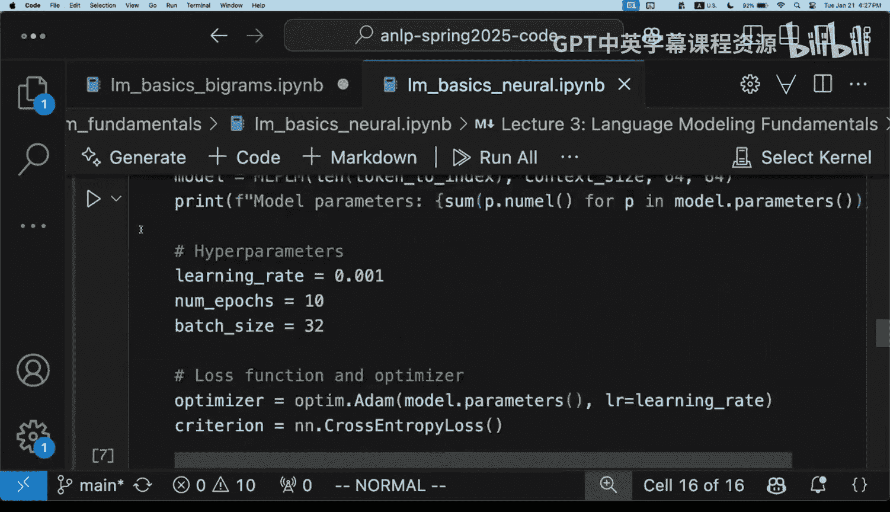

On the slides， and then it also has like the data loading and things like that。

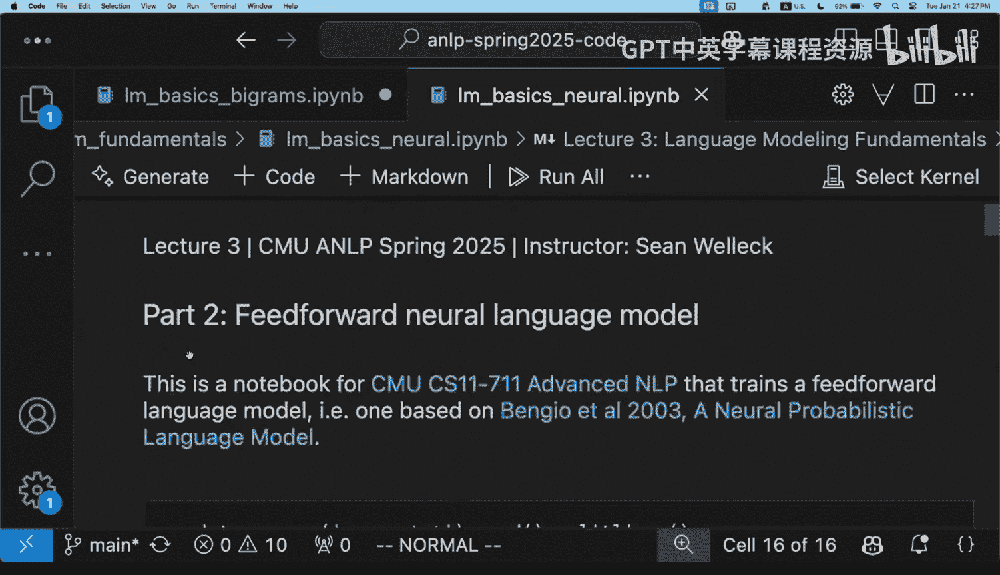

嗯。So。

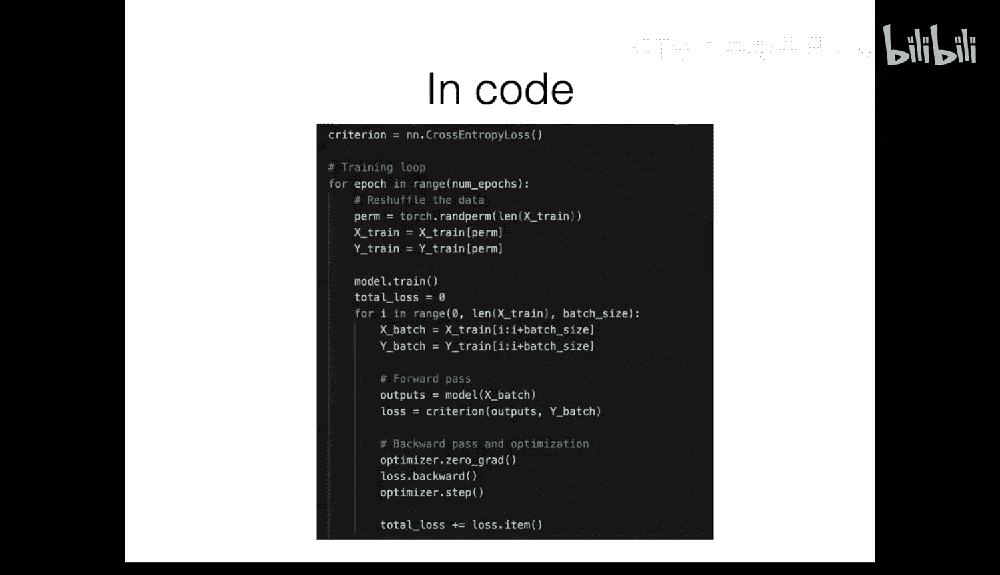

Okay。😊，So just to give some more idea of。Things that could be learned by this。

 so this was the idea we talked about last time combination features。

So here you have like two different word embeddings。

And then you could imagine that like this model has a lot of flexibility in what it can learn in different parts of the weight matrices。

So this is like one weight matrix。 And maybe it learns something kind of extreme。

 It's like all zeros， except for。This number here and this number here。

And one like example possible interpretation is， you know。

 maybe it learns something about kind of like sentence structure。

And so this multiplying this would give you some positive number if the preceding word was。

A determiner and the second previous word in the context is a verb。And again。

 this is just like one possible interpretation you would have to do some kind of。

Interpretability to see if this was actually the case。

It's more just showing that the model can learn， has a lot of flexibility and like possible features it can learn。

呃。Yeah。Given the context。And then here's some more intuition about。

 so I mentioned this idea that like when you're just counting。

 you don't really share anything across the data examples。

So here's some possible places where you could share information。

The model could potentially learn to give similar words， similar embeddings。Then you know。

 this could help lead to similar context getting similar hidden states。In this output weight matrix。

 the model could also learn to give similar output words， similar weights。

And so over the course of processing like multiple examples。

You can kind of leverage information from。Yeah， multiple like similar contexts or next tokens。So。

If you wanted to like really convince yourself of this。

Then this was actually in the reading that I listed on the course website。

So this is due to Qeongqon Cho。But you can actually like work through this little example。

 which shows。Why the model might be forced to actually give to similar contexts to similar hidden inveors。

So here， like consider we're trying to predict a movie。And we have these two contacts。

 it's a great and it is a wonderful。嗯。Then you could say that like for this context， HJ。

The probability that it assigns to this word movie， we'll call it PJW。

And then this don't get intimidated， this is like kind of writing out softms。

Softmax uses these exponents and then this is just putting the denominator into Z。

And you could see that like you have some weight and then times your hidden state。Okay。

 so now you could do this for the other context。And then the question is like。

How do you make these two probabilities similar？So you want this ratio to be one。Well。

 if you take this ratio， then it looks something like this。

So you have your weight and then you have these two hidden states being subtracted from each other。

And so one way to make these probabilities similar， the same， like the ratio to be1。

Is for the model to actually make these hidden vectors close to each other。

Because if these are like the same， then it'll be。It'll be zero and then you'll have e to the zero。

 which is one。So it's kind of a fun like little argument and I guess another strategy is to set the weight to zero。

 but that's kind of boring strategy so but it gives you some sense of like how it's possible for the model to kind of compress the similar information based on the language modeling objective。

Okay， so now with this， we can share strength among similar words I've tried to kind of argue that。

The model can also。Yeah， learn complicated features based on like different subsets of the context。

However， we still only give it this like really small context。

 so it hasn't really solved this problem of long distance dependencies。嗯。

So any questions about this of Har？First problem it will solve the problem only is that context is present in the data center。

 So if bought and purchase are both present。Then then only it will be used under。

 So if it is in context of other symptoms it might not。Yeah。

 so the idea is that it is possible for as long as they occur somewhere in some like similar contexts。

 then they no longer have to be exactly the same like in the Ngram model。And so the model could。

Make the representations。Or words that occur in similar contexts close together。sentenceYeah， yeah。

 that's a good question。 that so that's what you do。

 So you have like n-1 beginning of sentence tokens， yeah。Okay， cool， so just to recap。

 we went over the bygram language models。And some key concepts。Briefly。

 one of her NGm language models ends this neural network language model。

And so now with some of the remaining time， I want to just go over some kind of extra。

Concepts that are good to know。嗯。So again， these like deep learning systems have a lot of different moving parts。

So you have like the architecture， you have the choice of optimizer， you have。Like the weights。

 how they're initialized。 And then you have many different hyperparameters。

 like how big is your network。嗯。Yeah， things like that。

And so what can happen is like sometimes you run some experiment and you get an improvement or one model does worse。

And the improvement is actually just because， say you use a different optimizer。

Or maybe you like initialize the weights in a different way。

And so it's good to just be aware of like some of these key factors。Um。

 whether you haven't seen this before or if you have then， it's like good to good to review them。

So first is like this basic idea of splitting into a training set， a validation or dev set。

 and a test set。And there's this nice way to think about it in terms of， again。

 like fitting some distribution， so data distribution or we could call it P star。So again。

 we could view our training data as being some samples。

 some like finite sample from this data distribution or target distribution。

And we use those samples to， again， train or fit the model。

So that was kind of the argument that was making with maximum likelihood that you have some finite training set and then you fit your model。

But then the question is like， we don't want a model that only fits the training data。

What we actually want is a model that generalizes。We actually want to model like this full distribution。

 not just the stuff in our training data。And so therefore。

 like what you should do is actually pulled out some additional samples。

Which is called like the validation set。And you can use this to kind of check whether the model is generalizing。

So you can imagine some extreme case where your model literally just memorizes all the training data examples。

And so what you do is you hold out some additional ones。

 and then you can like check the probabilities on those。And in the extreme case。

 if it's literally only memorized the training data， then it would。You know。

 perform really poorly on the validation data。Now what you can also do is you can try different configurations。

 so like you could try one architecture against another and you can see like which configuration generalizes the best。

But then if you do this， you still want some final check。

Because in the course of doing trying these different configurations。You could even。

Find some configuration that only works well on the validation data now。

So that's why you have this additional heldout set called the test data。And ideally， you just。

Don't want to evaluate on this until you're completely done。

Because you want it to be some like final unbiased check of。The generalization。

So it's still a bit abstract， so here's what it looks like concretely。

 you use your training data to train the model。Use your validation data to tune hyperparameters to perform different alationations and then ultimately select a model。

And then once you've done all that， you don't want it may be actually a bit overfit to the validation data。

And so you want to hold out this test data and only。Evaluated at the end。

So here's an example and it's actually from the Back of Words notebook。

And so here you could see like you have three different models。And。Maybe it's too small。

 but can anyone tell me like what is the best？Model you should select。

If you like see this during training， so this is printing out like the training loss。

And the death accuracy。没。Yeah， so Model three， if you care about accuracy， then yeah。

 it's getting the highest accuracy。嗯。I actually didn't have this in mind。

 but maybe it's a trick question this model looks like it's faster so。If you need a faster model。

 then。嗯ello。But anyways。😔，So yeah， I mentioned this idea of overfitting。

 so again if the model doesn't generalize well， then something you'll see is the training loss decreasing。

 but then the validation loss increasing so it's getting worse。So that's a sign of。Overfitting。

And so you can like choose different hyperparameters。You can add regularization terms into。

For instance， like the loss function。Um， or what you can do is let's say you're training for like multiple epochs。

Then you can just choose the model right before the validation loss starts to increase。

And that's a pretty common technique。

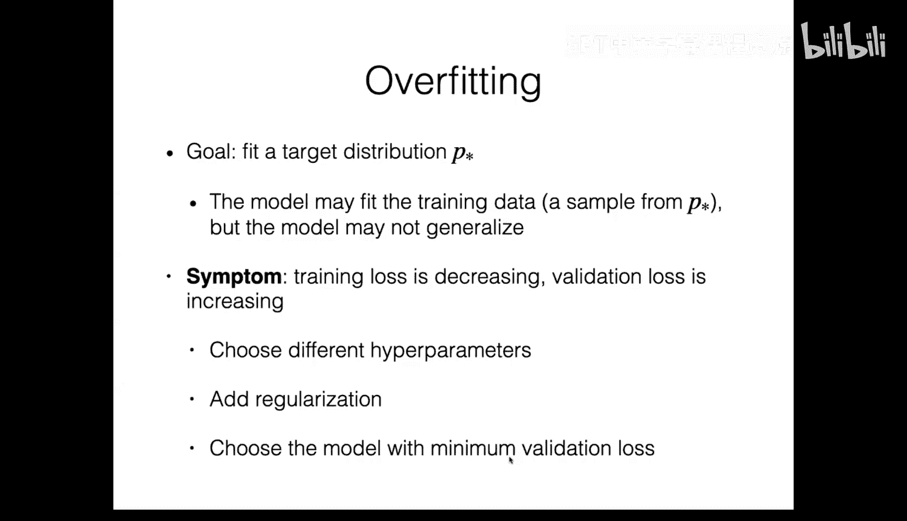

In practice。So any questions on this so far？O。The other thing is if you look through the notebook that we had from last time。

Then you'll notice these lines of code here。And what these are doing is they're initializing the weight matrices using this specific strategy。

 the strategy is called Xavier uniform。And interestingly， like if you take out these lines of code。

 then the model gets like 10% worse accuracy， I think。

And so the lesson is like especially when you're training a model from scratch。Um。

It's actually important to think about how you initialize the weights like initially in the model。嗯。

For example， like should you just set them to zero。

 should you just like sample uniformly kind of what should you do？

So this is a method called Xavier initialization。And again， like。

Kind of in order to get deep learning to take off， this was like some of the things that people had to solve。

 which are like what are good ways to initialize networks so that you can make them deeper？

And what this method does is。It has this formula here。

 but basically the interpretation is you want to control the variance of the outputs across different layers of the network。

If the variance is too large and you have like a deep network， then early in training。

 the gradients might like explode。And then if it's too small。

 then not much learning might occur because the。The gradients will be very small early in learning。

So this was， they actually have like a proof in the paper and they show that this has some like guarantees on the variance。

 and it depends on like the size of the weight matrices。So again。

 the details of this probably aren't important for this course。

 but it's more so just saying that like。Yeah， you could be familiar with this。Idea of initialization。

Nowadays sometimes we use pretrain models and so we're not training things from scratch。

 and you might not have to worry about this。

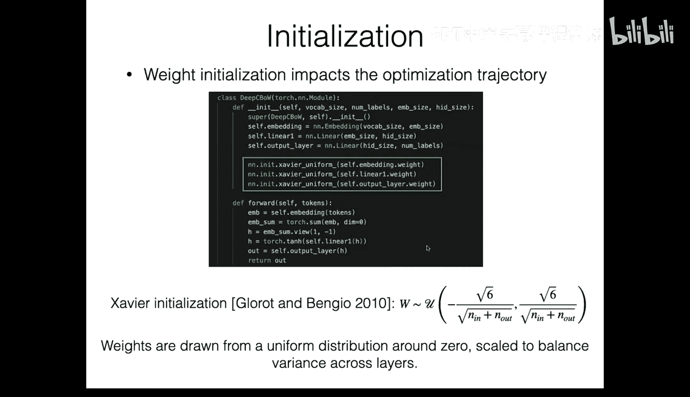

Then last class， I introduced the SGD stoastic gradient descent。And so nowadays。

 there's been more sophisticated optimizers developed。

And they can lead to a lot kind of better dynamics in the optimization that's occurring。

And so a really popular one is called Adam。And a lot of the times you'll see this as kind of like the default。

If you have like a fine tuning library or something like that。

And so what they do is they modify the gradient update。And they keep track of two different things。

So they have a rolling average。Of。Of the gradient。And then they also have this term called momentumment。

So again， this is just one slide， I'm just going through it briefly so that you've seen it。

This term here is called momentum。And basically what it says is you are not going to just use your gradient。

But you're going to have this kind of moving average with previous ones。

And what this has the effect of doing is it kind of removes a lot of like fluctuations or instability。

Because you have some like you have some momentum， it's like whatever direction you start going down。

 it's going to take like a few steps to dramatically change the the direction。

So that's the effect of the momentum term？And then you also compute this statistic here。

 which has like the squared gradient。And。I'll talk about this in a second and then you have this update here。

So you have like this momentum kind of adjusted gradient。And then you can divide by this term。

So one thing that this is doing is or one thing that both of these terms are doing。

Is you learn one of these parameters for。Kind of each parameter in your model。

And so you can have this kind of custom adjustment for each parameter。

 whereas for stochastic gradient asscent， we just use like the same learning rate for every parameter。

And then you could think about like， okay， what if we start these from like what do we do at the start of the training because you don't have any like momentum or a good rolling average。

Then they also just have these terms that。Yeah， bias it a little bit better earlier in training。

So these are just some of the key ideas behind Adam。And like I said， it's just one slide。

 so you might have to。哦。You know， look into it a bit more， but yeah， maybe you。

Also already see the idea here。That final term in the rolling average， the G， something G。

 is that the outer product or why it's happening there。Yeah， yeah。

 so in the paper they just write it as like GT squared。

 so I guess this would just be the element wise product and then maybe yeah。M啊。嗯。

Yeah that's a great question so here now you have three different hyper or four different hyperparameters to at。

So we have the learning rate like in SGD， that's this AA。And that'll again。

 control the kind of maximum step size you can take。

And then this beta 1 and beta 2 are hyperparameters that you just set。

And then what has been kind of found in the literature is like roughly speaking， you can。

Typically keep these the same。Sometimes you can eke out like small performance games by changing them。

But generally， you like don't worry about these hyperparameters and then you mostly tune the learning rate。

And then technically， you can like adjust this epsilon again， people just leave it to a small amount。

Oh。没看见。这个是。Deception关。Yeah， so。嗯。So let's say that you have like three different time stepss。

And so in the first time step， your gradient is in this direction。And in the second time step。

 your gradient is in this direction。Then that's a kind of fluctuation。

And so what momentum does is you have to。Multiply the second time step by the first and kind of average them together。

 so in some sense it like smooth out the fluctuation and yeah。Hopefully yeah the hand waiting。Yeah。

And so this idea actually didn't come from Adam。 There's actually a method called momentum。

Which was like a better version of SGD， and then Adam incorporated the idea of momentum。对啊。对。

I forgot out if there's any else， oh， so another thing is the learning rate can be very important。

Again， sometimes you can get like different。Yeah， different results based on your learning rights and so this is something people tune a lot。

In practice。One of the common learning rate schedules to use is called cosine schedule and it looks something like this。

So you start off with a high learning rate。And then like later in training。

 you start having a smaller and smaller one。And the intuition at here is that the large updates are kind of exploring in the parameter space。

And then the small updates are like not making huge jumps。

 but like focusing in on some opttiima that's been found。

But then what happens is like right at the starting， you don't really have very good weights。

And so you don't actually want to make these big updates。So there's this other trick called warmup。

And it'll just start off with like really slow updates and then gradually you get to the big ones and then you start the schedule。

And again， the reason I'm showing you this is yeah you'll see these come up in in different code bases。

 it'll say like cosine schedule with。Thousands that warm up and so it's good to have seen this the previous slide was Adam already doing some sort of re learning rate schedule？

Or do you have to add it on Yeah， that's a great question so so Adam does have these kind of individual adjustments to the to the gradient。

Those need some statistics in order to have like good rolling averages。

But then you always have this learning rate parameter still in atom。And so the learning rate。

What it turns out to do is it controls the maximum size of the update that could be used in atom。

They kind of make this argument mathematically in the paper。

And so you still want to set your learning rate。嗯。Yeah， yeah， yeah。And then final one。

 I guess we have one minute， which is just batching。

 so here we don't typically process like one example at a time， we have this batch。

So even in the language model example that I have， yeah。

 you do training on like multiple examples at once。

So here is like the batch dimension and here's the sequence dimension。

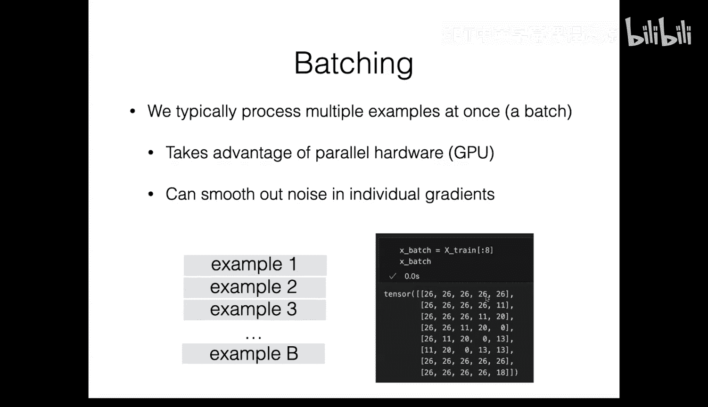

And then I guess I'm out of time， but a key idea is if you have sequences of multiple lengths。

 then you have to like add in these special padding tokens because otherwise you can't like combine them into a tensor。

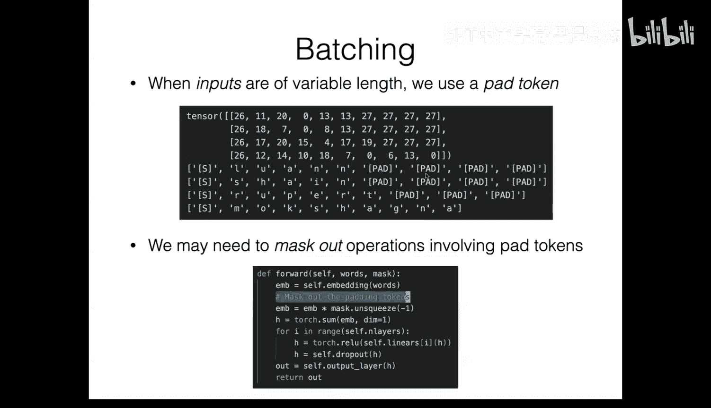

Okay， so that's it for today。Yeah， I guess we filled the entire class today。

 so thanks for all the attention and thanks for coming today。

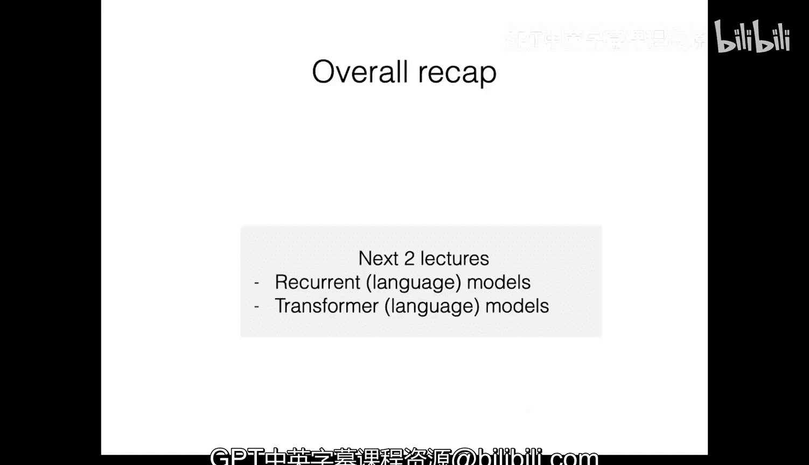