# CMU《高级自然语言处理｜CMU CS 11-711 Advanced NLP Spring 2025》中英字幕（claude-3.7-s - P4：-04-(4)_ Recurrent Neural Networks.zh_en - GPT中英字幕课程资源 - BV1nYVHz7Eoa

And today we're going to do another lecture on sequence modeling and mostly language modeling。

And we're going to focus on recurrent neural networks and recurrent language models。

So if you recap from last class， we went through the basics of language modeling。

So modeling some distribution of sequences like text。

And we talked about these Ngram models and the simple feed forward neural language model。And really。

 the key limitation of these is that they had this very short context。 So just n-1 tokens。

So for example， when we are modeling even those like short names。

They could only really model like a few characters at a time。So in this lecture。

 we're going to talk about recurrent neural networks and recurrent language models。

And at least in theory， these have a kind of infinite context。

So now we can have this approximation here that can take in the full context when predicting the next token。

Of course， in practice， there's going to be。You know， some problems to solve。

And we'll actually talk about one of those called vanishings and some more advanced neural recurrent architectures that were developed as a result。

And then also， if you could imagine like compressing a really。Long context into， say。

 a single vector。Then that can raise some issues。So this actually motivates a really important approach now in machine learning and natural language processing called attention。

And so we'll go over attention mechanisms in these recurrent models。

And then we'll actually go over it again next lecture in the context of transformers。

So here we're kind of looking at a single case， and it's actually how attention was developed。

And then since it's a really important idea， we'll just go over it again with transformers in a little bit more like general way。

Okay， so today we'll talk about recurrent neural networks。

 we'll talk about these vanish ingredientss and the more advanced recurrent architectures。

We'll talk about encoder decoder models。These are for like input output tasks and then attention。

Okay， so recurrent neural networks first I wanted to just like define what we mean by a sequence model。

Because I think it is important to distinguish the model or the architecture you're using。

With the task you're performing。So sequence model， I'll define as。

Some neural network or some function， which takes in a sequence。

And then gives you some representation， some like hidden vector。For each token in the sequence。Okay。

 so that's just visualized here。And。You could use the sequence model for the task of language modeling。

So one simple way of doing this is you can add in this extra output layer。

Which kind of takes your hidden vector for the current token。

And then gives you some scores over all the possible next tokens。O。😊。

And so here you can use sequence models for other things， not just language modeling。

And you can also try to do language modeling in different ways than what I'm showing here。

 this just happens to be kind of representative of the current approach。Okay。

 so I wanted to just present these things this way at some point so that you can distinguish between the underlying models and the architectures and then the tasks that we're using them for。

So what is a recurrent neural network？So our current neural network is a sequence model。

 so you can see here it's taking in these different tokens。

And then what it'll do is after taking in one token， it'll produce some vector。

 So this is called the hidden vector。Then we'll actually pass in the hidden vector along with the next token。

And those will be used to compute the next hidden inductor。And then you continue the process。

 so you keep passing in kind of recurrently the hidden vector。

 and then you keep getting new tokens and producing a new one。So what does this look like concretely。

 here's the kind of equation for the recurrent neural network。And if you look at it。

 it pretty it's fairly simple。So here you have the previous hidden state， Ht minus1。And again。

 this will be some vector。And then you have a weight matrix。

 which is like associated with the hidden state。And then over here you have the current input。

So this would be like you know， your word embedding or token embedding。

And then you have another white matrix associated with that。

And then you kind of just do this linear transformation and then pass it through some non nonlinear activation function。

 and that gives you your new state。O， so this is this is。

This is like what a recurrent neural network is and this form of the recurrential network actually goes back a long way。

 it's from like 1980。嗯。From a paper by。Last name， I think， was Elman。Okay， and so here the。

for eachYeah that's a great question so we'll have a slide on that。

 but they stayed the same yeah so you have the same so your parameters of the model yeah is a single weight matrix for the hidden state a single one for the input。

And then， a biased term。Yeah。Okay， so then again， you can like use a recurrent neural network for different things。

One thing is you could run it over a full input sequence。And it's just like， you know。

 evolving this hidden state， and then you can take the hidden state at the end and then perform some classification task。

So here， like we have a weight matrix and it goes to three different classes。

So this could be you know， positive sentiment， neutral sentiment， negative sentiment。

So you can use this as a classifier and like solve the problems that we were looking into in like the first couple lectures。

And then again， you can use this as a language model。

So here what you do is after you pass in a token， now you want the model to predict the next token。

And so again， you have some like output matrix。And then this will go from your hidden dimension to your vocabulary dimension。

And then you take the softm and you have some probability scores for the next token。

And then this is kind of showing how what you do at training time。

 so then what you would do is you would in your training set， like feed in the next token。

 have it predict， and then keep going。O。😊，So。Let's talk about how we actually train an RNN。嗯。

So here I'm going to just abstract away this like output part。

So you're just going from your hidden state to some output。

And what you do is you have to come up with some loss for each different output。

So like in the case of language modeling， you want some like next token loss。

And then usually you have some label， like again， in the case of language modeling。

 you have like the ground truth next token that you want to predict。Okay。

 so then you do this here as well and get a loss for this time step and a loss for this time step。

I should also say that if we were just doing classification， like I showed on the previous slide。

Then obviously there would just be a loss here at the end because there wasn't really intermediate steps there。

Then you can take the sum and now you have some total loss up here。嗯。

And then what you could notice here is that。Actually， everything here。Is differentiable。

So here this was like weight matrix and an activation function。 this was again， weight matrix。

The loss could be differentiable。 and then sum is。 So what you actually have here is this like computation graph。

嗯。And so you can just run the normal back propagation algorithm that I introduce in the ends of the second lecture。

Right，ca you like， build up this computation graph with by。

Implementing it pietorrch and then implementing the loss。And then you just back propagate。So really。

 there's not like too much。Too much new going on， I guess the new concept is that this hidden state is being like passed from from step to step。

Does anyone have questions about this so far？嗯。你识 a。Would look like we different types of tasks。Yeah。

 so I'll share the concrete example in a bit。But。Yeah， for example。

 the label for classification would be， let's say this is。Some movie review。

 then you' would have a label at the end， which is like positive sentiment negative or neutral。

And then for language modeling， your label would be what is the next token in the sequence？Okay。

And so sometimes you'll see this phrase come up back propagation through time。

 and that's what this refers to。So there was a question earlier about whether we have different weight matrices we have so the answer is no。

 so we just have a single set of weight matrices for the weights for the RN。

And then we use those at every time step。So what actually happens is you end up adding together the gradients from the different time stepss。

Because you're adding together these losses。And then the kind of， yeah， sum of all the gradients is。

All contributing to updating the single set of parameters。And so this is called。

A gradient accumulation。And then yeah， here's the concrete example。

 I guess it's not concrete in the sense I could input put actual words， but with language modeling。

 you start with one token。And then you get your output distribution over possible next tokens。

And then this is the loss that we talked about in last class。

Which is like the negative log probability of the next token in your training sequence。Okay。

 so then you can see here， the loss is。UmThe same thing at the last step。

 it's like log probability of the end of sequence token。Okay， does this make sense so far？Okay。

 and so you can notice that I mean I mentioned this was from last class， so again。

 if we train an R&N language model， you're again using these log probabilities and so again you're you know in the typical case doing maximum likelihood estimation。

 which we saw in the previous class。So although the network like looks more complicated than what we were doing last time。

The mathematical formulation of the training is the same。It boils down to， yeah， again， kind of。

Having your model increase the probability of the next token in your training sequence。嗯。

So there's something interesting here to think about。And we'll come back to this next class。

When we talk about transformers。So if this doesn't。

 if the importance of this isn't like fully clear right now， then just like， hold this。

Until next class， and then we'll see how this compares to transformers。

But basically like when you're training in R&N。If you look at this last step， for instance。

Then to actually compute the loss。You need to compute this H3。And then H3， when you think about it。

 like requires at some point computing H2。And then H2 requires computing H1 and like all the way back。

嗯。So this turns out to make it kind of difficult to parallelize the training of the RN。

Because you can't really break apart these different time steps individually。

You kind of at some point have to like sequentially go and you know。

 compute one hidden state after the other。Like conceptually。

 there's a kind of like for loop going on instead of something you can just， you know。

 send off in multiple pieces。So the transformer we'll see next time is a lot easier to parallelize during training。

And so that'll be like one difference between the recurrent model and the transformer that we'll see。

Then for inference， so again， like I'm using the word inference to mean you have a model。

 you've trained it and now you want to produce an output with it。So for language models。

 that means like generating some。Generating some text。And so the way you do this is again。

 similar to what we saw last class。Except you have to like adapt it to the recurrent model。

So what you do is you generate one token at a time。

And then you're going to keep the hidden state and then pass it to the next step。

And then generate the next token and repeat。So here， for instance。

 we start with the beginning of sequence token。We get our。Distribution over next tokens。

Then we can draw a sample from it because this is just like a categorical distribution。

And let's say that we got the word the。Then we pass it in and like embed it。

And then the key thing with the RNN is that you reuse like you keep passing the hidden state， right？

So you pass through the hidden state， you sample another token， and then you keep going。Okay。So。

The interesting thing here is to like consider。What if you are generating an infinitely long sequence？

Well， then the kind of nice thing here is that to generate， say， like this token here。

Then all you really need is this hidden state。And then to generate the next token you just need to like pass the hidden state。

So this is another maybe like subtle point， and it might become clear after contrasting this with transformers。

But the nice thing is that the RN as you're generating。

 kind of uses constant memory because you just have to retain this hidden vector and then kind of keep passing it。

And so again， the transformer will have a bit different。Properties in the RN。

And then let's say that like each step of the R&N， we could call it like o of one computation。

Then generating a length T sequence would be O of T。And again。

 we can kind of save this and then we could compare it next time with transformers。Okay。

 so these are， that's basically。All there is for introducing the most basic RNNs。And so again。

 we can think of this as this sequence model， which gives us these different vectors for each token in the sequence。

And it does so by transforming this hidden state at each step。

And so you can think of the hidden state in different ways。

One way is that it's kind of retaining things in a memory about the previous elements of the sequence。

嗯。You know， and retaining things from one step to the next。

And then we can use it for different tasks like language modeling。

And then we can just train it using the same algorithms that we've been using for the other models。

And then again， this recurrent hidden state can make parallelizing things tricky sometimes。

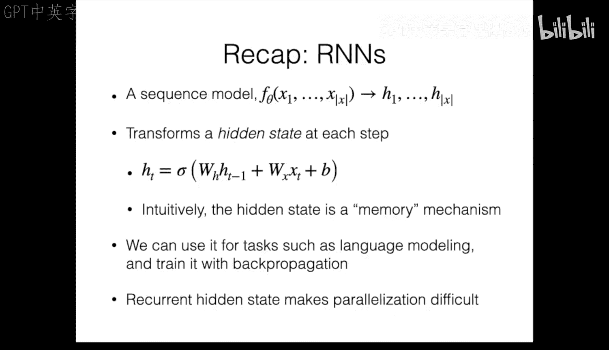

So if you implement this in code， we again have this notebook。Here。And。Nowadays。

 these like the block of the RnN will be implemented in Pytorch， it's called like Nn。rnn。

But for here， I just like implemented it so you could see everything。

And you could see basically exactly what was on the slide。

So you have this weight matrix for the hidden， you have the weight matrix for the X。

 you have some activation function， and then you just have like one line of code。

To implement the like block of the RN。Then you have to still implement like the， you know。

 what happens when you apply it to。To a sequence。

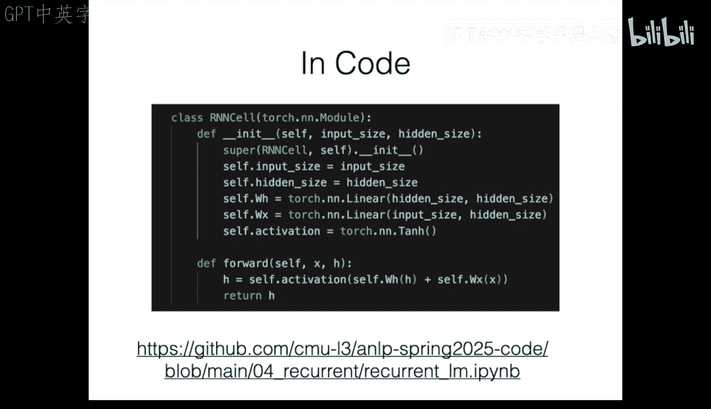

So here this is just showing at the first step， if you don't have a hidden state。

 then it's just initializing it to zero。Here you're embedding。You know， you're token。嗯。

And then are you're embedding things？And then here is like literally the way I implemented it is with a for loop。

But again， here you have to compute the hidden state kind of sequentially。嗯。And then， yeah。

 at each step， you can get some of some kind of output。

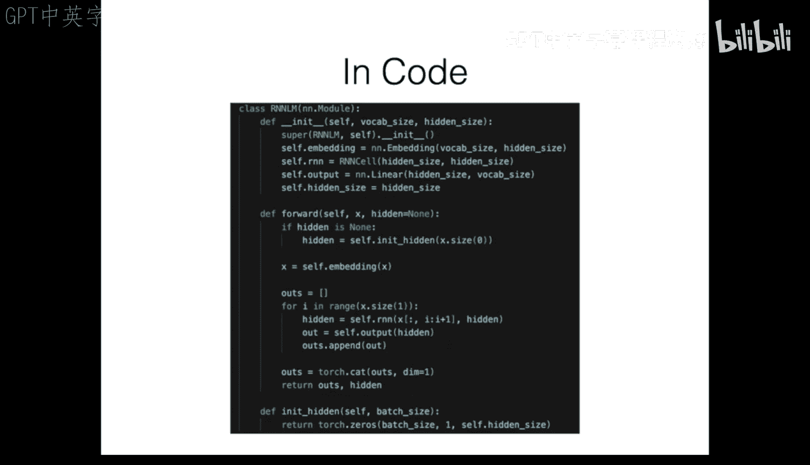

So again， this is in the notebookbook if you want to take a look。

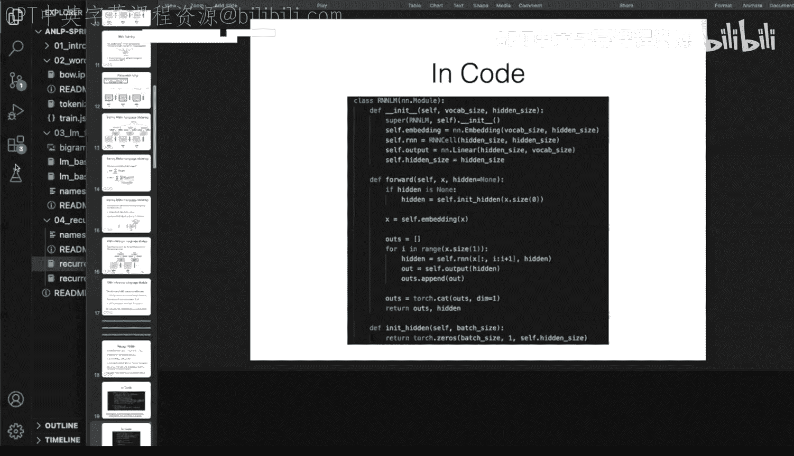

And just for fun， it uses the same data set。嗯。Let's see here this one， yeah， this name data set。And。

😔，You could again see the training loop。Not much is not much here is changing because again。

 we're just using back propagation and the cross centtropy loss。嗯。

And then now the names are starting to look。嗯。Probably more reasonable than the previous model。O。

So fun little example there， here's just some extra things if you maybe haven't seen this before and want to learn a bit more。

One thing you could try doing is replacing this with the high torch versions of the the RN。嗯。

And then。Yeah， these will， I found that like it was things were varying a lot based on the hidden size and things like that。

 so you could play around， play around with it and get some intuition for the training process。

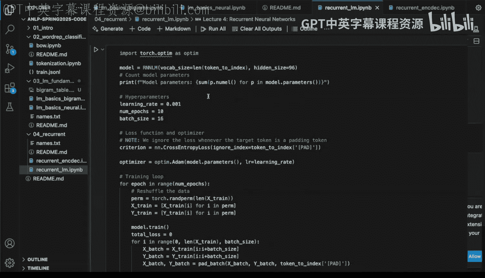

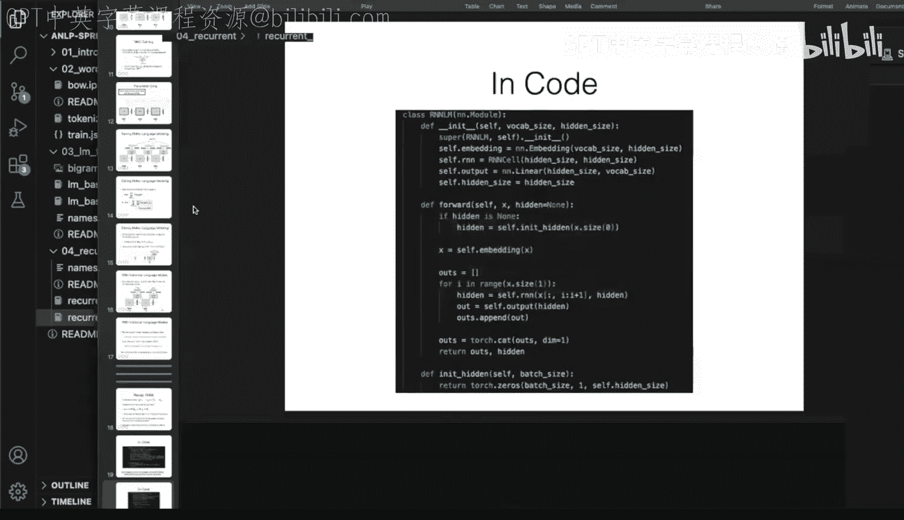

Okay， so now we can go to vanish ingredientss and other recurrent architectures。

So vanishing gradients， it turns out that the kind of dream of modeling these like infinitely long dependencies。

At least with the standard RNs runs into some issues。

So a really important issue in the development of these models was called vanish ingredients。

So what happens is， let's say we're just looking at like the last time step。

Then our gradient of the loss with respect to this final hidden state， it'll start off being normal。

But then it turns out， and I'll show the details in kind of gory detail in the next slide。

 but it turns out that each step you go back， the gradient will shrink。

So one reason is that like the activation function。

 and then also like the properties of the weight matrix make it so that typically these gradients are getting smaller every time you're applying the R&N。

And so what happens is if you have a really long sequence。

Then by the time you get several time steps back。Then the gradients for those steps are essentially zero。

And so as a result， the model， when it's updating its parameters。

Isn't really getting any gradient contributions？That are associated with really long range dependencies。

Okay， so if you follow the argument。These gradients are getting smaller and smaller and as a result。

 in practice， when we use the back propagation， the model actually struggles to learn kind of very long range dependencies。

Okay， so kind of， yeah， kind of interesting。Now here was。Here it is like in detail。 And so again。

 like the idea of this course isn't to， to I mean， it's not like a theory course。

 but if you haven't seen this before， then it could be helpful just to convince yourself what's happening。

 So I wrote it out the details here。So。Here's the definition of the RN。

This output for the last time step。And then what we could do is we can look at the gradient of the loss with respect to let's say this weight matrix here。

 which you multiply the hidden vector by。Then it turns out to look something like this。

 so you have the gradient of the loss with respect to why。And then you have Y with respect to H T。

 and then you have Ht with respect to。With respect to W。

And it turns out that the issue ends up being in this term。

So you can notice that this term here kind of jumps across time steps。

 you have like the last time step here， and then you have some earlier time step T right here。

And so if you look at this one， then it looks something like this。

 so you're basically going back in time。And so now you have this like product。

And so the issue with products is that if it's ever less than one。

 then you're going to start multiplying together things that are less than one and it's going to shrink。

Very quickly。And it turns out that for tan activations。

 this gradient for one time step looks something like this。

And the derivative of 10 H is between zero and 1。嗯。

And then it turns out that if the like dominant eigenvalue of this weight matrix is less than one。

Then this product will kind of go to zero exponentially。Okay。

 so basically all you have to have is like relatively small weights。

UmLike roughly speaking and use one of these like squashing activation functions。

And it's basically guaranteed to lead to this kind of vanishing gradient。On the other hand。

 if the weight is too big， then you can have the opposite effect where you're like multiplying together big numbers。

 and then it's called exploded gradient。Okay， so that's the details of vanishing gradient。

And so what is the solution for this？So this is actually pretty interesting。

There's this idea and it actually comes up not just in RNNs。

But it actually comes up in transformers in some form。

It comes up in architectures used in computer vision， these like residual networks。

And the idea is called additive connections。Or here we'll also talk about what's called gating。

So the idea here is to basically。嗯。Learn what is called a gate。

And the gate will help kind of pass information across time steps。So what does that mean？So。

 let's say this gate here was。Set to zero。Then basically the hidden state at the next step would just be exactly the hidden state from the previous step。

Okay， so you're literally just like passing the hidden state from from one step to the next。

And so if the model wants to retain some long term dependency。

Then what it could do is for some dimensions of the hidden state。

So you're going to have a gate value for like each dimension。

What it could do is it could just set the Z like very， very low。

And then it's basically just retaining what was in the previous hidden state。

 and it could do this across multiple time steps。And then like if you kind of take the gradient。

With respect， and it's just Ht minus1， then it's just one。And so。Yeah， you could like in principle。

 eliminate this vanished ingredient by kind of closing or opening this gate across multiple time stepss。

So it's a kind of cool idea and the idea is that， yeah， the model has the opportunity to again。

 like learn to control the information flow。And then this can help with the vanishing。

Then if let's say the gate is greater than zero， then you still want to like， you know。

 not just reuse the previous hidden state。So then what's done is you generate some like candidate new hidden state。

And then。Your hidden state will be like some combination of the old one plus this new candidate state。

Okay， and then you could probably notice that like what happens if we just don't have a gate at all？

Then it would look something like this。It will be like h T equals h minus1 plus this。

And when you think about what this， what this is doing， it's basically saying that。

What the model is putting into this new candidate state？Is just the， is just kind of the difference。

 So like if it， it wants a。Add something to the hidden state。 Then it just has to。

Add this like residual or same with subtracting， it doesn't have to generate like a fully new hidden state。

So this kind of trick here is， called residual connection or additive connection。

And we'll see how this kind of thing comes up in the transformers in next lecture。Mmhmm。😊。

DoesZT does not change across times times， does it？Yeah， so it does， yeah， it does， yeah。

So that's a learned like how do we learn habit is across stem strips。Yeah， so let me let me go to。

 so these were like the concepts and then I'll show the architecture and exactly what it's doing that incorporates these ideas and maybe it'll become clear。

So the architecture or one architecture that uses these ideas is called a gated recurrent unit or GRU。

And one way to think about it is you can just replace this RNN update with this GRU update。

And so what it does is it has these learned gates。And the way that you actually do it is you have your previous hidden state。

 you have your input。And then the model just outputs some number between 0 and 1。And so， it's just。嗯。

Yeah， it it it's the same trick like you just have weight matrices and then it learns to output a number between zero and one。

They also have another gate called the reset gate， so I didn't really motivate this one。

 but you'll see where it's used in a second。And then they use this recurrent update。

 which is like exactly what I showed on the previous slide。

And so now you can see here that this like gate value is is multiplied。

And added and so it's everything's differentiable and the model can just learn。Yeah。

 like learn everything。And then here and again， like every single detail of this is not。

Too important， but here's how it's actually doing the update to the candidate state。

And you could see that it uses this reset gate here to like control how much of the previous hidden state to kind of use in the update。

嗯。😊，Also like when you show the derivatives with respect to the new new students。

 like over there like you simply said the derivative with respect to h of T minus1 is one。

you ignore directly for still has minus1 solve problem Yeah。

 that's a great question So I maybe didn't write the the equation with so that was showing in the limit of Z going to zero then you just have the previous hidden state and you take the gradient and it's one。

But then yeah， in practice， the Z will be somewhere between zero and1 and so。

Basically like it's possible for there to still be a vanishing gradient if the model doesn't use doesn't learn to yeah push the gate value very low。

So the model still has to like learn to use the gate in some sense。

I don't see how it can end the problem it seems to feel like just a delaying thing and it not mathematically ended。

Itre still good be as you on board definitely， you'll still be getting an infinite product of increasingly decreasing terms yeah。

有有。Yeah， I agree that yeah， literally if you're looking at infinite sequences， then therere then。

Yeah， as long as it's less than one， then it could still have the issue， yeah。

So there is another architecture called LSTM or long short term memory。

The reason I didn't present it is because theres four gates。

 so there would have been like doubling equations。Here there's a blog post that I link to on the reading materials and they show here in the blog post that the gradient is actually now greater it could be greater than one or less than negative one。

 and so that one can have these gradients that like oscillate and。Yeah。But anyways， so yeah。

 you'll see this architecture come up to， it's called LSTM。And you could think of it as like another。

 you know， improved recurrent architecture。嗯。😊，Oh this is。第一个。

Both of them have like they have like the same formula。 So how did it perform like different。Yeah。

 so。I think they'll perform。Or they could perform different functions just due to where they are in the。

In the architecture。So this one， like I said， like if it gets set to zero， then。Yeah。

 it's just passing over the previous hidden state。Whereas。Yeah， I'd have to look at it for longer。

 but maybe it's it's more difficult to achieve that behavior with this reset kit。

Because the weights would also have to like。一楼。Yeah。It不信呢。Yeah， exactly， yeah。

So the like inventors of GRU had to come up with us using some kind of insight，Okay， so。Yeah。

 just a recap。 So vanish ingredients it can come up with the basic r Ns。 And part of the reason was。

 if you see these current variants， now you can one motivation for them。

 and then you'll see ideas like， yeah， exploiting gradients or vanishing other gradient。

And then like I mentioned， if， yeah， in practice， you can just like replace out。

The GRU or LSTM for these different cells， and they've kind of been implemented in different libraries。

Okay， so now let's go to encoder decoder and attention。

So encoder decoder is motivated by the problem of conditional generation。So let's say that we have。

 yeah， some English sentence and we want to generate a Japanese sentence。

Let's say we have a chat history and we want to generate a response。

Or basically anything else that you could put into this form。

And so the basic idea here is pretty simple， we're going to use a sequence model or a recurrent model。

To represent x as a vector。So what this looks like here。Yeah。

 I apologize I didn't put like gradual animations， but let's step through this so now you have an RNN over here called the encoder。

And you can see that it takes in this input sequence。And then， you know。

 you could look at this final hidden state that you got。

Now what you could do is you could consider this final hidden state。

As some representation of the full sequence。And for instance。

 you could use it to initialize the hidden state of the second RNN， which is called the decoder。

Now this decoder is exactly what we talked about before， so you have。R N slash GRU slash LCTM。

 whatever you want。And then you perform some you generate some outputs。

You would have like a loss here while you're training or if you're generating。

 you would generate one token and feed back in and so on。

And so this is one example of an decoder model。And there's various design decisions。

One is like you don't necessarily have to use this final context vector。You could if you wanted。

 like take the average or。Some or something else。But the idea is you get some representation of the input。

And then again here， there's different design choices on how you actually use the context vector。

So for instance， you could use it to initialize the hidden state。

You could actually incorporate it into the recurringt update。Or use it in the output layer。O。

 but the。那你。Yeah so yeah so visualized here this would be generation so let's say this is a English sentence。

And then this is a sentence in Japanese。So then this would be like tokens of the Japanese sentence。

So this would be like a start token this would be。Word1。This would be War two， War three。

And we're basically doing the language modeling。So ideally。

 this is like two Netflix and the context representation of。

So the word English that would end up in the context sector at the end of the encoder would be the same internal representation as the beginning of the decos。

 which would then decoding in Japanese。Yeah， yeah。 So the idea is in order to。

In order to generate a translation。The model has to know what it's translating。

And so the encoder tells the model what it's translating。And so in particular。

 it comes up with this vector representation of。The English sentence。And then the decoder。

 when it's generating the translation， can use that representation to generate the translation。Yeah。

 mentioned choices like is there any result like what choice fit towards it is better for what outcome like in this case。

 phrase representation is this design better than using the sub output context factors like Yeah。

 so I would say that。嗯。So for a while， the questions like this were would be like the topic of。

 you know， different papers or you would， in your paper， you would have to do this kind of。Yeah。

 ablation of different design decisions。So one nice thing about the transformer architecture is it kind of came up with some recipe and there was like a bit less of these kind of decisions。

So。Yeah， I mean， there's probably best practices， but I would have to go like look them up again。

 I was more trying to just give the impression that。Yeah。

 what I'm showing here isn't the only way to have an encoder decoder。In practice， yeah。

 you have to make some decision。Good for the encode and decoder。

 are the parameter shared or is it usually like a separate or or the decoder in the？Yeah。

 that's a great question， so typically it'll be separate。对。

So if you use one parameters set of parameters， then。Nowadays， I guess it's called decoder only。呃。

Maybe that's I'll talk about that with the transformers。 But yeah。嗯。😊，Yeah。

 so it'll also go into the encoder because I guess something like this or having some link between the encoder and decoder that is differentiable is really important because yeah。

 you want to back propagate the the gradients so that the encoder。Learns to。

 know learn good representations。嗯。Now， maybe this is a separate point you're jumping ahead， but。

You could kind of pretrain the encoder and then just leave the parameters frozen if it's already a good encoder。

So that's yeah， another option。But if you're starting from scratch。

 then you definitely want to train。Train everything。M。😊，It inform。 So yeah。

just try to read a good context and we do the degree。

To get your result really and then what we do right just try and find the new parameters for our task or。

嗯。😊，Yeah， yeah， so。In thesetro in these initial lectures were just。

Talking about like training the models from scratch。 But then quite soon。

 we'll talk about pre training。And so in， yeah， in pre training。

 you could use some pre training objective to actually get a good encoder。

And then you could use it to encode a sentence， for example， into a vector。

And then maybe in this case， you would just train the decoder for your task。In practice。

 we also now have。Pretrain decoders as well。So that would be another lecture， which is fine tuning。

Where you take a model that's been pre traineded。And then now you have data specific to your task and you fine tune in the model so you update its parameters so that it performs better on your task。

Oh yeah， so these kinds of models were historically developed for machine translation。

Also things like summarization， so let's say you have like a document and you want to come up with a summary。

And also dialogue， so here you have some like dialogue history and then here you have some like next response in the dialogue。

Yeah。O。嗯。So。One observation here。Is that。This encoder， at least this version is the encoder。

Is using the single vector for。All the possible tokens。

And it's kind of not getting updated after you've generated。Some outputs。

So you basically have to encode the sentence。And then just use the same context vector， you know。

As you're generating the full output。And so the question is like， can we do any better than that？

And this leads to the concept of attention。So the basic idea of attention。Is we want to encode。

EachEach token in the input sequence。Into a vector。So for example， in translation。

 we want to encode each token of the English sentence。Into a vector。And then when we're decoding。

 so each。Token of the Japanese sentence， let's say。We want to。Form a context vector。

By performing some linear combination。Of the encoder vectors。Using what are called attention weights。

Okay， so here's just like stating it in English and what it's basically saying is。

Instead of having the single context vector。We want to， like at each time step。

 come up with some combination。Of the。嗯。Of the encoders's outputs。So concretely here。

 let's say we have these encoder hidden states， H1 through HN。

And then we have our current decoder hidden state。Let's call it H。

And I'll show a diagram on the next slide。Then what we do is we compute what is called an attention score。

Between our decoder hidden state and each encoder state。

And so sometimes this input here is called a query。And this input here is called a key。Okay。

 so our query is going to be our decoders hidden state and our keys are going to be the ones we get from the encoder。

So I'll talk a bit about the different options for this scoring function。

But then you basically take the weighted sum。So you have these different scores and then your context。

Is going to be some weighted combination。Of the。Of the different keys。Okay。

 so there's a few options for coming up with these scores。One of them is really simple。

 it's just you take the dot product。So again， you have some queryary and you have some key。

And then you take the dot product and this will be some scalar number。

Another option is called Bilinear。So here you can notice that this doesn't really like modify the query or the kel。

So another strategy is you just introduce this additional weight matrix。

That essentially lets the model learn。To like transform the keys and query a bit。

This was one that was developed in the paper that like proposed attention。

And so here they actually have this like nonlinear layer。

 So you have a weight matrix and some tan and some other weights。So basically。

 if you wanted like some executive summary。This tends to。

 it could require a lot of data to train because it's like a more complex transformation。

And it turns out to be difficult to like model just the normal dot product in practice。

 some people have find that。On the other hand， this one's a little bit too simple。 So as I mentioned。

 it's not kind of。Modifying the。Quary and kettle。So typically people will use something that looks like this。

Where they introduce some new weight matrix and just like linearly transform the query and key to compute the score。

And so we'll actually see something that looks like this a bit different with transformers in the next class。

嗯。😊，Medical results and like moving capacity the model is。This on how we can litter the schools。

 like seems to be them。There should be certain relationships that impossible for the biline later capturetion。

 which in not can do we have any results on？Yeah， that's a good question。

 I'm not familiar with with any results。There might be some。But yeah， certainly this is， yeah。

 this is introducing the non linearity。So if there wasn't any additional。Yeah， non linearity。

 then strictly speaking， it seems like this part of the network。

 yeah would indeed be more expressive。You do have non nonlinearities in other parts of the network。

 so I'm not sure。Yeah， how this interact multiple nonlinear in the is it theoretically for it to be the same as another angle which has like multiple nonlinear？

Yeah， so I'm not sure how it would work with like the recurrent topology and attention。

 but there were some results that show that like all you need is I think one one layer with a non nonlinearity。

But and again， I might be like slightly mispeaking， but from what I remember。

 those results require kind of unrealistic assumptions like you need an infinitely large hidden layer potentially so。

Yeah， but。For more details， I would need to kind of。Review that myself to give a better answer。Okay。

 so zooming， zooming back back out。 So again， we have a tension here and let me show the the picture。

So again， we have the encoder here。And remember， our encoder is an R&N。

 so we get these different hidden states。And those will be what we'll call our keys。

Then over here we have our decoder， so again， let's say it's generating some sentence in Japanese。

It generated a token， and now let's kind of look at what happens at this step。

What happens is the decoder has its current hidden state。

And we can take that and use it as this query vector here。

Then we can compute these different attention scores。

Using the formulas that I showed on the previous slide。And then you take the weighted sum of these。

And you get your contact vector。And so intuitively。

 what this is doing is each one of these scores is kind of how much this key or how much this token from the encoder is going to contribute to the context that's useful for this timet。

So。The key difference here is， yeah， again， that you can compute kind of dynamically what is a good context as you're generating。

So let me show an example and then I'll pause for questions。

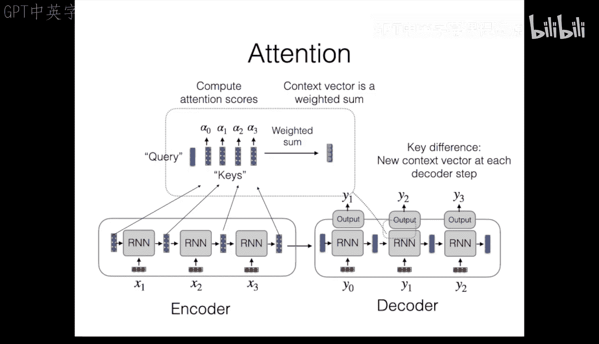

So here's an actual example on translation， and here they're translating from French to English。

And what this is showing is the attention scores at each step of generation or each step of decoding。

So what happens is you encode your French sentence。

And then let's say we're generating the first token。

Then it actually puts most of its attention scores on。L， when it's generating the。嗯。Similarly。

 you could see like over here。When it's about to generate European。

It puts almost all of its attention mass on this French word here， I won't try pronouncing it。

 but you could see that it's kind of similar to European。sh。

Also it could be in different orders right， so here economic comes after European and you can see that it learns to place this attention mass on this one which actually came before this one。

So really cool and yeah， you could kind of see what I was trying to show on the previous slide。

Where at each step of generation， it's able to kind of dynamically learn to attend to relevant information。

嗯。😊，不是。对不对。Yeah， so this is plotting these attention scores， alpha， yeah。

It typically a soft next after we completed the scores， I was going to ask。

 are we not doing up for this specific case？Yeah， that's a great question。

 And I guess I forgot to put it in the slides。 But yeah， almost always。

 you'll compute the softmax after competing all the scores so that they just sum to one。

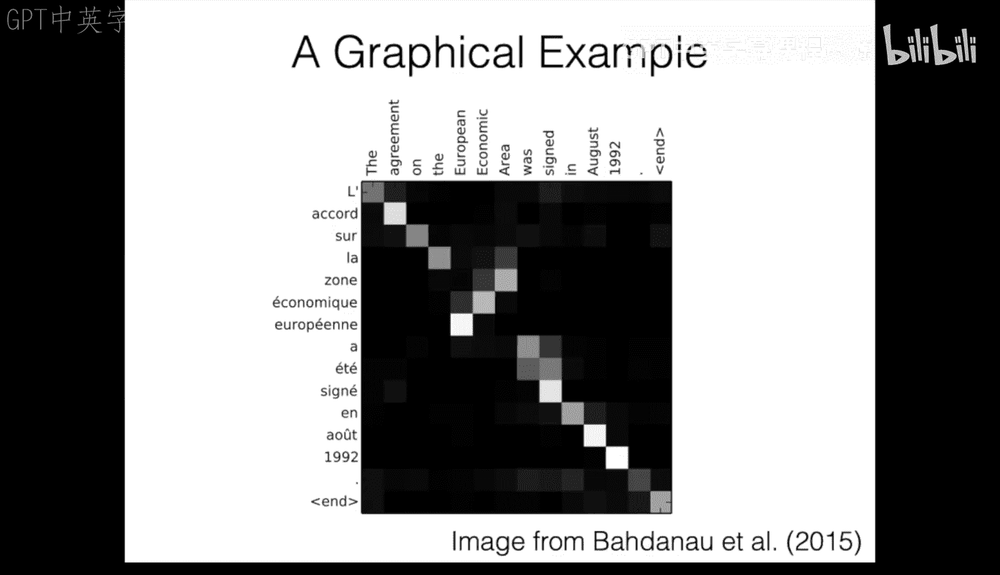

And so， yeah。Here， yeah， you take the softm of these。And then do the weighted zone。

People have looked into other things， like。Each one each each scores between zero and one。

 so strictly speaking， you don't have to。 but yeah， typically we'll take the softm。

 and that's what will be done in the transformer as well。嗯。

So here there's also an implementation if you wanted to kind to look into more details of this。

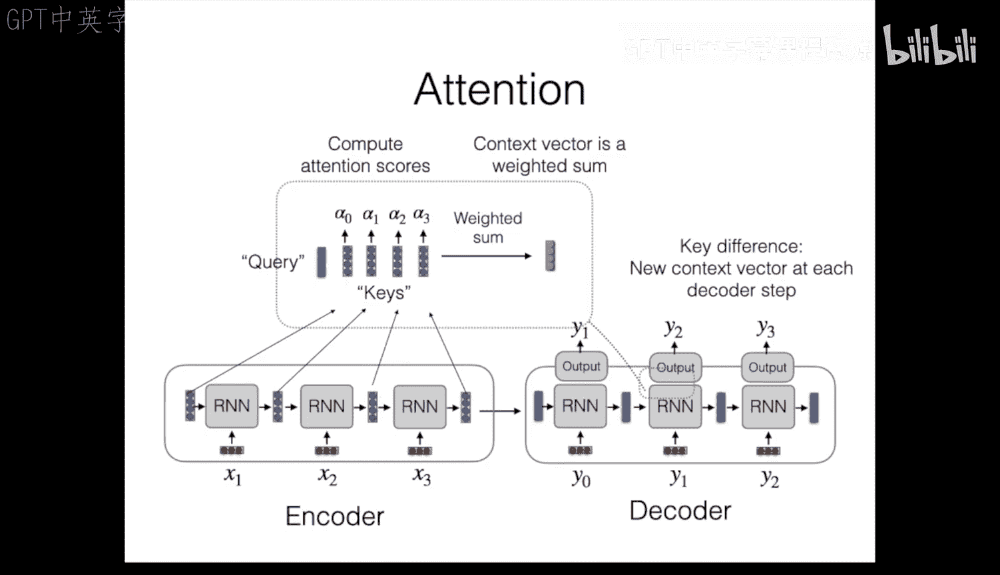

嗯。I think we have a bit of time， so let me just。Shows some things from it。嗯。So。

Here we're going to do a different task。

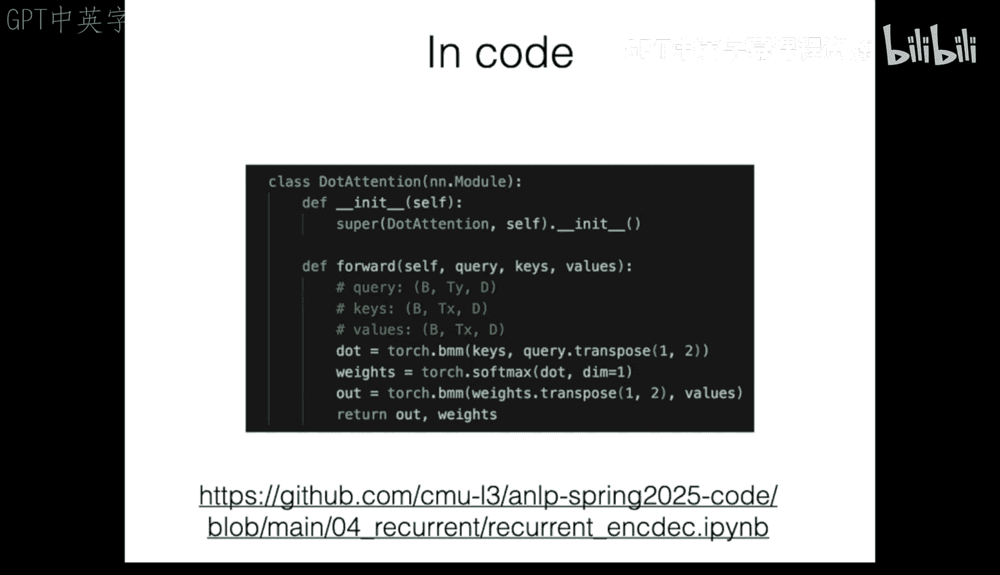

So just generating a name isn't really an input output task。

So I just came up with this like kind of fake task。So first of all， you want to reverse a name。

So your encoder will take in this name here。And then you want to reverse it。

And then just to make the attention patterns more interesting。

For the input name after each character。I'm just going to add a randomly sampled。

 like noise character。So basically， the model has to learn to reverse。

 and then it has to learn to ignore every other character。Okay， so is the task clear， okay？Um so。

This shows yeah， building the data， so if you haven't seen things like padding before。

 then it might be good to kind of go through。Go through this code。And。

No that you show with us are usually uploaded in the website。Yeah， so on the course webpage。

 under the slides， there's a link to the code。And then I mean， I guess I have a kind of good MacBook。

 but at least on this one， everything just you can train the model on the MacBook so。

It's pretty small scale。And so then here's a kind of simple example of what I was showing before。

So here's your keys and these will be like the encoder hidden states。

So you'll have like a batch dimension， you'll have the length of the input X。 This is called Tx。

And then you have some dimension， like hidden dimension。嗯。And then。

There's this other notion of values that we'll talk about with transformers in this case it's just the same as keys so you don't have to worry about it too much。

And then this query is like the current hidden state of your decoder。

So you just have like one time step and it's D dimensional。

And then here's how you would implement this dot product attention。In pietorrch。

So you'd have your keys， which are。Like B times。T X times D。

And then you want to multiply them to get something that is。B T x1。

 so that basically says a score for each。inputput position。

And in order to make the dimensions work out， you have to use this like。

Thatch multiplication with transposing。But the only reason it looks complicated is so that you can get the dimensions right。

And then as I mentioned， we do take the softmax here。

And then your output or your context will be the weighted sum。

So this might be worth going through and like convincing yourself that you kind of understand this。

A simple example。And then here it is kind of implemented as a pieytorrch module。

And then you can incorporate it into the encoder decoder architecture。So here。

 as we mentioned before。We have a separate。R&N or GRU for encoder and one for decoder。

And then we have our attention layer。And then。Here's the kind of loop so you encode。You decode。

And then。You have to perform the attention here。So what this is doing is it's actually taking the hidden state。

And it has this extra weight matrix for forming the query。And then you just apply the attention。Okay。

 and then the way it uses the context is when it's going to into the output layer。

 it will combine the hidden state with the。Attended context。Okay。

 and then there's logic for generating and again this you kind of have to go step by step and it' it's all written out。

嗯。Here was what I was saying about。嗯。Padding， so if you look here。This。I think this is the extra。

Patting token。And so you could see here that like this sequence is actually shorter than this one。

And so you have to make sure that they're padded so that you can form a batch of inputs。

And then here's the training loop。The loss actually gets pretty low because it's kind of determin aistic task。

And then here's some examples。This is not showing the noise tokens yet just because I wanted to make sure they are correct。

 it's hard to read with the noise tokens。嗯。And then down here， it's actually visualizing。

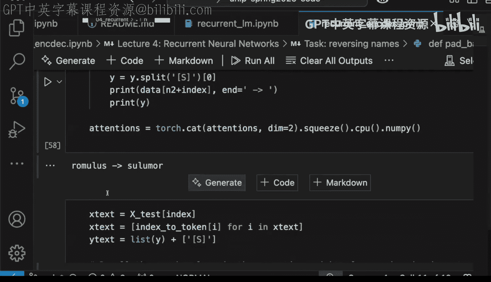

，The attention。So。I guess I'll have to zoom out， but while it zoomed in。

 you could see here is the input so you have。The name Romulus， R， O M， U L， US。

 And then here's the noise。Tokens。And then here's the output。And it's pretty cool。

 You could see that like， okay， let's look at you。 then it learns to place。You know。

 pretty much all of its attention mass on the。Corresponding character from the input。

 and you could see that it's learned to completely ignore the noise characters。

Here darker is kind of more attention score。So if you have like a fan。

 I would produce like a bad extensionension， would you kind of be able to see in noise and like there reasons for the bad extensionension on this visual in a sense。

Yeah， so it can get tricky in general to interpret the different attention。But yeah。

 you might be able to see。Some something different than this， and it might point to some error。

Like it feels。I guess yeah， one thing you might see is like the attention is completely uniform and then that might be。

Some error in the code where yeah， the attention weights like aren't getting or sorry。

 the weight matrices for attention like aren't getting updated for some reason。嗯。So I would say。

 yeah， it can be a kind of diagnostic， but I'd also say you have to be careful in interpreting the attention weights。

Because especially in more complex models， you can start kind of just like seeing whatever you want to see and it's actually not like a generalizable pattern。

 so Id just say yeah。Be be aware of that。Okay。嗯。Any other questions on this？谁。嗯。嗯。

What do you mean after training finish， is it worthwhile？

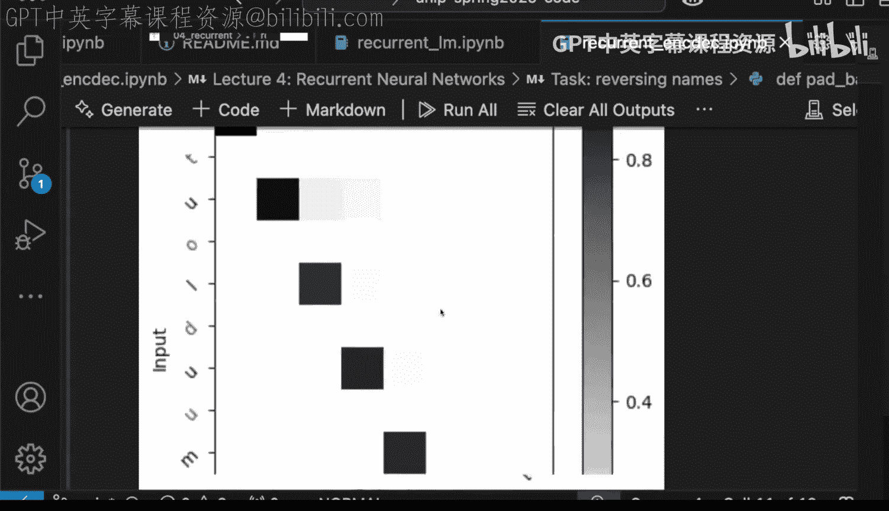

Oh yeah。 I didn't do like a systematic evaluation， just these 10 examples here。

But I got these ones correct generalized beyond the language。Yeah， that's a good question so。

So R ends， if you train them correctly， do you have like better length generalization？

Than some other architectures， I'm not sure if the way that I've trained it here would introduce something which causes it to not generalize。

 I guess， yeah， I would start off by trying it and。And seeing。

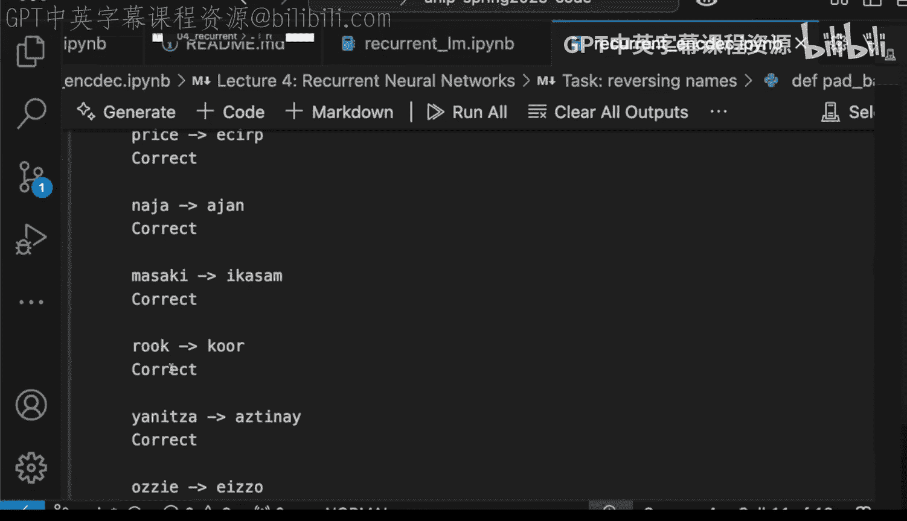

Okay。So。This is so we've gone over a lot today。So。First， a recap on the encoder。

 decoder and attention。So again， the encoder decoder means that we encode some sequence。

And then you use it in the decoder model。And the concept of encoder decoder is not specific to RNs。

For example， we'll see encoder decoder transformers next time。

Attention kind of refers to things that involve。嗯。Some query vector and some key vector and some value vectors。

 and then taking some weighted sum of them。And so again， in next class。

 we'll kind of start with a general view of attention and we'll look at the variant that is used in transformers。

嗯。Yeah。And so as I mentioned， we went over a lot today。So there's some extra topics here about， like。

 different types of。嗯。Sequence models。Um， but maybe I'll u skip those because it seems like a lot of content for for one lecture。

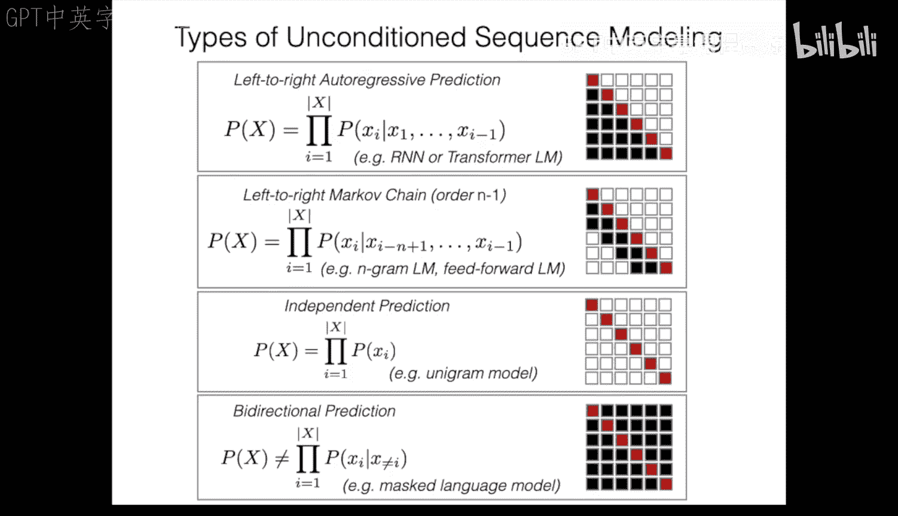

Any other questions or if not， I can take questions for five minutes here in person。

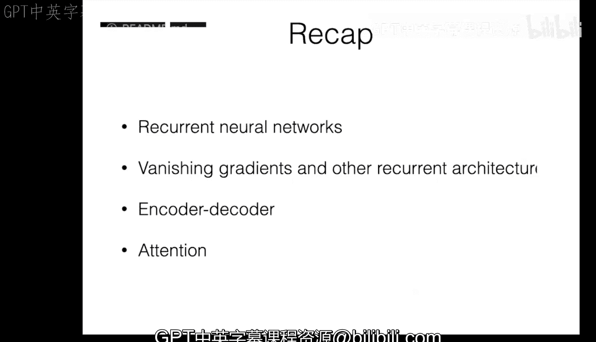