# CMU《高级自然语言处理｜CMU CS 11-711 Advanced NLP Spring 2025》中英字幕（claude-3.7-s - P5：-05-(5)_ Attention and Transformers.zh_en - GPT中英字幕课程资源 - BV1nYVHz7Eoa

Today's really exciting as with all the lectures， so today we're going to go over transformers。

 which are really the kind of current state of the art architecture that's used in NLP。And as a。

Brief recap， I wanted to just put this up from the last lecture。So in the last lecture。

 I introduce just the general idea of a sequence model。

 so something that goes from this sequence of tokens and produces some sequence of vector representations。

And last class， we talked about recurrent models。And you can really view the transformers that we'll talk about today as kind of another way of doing sequence modeling。

 so another way of taking in some sequences and then getting these representations。

And then of course， you can use a sequence model for various tasks。

One task that nowadays we care about a lot is language modeling。And again。

 here to use the sequence model for language modeling。

 a simple approach is to just add in this output matrix at the end。

And that will give you this distribution over the next tokens in the sequence。Okay。

 so this is a review and we've gone over these ideas in the past few lectures。

 so if anything there isn't clear， I would kind of go back and make sure those ideas are clear。

So then at a high level， we can think about multiple types of sequence models。

 so as I mentioned last time we went over recurrence。

And the key idea here was to basically pass this hidden state from one time step to the next。

And then this is just kind of visualizing that process。

I guess here it's going from like top to bottom last class I visualize it from bottom to top。

And in doing so， you can get these hidden representations。

So a sequence model that we haven't gone over and we're probably not going to go over in detail。

 but if you read through the transformer paper， they were mentioning this idea of convolution。

So this was a different approach I mean， it originated kind of in。In computer vision。

But then you can try to apply this approach to sequences。And the key idea here is to basically。

 instead of having a recurrent state， you look at this like local window and compute some representation using just this local window。

So like here it's visualizing a convolution with a window size of like three positions。So again。

 we're not going to go over these in detail but。Today we're going to focus on this approach called attention。

And so here， instead of just having this local window like in convolution。

Or instead of having a recurrent state， like in recurrent neural networks。

We're going to just use this attention operation to basically take in information from all possible locations in the sequence。

And then in doing so， again， you can come up with some vector for each position。So conceptually。

 this is the kind of key idea of what's going on。And so the transformer is a sequence model that's based on attention。

And so in today's lecture， I wanted to go over attention again。

 we went over it briefly in the context of the recurrent models last time， but it's a kind of。

Really important concept and so we'll go over it maybe a bit differently today so you see it just in different presentation。

Then we'll talk about the transformer architecture。

 and so attention is a key part of the transformer architecture。

We'll go through the kind of key design concepts involved in the architecture。

And then we'll talk about how the transformer has been improved since the original transformer paper。

And in particular， I'll focus on the improvements that are in thellma architecture。

 that's the one you'll be kind of implementing for the homework。

And it's also one that's kind of used today in practice a lot。So really， by the end of this course。

 we're going to start reaching things like close to you know close to very recent times and so if you noticed some of the papers I linked in the extra materials。

 they can be kind of some of them were fairly recent。Okay。

 so let's go to attention and so as a recap， the basic idea of attention is we want to encode each token in the sequence into a vector。

And then when generating， so like when going to generate the next token。

We want to perform some combination of the vectors。

And they're weighted by what are called attention weights。So what we saw in last class。

 we saw this kind of encoder decoder model。And so that is an example of what is called cross attention。

And so you can see here that you have one sequence up here。And in cross attention。

 you are attending to the elements of a different sequence。

So this is a Japanese sequence on the left and the English sentence on the top。

And then this is kind of visualizing what we talked about last time where you somehow come up with a score for each pair。

And then use those to determine some vector by taking a weighted sum。Okay。

 and so you can do this for each token and your attention scores will change。

Based on what kind of token you want to。Attend to。嗯。

So a really kind of key idea in transformers is called self attention。

So here you can notice that now we just have the same sequence on both sides and so now we're kind of attending to the sequence itself or yeah。

 self attention。So for instance， here， you again compute these attention scores。

Use them to take the weighted sum and get some output vector。And then do it at each position。嗯。So。

In both of these cases， you can think of this attention competing these attention scores。

 you do it kind of the same way， it's just with different inputs and outputs。And so again。

 the idea here is you have what's called a query vector。So let's say that it's this word hate。

 and then we're going to generate the next word。And then you have the set of key vectors。

 So here itll it would be the vectors from the。Japan sentence。And then for each pair of these。

 you calculate this weight or this attention score。嗯。Then this was a question asked last time。

 what we typically do is we take the softms of these scores so that they sum to one。

And so this is just showing this here， now you have these attention scores and they're a kind of like distribution over positions because they sum to one。

嗯，嗯。The use of self attention。So we'll go through this while we're talking through the transformer architecture。

But the idea is like。You can use the self attention to model these like long range dependencies。

So like let's say you're going to predict the next token。

 then the next token might actually depend on something like previously in your context。

And so when you do the self attention， it can like attend to all these things and come up with some representation。

啊。It's all。嗯。So cross attention means that you can have a different sequence。So like here。

 instead of attending to just like the English output， we have the separate like set of key vectors。

And we're， like。Kind of like crossing over to attention of them。

And then the other use of self attention that we'll see in transformers。

Is you can like stack these blocks together。 And so it's actually attending to like intermediate representations in the network。

But we'll see that in a second。But does that answer the question， at least for now？嗯。Okay。

 so then we calculate these scores and then once we have the scores， we have a third notion。

 which is called a value vector。So in this cross attention example， our value vectors。

 we could just have them be the keys。Of the。So the vectors for the Japanese sends。And then again。

 we take this weighted sum and you get some output。

And then you can kind of use this output in different parts of the model。

So in the last class we talked about how you can use it in an R&N， say like in the output layer。

 but you could think of this like attention thing as giving you some vector and then you're free to like use it in different parts of your neural architecture。

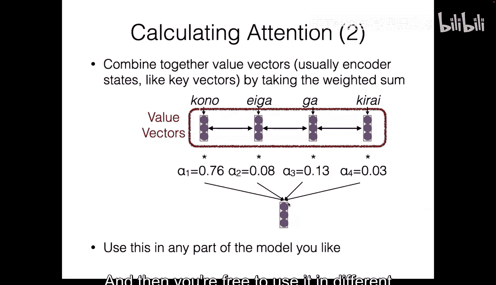

And then here's the example that we saw last time， so again on the left here we have the French sentence on the top we have the English one and then you can see the different attention scores and here a brighter means a higher attention score。

Okay， any questions about this so far？Mmh哼m。😊，嗯。这么で这么。Yeah。

 so in the case of like the cross attention or the yeah， the model we were talking about last time。

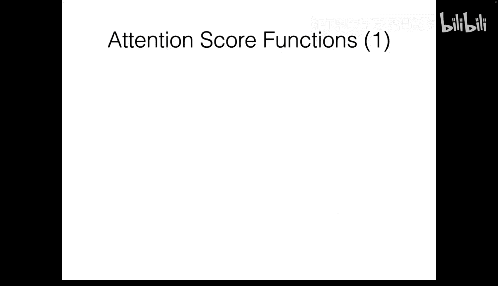

Then we would just use the same outputs from the encoder as both key vectors and as value vectors。

So they're just the outputs of the encoder。Yeah， and then in self attention。

 we'll actually do something kind of crazy， we'll use the same like vectors as the queries。

 the keys and the values， but we'll see that a bit later。

So it can be useful to think of this as like an abstract function because yeah。

 you can apply it in different contexts。

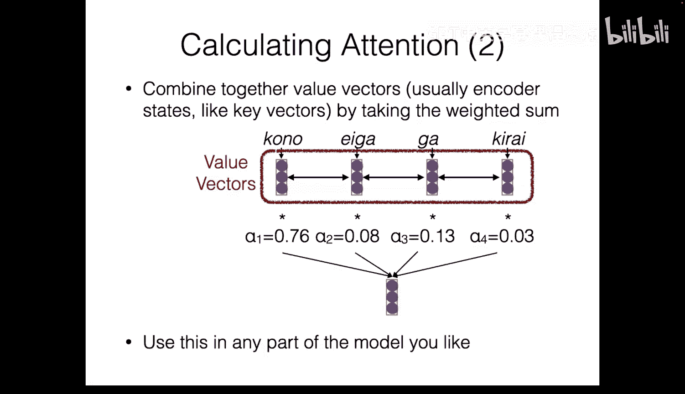

M。1是。嗯。Yes， so。

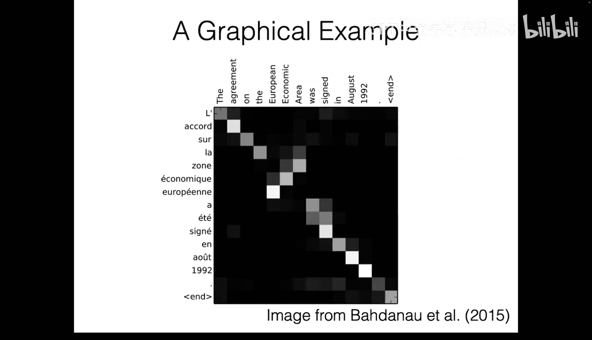

So I think the names are kind of instructive in the sense that let's say you're going to search for something。

Then when you search， you have like a query。And then you can imagine that you have a key value store。

So a key value store has like something that lets you check like check where something is。

And then you kind of open up the store and then you have the value there。

 And so that's the basic idea here。 This query is being compared with the different keys。

 and then it's basically finding the vector that is like relevant for the query。

 and then you want to get what's stored at that position， which is the value。有了。So yeah。

 it does have this kind of information retrieval type of interpretation。

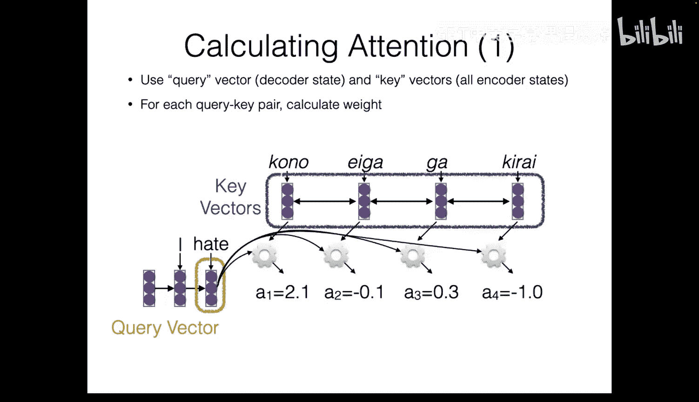

Okay。Yeah， this is great and yes， really great questions。

So then to compute these attention scores， here's some things we went over last class。

 so again you have some query vector and some key vector and you could have this nonlinear attention score again our score will be some scalar number。

We talked about this bilinear way of getting intention score where you introduce this weight matrix。

And then we talked about this kind of simple one， which is dot product。

 so you just take the dot product of these two vectors。

And then the one that's going to be used in transformers is called scaled dot product。

And so what they kind of observed is that the scale of this dot product can increase as the dimensions get larger。

And so they basically wanted some attention score that， you know。

 they could try out different size architectures and kind of not worry about that。

So then what they do is they divide by the square root of the dimension of the key vectors。

So this like notation here means the dimension of the vector。

And then this turns out to be a kind of useful normalization to include。

But you could think of it as like still doing this dot product between two vectors。Okay。

So we'll see more details about the exact attention that's used in the transformer。

 but this is the kind of you know abstract presentation of tension， self attention。

 and then coming up with the score functions。And so now we can move to how this is incorporated into the architecture。

So transformers were proposed in this paper called"Attention is All You need in 2017。

And so the idea was they came up with the sequence to sequence model。And again， as I've mentioned。

 it's based entirely on attention， so you don't have any recurrent hidden state。

 You don't have this idea of convolution that I briefly mentioned。

The kind of core operation will be attention。And at the time， it kind of got a lot of。Attention。

 I guess， because it it outperformed these recurrent models on a kind of really well known machine translation data set。

So they had like very reliable test numbers on this data set。

 and so the community kind of noticed that this was pretty significant because they got some improvements with this new architecture。

And then of course， since then it's been integrated into a wide variety of areas。

 so it's kind of used throughout NLP。 it turns out to also be useful beyond NLP for things like。Yeah。

 images we'll see some multimodal models later in the course。And yeah， even beyond that。

And then at the end of the lecture， if I have time to get to it。

 one really key benefit and key motivation for this is that it's very fast。And so in particular。

 everything that I'll introduce here。Is just based on matrix multiplications。

 there's no like four sequential for loop like in the RNN。

And so it turns out to be really amenable to parallelizing on GPUs。

So GPUs are really optimized for kind of large matrix multiplications。And in some sense， yeah。

 this architecture is kind of very amenable to that。嗯哼。😊，In spring。

What the output and bang there Yeah， so we're about to go through every part of this in in painful detail。

Yeah。😊，I'm kidding， it's not painful， it should be pretty interesting。So yeah。

 this is just broad overview and then we'll go through the different components。

So before we do that though， so there's two different types of transformers。

 especially like if you actually go and read the paper。

 then they were actually interested in these encoder decoder transformers。

Where you have one transformer on the left， and that's your encoder， so say you're doing translation。

And then you have this decoder transformer on the right。

And so without looking at the details of this， you can kind of view this as being， you know。

 somehow similar to the encoder decoder RNNs we saw in the last class。

Then you could also have what's called a decoder only transformer。

So this would be like today's language models， they don't really have the separate encoder component。

So today I'll mostly focus on this decoder only and all of the concepts that I introduce are。

Basically how you implement the encoder。So the basic idea behind this architecture is to come up with this like cleverly designed layer。

And then once you do that just stack them together so some of the transformers will be like 12 layers deep。

 some will be like 50 and that's the basic idea。And so the key concepts are basically。

 how do you design these layers？And then you also have to think about how you design the input embeddings。

 so we'll talk about that as well。And there's really kind of five key concepts to do this。

So the first is called positional encodings。The second is the next two you have to do with how you design the attention。

嗯。The next one is called residual connections and layered normalization。And then finally。

 the feed forward layer。So we'll go through each one of these one by one so you don't have to kind of understand it from just these bullet points。

So first， we'll look at the very bottom of the network。

 so we'll look at how these inputs are given to the network。And so here， if you remember。

 we went over this idea of tokenization， so tokenizing things into subboards。

And then having some embedding layer， so where each token corresponds to some learn vector。

And so for representing the tokens。It's actually exactly the same as the previous models that we've talked about in the class。

You essentially have this matrix and again， for each token， you have some vector。

And then you select them and now you have like some vector that could be passed into your model。

So does anyone， I didn't put the details here because we've seen this a few times here。

 but can I clarify anything？Here。Yeah， so this will be so we're just looking at a decoder and so this would be some some sequence of tokens。

 so like this sentence， the books were improved。You would turn it into these tokens。

And then each token would have some vector。That you select from your embedding matrix。

And then you pass the sequence of vectors as the input to the model。嗯。

So this is one way that we can do like socializations there's multiple different methods is this like the best way that we do it currently or are there different ways to are more effective for example Yeah so I think it was in the in the second lecture I went through some of the tokenization methods。

So I talked about B pair encoding， BPE。And yeah， most of the state of the art language models are using BE。

 so by parentcoding。So there like the notebook that's provided will actually show you how to like train a tokenizer and get one and that's kind of yeah。

 pretty representative of how you do it in an actual model。Okay， so then。What you may have。呃。

Noticed or not noticed。So basically， since we don't have some kind of recurrent hidden state。

If you only give the。The vectors for each token， then you actually don't know which positions each token is at。

So basically like if you have this sentence here and you give it to the transformer。

Then there's actually no way to distinguish between this word big and this word big over here。Again。

 they're just going to be the exact same two vectors that you've selected from your embedding matrix。

And then similarly， like these two sentences would be kind of similar because they're just the same sentence with these two different words flipped。

So then basically， you have to add into the transformer some way of encoding position。

And so one way to do that is to add some additional vector。

 which basically has some indication of which position the token is at。So like for the word big here。

 we would add in some vector that corresponds to position number two。And then for this big over here。

 we would add in a vector that corresponds to position 7。

And so now how you design this vector is a kind of design decision。And so on the next slide。

 I'll talk about what they do in the original transformer paper。And then later in the lecture。

 I'll talk about what people do kind of nowadays and what you'll see in the homework。

So the way that they。Sorry， the way that they come up with this position vector in the original transformer。

Is to use this idea called sinusoidal encoding。And it can look kind of complicated。 I would say that。

 like the。The idea is kind of simple， and now it also keep in mind that there's other methods that people use today。

So。嗯。We'll talk about this later and you'll see it in the homework so you could like focus your effort maybe on understanding those。

 but I really think you could understand this one too。So the basic idea here is to have some vector。

And then each position in the vector。Corresponds to some sine function or some cosine function。

So it's kind of small here， but this blue line here is showing。The vector element zero。

 and you can see that it's this like fluctuating function。And so on the x axis here is the position。

So the idea is like if the token is at position number two， then for this vector element。

 you'll take like this number。From the blue sign curve。

And then you alternate between like sine and cosine。And you change the frequency of the curve。

And so the basic idea is you have some like high dimensional vector。

 and then each position is kind of changing in time。Some positions are like fluctuating very fast。

 Some dimensions are fluctuating very fast。Some dimensions are fluctuating more slowly。

And you get for any like position in the sequence， some unique combination of the signss and cosines。

So this is visualized here on the X axis we have position in the sequence。

And then on sorry on the y axis and the x axis， you could see what vector representation it would get with this encoding scheme。

So it seems a bit like it comes out of nowhere and they had some motivations in the paper。

It turns out that translating this function is just a you can translate this by just learning some linear function。

 and so they kind of hypothesize that maybe it's easy for the network to learn some notion of like relative positions if you encode the positions this way。

And then they also hypothesize that maybe the network can kind of extrapolate to longer sequences than it's been trained on because these signss and cosines have this kind of repetitive nature。

That one turned out to not actually be the case in practice。

 it turns out that you have to do other things to get the model to extrapolate。

So does this somewhat make sense to everyone？Can you explain again what's the blue line and what's the orange line in the first graph？

Yeah， the orange one yeah， yeah， so so this is saying again， you have。

 you have some vector and the vector represents position。

And then each element of the vector is going to be some sine function or some cosine function。

So this is looking at like element0 in the vector。As you increase position。

 it's going to like trace out this。Will this be signine or cosine？Anyways， yeah。

 it's going to trace out this like periodic function。M I。Yes。Yeah。Sorry， I here is the。

The dimension in the vector， and then T is the。嗯。Is that the case is the。Position in those sequence。

Why do the waves have a different frequency Oh sorry， do the waves have a different frequency？Yeah。

 I guess like some of them maybe capture like longer range patterns and then some are fluctuating more quickly so the variation numbers will。

さ？Sa again equations are both sine and co of omega times t right。

 so they kind of fluctuate the same way like if one is co and one is sine。

So you also vary this omega。Yeah， and what is Ka？This would also be the。Index into the vector。

 so that。The dimension。So the idea is like each you allocate two dimensions。啊。

Because you have sine and cosine and those will have a frequency and then the frequency adjusts like every two positions。

有。So for this to really understand it， I would probably just go find some code online and you could see it implemented in like five lines and。

It might actually yeah be easier to understand I do think we should probably keep going because yeah。

 we have a few more parts of the。Or the architecture to go through。

The focus are directly inputed to the flight filter in the previous slide for input and eming I saw that the work part was not included so are we doing any kind of screening or reprocessing on the lake before tokenation。

Say it again。Oh yeah， so you include the full sequence， so then this was just in bold。

 I guess because it split into sub wordss。Yeah。Okay， so now that you have some way of。

Ebedding the input tokens as well as their positions。

You want to actually start repeating these layers。 And so the first part of the layer is。Excuse me。

 the attention mechanism。And there's kind of two ideas here。

So the first is called scaled dot product self attention。

 and this actually combines ideas that we just saw。So first of all。

 you have this scaled dot product attention。So your attention scores are going to be determined by this formula that we saw。

And if you read through the paper or you know， if you look through implementations of transformers like the one in the homework。

Then you'll actually see this implemented in this kind of efficient matrix form。

And so what this is saying is that instead of a single queryary vector and single key vector。

We're going to have multiple。So here we have like all of the queries for an entire sequence。

And we stack them and have this matrix， which is sequence length t times r dimension。

And then similarly， we can do this for keys and values。

 so we can kind of stack multiple keys into a matrix and stack multiple values into a matrix。

And then this formula here。You can kind of see it in matrix form right here。

So we are taking the dot product between the query and the key matrix。

And it basically does all of the positions at once。And at the end， you get this matrix。

 which is T by T。So you have Q， which is TID， and then you take the transpose and multiply them。

And then you get this matrix with it， which is t by T。

Which is basically like the attention score for each pair of positions。Okay。

 and then you take the softm again to normalize the scores。

And then multiply them by this value matrix。So if you haven't seen this before， again。

 you might have to like step through code and convince yourself。About this， about this formula。

 the basic idea is it's a kind of efficient way of computing these attention scores and then taking the weighted sum。

Of the values。And so you'll see this again， like if you read through the transformers's paper。

 this is the way that they presented it。嗯。Yeah， so I think their argument was that the。

The size of the dot product can grow just due to having more dimensions or it can like shrink just due to having fewer dimensions。

And so they have this normalization term。To kind of just， yeah。

 make things more stable if they like change the size of the architecture。Yeah。

 I'm not sure why this particular one was used， I'd have to go back and look。

I know a part of it is they tried a bunch of different things and this one worked。

 but maybe I can go back and try to。Answer that a bit better。Okay。

 so now you have this like fast way of computing attention over the full sequence。

And then the second idea is to do self attention， so this is what I mentioned earlier。

And you're basically going to call this attention function。Using the output of the previous layer。

So again， remember， we're like stacking these layers together。

And then you're going to feed into the attention。As queries， keys and values。

 the output of the previous layer。And so it's kind of interesting idea， but yeah。

 it's basically learning to take the current representation and then like attend to whatever parts it needs and then in some sense like transform the representation into a new one so maybe that's where the name transformer came from。

And so again， here these inputs and outputs。They're kind of the sequence dimension times your models hidden dimension。

Okay， any questions here？O。So then once you have this attention operation。

There is one more thing that's done， and it's called multi head attention。So the intuition here。

Is that。Kind of information from different parts of the sentence can be useful。

And so you don't want to just attend to like one thing at a time。

 you want to attend to multiple things and then like combine them。To。To have an output。

And so an example here is like you might want to attend to the word I because it's this like useful piece of syntax in the sentence。

But you might also want to attend to something further away like the word business here or the word mile。

And if we just take the softm， then it's kind of spreading the attention mass out。And so instead。

 we can have like multiple copies of the attention。

 and they can just like individually attend to different things。

So that's the kind of intuition for what's called multi head attention。

And then the way that you realize this in the transformer。Is as follows？

So you again have these query matrix， key matrix and value。嗯。And what they do first of all。

 is to just transform them into some common space。So they have this like query matrix。

 some key matrix， and some value matrix。And so now you can see that everything is of。Dimension 4。

So here dimension is being visualized on the Y axis， I think。

And now what you do is you split these into different parts and each part will be a different attention head。

So here we have like two attention heads， so we're just going to like vertically split。The queries。

 keys and values。Okay， now that we've split things up。

 we just run the attention function from the previous slide。On these。

And now we get like two outputs from attention。And then at the end。

 we just concatenate them together。So in some sense， we like take our original inputs。

Split them up and then like run attention in parallel and then combine the results at the end。

And that's the kind of， yeah， idea of the multi head attention。

So if you're kind of concerned about the exact dimensions on this plot or something。

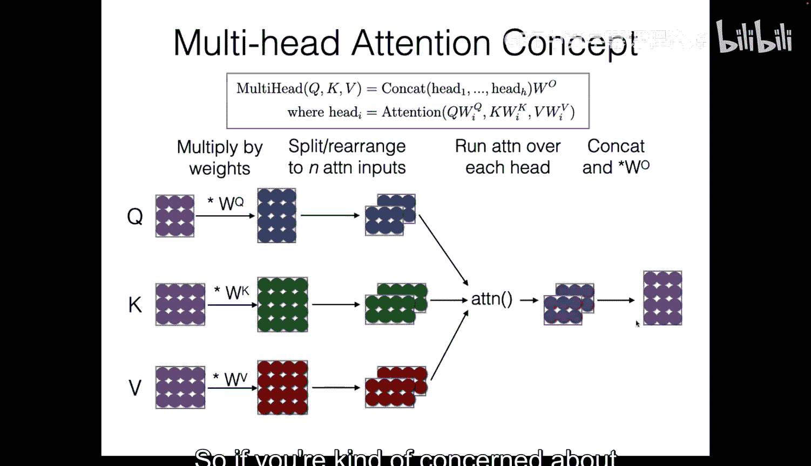

I put an example excerpt of code here。And so this is a nice implementation of the GPT model。

 which is based on transformers， and it's by Andre Carpathy。

 again I've referenced some of his stuff in other parts of the course。And up here。

 these four lines of code are doing the kind of splitting that I was talking about。

So I might not be able to talk through。Like all the details here。

 you might need to like look at this a bit closer after。But by kind of understanding this code。

 which is the forward path of the attention mechanism。

You should be able to understand like exactly how this multi head attention is being implemented。

And really， the key idea here again is。We are kind of reshaping these keys， queries and values。

 that's K Q and V。Do you have like multiple heads？And then here is like doing the attention and then combining the results at the end。

Okay， and so you'll have to get not with this exact like naming of variables。

 but in order to do the homework， you will have to implement some stuff that looks like this and so yeah you do have to kind of get familiar with the kind of low level of how this is implemented。

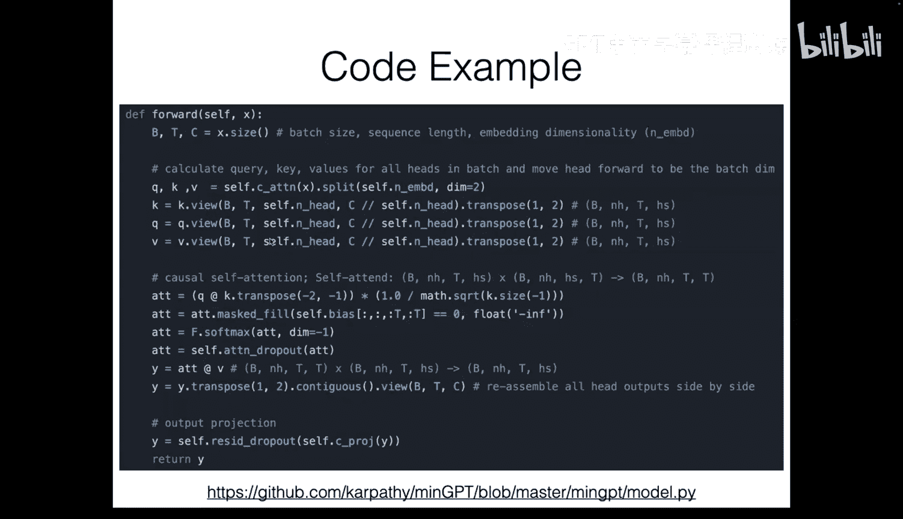

Okay。😊，So then assuming that we've implemented multi head attention and trained a transformer。

 what are some examples of what this does？So here's actually an example from the transformer paper。

And up here， they have the word making。And then they visualized different attention scores from different heads。

And so you can see that one attention head。Has kind of learned to attend。

Just like kind of self attend to the current position。

Another one has learned to attend to more and difficult。Um and then， yeah。

 so you can have these like， yeah， multiple positions where you have high attention scores and then they're combined by the transformer。

To make the final output。So you can also play around with this。

 there's like a tool online and yeah you can like visualize some attention scores for different inputs and outputs。

There's one more detail which is like really important for implementing the attention for language models。

You probably noticed that like。So in language modeling， we have to predict the next token。

 given the previous tokens。But then if we give the full sequence to the model。

Let's say that we're at the word I and need to predict the word hate。

Then what it can do is it can just cheat and just look at the word hate。

And then know exactly what it has to predict。So what you have to do is you have to introduce what's called an attention mask。

And so the attention mask。We'll basically zero out the attention scores。

For positions from the future。So like at the first step。

 you only want to attend to this input sentence here。

And you want to like zero out that's shown in white。All the attention scores here。

Then after you've predicted the word I， that's this row。

You want to zero out the attention scores from the future again so that the model isn't cheating。

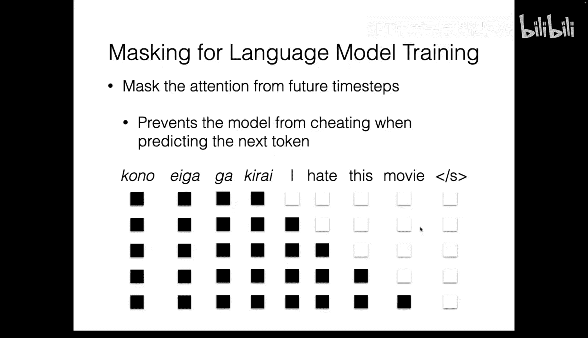

And again， you can see this implemented here， it's this line right here。

Where it's filling in this attention with like minus infinity。

Okay， so this is actually really important if you don't do this。

 the model will quickly learn to cheat， and it won't really be a useful language model。Okay。

 so any questions on the multi head attention before we go to the next part？

Can you explain why is that like the attention mechanism you seen that deco there has a mask。

 but the attention mechanism you seen input as on。Yeah。

 so it's because of the way that the language modeling task is designed。

So the language modeling task is to predict the next token given the previous ones and whatever input you have。

So here in translation， you assume that the model is given the input sentence。So in some sense。

 it's like always allowed to look at inputs。And then， but when you're predicting the next token。

 you can only do it one token at a time， and you can only look at the preceding ones。

Does that make sense？Okay。So now let's go to residual connections and layer normalization。

So visually， it's kind of right here on the architecture， it actually appears twice。嗯。

And so here the idea is， if you remember with recurrent networks。

 we spent some time talking about this idea of vanishing gradients or exploitloding gradients。

So this was like the visualization we had where as you kind of went back in time and the sequence is longer and longer。

Then the gradients in the model were almost guaranteed to get very small。

Now you can imagine like taking this diagram and then like flipping it and having it be vertical。

And conceptually that's it doesn't correspond to positions of the sequence。

 but you could think of the transformer as being this like potentially really large stack of layers。

And it turns out that the same issues of like vanishinging gradient or exploding ingredients gradient can happen if you have a very deep transformer model。

So there's a couple different ways to address this。So one is called layer normalization。

So here we want to ensure that the outputs of a given layer are given part of a layer。

Are kind of in a consistent range。And so this will avoid the model having like too much variance。

And you can imagine that if you're stacking like， you know， 20 layers together。

 if anyone is like too crazy， like too large or too small。

 then it could kind of mess up the gradients。And so conceptually like layer normalization is a way of addressing that。

And what you do is you basically take the。You readjust the outputs。

By taking the mean and the standard deviation。And then， like， rescaling the outputs。So here。

 x would be your kind of current output vector。You take the mean across the dimensions。

And then you similarly take the standard deviation。And then you have these two learned parameters。

One kind of adjusts the scale。And then one is a kind of shift term， so a bias term。

And so in doing so， you kind of go from your original output vector x。Two。

 one that's been adjusted by the mean， the standard deviation and these learned adjustment parameters。

So does this kind of any questions about those layer normalization？Okay。

 cool and the layer norm itself is like。You can put it in different parts of the network。

 so actually later on I'll talk about how people looked into where the best place to put the laryor is。

And actually changed from the original transformer。

The second idea is something else I mentioned last class， and it's called residual connections。

And so here we add this additive connection between an input and an output。

So it's this kind of skip connection。And intuitively， what it's doing is。You know。

 the model could actually set this F of x to zero， and then it would just be like passing the input through。

But in practice， the model is basically learning to adjust the current。

The current like representation or current input。And so doing this again can help prevent these vanish ingredients。

It's the same argument that we saw before。Where like if F of x is really small。

 then you always have this alternative kind of connection here。

And then it does change the dynamics of learning because again。

 now the models like learning these differences versus like learning the full。

Function at a given layer。And so then the implementation is really simple。

 like you literally just add and we'll see it in a bit。

So any questions here or I'll go to the feed forward layer。OK。

So then now the feed forward layer is right here and it's towards the end of this block。

 so we're almost done。Um， and the idea here is to just take the outputs from attention and， you know。

 maybe they've been normalized。And then just do some like complicated transformation of them。

So we have a feed forward network。That takes in the output and then just does some nonlinear transformation。

So again， here you could have like a two layer network where you have a weight matrix。

 you have some activation function， and then you have another weight matrix。So in previous classes。

 we gave some intuition for these。Feed forward networks。

 They can learn these like combination features， and they can introduce the non linearities and just make the network kind of more。

Expressive。Okay， so then these are really the ideas of how one of these layers or blocks is implemented。

 and then you'll just repeat them to make a deeper and deeper transformer model。

So there's a notebook here in the course code repository。

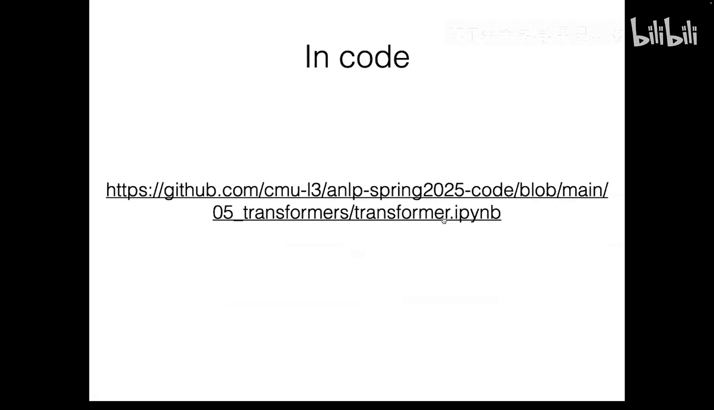

And again， on the same task of doing language modeling of these names。

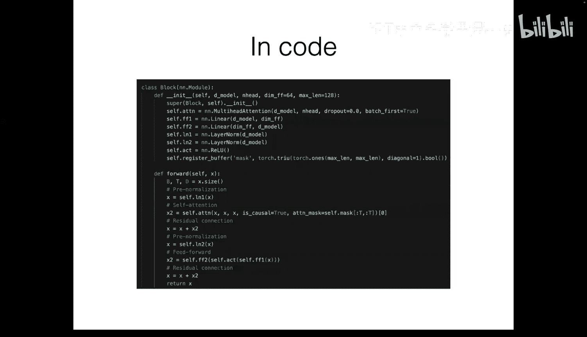

We could train a really simple transformer model。And so here you could see the implementation of the block。

So here I've cheated a bit and used pie torchches implementation of the multi head attention。

Then here you have the parameters for the feed For network。

And you have these two different layer norms。And your activation function。

And then here it's like storing this mask that we can use to mask out the attention。

And then here's the forward pass of the of the whole like the individual block。

Here it's performing the layer normalization。It's performing the attention。

 and you can see it's passing in this attention mask。Here's the residual connection。

 so you take the previous thing and you kind of skip over this part and then add them together。

And then here's the second part where you again do a layer normalization。Do the feed forward。Network。

And then do the residual connection。Okay， so I'm going through it a bit quickly， but hopefully。

If you look want to look through this after it's。Yeah。

 hopefully the code is kind of simple and you can see concretely how the different parts that I introduced。

I' go into this architecture。And then to actually implement the language model。

Here we have a token embedding。We have a position embedding here I did it a bit differently。

 so instead of using like the signss and cosines。I'm basically just learning some embedding for every possible position。

And then here you could see how it's literally just like stacking these blocks together。

And then you have some output layer。And then here， just to make it clear。

 I've implemented this with a for loop， but you can imagine that these are really just stacking things together so you can make this very efficient。

And you could see that overall the forward pass of the transformer is pretty simple once you've eruping it up into these different blocks。

Okay， so the version you'll go through in the homework， it'll have kind of more surrounding code。

 and it'll have some new features that yeah， hopefully I'll have time to。ToTo get through。

 but this is a kind of minimal version， and you can train it and again have it generate these names。

Like we saw before。

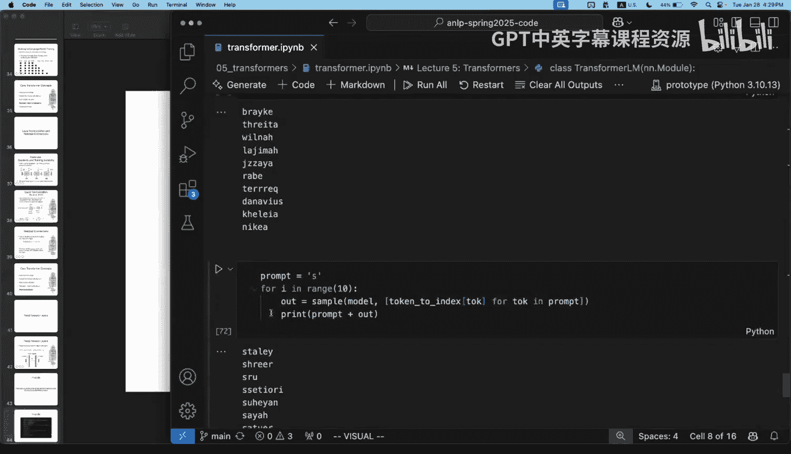

Okay， so。

Any。Questions on this before I go to the improved components。 and we have about 20 minutes。

 just as a。嗯。Yeah， as a reminder of this time。Okay。

 so let's go to some improvements so one I actually oh I apologize about the Can you mention the output thing that I asked earlier here。

Why the output appears in the diagram？The output。Oh。

 I thought you were asking about the position embeddings。

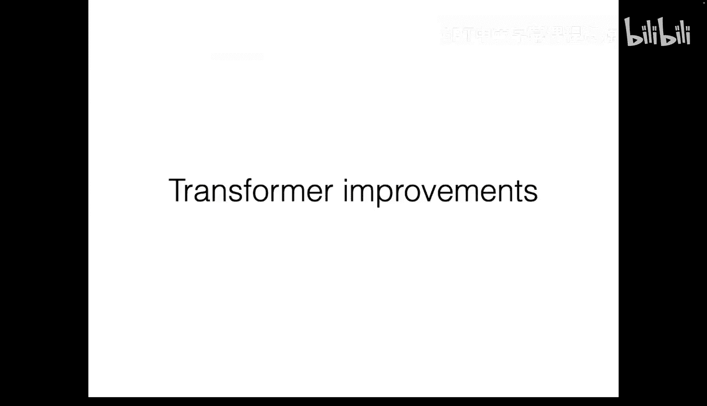

Which part were you the first huge diagram have like both the in colorder and the color？对。嗯。

What is the output being on the lower right side？嗯辩。Oh， okay。 yeah。 So here， this is just， yeah。

 I guess terms it， it's calling the encoder input， the input。

 So it might be like a Japanese sentence。 And then it's calling the sequence for the decoder。

 the output。 So that'd be like the English English sentence if you're doing translation。

Go the target。Yeah， so this would be the if you're doing translation。

 this would be the target sentence， yeah。对。Okay， yeah。 sorry， I misunderstood you。

 I thought you're asking how the embeddings were。呃。Functiontioning in the transformer， okay。嗯。

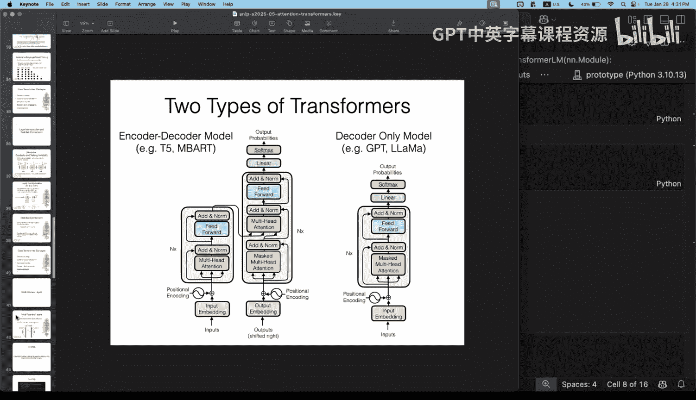

So， let's go。Let's go here。I actually already showed you this in the code。

But one thing you can do is instead of dealing with those signs。

 the assign you so little encodings that we were talking about before。

You could just have a learned embedding vector so you take like every potential position up to some maximum。

And then you again just learn like one vector per position。And so as you saw in the implementation。

 this is like very simple to do。A disadvantage is that you again can't extrapolate to longer sequences。

So if your models only learned embeddings for。For example， on this name data set。

 let's say all the names are shorter than like 15 characters。

Then it's never learned some representation for like the position 16。And so in practice。

 it just performs very poorly if you have a longer sequence。

So one thing people were interested in is whether you could only care about relative positions。

So like。Yeah， instead of encoding like this token is in position。Zero or position 16。Just say like。

For this pair of tokens， how far away from each other are they？And then if you think about it。

 like this idea， it doesn't really matter exactly。Which absolute positions in。

 it's just looking at the relative positions。So here's a kind of minimal。

 but it's kind of showing you the idea。Here what you do is you have。嗯。

Some embedding or like at least some number。For each pair。So before you do attention。

 you would have the token zero here。And token one and token two。

And so then this embedding is basically saying。These two tokens are like two tokens apart。

And so what you do is you learn like each one of these and now you have some embedding for the relative positions。

As you're performing attention。So the reason I didn't go into details here is because we'll go into details on this next one。

So this is a method for relative position encodings called rope。And it's still used in。

Like many state of the art language models。And this is what's used by Lama also。

 and so you'll actually be implementing this rope encoding in the homework。

So you'll see this in a lot more detail following the lecture。

 and here I want to just give the kind of key idea。So here。

 if you think about what attention is doing。Attention is performing a dot product。

And if you want your model to only depend on relative positions。

Then you want your embeddings of positions to basically satisfy this formula here。

It says that when you take the dot product of two embedding vectors。

You want it to be a function of the input， the output， and then just the relative position。

 M minus n。So in particular， like you don't want the embedding to be a function of the absolute position。

And then what this method does is called rope。Is they use ideas from trigonometry and imaginary numbers。

To come up with some function that satisfies this property。So again。

 the function involves signss and cosines。And it can look kind of complicated。

But let me just show the end end result here。What you have is you have some。Some vector。

 and it'll be like D dimensions。And then your embedding will be this thing here。

 so it involves these like cosines at different frequencies and it involves these signs。

And what the authors show is that this function here actually satisfies this property。

So when you take the dot product。You get something that only depends on the relative position。

And so here to like fully understand the motivation for this and the derivation。

It might take a bit and we want to go over like multiple things in the class。

But you'll have some time to understand this because it'll be in the homework。

And I actually personally like to review this was going through some different materials。

And I found a pretty good blog post that， yeah， kind of understands the motivation pretty clearly。

 and so I linked to that on the course page。Um so it talks through the， yeah， again。

 the motivation and then how this thing at the end ends up u satisfying this property。

So you can definitely check that out and then you can also。嗯。Yeah。

 look how it's like implemented in different libraries。

But this idea of encoding the positions with this rope method。

Is the kind of current method that's being used now？Okay， any questions here。

 I know it it's just a quick。quick overview so does this replace adding up the positional embedding like the output of this equation？

Yeah， so， yeah， so the idea is you no longer add some positional embedding at the input。

This will actually be added at a different part of the network because it's involving these like dot products between two positions。

And then it'll be used in place of。The， yeah， the additive one。And the key idea。

 like aside from the details is that when the model is doing the dot product in attention。

It could now have access to some positional information。

And so then this is the way of kind of incorporating it。哎Yeah。O。So yeah。

 we have like three more things to。To get through。So the other one is called pre layer norm。

 and so here I mentioned this earlier， you could basically decide where this layer norm is going to be put in the architecture。

And what people found， there's actually this whole paper about it。

They found that putting the layer norm prior to the attention or the feed forward network。

Actually was favorable in terms of the gradients and like the optimization stability。

They actually go through like some kind of， you know， formal arguments in this paper。

but basically like for this class or for this presentation， you can think of it as like，um yeah。

 it turns out that the position of the layer norm can matter。

And the trend recently has been to yeah put them do this prelay norm so put it before instead of after。

 which was done in the original transformer paper。So this is how it'll be implemented in thellma model as well。

Another simplification that happened is people realize that like for a layer norm。

 you can simplify things and。Instead of having like the mean and standard deviation and gain and bias。

You can have the simpler thing here。So it's called RMS norm。And you could see that now， it's。

It has the learned gain， which can like scale things。Then it has this input dependent scaling。

Um based on this like root mean u squared， that's where the RMS comes from。这个。嗯。So yeah。

 I think the general takeaway was that people got like similar empirical performance with this and it's a bit simpler。

 so then this is also common to use RMS norm instead of the layer norm。Okay。

 and then the final one is called grouped query attention。So on the left here。

 I'm visualizing what we have in multi head attention。So here each box corresponds to a head。

So here the model has like eight different heads。And in standard multi head attention。

 you would have eight query heads， eight key heads， and eight value heads。

And what people notice is that you can save some parameters and especially like save memory accesses。

By reducing the number of keys and values。So here now you would have just like four keys。

And in some sense， these like each key would now correspond to。To two different ones。

 or you just have like， you know， half the number of keys and values compared to the queries。

A really extreme case is you just have a single key head and value head。

 and this is called multi query。But this grouped query approach。Is yeah， again。

 kind of popular in practice。And you'll see it in the transformer， sorry in the Lama code。

You won't actually have to implement this yourself。

 but you'll see this idea of having some number of keys and some number of queries and they can be different。

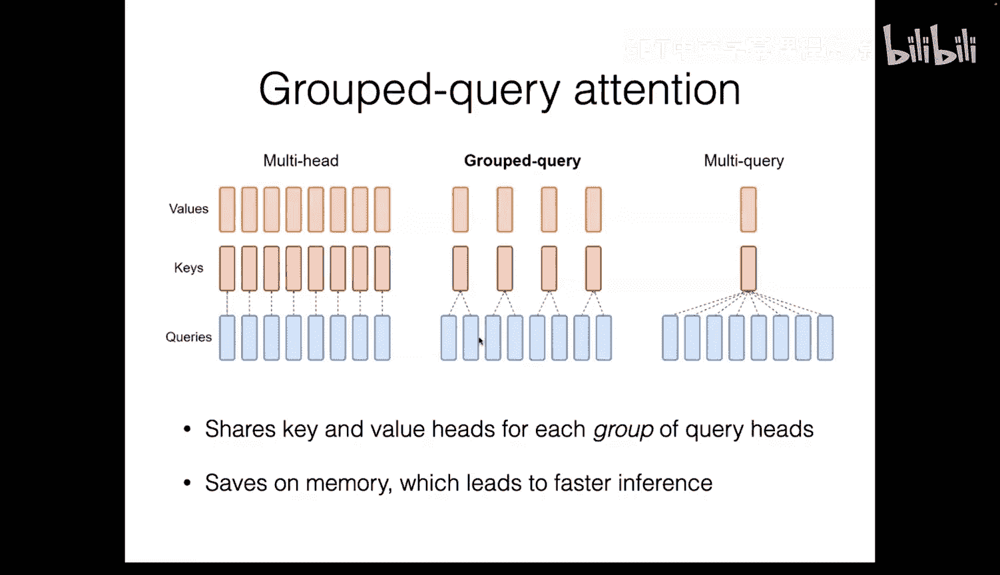

So just to show you where this comes up， so this is actually looking at the actual Lama model code。

It's not showing you all the context， so to see where all of this fits in。

 you'd have to go look at it。But basically， this is inside the attention implementation。

And you could see here that it's getting its query， key and value。

And then it's doing this reshaping operation。And you could see that the queries have some number of heads。

But now the keys and values have some different number， which is called Kv heads。

Local is something else， it's because they parallelze the model across like multiple devices。

So that's what that is。 But yeah， basic ideas here， these can be different。And then later on。

 what they do is they just duplicate these key and values so that you can just apply the attention。嗯。

As you were before。Okay， and so the kind of finding here was that this reduced parameters。

 and then if you look at like the specific memory axises that were happening。

 this actually saved on memory axises a lot， which like speeds up inference。

We'll actually talk about that in some detail later in the course， but just to give you a quick。

AOne line summary there。

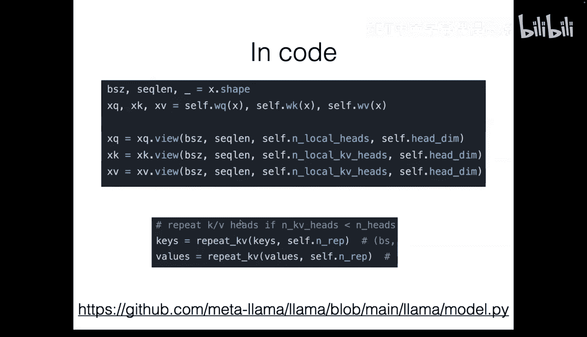

So if we actually look just to convince you that these things are being used。

Here on the sorry first column， we see the original transformer。

And then here we have the Lama model and the Lama 2 model。

And you can see how they changed the position of this norm。They changed the norm type。

They also changed to a different linearity， I didn't go into that。

They change the positional encodings。And then they started using this group to query attention in Lama 2。

Okay， so it was kind of an overview of a lot of things at once。

 but I did tell you about all of the key ideas that even go into these kind of state of the art architectures。

And then again， you'll be looking at the Lama2 architecture in the homework to help make these things more concrete。

And then one last note， which is like， how important are these different addons？

So this is from a different paper on a different topic， it was about like different architectures。

And here they have the original transformer in。This kind of yellow。

And we're looking at the perplexity。And then here it's kind of hidden， but it's this orange。

 it's basically equal to this purple one。Is the improved transformer， which is like Lama Lama 2。

And so you can see by adding in all these different things， not only does the model get like faster。

 which I briefly mentioned， it's actually getting lower perplexity。

 so it's like doing language modeling better。嗯。And the reason it's showing this X axis。

 so this is the amount of compute that you're using for training。And so you can also。

 it's more efficient in the sense that you can like reach a given level of performance a lot sooner。

Than with the original transformer architecture。So this idea will come up later in the course。

 So if you didn't follow everything I said about like。

Compute and all that we'll talk about that later。I think I'll actually skip this for today。

Maybe I'll do it at the beginning of next class， but it's kind of going through how transformers have like more efficient training compared to RNNs。

Um but transformers are inefficient since they have this。Qudratic growth in the attention。嗯。

But maybe I'll save that for next time or we can just。嗯。Yeah， not cover it。

But maybe I'll introduce to at the beginning of next class。

So today we saw the transformer and again it's a sequence model based on attention。

 we saw the architecture and some improvements that are made。

And so this will be really like set the stage and be used in the models that we talk about throughout the course。

Okay， so thanks everyone for your attention。

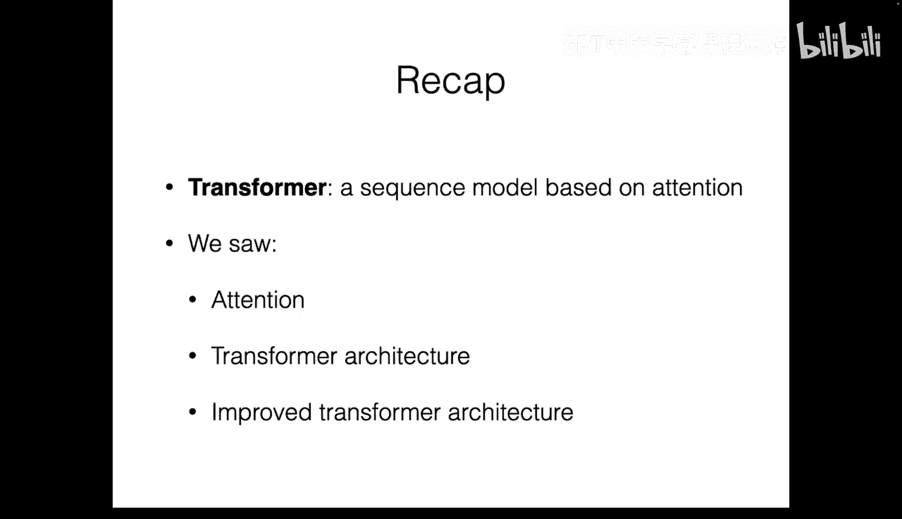