# CMU《高级自然语言处理｜CMU CS 11-711 Advanced NLP Spring 2025》中英字幕（claude-3.7-s - P6：-06-(6)_ Pretraining.zh_en - GPT中英字幕课程资源 - BV1nYVHz7Eoa

Here。So today's another lecture that I'm pretty excited about。

 today we're going to go over pre training。And so pre training is pretty interesting。

 it's something that has really gotten popular in the past， say six， seven years。And for a while。

 a lot of the field actually didn't know very much about free training。One reason was that it's just。

 it was something new。Another reason was that sometimes a lot of these pre training methods were being used in kind of industry settings and the details weren't released。

But then luckily since then， there's been kind of an enormous effort by different people in the research community。

 so both academic researchers and industry researchers。

To basically make things like pre training open， so to publish details about it。

 to provide different artifacts， like data and models。And then also to provide analysis about it。

So now we can kind of look at what has been done and try to get a sense of some of the key ideas behind pre training。

And so hopefully that's my kind of goal for today's lecture。So。Just to recap what we've done so far。

 so in the first couple classes we were talking about classification and neural networks。

Then we move to talking about different kinds of sequence models， ending with transformers。

And throughout， we've been kind of emphasizing the problem of language modeling and language models。

And when you think about it in all of the different examples that we've gone through so far。

We've just been thinking about taking a model and training it from scratch。

And basically having one model for one task。Right like we trained this sentiment classification model and then in the notebooks we were training like this language model that could like generate different names。

But today we're going to shift to a kind of different paradigm。

Which is we do what's called pre training and pretrain a single model。

And then try to adapt that model to many different tasks。So here's the basic idea。

The basic idea is you take a lot of data。And then you do this pre traininging stage。

And you get a model， and we could call it a base model。

Then you use some technique to adapt the model to a task。So for example。

 you could adapt this base model to sentiment analysis。嗯。

And you can adapt the same model to multiple different things。 So like translation。Dialogue。

 problem solving， kind of whatever you want。And so what are some examples of adaptation？Well。

 both of these were actually going to have full lectures about them。But the first one is fine tuning。

So here you take a kind of smaller amount of data that's relevant for your task。

So let's say we want to do translation from Japanese English。

Then what youll do is collect these kind of input and output pairs。

And then fine tune this base model for the task of translation。And then when you're fine tuning。

 you're actually adjusting the model's parameters， so you actually end up with a new model。

 this fine tunes model over here。And again， there's various strategies for doing this。

 there's like efficient ways to do it， and we'll actually talk about those in a later lecture。

And then again， the idea is you don't kind of start completely scratch from scratch。

 if you want to make a different kind of model， you just fine tune the base model for something else。

And then another way to adopt a model is through prompting。So this is again。

 a kind of relatively new thing。So instead of fine tuning your model。

 you could potentially just prompt it and say and like describe the task。

And just say like translate this sentence into English。And then you give it some sentence。

And then these models go from like left to right so then it could just try completing this and you could potentially get a translation here。

Now， of course， like how you build the prompt and the properties of the model will affect how effective this is。

And again， we'll actually have a whole lecture on this next week。ButThen here。

 the cool thing is that now you could perform many different tasks without even changing the model。

And so this could be pretty attractive because， you know。

 one organization even could just train this really big base model。

And then different people could just use it for many different tasks， which is kind of a cool idea。

Okay， so aside from you know， being able to adapt to tasks。

 what are some reasons why we would want to pretrain？

So a really like underlying idea from machine learning is that we're leveraging this notion of transfer learning。

So at a high level， that means that we're taking some notion of knowledge from one task。

 so from our pre training task。And then we're trying to apply it to hopefully learn quickly or more efficiently on some new tasks that would be like you know translation or the ones I mentioned。

And so some things that you could hope to get from pre training， one is for your target task。

 you could potentially use less training data。So， you know。

 maybe you need fewer translation pairs for translation。

Or a really extreme case is when you think about it， if you're just prompting a model。

 maybe you don't even need like any data to perform some task。

You could also just get better absolute performance。

That like for the amount of data you have for the task。

 using the pretrain model could just give you you a performance that you couldn't otherwise reach。

And then just having one model that performs multiple tasks could be useful for many different reasons。

It could just be convenient。UmYou can kind of like spend a lot of money up front。

 but now you have maybe something that can efficiently be adapted to by many people。And in general。

 it could be like a useful starting point if， say you're a researcher。

 then you start off with a model that's already at some level of capability。

So these are some reasons why this paradigm is kind of attractive。

And it's really like a standard paradigm now that we use in NLP。

So what are some major factors that kind of determine？Different pre train models。Well。

 you've probably heard of these different models and they kind of each have their own unique names。

So models like BerRT， GPP3， Lama or deepse or deepse version three。And really。

 all of these different models are somewhat determined by four different factors。

And these factors are kind of the topic of the lecture。

So the first is the underlying like neural network architecture that you're using。

The second is what pre training objective or training objective is used for the model。

The third is the data that you use to pretrain。And then finally， this might seem trivial。

 but it turns out that the actual hyperparameters that you use。To actually do the training。

 like how long you train it for， even things like the exact learning rate you use can impact how good the model is。

So let me just give a really broad overview of these categories and then as I mentioned。

 these categories will or some of them will be the topic of today's lecture。So for the model。

 today we're not actually going to spend too much time。

Mostly or all the models that we'll talk about today are based on the transformer architecture。

But then like if you actually look at any given model。

 the exact specifics will actually vary a little bit。So like we saw in the last lecture how。

 you know， from Lama 1 to allma2， they actually introduced this like group query attention。

And so when you actually look at the details， again。

 these different models might have like slightly different you variants。And then again。

 sometimes we don't even， you know， people don't publish the details and we don't actually know the exact model that they're using。

So in terms of objectives， we're going to talk about two of them。

So we're going to briefly go over what's called mass language modeling。

This was really popular in like 2018。And typically， if you train a mask language model， again。

 we'll talk about the details in a bit。You'll get a model and then you'll use it for fine tuning。

So usually get a kind of encoder model。And then you can find tune it for a specific task。

And mass language modeling consists of basically like removing or masking out different positions in the sequence and then having your model predict them。

And so these positions can be from like anywhere in the sequence。

 so you're not necessarily going from left to right。

And then there's auto regressive language modeling。And so this is the one that we've seen come up。

 you know， I've mentioned it a couple times now。And so here again。

 you have a model and it's predicting tokens from left to right。And that basically amounts to， yeah。

 predicting the next token in a sentence sequence。Given the previous ones。

And so this one is also used for fine tuning。But then this has these kind of generation capabilities as well。

And so people have also discovered this ability to prompt these models to use them for different tasks。

And then now we're in 2025 and just like broadly speaking， this auto regressive language modeling。

 pre training is the kind of popular thing to do right now。

And then of course there's data and so data is extremely important。唔。Oect thank you。Yeah。

 so these will be for pre training。Oh yeah， yeah， sorry about the wording。

 so you do the mass language modeling on a bunch of data。Then you get the base model。

And then the masked language model based models are typically used for fine tuning。

 you can't really prompt them， it kind of comes down to the fact that they're not left to right。

 they don't really have a defined generation order。嗯。你这意思。好，谢可。Right， yeah。

 you can do this kind of like， you could do a kind of prompting where you remove like one word and have it like fill in the word。

But yeah， since it doesn't really have a consistent generation order。Yeah， yeah， exactly。嗯哼。😊。

ちょっとそれでおちょっとめして。Is that the same as the masking I discussed in the transformers election？

So this is the one that we， yeah， we talked about this in like the R&Ns lecture with the encodeder decoder。

 so the decoder was trying to predict like the next token and then yeah we also talked about this in the transformers lecture。

And。Yeah， exactly。 yeah。 so in order to train the transformers to do this。

 you use a mask that yeah actually looks like this diagram。Yeah。Any other questions？Okay， cool。

So yeah， data is very important and a large portion of today's lecture is about data。

Just as a really quick summary before going into that part。Yeah， back in 2018。

Some of the popular sources were like this book's corpus， which was a really large corpus of books。

Also Wikipedia。It turns out that people still incorporate Wikipedia into their retraining data。

But one thing that's become really popular and again。

 we'll actually talk about how you do this in the lecture is to use data from the web so to take like a massive scrape of the web。

And then try to turn it into pre training data。And then for the hyperparameters， so again。

 some models will report exactly how they're training the model。Some won't。

If we have time at the end of the lecture， we'll go over a few strategies that could be used。

To select some of them。Otherwise， we're going to have another lecture later in the semester on advanced pre training。

And so if we don't get to that today， we'll just talk about it then。So。Yeah。

 today we're going to talk about two different objectives。

 I'll briefly go over master language modeling and then talk about the autoregressive language modeling。

I'll talk about pre traininging data， so different sources of data。Different notions of data quality。

Um， and then tied in with the sources， basically how you can get， you know。

 massive amounts of data to pre train a model with。And then time permitting。

 we'll go over some different ways for thinking about pre training。

So there's a really kind of useful way of。Thinking about pre training in terms of the amount of compute that's used to pretrain the model。

And that turns out to relate to the number of tokens that you're pre traininging on。

And also the size of the model。And then finally， there's this kind of cool idea of scaling laws。

And these help you kind of make projections about how good your pre training will be at a larger scale。

And it turns out that you can use these to actually。

 yeah perform experiments at a small scale and then do things like choose hyperparameters for a really large model that you kind of only have one chance to train。

So again， we're going to have another lecture on advanced pre training later in the course。

So this is my first time giving this lecture and if we don't make it through any of the parts。

 then we could talk about it with them。So first， mask language modeling。

So this idea was really kind of popularized in 2018 and the model like the yeah。

 the model that kind of popularized this was called BRT。嗯。

I remember the B means bidirectional and the T is transformer， I forgot what the E and R are。

 but anyways， so the model they're using is a transformer， so like we saw last class。

And so here at the bottom， you give it some sequence of tokens。

And then this is just visualizing the transformer。And then up here you have the kind of vector representations and you'll get kind of one vector for each token。

And then here there's some kind of， yeah， maybe interesting things。

 especially if you ever use a BRT model。What they were doing back then is they were training the model on like two different sentences at once。

And so they have these special tokens for like separating the sentences。

And then they also have this special token， it's called CLS at the beginning。嗯。

And it turns out that when they would fine tune the model。

 which I'll actually have a slide about this。They would typically use the like vector representation for this CLS token to fine tune the model。

And so here the model is there's actually no attention mask used。

And so even if you take like the vector for this position。

Then the vector has kind of incorporated information from the whole sentence。嗯。And so yeah。

 they kind of set aside this extra position here to like use for fine tuning。

I think the reason they use two different sentences is because I might be wrong about this。

There were certain tasks in NLP at the time that used two different sentences。

So like one was called natural language inference where you kind of like tried to determine whether two sentences were contradicting each other or something like that。

Also translation。So perhaps that was the kind of reason for that。

And then the objective is mass word prediction， which I'll go over on the next slide。

And their data was these two ones that I mentioned earlier。

 it was a kind of large corpus of books as well as English Wikipedia。

So the basic idea of mass word prediction is kind of like it sounds。

So basically you take some training sequence from your pre training corpus。

And then you just randomly mask out some tokens in the sequence。So I think in the paper。

 they have like， you know。10% or 20% or something will get masked out。嗯。

And then the model has to predict the token。And so when you think about it。

 if you like do this on just like a， massive corpus of sequences。

Then maybe the model actually starts to learn some useful representations。Like。

 let's say you have to predict this word is。Then it kind of learns， you know。

 some grammatical structure that like is typically goes。You know， right here。

Does anyone actually remember what words were masked out？Yeah， so cute and ink。

 So see here I would learn to kind of put ink after， you know， this structure。

And the kind of intuition is you just do this on you know， massive amounts of data。

 and then in doing so， it learns some useful representations。

So I guess the details of this are not too important but。

What they actually do is sometimes they'll mask the word。

And then they found that like sometimes it's good to just substitute this in with a random word。

Cause then the model has to learn to， like， detect whether。You know， a word is kind of out of place。

And then sometimes they don't change the word at all， but they still require the model to predict it。

Because then the model has to be like。Kind of learned that this word is actually suitable here and it shouldn't change the prediction。

But this was like， after this BRT model， I think the， you know， if you look at this paper。

 it has just this enormous number of citations。And so improving these mass language models was a kind of like major focus of research。

And so people found like different。Strategies that like differ from this one。

They actually found that some of the additional objectives from the Burt paper kind of weren't needed。

So I think like maybe the important thing here is to kind of be aware of this these mass language models and some sense of how they're trained。

嗯。So。If we want to use one of these for some task。Then what's typically done is to。

I guess we've seen this idea before， but you can basically add this extra output layer。嗯。

Onto like one of the hidden representations。So again。

 what they typically do is they set aside this extra a token。

And then you can add this extra weight matrix and get some like output scores。So for example。

 let's say that we wanted to solve the task from the first two lectures， the sentiment analysis。

Then you basically collect this data set of。Like movie reviews and your class would be positive。

 neutral or negative。And then you would add on this weight matrix。

And the weight matrix would go from your hidden dimension to three。And then if you take the softm。

 you have like probability of each of the three classes。

And then the key thing here is instead of like training the model from scratch。

 you now initialize this part with the pretrain weights from the pre training。

And then kind of train or fine tune the whole thing。Using cross entropy loss。In this example。

 what hidden vector do you use is it like the CLS tokens， hidden vector？Yeah。

 so I'm pretty sure you could use any of them， but then， yeah。

 people would typically use the CLS token。Yeah。Any other questions on this or about？

The mass language modeling。Yeah， as I mentioned， we're。

Not spending as much time on these compared to the left to right。嗯。Yeah。

 I don't know the the exact argument。 one， one is like just。

 it's this kind of extra token that's set aside for the purpose。

 So you just don't have to think about it。But yeah。

 I'm pretty sure people have experimented with different strategies。

 like you could even take the mean of all the vectors。And you could like。Yeah。

 you could use a different vector。But yeah， it kind of became a standard to just use this token that's been set aside。

O。It the C is broken already in the first model。Yeah。

 so basically they would have their vocabulary and then they just add this extra to the token。

And then for every training sequence， so like let's say they have the books corpus。

 you like take a page from the book and then separate it into sentences。

 and then they make sure that the CLs token， you knows， yeah， so then it sees it。

On every sequence during training。嗯。So yeah， that's how it's done。C posted to the move review data。

Yes， yeah， you don't want to do that， yeah， yeah。嗯哼。😊，First cold controller。

He use the mask word prediction to training himself。Yeah， so the BRT model。

 I guess you would consider it an encoder decoder is usually associated with。

Maybe this like left to right generation。嗯。But at the end of the day， it's a transformer。And so yeah。

 you can give it tokens and then you can get these factor representations。

And then to train the model with mass language modeling。You would， again， you take some。

Take some training sequence like this。嗯。Pass it through the model。And then。

Let's say that this position here had been masked out。Then you would have some。Output matrix。

 which is over the full vocabulary。And the model would have to predict the correct token。

Does that make sense， yeah， I didn't really visualize that part of it， but yeah。Okay， cool。

 so the I mean， these， yeah， mass language models are still useful and you can download them and fine tune them and yeah people still still use them for different tasks。

So yeah， next we're going to go to the autoaggress language modeling。嗯。

And so here I'm just putting this formula that we've seen in different lectures。

And so now instead of the mass language modeling objective。You have this objective here。And again。

 what it's doing is it's having the model， so you take some sequence from your training data set。

And then at each time step， it's having the model predict the next token。

And then the actual objective you use is called。Maximum likelihood。

Or minimizing the minus likelihood or log probability。

And so we talked about this actually in lecture three。So if you remember， even with these byG models。

 we were using this idea of maximum likelihood training。Similarly， like in the R&N lecture。

The same loss function came up。And so the exact same thing is used for pre traininging a very large model。

The idea is you collect this really large training corpus。

And then you train the model to basically predict the next token。Now。

 if you remember from lecture three， we went over two different interpretations of what this is doing。

One interpretation is that。You're going over your data set and you're minimizing this cross entropy loss。

So in some sense， the model is learning to kind of classify what is the next token。

And so we went through the details of that。Yeah， in lecture three。And then also in lecture three。

 we talked about how doing this maximum likelihood training。

Is actually equivalent to learning to model some underlying data distribution。So again。

 the data distribution is determined by the training set。And then if you remember from lecture three。

 we had the slide and it was like a five or six line kind of proof。

And it showed that minimizing this。Was equivalent to fitting。This data distribution。

So if those aren't like。You know， coming to mind， then it might be worth revisiting this argument from lecture three。

Just in case you want like different ways to think about what's happening during pre training。

So if we look at this， this like cross entry P loss。

 which is how we ultimately implement the pre training。Then there's really three key inputs。

So one is the parameters of your model。And so this will be determined by your model's architecture and basically how large it is。

And then the second is your training data set。Thatll again determine kind of which distribution your model is trying to fit。

And then again， you have these hyperparameter， so things like the exact learning rate that you use and the batch size that you use and things like that。

And so when you're pre training， you know， sometimes your model is extremely big and so it costs like millions of dollars to do the pre training。

And so these hyperparameters can actually be， you know。

 you kind of have one chance to do the final training run。And so。Yeah。

 you want to kind of be careful about which ones you choose。

So I'm going to go through some examples of pret models。But before I do that。

 let me actually tell you about evaluating the model because then we could kind of look at some plots and yeah。

 some interesting things。So one way to evaluate the model is to just look at its loss。

So you could look at its training loss， it's like validation loss or test loss。

And this could be really useful for kind of looking at the trajectory during training。

If you see a kind of spike， then maybe something went wrong or you could see whether it's like leveling off。

Another common thing to do is to train models of different sizes。And so if you compare their。

 even like their training losses， you can usually see relatively like how good the bigger model is versus the small one。

And we'll actually see an example of that in a bit。

But then what you could do is actually like evaluate the model even while it's training on downstream tasks。

And the way to do that is called few shot prompting。

So what you do here is you have some task description。So like translate English to French。

And then you just give the model a few examples of the task。So here it's like going from sea otter。

To to the French version。And here they gave like three different examples。

And then what you do is for your test example， you just give the input。

And then these models generate from left to right， so now you can just have it generate and give you a translation。

Okay， so we'll have a lecture on these kind of prompting strategies if you haven't seen this before。

But this was kind of one of the surprising things that。嗯。Was discovered， I guess。

 with these larger language models。That you could just prompt them to do different tasks。

And then you can get some sense of their performance， even kind of as their're training。

And then the last way is you could actually take the model and fine tune it for some task。

That'll actually could be more expensive， you know。

 because you have to actually run the fine tuning and adjust the parameters。

But that's definitely like a valid way to evaluate how good a model is。Basically， like， how good is。

A model after it's been。Fine tune from it。So any questions here。

 and then we'll see like concrete examples of。What this looks like in a bit。O。

So the first example is GPT2。And so this was， well， there was a GPT1。

 but like maybe GPT2 really kind of started getting people very excited about these pretrain language models。

So this one was trained by Open AI。And does anyone know what GPT actually stands for？Yeah， exactly。

So they had this transformer and they trained it on all of these different web pages。

And then they noticed that it was actually outperforming like fine tunes models even on zero shot tasks。

 so not even like giving it a few examples， but just having it perform a task。

Then a more recent example is Laama。And so you can see here they're again using a transformer。

 but now they're training models。Of different sizes， so from like  seven billion parameters to 65。

They're also trending the model on much more data， so 1。4 trillion tokens。

And then you can see the different sources of data that they're using。So for example。

 this common crawl we'll talk about in detail is kind of web data。You can see they have。

Some get code data， Wikipedia。Books， archive and S Exchange。And then you could see here that。

 you know， somehow they've determined these different， they're called like mixture proportions。

And so this will actually turn out to be， you know。

 the proportions you pick can kind of influence how good the model is at one type of task or one type of data versus another。

So you can imagine like if your proportion was higher for GitHub。

Then maybe the model will do better on code data or code tasks。

And then here's the actual loss function for llama。

And so you could see a few interesting things here。First on the X axis。

 you can see that as we have more data， so more tokens in the training data set。

The model's training loss is going down， so it's getting better。

You can also see that the larger models are doing better。

So the red line is the 65 billion parameters and the blue one is 7 billion。

And then the last kind of interesting thing is these different spikes here。

So this will happen during pre training where the model will have like really high loss and it can actually crash the training。

So one thing you have to do is like do these very frequent checkpoints。

And sometimes just the randomness of just like。Resampling a batch with new random seed。

Can like avoid getting these spikes。So yeah， those are some maybe interesting things and。Yeah。

 it's kind of interesting to see the actual loss function for。This pretty large model。嗯。So also。

 you could look at the few shot performance on tasks as it's being trained。

And so you could see here that not only is loss decreasing。But like generally speaking。

 it's getting better at performing these tasks as you train it on more and more tokens。

So the exact specifics will kind of vary by task。But generally。

 you do see this kind of upwards trend。嗯。😊，3。How do know， what's the optimal of stopping。Yeah。

 that's a good question。Typically。I'm not sure if they'll stop the training purely based on these like downstream metrics。

When they're training the really large model， they might just have some fixed budget。

Like here they were just going to train the model for like 1。4 trillion tokens。

And then the hypothesis is that， like， as long as the model is。呃。

As long as the model is like becoming a better language model， then in aggregate。

 it'll be better at different tasks。So some tasks， yeah， it might actually level off。

 but then they kind of just say like we're going to keep training up to some budget。

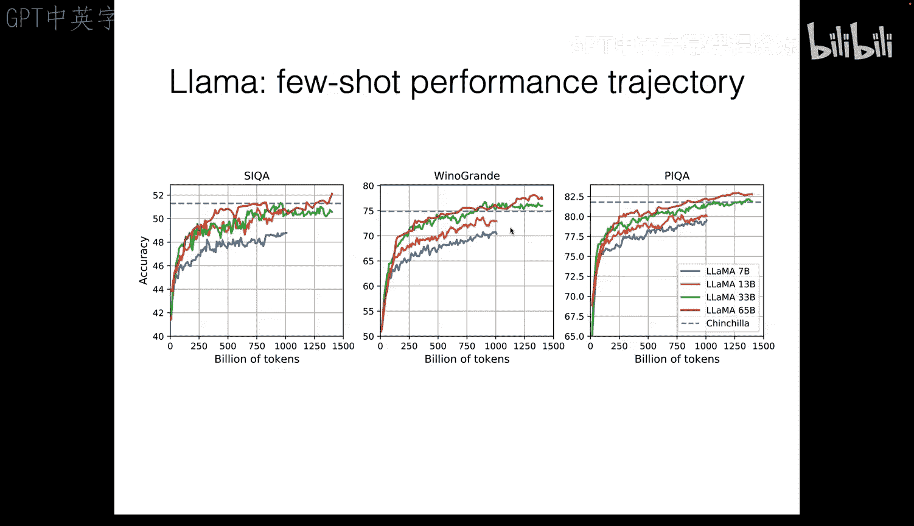

Okay。So then if you want to use one of these models， then。Yeah。

 many of you may have heard about this， but if you haven't。

 then there's this kind of useful library called Hugging F Transformers and the companys called Huging F。

So here you can basically like take you can go on this website and look up different pretrain models。

 they also have data。And so you could see here， like if you type in Lama， you get like Lama。

 you also get deepse R1 to still Lama， you have like a lot of bull options。

And like most pretrain models are on hugging face。And then you could actually just load one in in like two lines of code。

So you can load in the tokenizer and then you can load in the model。

And so， yeah， like just in case you haven't seen this before。

 there's like a little code example in the。

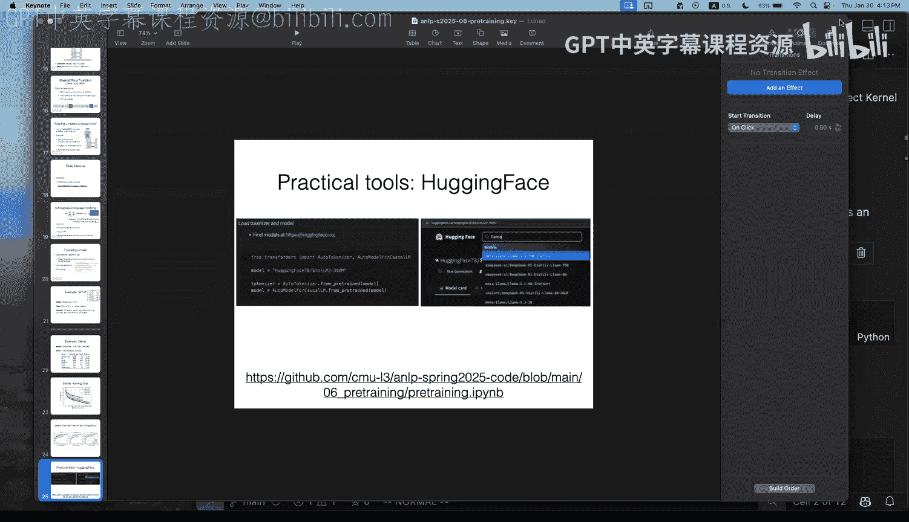

In the course code page。Where we load in this really small model that you can run on your laptop。

And then you just have it generate with these different prompts。

So here it says like it gives some meaning of life。It does this addition problem。

And then here I kind of wanted to trick it。Because this is like asking me about the future。

But it very confidently says that the temperature was 100 degrees crenoid。

So very important lesson in language models， they will hallucinate。And they will give you something。

 especially the base language models。嗯。So yeah， very helpful library if you want a play around with language models。

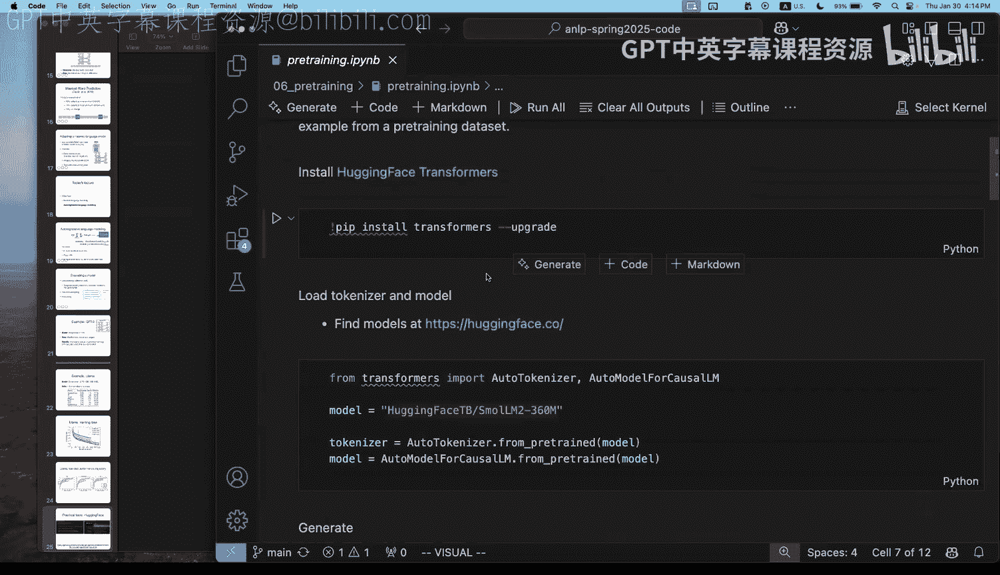

Actually， later in the course。We'll talk about fast inference。

And so if you have GPUs and actually want to generate like extremely fast with the models。

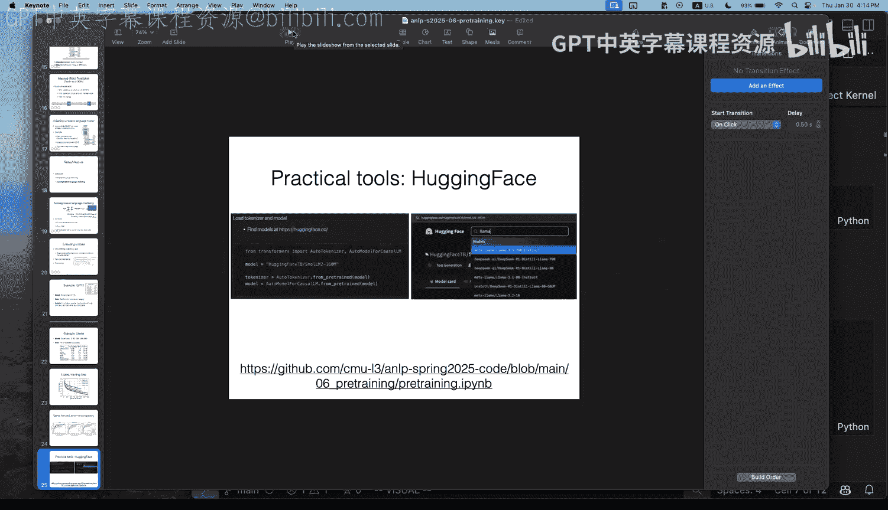

Then maybe there's some different libraries you would want to use。But this is a really， yeah。

 kind of useful one。

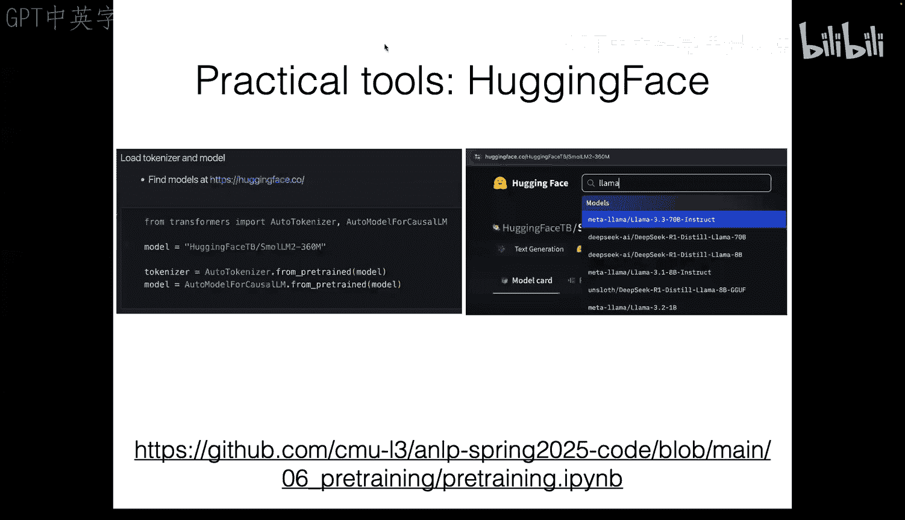

Okay， so now we can move to data and this will actually be looking at some fairly recent research papers and yeah hopefully it's interesting and gives you some insight into the kind of like complexity and things that are going on in the background when you're building a pretraining data set。

So first， yeah， we observe that like when you have more data， you generally get a better loss。

 so clearly the data is important。But there's kind of three maybe like key factors in the data。

So one is just how much data do you have again， maybe you know， just more data is better。

But then it turns out that also the quality of the data is important。

And so we'll look at some examples of what that means。

 maybe one definition is like is the data actually beneficial for training a model that's eventually a good model？

You know， you could imagine like training it on the same sequence， repeated trillions of times。

 and that's a large quantity， but it's kind of useless。And then also coverage。

 so does the data that you have kind of cover the domains that you care about？

So if you want to train a model that's good at math or good at code generation。

 you kind of have to determine。You know what is， excuse me in your pre training data。

So just to look at some quantities and even like some really recent models。

So the size of the pre training data sets is growing。

And you could look at like these kind of recent models are pretrain on up to 15 trillion tokens of data。

And just as some relative sense of how much that is。

Basically like all of Wikipedia is much less than 10 billion tokens。

So now they're going up to you know， 15 trillion。And some people might even be training on more。

 these are the ones that have just been publicly released。And so a really key question is like。

 where do you actually get 15 trillion tokens of data？Well。

A really major source that's used in most pre training data sets is based on web data。

And so a publicly available source of web data is called Common Cal。

What they do is basically like periodically take snapshots or crawl the internet。

And then like store as many pages as they can。And so this is just one example from one paper。

 but you know， they basically have like hundreds of billions of pages saved from different points of time on the internet。

But then it turns out that if you just train on kind of raw web data。

 you could imagine that there's like a lot of different types of data on the internet。

And you might not want to just train on like HTML。So you really have to think about the quality of the web data。

And again， there's kind of seems like there's like three is always the magic number。

 There's kind of three main steps that people take。The first is extraction。

So you can actually think kind of carefully how you move from the raw HTML to the text that you actually want to train the model with。

Second is you can spend a lot of effort on filtering。

So either filtering out unwanted pages or noisy pages or， yeah， things like that。

Or filtering for a particular。Type of data that you want。And then second， it turns out that。

When you look at the internet， especially multiple snapshots of it， there's tons of duplication。

 so either duplicate content or literally like the exact page is duplicated many times in these massive data sets。

And so it's really actually。Very important to do some amount of deduplication when you're constructing the pre training data set。

And then if you do these three things， you can get this final pre training data。

This might be a random film， but is data author necessary if you have so much data that's like diverse or do you not need to like make your data announcement？

Yeah， that's a good question。 So we'll go over a couple examples later， but a good example is。

Training these language models to be good at math or code。People found that， basically。

Just training on a kind of random sample of the internet。

Did improve their performance a bit because there's probably some math around or code around。

But then it's actually beneficial to like specifically add in some math data or some code data。

So I guess that suggests that， yeah， you still want to。Do some kind of targeted data collection。

And then if your domain doesn't have much data， then you could do some kind of augmentation to increase the amount of data there。

So let me actually give you some like flavor of。What these look like again。

 now there's some pretty cool research papers that show how this is done。So for extraction。

It turns out that there's like tons of boilerplate in HTML， you know， there's all the tags。

 there's like the imports or whatever。And you actually have to think kind of carefully about how to keep things like math。

 like lateEEC or code in a good form for pre training。

So here's an example and the paper is called Open webMath。And so basically。

 they were trying to collect as much mass data as they could from Common C。

And they notice that math is actually represented in like various different ways。

It could be in these like special annotation tags。It could be represented as like math jacks if you're familiar with that or just lateX。

And they found， like， various different ways。And they also found that the kind of default extraction libraries would just remove a lot of this math。

And so by like putting in extra effort to extract the math。

They were able to get kind of a lot more mass data is like the executive summary。嗯。

Then recently there was a cool paper that looked at the effect of removing these kind of custom extractions。

And so here at a kind of， you know， non trivial scale， so like 30 billion tokens。

This is across like multiple like an aggregate benchmark。

You could see this difference in performance of the model。

Based on whether you do some kind of custom extraction， whether versus just using the default。

And so each one of these decisions can like end up impacting the quality of the model。

The second step is filtering。So here there's like a variety of filters that people do。

Sometimes people want to just train like an English model， so they'll do a language filter。

They'll filter out like pages that have too many short lines or repetitions。

And so you can imagine like maybe different companies even have like a whole team that's coming up with these different filters and they've come up with kind of good heuristics for filtering out bad data。

And again， here they looked and kind of demonstrated that using different filters or excluding them can again lead to。

Kind of like non trivial variations in performance when you pre tradeate a model。

And then the last step is D duplication。So I won't go into details of like the algorithm you' would use。

 but it's called typically use what's called min hassh。

And so this is a kind of fuzzy strategy and you can scale it up and run it kind of quickly。

And the basic idea here is that。Yeah， again， there's a lot of repetition on the internet。

But then you actually have to be careful to not。Did duplicate duplicatelic too much。

So like you can imagine some extreme example where if you're deduplicating at like the sentence level。

 then you might discard like whole pages that are actually a bit different。嗯。And。Again。

 this paper kind of showed that the deduplication strategy can have a big effect。

So the trick that they came up with was to basically take each snapshot of common C and individually deduplicate it。

And they found that this was like a lot better than doing like a really global deduplication because it was too much。

so anyways， but I mean， like I think for the purposes of here it's just giving you some sense about this step of constructing the pre training corpus。

嗯好。我谢谢一个。F term，3 k competitions。嗯。Yeah， so the repetitions is they'll literally be pages with like。

 yeah， like repeated content。嗯。for whatever reason， you can imagine like across the whole internet。

 there's these weird。Pages where like the same thing is copied over and over or you have some like machine output that's just repeated。

And so yeah， a common filter is some kind of repetition filter。

But it's within a page whereas deduupplication is saying like across the whole data set。

 can I deduplicate like pages from each other？This can also be at the sentence level。

ACcross pages so itll it'll be at a larger so。Yeah， from what I remember。

 you'll typically take a page and then you'll get some like different hashes of the page。

And then if some number of hashes from two pages match， then they'll consider it a duplicate。

So it's typically done at the page level， then each hash is at a smaller level so you can still run into issues。

对。

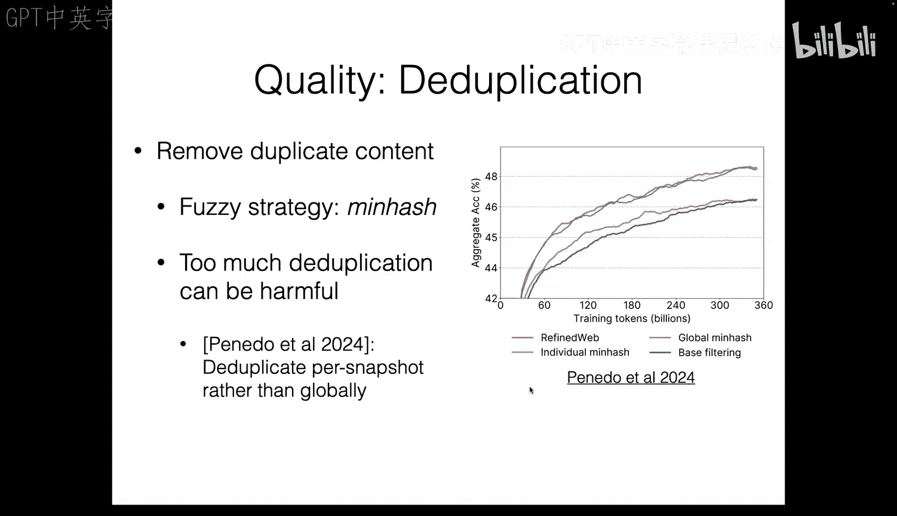

Okay， any other questions？Here again， this is kind of cool。 So yeah， I mentioned like some。

Either academic groups or industry groups are trying to make everything openly available。

So this was an example of pre training corpus from AI2 called Doma。

And you can actually go online and look at their exact pre training corpus。

So this is showing an exact。Like one page from Common C and it's been like formatted and this is like exactly what they would use to pretrain the model。

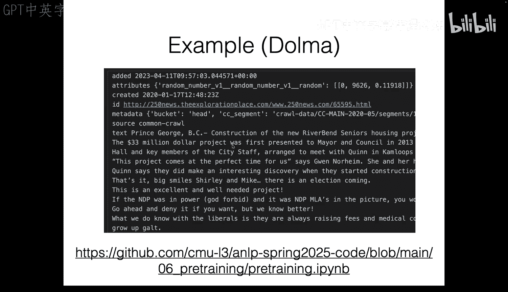

嗯。And if you're like curious about this， I thought it was kind of cool。

 You can actually go on hugging face and look up exactly。😊。

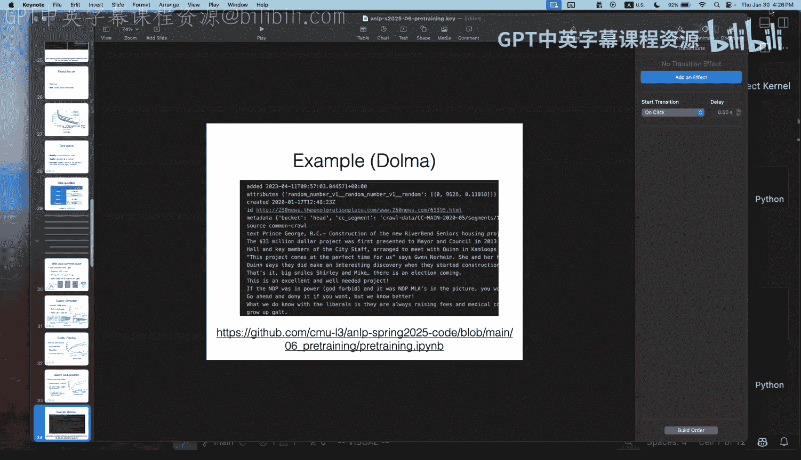

Yeah， basically all of the data in this corpus。

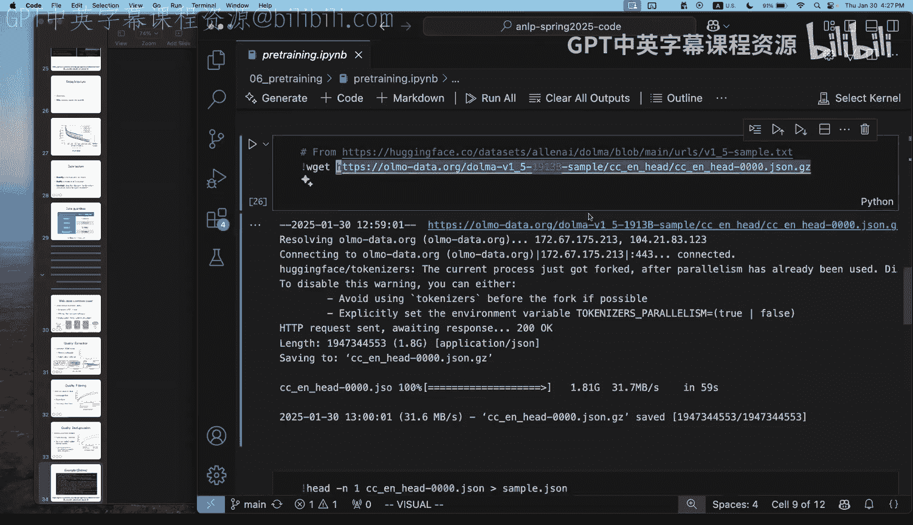

So this is just showing you how to do that and visualizing an actual training example from one of these pre traininging data sets。

嗯。Okay。

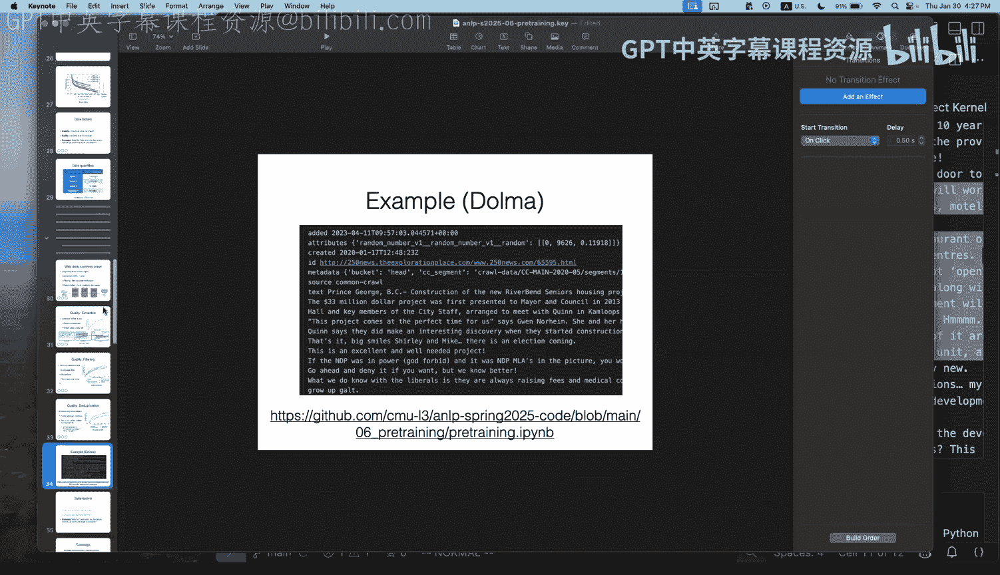

So。嗯。Yeah， so there's still one more thing related to data， which is coverage。So yeah。

 as I mentioned before， when you're pre training or training a language model。

 you're fitting some data distribution。And so ultimately。

 the data that you choose will kind of determine what kind of model is learned。And so for example。

 web data is you not necessarily equal to， for example， math data。Or educational data。Or code data。

And so you actually have to be careful about the exact kind of composition of your pretraining data set。

So one common approach that's used is called classifier filtering。So this idea is kind of simple。

 You basically try to build some classifier that takes in， for example， a page。

And then gives you some score and you determine whether to keep or not keep the page in your corpus。

So here's an example from the open web math that I mentioned。

So they actually train this classifier for detecting if a page is kind of mathematical or has mathematical content or not。

And I guess the exact method that they do isn't too important。

 but they come up with this trick where they remove the latex equations in a page。

And then they try to predict whether a page。Would have latex or not。

And so the kind of trick here is that now this classifier could be used on a page that's about math。

 but doesn't have any latex。The classifier would basically give you some score that maybe it's still likely to be a mathematical page。

But anyways， so then they actually incorporate that into this like pipeline。

And they go from common crawl， you could see this math score filter is here and it's reducing the number of pages that they have。

They also have other filters like perplexity and。Here's their deduplication。

And then you end up with this corpus and again， you can go like look at it or use it。

It's online called Open WebMath。嗯。So yeah， it's kind of cool again there's a paper about it and it turns out to kind of do some intuitive things so for example。

 like the stack Exchange is the top website。I guess it also picks up on kind of scientific data。

You see like physics forums。com， which has a lot of like different solutions。And things like that。

Actually， like I was part of the project that。嗯。That， you know， like use this。

And we actually discovered that it contains some solutions to some common benchmarks that are used。

To benchmark language models on math。嗯。Because yeah。

 a lot of them are based on competition problems and you could imagine that， you know。

 across the internet， there's various places where people are like discussing solutions。So anyways。

 here's another example where they wanted to find like educational content。And so here。

 the definition of educational is maybe a bit more abstract。

So what they do is a kind of modern method。They basically take a bunch of web pages and then they prompt a language model。

To basically assign some label for how educational the page is or not。So in their prompt。

 they kind of say， you know， you should determine whether this page is， I think。

 like grade school level or middle school level and give a score between zero and five。

And so now they have this like label data set of page and educational label。

But then in order to apply this kind of at scale， they actually they can't use the language model because it's too expensive。

So they have to train this like very fast classifier using this kind of synthetically labeled training ghetto。

So then they could take that classifier and they run it on this data set of 15 trillion tokens。

And then they get this data set called F webb EDU， which has， yeah， like 1。4 1。5。

Trillion tokens of educational data。So kind of creative idea， and then they show you know。

 very various effects does it has。So here's looking at a kind of benchmark that measures。mYeah。

 some like different。Reasoning abilities or abilities to yeah perform well on these different kind of like school subject tests。

And you can see here that compared to the non filtered version in pink。

Training on this or pre training on this。AFtered version gives you this kind of huge jump in performance。

So it's some evidence and they have a lot more in the paper if you're curious that， again。

 the like exact distribution of the data that you're training on does end up mattering。啊 any。

Questions about any questions？嗯。😊，So。See。I you。So here， yeah， concretely they use the llma3。

And so the model has to already itself be pretrained to be able to give give labels。

But then here they have such a large amount of data thatops。They're starting from scratch。

 and they're basically pre traininging a new model。 So yeah， it'll be separate。Okay。

 and then one last thing， again， you don't just use web data to pre the model。

Here's looking at a very recent paper called OMmo2， again from AI2。And so they give again。

 like all the details for their pre training data set。This model ends up being pretty good。

 so like it's better than Lama。And you could see here that there's like nothing magic in it。

But they have this mixture， so you do have web pages， you also have code。

They actually use this open webmas data set。They also use this data set I was part of the project that created this one。

And also include Wikipedia in there。Okay， so kind of cool looking at like the exact mixture。

That they're using。Okay， so to recap， if we want a really large quantity of data。

 then typically you know you go to the web， you have to ensure that the data is high quality and filter it。

And then you ultimately still mix it together with other sources of data。

To create your pretraining data set。And so just as some more recent examples。

I mentioned this data set F webb。It turns out there's another one that's even bigger。

 so 30 trillion tokens。And both these are openly available if you happen to need them for anything。

When you look at the scales， if you look at like the actual mix that they're using in like Omo2 or this other language model。

Then these mixes were like 3 trillion or4 trillion。

And then if you look at these domain specific ones。

 they're much smaller so you have like 15 billion or 11 billion。But as we saw before。

 these can still be useful to include in the mixture。And then finally。

 this is a kind of like interesting case where they create this like domain specific data。

 but it's actually fairly big， so on the like scale of a trillion tokens。Okay， so。Yeah。

 I gave an overview of the objectives and the data。Any other questions。

 we have about 15 minutes and I can start talking about。Some of those topics here。Okay。So as we saw。

 here's the kind of same plot where we're increasing the amount of data or we're making the model size bigger and getting a better loss。

So next I'm going to introduce a kind of framework for thinking about these different things。

And one way you could think about this is in terms of compute。

 like the amount of compute that is using being used to train a model。

And so one goal you might have is to， let's say you're a really big company and you want to just like spend money and get a better medal。

Then it would be really nice if， you know， you could just say we want to throw like more GPUs or whatever more data and get a better model。

And in general， just like spend more compute。And yeah， have a better language model。

You could also think about this from like a philosophical perspective。

 So there's this idea called the bitter lesson。 you might have heard of it。

And it basically says that， know， if you look at the history of AI research。

Then the methods that are tending to win out in the long run are kind of very general methods that just like somehow leverage computation。

So again， this is just a quote and it was like an essay by someone and you can like debate it or you know agree with it。

 but it's a kind of interesting thing to think about。And so one question is like。

 what is actually compute？So concretely， we kind of spend compute while pretraining。By， you know。

 like literally doing a forward pass through the transformer and a backward pass on different training sequences。

And it turns out that you can come up with this rough approximation of the amount of compute that's used when you're pre traininging a model。

And what it says is the amount of compute that you have in terms of floating point operations。

Is approximately equal to this magic number six。Times the number of model parameters。

And times the number of tokens in your training corpus。

And where this came from is there was actually this paper on scaling laws。

And they looked at the transformer architecture。And looked at exactly how many floating point operations were being used for a given number of tokens。

And then they basically made some approximations so that you could have this just like easy formula。

So anyways， maybe like the interesting thing here is you have this compute and you can see that it just depends on two things。

 how large your model is， and then how many different tokens yeah。

 how many tokens you're pretraining on。And so for example， with the Lama2 model。

 which you're like looking at for the homework when they pretrain it。

It would have this like six here， and then it has the Lama 2 model。

 one of them has  seven billion parameters。And they trained it on two trillion tokens。

So you get this big number here。And it's basically the number of floating point operations that are used during pre training。

And so you might be thinking like， okay， why is this？

Interesting or you might or do you think it's interesting？But。

One interesting thing is you now have these different two different knobs you can turn so one is like if you want to increase the amount of compute you have。

 you could just train a larger model， but on the same amount of data。

Or let's say that you have a small model， you can still increase the amount of compute by just training it on more tokens。

And the kind of cool finding in the language model research has been that。

 you know like just increasing the amount of compute that you have。

Can kind of predictably lead to improvements in the quality of the language model。

And so here what this is showing is the compute on the X axis。

And they tried variety of models at a variety of different scales。

And if you look at like the optimal model for any given amount of compute。

Then you can get this nice like line and actually project out。

What your loss would be if you like used。A certain amount of compute in an optimal way。嗯。

And so the basic idea here is。Yeah， again， what they did is trained a variety of models。

On different numbers of tokens。And then just plot the loss function of each model here in blue。

And so then some models for a given amount of compute will be worse than others。

So certainly there's like good ways of spending compute and bad ways of spending compute。

But what they do is just like look at the best possible configuration。

And then plot that here in black。And then you can like run a just simple linear regression on this line。

And then get this relationship。Which says that basically like the if you're using a compute optimal configuration。

Then you can kind of predictably improve the language modeling performance。

So you may or may not have heard of this， but this is the idea which is called scaling laws。

So the idea is， you have。These like compute optimal models in black。

And then the line itself is the kind of scaling law。

It's saying that you have some like predictable relationship。Between the model quality。

 so here in terms of loss。And some quantity here it's the amount of compute that you're using。嗯。

So I'm going over this kind of kind of quickly， but yeah。

 you may be getting the kind of general idea or do you have any questions about this。嗯。😊。

我你他 data parameters wouldn't he这。For a given， Yeah。 so that will depend on。The， yeah， the amount of。

 of data you have。So yeah， there will be some regime where the amount of data is much smaller and you'll start overfitting。

So the way they actually do this is。If they have a scaling law for。

If you have a scaling law for just the parameters。Then they assume that you have kind of like infinite data。

So they'll run many different parameters on like a really large data set。嗯。So yeah。

 you assume that like the other factors aren't bottlenecked and then you just look at how one parameter scales。

嗯。😊，Yeah， so that means， so if you look here， you could look at each point here is some compute budget。

So it's basically saying you're training a model of a given size for some number of tokens。

And at this point， you've spent this much compute。And then if you do that across multiple models。

Then。Some model will have the best loss at that。Compute budget。

And so that is the kind of compute optimal configuration。For this compute budget。Okay。

 so this is the yeah， basic idea of the scaling laws and then even aside from these。

 at least like the first time I learned about this idea of like you know。

 tokens and model size and compute， it's also just a kind of helpful way of thinking about the pretraining。

嗯。So just really briefly， and again， I can only just go over this briefly。

People will actually use these scaling laws， not for just like making these。

Projections about how good the model will be with tons of compute。

But you can use it for like very practical reasons。

 like choosing the hyperparameter for pre training。

And the basic idea here is you can run many experiments at like a relatively small scale。

And then you want to determine what the hyperparameters will be for your kind of massive final training run with like a really large scale model。

So you'll try to use one of these like projections to project like what will be the best hyperparameter。

Fourth the large scale run。So let's like in the next you know， two minutes。

 just like quickly look at examples。So a really famous example is trying to choose what is the best model size and number of tokens for a given compute budget。

So you can imagine like training a really small model for many tokens。

Or training a really large model。For a furent number of tokens and in both cases。

 have the same compute budget。And the basic idea here is you again。

 like run many different experiments。And then you could turn these like compute optimal points in gray。

Into a plot that looks like this。And so this is looking at for the compute budget on the X axis。

And the number of parameters on the y axis。What is the compute optimal configuration？

And then you could basically like run the linear regression and try to project。Okay。

 if I had this really large compute budget， what is the kind of optimal model size that I should use？

And so what this says is like the best use of your compute budget is to train a model with 67 billion parameters。

And then similarly， for your compute budget， you could try to predict like。

 what is the optimal number of。Tokens you should train on。And here they determined it was 1。

5 trillion。So this was a pretty famous paper at the time。 It's called the Chella paperper。

I would say that like since then， sometimes the large companies will actually just like pick a model size。

 like they'll say we want to train a 7 billion parametermeter model。

So they won't necessarily do this like compute optimal thing。

But it's at least good to know about and you know， maybe some groups actually do kind of do this。

And then just really briefly， this is from the original deepsek paper。

They actually use scaling laws to determine what is the optimal batch size or the optimal learning rate。

And so again， the basic idea is you run a bunch of experiments at a really small scale。

And then you try to predict， yeah， the final hyperparameters that you're going to use。

For your really large training run。So。Yeah， we actually got through all of the content。

So I kind of introduced pre training， talked about the objectives and the data。

And then gave a kind of quick overview of these scaling laws。And again。

 in the second half of the course， I'll talk about some other important ideas in pre training。

In particular， how you actually like at a systems level， train these really large models。Okay。

 so that's all for today and thanks again for all the great questions and for your attention。

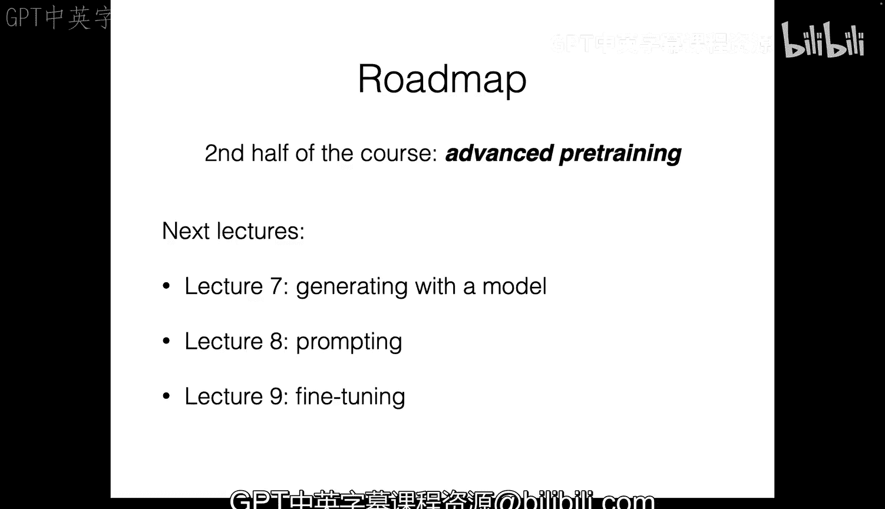