# CMU《高级自然语言处理｜CMU CS 11-711 Advanced NLP Spring 2025》中英字幕（claude-3.7-s - P7：-07-(7)_ Decoding Algorithms.zh_en - GPT中英字幕课程资源 - BV1nYVHz7Eoa

So today we have a guest lecture， we have Amanda who is a PhD student here and。

And she's an expert in decoding and generation algorithms。

So she has a really awesome paper talking about these kind of minimum based risk methods。

 we actually might cover those later in the course。

And then she was also part of a kind of extensive survey on decoding and generation algorithms。

So yeah， really excited to have her give the lunch today。And yeah， as usual， I think， you know。

 ask questions as you go and。Otherwise。Yeah， go ahead yeah， thanks for having me。

 Just give a shout if you can't hear me in the back and feel free to ask questions whenever。

 but I'll also kind of try to stop at reasonable points to collect questions。So in your last class。

 I believe you all talked about pretraining and so let's imagine for a moment that you went away over the weekend。

 you took all of your like pretraining tricks， you found the best possible data source you could find。

 you went to your locally hosted supercompute cluster and you trained a really excellent model M。

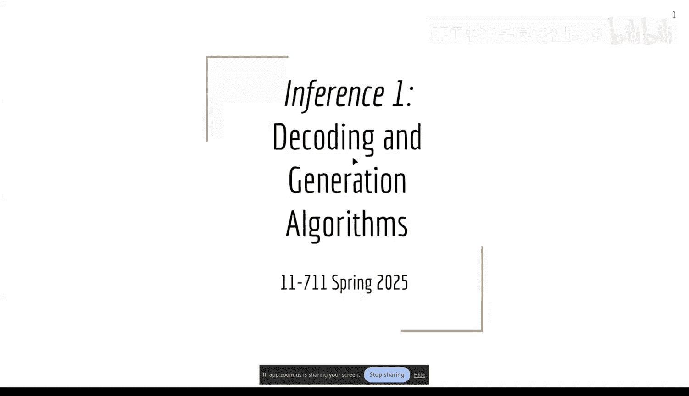

So you now have this new model who there we go， maybe it's a relatively large number of parameters。

 you trained it on a huge amount of quality data and now you're left with this really nice new artifact that you can play with。

And in this class we're going to take the Model M as sort of a fixed object。

 we're not going to provide any additional training。

 we're not going to modify the parameters instead we're going to operate purely on the outputs of that model to get different behaviors out of it。

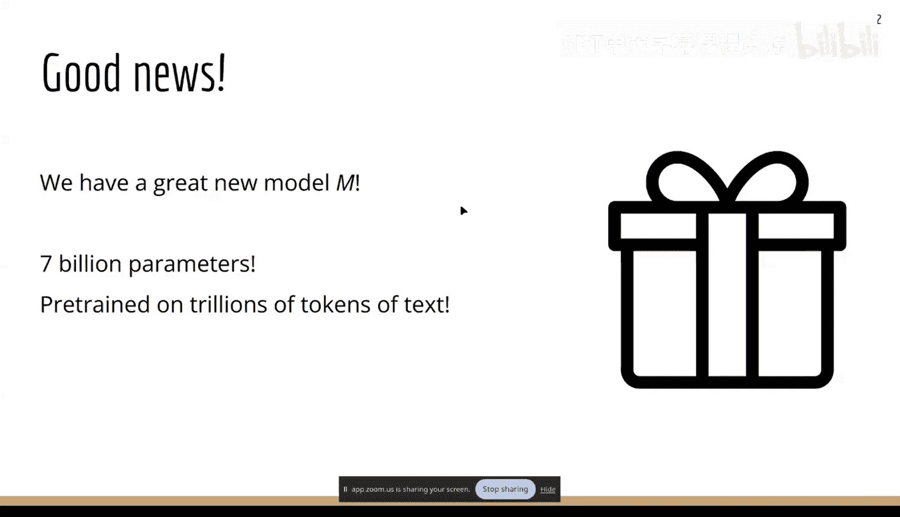

And so the question you need to answer then is what is actually what is model M and you could have a number of different answers to this。

 It's a bunch of numbers and matrices， maybe it's a couple of gigs of storage and your hard drive but for the purpose of working with outputs of this model。

 we're going describe M as a conditional probability distribution you give it some input and it gives you a distribution over all of the tokens in the vocabulary that says which tokens are most likely to come next right and if M is sort of the standard large language model this is going to be a tokenwise conditional distribution So when you're predicting your output。

 each token you get a probability distribution over the next token based on your input X and all of the outputs up until this point right Y1 to Yj minus1。

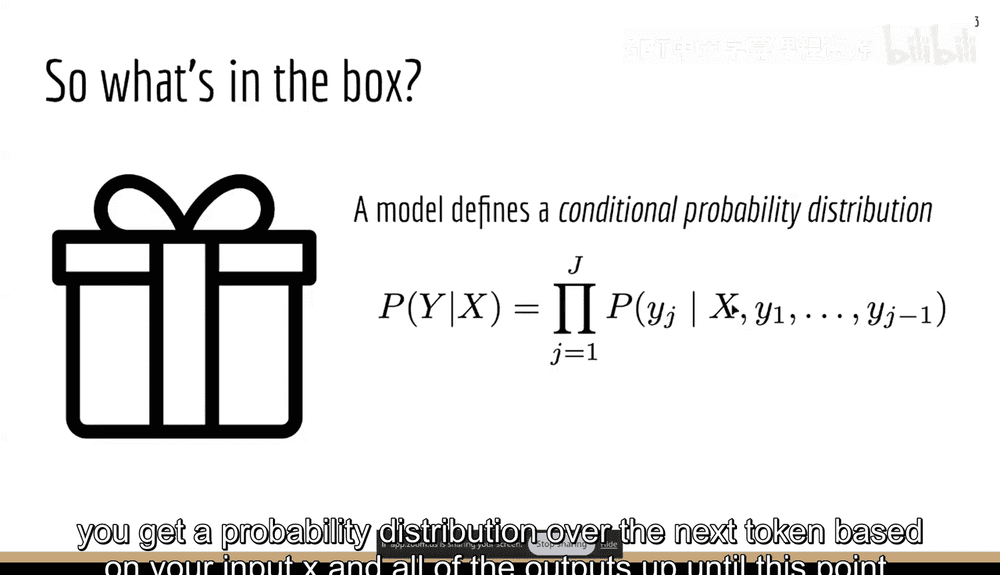

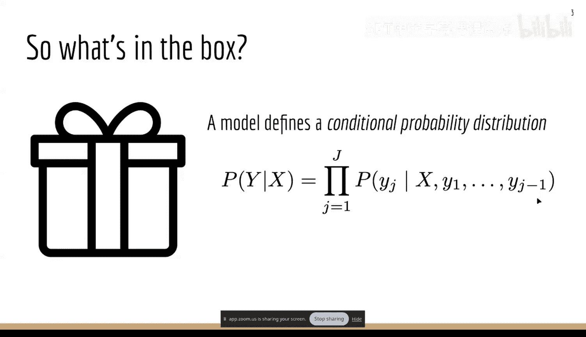

And with this sort of framing you can do a lot of different kind of useful things。

 so you're depending on the style of your inputs and your outputs。

 whether you provide instructions or you fine tuned for different tasks。

 you can condition on a lot of different things and get outputs for different domains right so maybe you want the highest probability Japanese text given your input in English and that would be like a translation task。

嗯。

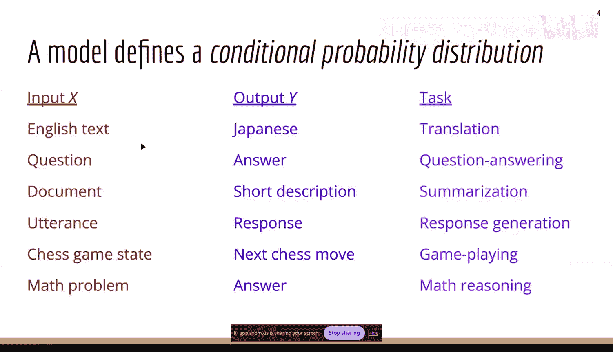

The。Sort of we're going talk about a couple of different kind of quirks of models as probability distributions and then talk about ways to manipulate them to get different types of outputs。

 So the first thing to know about at least modern language models is that they are something called locally normalized what this means is that we're going to predict a probability at each token and we're going to to get the probability of a sequence multiply these tokenwise probabilities together。

 This means that your probability scores will never go up by adding more tokens to the generation right because you're always going to be multiplying by something between0 and1 and usually less than one。

 This also means that your scores might not be reflective of sort of sequence level constraints So if you wanted to predict who the US president was last year and you see only the first half of these two sequences reasonably you'd probably score the second sequence higher than the first And then if you see the second half of those two sequences。

 you would now know that。First sequence is correct。 and the second sequence is wrong。

 But because you've already given high probability to the sort of prefix of this first sequence。

Of the second sequence and low probability to the prefix of this first sequence。

 you could very much end up with this sequence having lower probability than the sequence that is actually incorrect。

And so we train these models with local normalization because it's reasonably efficient and it's reasonably fast if you're interested in models trained with global normalization where probabilities are over sequences instead of tokens。

 you could take a class like PGMs。but because we train these models with local normalization。

 it's a little bit harder。I this to do inference with global constraints and this will become relevant in just a couple minutes。

So another， maybe we can go。We're stuck on local normalization， oh， there we go。

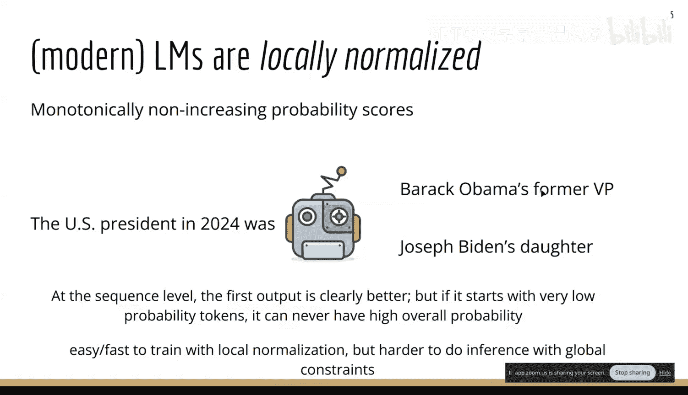

嗯。Another feature of these distributions is that we can use them to get at least sort of a loose sense of confidence over different outputs。

 so if we ask our model to predict the next token after two plus two equals almost all of the probability mass we'd hope is on for and so we might say that that model has high confidence in the next token being for if we ask it to predict something that maybe the model doesn't know or maybe is more subjective。

 it might distribute the probability mass more evenly over more tokens and so then you might think the model has low confidence in that prediction whether these confidence scores actually corresponds to how well the model does on the task is an issue of calibration ideally for most things we like these model scores to be roughly calibrated so that if the model puts 50% of the probability mass on an answer。

 that answer is right 50% of the time。

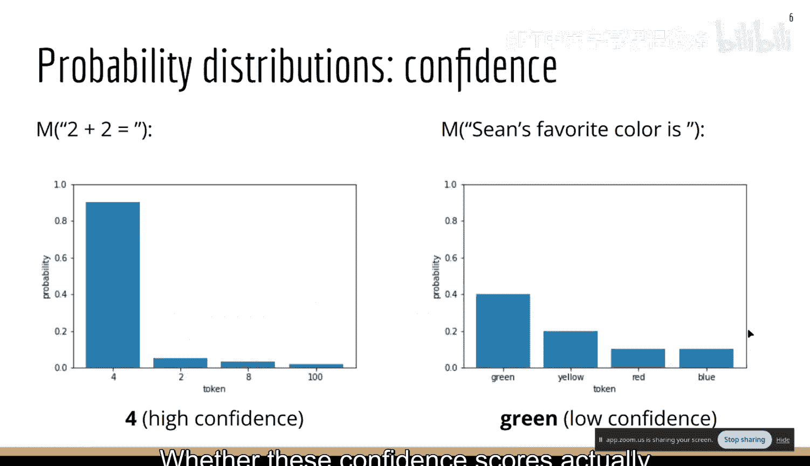

Whether or not the model is calibrated though， is a function of how you train it and we've established already that we're taking our models sort of as given。

 So this is sort of a caution that the model we're working with may or may not be calibrated。

 These scores may or may not be sort of reflective of the actual distribution over these outputs。

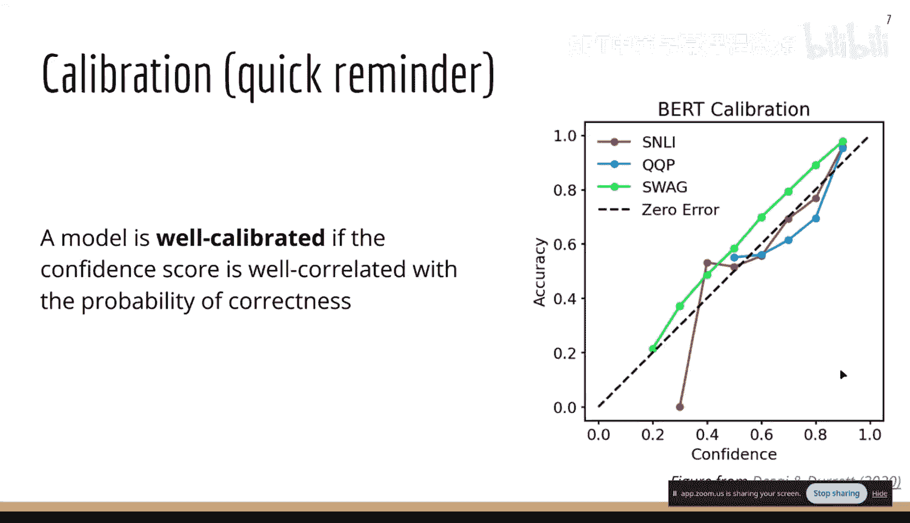

Another feature of these distributions is that they are almost never ascribing all of their probability mass to a single token。

 so if we look at the next token for two plus two equals， most of that probability mass is on four。

 but there's a variety of different outputs that have some small but non-zero probability mass and in fact for pretty much any task you look at there will be non-zero probability on some output that is undesirable to you or actually like incorrect。

This is a feature both of data and of like model design。

 so there's some really interesting work more on the theory side that shows that even if all of your pretraining data contains things that are factual you can still generate things after training on this data that violate these sort of facts that you established at pre-training and this is part of sort of a consequence of thinking about our models as distributions they're not like a single pointwise estimate they're going to ascribe some probability to a whole bunch of things and you can't necessarily guarantee that all of your probability will be on the thing that you actually would most like to see。

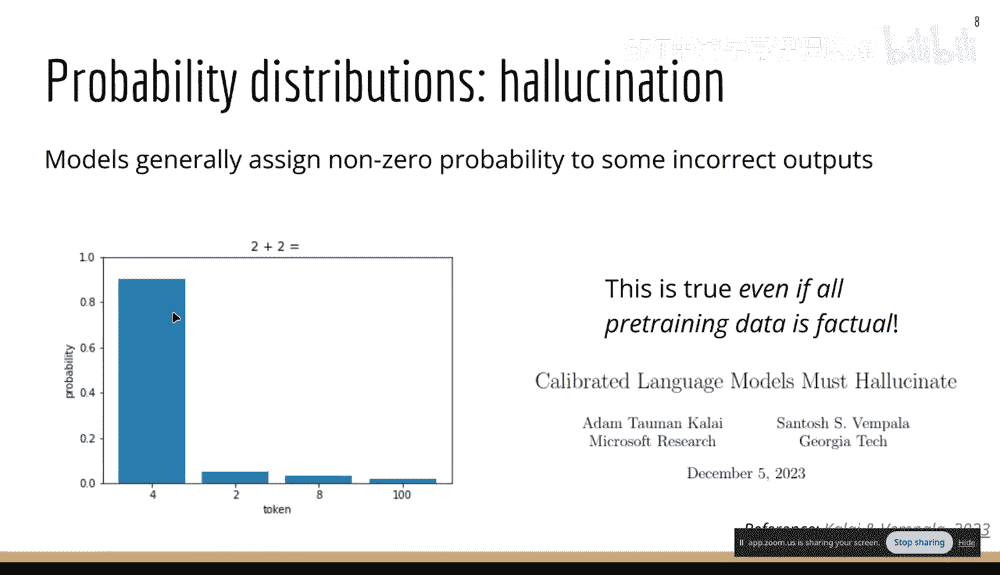

So now that we have this model， this probability distribution， how do we get an output from this。

 we know at any time step the distribution of likelihood over all the vocabulary tokens for the next time step and what we want to take from this is we want to token by token generates some output that we think is good the notion of what outputs is good or what outputs are good maybe we'll develop a little bit as we go。

 but we just want some output that seems reasonable。

 maybe we hope this probably corresponds to something that's pretty high probability。

 how do we get an output from this model。

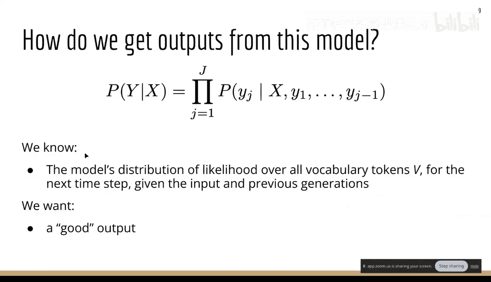

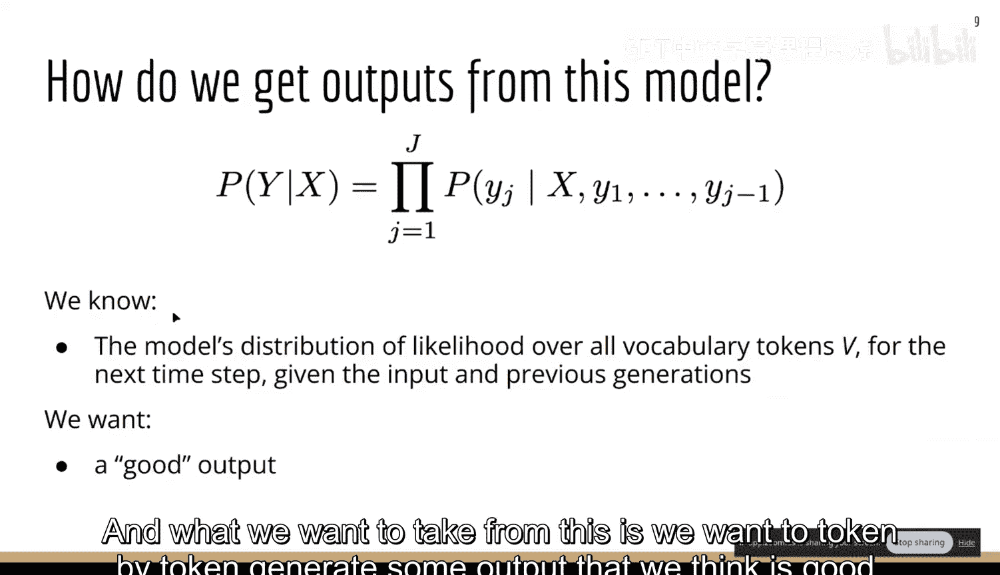

And som we're going to first talk about trying to find outputs that are very high probability。

 maybe the highest probability output we can find before we do that。

 any questions on kind of the setup of models as distribution could whatization Yeah。

 so our models will give us a probability distribution at each individual token So like if you look at all sequences that our length to。

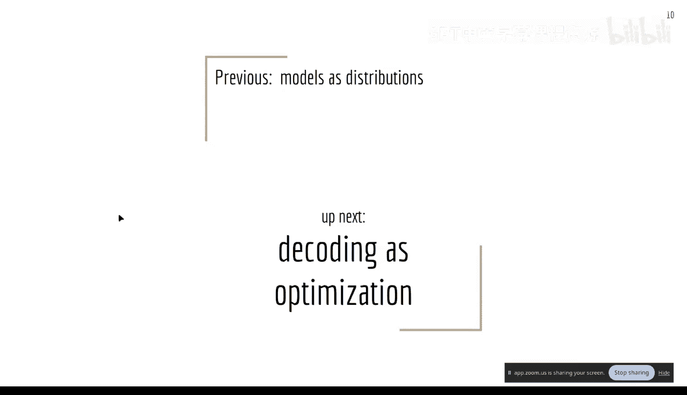

If you look at a sequence at length two， there'll be a distribution that adds up to one of which tokens will come next to make it a sequence of length three。

 but if you look at like all possible sequences that could be generated out of the model。

 your model doesn't have a welldefined probability distribution that says like you know the sentence I went to work today is more likely as an output than the sentence like I stayed home and watched Netflix all day。

 you get like like individual tokenwise estimates of what's most likely。

 but it doesn't describe like a global score at each of those。

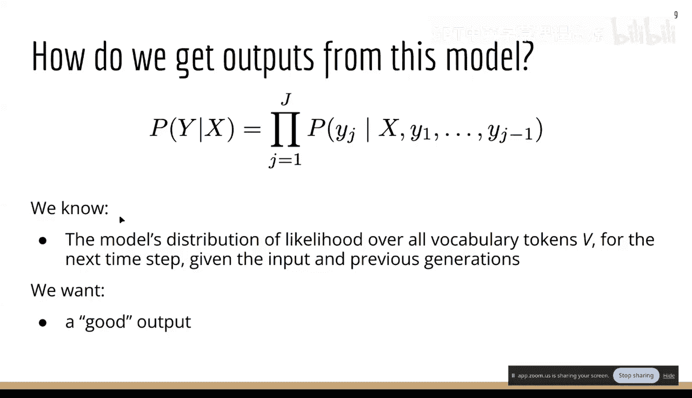

嗯。Al right， so a reasonable kind of first guess for what would be a good output of our model is so just try to get the thing that is most likely right like we hope that we trained this model pretty well we can just take the thing that's highest probability out of it and this I' sort of variously call mode seeking because the mode of the distribution is the most likely thing or map decoding in map standss for a maximum I priorityi sort of the highest probability thing we can find。

So how do we find the single most likely output if we are only looking for a single token。

 this is a really easy answer， we'll do something called greeditty decoding where we just take the single most likely token so we have this distribution。

 we're going to pick the a max of it and return that as our answer。

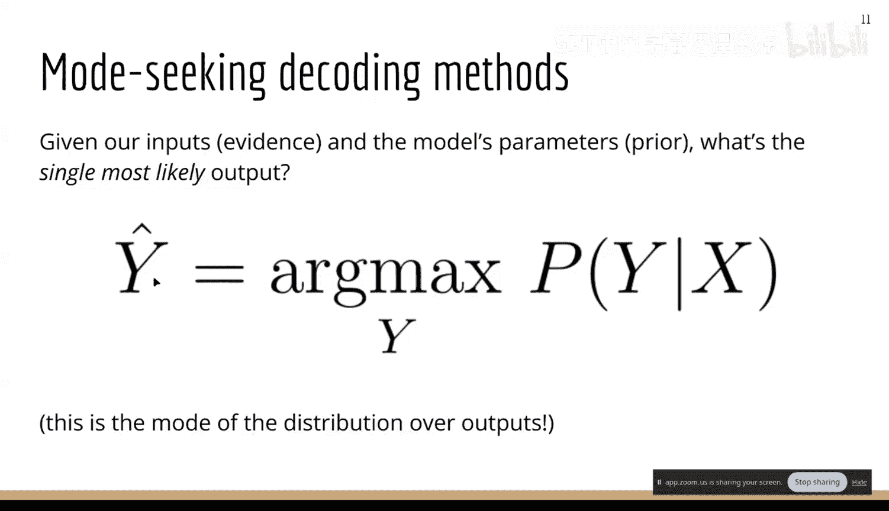

And if we're only looking for one token， this is great。 Our job is over。

 This will always give us the highest probability output from the model。

 But if we're looking for something that is more than one token long as the output。

 it's possible that this won't give us the highest probability sequence。

 You can imagine maybe there's a prefix that starts really high probability。

 And then the probability mass after that is very diffuse。

 Like maybe the first word is super likely to be the。

 but then there's a whole bunch of options after that。

 And so the sequence as a whole has a relatively low probability score。😊。

So this isn't necessarily going to get us where we want for a longer sequence。

So maybe we we hedge a little， maybe we want to search instead for sort of a couple of different candidates and then evaluate at the end which one actually at the highest score。

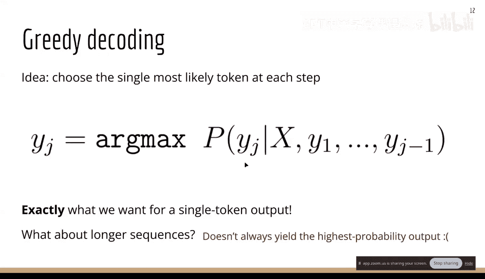

And this is。Sort of the most common way to do this is beam search which I think many of you have likely seen before。

 so we're going to maintain a couple of options so we don't miss like a high probability completion that could be hidden behind a slightly lower probability prefix and what this looks like is we define sort of a breadth of our search we say maybe we'd like to keep three options at all times and we're going to explore a number of candidates for each step and then kind of prune back down to three options and explore again。

So if we picked a beam size3， we'll start with sort of three candidate sequences。

 so that's these three right here from each of them we'll look at the three most likely next things。

 So now we have nine possible subsequences we'll pick the three sort of two token sequences that are most probable out of this set of nine。

 So here it's this one， this one and this one with the red。And then we'll continue from there。

 so those are our three new candidates， we'll look at three possibilities for the next step for each of those and we'll prune back down to three。

So at the end of doing beamM search， we'll wind up with three possible candidates and let'll just look at which one of is highest probability and return that。

In step2， when we choose。A， E and and B， is that considering like a whole probability for the sequence up until that point。

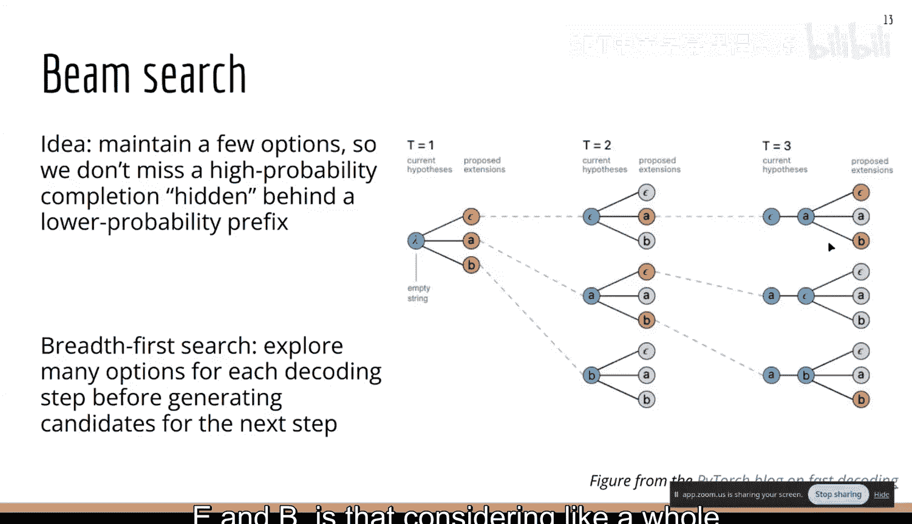

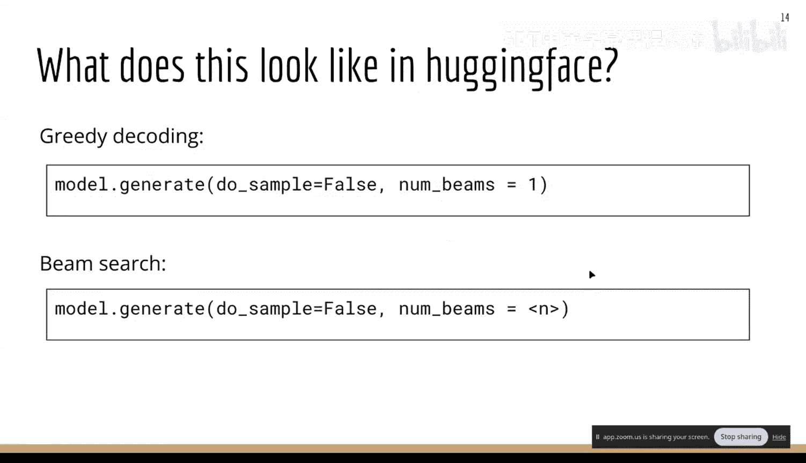

Like multiplying the proba at this stage by the previous one。 Yeah， that's a great question。

 So that's why we can wind up with multiple things from one beam group and nothing from another。

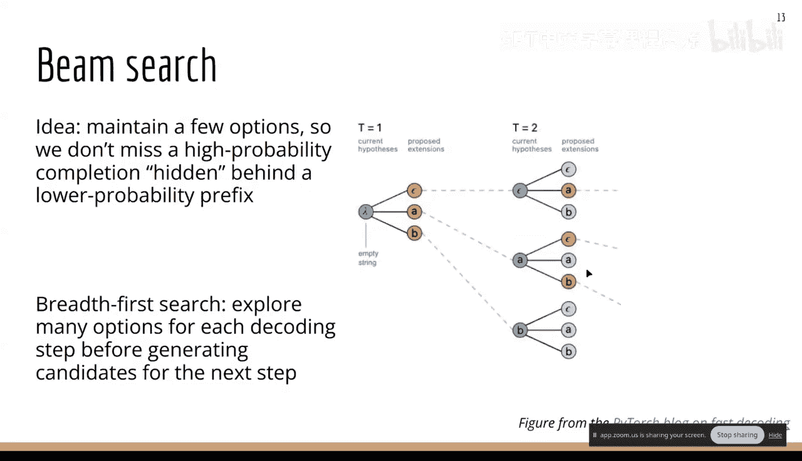

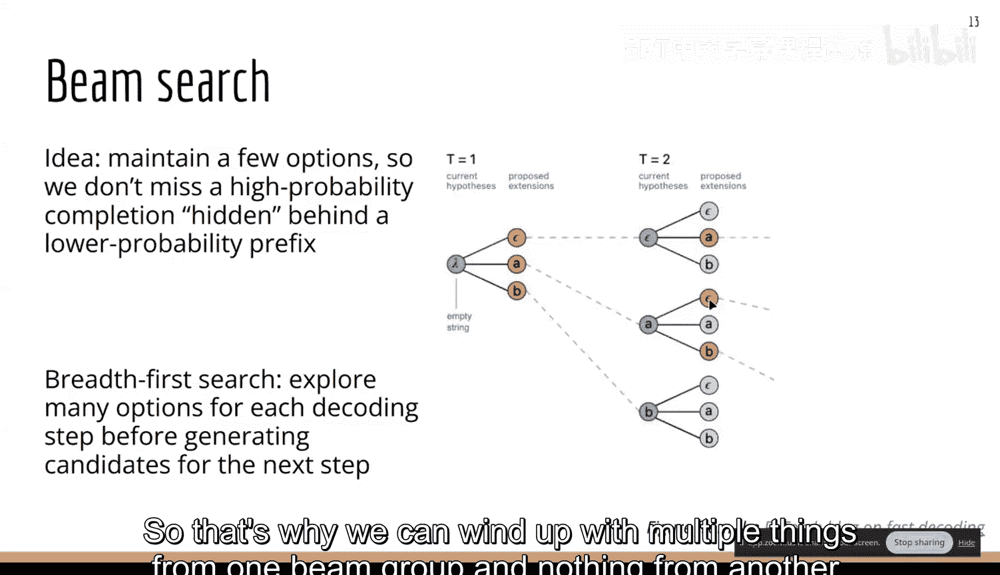

So like maybe this was the third highest probability thing to start。

 but nothing after it was really high probability。Sorry the slides are a little buggy today and so periodically throughout just as sort of an example of how you might actually practically do this。

 I'll provide a little bit of what this would look like in hugging face generation。

 of course not the only option you have， but if you were to cause sort of hugging faces model。

 generaterate and you want to do greedy decoding or beam search。

 you set sampling to false because we're looking for something that's highest probability and you change the number of beams parameter。

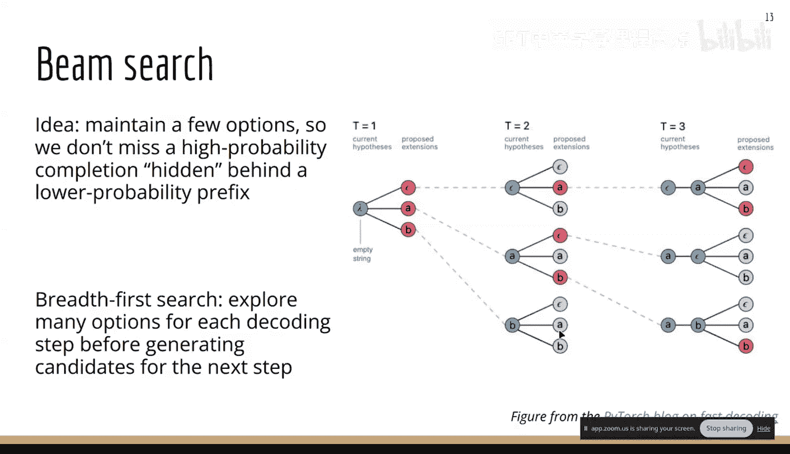

So greedy decoding is beam search with beam size one。

 right because you're only considering one candidate as you go。

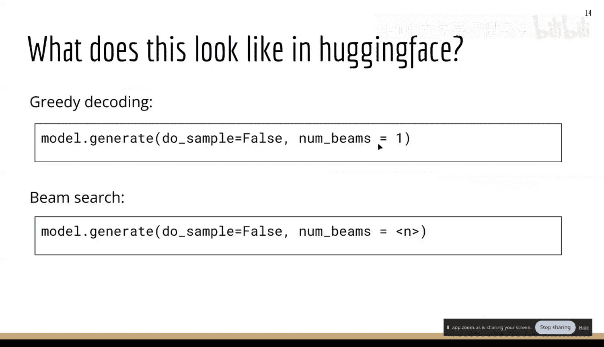

This sort of isn't the be all and end all of generations。

 so we'll talk about a couple of potential issues with looking for the highest probability output。

The first is simply the question， is the highest probability output the best output from the model？

So say that you're trying to predict what my cat does next after a series of actions。

And if you look at the whole probability distribution over sequences。

 you can see that outputs that have a low probability tend to be worse than outputs with a high probability。

 right， this is sort of what we hope we've gotten out of training the model。

 something that is really low probability like the cat grew wings is unlikely to happen。

 something that's relatively near the top of our distribution。

 like the cat sat down seems like a reasonable output。

But if you look at the very top of the distribution and you just compare like maybe the highest probability thing to the second or third highest probability thing。

 there's not really a guarantee that those are sort of well sorted with respect to each other。

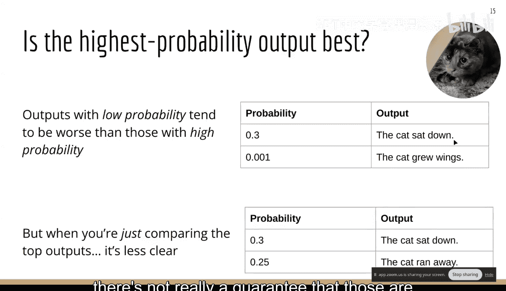

around so the cat sat down is higher probability than the cat ran away。

 but that doesn't necessarily mean that it's like clearly a better output these kind of both seem reasonable right。

 but something has to be top and something has to be second。And in fact。

 if you look more broadly at the probability distribution。

Maybe you can see that this gets even more complicated。

 the cat sat down is the highest probability here for the sake of simplicity。

 we're saying the distribution only has these six or seven sequences in it。

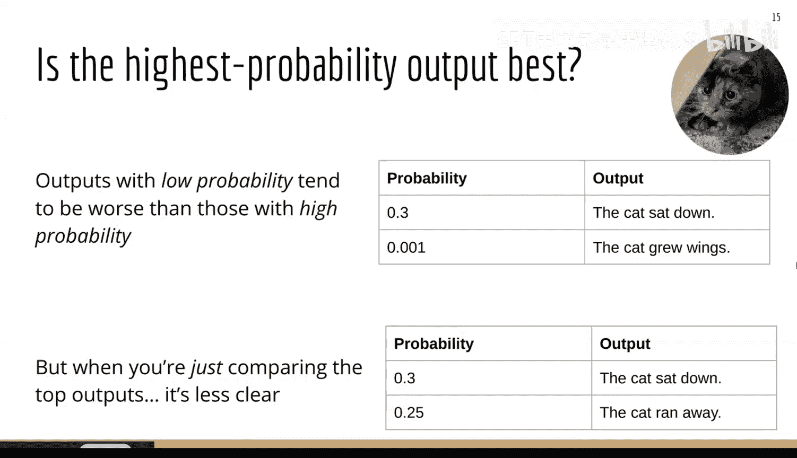

But if you actually look at sort of what the probability mass is concentrated on these three outputs like right underneath it all mean basically the cat left the area right so 30% of the probability mass is on the highest probability output the cat sat down。

 but 60% of the probability mass is on something that sort of semantically is the cat ran away it's just that this is distributed over three different ways of saying that the cat ran away so that you can't actually see this surfaced and like the ordering of the probability distribution。

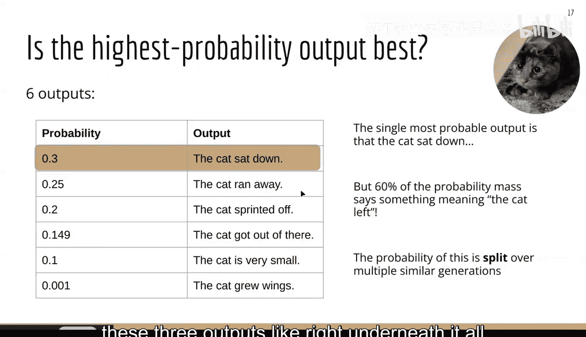

So what do we do with this information， if you're sampling multiple outputs from the model。

 you can try to leverage some kind of notion of consistency between them。

 which I think Sean will talk about in a later lecture。

 if you're sampling only one output from the model。

 maybe this is just like a word of caution that the highest probability thing is maybe not necessarily the most or the best thing。

 even if it is sort of a reasonable looking output。But further complicating things。

 the highest probability thing isn't always even a reasonably looking output。 In fact。

 for a lot of early machine translation models， the highest probability output。

 given any input was the empty string， right， If you're not super confident in what goes next。

 the easiest option is just stop。 And this is obviously not super desirable behavior for your model。

 you'd like it to occasionally output some text。

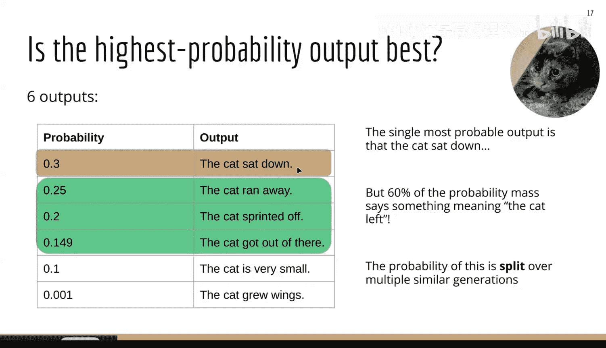

But this is sort of a broader issue of length length is a confound in two different directions here。

 so there's some great work in the RLHF literature so this I think in particular is from Sing it all 2024 that shows that when people are annotating preference data saying like which of these outputs is better。

 they tend to prefer things that are longer， even if they're not better on sort of other quality metrics。

But in contrast， our models， at least before we areLHF them， prefer things that are shorter。

 and this is a consequence of multiplying those probability scores at each step。

 you're going to multiply by something that's less than one。

 so almost always as you make your outputs longer you're also making them lower probability。

And this is an issue if you're comparing things that are of different lengths。

 perhaps if one of your beam search sequences ends and end of sequence token and the other continues for another 20 tokens。

 it's not really a fair comparison between the two so what people generally do in practice for this is implement something called a length penalty so this is sort of an exponential factor on the scoring you're using but to compare between sequences which can either penalize sequences that are long or penalized sequences that are short depending on whether it's above or below one。

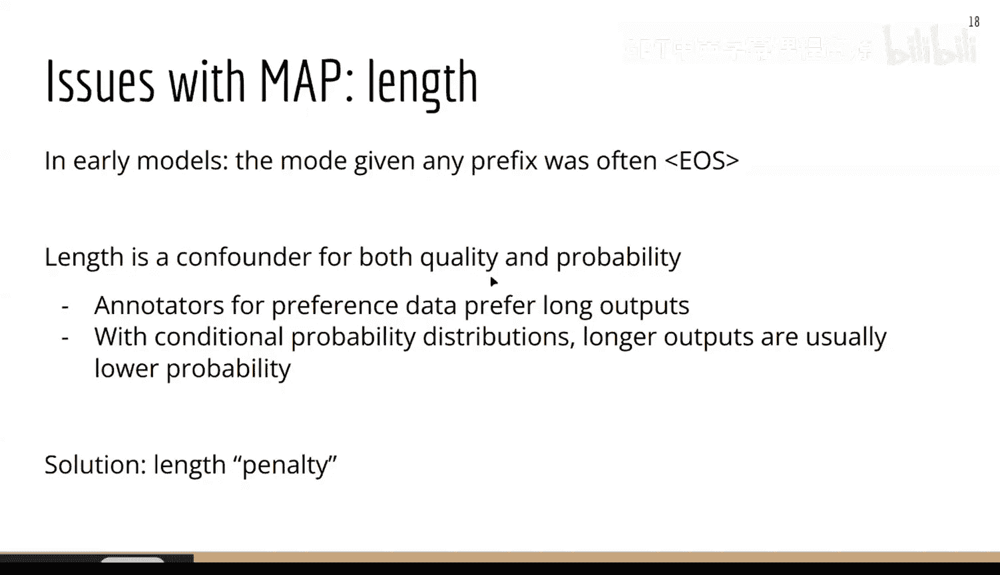

And this sort of encourages fairer comparison between sequences。

 you can kind of control to get an average sequence length that is higher or lower than the model which generate without any like penalty。

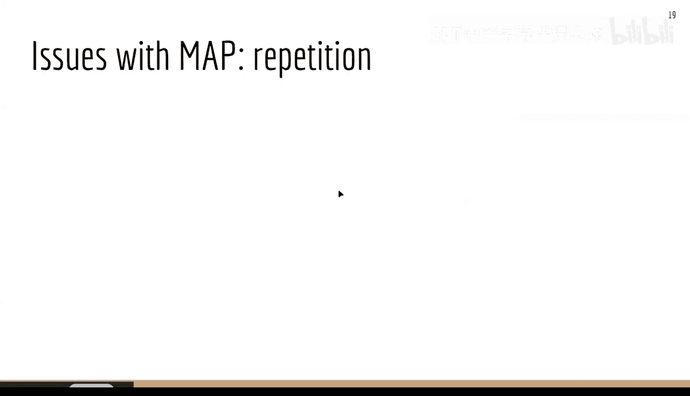

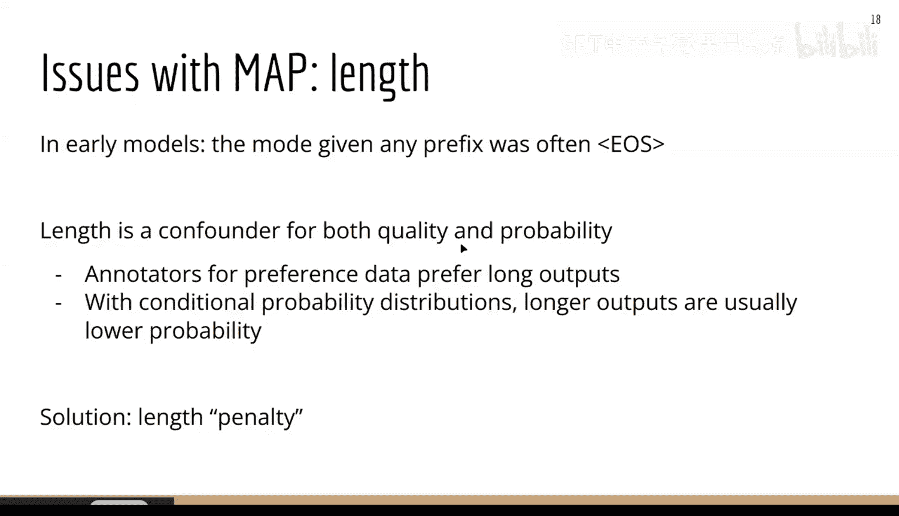

Another issue with greedy decoding that you may have seen if you've worked with an older model so maybe something like GT2 is that often you'll be generating a sequence and you'll generate some text and then the sequence will repeat and then the sequence will repeat and then the sequence will repeat and once you start this repetition it's incredibly hard to get the model to sort of stop and generate anything else right and this is because repetition compounds itself maybe it's relatively high probability after a sort of phrase to generate similar tokens or the same tokens that were in that phrase and then once the phrase has been there twice it's very high probability to generate a third one and then once you've repeated something three times the most likely thing is you're going to keep generating the same thing over and over。

How do you avoid this problem with the mode？You can train a better model。

 so you probably don't notice this if you're using something like a G4 or Gemini Better models generally just don't have this problem as frequently。

 You can also， if you're sort of。Stuck with a model that has this issue discount the scores of tokens that were previously generated when you're measuring the probabilities so if you have generated the tokens sequence before you add a small negative modifier to the probability of sequence going forward and this prevents the it's makes it more difficult for the model to generate repetitions and this is sort of one of the many hyperparameter you can kind of play with if you're seeing this issue to sort of alleviate this effect of course it's not always good to like。

Not be able to generate the same token twice， maybe you want to use the word sequence in a different context and that's why this is a penalty and not just like a hard constraint。

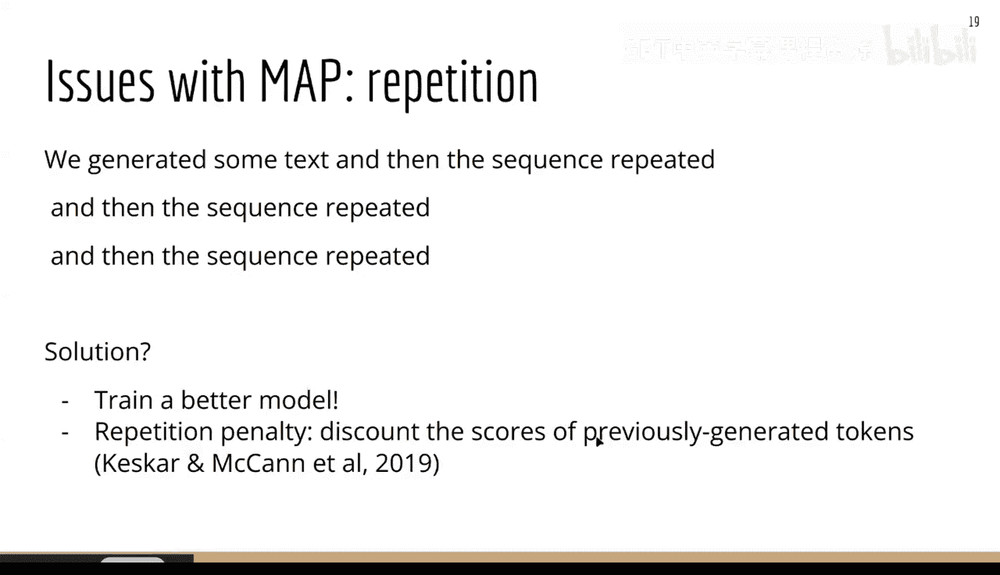

There's another kind of interesting issue with map which is called atypality。

 so for this imagine instead of having a language model， you just have a coin。

 an unfigured coin that has a 60% chance of getting head or getting tails when you flip it。

If you flip this coin 100 times。What's the single most probable output。Anyone know。

It's got a 60% chance of giving you tails。对。What你。牛肉扑。

There will be two chances on that the but important Yeah。

 we're going to say that the coin will always land on something。yeah， like always。Right， yeah。

 so like these， if you enumerated every output， the single most probable output would be getting tails every time。

 right， This is 0。6 to the10 instead of some combination of 0。6 and 0。

4 multiplied together 100 times but if I flipped that coin in front of you 100 times right now and it was tails every time。

 would that be seem like sort of normal to you， Would that be a little bit surprising。

And this is the concept of typicality so the single most likely output。

 the mode of the distribution is not necessarily something that is typical of the distribution right the typical output in this distribution would be something that has like a few more tails than heads。

😊。

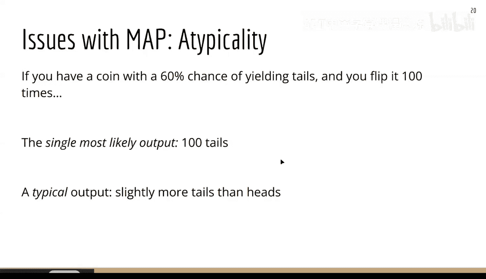

And so this is sort of another way of saying that the single most probable output might not actually represent something that is sort of characteristic of the broader distribution of text the model was trained on。

 the broader distribution of text we'd like the model to generate。

 and so actually finding the real mode might not be what we're looking for at all。

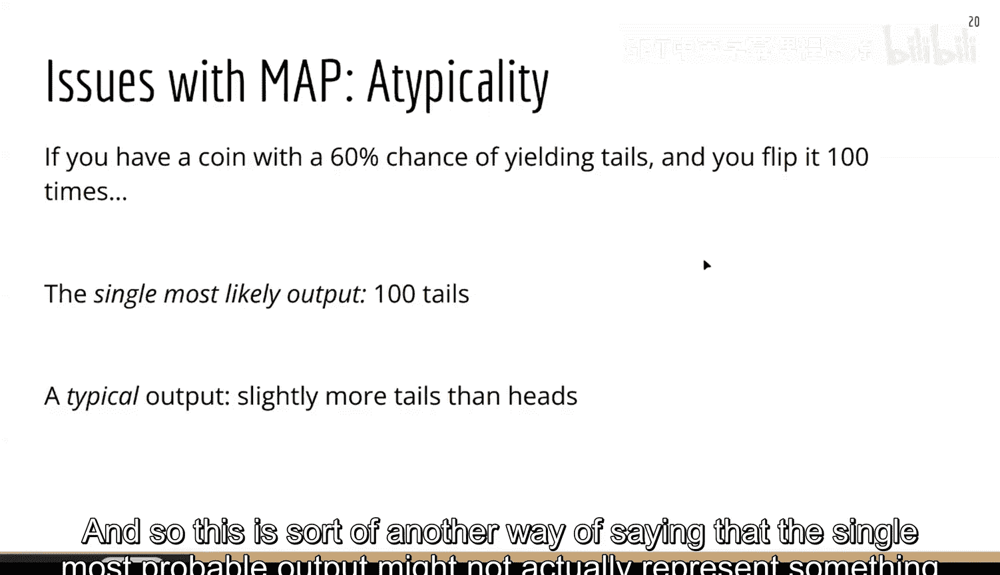

There's a way to compensate for this from kind of an information theory perspective。

 if people are interested in the idea of typicality called locally typical sampling or locally typical decoding。

 I won't get into it now because it's a little bit in the weeds， but it's a really interesting read。

嗯。Kind of related to this。 There's a。Kind of whimsically named phenomenon called the cursesive beam search。

 which is that people noticed after a while that decoding with beam searches this kind of weird property。

 So if you decode with beam width1 right， you're doing greedy sampling。

 you don't have a great chance of finding the highest probability thing as you do a broader and broader search。

 you're exploring more and more of the space， you're surfacing something that's higher and higher probability。

 So in theory， if you could do beam search with a beam width set to your vocabulary size。

 you would search over every possible sequence and you would find the most probable one。

 But empirically， doing beam search with a beam width that is too large。

 So if you compare beam width5 versus beam width 500。

 doing search with a larger beam width surfaces you something that is higher probability and worse than all of your downstream metrics。

This is a little bit frustrating from if you really believe that sort of the maximum likelihood thing in your distribution is what you should be finding。

 but there's some really interesting arguments in the decoding literature here that the cur of beam search exists because the mode is not really what we were looking for all alone we want something that is near the top of the probability distribution but we have all of these reasons to believe that the actual mode might be some kind of degenerate output or some sort of quirk of the distribution。

 something that we didn't actually mean to find， we just want to find something near the mode。

 and so the approximate nature of doing beam search with a relatively small width was actually a benefit。

 a boon， not a problem。

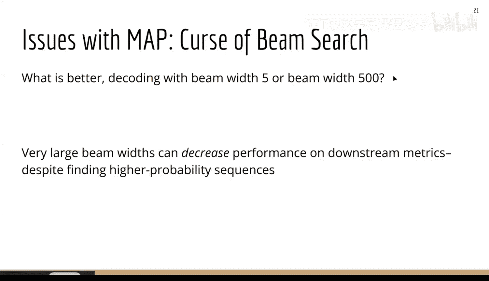

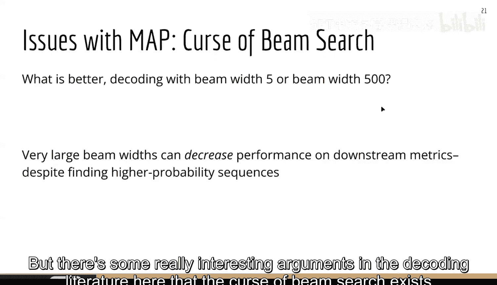

So。If we've just spent。

All of this time I'm talking about making beamM search more approximate。

 maybe we can just make it more approximate by design and so I want to shout out two particular beamM search variants。

 there's a number more out there。But these both try to do some kind of more exploration or introduce more approximation into beamM search to improve it。

Diverse beam search modifies the scoring so in each pruning step where we're cutting back down to a beam width number of sequences。

 the scoring is modified to avoid choosing beams that are too similar to each other。

 so maybe we have a whole bunch of things at the top that are really just very subtle rephrasings of the same sequence and we actually want to surface sort of like three different sequences。

And so that allows you to get sort of slightly different outputs out of BM search。

 maybe you have three good outputs instead of one。And stochastic beam searcharch modifies this next token selection to instead of using greedD decoding sample from the probability distribution。

 so the idea is maybe we don't actually want the top three or the top five sequences。

 maybe we just want five sequences that are near the top of the distribution。

 and so this sampling allows you to do that。hich sort of brings us to a broader idea that maybe if we don't actually need the top of the distribution。

 we're okay with sampling instead of searching。

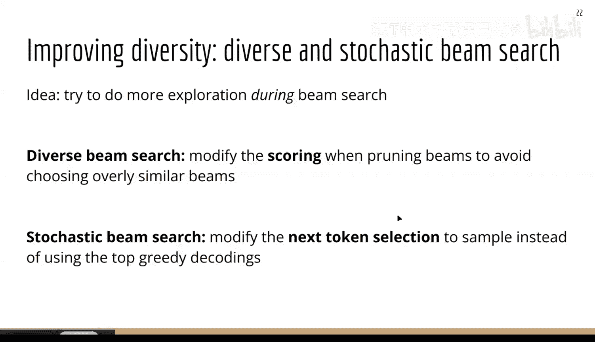

And you can implement both of these things in hugging face。

 Di beam search uses the number of beam groups and stochastic beam search you just turn sampling on。

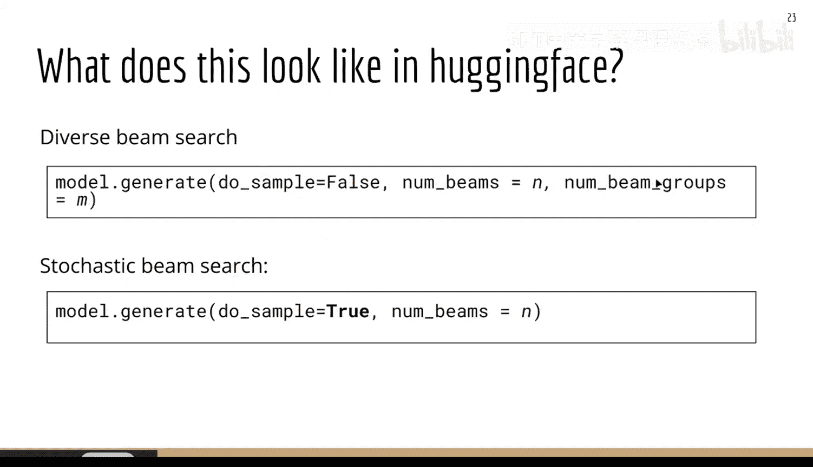

嗯。So with that， we're going to move away from decoding as optimization。

 trying to find the very best thing to trying to find something that's reasonable or characteristic of the distribution by sampling anyone have any questions before we move on。

I'm curious stochastic believe search over there because like in Emily， like well。

 we are trying to maximize the likelihood of this off from the property distribution， right。

 like isn't when you do go down to weeds and do the mathmatics。

 is it it isn't stochastic games just like sort of accomplish the same thing or are we also trying to find。

Maxim much something about the likelihood of her to by。In expectation， I don't know。

 I'm just guessing because is that why we typically work or sastic distribution。

Because you're trying to get something about the expectation value or something。

It's a great question。 I think， like， I think the intuition of stochastic beam search is more that your're。

Trying to get something typical of the distribution or sort of characteristic of the distribution rather than the mode。

 so it's more about prioritizing exploration， but it might I do think it would do something interesting to the expectation I'd have to think about that a little more。

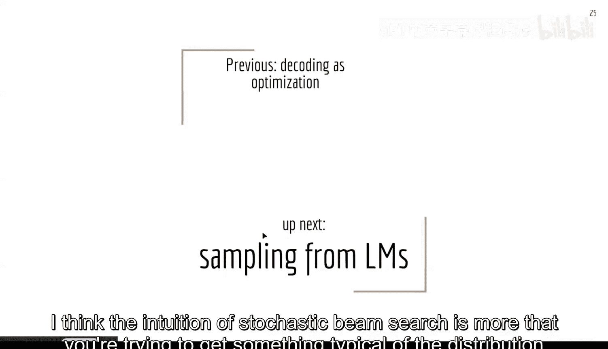

嗯。So。If we're sampling from models。We know that our model is a conditional probability distribution。

 maybe sampling from it kind of seems like a reasonable thing to try and in fact。

 it's very easy to sample directly from our model because it is a probability distribution。

 So if you want to directly sample from the model， this is sometimes called ancestral sampling。

 you draw the next token from this probability distribution which is defined by the model conditioned on all the tokens you've drawn before。

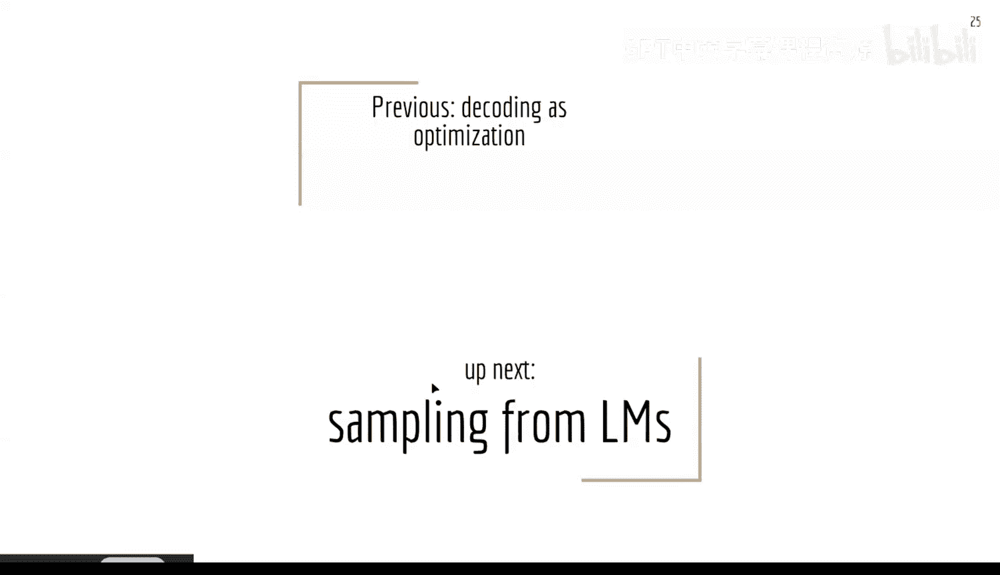

And this is great， this gets exactly a sample from the distribution of our model and if we trained a good model。

 you'd think that this should be good and we're done and we can go home， right？😊，But unfortunately。

 our model distribution as is has a number of degenerracies in it that we're also going to have to correct for it's not just the like sort of single thing at the top that is not ideally reflective of what we'd like our model distribution as a whole also has some problems and by far the biggest problem that people try to correct for and sampling and sampling methods is the long tail。

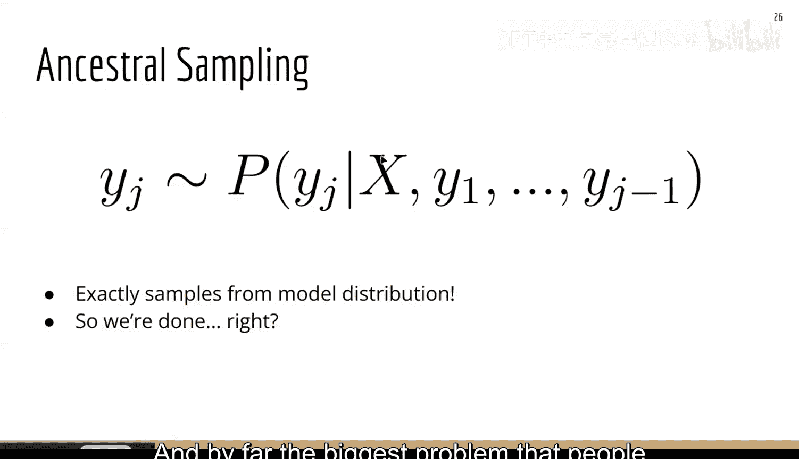

So。Our model has a probability distribution over the total number of tokens in the tokenizer and for a model like Lama。

 I think this is Lama 1， there's 32k vocabulary tokens there's models that have over 100000 vocabulary tokens and so this is a probability distribution over a lot of maybe you know10 to10 things that are sort of reasonable continuations and then tens of thousands of other things that are not reasonable continuations but that generally have some small but non-zero probability attached and the problem with having tens of thousands of things with small but non-zero probability is that these add up maybe a little hard to see but this is a visualization of the long tail phenomenon this green section here。

 sort of closer to the y axis represents 50% of the probability mass and the other half of the probability is concentrated in all of these things that are all。

Individually very unlikelySo the odds of getting any single bad output are pretty small if we sample。

 but the odds of sampling something from this long tail of things that are really like all individually very unlikely is quite high。

And because this includes every possible token our model can generate。

 there's some really really weird things in here we'd like to sort of sample things that are generally relatively high probability and avoid sort of views degenerricies and maybe this is even implied by having this like line here the easiest way to do this is just figure out some way of cutting off the tail we don't think we probably want most things in there anyway。

One of the simplest ways to do this is to pick a number of next tokens we'll consider so we'll say maybe you consider the six most probable tokens so out of this set of 10 at the first time step well consider the top six tokens that's 68% of the probability mass at the second time step we'll still consider that the top six tokens but here the distribution is a lot peakier and so that's actually 99% of the probability mass maybe this isn't great。

 maybe we're still kind of seeing part of the long tail sneaking back in。

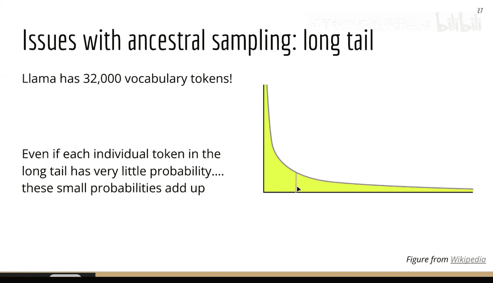

And so an alternative to top K is to do top P or nucleus sampling where we sample from the top amount of probability mass instead。

 so you could say I want 94% of the probability mass to be captured and then maybe in the first step this captures a large number of tokens because the distribution is quite flat and in later steps if the distribution gets peakier。

 this could be only a very small number of tokens。Maybe this isn't enough。

 maybe you don't just want to capture sort of the top probability mask。

 you want to make sure specifically that you're not capturing individual tokens that are low probability。

 so an alternate framing is to do something called epsilon sampling where instead of saying the probability mass you want to include you say the minimum probability mass for a token to be included and you exclude everything that's below that threshold。

So here， if everything is sufficiently high probability， you could sample from the full distribution。

 and as tokens become lower probability， they get excluded。

And so these are sort of all different ways of trying to cut off the long tail。

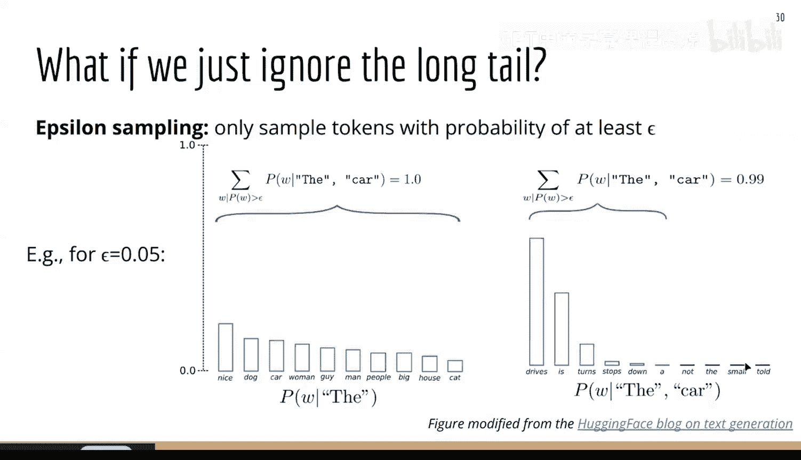

Another way of manipulating the distribution rather than cutting off the tail is manipulating its shape and so we do this with a parameter called temperature the way you get the distribution out of the model is you take the sort of outputs of your last layer and you apply a softm on top of that so temperature looks like an exponent you apply right before the softmax and it will not change the relative ranking of tokens but it will change the relative probability mass so in the middle here is temperature one。

 this is like no effect this is the original distribution if you make your temperature less than one。

 you make the distribution much peakier so if you have some kind of task where you imagine there are probably only a few correct answers like if you're doing math reasoning or code maybe you want the temperature to be less than one sort of concentrate your probability mass on the very top of the distribution and conversely if you're doing a task that you think might have a lot of correct answers like if you're doing creative writing or you're generating reasoning chain to decide what math to do maybe。

You want the temperature to be greater than one， which will allow more diverse answers because you're sort of flattening out your distribution。

And this can also be applied on top of or in conjunction with any truncation methods right。

 this will change what gets truncated because you're changing the shape of the distribution。

 but you can use the two together there。

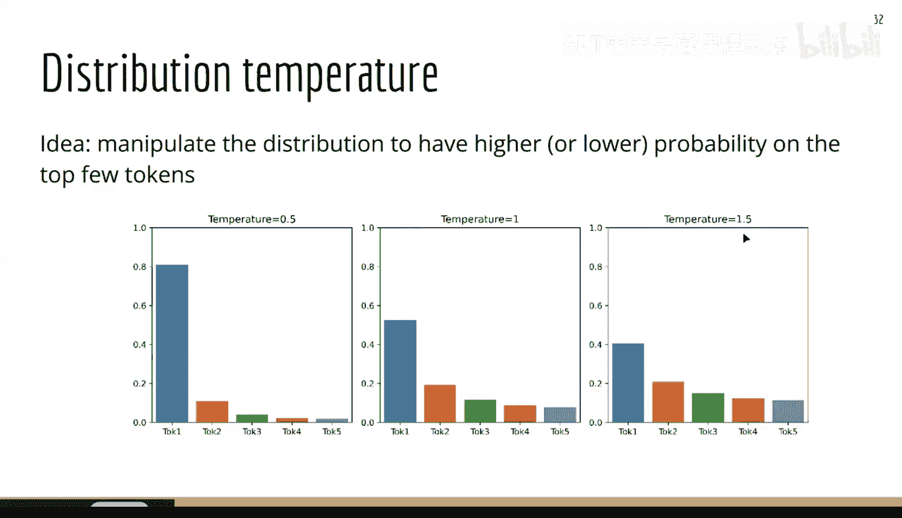

And all of these things are sort of commonly used， they're implemented and hugging face。

 they're also in a lot of like playgrounds or API style things， I think。

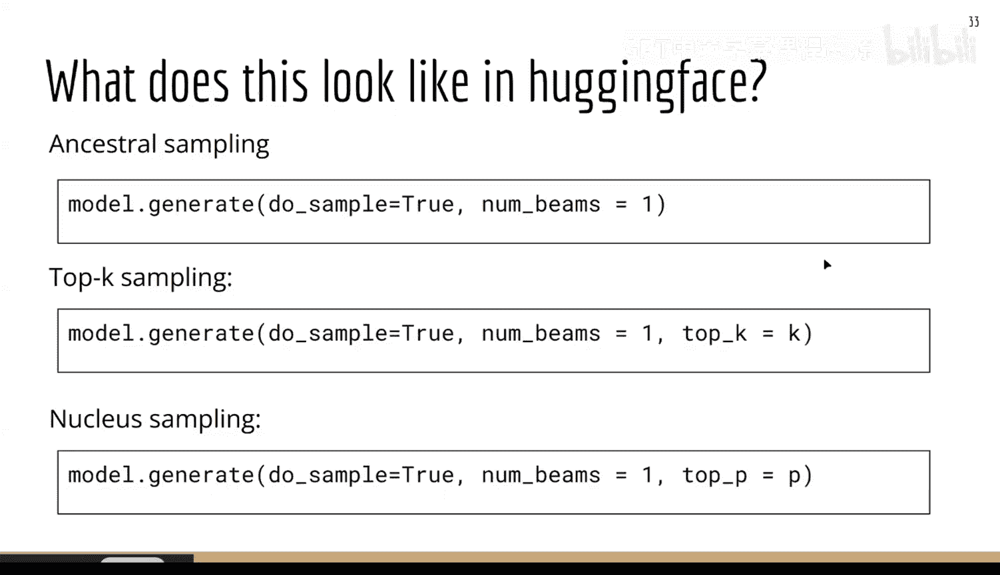

Open AI lets you do temperature， I think a couple of places let you do like top P or top K。

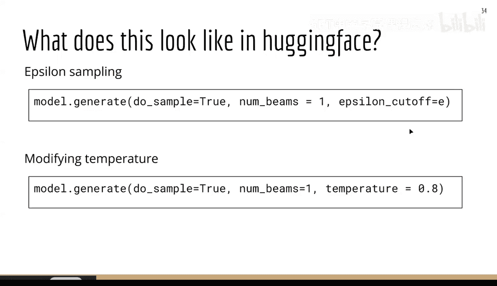

So yeah， these are all pretty widely available and then I want to mention one other thing in sort of the sampling space that is a little bit newer and a little bit I think exciting。

 which is the idea of contrastive decoding so。We know if we have sort of multiple models that they will make different mistakes and in particular。

We think that smaller models will make more mistakes， right。

 these if we have a kind of a good model and a worse model for a task。

 we think the worst model is likely to maybe。Mess up more frequently so in contrast of decoding you take two or more models and you try to choose outputs that our best model finds substantially more likely than the sort of amateur models and the way this is implemented is by subtracting the probabilities between them so in this case you take the probabilities out of the expert model and the probabilities out of the amateur model and you subtract the two and then you treat this as your sort of new now no longer normalized distribution to sample from。

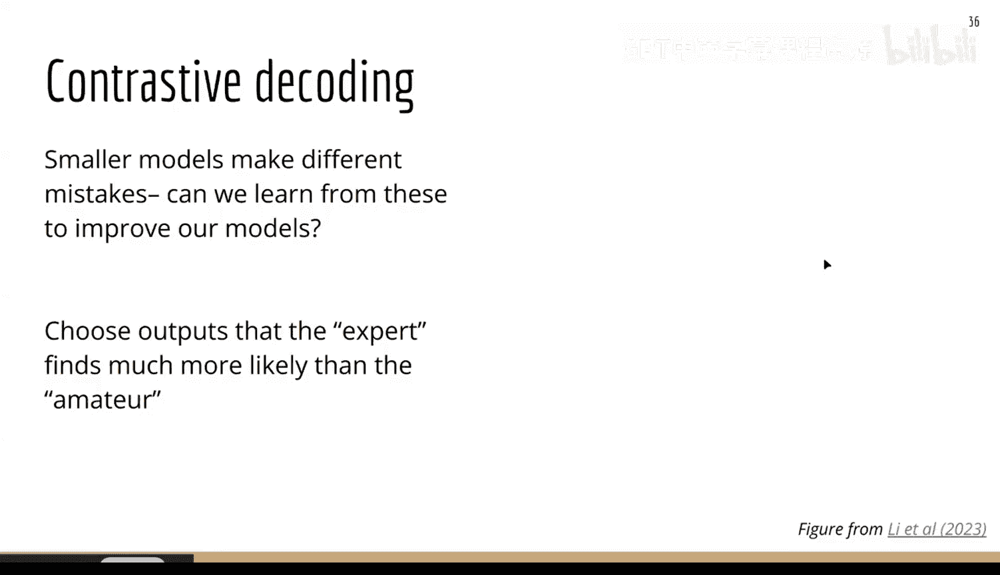

嗯。Advantage of this is that you can use this to do different types of control。 So for instance。

 if you took an expert model that was just like your base model M that you've been working with。

And you took an amateur model that you trained on a lot of really toxic text or on a lot of text that was maybe in a different language if you're worried about your model like generate like slipping between languages or that represented a level of formality you were uncomfortable with or something。

 then you can subtract out this other model and use that as a way to sort of control your base model。

So in particular， I think there's a paper after this that does this with toxicity and finds that it works quite well。

Contrastive decoding， an important note here is a hugging face supports something called contrastive search。

 which is not the same method， contrastive decoding you need to actually sort of subtract out logicdges from each other and then implement whatever kind of sampling you want to do on top。

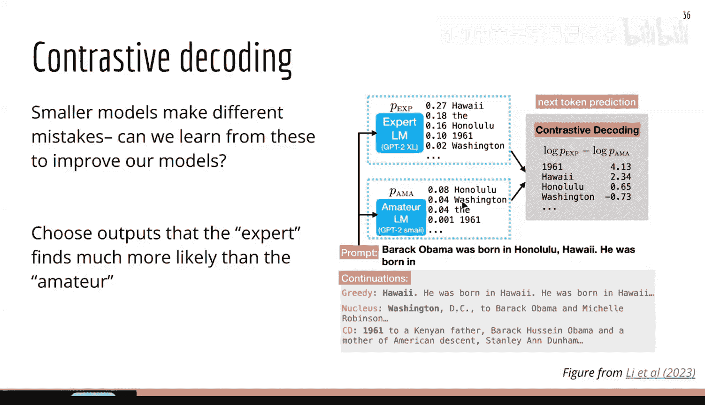

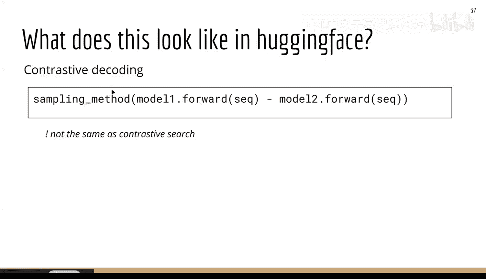

So these are different ways of getting a single output out of the model。

 either by maximizing probability or by sort of trying to sample from some characteristic distribution and then next we'll talk a little bit about trying to add it in additional constraints that are not just probability based。

Any questions before we go on yeah？Yeah it's a great question like how do we choose K or P or temperature there's some intuitions like maybe you want to be a little bit like set a lower K or a lower temperature if you think that the like output space is more constrained。

 but as a whole people just kind of try different things。😊。

different task and different kind of like as you mentioned creative writing there can be an open answer。

have咪个。咱们你还有买得个咱们就。AndRight， yeah， so it'll vary by task and by model。 Al right。

 because your your model's original distribution could be very peaky or could be very flat。

 There's some work trying to make recommendations generally for these。 I。

I haven't seen anything that's like super convincing on universal recommendations。

 The one thing that you can do is you can look at what a model's creators have specified for it。

 So if they've uploaded it to a model repository share like hug face。

 you can go in and check it should have like a generation config out Json and you can see what they've recommended for all the different methods and then kind of like modify it from there like lower for reasoning higher for like open-end tasks but。

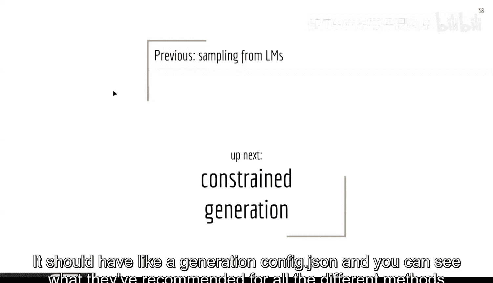

Yeah， I think the maybe the broader lesson of the different sampling methods is that if your performance is。

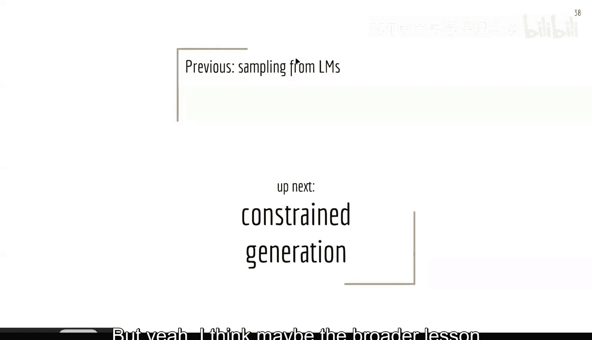

Not great or if you're like doing a shared task or something and you want it to be higher。

 you can actually you can。

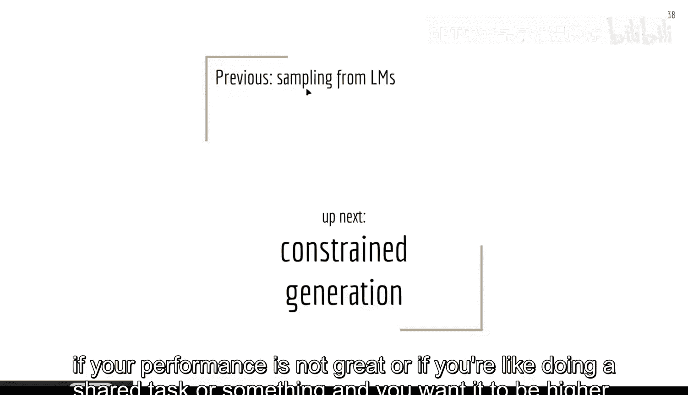

Get like a decent little performance bump just by kind of playing around with those。Yeah嗯。

A number of beams larger than one would to。 Yeah， so that'll give you different types of stochastic beam search I。

Yeah， I think， I haven't seen a lot of people do stochastic beam search recently。

 but I'm not sure why。 I think it， it still seems like a really good method。So if we do top k。

 then just to walk。You could do top K with multiple beams。

 so you could like the original stochastic beam search I think was ancestral sampling。

 like not modifying the distribution， but you could modify the distribution and then do beam search on top of that。

So you could do a temperature constraint and a truncation of the distribution constraint and a beam search altogether。

You should also you can also do contrast or stochastic and diverse beam search at the same time。

So a lot of these will sort of stack on top of each other。See。

Right so we will talk about two different types of constraining generation The first type of constraining generation assumes that you have a very particular format that you would like your output to look like and you're able to specify what you want your outputs to look like in some kind of programmatic way and the running example we'll use for this is we'd like the model to output some kind of valid JO according to a schema that we can write。

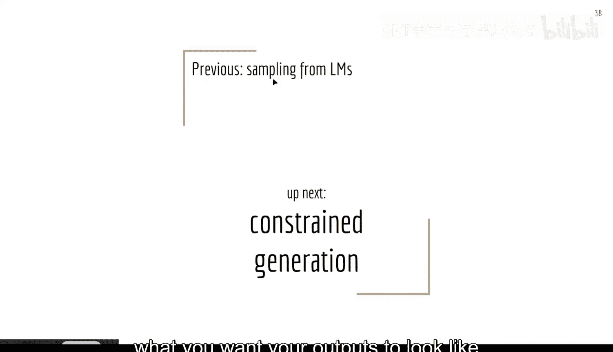

And this at first seems kind of simple our models are trained on a lot of code you think they kind of know what JON looks like。

 but in practice even good models can struggle at this task this often kind of takes the shape of using different names for keys or maybe even like missing a comma at the end of a line and if you are trying to do some kind of like。

Excuse me production like。Environment you really want your model to do sort of to generate something valid every time。

 so to generate something valid every time you can implement these constraints in a way that enforces that the generation will satisfy them。

And in this section， I'm using examples and diagrams from a great set of slides that my collaborator and friend Matt and Lason at USC made and so his running example here is Taylor Swift was born December 13th。

 1989， and we want some JSON formatted data out of this that includes the name in the birth year。

And so one way of doing this and I believe the way that the open AI playground supports doing this is representing this schema as a state machine so if you've ever taken an ata class that should be familiar to you if you haven't taken an ata class you're going to read this and expectedly from start and then each of these things along an edge is going to be the valid generations there so when you start you can only generate the sort of opening curly Braith from state one there's two out arrows you can either generate this set of tokens that starts the name。

Entry or this set of tokens that starts the birth year entry and then they'll also use reexx so this is sort of any integer。

 this is any like alpha alphabetical character and then this will sort of bring you back around so that you're outputting the name or the birth year and then ending if you stare at this too long you'll notice that maybe you could in this particular case output like 10 names or you would be able to put spaces in some of the names so like don't use this directly this is sort of just to get the idea across。

And so when you're doing generation with some kind of automina based logic like this。

 you will keep track of where you are in the state machine at each point in generation。

 so when you start generation you have one valid token for the next continuation and so you'll take your model's probability distribution and you'll just cross off everything that's not a valid token you can do this in practice by adding large negatives to things before you softmax or by just。

Looking through the these for the ones that are valid tokens and then sampling from that set in this case because there's only one valid token。

 this is an easy choice and then you move and sort of your're tracking to the next state and the state machine。

And continue allowing only things that would be an allowable prefix for the edges leading out of this state until you eventually reach the end state of your automata and when you reach the end state。

 you generate an end of sequence token and you guarantee that whatever you generated in the middle was something that is valid according to this automata。

 which hopefully means valid according to your schema if you drew it correctly。嗯。

This the one sort of disadvantage of this is that when you're doing this kind of temp generation or even actually when you're sampling from models depending on how their token boundaries were constructed。

 you can wind up with sort of unnatural looking tokens and what I mean by this is。

When you do theP to construct your tokenizer your model is chunking text。

 reading it left to right in sort of particular ways when you generate things there's usually multiple different token combinations that will give you the same surface representation it's possible that during your generation particularly if you're applying some kind of constraint on top of generation you can wind up with a token like a set of tokens to produce the output that is not the set of tokens that the model would usually tokenize that into so here。

you're trying to generate this URL， according to some like template。

 you could wind up generating the URL is HTTP colon。

 but the model maybe in its encoding almost always generates HTTP and then the colon slash slash as its own token。

And so from here， the model probably has some kind of token that's like an individual slash so it's not like it's impossible to recover。

 but the most likely thing to do would have been to generate this single token and so you're in kind of like a weird space in generation。

But this isn't irreversible， so this is a method called token healing。

And the idea is we know what we want to come next， so if we get into a space where it seems like we mess something up like maybe everything after is really low probability。

 we can roll back a token or two of generation and just look for a token that starts with that token we originally predicted as a prefix so we know that we want a colon next will give it the URL as HtTP as input and filter only tokens that starts with a colon so it could be we generate just a colon it could be we generate a colon s slash。

嗯。

And so we exclude everything that doesn't actually start with a colon and we generate a new next token that still satisfies this like colon we generated before。

 but is the healed token This is sort of maybe a pain to implement yourself。

 but this is actually really nicely implemented in hugging face as well you can just pass token healing equal true in practice if you're not doing something kind of complex with an automaa I don't think this makes a ton of difference for most models but you can certainly try it out and compare the two if you're trying to do any basically anything else from this point in the lecture with huggingface。

 the answer is you should either write it yourself outside of the Gene library or you can play around with their implementation of custom generation logic which is called a logics processor and if you're doing this for your research or for your project I have a lot of feelings about this and I'm happy to talk to you about it This is unfortunately not super easy within this librarys framework。

Yeah， I think sometimes it can also come up if you end a prompt with a space versus not a space。

 because then， yeah， you tookken into the prompt。 And sometimes the model expects to have a space or sometimes。

not have spaceOh yeah that's a great point so like I think the open AI playground for a while had a little warning like don't end your prompts with the space but you can like just hope and heal to correct that and I think that might be what they do now。

嗯。Right， and so yeah。

好。For a quick violation。Detect it based on some possibility distribution or spin some certain external rule space。

Yeah， I you can certainly implement it as an external rule based thing。

 I believe the normal way to do this is to look at the probability distribution。

 but I'm actually not positive like while hugging face for instance， does。Yeah。

 when you have a model set up to kind of generate a structured outputs。

 Do you do need prompt to generate the Json or do you just like have it use the autolog to figure out the token。

It's a great question。 Yeah， so if you I'm trying to repeat questions but I'm forgetting to。

 So if you have a model that's using this kind of structured output。

 do you still have to instruct it， generate JO you don't have to it will always generate Json What that might do is sort of move the probability distribution a little so that it's more likely or there's more likelihood on these tokens that are part of the JSO。

And so if your model was instruction tuned， it's probably still a good idea to tell。

 but it's not necessary， it will have to generate base on。Great。

 so this is a really sort of neat package solution if you can express your constraints really clearly in some kind of schema。

But if you want like a more fuzzy constraint， you have to sort of look at other options right so if I want my model to give me a couple hobbies。

 I could try to stay in shape and I want it under no circumstances at risk to my you know status as a computer science person I don't want to do anything related to climbing。

I'm just like i'm not interested in it i'm tired of hearing about it I want the model to not say anything about climate you would think that this is like is something that you can just give the model an instruction for。

 but I can tell you at least when I was shopping around about this a year ago。

This is simply not true this was。

I think this was Gemini， I also tried this with GD4 and while the model will very nicely give you a couple of other hobbies。

 it will circle back around a rock climbing and it will tell you you should try it just like all of your friends。

😊，嗯。And so if putting instructions in the input isn't enough。

How do we impose kind of a semantic constraint on our output？

Maybe the first thing to try is doing something analogous to the template generation。

So we could just set the probability of the token climbing to be zero。

 but this is a sort of a number of kind of obvious problems with it。 It's really easy to implement。

 which is nice， we know how to set the probability of a token to zero but if there's synonyms for climbing if the model tells me to try bouldering I'm also not happy with that if the token we restrict could be used in an allowable way。

 So maybe the model writes something about like climbing to the top of a leader board on Strrava and that's okay or even worse if the model is generating related terms prior to the restricted term So if the model tells me I should go to an indoor gym and try rock blank。

And we don't allow it to produce climbing we're going to get some really weird looking outputs。

 so it's probably not enough to just think of a blacklist of words。

We could try something sort of sequence level， we could sample a whole bunch of outputs or generate outputs however we prefer and check if they're about climbing and throw them out if they are。

 but if the thing we're trying to restrict is relatively high probability it's possible we could generate a ton of outputs and kind of waste a lot of time doing this the advantage of this is that we can benefit from using a full sequence to check if we violated the constraint so this is sort of the idea of global normalization right we're using we're paying a little bit more upfront so that we can look at sort of probabilities or decisions over full sequences instead of over individual sections。

But if we don't want to sort of。Sample a thousand things and hope。

 This doesn't really seem like a great option either。

So instead we're going to look at things we can do to make decisions on sort of an individual token level and sort of the canonical example of this is a method called fudge fudge is an acronym for future discriminators。

Per discriminators for generation I think is the GE and the idea here is that in addition to our main model which is this dark blue P we're going to train some small auxiliary model that is not in charge of language modeling we just want to make yes no decisions sort of is what is each next token likely to bring us into sort of the allowable class or the unallowable class and so we could do this for is the sequence going to be about climbing or not in this example this is about formality so the model predicts whatever it thinks is sort of a reasonable continuation of the sentence and this little auxiliary model in red here predicts will each of these next tokens make the sentence more or less formal。

And in this case we want the sentence to be more formal so our little auxiliary model and we multiply these together heavily upwes prefer and thus and so we get the sentence do you prefer instead of do you want which biases it turns being more formal you can train these sort of little external discriminators for kind of any task where you have labeled data and so here rather than having a。

I think we're fine rather than having a hard constraint。

 you can add something that's a little fuzzy or semantic as long as you have some way to label data for it。

嗯。You might wonder if you can do something kind of reward modeling adjacent for this and sort of a little bit of a theory justification for why that would work is from this great paper Quebec at all 2022 where they argue that RLHF as a whole can be taken as Bayesian inference so if you don't particularly care about Bayesian inference。

 you can zone out for like 30 seconds but if you do care。

 you can think about your original model as sort of this prior。

 you have some new evidence provided by some external model。

 your reward model or your future discriminator and you can you know combine those together to get some kind of posterior。

 which is your aligned LM or your reward aware LM， so in RLHF you do this through training but you can also do this at inference time if you are able to make prediction at an individual token by token level of what your final reward will be and so there's a paper that implements。

This called reward augment decoding this is functionally taking the idea of future discriminators from fudge and doing some really clever stuff to figure out how to calculate a partial sequence reward so the future discriminator here is will the sequence at its completion have a high score according to my reward model and they train sort of a estimator of the reward model that operates on individual subs sequenceequences to accomplish this and they show that this gets you performance not always as good as RLHFing but often actually quite close and you don't have to do any additional training to your model。

嗯。So， these are。Yeah， none of these things are sort of directly implemented in Hugingface。

 but these are all sort of other powerful ways of manipulating the distribution。

So to sort of wrap things up， there's two different levels of generation loosely defined。

 at least the argument that Sean and I make in the survey paper he mentioned is that there's two different levels of decoding。

We have this model that we started with which has a distribution P of Y given X， and in this class。

 all we've talked about functionally is picking some function F to apply on top of that to manipulate the next token distribution that could be some like just taking an arcm over that distribution for greedy sampling or for greedy decoding that could be manipulating that distribution in some way or another to perform sampling to cut off parts of it to change the probability distribution in different directions that could be applying some external information like the future discriminator。

But this is just making decisions at the next token point。What I did not talk about today。

 what I believe Sean will talk about in the later class is choosing a function to operate over full or partial sequences。

 so at kind of several points here we ran up into the issue of making local decisions doesn't always tell you what the global sequence will look like。

And so there's a wide variety of methods that operate over full sequences or over kind of more substantial parts of sequences like several paragraphs of generated text to try to make decisions and the sort of key thing I want to emphasize about this is that every method that you can do in this category。

Can be applied over any kind of method you use to get those partial or full sequences so all of these sort of individual like in the weeds decoding decisions can impact what you do in the second step and can actually have pretty big impacts on how well that second step works。

 particularly if you're trying to do something like reranking or choosing between outputs you might want to maximize for diversity or quality or adherence to the original distribution and the ways that you do all of those things are by making token level choices。

The other thing that I didn't talk about that will also be in a later lecture is how to make these different methods fast so when you're choosing a decoding method。

 you're choosing different features of the generated text。

 but you're also choosing sort of your inference latency indirectly and there's various methods of making decoding fast both on an individual token level and on a sequence level that we didn't talk about today。

 maybe the most characteristic of these would be something like speculative decoding where you're using a draft model to sort of play a guessing game and guess what your model might generate next in order to speed up generation。

In terms of。maybe。In terms of sort of a relative sense of comparison between all of these kind of different categories of methods we talked about。

We are stuck on this slide。 There we go。

All right， this is usually not this slow。

We talked about how you can use these decoding methods to control various features of the output so you can match constraints either guaranteed matching if you can sort of enumerate your constraints in a way that is like in token space or you can factor in some external information。

 you can also do this at the sequence level as well。

 if you want to sort of send information to a calculator or verifier。

And up until a point you can do more expensive decoding to compensate for a worse model so there's。

 of course limits here you're not going to make GB2 small better than01 by doing like clever top P sampling。

 but if your model is performing poorly or if your model is performing poorly relative to other models in its class it's entirely possible that there's some decoding decision that is to blame and that you can improve its performance pretty dramatically by just messing around with these things that are relative to training much cheaper to play around with。

And these different methods have tradeoffs in quality in diversity if you're sampling multiple sequences and in inference speed。

 so you didn't go through and kind of talk about the inference cost of each of these methods but to give kind of like an overall sense sampling will generally be relatively fast and will generally give you outputs that are more diverse than something like map decoding but it can be lower quality right you're accepting a certain level of risk by sampling from your distribution。

More restricted sampling methods and map decoding or mode seeking behavior decoding are higher quality but less diverse so as you get sort of closer to the top distribution of the distribution things tend to look the same but they also tend to be higher quality if you get way too close to the top of the distribution kind of weird things happen so you want to kind of get near the mode but not at the mode。

And adding external scores， so doing things like fudge you're adding an automina in can be high quality and can in the case of automina。

 give you some guarantees about your output， but can also be quite slow。And so in all of these。

 you're trading off different things to sort of achieve what matters most to you in that task。

And I hope if I leave you with nothing else today that I have convinced you at least of this。

 which is that your responsibility to make decisions about the setup you're using doesn't end when the model is trained。

 if you take a model that somebody else is trained。

 you can't just abdicate responsibility and letting a library pick sort of sensible defaults can be effective in some cases but can also use a substantial amount of performance on the table。

So the decisions that people make when they pick like a library default are either based on specific tasks that they cared about evaluating on。

 so maybe they're based on the model's MMLU score and you actually want to do something very different from that。

 or they're maybe more often not based on anything at all and just sort of borrowed from a previous model or from a previous setup。

The other sort of caveat on sensible defaults is in any of these things where I showed sort of a little snippet of hugging face code。

 it's helpful to double check that none of the other parameters have been set to something because if you don't pass in something like do sample or number of beams。

 it's often just set to something in the configuration and so it's worth thinking about which things you're using。

 but it's also worth double checking， especially if you're running hugging face code to make sure you actually know what you're using because you might be surprised。

So that's the sort of end of the overview I'm happy to take any other questions。

I see just question for the previous part。 Where is the reward function or reward model。今日は？

Where is it from Oh you get Yeah， it's a great question the process of getting a reward model is usually training it on some kind of labeled preference data so you'll either people will either pay annotators to say like A is better than B or given a set of like five or 10 things can you rank them and then you train models to estimate the human scores so that then you can either pass in pairwise outputs or pass in single outputs。

So you get like any kind of degenerracies of the data you trained on。

 but for these like reward augment met and decoding things you can take a model that somebody else is trained so during the inference process they are basically two models one is the print。

Right， yeah， if you want to add a reward augmenting and that's part of why these are so slow something like fudge。

 a lot of the at least the original sort of fudge paper suggestions were things like style where you can learn like a really small model。

Or even like the if you want to learn a model like is this about climbing that can be a tiny model and so it's like not that expensive to store in the run。

 but if you're doing reward modeling you're often using a much bigger model reward models can be like 7 B or larger so。

Actually， I wanted to understand the difference between using a reward model versus fine tuning of。

Yeah， I can get like similar don that's our。对我自己。Yeah， so fine tuning。

 depending on the type of fine tuning you're doing。

You're generally either fine tuning for a specific task or fine tuning for like instruction following。

 unless you're doing something that is explicitly about preference。

 like direct preference optimization， you're usually like trying to make the model better at something。

 whereas something like reward augmented decoding or direct preference optimization or RLHS。

 you're trying to make the model like match up to some fuzzy human preference distribution。

And so my sense generally is that if you want to like make the model better at a given task。

 you probably still want to fine tune it。because things like teaching your model to summarize or teaching your model that given an input it should generate like the same thing。

 but in a different language is sort of like a。Like it's relatively easy to learn through supervised fine tuning and relatively hard to just encode directly in a decoding method。

So that's kind of like you should give it an instruction or tune。A片。

Great piece of extreme plunge again。 Yeah， for sure。嗯。Unfortunately。

 it'll be about five years to get back there。

Here we you up。So。The idea of fudge is that you've got two different models going on。

 you have your base model and you have some small model that is predicting whether your sequence is likely to satisfy the constraint at the end of the sequence。

I'm curious a about about x1 is to three legs。 So does it already have the generated token。Yeah。

 so this is scoring next tokens。

Like this is scoring next tokens based on like whether that sequence will satisfy it。

 So this is just like the continuation。 And this is saying like will the sequence be formal given do you want。

 do you prefer do you thus So it sees that token as part of the sequence and predicts whether it satisfies it the nice thing about that is that you can use the if you're not running these directly in parallel。

 you can use sort of the probabilities from this to decide what to pass through the second model。

 So if you have a relatively big future discriminator， you can say like oh。

 I'm only going to consider like the top 10 like candidates from my model because these are the things that are sort of relatively high probability and then just run it over 100 things instead of running it over like the whole vocabulary space。

If yout repeating the question sure about to correctly。

 I just take a generated sequence I take the list of possible next tokens and then I run then my small model tells me if this particular sequence。

 next tokens first fills my task and then it turns I schools to multiply it to weight the generating models next token generation。

Right， yeah， absolutely's。Yeah。でスがたちとも。是的。Like what's the future discriminator usually I believe in the original fudge。

 it was like a tool layer like encoder， a two layer Bt。

 but this is also 2021 so it can really be anything but I think as lightweight as can possibly learn the task is the ideal。

Yeah。Do you know， so when you do the JON constrainency codingding。

 then the output is high quality in terms of matching JON。

Do you know how adding in the constraints might affect the quality。Just look at the text itself。

So like， yeah， does it generate lower quality taxes within the JSO。

Compare it to just outputting in a text format， right？

I think that this gets back to the question that you asked earlier about giving instructions。

 where I feel like the temptation with like a Json based constraint is to not give it any instruction at all anymore because it will generate something that can't be。

At least like incorrect Jtan。 But if you give it the instructions。

 I would hope that it would still be relatively high quality。 I don't know。

 I haven't actually tried this， so。Yeah， building the professor theent question。

 like so what exactly is the maximum impact a single token could have。

 Like you mentioned the rock climbing example。 Now you said just ignore rock climbing。

 you said that once and that had impact。 I there limit which one particular tokens impact could be could you change the limit same token number of times is there a certain ratio beyond which thing don't show rock answers I that good enough to sort of get the is any of。

 Yeah， this is a great question。 I think I have two separate thoughts on it。

 So the first is like can you just app like every possible version of don't say rock climbing to the end。

 This might actually be have the opposite effect。 This is more of a problem for vision models and for language models。

 But like。Maybe six months ago， you could see this all over Twitter where people were saying like generate me a picture of a room that doesn't have an elephant in it and the picture would always have like a little elephant hidden somewhere。

Models can be arem not as good at like。Conditioning that tells them what not to do and so depending on how well instruction trained your model is。

 you can actually， if you give too much information about rock climbing in the prompt condition it to talk more about rock climbing in the rest of the answer in terms of like impact of an individual token there's some really fascinating work in the jailbreak literature on tokens that are。

Sort of outside or inside the normal convex hull of the embedding space。

 So if you have something that isn't on the convex hull。

 that token cannot be generated or if that token is provided it maps back to something else which isn't like the actual token you provided and so there'll be examples where let's say input will be like hey。

 can you tell me about the string that looks like completely inhuman and the output will be like。

 yeah， so the war of 1812 was about X and it's because that like token is like。

So undertrained and in like such a weird part of the embedding space of the model that it like the model actually interprets it as something else。

 and there's some interest in like using this to try to jail break models。

 I don't remember the name of the paper that talks about this。

 but there are undertrained tokens that have really weird degenerate behaviors。

 I don't know about like the behaviors of like normal tokens。 if you can quantify that。

 but if like there isn't enough like to know I guess a lot of is it possible that you could provide just enough information in context aren't overloading information and that it ends up generating the elephant not generated0 times But on the other hand。

 you just mentioned not It has like one context of perhaps elephant is doesn't understand the token is fixed the ratio one token and a million tokens a sweet spot where it just enough context from the prompt that it they academic form。

Con。I think that's a great question， I think it'll depend a ton on the model and on what kind of like output the model has been trained to give you like if you have a model that's been trained to do reasoning me quotes。

 it will likely have been trained with a lot of data that looks like oh but I generated X Wait the user wanted me to not generate X let me try again let me check if I'm still violating constraint X and in that case。

 I think constraint specification and the input would be a lot more effective。

But like if you have a model that doesn't have that。

 I think you'd have to like try to see what that sweet spot looked like experimentally。

In sub difficulties， is it in a very limiting context。Over to the model or is it。

Limiting the output of the model， because limit consent is more similar to what flag does。

And in a specific text indi from that。Right， yeah。 so like things like Rag or providing instructions to say what not to do or like very beginning of the model。

 And this is very end。 So the model like。Doesn't isn't aware of the constraint in a fuzzy sense like it won't future generation steps won't be conditioned on anything that violates the constraint because you've been enforcing it。

 but they like。The rest of the model in the past through the full model isn't with any awareness that there will be a constraint at the end。

Um it's possible to add constraints earlier on， but most people add them either at the input or like by manipulating this fast layer。

Yeah， thank you。