# CMU《高级自然语言处理｜CS11-711 Advanced NLP Fall 2025》中英字幕 - P10：(10)_ Akari Asai - Retrieval and RAG.zh_en - GPT中英字幕课程资源 - BV1ZWYAzuEMa

Today we're honored to have A CAri SI。He's currently a research scientist at AIT and will be joining CMU as an assistant professor in fall 2026。

And so she's a world expert in this area of retrieval augmented generation。

He had some of the earliest work in the area and really impactful work like self Ra。

And recently she led the development of Open scholarol。

 it's a system for literature review that preceded today's deep research systems。

 and we actually saw a demo of it in the very first lecture of the course。And recently。

 she was named to MIT Technology Reviews 35 innovators under 35 or her work on a retrieval augmented generation。

So she's perfect person to give this lecture today。And I hope everyone learns a lot from it。

So with that， please take it away。Yeah， thank you so much for kind introduction and inviting me to give a lecture today and hello everyone。

 I'm a colhallie， I'm a visa scientist at Un Institute for AI and I will be an assistant professor at CMU starting next year and I'm really excited to talk about Vibo and Vichibo augmented generation today。

 which I believe one of the most impact for an important idea of longage models in today's world and feel free to interrupt me anytime or like to ask questions or like post questions in Zoom chat and I try to answer them during or after the lecture。

😊，Okay， so let me start。

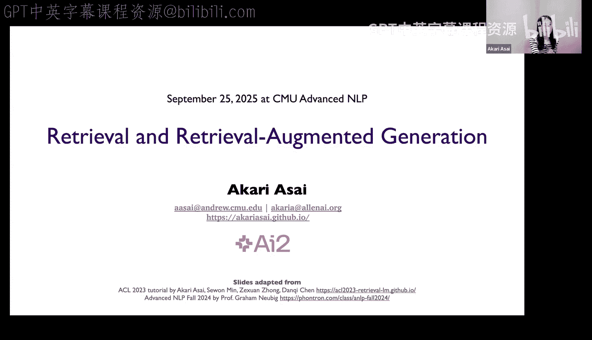

Oh wait， sorry， let me。

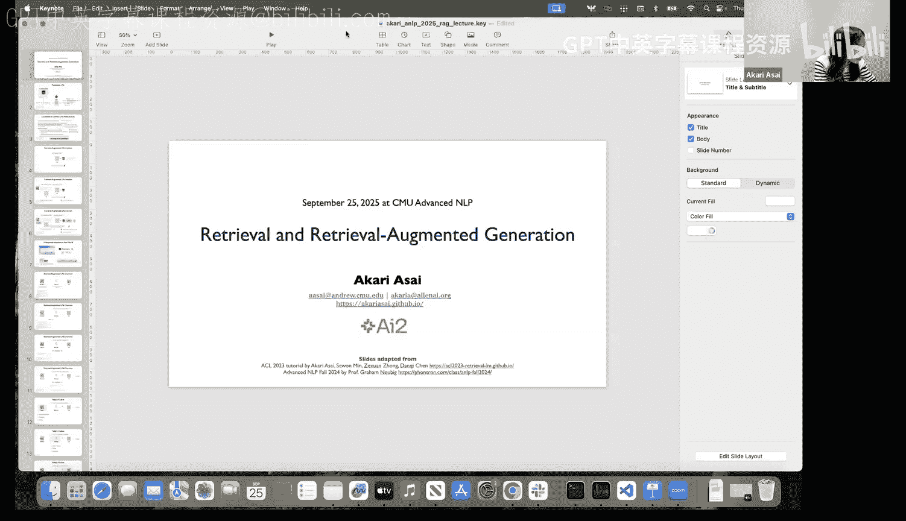

To。K。So。To understand why BT augmented languageage models are so powerful and widely used。

 let me brieflymin you how normal languageage models are built today。

Their training involves two main components， master pretending dataor and the longest model so。Oh。嗯嗯。

So should I minimize the chat。😔，We can't see it on the screen Okay， let move you again just keep it。

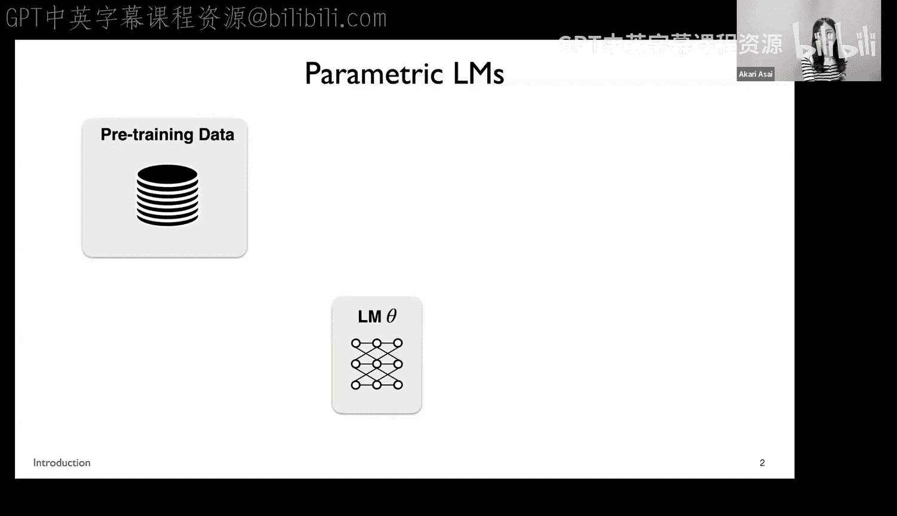

And then if someone posts a message， I can。Okay， so at some point， okay， sounds's a good question。

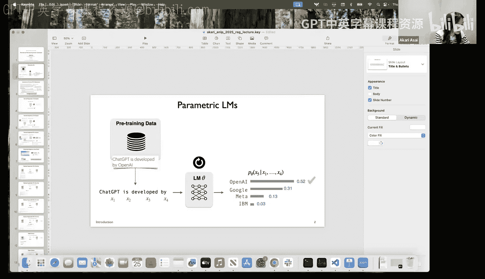

Okay， I get okay， let me okay。Yeah， so。Their model traininging data language model pretraining involves two main components。

 master pretraining data and the language model itself。

 and during pretraining times documents like chatt CPT developed by Open AI are sample and the model is given the PFX and predicts the next token。

We update the model parameter so that longest models learn to maximize the probability of the credit token。

 in this case Open AI。This process enables language models to encapsulate extensive outn。

 language understanding and generation capabilities entirely tightly within their parameters。

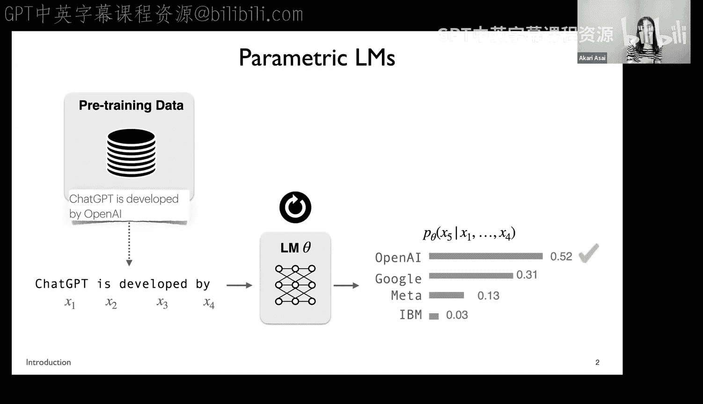

However， many of us have already noticed significant mutations in kind such poetic language models。

One of the most well known issues is Hnation where the model generates outputs that contain a lot of fact errors。

For example， I asked TBT to explain my research and list some of my different papers。Initially。

 the model correctly identified me as a researchersers researcher walking and questional。

 which is accurate。However， things get things very quick went wrong when he started generating list of paper titles。

The first paper it mentioned was realo， but it's not written by me。

Also the second paper is related to my previous work， but this paper title doesn't exist。

As you can see， longish models often struggle in long termnavis or nas that is underpresent in between time。

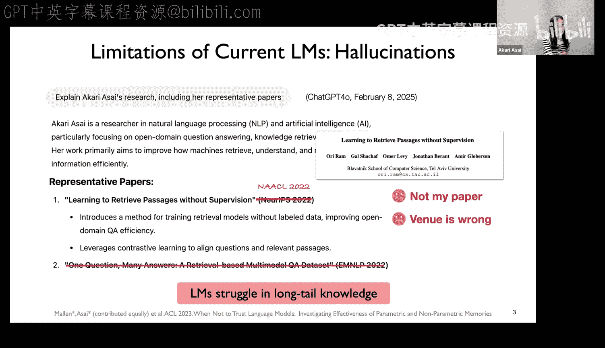

How can we overcome such long tail hostation？The challenge here is that for less popular concept。

 even if they appear per training time， longish models can't affect to en memmalize or be orbits in their parameter。

Then what if we could directly search large scale and Titic data used during between time？

Locate a few documents about rare entities like a Car I here and reason overble them to update answer。

This is essentially the coin tu behind pre augmented language models。

We found that this could significant biggest host nation even just on top of existing language models。

嗯。Moreover， WiQ augmented language models offer many different key advantages over pramedic models。

Another major limitation of parametricic language models is that the navis quickly become outdated as the per data is often collected fine in advance。

Or continuously training model a new data is one solution。

 but it is super expensive because now the longggage model training data and the size of model。

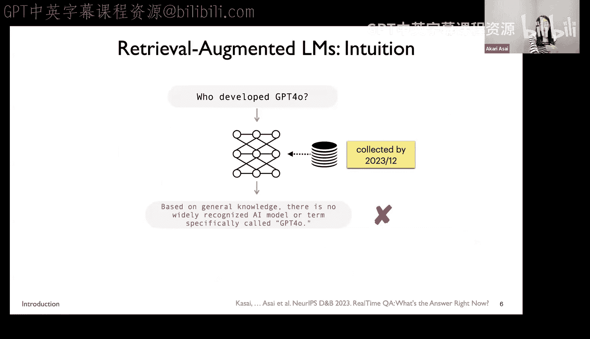

It's like much larger than previous models we had。

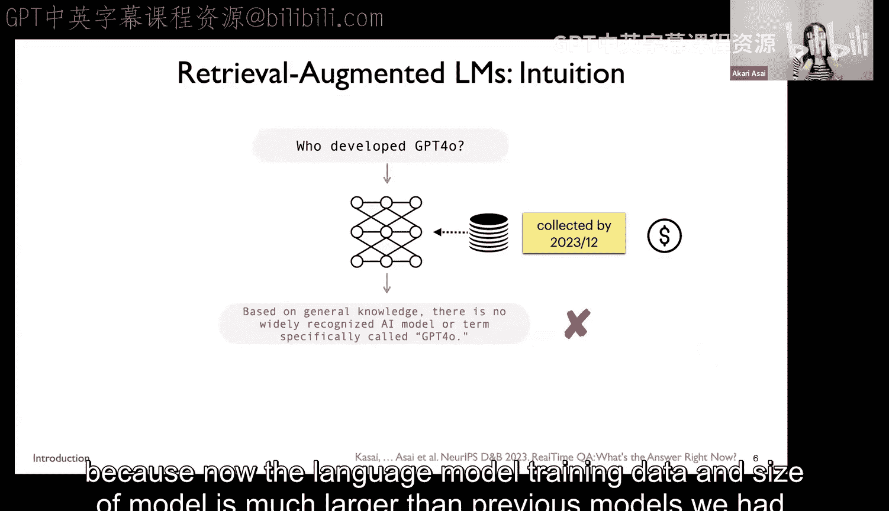

As a result， even instead of that models like GT40 still depend on average from 20203 or 2024。

Retableval augment language models can address this issue by dynamically updating theirna via external Data store。

Instead of retain huge language models a new data， we can simply depa the data store with a new one allowing the model to generate。

Mout more up to date businesses。We found that this approach is quite effective to enable modelstors activityC to update their prediction based on even last week's news。

Additionally， because now we have this kind of citation or evidence in addition to the model response。

 it enables us to verify the answers much easier， much easier than。Normal parameteric language model。

 which doesn't provide explanation on why this model generates this answer。

And this kind of amount verifiability is quite helpful。

 especially for domains where factual variabilityability is critical。

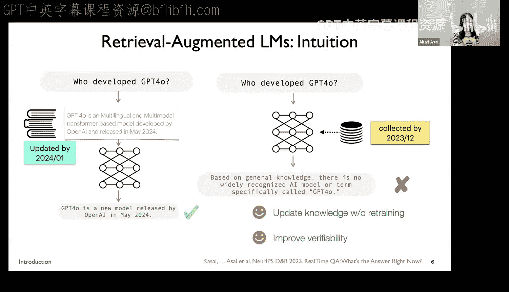

I hope we are now on the same page that B languageage models are highly effective for building language Mo based system。

 particularly when reliability or adaptability are crucial， like healthcare domain or Sc domain。

In fact， retrieve augmented language models are becoming avic test。

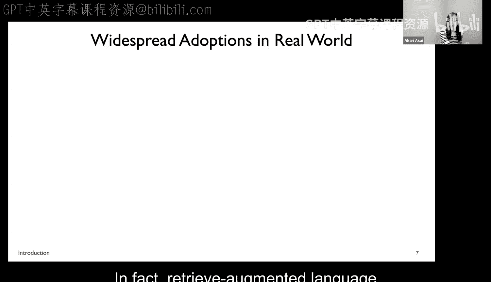

Open AI has been de chaivity search or deep research system。

 both of which develop between augmented techniques to provide more accurate up to date responsess。

In today's lecture， I will discuss how we can build such systems。

And those products are not only just in opening a system。

 but also many as a company product like Google， Gemini or like other search engine system like Perplexty or U。

com search。

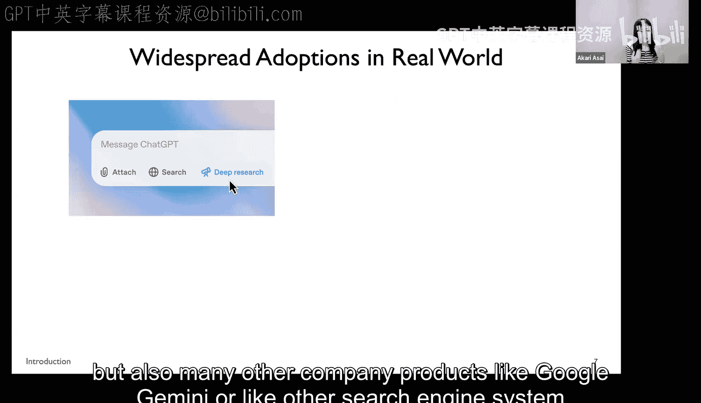

Beyond those users facing chat application， re augmentmented language models are also widely used ac。

Industries to automate core tasks and develop custom facing products。

 making them a key component of modern air systems。So。

So today I will teach you how we can build such re augmented language models by providing highable overview of their core techniques。

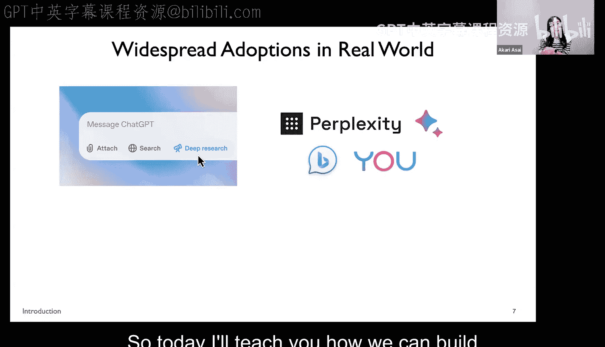

Before diving into the detail of each component， let me provide a more concrete descriptions of how Winet language models work。

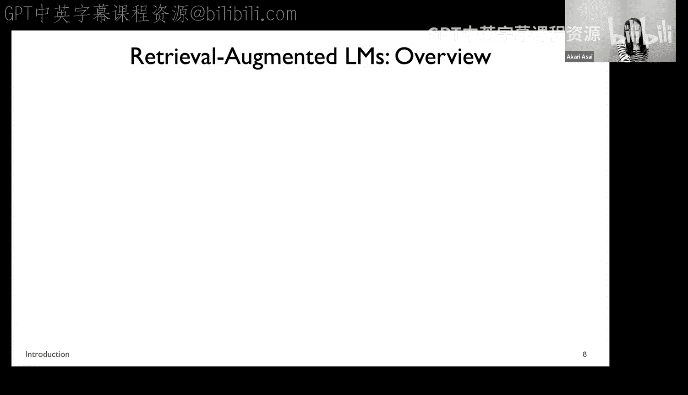

Those models enhance phmatictic otic language models like GPT405 by incorporating a largeSQ data store。

 a collection of documents。

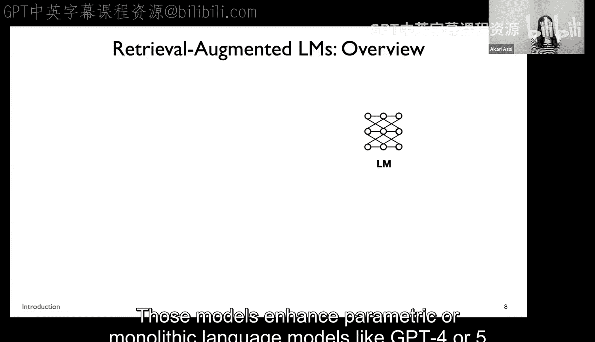

Documents links are depending on models， but typically each document consists of a few hundred words。

A retrieval model identifies the documents that are most related to the input query from the data store。

In particular， given the user imptex， we use a Vi system to compute the similarity between query X and documents in the data store。

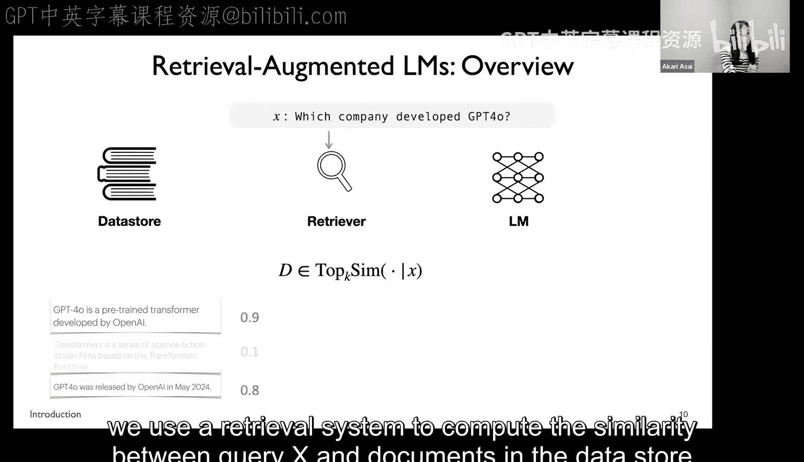

To identify the top K documents D with the highest similarity score。

Then we incorporate material documents D to enhance the prediction of longage models。

Note that there are many different ways to incorporate the behavior documents did。

Today I will discuss how we can improve each key component of V augmented language models。

 the data store， Vtiba model， language model， and the integration。

The first I ob briefly cover data soil construction as the quantity of the data store is fundamental to building effective augment language models。

I will discuss what type of documents should be included。

 how we should process and structure the data store。

 and other important cons to ensure optimal performance。

Then I would discuss the different type of Vivva models。Information Betval itself is a vast field。

 so rather than diving into all the data， I'll provide a high double overview of different Vtbo techniques。

 their training my strategiesologies， and how they are evaluated。

Ho this will give you a solid understanding of key approaches used to retrieve relevantvan information effectively。

Lastly， I will discuss how re systems and languageage models can be integrated。

 covering different architecture approach at higher level。

Then I will highlight some recent advancement in this area。

 especially focusing on new models of improving V augmented generation。

 showing how those new approaches improve the effectiveness and efficiency of VT augmented generation。

So now let me start with a datatper and feel free to post question in Zoom chat if you have any questions。

Okay。First， let's consider what data we should have in BT augmented languageage models data sort。

The choice of data story depends heavily on the target application。

If your goal is to answer fact based questions， factored questions。

 then a widely used and highly high quality sources like English superior is indeed a stone candidate。

Many NLP papers use English criteria to enhance the model's prediction in those like fact based Open domain QA type applications。

However， if your application is more specialized， such as building a Vi augmented system forta animation or quota assistant。

Then you need to be more strategic in constructing your data store。For qua related applications。

 your sources might include a mix of GW history， official documentation。

 or community forums like Sck Overflow。The key takeaways from those prior work is that the choice of Datastore should be carefully aligned with the specific needs of your application to ensure high qualityT and effective system performance。

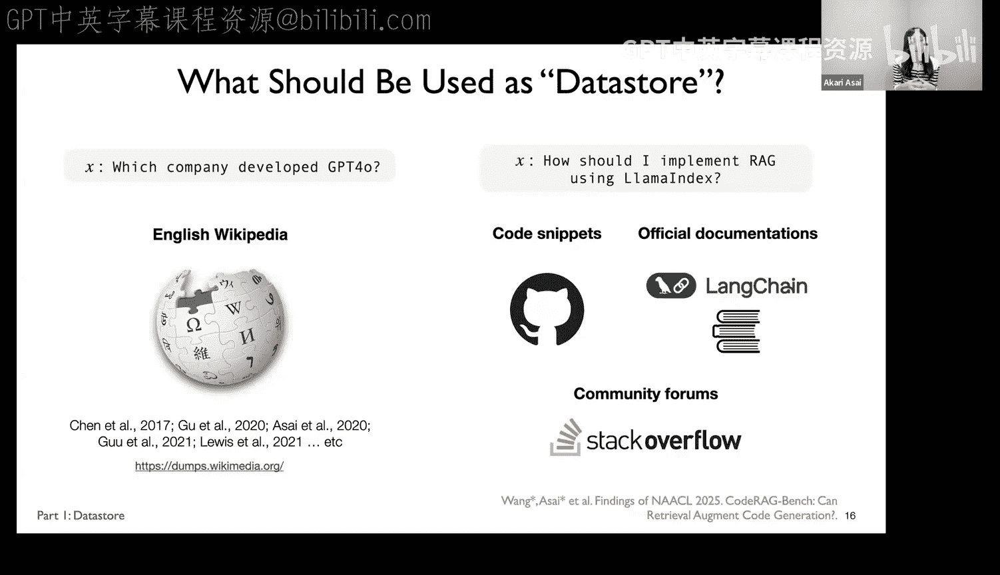

Another approach is you can use massive data store that encode everything。

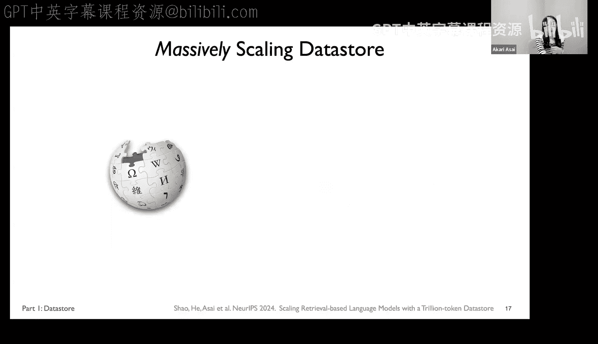

We have previously worked on it and built 1。4 tri token data store。

 which is close to language models between data scale。

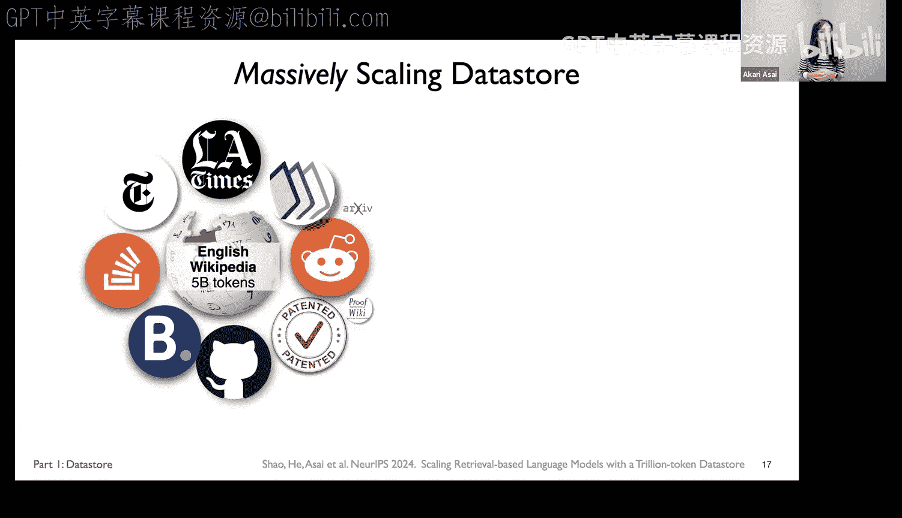

We found that this is super effectivefective for both upstream and downstream task。

As you can see in this chart。If we scale the data to a size in terms of billions of token from left side to right side。

 we can see large performance impairment in terms of longage mode perplexity and also downstream task。

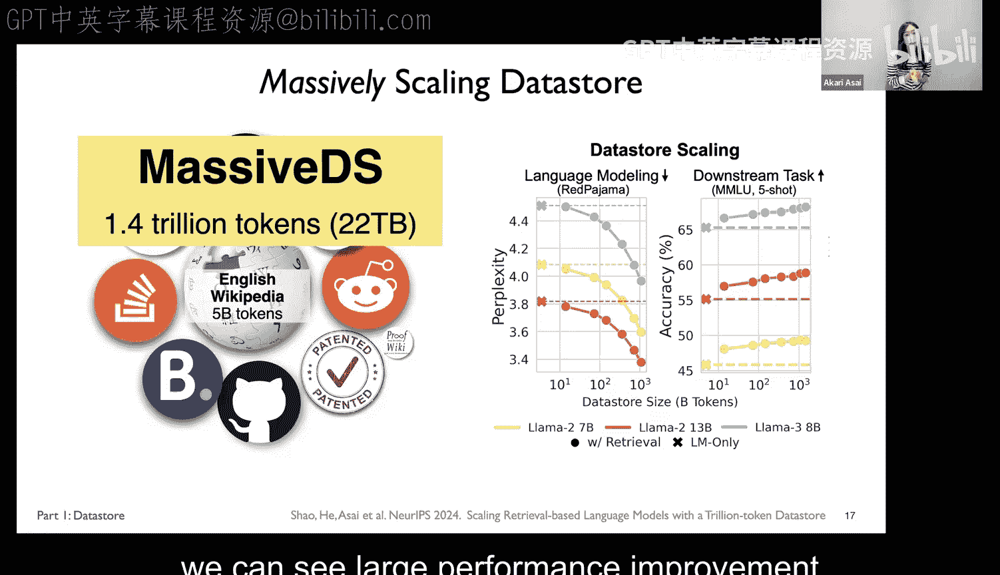

But the key challenge here is that having such massive data store could be le expensive。

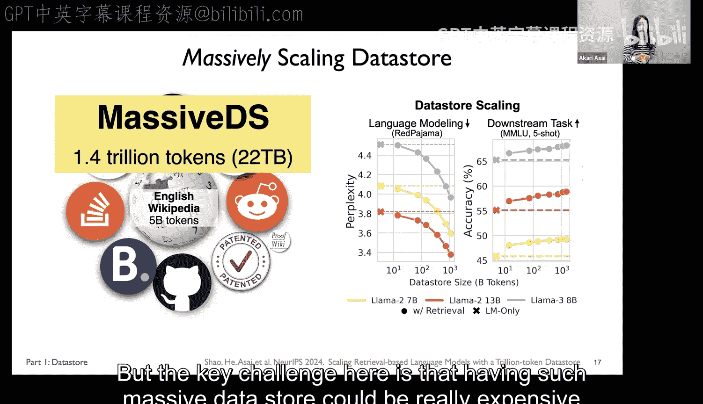

Because now。We have like tens of millions of， even billion of documents and each documents will require us to generate embedding。

 and we need to have massive GPU， CPU and memory at entrance time to ensure like fast retrieval。

So there is a trade off between the scale of data store and a sufficiency at infant time。

There are many papers that simply use existing production search engine API like Google search to overcome challenges of hosting massive data store。

 but if we use those backbox API， there are many new challenges， for example。

 like we cannot reproduce produced without or like those search APIs apply optimized for human users。

 and it's still unclear if those search systems primarily optimal languageggage models inference。

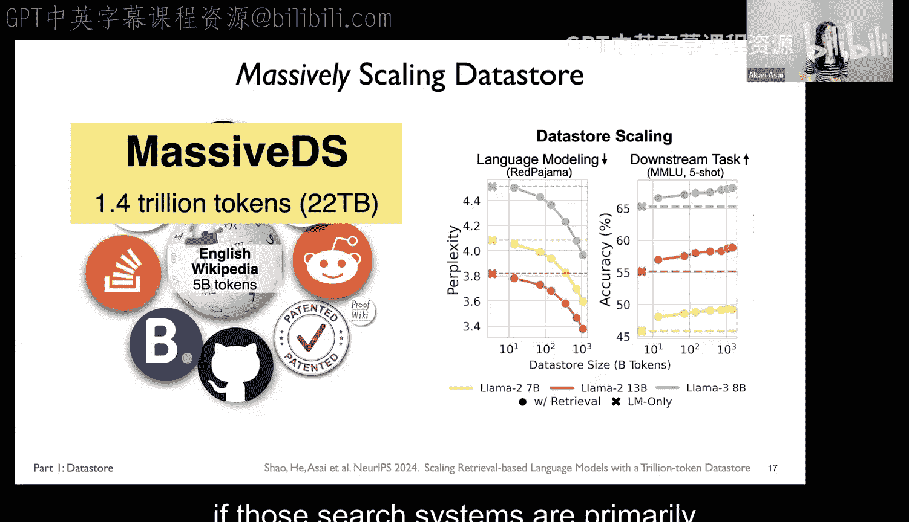

Once we identify a set of useful documents， how should we process those documents？

Even in English Expedia， where we can more easily get clean pulse documents。

 there are many open questions。

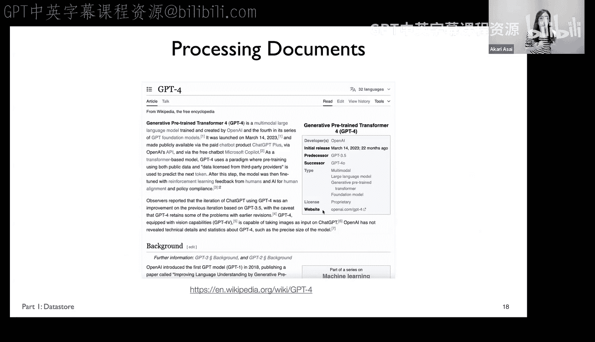

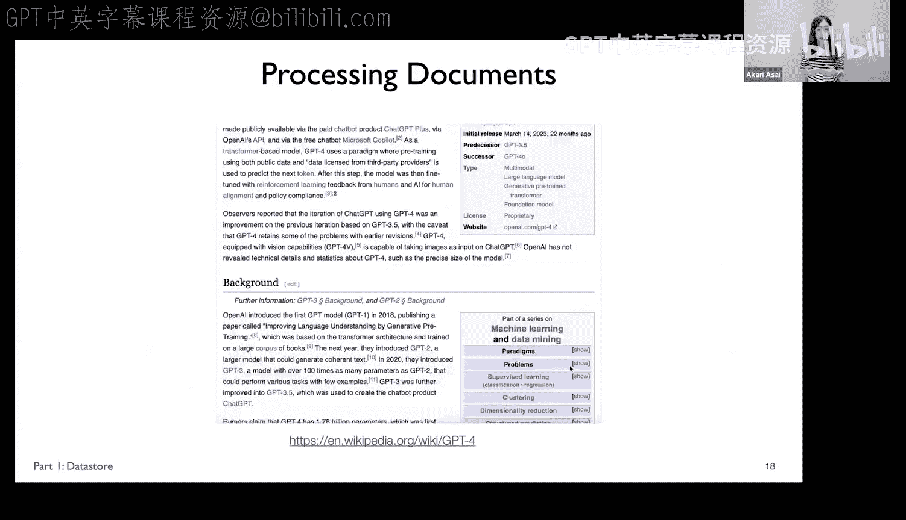

For example， eachhipedia article is often much longer than a few hundreds or even few thousands words。

 and if we simply refer them to like language model or be system。

 it might already hit the contact window。

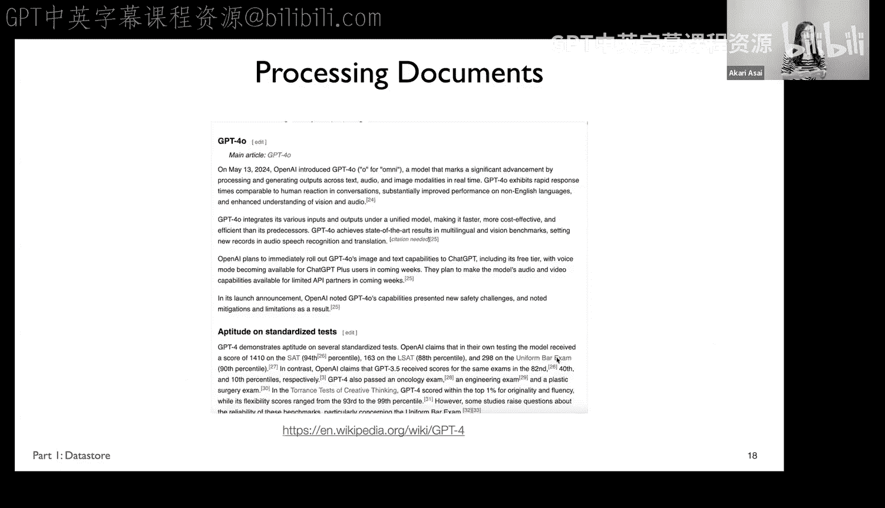

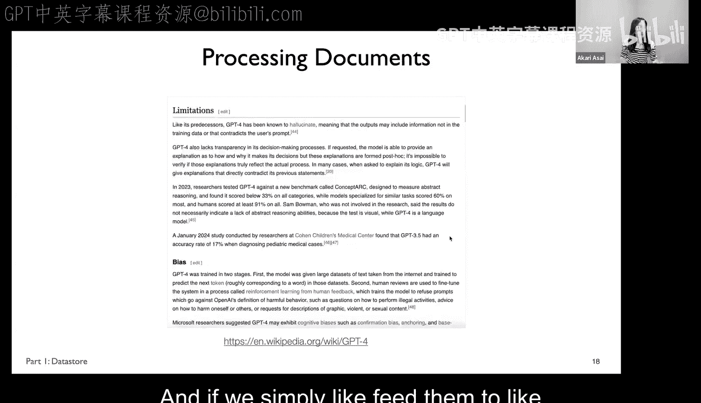

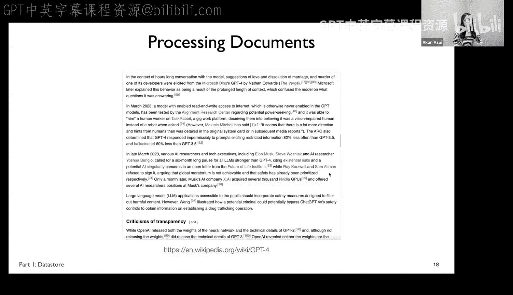

So we needed to process those each articles to a set of documents。Oh。

 there are many factors to consider the typical document processing pipeline for those key steps。

First， we create and plus data。This involves collecting relevant data of web pages from appropriate sources and then cleaning it to ensure consistency and usability for instance we download Wikiped articles and process HTML to extract the plain text。

Then we chunk plain text into documents。Instead of creating entire。

 entire article as single retivval unit， we typically break them down into a small chunk to improve retivval accuracy。

A common championing strategy is just split text into fixed size of segments， for example。

 like every 200 words。Another approach is semantic segmentation。

 where we use structural elements like paragraph tags。

 W new lines or section headers to preserve more meaningful context segmentation when breaking up documents。

After chunking， it's also useful to apply heistic featuress to define the datastore。For instance。

 even in Wingoo superiori， there are many articles that don't have any text or like it has a gl short text。

Tia work found that if we fu out those really kind of low quality or like unhelp put documents during these post processing stage。

 we can improve the model performanceas a lot。

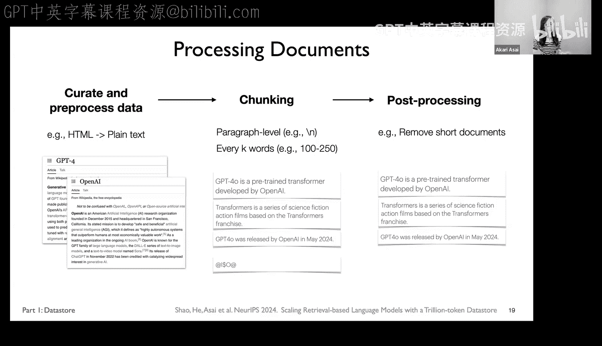

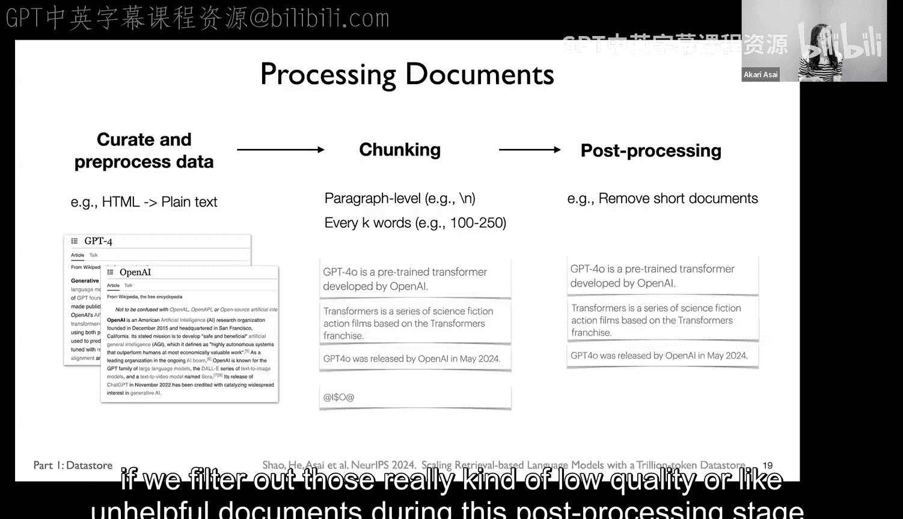

So it's important to Carefree after you collect the initial data。

 it's also important to Carefree process the data so that get you can get the best of it out from those data stored。

So in summary in this part， I discuss Datastore， an important takeaway is to choose the right data store and carefullyfr processces those data stores。

And skating data store could be helpful， but it require additional computational requirement。

 So I would say like first finding a small and manageable scable data store is quite important。

So before moving on， I can answer if there's any question。Yeah。

 so there's a question about chunking does chunking cause the retrieved info to lose key info？

Such as what document the initial document came from。

Yeah yeah citations yeah that's pretty good question So so that's actually like a common like failure mode So what we do typically is that we concatenate the original like original website title was this like each chunks document so like when we use Wikipedia article instead of just showing like the 200 words segment or Wikipedia article we also like give the title information or some people some people use the URL as well so that。

Moto know like where this article is coming from， but still if we use this kind of every 200 chunking。

 then typical like documents start at the middle of sentence and then at the middle of sentence as well So there are some papers that show that this's kind of every 200 chunking could be suboptimal especially for some applications like scientific research and that's why like I say that semantic segmentation using the document like more structural information of documents could be helpful but the challenge is that some websites don't provide those like semantic segmentation unit so I think in many paper people typically use every 200 every 500 words because it's much easier。

嗯。😊，I had another question about the structured data。

 so let's say you have like a table of data from Wikipedia。Then maybe it's less clear。

 like the best way to represent that。Yeah， what are some different？So right now， I think。

What we do is that we typically like almost like just chunk based on like aK words。まだ十性なくてす。

クるビ even分。More challenging if we have like most architect like table type data。So。😔，Right now if。

People use local data store， I think still like the most popular clothes is just using every keys。

There are many paper that use like external like production。

APpiI like search engine like Google search API or B search well like you dotcom API and those。

Papers typically like takes a original HTML and then like summarize articles。

Using a summarized article and like generate like Macdown document and these Macdown documents typically retain like the original table type structure much better and so that might be another reason like why those more recent approach perform home better than like just using local Wipedia data store based on like everyk tokenken segmentation。

还是你的。😊，And then there's another question about images or multimodal。

 and I thought we could deal with that。Yeah， that's pretty good question。

 so I would say still multimod retrievals。😊，I like kind of make onex board。

 So theyre like a little research on like text on DBT side and also like。

Multimoal of like most of like image or like video Vi research。 But still。

 we don't have really good Vi model that can bridge multimoal data So like given the。Text query。

 it can be both text documents or like multimodal， like image type better or like。

Given the emails like find a text document or like other like video data and so on one challenge is that for ret training。

 I will talk about it later， we typically use a pair of query and also positive documents and negative documents and we also needed to like care features。

 those positive documents and negative documents and those are。

Typically based on existing like links between this kind of queryion documents， but those are not。

Tip available in like especially when we try to scale to like more modalities。

So I would say like it's still like walk in progress any year and at the same time it's really exciting。

 beautiful research， especially now we are kind of building BT augmented languageage model system as web agent and like those systems might need it to handle with like more like multimodal data。

😊，Okay cool thanks and then there's one more question but maybe we could save it or at the last point you said you' were going to talk about some of the state of the art Okay so someone was wondering like what data stores are used and things like。

Can I or Gemini or perplexity but maybe just a keep in mind or you can cover it right now Yeah a quick coincide that it increasing number of papers and I'm pretty like industry products。

And now using web search engine like Google search API， Bing search only like stopped the API。

 but like some paper also use B search API and one reason is that now many of those language model based like B applications。

看。Focusing on like web browsing tasks web browsing tasks a more complex tasks not only just like answering factor questions and if the task is just answering like a general domain like fact questions then Wikipedia is a pretty good data store well like when we try to like host Wibug imagination system for many different use cases then like Wipedia is typically not like doesn't cover all the information we need and so and at the same time like as I said hosting like toium token datastore is super super expensive so a quick and like simple solution it just use production search engine API。

And so I believe many of those industry deep reset systems use those production API。

But I also think that some deep research system combine buy multiple defined search system。

 not only just Google search， but could it be like Google Sc search or like semantic Sc search for research or like some kind of code requivo API for like more software engineering or quarter generation type task。

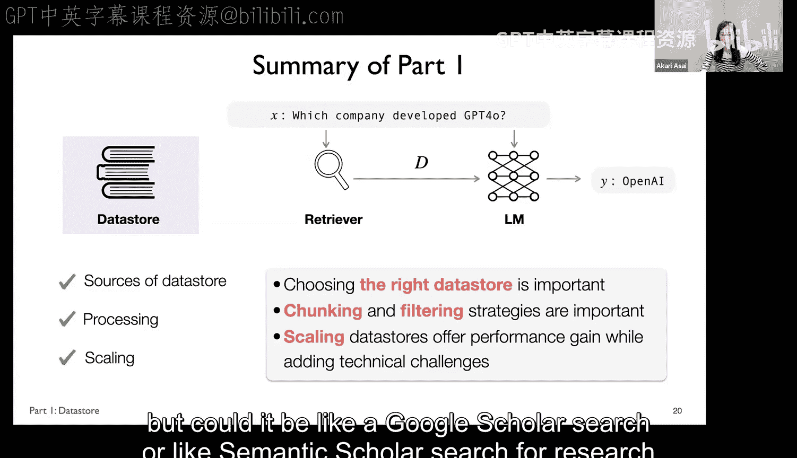

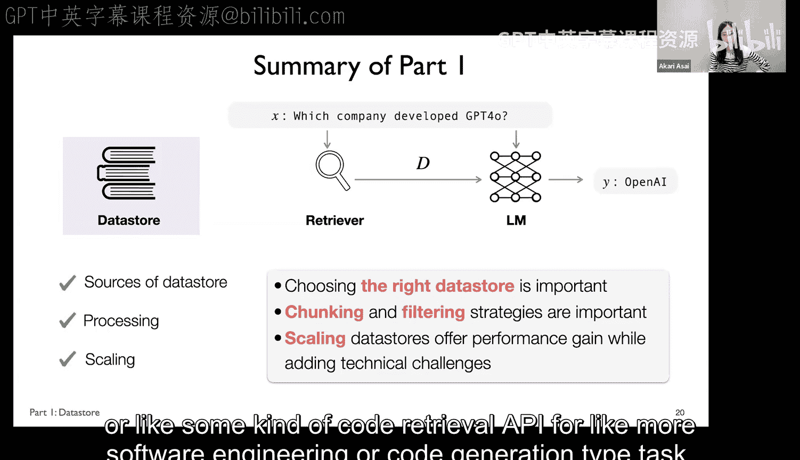

But those companies don't disclose like what they're doing behind this like chat application。

 but there are some new deep research papers that try to combine multiple search systems。

 so that's my guess。Okay， great， thanks and thanks for all the great question。

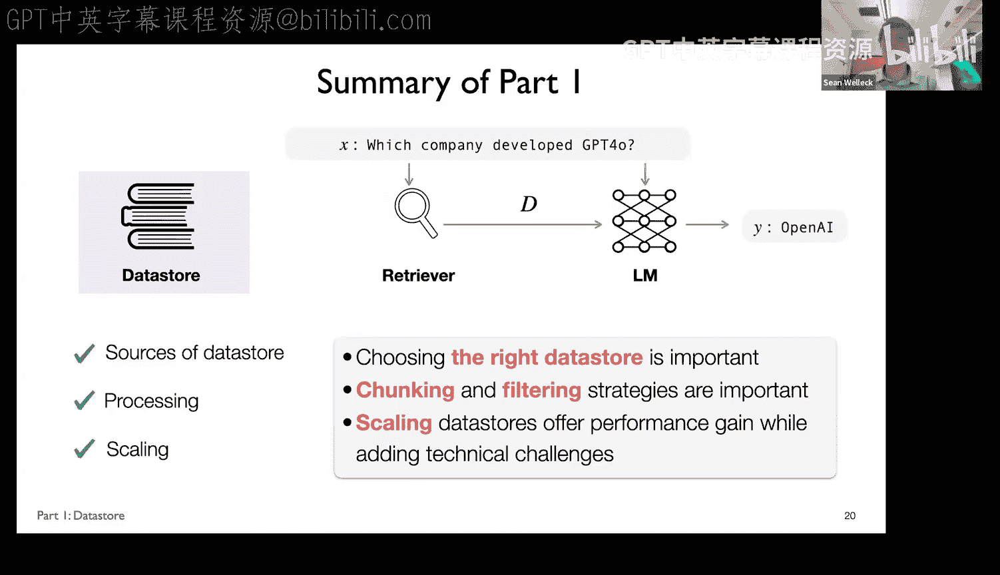

Okay， let me go to the next section So now let's discuss how we can build V system using a datastore As I just discussed for some application people use more like production search engine system but if you have more like specific like forecast task still like building your own local V system could be super helpful and I heard that like the homework assignment for advanced Nlp is to build Vtg imagination system for about like CMu like FQ So I think for those cases you might need it to like actually build your own local V system So hopefully this section will help you to learn how to。

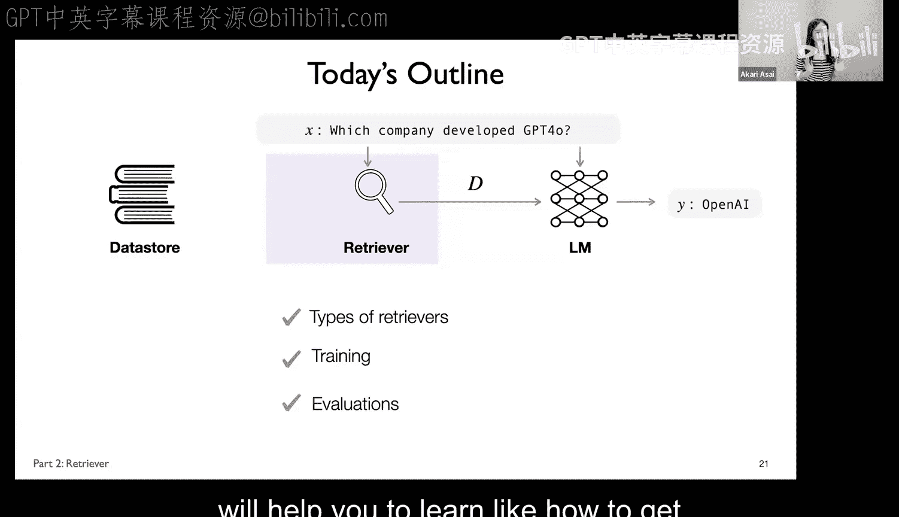

Yes start was building Vtba pipeline。The goal of reba systems is to identify the most related set of documents to the query。

 and we typically compute the similarity gate between query and documents all of the documents in the data store。

😊，And there are many different types of ret systems， depending on how they compute the similarity。

In English me community， spure me systems have been widely used for decades。

And those first re systems typically count word and time frequency in the documents to view index。

 which doesn't require training。

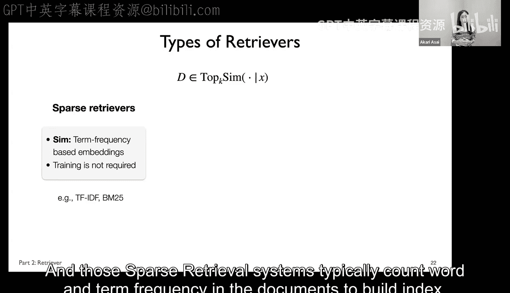

More recently， dense or neurobetebral systems have shown to be more effective。

They train neurovitba models to compute embeddings of documents and query。

A embedding of document on query and computed embedding similarity in this more denser embedding space。

AndLastly， those spurs or dense behavior systems are often combined with reraning models which compute the similarity between documents and queries by generating query dependent documents representations and compute the final similarity scores。

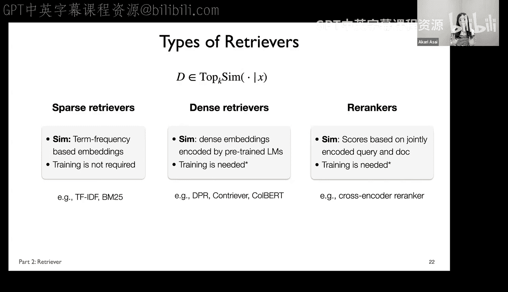

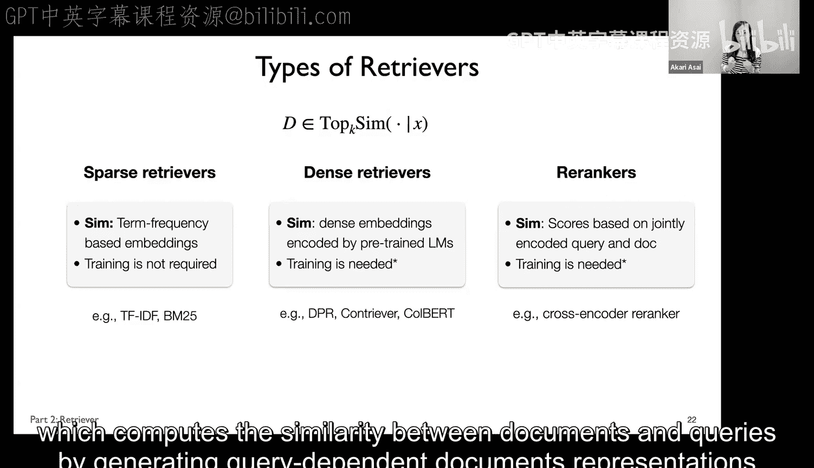

I'll discuss each of them in detail in a minute， but often the cost of those systems increase from left to right。

 while the paas often gets better。

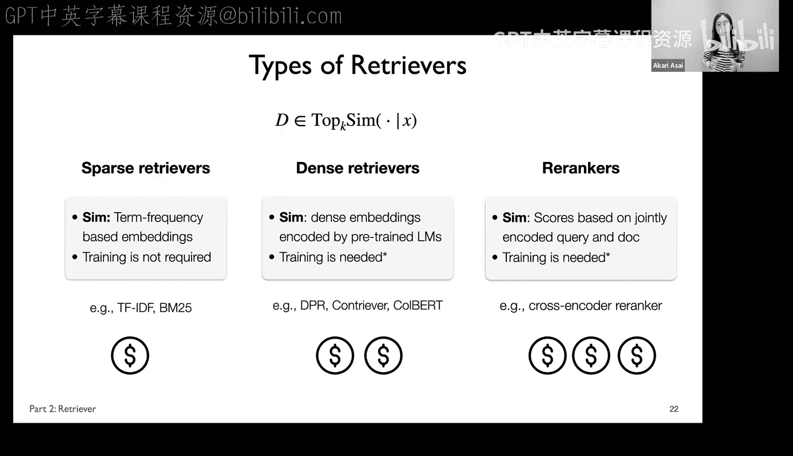

Now， let's talk about Spby keyboard system。First first retval system。

 we generate embedding of documents on query based on time frequency or what frequency。

We start with a vocabulary of words。So here like we have vocabulary including like what can the NLP is language like Amazon and we have Z documents and now we have a new credit。

For each document or query， we build a binary baggo words vector。Ifho word appears in document。

 then its entry is one， if not it's going to be that。For example。

 for this query or for this document， D， what is like candy like。

 then the entries of what candy is and like。Add one， well all other words are zero。

This binary vector is often called a1H of multiH representation。But this has a limitation。

In some documents。Some words appear multiple times like here， life appears twice in document D1。

 but this will not be captured in those1 ho vectors。

So Tom count vectors count the okness of a word in a document taking into considerations of such time frequency inside the document。

Here， life as life appeared twice， we update the original1 hot vector to2。

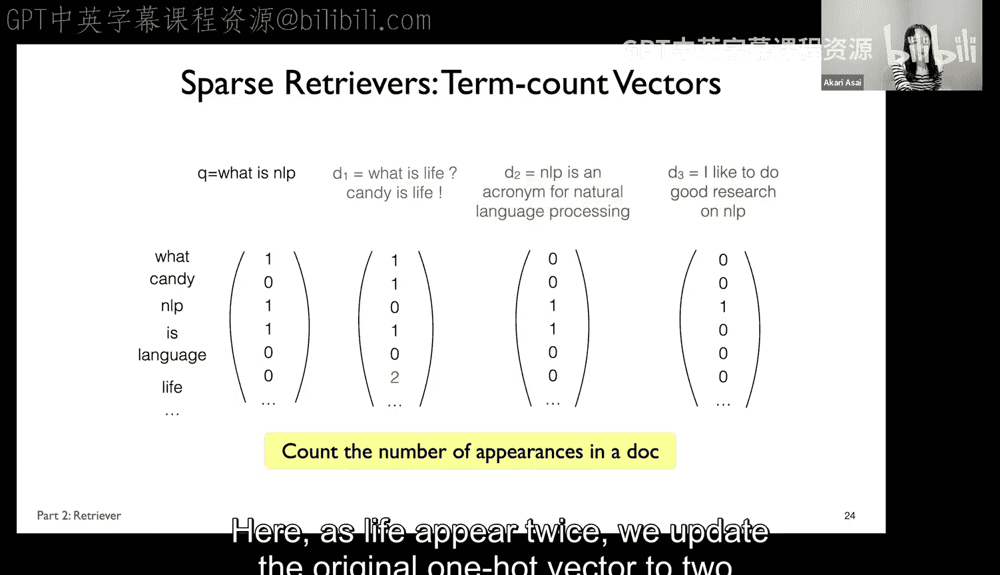

Based on this， now we compute time frequency and embraceverse time frequency。

Tm frequency compute of T T compute frequency of T T in the documents D divided by the total number of term in the document。

Here， if we consider Tf of T1， what？Given D1， what is the canies like。

Then like we have in total of six words in D1， well like we have what App once in this document。

 so we will get roughly like 0。16 as Tx score。IDF on the other hand。

 compute total number of documents in the corD， like for example。

 in this case we have3 documents that it's going to be seen。

Divided by the number of documents containing theity。

 and in this case theity is what and what only appears in one document autoity。

And we take the look of this number。So in this case， this Tom T1， given D1 will get right the one。

Because like we take logo to you。

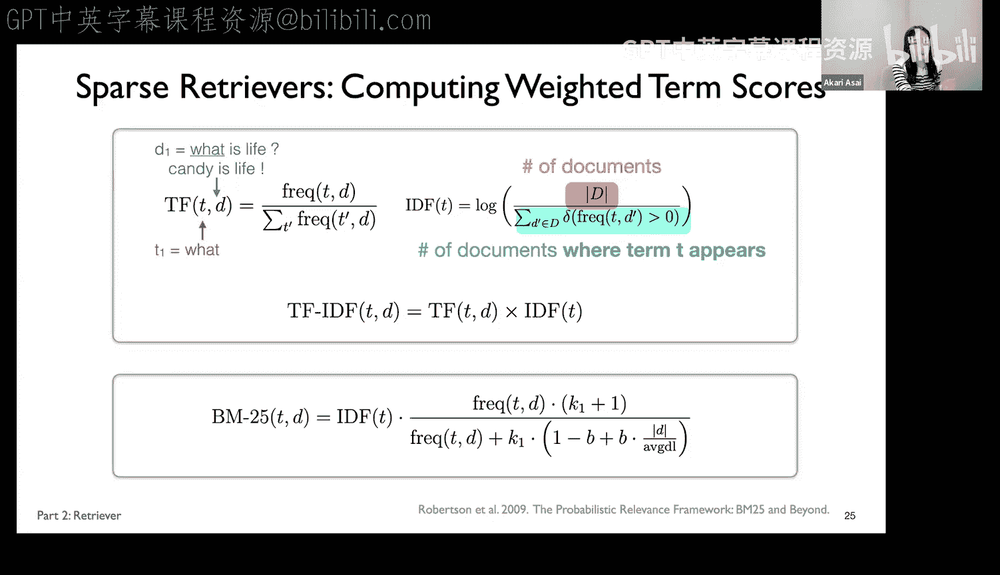

So as a result， the TF ID of score or what given those3 document is going to be 0。18。

 and we compute this TF ID score for word for old words across all of the documents we have。

 and then once we get query， we compute those TF ID of score for each word in this query and then we compute the similarity of those person bedding。

Not thatあ。As we consider both ti Y de score。Even that same same term can get different weights at good documents because the TF IDDF score TTF score tense。

So is we get 0。1 z in D1， but we only get like 0。05 in D2。Also， even inside the same document。

 terms with the same count can get different number because we consider IDF score。In D2。

 both NOP and languageage appear once， but languageage have higher score because this word doesn't appear in any other document。

 so we think that this term is more important than other terms that appear multiple times in other documents。

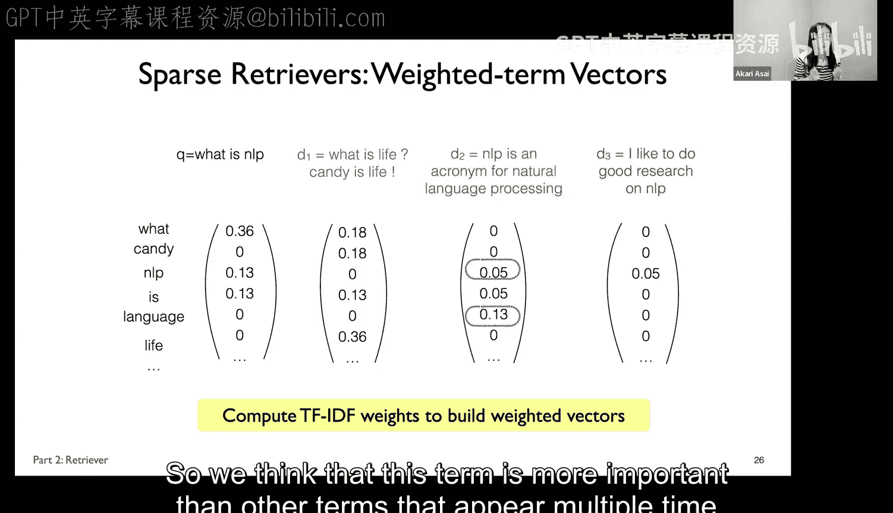

After we compute the con similarity between sp em bedding。We after we construct thispers em betting。

 we compute the co similarity between queryI and also all documents in the data store。

When we compute the similarity， in this case， D1 will get the highest score 0。40。

So now maybe you can see the problem of using such a spars embedding system。

When we look at thes three documents。In my opinion。

 D2 or maybe like DC has higher similarity to the question could and especially D2 directly answered。

 NOP is an acronym for natural language processing。

But this document got lowest similarity score to the query。This is because one。

This kind of time frequency only consider like time level similarity。

 and it doesn't carefully capture like semantic similarity。For example。DmanmiD， for example。

 I hear the D2 answers the question， but like D1 get the highest score because D1 is also like question and saying like what is like。

 which is prettymi to what is NLP。And also these lexiossmiities cannot capture like different polyphrasing。

 for instance， like here D2C like NLP is natural language processing。

 but this is not fully captured because we don't register those like paraphrasing well。

Another issue is that this is simple bag of words so we don't consider order words。

 so a funny example is that Do bitesman and mom bites Do look similar in terms of T5 score。

 which is obviously a problem in some case。

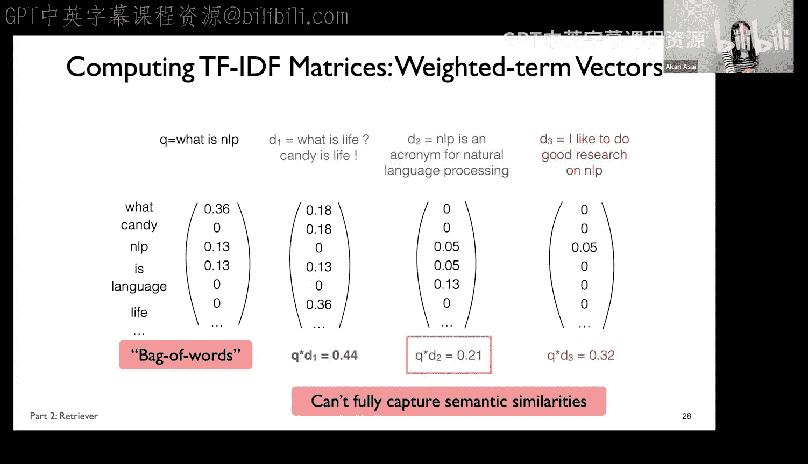

So recently， we have observed the neuro dense reteb system can overcome those challenges and out homespers reteb system。

The basic idea remains the same。 we want to compute query independent embeddings of documents and then like generate query embedding and compute a similarity based on embedding space。

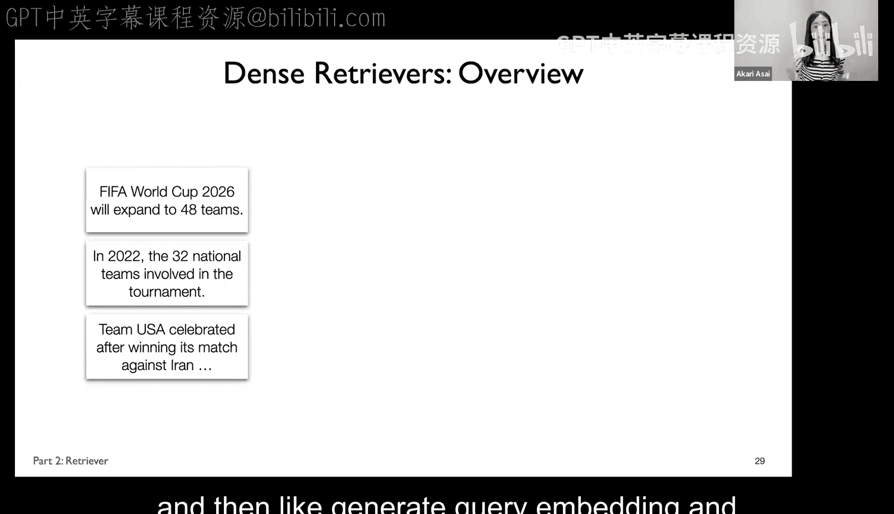

But instead of generating embeddings based on con frequency。

 now we use powerhu neural models to generate dense variable documents and query using trained encode quota models。

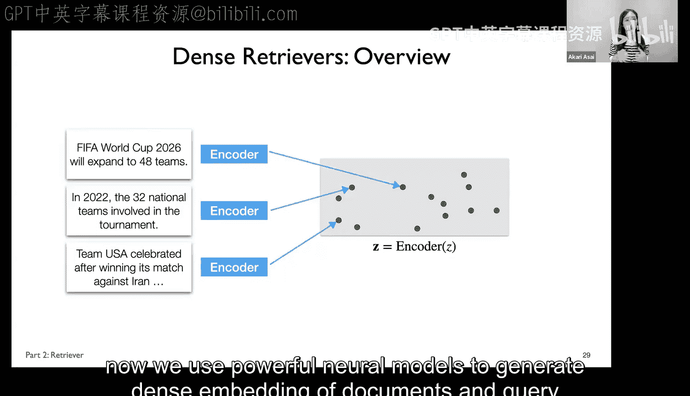

Given the encoder model， we pre compute all of the embedding of those documents。

 and then given the query， we use the same or different encoder system to generate dense embedding of query。

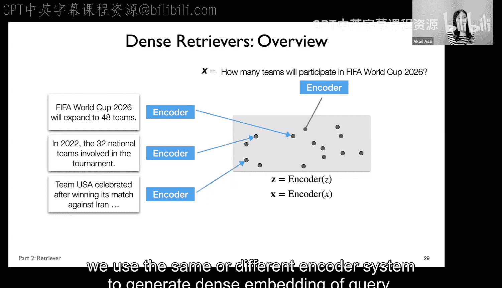

After that， we can computefuse the similarity of those embedding by performinging the past nearest Ne search。

😊。

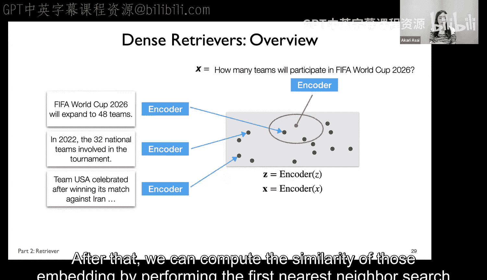

To find the top K mostulated documents。

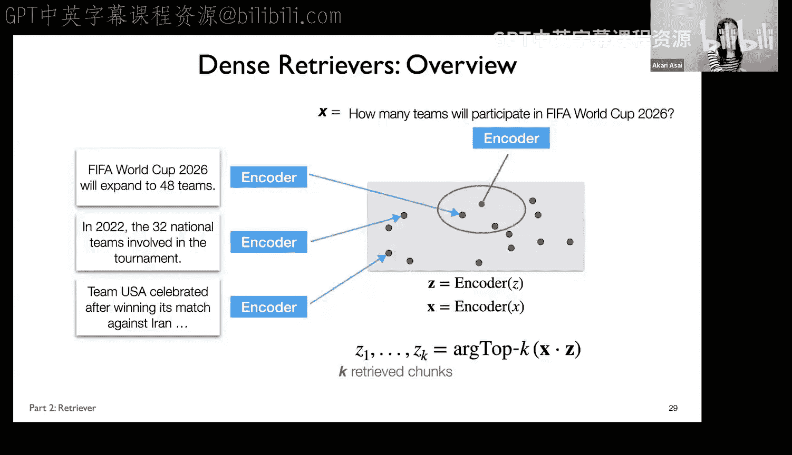

There are multiple ways to generate such dense embeddings。

 I believe you have land and quotaondi and maslaage model like B。

 and one common approachuse is to take the output the representation of Cs token of such models。

 What is the dimension float vectors already。Another popular plot is to take mean maxs or average footing of output vectors for the entire output token sequence。

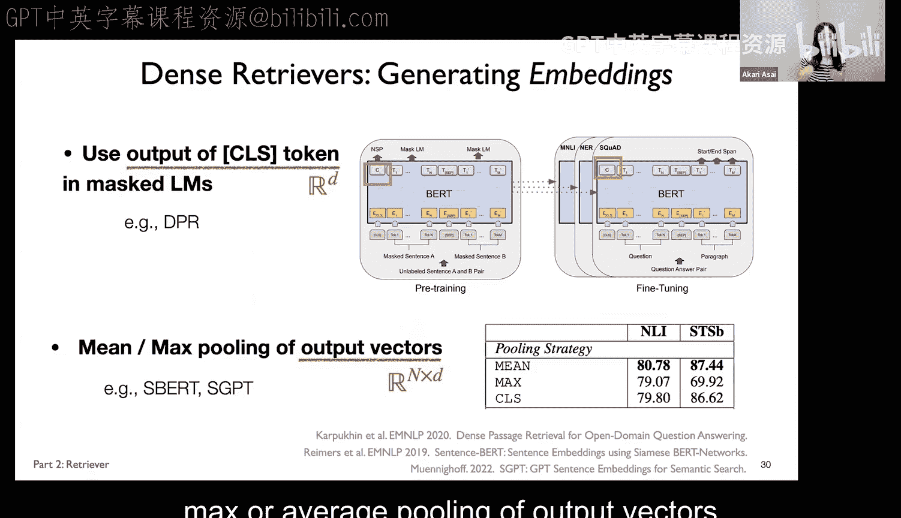

These uploads can be directly applied to non mass language motors without any serious tokens like Lamma and has shown to be quite effective。

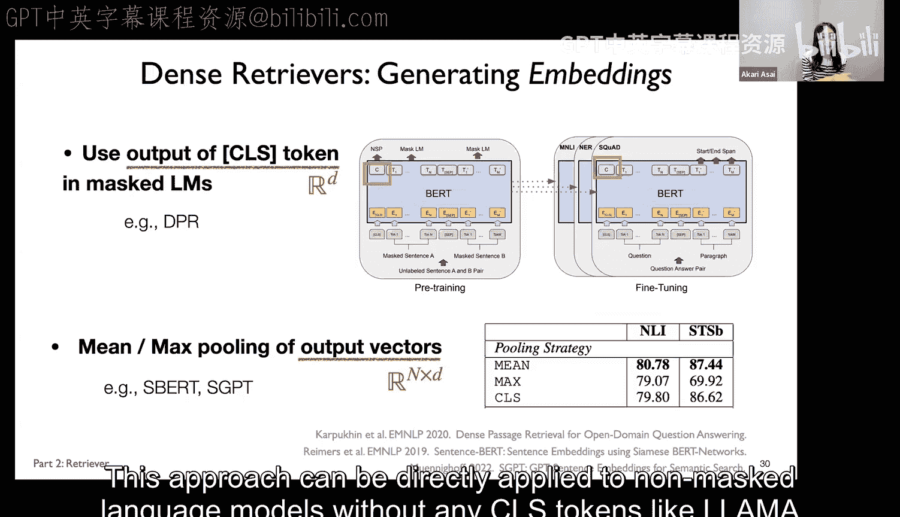

An empiricalical comparison of those different my strategiesologies are task dependent。

 as shown in the expert and SCPTs papers， so if possible I recommend you to like try a different way to put presentations。

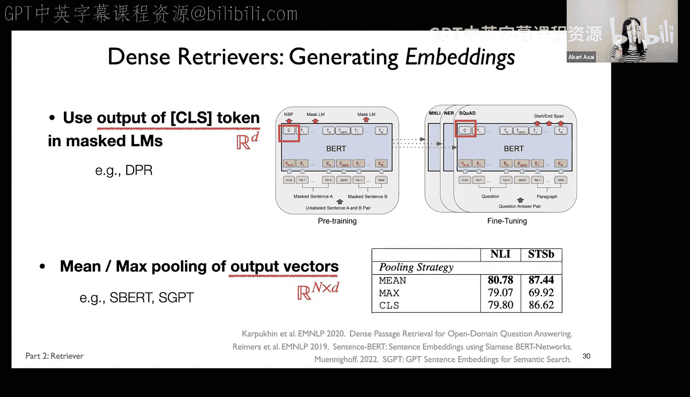

Also， I'd like to be reiscuss another key element fast near this neighbor search。

Especially when we scale to a large scale search， like retieving over hundreds of millions of billion of documents。

 the efficiency of Kenya's neighbor search is really important。

This ADIC is another big research topic in theory machine learning。

 algorithmism and wider A community， so I won't go into the detail， but you are interested。

 FIS one of the most widely used libraries in this area has a really nice overviewW and implementation of many different type of index。

Specifically， if we deal with， let's say， English with Pdiascale， tens of millions of documents。

 then you can probably just use Fl index， which performmes exactly nearest neighbor search。

But if you needed to do with much larger data store。😮，Then another popular alternativeative is ATNSW。

 which built a hierarch of indexing to speed up search， but this method requires much more。

 much larger memory and strategy requirement for indexing。

Another consideration for practical application is the total size of index。

If you are embedding an order of tens of millions like English failure。

 then even with best Vtba models， you end up consuming around 100 gigaby memory。

So to minimize index size， you can also explore a quantation or binding embedding mys。For instance。

 we have。Some p work that generate binary embedding instead of generating float embeddings。

 and by doing that we can deduce the total index size。

 total embedding size of weak failure from 60 gigte to 2 gig。

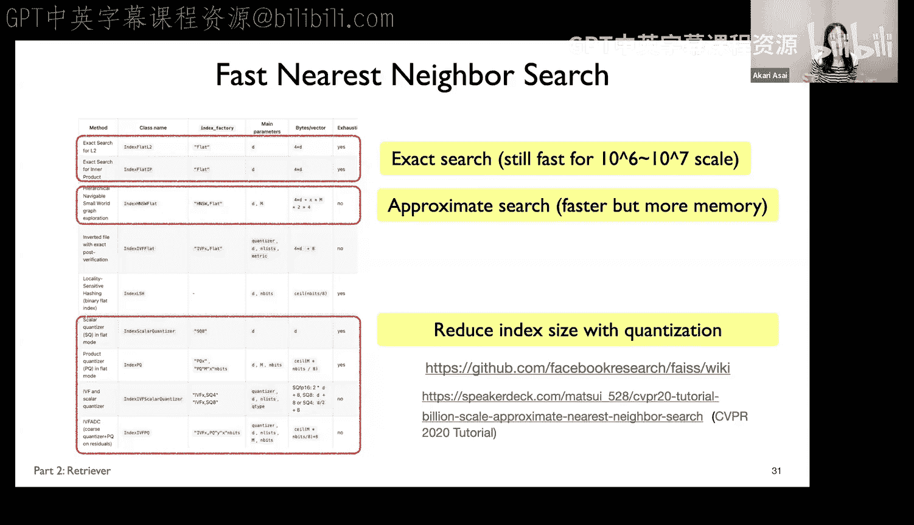

Now， I also want to quickly talk about how we train such VTO system。

We typically use a contrastive learning objective， the model learns to put query embedding closer to its positive documents while pushing it away from negative documents embedding。

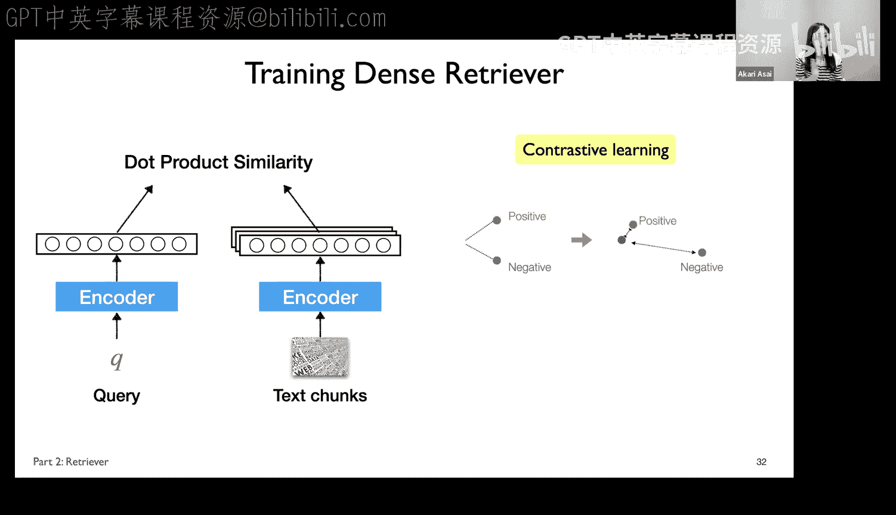

Completely， we minimize a contrastive objective that compares a query positive similarity to the sum of query negative similarities。

A good and quota system has a high score to the positive document， driving the loss towards Ze。

While this poor encoder system， for a poor encoder assigns high scores to positive hyp score to negative。

 which makes a loss much largerr。

The key to means is choosing good positive and negative positives during 20 time。Tiffically。

 we cannot use the entire index during 20 time because it could be super expensive。

So we typically like assume we typically construct a good negative and positive documents pair using a technique called in batch negativeative。

A cool idea is that we given the query and also all of the positive documents to those queries in the same mini batchs。

 we use positive documents to other queries as negative for this specific Q1。

And this in but negative， although the idea is quite simple。

 has shown to be quite effective to train dense with system。

Also there are some papers that try to do more complex negative negative document something strategy。

 which we call hard negatives， and the original DPO paper has some discussion on like how we should construct those negative and positive documents。

 so if you're interested in please go look at the paper。

And there are also like some new techniques to improve the training of re system。

In the methodology of DPO， we needed to have query and positive documents pair to start the training。

However， when we try to escape the training， we typically don't have such a labeled pair。

So there are some papers that tries to scale up those theki model training by using unsupervised training BB。

 pretty much like language model。So this paper called Contriver has a really nice recipe and like show the effectiveness of unsupervised training。

 and one of the technique is that they use independent croping technology while they extract the sentence from the they extract the sentences from one document and then they labeled these sentence pairs as post pairs because we can assume that sentences from same documents are more likely to be did than the sentence pair from sample from dependent documents。

Conriver， although that was released in 2022， still remains one of the strongest models in longest smallerer beval models。

Another popular techniques in this Beat area nowadays is doing instruction training for Bt model。

 like language model instruction training。Initially reki system， a typically trained。

 designed and trained for different ret use cases， like we have different system for Wikipedia code orQD cables。

However， there is a trend of new Vitva models that can perform those many different Vitva tasks by taking instructions in addition to the original query。

😊。

The core technology to make it work is to design good hydro negative sample so that we can encourage the model to use those additional task instruction system。

 task instructions。

Lastly， I'd like to briefly reemention re ranking models。

 which often give us significant additional gain on top ofpers or dense video models。

In Sprse and density cable models， we compute the similarity between query documents based on embeddings which computed completely independently。

But this doesn't let us to capture like more complex interaction between query and document。

So the idea of close encoder is to encode a question and document joint tree using encodeta modelto and then like classify or compute the Dman score based on this joint embedding。

Now we can。G presentation， hoodie conditioned and query。

 so as you can see like there's much more interaction。

 and we found that this kind of a close encoder could be quite powerful on top of existing spurs and dancing en quarterr based models。

嗯。And now like I would like to briefly talk about how those different retr models perform。

 but before talking about the result， let me briefly recap metrics because we also needed to understand metrics to understand the model capabilities。

😊，And I will not。Dive into how each metrics computes the performance of different models。

 but I would like to highlight that there are like two major categories of ret metrics。

So one is unlocked retivval metrics， which only consider if positive documents appear in the top K ret set。

 but it doesn't consider like any ranking。Another set of metrics considered the ranking of Vt set。

This is important， like， if we have to like， present the best result in the top result or like。

 we wanna like make sure like the top results are all related。 Well， like。

So it depends on like which metric you should pay more attention to is depending on like the application you have。

But typically like any C at 10 is widely they used in common benchmark like beer and if you're interested in please go look at some textbook or like website that discuss like how we compute those metrics in Be task。

And Rich and Richs wrap up this section by introducing a few core benchmark in this area。

 because those benchmark help you to pick up like which behavior system you have to use。

One of the most common benchmark in Vito area is Beer。

 which tests the Vitbo Mo capability to perform a Vitbo task in more like Zot setup。So in beer。

 they combine many many different kind of like retebval tasks across many different domains。

 and then they test the retebable performanceas based on like energy C or like some other retivable common retivval metrics。

And when we look at the model performance on this peer benchmark。

 we can clearly see like some why like existing close encode of best reruning while on training is effective。

 so this is a result from the original con paper and they have some like comparison between different baseline and as you can see adding by adding cross encoder on top of BM25 we can see master improvement from the BM25 only result。

This results showed that like using Brankimoto is quite helpful。

But interesting finding from the via paper and also contribute is that DPL。

 which was instead of Ja back then。I struggle a lot in this fear setuprup。

And what people found is that those neuro dequipo systems， depending on supervised training。

 often struggle to generalize the new domain， so we have to like collect supervised training data to make those neuro dequi models work。

So the Conval paper show that we can overcome this issue by doing Anspa large scale Anab training and the Conval paper achieves the best paas back then in this benchmark。

The most recently the popular benchmark is the MTTEB benchmark。

 which combine many different embedding based tasks， so it include beer asV benchmark。

 but also like many different other tasks like cross fasting or classification task。

And I believe this is one of the kind of like the fact standard leader mode for embedding tasks nowadays so whenever people ask me like oh which embedding we should use for our application。

 I recommend people to take a look at the data mode of the MTEB。

Benchmark。And you can go to the website and see like which model perform best across different task。

 but one thing I want to highlight is that now most of the state object models are those instruction change retba models and they can perform many different tasks without training a single Vtba system for many different tasks。

The one thing we needed to be careful about is that those PA state of retval systems are getting much larger than the previous Vtval system we had。

So conver or DPL are like just bird based model， which is just like 100 million parameters。

 so the embedding size is also like just 768 dimension， so the total index size is pretty small。

But when we look at those 7b or like even 4b language models。

 they have much higher number of embedding dimension。

 meaning that they consume much more storage and CPUM memory at the infant time。

Well， as you can see， those much larger retval system can higher performas。

 so there is a still trade off between efficiency and performanceas a retval component。

In summary this part discussing different type of ret models。

 how to train them and their validation metrics as well as efficiency and performancemastrative。

 and I'm happy to take questions before moving to the next section too。Yeah， thanks。

There's one question and then I had a couple of first for the trade offs between TF IDF and Reeverrs。

You mentioned it a bit on this like beer benchmark， but could you also talk through yes。

 some of the other tradeoffs and。I think the question here was like if you go to a really large scale like the internet Yeahs one better than the other。

 Yeah yeah yeah it's pretty good question。 So there are some advantages of those Sp Bba system one big advantages is like all this scenario and the via paper show that BM 25 is actually like more capable than newba system when we don't have any training data as I discuss in the slide Another benefit is that typically this Sp Bba system is much more like efficient and scalable So for the open Sc demo we had is。

Uses kind of a combination of Sprse retebval system and small neural retebval system because for Open Scar we needed to deal with 45 million scientific papers and we chunked the scientific paper into paragraph level so we had like hundreds of millions of documents and we found that it's really hard to we can build dense reteb system and for the reason paper we had like dense retal system which we host locally。

 but for the public demo because we needed to handle many userqueries at once we decided to use the combined thispers ret system with small dense reteb system to make sure like it's scalable enough so there are some advantages of such Sp ret system。

Okay great， thanks and yeah， I think in the homework。

Students will have to explore both but also learn more about it there。

There's another question that just came up， so could you re explainplain why the instruction tune retriever is able to generalize quickly to unseen tasks？

Does it somehow leverage unsupervised data or how does it do that？

So for instruction tu for retivval model， it's pretty similar to how we do instruction training for languageage model。

 so we construct a bunch of instruction query and positive documents pair and then at training time。

 we concatenate instruction and query and then do the normal contrastive learning objective。And。😔。

For our paper， we use contributor for based Vi system， and we found that。Those。

Tined instruction to the models are good at identifying or like good at like changing its behavior based on instructions。

 but we found that like the capability to generalize competing new Vtba task is slightly limited or like the ability to photo complex instructions。

 although like still the model perform best in the same size of like different Vtba system。

And there is some sort of work that tries to improve instruction following a retba system。

 and they found that scaling up or using between language models like 7 B language model 4 B language model as the base of retba model helps a lot to generalize the more complex or like new ret task。

 So it seems that。The model can use those pretrainna from like longgg model well if we scale up the Vtba system。

 but the challenge is that for Btbo scaling the encode quota model could be even more expensive than just like scaling languagegg model part。

 so that's why like theres a trade off between efficiency and performance of Vtba models。

Okay coolol good yeah I had a question kind of on a similar which is so in the course we talked about pretraining and then fine tuning so do we have the same maybe it's a simple question like do we have the same setup here where you do massive pretraining and then fine tune for your task and then is the pretraining like specific to retrieval or can you use like language modeling pretraining？

Yeah， so Con did kind of continue the pre training while like they take existing like botbased pretending longest model which is already like kind of trained in massive text data and then like they conduct contrastive objective based on supervised training which which I kind of consider like continued a second stage of pre training and after that they did supervised training using logicalQ supervised data like MSmaticco and I think the instruction tuning。

Of those Btba system is like another stage of fine tuning where like we train the model using a lot of like multitask essentially like it's just like multitask training of Btba models so the trend is like really similar to language model where we do pretraining first and then we do some additional continued pretraining well like just take this pretrain models to do supervised more like task specific training first but then like people later realize we can also just do like multitask training with instructions and we got like a lot of inspiration from language model community as well。

Okay， thanks and then one other thing came up which might be relevant for like the homeworker in practice I was wondering do you you usually have to spend some effort in practice to come up with a good query because we've been talking about like similarity between query and document then like where do you how do you decide what the query is in the first place？

Yeah， yeah， so earlier studies usually like just take the original input users of original input as。

Like search query in like NLP community， but like there's a rich literature in like more like information between community where like people transform its original query to be like more informative or like more descriptive so that we can maximize effectiveness of re system。

😊，So instead of just using the original query， they transform the query based on like like using language models or like based on like the first retrieve documents and then like inform improves the query based on like those retrieve or like other numbers and this has shown to be quite effective。

 especially when the original queries are kind of under specifiedified or like。

They are underspecified case。And so I believe that this would be quite effective to improve the Vival model。

 to improve the Vitba performanceas， especially for like more specialized idea like the homework。对。

great， yeah， thanks that's all the question here Okay yeah Okay now yeah。

 let me go to the final section and here I will actually talk about how we integrate retval model and languageage models to build the final and trend re augmentation system。

😊。

So there are many different architecture re augment language model and re augmented generation is actually like just one of those many different re language models。

 and so to understand those different type of re augment language models。

 I want to highlight the key core key aspect。The first one is that what we should retrieve。

 given the query， as I said， one of the common approaches is to retrieve text tanks or processes like the paragraph from Wipedia。

 but there are many different units， for example， we can directly retrieve tape next token。

 or some people try to do like be like different units like entity or like sentence。

And also how whom we is important this point。Audio studies often just be ones using the original user query as Viba query。

But this is becoming like more prag if we have like much more complex scenario where like we needed to be multiple times。

Another extreme strategy is like we keep every single token and there are some papers that indeed we keep like oh it for each next token。

 but this could be quite effective。This going to be quite expensive。

So there are more papers that try to do more economic between those like just single re and like every token re and like make the model to decide when to use Vi。

 and I will discuss it in the next in this section。Once we receive documents。

 the question is how we should use those documents during inference time？

VT augmented generations simply take those V documents in input space by adding like VT documents to the original input query。

But there are other approacheses， for example， some people directly manipulate the output token distributions using bitt distribution。

Or there are some papers that twice to incorporate between documents in middle layer。

So I got to classify those different V augmented language models into three different categories。

 the input augment is like B augment generation scenario where we simply append re documents to the original input and the intermediate fusion。

 meaning that。Means that we incorporate edit documents and intermediate a hidden layer of transhoal log。

And the last one is output intertlation， which we directly manipulate the output token distributions。

 and today I will mostly focus on input augmentation。

 but towards end I will briefly mention this intermediate fuion approach and also output interlation approach。

But let's talk about the input augmentation， which provide the foundation of more than BT augmented generation system。

So given the re documents and the original input， what we do in VQ augmentted generation is pretty simple。

We concatenate re documents， and then we append those re documents to the original in。

 and we feed them together to language model。So now we just change the input space and we don't need to change the language model itself and we can take any existing language model to build this V augmented generation system。

And those simplicity make people to apply those re augmented generation system。

 the re augment generation approach to many different models。

But initially， when people propose these re imagination models。

 people typically train retval model and language model to improve the performance and downstream task。

Audio papers like DLQA or like DPL train behavior models or task language model or like question asking models compete independently。

But this doesn't let us。But if we train those models completely independently。

 each component is notly optimized for like this reki augment generation scenario。

 and they found that many people found that even if we take the best reki system。

 those best ret systems are not always giving the best entertained reki augment generation performance。

So to ensure the best performance or like improve the interaction between V and language models。

 some people also explore sequentialial training， so the core idea is that they first train one component first and then use this component to improve the training of the other component。

Lastly， joint training is another approach。Here， we try to learn beevval model and generation model together and a single objective。

 This couples the two modules most tightly me， and it can yield the best end end end end end performance at the cost of a lot of engineering complexity deep。

😊。

So how do we train those modelss in an entertained fashion？

I will explain it using a Re augmented generation， the Mes original Re augmented generation method。

In RaG we minimize a negative log likelihood of a predicted answer Y given X。

 just like standard languageggage matter training。The key difference is that now the generation is conditioned on ret documents。

The regular of probability combines the retva score， theba score， and generation score。So， given the。

In but clearly a be document and the predicting the motor predict tokens。

 then like we propagate not only to the generation model， but also to the re encoders。

A major challenge is that。Whenever we update the document encoder。

 we needed to refresh the document embedding， which can include like millions or tens of millions of documents。

 and this could be quite expensive， like we don't want to spend like one hour to refresh embedding for each training step during terms SS。

So I won't go into the detail， but in this literature。

 people improve efficiency of this entertainment training by using some technique like approximate。

The ASInc update， well we only update we only update embedding an index for every like thousands of steps。

 or like another approach， try to approximate this hood index update by generating a high quality question and minimize negative sample pairs。

However， starting in 2022， several papers show that without additional to complex training。

 strong language models can effectively use behavior document and reach high performancehoas。

 matching much smallerer but hoody supervised models。

So one of our papers conducted Mon's audio study of this simple B imagination generation strategy。

 and we found that by combining GPTC with OS Viv model like BM25 or con。

 we can get hormone improvement， especially for long tail questions。

So here we show the model performance on questionizing data。

 where we have different level concept popularity and the left side show less popular questions or long tail questions and the right side shows more popular questions。

And as you can see， the red line， the DTC without any V performanceas。

 is constantly worse than the VT augmented generation performanceas indicated as green line。

We found that even without training， those V augmented generation can give us huge performancehammaas impairment and reduce fasciation in long tail。

But such training free approaches back then also showed many limitations。

Those simple bug method always became fixed number of documents regardless of whether external numbers is needed or not。

 lacking flexibility。Furthermore， we found that those unnecessary be can easily confuse language model even when the modelvis no the answer。

For instance， given the question who is some ottoman。

 maybe we table system fails to retrieve correct document about some alttoman and it can became a document about some atoms。

And long as model are no good at detecting this unhelp document and can easily confused by can easily get confused by。

Does and helppo document。We found that in most popular questions。

 this happens more frequently because longish models already know answer。

 but because of those rechial errors， longish motor performanceas can get worse and they start generating incorrect answer。

Also， there are some other limitation of those simple behavior generation scenario。

Many paper found that even when morttos cites some。Additional documents。

 the model answers are no fully supported by those documents。

 and this is even a even more serious problem compared to just peric language models because now those model responses come with citation and people can assume that those model responses are fully supported by those citations。

 but it's not true in many cases。

Another common issue is that now we be documents and then we take those behavior documents in input space。

 which quickly increase the latency of those Vt imagination models compared to the original permedic language models。

So there is a trend of training new language models that can more effectively incorporate those Vt context or new infant stamp techniques and one of such work set fact trans languageage models to decide when to use the V and given the detailed result that whether documents are editd and then find generated responses based on detailed documents providing accurate citation。

So given those input， the model first predict if PT is needed， and if the PT is not needed。

 then the model acts like a standardal language model。But if T is needed。

 then we trigger B T system to identify a small set of documents。

Instead of just taking all of those behavior documents， the model first evaluate。

Each of a document is related to the question or not and then only use the most related document。

After that， the model generate businesss and after generation， it also evaluate。

If the generation is fully supported by cit or。To achieve this functionality。

 we train language models。To generate which special tokens， and if the model generate， for instance。

 behavior token， we prompt behavior models， we trigger behavior models。

And we use those special to approach to evaluate which document is most helpful。

 or if the model answer is fully supported by citation。

Here's one example， given the query， the model first generates ret token and then Retable system returns a set of documents。

Instead of concatenate all of the documents and dente based on this concatenated document。

We process and dennovate。Resmases based on each document in Pao。

The model first generate of contiation given those documents。For the first document。

The first document is not super related to the query because this one only talks about longish models application in industry。

And if the response is based on those unhelpful documents。

 the information that continuation is likely to be incorrect， while at least citation is not helpful。

😊，So we discardd these responses based on unhelpful or irrelevant documents。

For the bottom two documents， both of them are deleted。

 so the model will generate the token first and then start generating responses。After generation。

We also make the model to generate。Judgment and whether the moral answer is fully supported by citation or not。

In this case， the bottom document is only personally supported。

The model generate Percy supported token。We take the best contiation based on special token probabilities so that we can consider both citation relevance and also like whether the model generate who is supported sentences。

And we continue this process until the model finish generation。

We found that this approach can significantly reduce the unnecessary re and also make sure the model can generate sentences that are more supported by citation。

While Cra directly teaches model to generate with special tokens。

 content work back then exports alternative uploads， which directly generate to records or API code。

The Tu form paper is one of the artist work that teaches languagegg model to generate tools。

 including search， calicculator or machine translation system。

Which inspired a lot of photo work in two augmented or API augmented language models。

Lastly， I want to also highlight a new trend， deep research system。

Those models share the same spirit of a setra or two toform style approach。

 the adaptB issue protocols to incorporate those new tools at In time。

But the key difference is that they now pair this approach with Pa reasoning languageage models that can explicitly generate high quality think and plant tokens to improve predictions。

This is an example from such decent like D paper web thinker， and as you can see。

 given the original of question， the model first generate thinking token and say like oh。

 this is a search plan and let now I start searching and then the model generate the2 code to triggerkivo system。

And takes V of the documents in line as in set a f。And after that。

 the model depict this thinking to the record and search output。

Activities until it collect all of the information and starts generating answers and those deep research system has shown to be quite effective and many of you might have tried those industry deep research applications and taking and you can take a look at those reason cases and like those models generate inspection or like planning of those search strategy。

Software I just focused on V generation and those methods against super super powerho and providing backbones of many widely used applications。

However， those models have many quad limitations too。For example。

 we have to incorporate ret documents in input space。

 so it's not de scalable if we want to deal with like many， many documents， like for instance。

 if we have hundreds of documents in input， each of which have like thousand token。

 then it's already like exceeding contact window for quantitative。Also。

 even though we take those documents in input space。

 it doesn't strictly guarantee that the model answers are fully supported by those citations。

 although methods like Cfa can address those challenges to some extent。

 still like we don't have like career attribution for each token or phrase level。

So now let me briefly talk about two different approaches or the alternative architecture of B augment language models that address those challenges。

So one approach is intermediate fussion which take many distributed documents in intermediate space and so in this retro paper from Deep Mind basically can change the original transformer block to have a new chunk cost attention layer。

 so this one is between like set of attention and fit of a network in each transform block and by adding this new block。

 they can take many distributed documents as embedding。To enhance the hidden representation of those。

Of those model predictions， and they found that these uploads enable us to scale up to many documents much more easily。

 and they also found that by scanning documents， the number of documents used during infant time。

 we can input the model performas。But the challenge is that now we change the reasonable architecture of language model from transformer to competing new architecture。

 so we have to pre language models again。And so there is a photo of work based on in rhetoric usingdma。

 and although like they only require connu training。

 still it's super expensive especially for academic scale。

 and also it's still unclear like if this new competing new architecture can be helpful in terms of dancestream performanceas。

 so compared to between imagination still those intermediate fusion is less widely used。

Lastly， both input documentation and intimidating corporations don't strictly guarantee that model responses are based on those particular documents。

So there's another approach called output intertlation。

 which directly manipulates the output token distributions and can give even like token laboratorytri of model output。

Canon languageage motors is one of such as， so the core idea is to interlate output the token distribution by taking a weighted sum of two part。

The first one is P distribution， which is directly predicted by language model as a normal language model prediction。

But the other distribution is a non paramaticic distribution， where we。 we built。

Which we build by bekeing similar context from large scale training data。

 measuring the similarity to the text test context。

 and using those similarity to score the next token。This method doesn't require additional training。

 and as you can see， as you increase the weight of those non parametermatic content。

 each predicted token becomes more strictlyly attributed to specific sequences in the training data。

However， PP studies also found that those canyon language model often under a home standard language model。

 so more work is needed to validate and improve this approach。

To summarize percy。LVtba augmented generation is most widely used approach for vtba augmented language models。

 and it works well in practice but has created limitations。Gloning isn't guaranteed。

And performance also pretty much depending on your quality。

So I reviewed some of the recent progress addressing those challenges。

 and we also looked at alternative architecture that integrate evidence at defense stages like interit incorporation and output intertlation。

So this is pretty much all I wanted to talk today and I now I amm happy to answer questions。

对。Okay， great， thank you。We have one question and please feel free to add more because we have a few minutes。

So the first one is。On the topic of to retrieve。You mentioned even like retrieving for every next token？

SoThe question is like。Oh do you implement that or maybe another question would be like what is？

Typically done in practice。

Yeah， so when I said like。Beting like every single token it's pretty much scanning long models。

 where like for each next token prediction， they compute the similarity between like this test context。

 which is basically like the preceding generation and then like they find similar context in training data and then like they basically like takes the target word of those similar training context as a next token prediction。

Another like adaptive approach is like setreg or like those like two to format type approach is more like adaptive re strategy。

 and for that。

即系。We even like multiple time during generation， but typically like they inserted those two the code like for like sentence level。

 well like each semantic continuation level。And so it's still like it still help us to retrieve more information as we generate more。

 but like the frequency is much lower than like token about B。

 And I think this adaptive re approach is a like nice middle ground between like just single time V or and every token re。

😊，Mmhmm。😊，Thanks， and then there's maybe a follow up question， which。

If you look at what's being done in industry now or a standard rag pipeline。

What would they typically use？So the decreased like longggage motor part or retevable part。

So the question didn't specify， but maybe。Or well like you introduce the next token to retrieval or retrieving once。

What would be the kind of standard pattern？Yeah， I think my guess is most of the industry deep research system is pretty much B augmented generation system and right now the deep research application。

 I assume like a couple reasoning longest model with those search tools。

And when you look at the Gemin ID research or like open ID process traces。

 the model typically generate like oh like this is my plan and this is my tool this is my like search code and then like based on the search this is information we have software and like let's go to next query Amazon so and I believe that it's basically like they take their best languageggage model they have in house and then like couple it was those two the augmented upload and to do that。

Many industry like Fier models are now trained those models with tools as part of their post training so when you look at the deep6 3。

1 they have like specification that like those models are they trained with search and also Python interpreter so you can like use those tools just like。

Ault books by using those languageage models。there is some paper that use more innovative architecture。

 for example， Google has a new paper which use diffusion model for deep research and I think the idea is really cool because diffusion enable us to like do more like。

Because deep research we typically have like much longer context and also like we want to like edit like those model vestmas or like search without a middle generation instead of just generating chrom right and using diffusion makes much sense。

 but I think still it's kind of one of those pyro study。

 but it's not the most defect standard approach as of now to build those deep research system。Great。

 thank you。😊，And there's another question about。嗯。Building a rag system so when building a rag solution to address a particular use case。

What are the top considerations for maximizing？嗯。So， I。

I think identifying good data store is actually important。 Well， like identifying good data store。

 and also。The search system we should use for defense downstream task so right now we are walking deep building deepP search system and what we found is that if we only test model for general domain factor the question like browsercom simple QA then like we can just use like Google web search API as Vi cable system but we also did a variation on like many defense setup like healthcareca domain or like research domain and for instance with research domain if we only use those web search system it's not enough and we found that the best performance comes when we combine those DP system with like semantics cloud API or Google search API which is more specialized for research domain。

Building good inference pipeline is another important part。

 but I think it's based on the order part is a pretty important like how we build a data store。

 which re system we want to use or like after Ret like which junkkey model we want to use and then like how to combine them at inference time so I recommend like explaining a different approach for like each component。

Okay， great， I think that was a great question， maybe to end on。

I think we're out of time。So。

