# CMU《高级自然语言处理｜CS11-711 Advanced NLP Fall 2025》中英字幕 - P11：(11)_ Multimodal Modeling I.zh_en - GPT中英字幕课程资源 - BV1ZWYAzuEMa

So now we're back here in person。So today is going to be the。Is it too loud or is it okay， okay？

So today is going to be the first of two lectures on multimodal modeling。

 so not just looking at text but also images in particular。嗯。And so multimodal models。

 as we'll see in the next couple lectures are widely used throughout advanced NLP。

 they'll be really important for some of the applications or areas we talk about。

 especially these digital agents that are operating on things like webpage or trying to control your computer。

 things like that。And there's a lot of interesting ideas in this area。

 there's actually a whole course on multimodal here at CMU and at LTI。So of course。

 we're not going to be able to go into everything。But hopefully you can get some handle into the domain and I'll try to go over some of the key ideas that you kind of should know about and you'll see them in some form in a lot of the state of the art methods as well。

So。We could think about what we've done so far as going from text to text。You could have。

Text is input and output even just a class label， or you could output a whole string of text。

So something else you could do is imagine providing an image as input to the model。

 so we might call that multi for multimodal。But then still have the model only produce text。

So it turns out that if you don't try to produce images。

 then you can use different types of modeling decisions。If the models only producing text。Similarly。

 you could try to have a model which takes in text and an image and outputs an image。

But it doesn't necessarily know how to produce text。Okay， and it turns out that if this is your goal。

 then you can also make different decisions than if you want a model that produces text。Okay。

 and then finally， you could have maybe the most general thing。Within this。Cateorization。

And that would be that you have a model which takes in text and it also takes in images。

 and it can output both text and images。And here， the text and images could even be interleaved。

 You know， it could be a whole conversation where you're copy and pasting images and things like that。

 And it's generating things for you。 Or it could be like， you know， a stream of。

Screenshots from your computer and then there's some text that you type maybe to an agent and so on。

So we'll go through some concrete examples of the things that I just said。

 but basically the way this is divided up is today we're going to focus on models in this category。

 so models that take in text and take in an image， but then they only produce text。

And then the next lecture，ops in the next lecture on Thursday。

 we are going to go over these two down here， where we are also trying to produce images。

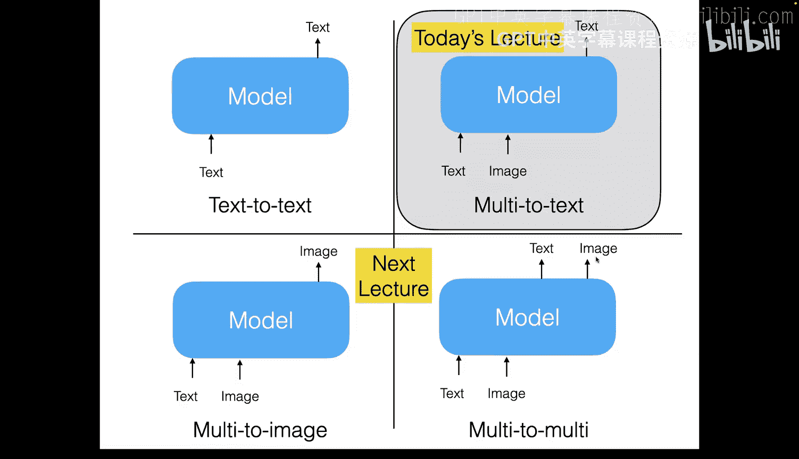

So some examples of this， and I think I got these examples when I put together the slides from last semester。

So they might be slightly outdated with how fast things move。

But here's an example of this model called AI2 MoMO and one reason that it's in here is in this lecture we'll talk about exactly what's going on in this model and you can download it and use it yourself。

And so here we said， tell me about this image and then gave it this image。So this is text and image。

And then it tells us something about the image。So it's producing text。

 this image showcases a beautiful painting of Pittsburgh， presented in ornate gold frame。

 the artwork and so on。So it's a kind of nice picture， I think I generated the picture with chatGT。

 it's kind of unique you know impressionist view of Pittsburgh。

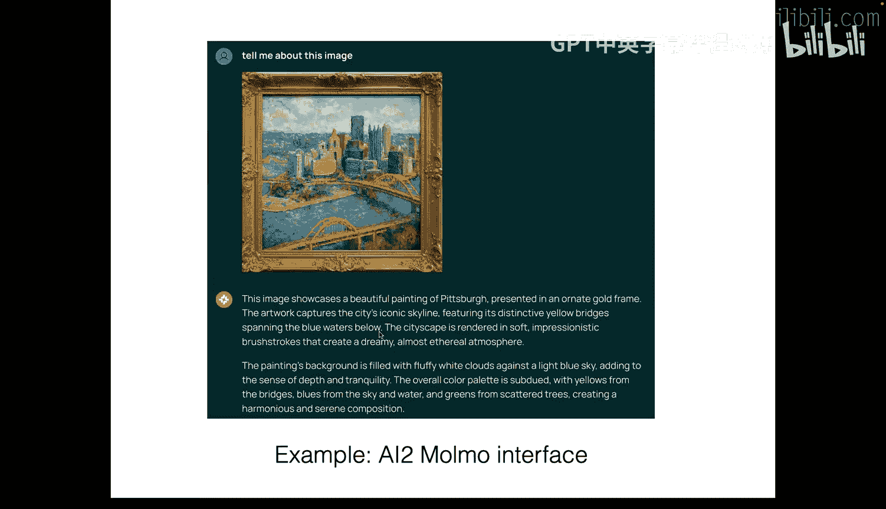

So another example that we'll get to in a few lectures from now is these agents。

So a popular class of agents are called web agents。

So here you have a model which is taking and say visual images of a web page。

And then you give it some instructions， and even the instructions might involve an image。

 like help me make a post， selling this item and navigate to it。

 price it at $10 cheaper than the most similar item on the site。Okay。

 and then the agent takes actions by actually producing text。 so here it's producing some text。

 which says click and then some number and the number will correspond to basically an element on the web page。

Case we'll go into detail in these in a few lectures now。

 but the relevant part for this lecture is that you have to have a model which is able to take in both images and text。

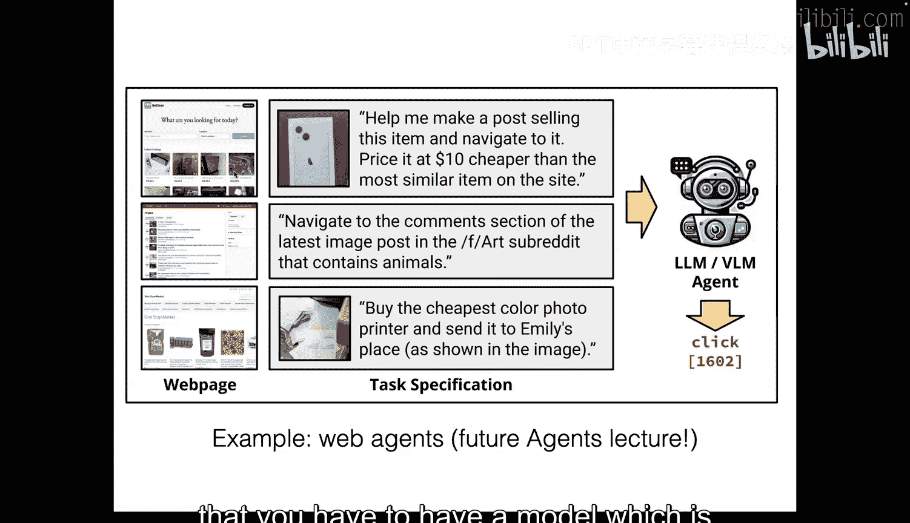

Okay， and then similarly in the agents lecture， we'll talk about these computer use agents。

Here you might have， say， like a stream of screenshots that are coming in。

 and the agent is taking actions， which are just like clicking or typing on the computer。

And if you build an agent like this， you could imagine that like， at least in principle。

 maybe you could learn to do anything that you could do on a computer。Okay， and so again。

 one core ability here is the ability to take in both images and maybe also text because you want to tell the agent what it should do。

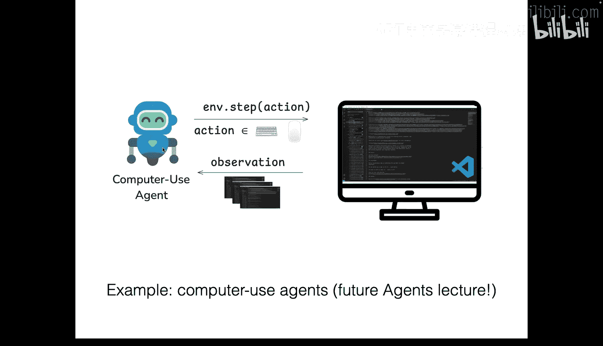

You could even think about。Things like like you know different reasoning tasks might involve kind of visual reasoning so here's just one example of this benchmark looking at mathematical reasoning called math Vsta。

This benchmark became popular for you know， throwing it into the list of benchmarks or evaluating the most recent models that were coming out and the idea is that like in order to answer the question。

 the model has to also look at some kind of image or do some kind of visual reasoning。

So today's lecture will go over three different things and again。

 they're kind of just core ideas that you'll see when you're in this area。

So the first is just looking at the architecture。 so we talked about， you know。

When you are working on a problem， you have to decide the kind of parameterization and one of the things you have to decide is what architecture do you use for the modlology that you have。

So we'll talk about how to use transformers for taking in images as input。And again。

 there's different ways of doing this using transformers transformers for images is only fairly recent。

 so we're going to kind of ignore a lot of other methods in the name of kind of。

Going over some core ideas that relate to some state of the models in advanced NLP。Second。

 we're going to talk about learning good image representations。

So here we basically want a model that can take in。

 say an image take in some text and then give us a vector。

 and then you can use the vector for different things。And one of the most。

A really impactful work in this area was called C from Open AI。

And so this method has been built upon and the kind of core idea still is around today。

And it's going to be very useful for this kind of use case of providing representations to a language model Okay。

 so in the third part， I'll talk about this method which kind of takes image representations and then essentially adds them in as tokens that go along with text and now you can have a model a language model that takes in both text and images。

Okay， and so one of the methods in this area was called lava。

 and then at the very end we'll actually take a look at this AI2 MoMO。

Model that we saw in the example at the starting。Okay， so if we go to the first part。

 then the first question is kind of what architecture do we want to use and what do we actually want to do with these images？

Well， in this course， we've been treating text as essentially the sequence of different token embeddings。

So why don't we try to do the same thing for an image， essentially represent it as。

Some sequence of vectors。And if we're able to do that。

 then we have all of these good architectures that have been developed for kind of transforming vectors into better representations。

Okay， so。Some notation， we might want this kind of encoder。

 which goes from an image to some vector representations of it。So in order to do this。

 we need two things， we need some neural network architecture。

And then we need some algorithm for training the neural network so that it actually produces kind of good representations。

So， for the architecture。We'll talk about this one， which is called vision transformformer。

And the idea， the kind of high level idea is we want to use the same transformer architecture that we've been using for text。

 but just use it for images。Okay， so here the idea is。

We are going to divide up an image into these different patches。

Then we can just flatten those patches into vectors and we'll see this concretely in a bit。

And then if we're able to do that， it turns out we can basically use a standard transformer。

 we can also add on things that we've talked about like rope embeddings and now have a nice architecture for processing images。

So here's the kind of picture from their paper and we'll step through it in detail。

 but here you can see this image on the left hand side and it's been turned into these nine different patches。

And then they really are just kind of flattening it and so now you have a sequence。

And then you can say， okay， what if we turn each one of these patches。Into just some factor。

So that's what's happening in this step。And then you can associate some position embedding。

With each patch。Now we essentially have what we have in the case of tax。

 right you have a sequence of vectors instead of。Text embeddings。

 They're these kind of flattened patch embeddings。And so then we can just run it through a standard transformer。

Then as we saw in the previous lecture on fine tuning。

 we could add on this additional output head if we want to perform different tasks like for instance。

 classification， that's what this is showing here。Okay。

 so that's going to be the idea of the vision transformer and we could take a closer look and kind of look at exactly what's happening to make sure we see what's going on here。

So what we're going to do is start with an image。And the image， unlike text。

 is structured in a different way。So you basically have these three different dimensions。

So you have the height， you have the width。And then you have what are called these channels。

So here there's going to be three different channels and each channel corresponds to red。

 green or blue， so RGB， you have one channel for each。

Now it turns out you could have other channels with other information， but maybe in the simple case。

 let's just have C equals 3 and now you have this kind of RGB representation of an image。

So now we're going to also have a notion of a patch。

 so concretely let's say that our image is 120 by 120 by3。And let's say that our patch size。

 we choose to be 40 by 40。And we'll see exactly what's used in like an actual model in a bit。

 I think I'm just choosing 4D here because it's easy to divide 120 by 4D。嗯。

So now what we're going to do is basically come up with the sequence。And。Here we have。嗯。

So n will be the number of patches。And here we're just flattening each patch。 So it's saying， okay。

 for each patch， we have p squared different numbers。Times the number of channels。

So this will be one vector corresponding to， say this patch here for all three channels。Okay。

 so this will just be this kind of vector or list of numbers。So concretely here。

 let's say you have 40 by 40 patches。Then you would get a sequence of n different vectors。

And their dimension would be 4800。Okay， so you can see probably the choice of 40 by 40 is kind of big for a patch because now you have this fairly large dimension here。

嗯。Okay， and so now what we're going to do is project these or transform them into a different dimension。

 and that'll be the kind of dimension that we use inside the transformer。You know。

 usually you have this kind of。Dimenssion that's kind of consistently used as the hidden dimension for the vector and things like that in the transformer。

And so for that， we can just introduce some weight matrix and do this linear transformation where we take these blated patching em beddings。

And then just transform it using this weight matrix。

 and now we get these nice kind of vector of the appropriate size。And then， yeah。

 you can see here that like the choice of。Pch size ends up influencing also like the size of this matrix。

 things like that。嗯。So now we have this input， which is represented as this essentially matrix right of nine different vectors of size 1024。

Now when you like read papers or things about these you want to kind of give names to these different things。

 so these are sometimes called patch embeddings if you see that it's basically you know you flatten the patch and then you transform it and now you have some embedding。

So now it's not visualizing it， but we also want to add on somehow position embeddings。

 so in the really simple case you can just do this kind of absolute positioning right you could have like zero。

1， two， three， and so on。And then as you might imagine。

 these types of architectures are really important。

 so there's been tons of research on different embedding techniques。

 I probably couldn't say you know exactly which one is used in the burn model you'd have to go look at the paper but they have developed you know analogies to the rope embeddings for the images and those might be a kind of better version of these absolute position embeddings。

Okay， and so now that we kind of have the embeddings， you can basically use a standard transformer。

So here is the transformer encoder， and then you can think of these as producing some other vectors。

And then as I mentioned before， you could then use this for a certain task right let's say you want to do classification then just like we do for text。

 you can attach this kind of output head and then have your list of classes and then you could fine tune the model with say like cross entropy loss。

Okay， so just again， here， your data would be you know， pairs of image and class label。

 and then you could fine tune in this architecture using basically the same techniques。

That we saw for text。So that's really the idea of this vision transformer。

 it's a kind of idea and you know leading up to this。

 a lot of the techniques or images were based on convolution。

So we didn't cover convolution much in this class， but if you remember it was kind of one of the options on this overview slide we had for the sequence models。

And so convolution is kind of going over some patch and kind of going over and then coming up with the representation。

And those kind of dominated the area。And now there's a lot of methods based on。Transformers。

 especially when you're trying to use them。You know， as a language model。

 like we'll see at the end of the lecture。So here is yeah。

 maybe this comment I just made is kind of related to this plot here。

So here we are looking at the pre training compute on the X axis。And then on the Y axis。

 you're seeing accuracy on different tasks。And so here you have this resnet architecture。

 which was one of the popular ones at the time。And here you have the transformer and you could basically see that。

 you know， you see this pretty favorable scaling with the transformer architecture here in fact。

 is' kind of more favorable than the resonite。They also tried combining it to kind of have a hybrid of the two。

 and you can see it also performs pretty well especially at kind of lower pretraining compute。

 but I think one thing they want to demonstrate here is that if you go to really high levels of compute。

 even this kind of hybrid architecturet didn't matter too much and you can just kind of use the transformer。

Then I'm not going over history of the convolution methods。

 but one kind of cool thing with the convolutional methods was， you know， even even before those。

 before using deep learning， people would kind of come up with these hand definedfined filters for like edge detection。

 things like that。Then it was found that， you know the deep learning models were actually learning。

Kind of things that looked analogous， things that pick out like edges or different patterns。

And so it turns out that here you can kind of get something similar。

This is looking at these different。It's looking at this matrix at the very beginning。

 which is basically coming up with the embedding of a given patch。

And what you can do is just take like the different rows and then visualize the principal components。

And you can see that there's these kind of directions。That have been learned that correspond to。

 yeah， different patterns， things like edges or。嗯。Yeah， other things here。

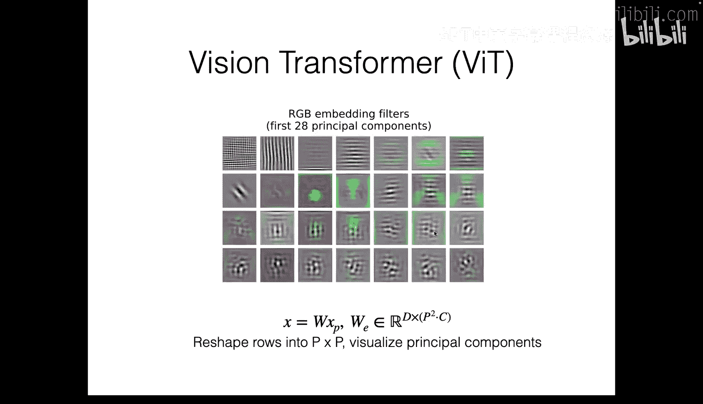

And then this was just visualizing these， by the way。

 are from the kind of original vision transformer paper。

So this is just visualizing the notion of learned。Ebeddings。So maybe at the time， it was kind of。

You know， one question is， if you just flatten things， then do you kind of learn the 2D structure？

And you can see here that the model has actually learned to come up with kind of similar embeddings that kind of。

When you look at the similarity of embeddings from two positions。

It kind of corresponds to the 2D position， which is kind of。

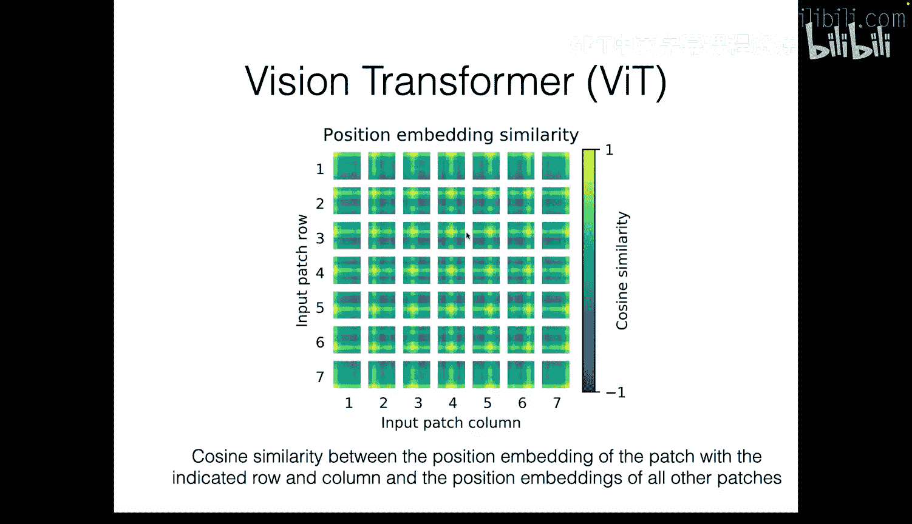

Which is kind of nice。And then finally， another fun thing to do is you can。

Look at where the attention mass is being allocated。So here， for instance。

 this model has been fine tuned for classification。

So it's probably trying to classify this as dog this one as airplane。You know， at this point。

 they kind of extract the attention map and then visualize which parts are high and you can see that it kind of focused on this area。

嗯。

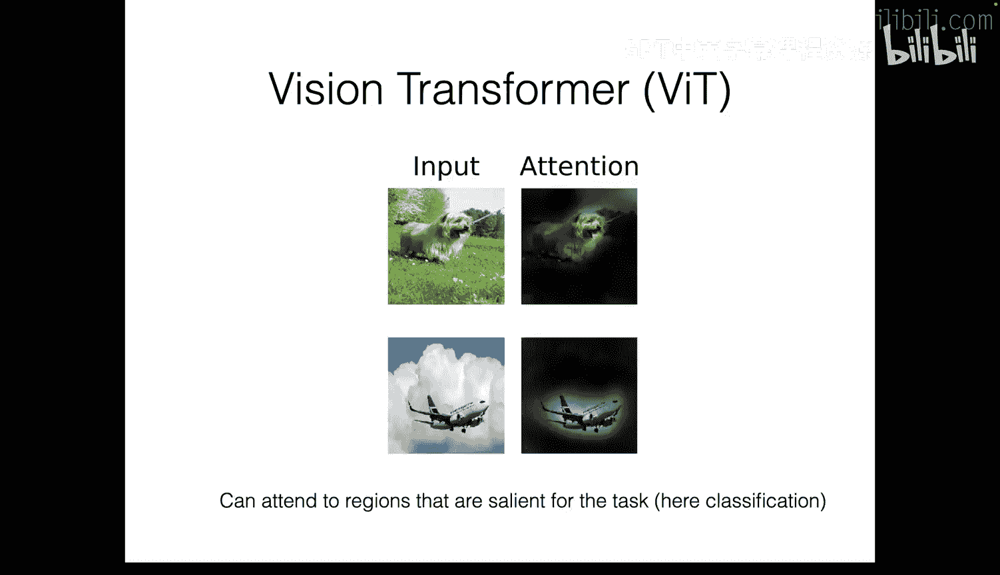

Okay。And then， of course， you have to keep in mind that。

 you know the network will be multiple layers and there's multiple attention heads。So in general。

 you might have some that are attending to kind of really large regions or more narrow specific regions。

And this is just trying to show this。So here it's showing that， yeah， as a function of the depth。

 you see different patterns and in particular as you get deeper in the network。

 it's corresponding to kind of larger and larger regions of the image。

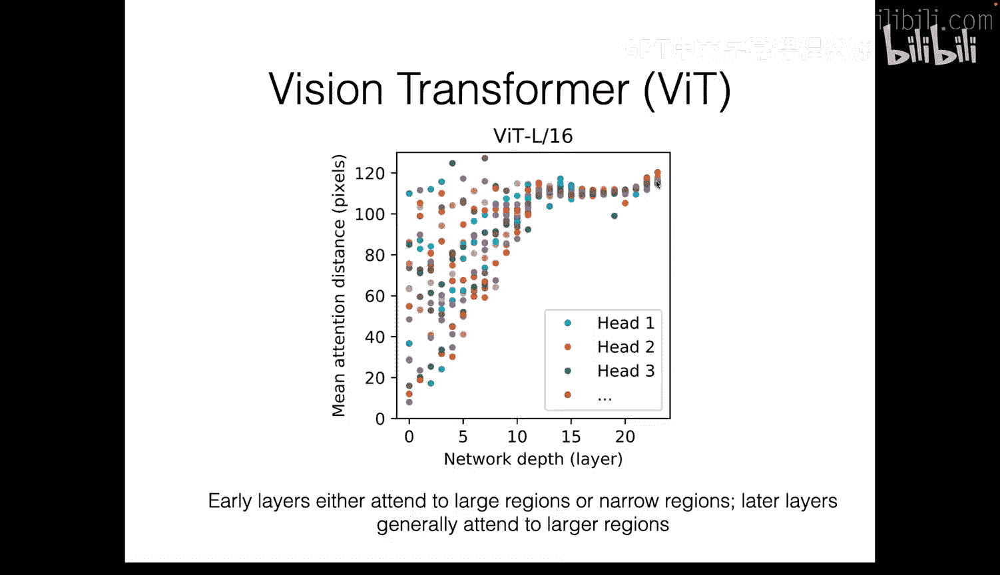

嗯。So here in the code for the course， we have another code example。

嗯。So。This one is。Kind of kind of fun。 So here we are looking at。This。

This might be the original of transformer， and you can see here that it uses this patch size of 16。

And then the model has been trained。For specific。A dimension， as well。

And so this is just loading the model。So here we can see the image size is t24 by t24 and their hidden size they chose is 768。

So now we can load this image here。And you can see here that。

Now you can see here that we want to basically turn this into。The different patches， right。

So here's the visualization of the different patches。And then this is showing the patch embeddings。

 like actually getting them from the model。So here we have。Oops， Im might skip something。O。

So the image size is T24 and the patch size is 16。So then therefore， on each dimension。

 we'll have 14 patches。And 14 times 14 would be 196。

And so we start off with this at the kind of base level， it's just the image。

That is represented as 224 by 224。嗯。So。Now we go through this projection layer。😔。

And if you remember it from above， there was 196 different patches。

And they've been transformed to this dimension of 768。Okay。

 so you can see that here the 16 by 16 by3。Which is what I was showing on the slide。

 gets transformed to their hidden dimension。Now what's typically done is if you remember in the BRT model。

 they had this special token at the beginning， a CLS。

So they did the same thing here with the vision transformer。

So now you can see that after adding on this extra token， we now have 197。

And so this will be the kind of final inputs of the model。

Then when we pass it through the transformer。You can see here that the dimensions are stay the same。

A similar， you know， to the case of。of text。嗯。And the reason you have this extra token is it's typically in practice used to do the fine tuning for different tasks。

So here now this is loading a model that's been fine tuned for the classification。

 and you can actually get these output scores， take the softmax and then look at the top five predictions。

And you get these results。And again， so then this model， I'm going kind of faster。

 this model has been trained on some data set with a bunch of different classes and then kind of each class label will correspond to some name here so it's not like you know generating the text here。

So here it classified it as。93， like its most confident prediction was Egyptian cat， then Taby cat。

 tiger cat， and so on。Okay， so pretty cool and so hopefully now you have some understanding of。

Basically using a transformer or processing images。

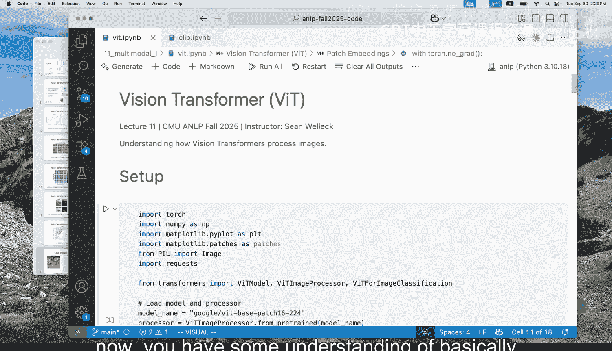

And now we'll talk about how we can train a transformer like this to come up with good representations of images。

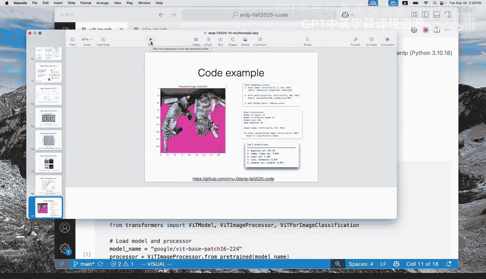

Okay， then we'll see how the representations are incorporated into a language model in the third part。

So any questions about this so far。嗯。Yeah， so I think it is。

Well so the models will be pre trained so you kind of have to decide up front。

 you know what's going to be on patch size and you can see that this model was trained for patch size 16。

And I think what they do is they have different versions of the model。

 so they might have different hidden sizes and different patch sizes。

I'm notI'm not sure exactly how it's selected， but you saw that it impacts like the size of the weight matrix and the dimension and things like that。

 so potentially it's decided。Based on like the computational consideration。

167Yeah yeah yeah yeah sorry yeah we over that kind of quickly so let's actually go to this。

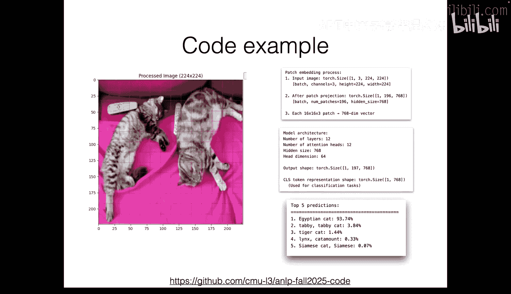

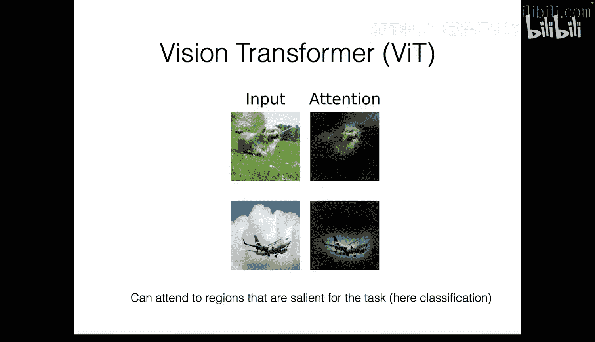

The image from their paper。Here， so if you remember in the BRT model。

 they basically had this weird token， which is like CS and they put if there be any of senses。

And it's just some consistent way of having this output。That you can use for fine tuning。

 So if you really wanted， you could probably take。You know， the last vector， too。

 but maybe that vector actually corresponds to some semantic part of the image。

 So I guess in practice， they just。Put on this kind of fake position here for the purposes of you know using and fine tuning and so you'll see the same thing in the birdRT model as well。

Mh。Okay， so that's the vision transformer now we'll take a look at clip。So。

Cp answer Conive language image pretraining。And here the goal was to basically come up， so you know。

 we talked about pre training， we talked about pre training for text。Now the question is。

 how do you pre train a model so that it learns good image representations？

Kind of interesting question。So some requirements you you might want are you might want the model to be able to learn from text so if we think about。

Like， let's say images on， on the Internet。Then you might have an image there。

 but you kind of have this other useful information。

 which is like the caption under the image or even like the text on the web page。And so potentially。

 if you can kind of leverage this kind of pairing between text and images。

Then you can learn some good representations。And so for the method， we'll see another kind of。

Thing to understand is maybe the context from the time。So at the time。

 people would pretrain these models on just classification。

 so they'd basically come up with a big data set of images。

And they would just have the single class label。

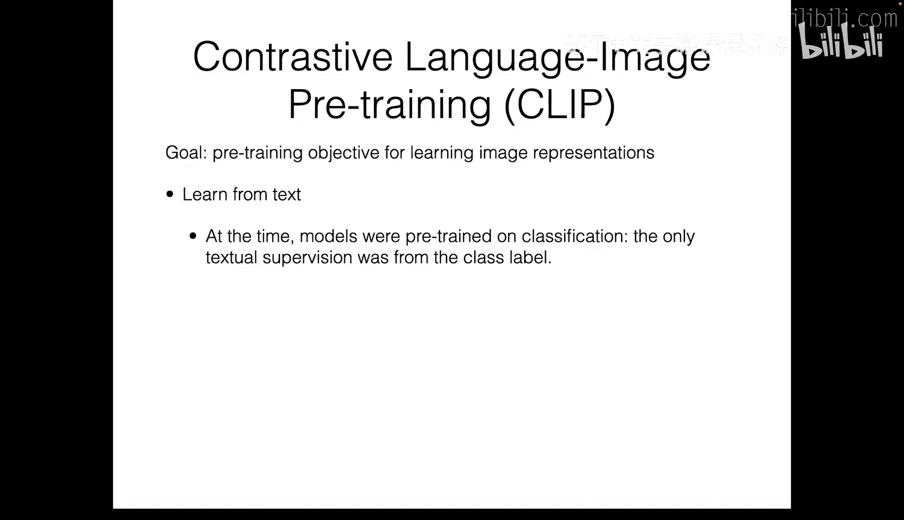

So for instance。And for this image。You could have a class label， which is， you know， Egyptian cat。

But actually when you think about it， there's actually a lot more information in this image than just cat。

So again， suppose you had an entire caption or an entire paragraph about this image。

Then it could say， oh， there's there's two cats in image。

 so then the model could learn something about even like counting。

Or it could say the cats are on a pink couch so then it could learn like something about the color of pink。

And the notion of like on， so you could see that as you add kind of more high quality。

 if you somehow get high quality text associated with an image。

 then there's more potential kind of learning signal that you could you know leverage。

So here this was one motivation， they want to think of some pre training objective。

 which was not just classification。And then also this was developed by Open AI and a lot of things that Open AI does is leverage scale so we saw a look with language models they're generally getting better if we kind of scale up the amount of compute so we also want some kind of prechaning objective that you could just throw more compute at and maybe it gets better。

And again， when you think about this classification。

 then somehow you have to come up with these class labels， you have to have like humans come up with。

Yeah， like hand label images and things like that。So here the idea that was proposed was called clip。

And so the idea is we want to learn image representations jointly with text representations。

So what does that mean， So here we have this image encoder。

 which will go from some image to some vector representing the image。

 or it could be know multiple vectors。And we also want to learn at the same time this text encoder that goes from some text to some vector representation of the text。

And then the kind of idea is you want to train this model so that its representations for an image and its corresponding text are close together。

And so if you think about it intuitively， like maybe the model is learning that， you know。

 this image of a。Two cats on a sitting on a pink couch with some TV controllers has to be close to like that text representation。

 and somehow that is really effective for kind of learning to represent both images and text。

And then similarly， you don't want everything to just be close together。

 you also want representations for。An image and some kind of irrelevant text to be far apart。

So that's the kind of intuition。Oh， and then for scalability。

 we want to apply the method over a large data set of image and texts。

So you can imagine this isn't the most scalable thing， you still have to get these pairs。

 but you know maybe it's easier to go in the internet and collect like images and their captions than it is to have humans sit down and like write a class label you for an image。

So yeah， so here their data is these pairs of images and text。

And what they did is collect 400 million web images with their text descriptions。

 so basically what I just said。And then you could imagine that since then。

 people have developed know， even bigger。Data sets of this form。And then for their image encoder。

 you could have a vision transformer like the one I just introduced。And for your text encoder。

 you have the non vision transformer， so the one we've been using in the class for text。

Then the really key idea here is to come up with this kind of clever loss function for training the model。

And it's actually going to turn out to be have similar ideas to the loss that we saw in the last lecture for retrieval。

So what's going on here， so I'll show the equation in a bit。

 but it's also helpful to just kind of visualize it。So here we have， say n different images。

 so you might have a dog， you might have， you know a cat and a couch。

And then you have n different texts。And so each。Item is going to correspond to you know one other item so like the first text is about this dog。

 let's say the second images of a cat then the second text will be about a cat and so on。

Then you're going to run those through the encoders and get these different vectors。

 so each square here is a vector。Similarly， you run the images through。

And now let's say you take the dot products of these different vectors。Okay。

 so in particular on this diagonal here， what we have is the dot product。

 which is kind of like a score。Of the image， along with the text that it's paired with。

When we go off of the diagonal， assuming these are kind of different。

 now you have the score of an image paired with some text that is kind of not relevant to the image。

Okay， and then similarly here for the text， you have the score of a not relevant image paired with that text。

Okay， so this matrix here is a kind of nice interpretation。And then what's going to happen。

 I'll share the。The equation in the next slide， what's going to happen is we're going to have a loss that basically pushes up the score of things on the diagonal。

And pushes down the score of things that are not on the diagonal。

And so if you followed kind of what I was saying， then the loss function is basically saying， okay。

 increase the similarity or increase the score of these paired items and then kind of decrease the similarity or decrease the score of the not similar ones。

And so here's the loss function， and it turns out to be basically very similar to the one we sell for retrieval。

So。Here， if we just look at one of these at a time， this one is just dealing with the images。

Then what it's basically doing is it's taking a softm over either one of these rows or one of the columns however it is visualized。

 let's see。Soft neck over。Images， so this is basically saying， okay， for each different column。

 we're going to have a soft max。And we're going to increase the score of this。Up blue squared here。

Okay， so you can see here XN and Yn， if they're the same。

 get kind of pushed up and then in the denominator， you have everything else here。

And since it's a softm， everything has to sum to1。 So as you push this one up。

 the other ones are going to get pushed down。Okay。And then similarly。

 you could do the same thing for the text so you could say like okay for each row。

 push up the dot product of the correct。You know， pair and then push down the dot product of the other pairs。

嗯。And then the one way to interpret this is， you know。

 we've saw this idea a lot in the course of kind of having this log and then a softmax。

 and it's kind of like a log probability。And so you could actually interpret each one of these as a kind of cross entrypy loss。

Where the model is learning to kind of put all of its probability mass on this kind of cracked pair。

Okay， so yeah， this loss， like different forms of it came before clip。

 one of the early ones is called infofo NCE， In noise contrastive estimation。And then yeah。

 you also see this appear in yeah， training。The retrieval models because again。

 the retrieval models are basically learning to kind of bring together the similarity of different vector。

Okay， and so this is actually a screenshot from their paper。

 so they were trying to make the point that I guess it's easy to implement。

So maybe I won't go through all the I won't like step through here。

 but you could look at it afterwards if you're interested， but it really comes down to， you know。

 taking some dot products and then。Here's actually what else。

 this is another reason why this screenshot is interesting。

 you could actually use this cross entropy loss to implement their loss。Okay， so。

That is clip so then what you do is you basically run this on your whole data set and then now you have a kind of good text encoder and good image encoder but how would you actually use those？

So one thing that they showed is that the model could be used for this kind of zero shot classification。

And this was maybe something new at the time。So what they're doing here is this kind of clever thing。

 which is， let's say you have a classification data set and it says like plane， car， dog， bird。Well。

 then you could just turn each one of those into a string of text。

 like a photo of a car a photo of a plane。Embbed each one of those。

Then you could embed your image just once and then basically get the score of each one。

And now you have a classification model， right， because you could say， okay。

A photo of a dog has the highest score， so I'll use that as a classifier。And as I mentioned before。

 like at the time people would kind of train the classification models from scratch specifically for the task。

 whereas here they're trying to show like。Just given these really good representations。

 you can kind of just quickly make one of these classifiers。And so this is what is being shown here。

 so here they're just showing that the model is working better than this kind of fully supervised model across you know some data sets。

 which I think was kind of a big。A surprisingur thing at the time。And。Then I mentioned the scaling。

 so。This is actually showing， I think the average line， if you see， it's kind of noisy。

 but you do see on the X axis here is the amount of pre training compute they're using。

And then this is， you know probably error on some specific task or group of tasks。

 and you can see that as they're pretraining more， the error is getting lower。

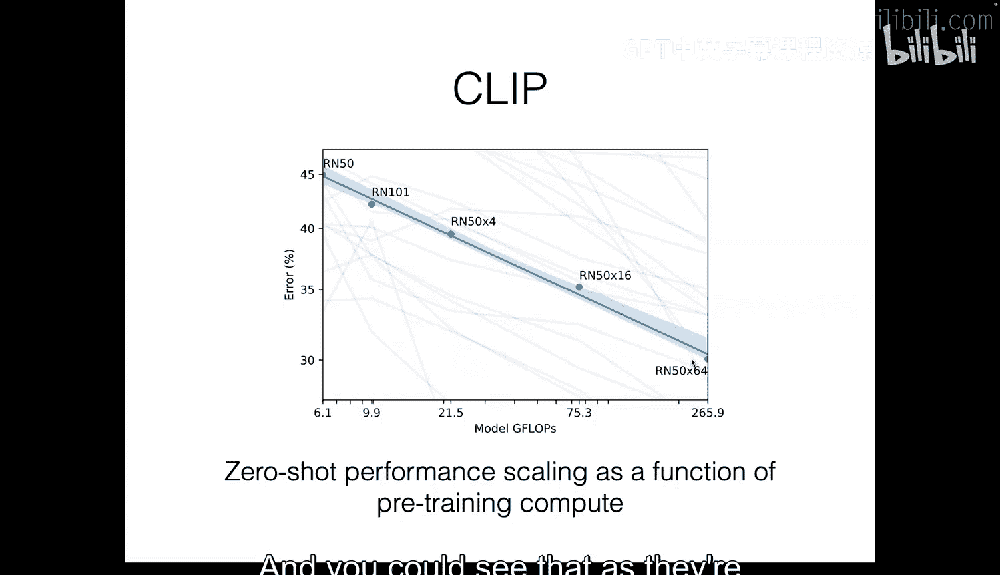

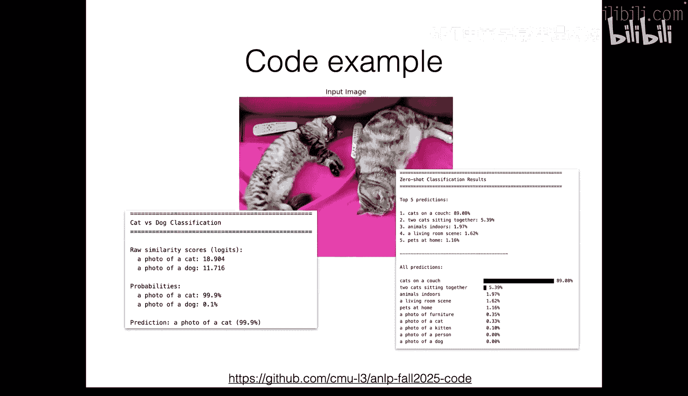

So again， this was。So unfortunately， Open AI doesn't open source all their stuff anymore。

 but they do provide a clip so you can still download it， so here's another notebook。

And it's actually just doing this classification that I showed you。

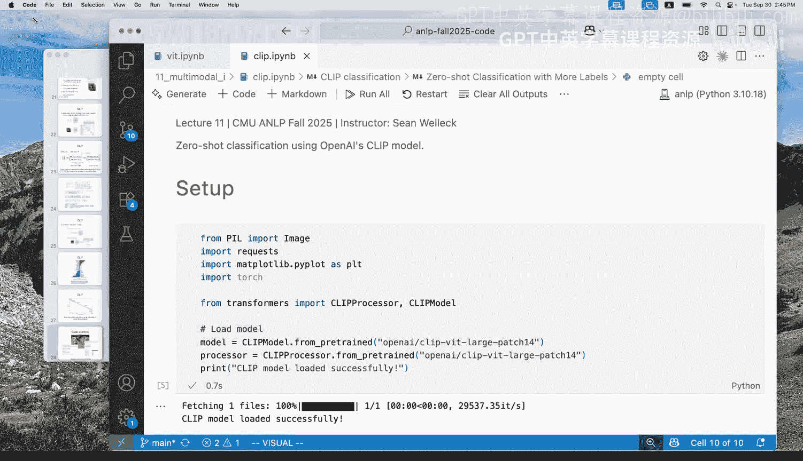

So here you can see this clip model， it has this patch size of 14， and again。

 I think they have different sizes。Or this will be based on maybe。Oh yeah， yeah。

 so vision transformer large patch sizeer 14。So you can load your image and then。Here's just showing。

 suppose you make this kind of two class classification task。A photo of a cat or a photo of a dog。

Then you could get。These outputs， and I guess， in the。This is using hugging face right。Yeah。

 so in hugging face， it's doing， it's kind of abstracting all this。

 And it's actually giving you just the similarity scores between the image and the text。

So now you can take a look at them and。After you take the softm， it's pretty， it's pretty good。嗯。

It's basically classifying this as cat versus dog。So then you could kind of give it more candidate labels。

Like two cats sitting together， cats on a couch。Animals indoors。嗯。And so now， I mean。

 maybe it's not exactly clear what should be the maximum。

 but you can see that it's put its probability mass on pretty reasonable things。

 So I guess most of they're giving cuts on a couch on it someone two caps I have one and so a pin with this Okay。

 and so you can imagine it's very difficult。To。Kind of write out all these possible different classes and train a classification model。

 But if you kind of come up with this model for just getting good。Text image similarity。

 Then you could have these kind of very detailed。Classes if you want， but they're essentially。

 you know， natural language kind of prompts that you up come up with。Okay， so that's the。

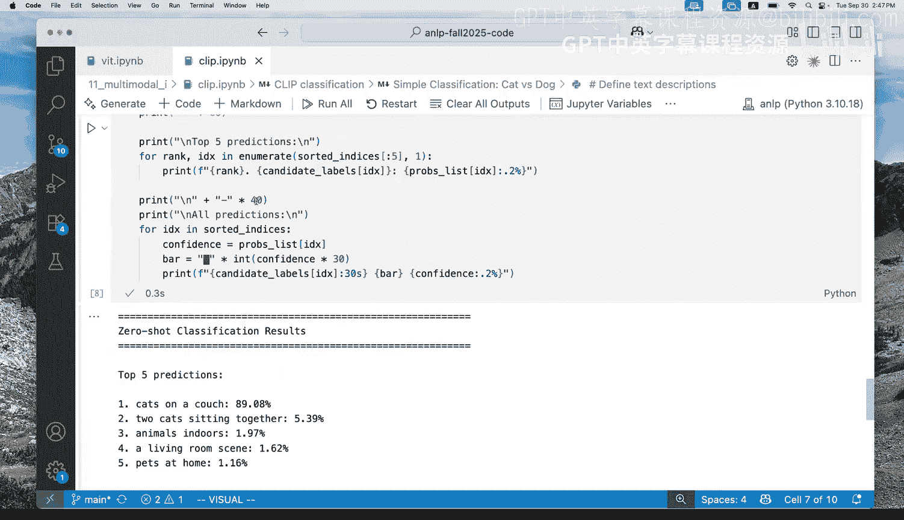

That is， I think， all I have fur。For clip， so any questions on this before we talk about the language models？

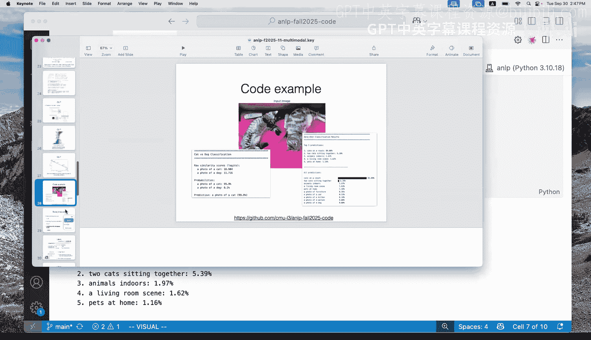

嗯哼。😊，I what took architectures for the image and text order world it。

So they so like this one that I showed， for example， is the transformer。

And so the nice thing about the transformer is it works well for text and then they just use a kind of similar architecture for images。

嗯。I guess in principle， the clip method would just be about。

The kind of use of this loss function on the paired data so you can try using a different architecture if you want it。

嗯哼。😊，I it correct to sort of think that the possible outputs and to be like a classification use case so it isn't generative in any sense。

 but you have a fixed set of potential outputs and that is what you are inputting with the text encoder to do that。

麻对。Yeah， exactly exactly yeah， yeah， so。Yeah， I guess that's that's one reason for like dividing up the lecture into these different parts。

Which is like if you want to generate an image， you need to think of some other sorry。

 if you want to generate。Text or incorporate this into a text generator or into an image generator。

 you kind of have to do something different。But it turns out that the clip could be useful as a kind of first step for getting these good vector representations。

 that's what we'll talk about in the third part of the lecture。

That's within the clip is what we use as a baseline to do the partYeah， exactly so。

So clip is really like the innovation， I guess， is using， is this right here？

And then you could choose， you know， how do you implement your text encoder。

 how do you implement your image encoder。Like what architecture do you use So here you could use the vision transformer to basically implement the imaging coder。

嗯。ok。Okay， so。If you remember。Well you probably remember because homework1 was aboutllma so now instead we could have lava I guess the V is revision so here our goal is to again have this language model which can also take in images。

And the idea here is going to be pretty simple。So here we have a language model which of course takes in some text embeddings and outputs some text。

And the idea is we're going to basically get these embedded these vectors from， say， a clip encoder。

 that's this blue box here vision encoder。Then we could just learn this weight matrix， for example。

 to project them into the same dimension as our language model。

And then just train the language model to have both these like embeddings corresponding to the image and the embeddings corresponding to text。

So so that's really the idea and so specifically to kind of visualize it。

 here you have your image again， separated into different patches， you flatten them。

 you send them through the transformer encoder。This transformer encoder。Could be。

The weights that were pretrained with this clip objective。

And sometimes these go by the name of image tokens。嗯。Yops。

And the reason is because when you think about it， like when you have text tokens。

 you turn them into these vectors。So why not just consider。

 you each one of these to be kind of a token？嗯。So。Yeah。

 so this is basically the strategy we'll see in a bit that you can play around with exactly how you do this transformation。

 so the simplest thing is might this you might learn a new matrix， right？

And it's basically saying that， okay， the embeddings that clip give you might not be the perfect。

 You might be in a kind of different space than the text embeddings。

So maybe you could just learn a simple linear transformation to transform them into a kind of similar space as the text embeddings。

But it doesn't have to necessarily be linear。 You could learn， you know， like a。

One layer network or something for doing that。So we'll take a look at exactly what's done in this MLMO model in a bit。

But this is really the idea behind this model called lava and then what they did is basically try to train try to fine tune a model。

 sorry so here they're taking a pretrain model。They're taking pre trained clip embeddings。

 and they want to fine tune the model so that it could follow these instructions and kind of do different tasks。

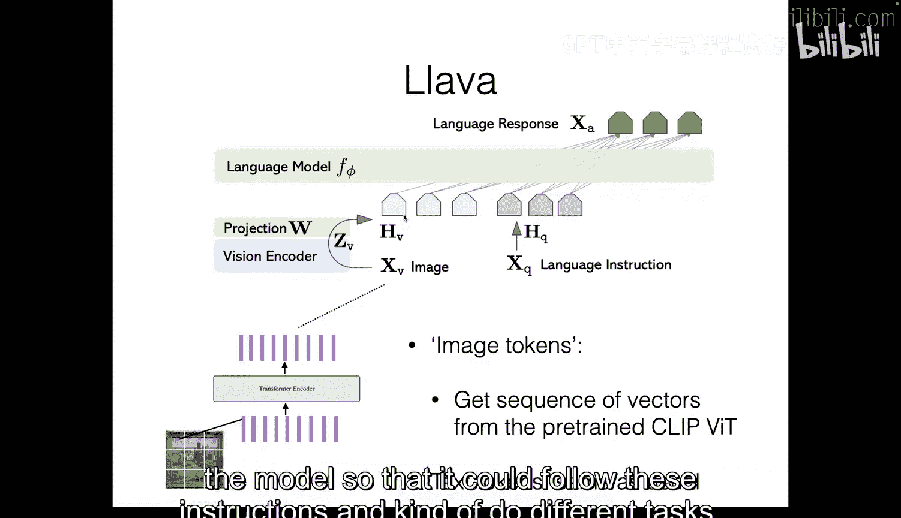

So for instance， here。Let's see。 See You have this image。

And it looks like it's a person on the back of a taxi ironing clothes， right？And so in their data。

 they have these different like image。Prompt pairs。

So here you can see that the user said what is unusual about this image？

And then now the lava model will basically be fine tuned to produce some text sequence。

So for instance， like after it's fine tuned， this is one of its predictions。

Orre one of its generations。

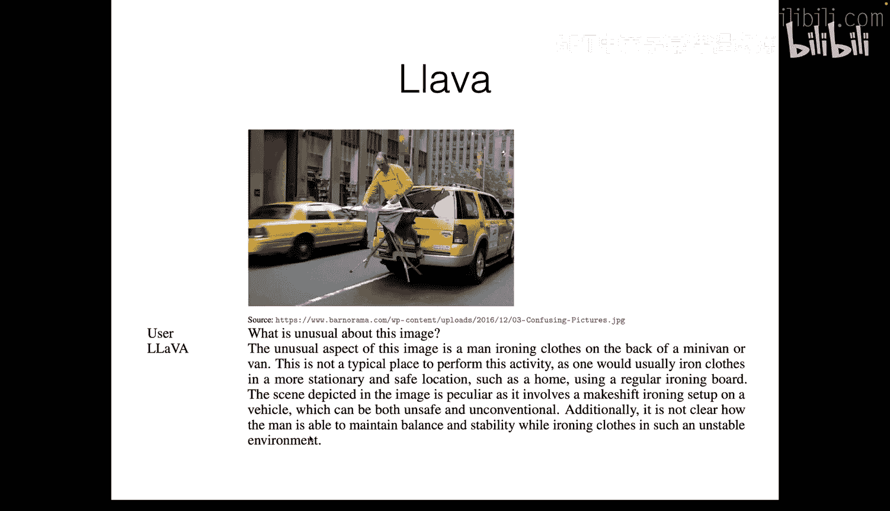

嗯。And so， the general pipeline here。If you could take this and kind of generalize it。

Then we want some method of basically pre processingcesing the image。

 so splitting it into patches and turning it into vectors。Then we want some method of。

 let's say encoding the images， so going from these like patch vectors to some better vectors。

And so an example of that is you could take this pre existingisting clip model and get the vectors from like the last layer of the transformer。

And then the third step is basically provide those encodings to an LLM， like as I mentioned。

 you could linearly transform them if you want。And then train or fine tune on data that has these kind of text image pairs。

And here again， we're not training the model to produce images， so for the kind of image positions。

 you don't have any loss associated with it。

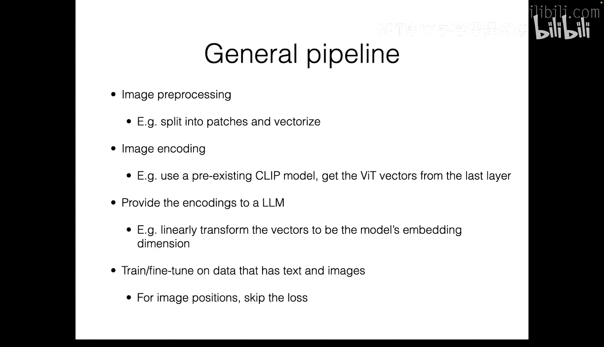

So as an example of this， a recent example is this model developed by AI2 called MoLMO。

And I think this was really recent， like it it just come out last semester when I was giving this lecture。

So you can see that they're really using this recipe that I just kind of told you about。

Here they have this vision encoder。And then they get its kind of outputs and they call the transformation to the embedding dimension of the LM。

 the connector。Then they're giving it to a language model。

 it has some text tokens as well like point to Mount Rainier。

And then it's trained to do basically outputs and text。

 And so here it's outputting text that says like point。You know， it's important。

Then you can like visualize that coordinate on the image and the model has not learned to like point to things in images。

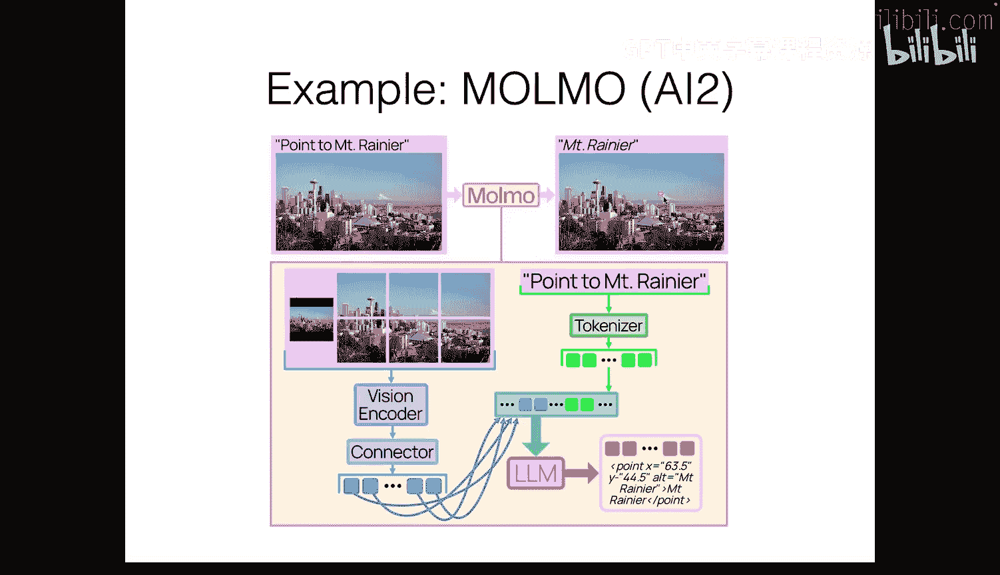

嗯。Now， you could take a look at their paper for。Basically。

 all different parts of the pipeline that I told you about。

 you could imagine trying to make them better。So even in this image pre processing step， you know。

 maybe it's not ideal to just have these patches of the original image。

What they do is actually take multiple kind of crops of the image。

So here you could have a really height resolution image， for instance。

And you could take a crop just corresponding to this part of the image。

And then turn that into patches。And similarly， do that like multiple times。

 And so you can start stacking up kind of all these different。呃。

Tokens corresponding to the same image。Okay， so there's a lot of these kind of different tricks you can do and they end up leading to better performance。

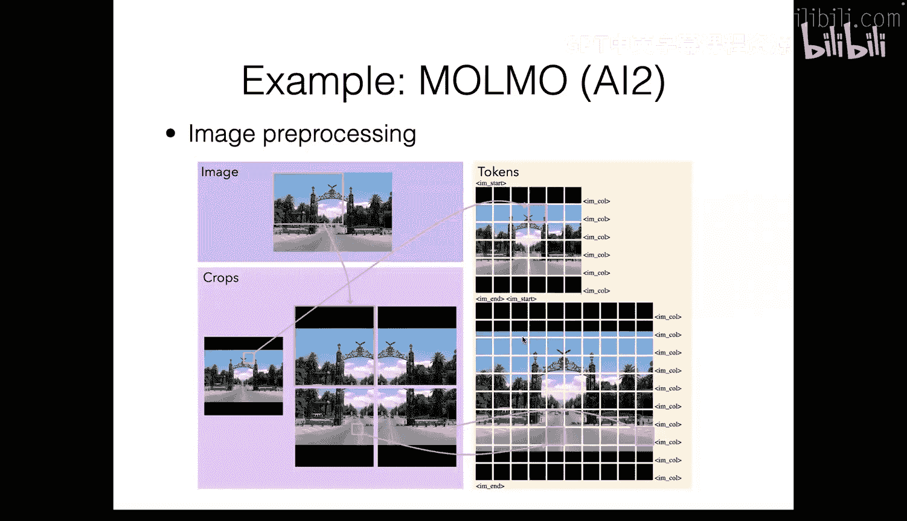

And then here's just concretely showing， but again。

 this model had like just come out when I was giving this lecture last semester。

So it was just showing that really the ideas that we saw in today's lecture go into these。

 So here for the image encoding， they were using this pret clip model。

They had like these size images and patches。And then they also did this trick for the what was it called the connector。

Where they pull together these like two by two subsets of the patch and then actually provide those。

It will transform them and then provide those to the Llum。So again。

 I think the reason I'm saying this is just to give you this sense of like you have the general pipeline and then each part of the pipeline you can kind of refine a bit and so if you read through the MoA paper you'll see these kind of you know different tricks being done。

And then yeah， they use like the full image and then 12 different kind of crops。

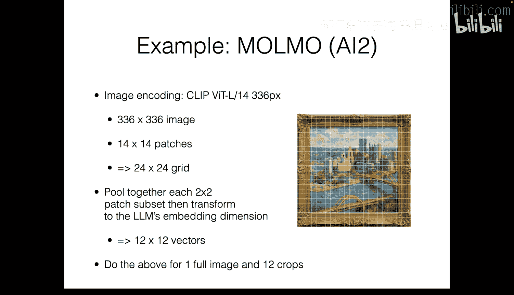

And then they talk a lot about the different data that they collect。

 so they collect this kind of captioning data。I guess here they had， I think。

 like human annotators generate。Generate some of it。

 so they might have someone just like talk about an image。

Maybe it's easier to talk about an image than write about it or something like that。

 and then they turn it into a transcript， and then you can kind of reformat it with an LLM so that it's nicely worded。

Here's some other stuff where they're like asking questions about an image and getting answers。

You can imagine generating tons of this kind of pointing data automatically。And yeah。

 they have a variety of techniques for basically coming up with these image and taxpayers。

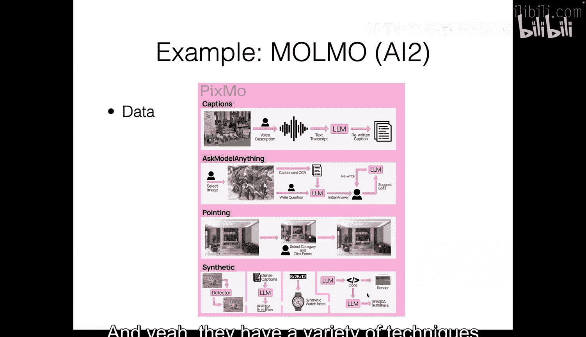

嗯。This is what is this Oh， these are just examples from their paper to look at some of the results。

 So here's like some captioning it can do。

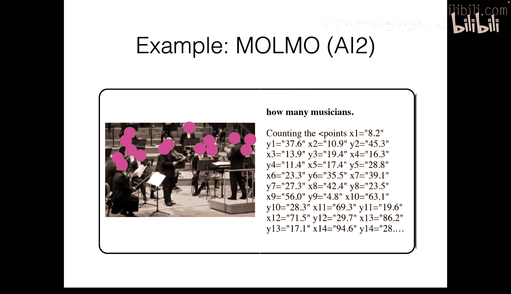

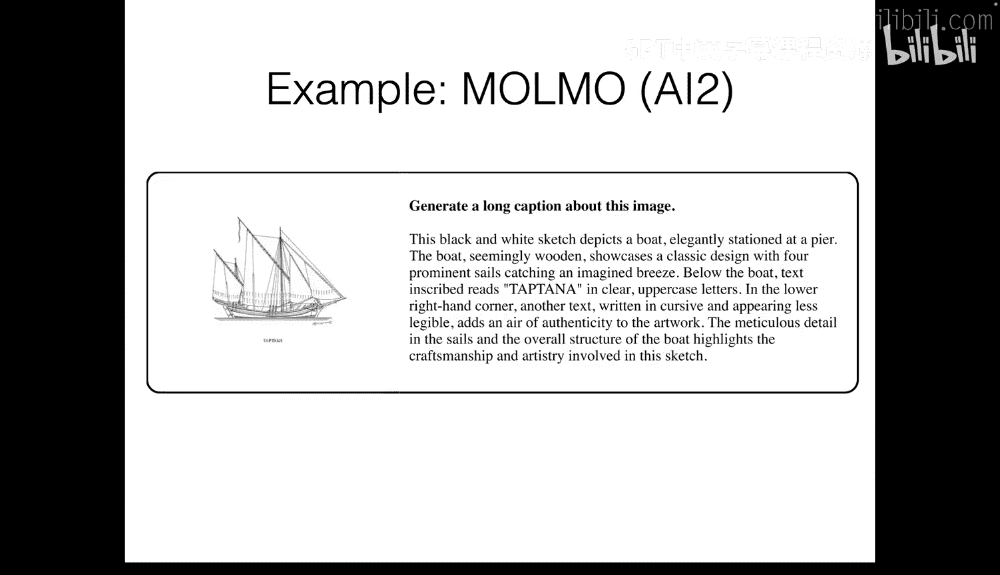

嗯。Here is saying how many musicians， And it kind of turns it into。

Counting these different points because it had been trained on a lot of this kind of data with different points in it。

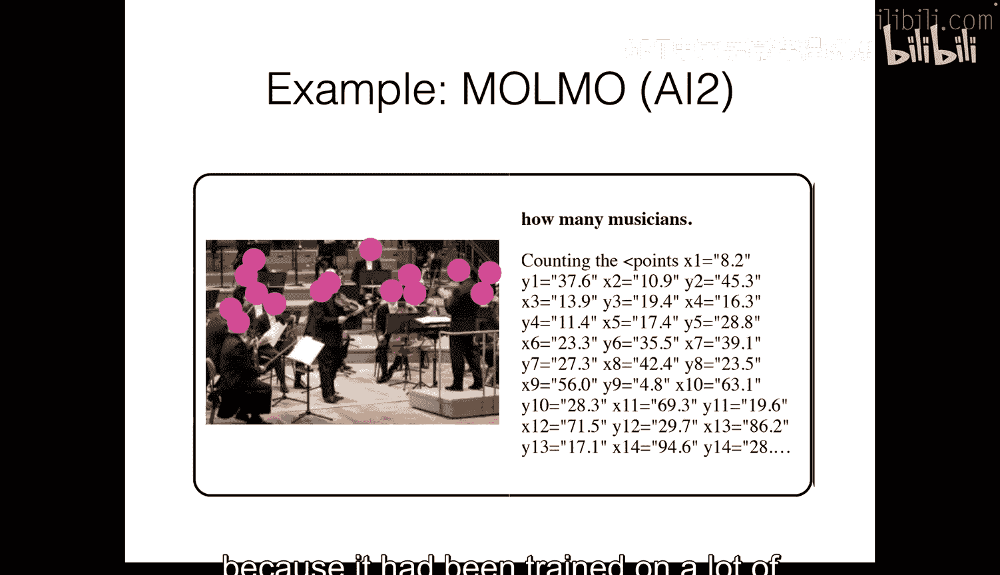

嗯。And this is just question answering， I guess， what kind of downite is this？

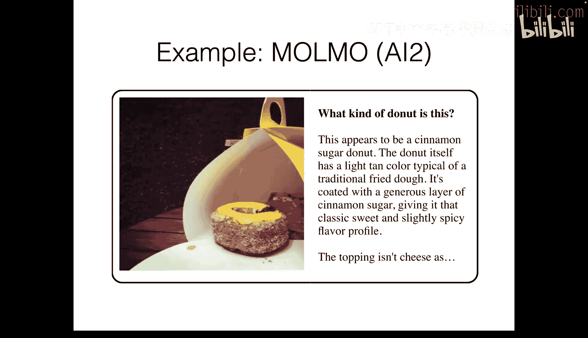

This is showing the pointing on some， yeah， on some actual data， like an article。And yeah。

 that's essentially。That's essentially a。So in oh， and then I want to mention that this model specifically。

 they made everything open so you can go download the model yourself。嗯。

They have a really small model。 It's a mixture of experts model。 So maybe I'll wait。

 we have a whole lecture of mixture of experts。 So maybe I'll come back to this and we can see that model at that time。

But then they also have， you know，7 billion larger models。So yeah。

 basically today we went through this kind of quick overview of some key ideas to know about in this area。

First is the architecture for images。Based on the transformer。

The second is this kind of objective or recipe for learning different representations。

And the third is one technique for combininging this with a language model。

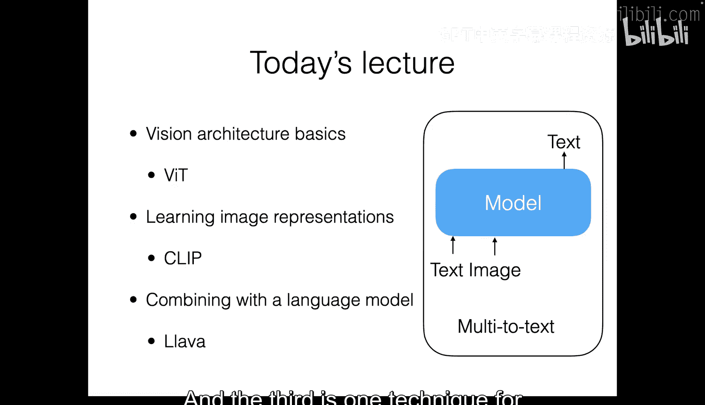

So then as I mentioned in the next lecture， we will。Talk about this is an error， actually。

 So this should be image here。 We'll talk about methods which either generate images or the kind of most general thing。

 which is， you know， interleaved text and images。And those will turn out to use slightly different techniques。

 but still are relevant to the ones we talked about today。

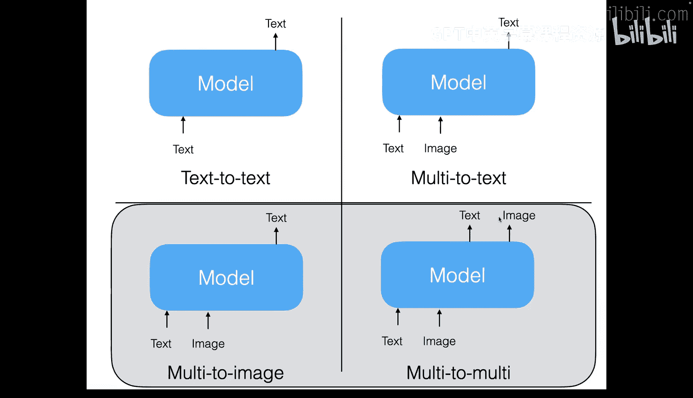

So that's it for today's lecture， I can maybe take a few questions and then take some more just in person here if there are any the same as using the print batch。

No， why this crop and work what's the benefit of？Yeah。

 so one benefit is that you can so you can keep your patch size fixed。

 but then you could basically zoom in。So your original image resolution。

 imagine you have like an image of a computer screen then it has all this text on it。

 and it would be beneficial to actually have like zoomed in versions。

It changing the receptorcept of the crops of the batches Yes， yeah， yeah。

And then you can kind of keep the patch size the same， which is nice because then。

then the kind of architecture stays the same。question about。嗯。About the pointing。

 how does that work usually models。Reason about what the information in the data itself。

 pointing to the image screen sort of meta， how does the model know about the spatial dimensions of them？

Yeah， so I guess the。The thing is。Oops。Let's take a look here。So here they get a lot of data。

 which is just image。And then some instruction， like point to the couch and then。

Some coordinate and the model outputs the coordinate is tax。And so yeah。

 I guess it's just taking advantage of like the amazing thing with these models that if you do have kind of data that has these like input output mappings。

 they're typically able to learn even kind of， yeah。

 very like nontrivial input output mappings if you start off with good representations。

So here you could imagine that like in principle， it should be possible。

For the model to take in an image and。Yeah， some direction about what it your point to and kind of learn the correct coordinate for it。

People the attention。But is it just making the。多就。I believe it's just the same。

 like they don't modify it specifically for the pointing。But as we'll see。

 the pointing specifically in general is still difficult for models。So this is like， you know。

 they fine tune it specifically on this data and it probably does well on kind of similar things。

We'll see in the case of the agents that the agents can still struggle a lot with like clicking in the correct place on a web page。

 for instance。So I'm not saying that this is like solve， but just giving some， yeah。嗯哼。

It reality people what what task the define in the model to while the training for language modeling a class。

Yeah， so there they were just doing classification and so there the innovation was about the architecture that was used。

没有。so。For the Lava model， they are when they are training the model。

 are they fine in both the language model and the state models or are they just fine in one of them。

Yeah so I believe they're leaving the encoder fixed so what they are training is so so given the embeddings from the clip model。

 you can still transform them you know before they go into the transformer so theyre they're updating those weights。

But then。You probably have the option of leaving the encoder frozen or not frozen。

 and I think they're leaving it frozen。I think in the a multimodorality Ive generally seen like people don't train the entire model until they keep some of some part frozens and train the other part at the time when they try to use really good pretrain models so do you have any intuition of like why they do that？

嗯哼。嗯。So so we'll talk in the next lecture about things that are slightly more end end。

 so they will basically come up with some way of tokenizing an image。

Which is a bit different than what's being done here。

 and then you can kind of pretrain the model on like interleaved text and images。嗯。

It'll still have a kind of separate component， which is like this image tokenizer。

 but it will be slightly different than what we saw today。So this isn't like the only thing。

That's done。 I guess maybe the assumption is that the。

You want to leverage all the pre traininging that's been done for the image。

For the images and it still turns out to be beneficial with these models to you know start off with the pre existing encoder。

 but yeah， it does seem like slightly subopmal。To have these kind of two different parts。

 It's kind of clunky。好。Ts of the I one of the inclusion as to why is the perform better when compared to things I mean。

 when you do moving from Rs to let's say transform of these language models。

 we saw a lot of drawbacks if were handled with transform what you say is that anything that the I are doing better into hers Why are the。

Yeah， I guess one way to view it is that the the convolutional networks are。They're in some sense。

 like hard coding something into the model。 They're basically hard coding in this idea of like viewing an image as being this。

2 by two grid。 And you kind of shift this convolution over， over the grid。

And so maybe the transformer just has a more general attention mechanism。So it could learn。

It's potentially more expressive because it doesn't have this kind of inductive bias built into it。

But then the trade off is you probably need more data to learn the transformer。

So I think like one thing they showed even in that plot， you could see at the。

At lower amounts of compute。The hybrid method， which was using the transformer combined with the other model。

 was doing better。But I think the intuition is that with enough compute and enough data。

 then the model is able to learn kind of more。It's kind of able to learn everything that it needs without the inductive bias。

What are the general corpus that you would use in these settings what are the general training training data require are benchmarks。

Oh， yeah。 for that， I would take a look at。The， I mean， this Mo paper is is。Is pretty good。

I could come up with a list for the next class， so I probably should have incorporated that in yet。

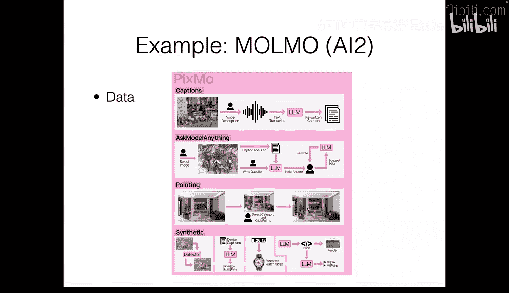