# CMU《高级自然语言处理｜CS11-711 Advanced NLP Fall 2025》中英字幕 - P12：(12)_ Multimodal Modeling II.zh_en - GPT中英字幕课程资源 - BV1ZWYAzuEMa

Today is the second lecture on multimodal modeling。And as I mentioned last time。

 we would basically need a full course to really go into everything and actually there's a full course on multimodal here。

But we can still go over some key ideas that are certainly good to know about and give you some kind of footing into the area so then you know kind of what to look up or you have some jumping point for learning other ideas。

So we'll continue with that today and if you remember in the last lecture。

 we really focus on models up in this corner。

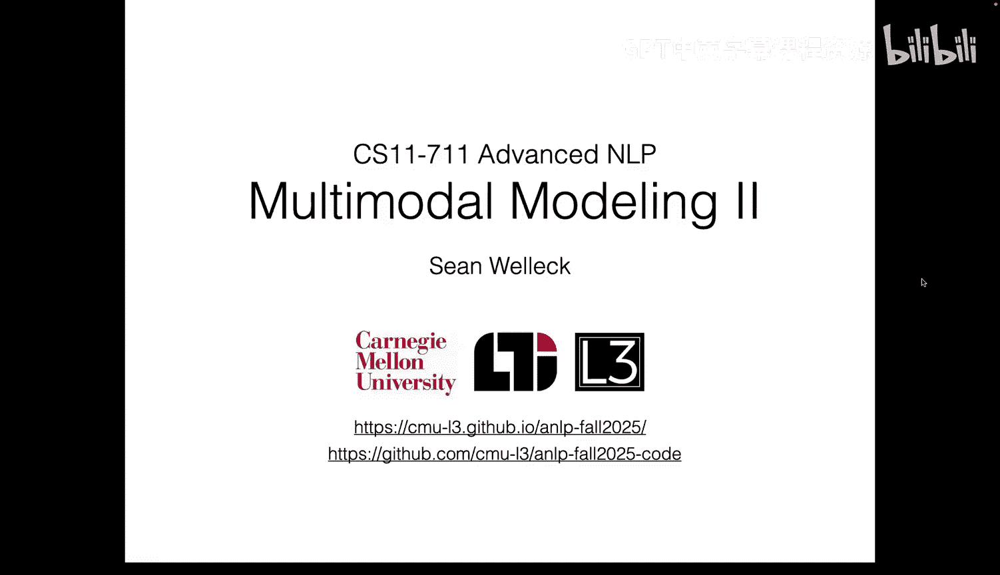

That we're taking in text and we're taking in images， and then we're just producing text。

So today we'll focus on ones down here。So actually， first。

 we'll talk about ones over here that can generate both text and images。Then we'll actually see that。

 you， if you really want really high quality images。Then at least so far。

 this type of method isn't necessarily the best approach。So then at the end， as long as we get to it。

 I'll just。Very briefly go over some of these diffusion models that will generate images with very high quality。

And so。Similar to what I mentioned before， we're not necessarily going to be able to go over all the ideas that are in state of the art methods。

 but at least this will give you some sense and some starting point then for looking into it further。

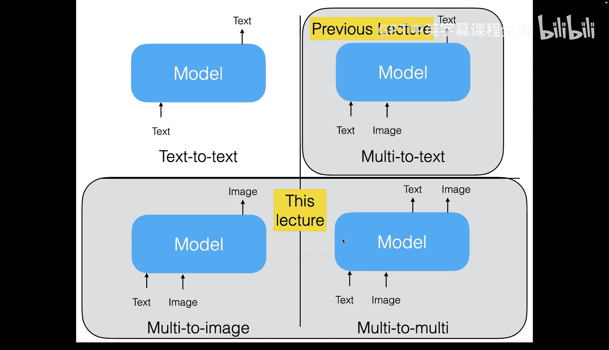

So here's an example of。Generating an image so。Here， I said。

Generate a framed picture of Pittsburgh in an impressionist style。

 and at the time it was this GPT 40 and it generated this image。嗯。

I'm not sure if one of the bridges is hallated， but anyways， it's kind of nice， nice style。

嗯。So I guess this's the only example I had， but if you've used things like chat GPT now。

 you can have these kind of interleaved， you know conversations with images and things like that。

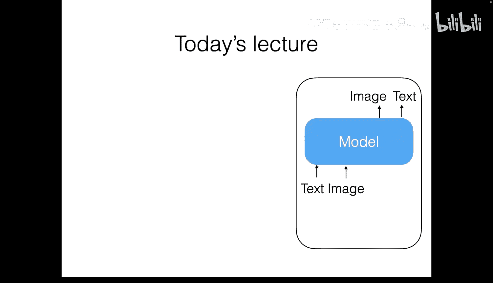

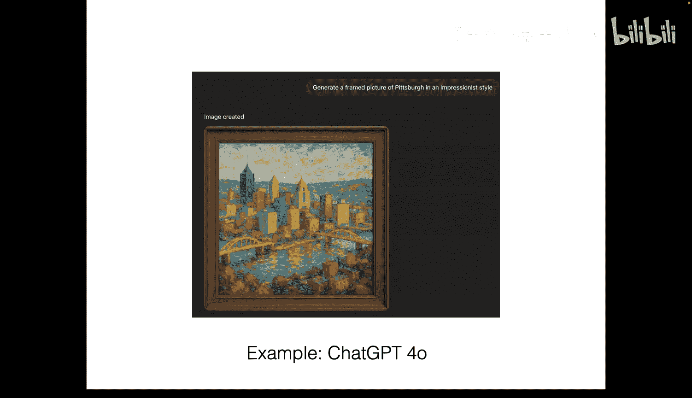

嗯。So in today's lecture， we since we're dealing with potentially generating images。

Then we actually have to talk about different methods than the ones we talked about last time。

 So if you remember last time we mainly focused on clip。And C gave us these really good embeddings。

 but it didn't necessarily say how we can generate a full image， for example。

So when we want to generate things， then we consider these generative models。

And it turns out that in images， you don't necessarily use these autoregressive models that we've been using for text。

However， you can think about using them in some ways， so we will talk about that。

We'll talk about trying to use them to directly model pixels。

And then to instead model these kind of image tokens。Then later， we will talk about other paradigms。

 so not autogressive modeling。But actually。I'll start off with introducing these different paradigms just so you see how this autoregressive modeling fits in。

So in general， with these generative models， you have some data distribution。

 so you can call it P star of x。And if you remember before with the language models。

 we might have some text， and we might consider our data distribution to instead be images。Okayy。

 so here you have some images of cats， some of dogs could be images of whatever you want。

Then we train some model and we get this kind of generative model。

 which is modeling the distribution。Then to actually use this to produce images。

 we have to do some kind of inference， so for example， if we're able to sample from this model。

 then we can produce a new image of a cat that doesn't appear in the training data。Okay。

 and so so far in this course， we have only pretty much looked at this paradigm on the top。

 what are called auto aggressive models。And so we'll go through each one of these step by step。

 but here's just a broad overview。And it turns out that in images。

 there's other paradigms that are very popular and like very highly performing。So。

I'll briefly introduce this variational auto encodecoder approach。

 which will actually become relevant as kind of part of the pipeline that we'll talk about。Similarly。

 I'll briefly go over this generative adversarial networks approach。

Which will also be part of the pipeline， it will be used to like tokenize and detokenize images。

And then down here is these diffusion models， which will be relevant at the end when we talk about generating really high quality images。

So first， auto aggressivegressive models， so we've now seen these kind of extensively for text。

And when you think about it， like for text， we had this kind of natural way to decompose text into these different tokens。

And actually， like a token doesn't necessarily have to be about text。

Or you could like imagine using the same approach for things other than text。

And so one thing you can imagine doing is like， okay， let's say that you define some order。

 some consistent order for generating an image， like let's say that you start in the top。

Left hand corner， and then you kind of go in this， it's called rest or scan order that's being shown here。

Well then you could consider like okay， each step or each pixel is kind of like a token。

 so maybe you can actually just generate like model images in this way。

You can say like at each step you have the image so far and you want to generate kind of like the next unit。

 so potentially the next pixel。Okay， so that's。You know， maybe something reasonable you could do。

So we'll return to that later。Another thing you could do is what's called variational autoenrs。

And so the broad picture is right here and we'll go a bit into the details later。

So here it actually looks much different， so now we basically start off with this real image。

This will be like in our data set， it's not a real image， but hopefully see what I mean。

Then we're going to actually learn two different models， so the first model is called an encoder。

 and the encoder will basically learn to map this image to some latent vector。

 so some continuous vector。Then we also want to learn this decoder。

 which learns to map a latent vector。Back into an image。Okay， and suppose we're able to do this。

 well then one more thing that you need is you have to kind of keep these latent vectors in some kind of consistent space。

Because then what you could do is if you kind of know the space of where the latentves are。

 then you can just generate one at random， for instance。

 and then send it to your decoder and then you can get like a randomly sampled image。嗯。

So we'll talk really briefly about how you would actually train this。

 but hopefully here you can kind of see the high level picture of what you want to get with the variational autocutter。

The GNs is slightly different。From both of those two。

So here you kind of come up with this clever kind of game， adversarial game。So here you have again。

 two models， but one is called the discriminator and one is called the generator。

And so now what you do is you have different examples。And it'll be pairs of examples。

And what you do is sometimes。You give the discriminator a real image。

 and sometimes you give it a fake image。 So you just give it one image at once。 sorry。

 if that was unclear。Now， the discriminator's objective will basically be to detect whether the image that you gave it was real and vague。

Okay。嗯。Then the generator's goal will be to start with some like random noise。

And produce really good image。Okay and we'll see the equation later。

 but basically the idea is you want to train the generator so that it learns to fool the discriminator。

So essentially， learns to generate images that the discriminator thinks are real。

So it's kind of this clever idea and again， we'll go into briefly into a bit more detail in the lecture。

And then finally is the diffusion models， so the kind of high level idea here is you have this kind of noising process。

So you have this notion of a forward process and a reverse process。So the forward process is saying。

 let's start with some real data。And then let's gradually add noise to it。

And eventually you get to the point where it's literally just random noise。

 like you could sample this from like a Gaussian distribution。Okay。

 then the goal of a diffusion model will be to basically learn to reverse this process。

So it kind of goes step by step in some sense， so at the current at the first time step。

 it will learn to like slightly produce like slightly dennoise image。

And so on across these different steps。And if it's able to do that really well。

 then you can just kind of apply it multiple times and it will eventually produce a real image。Okay。

 so here I'm just giving the kind of high level picture and I think based on these slides。

 you can already see that these are kind of much different than at least， you know， at first sight。

 much different than the auto aggressive models。嗯。Okay。

 so now we could talk about like given all this， let's try to think of a concrete goal。

 maybe going back to what we've been talking about in these lectures。

Let's say that we want to build a kind of language model。That can produce text。

 but also produce images。Then what would that look like？Well。

 what we would need is we basically need some way of tokenizing an image。So， yeah。

 turning an image into different tokens。But then the new thing that we didn't talk about yet is this kind of de tokenizer。

 So suppose that the model produces some tokens because it's it's a normal language model。

Then how do we actually map those into this kind of like a visual image。不了。

And so the goal will be to do this somehow and then basically not change the transformer at all and just have this language model that could produce text tokens or kind of image tokens。

So the key thing here seems to be like， what do you do for this tokenizer？

So first we're going to do what I was mentioning earlier。

 which is what if we just don't necessarily have tokens， we just try to generate individual pixels。

Okay， so if you were to generate individual pixels。

Then this notion of like turning the output into an image is not really an issue because you already have the pixel。

 So you already kind of have an image。As a sneak peek that's not going to necessarily be the answer。

 so we're going to talk about this other way of kind of coming up with a good tokenizer and detokenizer。

Okay， so let's go to the first strategy， so here we're going to basically treat the image as a sequence of pixels。

And then just learn a language model over the pixel sequences。So specifically。

 let's say we take an image and if you remember， it has this like height dimension width dimension and these channels。

And let's just turn the entire thing into a long sequence。

And so each element of the sequence will be some number and they'll be between one and 2506。

 so there's these numbers that correspond to the RGB pixel values。

Then what you could do is you could take a lot of images， turn them into these sequences。

 and then you have a data set， and you can just apply the same training procedure that we've talked about。

 so the maximum likelihood estimation。And you could basically train this language model， which has。

 okay， given the pixel sequence so far。Predict the。Next pixel。Okay， so hopefully I'm going through。

This a bit quickly， but hopefully this is familiar by now。

 and this is essentially what we've been doing with the text models。

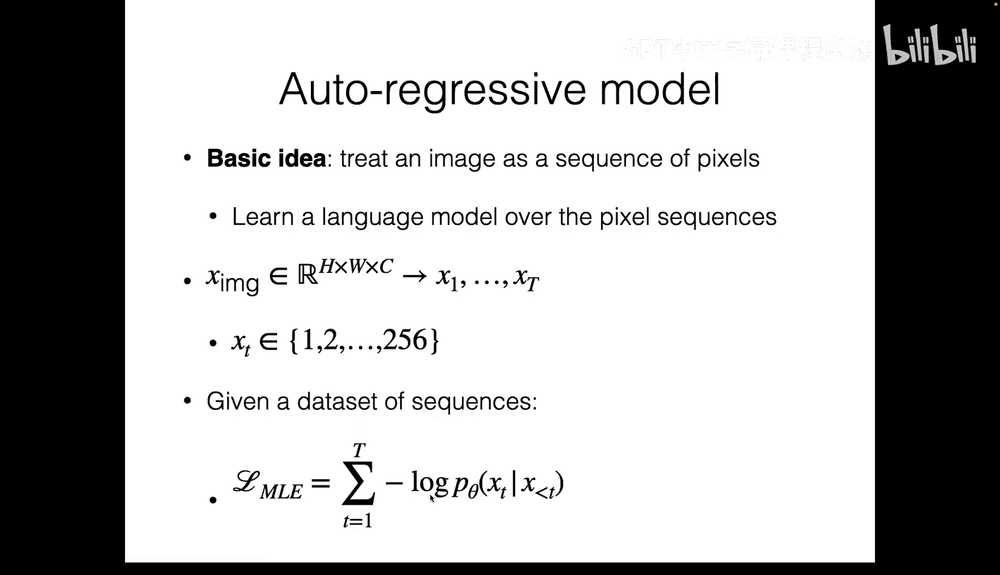

So it turns out that people tried this and here's an example from 2016。

And they weren't using transformers， so they're using these RNNs。And here you could see some results。

So here they're giving the model this， so they're going in this raster scan order。

 so you could basically prompt the model with this part of the image and then have it complete。

And then here's like the original image。So I think it's a person swimming or something like that。

And you could see these different completions that I came up with。Similarly。

 this one's an animal and it comes up with some different completions and here's the original。

And here's another example。嗯。So then you could cut and like try to improve this。嗯。You know。

 maybe you could use different architecture or train on more data。

 and so these are supposed to be dogs。So this one， you know， kind of looks like u looks like a dog。

And so here the basic idea again， is to basically just do this autoaggressive。

Modeling and generation of images。

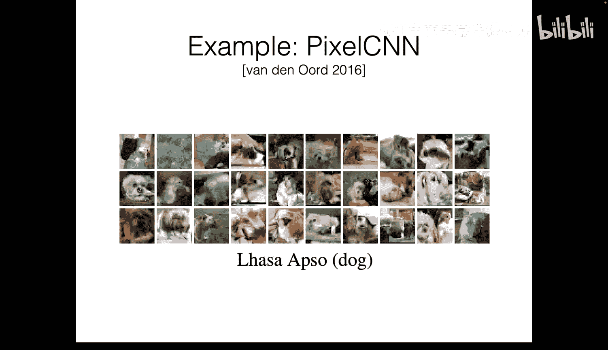

You could also try using a transformer and maybe the images are looking。嗯。A bit better。

But when you think about this， a really key challenge becomes the sequence length。

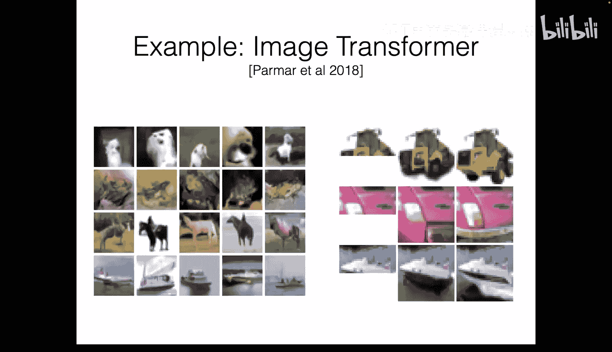

So let's say that we want to generate this thousand by thousand image with three different channels。

Well， then basically you have 3 million。Tokens， so pretty long for just one image。

So you could imagine like， okay， what if you wanted。

What if you had an agent and the agent had like multiple images in its history。Well。

 then you could have like 10 or like 100 million tokens pretty quickly。

And so typically these earlier works were coming up with different ways of doing memory efficient attention。

 so they weren't using like the standard attention and they were trying to modify。

 say the transformer architecture。And in general， this approach kind of runs into this issue of having this really long sequence length。

 and then that also slows down generation， like if you have to generate  three million tokens。

 it might take a while just to generate one image。So a question is like whether you can come up。

 still try to use an autoaggressive model， but not necessarily predict individual pixel values。

 maybe try to predict some more kind of compressed representation of the image。

And so that's what we'll talk about next， but maybe first let me pause if there's any questions about the stuff I've said so far。

啊嗯。Are they just getting the emergency but also like some text that are that I think done have the completely？

Yeah， so I think so in one setting they're just giving the images I actually forgot all usually they'll try you know different variations。

 different tasks， so they might have tried some kind of captioning task。

 but I actually don't remember yet。Okay， so next we're going to talk about basically learning。

 so if you think of the pixel as a token， then the question is like。

 can you have a better notion of token？For producing images。Okay。

 so for this we have to use some kind of clever ideas。

 so I'll introduce this idea called the vector quantized VAE。So here again。

 we want to learn some tokenizer that。Kind of compactly represents an image so that we don't have to generate。

 say，3 million tokens。 Do you generate an image。And so again。

 tokens are these kind of discrete items so we don' we don't really want something continuous。

 we want something discrete because then we could just use the language model。

 you know as if it was producing text。So an example of maybe what we might want is。

 let's say we introduce 8000 different tokens that you could have。

UAnd you want an image to just be a thousand tokens long。Okay。

 so it's kind of much different instead of 3 million， we have a larger vocabulary， so instead of 256。

 we have 8000， but now hopefully the sequence length is much shorter。So then the question is。

 how do you do this or how do you even like think about。This this kind of problem。嗯。

So there's this cool approach， which is called vector quantized VAE。

And it uses this idea of variational autoenrs。So basically the idea will be we want to learn some discrete code。

That is kind of sufficient for a decoder to produce the image， to reconstruct the image。

And when you think about it， like if we're able to achieve that。

 so encoding something into a discrete code and then kind of perfectly reconstructing the image from it。

Then that kind of satisfies what we want。 It's basically some compact way of representing an image。

Okay， and so you can see that this VAE framework is potentially suitable。

But the tricky thing will be the fact that these tokens are discrete。So in order to explain the idea。

 we have to learn a little bit more about VAEs， so let me briefly introduce just the standard VAEs which have a continuous Z or continuous latent variable here。

Oh， and then yeah， the way these VAEs work is， like I was saying。

 if you if you have a kind of you know， well behaved latent space to say it's like a normal distribution。

Then you can generate a random sample。By just generating some sample。

 say from your normal distribution and then passing it through your decoder and you get a kind of random image。

Or you get a sample， sorry。So the standard VAE will assume that this。

Laightnt variable Z is continuous。And it basically assumes that data is generated as follows。

So first we sample a latent variable， like I was saying。Then， you turn。

The you turn it into data with a decoder。And then the thing called the encoder is something which maps this data x into the latent variable。

Okay， so now we could just introduce some notation， so our decoder will be P theta。

Our encoder will be Q phi。 these are just different parameters。

And then this PZ is usually called the prior distribution。

So the way you train the VAE is to basically balance two different goals。

So first you want the model to be able to reconstruct images well， given some latent variable。

So for that， you can just use this kind of reconstruction and loss。

And it says that the decoder should assign high probability to an image given a latent variable。Okay。

 so it's basically saying this decoder should， yeah， learn to model the。

Kind of image distribution conditioned on different latent variables。

And then what you want to do is like I've been mentioning。

You don't necessarily want the latent variables to just be anything。

You want to kind of keep them well behaved so that you can produce samples easily from the model。

So what you can do is you could have this regularization term。

And it's basically saying that the encoder。Should have a distribution of latent variables that's kind of close to。

Just this Gaussian distribution。Okay， so we want to learn this encodeder and this decoder。

And we want to make the encoders outputs kind of close to a standard Gaussian。嗯。

But they should have some information and the decoder should then be able to use it to kind of reconstruct an input。

So the final loss that you get looks like this and it's basically these two different terms。

So over here you have sorry the regularization。And then here you have the reconstruction laws。

And you can basically see that it involves actually generating latent variables from your encoder。

And then you try to reconstruct them with your decoder。Okay， and so。

We'll see how much time is left at the end of the lecture。

 and maybe I'll add it in for future semesters。 but I thought there might be a lot of content in today's lecture。

 so I won't go through the full kind of。Derrivation for where this loss comes through comes from。

But hopefully I've given enough sense of where these terms come from in terms of having a reconstruction loss as well as this regularizer。

Okay， so this was kind of quickly how you would train one of these VAAs。

You would again have some data distribution of like images。And then basically， you know。

 write some code so that you could。Compete this loss and optimize it。And if you do this。

 this is from the original VA U paper。Then you can get these kind of interesting results they're especially cool if you haven't seen this before。

So this is basically showing some structure that has been learned in the latent space。

So this is saying like， let's say you get the vector corresponding to a7。And you get the。

 the latent vector corresponding to01。Then it turns out that you could just do the simple kind of linear interpolation between them。

And you could get this， like sequence of vectors。Then you could pass each one of those vectors through your decoder and actually produce an image。

And then the kind of cool thing is that it actually ends up looking like some interpolation between you know。

 the different numbers。And then similarly， you could do this for faces。Like here's different kind of。

 I don't know， emotions， and so you can do this kind of interpolation between different types of facial expressions。

And so kind of what it's showing is that， well， first of all。

 we have the ability to reconstruct images from vectors because each one of these。

 you start off with a vector。And then second， it's showing that the latent space is somehow kind of structured。

What you can also do is just sample。Lant vectors from a Gaussian and then pass them to the decoder。

 and then you can just get kind of randomly sampled numbers in this case or randomly sampled。faces。

Okay， so this is it for the standard Ga。 and then basically at the time。

 this introduced this kind of new way of doing generative modeling。

And so this led to a just you huge amount of research on improving these models and these were basically the state of the art for generating images for a long time。

 and there's just been a lot of different follow up works related to these variational on cutters。

So one of them was people started wondering like。What if you could have this latent vector be basically discrete instead of being continuous？

And that'll actually turn out to be useful for our use case here。

So these standard VAAs give us a way to encode and decode images using the continuous vector。

But if we could represent things as discrete， then we basically have this kind of tokenizer and de tokenizer。

So you could apply the VAE encoder to basically tokenize an image。And then similarly。

 if you produce some of these kind of VAE tokens， then you could run the decoder to basically turn it into an image。

 that's the basic idea。So a technique that was developed to try to do this is called VQ VAE or vector quantas VA。

And the idea is pretty cool so here we have again， some encodeder and decoder。

And so we start off with our encoder producing this。Continuous vector， okay。

Now we actually want to turn this into something discrete。So we have what is called the quantizer。

And the quantizer kind of at the high level will take this continuous vector and yet turn it into。

ADreet value。So the way you do this is to have what's called a codebook。

So the codebook will have some number of continuous vectors。Let's say here you have like one。

 you have eight different。Vctor is in your code book。

Then the idea is you can basically do this lookup where you try to find， okay。

 given the vector produced by the encoder， what is the closest vector in the codebook？

So that's just writing this out here， you find the closest。A vector in terms of the L2 distance。

And then if you find do this lookup， now you can basically associate your encoder value with this discrete index from the codebook。

Okay， so like in this case， let's say that the nearest vector was this one here。

 then we're basically saying that we're going to encode this part of the image as the number five。嗯。

Then your decoder again， is going to take in。The vector corresponding to。This number， right。

 because you could view the output as a number， but then you could go like look up the vector and provide it to the decoder。

And then it will try to produce some image。So so that's the basic setup of this VQD and then the question is like you know。

 how do you train this and what are different issues that could come up？Actually。

 before I talk about them， could anyone does anyone have any thoughts on。

Some things that might go wrong or some things that might be a challenge with this set。

WellFirst of all， BQE uses discretized tokens then wouldn't its specificivity be very limited as well？

Yeah， so one issue is that here we have images and images are basically。You know， let's say。

100 by1000。 and then each value has 256。 So itd be what， 256 to the power of 1000 times100。

 which is like a massive space。And then the space of possible codebooks is of possible like discrete sequences is much smaller。

So。You are basically inevitably going to have。Some loss， some like kind of lossy compression， right。

So yeah， that's， that's one issue sure。咁能个歌都可以。So that'll be on the next slide。Okay。

 so another thing that's tricky is this lookup that we're doing here is this kind of discrete operation。

So it's not this continuous kind of differentiable operation。

 so you have to have some way of dealing with the gradient when you're trying to back propagate in this case。

So the way that it's done is like this。So let me walk through each step。

So here they have this loss function that has three different terms。So first of all。

 you have the reconstruction term and maybe this one isn't too surprising。

 it's basically saying like given your latent variables， you know reconstruct the image。

This one is saying that you should update the codebook embedding。So， you might like。嗯。

Start off with some random embeddings， and maybe you want to make them a bit closer to the ones that the model has actually produced。

And then， kind of。On the other side， you want to make the encoder kind of actually produce vectors that are close to the ones in the codebook。

And in particular， you kind of want to commit to like one code book vector if you're trying to do。

just choose one of them。And so the trick they do here is you can only apply the gradient to one thing in each term here。

Because otherwise， each one of these would just be minimized by like setting setting them both equal to each other。

And then you have to deal with the fact that you don't。

 it's difficult to kind of back propagate through this select operation。

So here they use something called the straight through gradient estimator。

And it's basically this kind of really naive gradient estimator again。

 the challenge is we can't back propagate through this so we don't have a gradient to kind of use for the chain rule for this vector here。

And the straight through estimator says just take the gradient from here and just copy it and kind of use it in the back propagation。

Okay， so you can kind of see that maybe there's some kind of heuristics going on here and then you have this kind of gradient estimator。

 So maybe it's not perfect， but potentially。You know， it works。

And then the kind of inherent limitation is the one that was brought up。

 which is even if you train this really well。Ultimately。

 you're trying to represent this image from like the space of all images with a like fairly small number of kind of discrete numbers。

嗯。So what you actually do in practice is you could have this kind of structured。嗯。诶。诶坐消。

So here we're saying that like， okay， we are going to associate one of these numbers。

With kind of each position on this 2D grid。So to represent an image。

 you could view it as being a sequence， but you could also view it as being， you know， some。

Discrete values that are kind of arranged in a 2D grid。

And then you could kind of get the vectors corresponding to them and apply some image architecture for the decoder。

Okay， and so here it's sharing convolutional neural networks。

 but the overall idea isn't necessarily dependent on the architecture。

That you're using for the encoder or the decoder。Okay， so this picture is like from their actual。

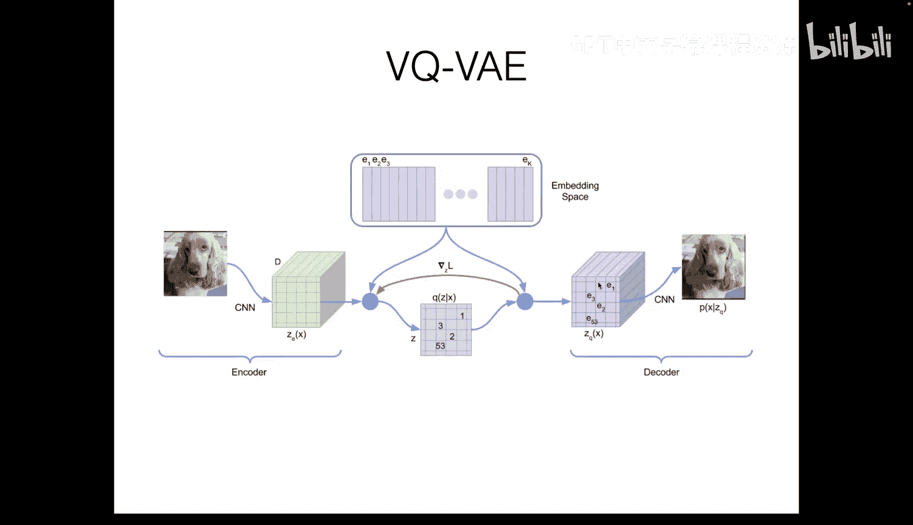

Paper。So some examples of this， so I put together a code example。With a really simple。Example。

 but here's one that was actually trained by Open AI and used in their Deli system。

So maybe the surprising thing is that this does work to some extent。

 so here is there you could see that here there's this like encoder。Here they have this decoder。

And here are the kind of intermediate tokens that are generated。

And so here it basically represents this penguin as these discrete numbers。

 and then it's able to go and you could see it's a bit noisy。

 but it's able to some extent reconstruct this image。嗯。

So， so this one in particular is。Is actually still used in some models。嗯。

But this is like an example of one of these kind of tokenizers and detokenizers。Based on the Vs。

I think they use slightly different you know implementation details。

 I think they might use a different gradient estimator and things like that。

 but the overall idea is the one that I showed you。

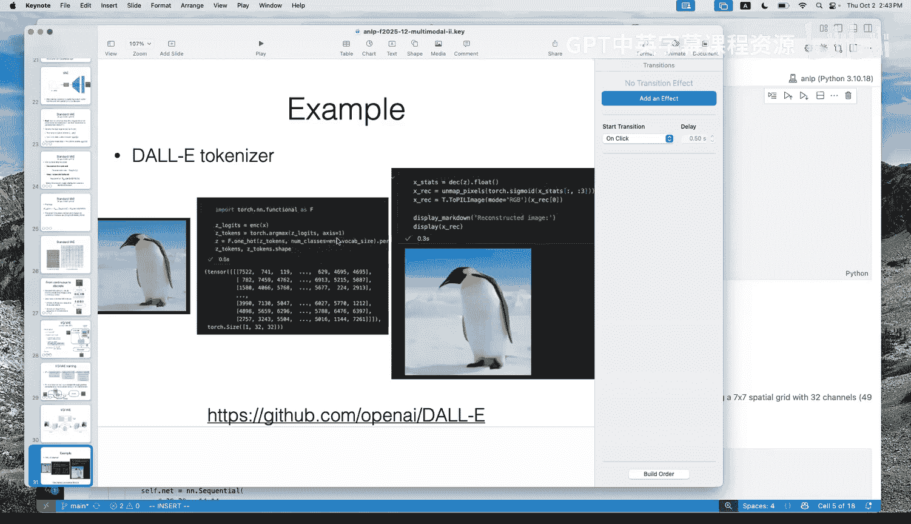

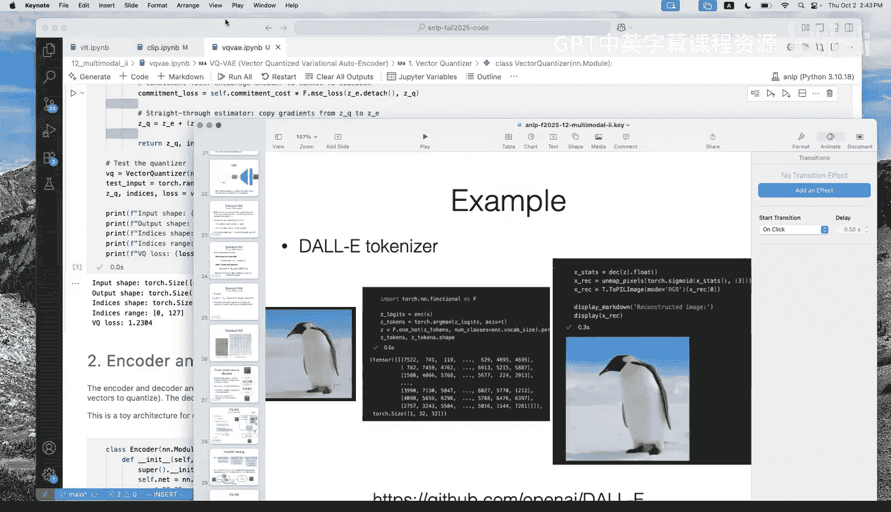

Then I was also putting together this example here in the notebook and it's using。

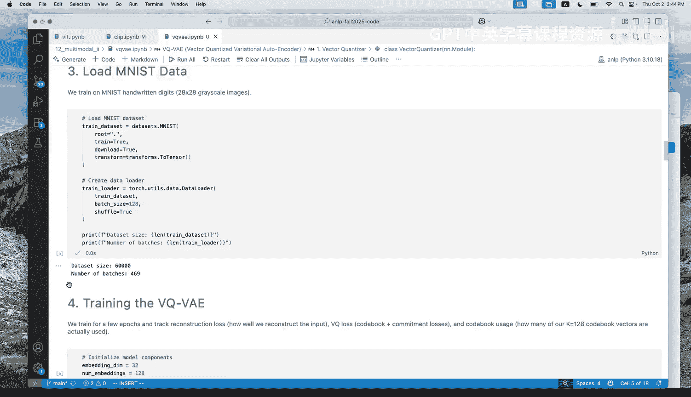

Anest。So here we have these different digits。 and then you can look at the。

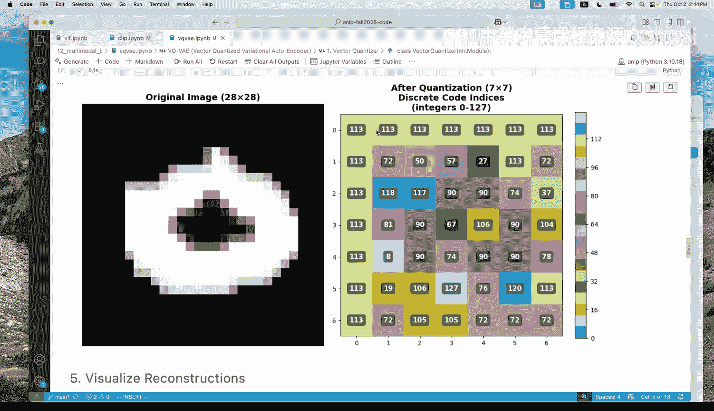

Well， first we can look at the loss。So here the reconstruction loss。Ends up being。Fairly small。

And then the model doesn't actually， maybe these are like fairly simple images。

 so it doesn't really end up using even all 128。嗯。Code entries。

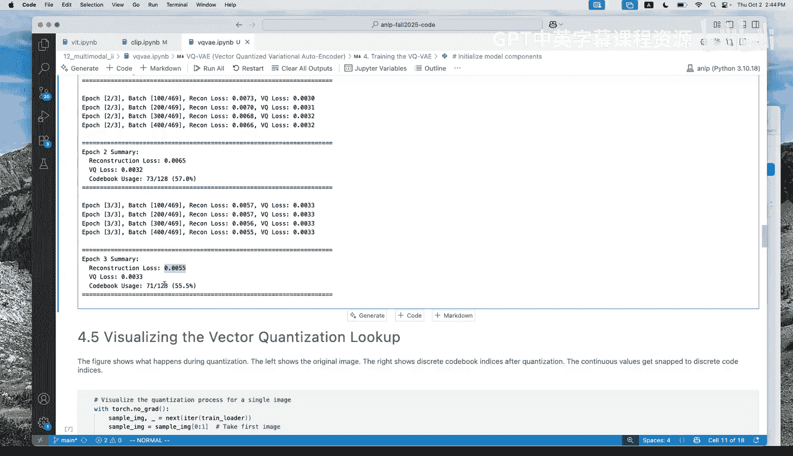

So here you can see an example and it looks like it learned that probably in all of these images。

 this part is just blank space。So it could just use this like single token to represent that。

And then in here you see some different variations and different usages of tokens。

And then the cool thing is that the decoder then is able to kind of reconstruct。

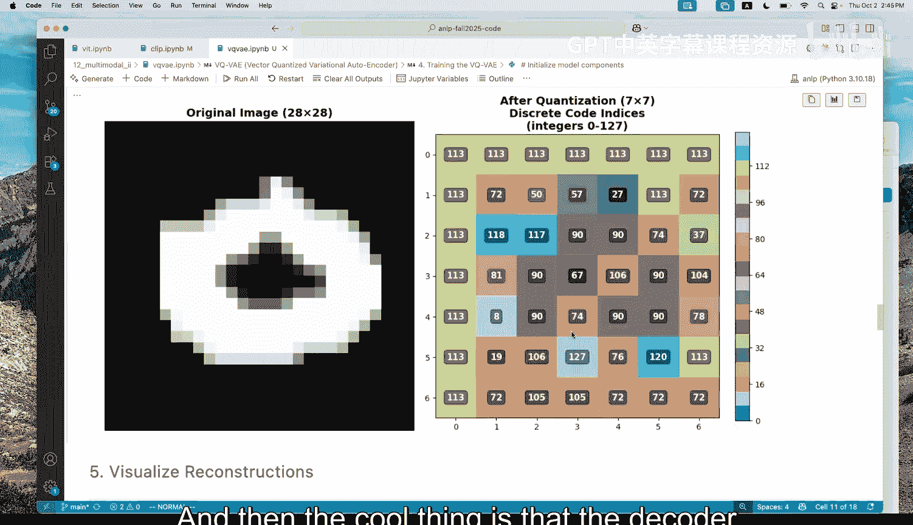

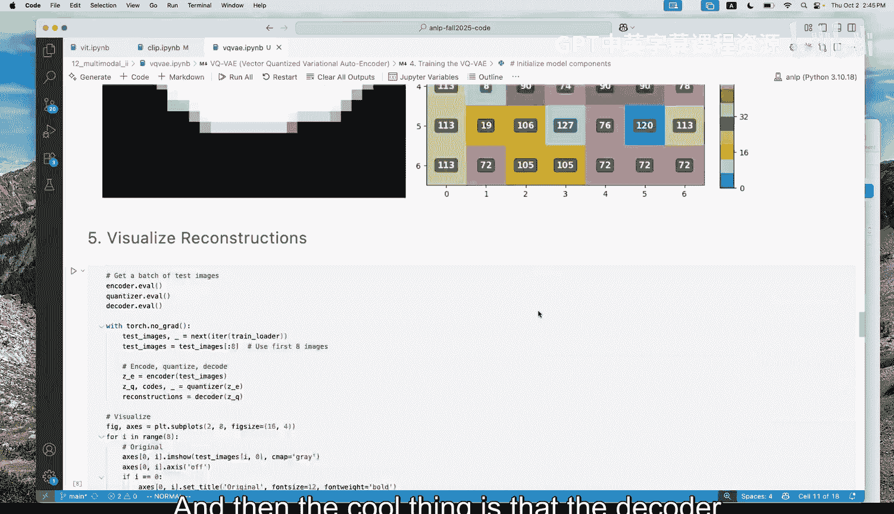

Reconstruct the image from this information。Now， you could probably imagine that like if you had a really information dense image。

Like， let's say I had a screenshot of my laptop right now。

Then basically your codebook has to also encode information about all of the text in the screenshot。

And so possibly， you know， this approach doesn't work if you have like really information dense images。

But it at least works for these kind of simple ones。

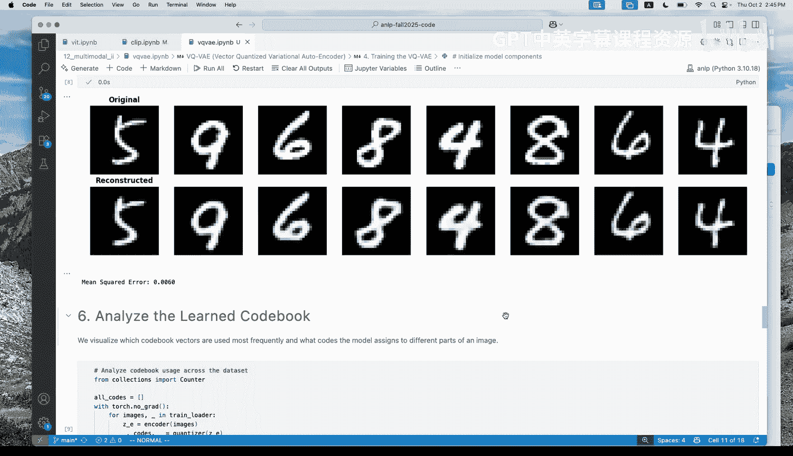

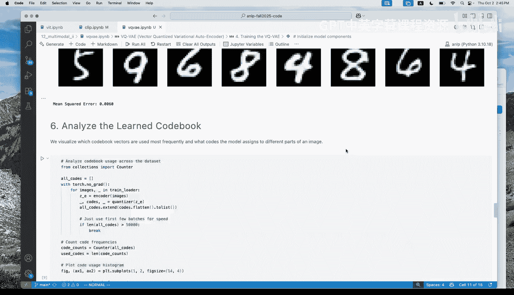

So you can look at some other stuff here。 here's you're showing it with。

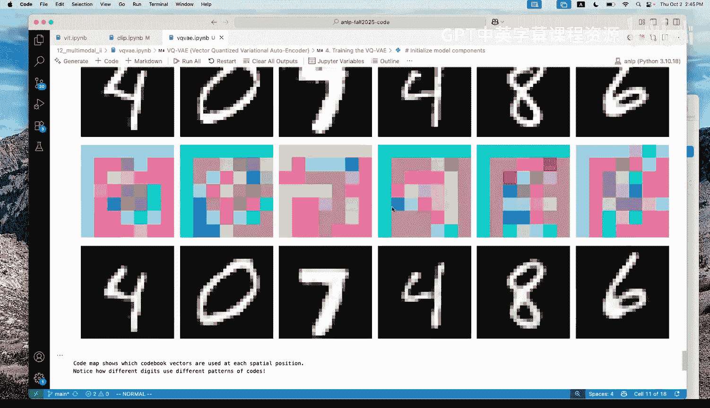

Like some different variations。So maybe let me pause here for questions before I keep going。

Maybe I like this， but why do you want to discretize English？Yeah。

 so we'll see this in a second that once you disretize the image。

Then we can basically just use a language model to then predict the tokens。

And then once they predict the tokens， you could run the decoder and now you have a generated image。

Yes， basically this vision developing。Yeah， you在喝。嗯。😊。

And so this process of trying to see whether the generator theoc image is similar to the original。

 is this for the purpose of helping us understand if what the latent space and the learned like decoder is good enough or like you maybe reiterate the point。

不间了O。这是法不。Yeah， yeah。 So here we want to see whether， well， you can imagine some case where。

The model produces random tokens， and then the decoder produces random images。

 Then that kind of says that the encoding that it came up with either wasn't sufficient to。

Reconstruct image， or it means that your decoder that you learned isn't very good。So yeah。

 one of the metrics is basically can the decoder reconstruct given the。given。

The encoding of the image。And then yeah， sorry， go ahead。Yeah， this is used to like diagnose。

The training of the V。Yeah。And then you'll also usually check things like if like what is your sample quality？

So basically， the encoder could learn to just put。嗯。You know。Put things in a latent space anywhere。

And then。If you sample from like a normal distribution and try to decode it。

 it could be some random image， so ideally you want to be able to reconstruct images and you want to have this kind of well behaveved latent space so that you could then sample images easily。

Has the problem being border or？Yeah， so one thing you could check is。Like what else。Yeah。

 what I was just saying， so。If you。Well， I guess there's different problems you can have。

 So one is that the the laden space isn't kind of well well behaved。

 So for that you could try sampling and see the the sample quality。嗯。

You can also look at the k divergence if it's like very large， very small。And then you can look at。

The reconstruction quality， but。Yeah， like I'm saying。

 you probably need to look at multiple metrics to say what is contributing to battery reconstruction。

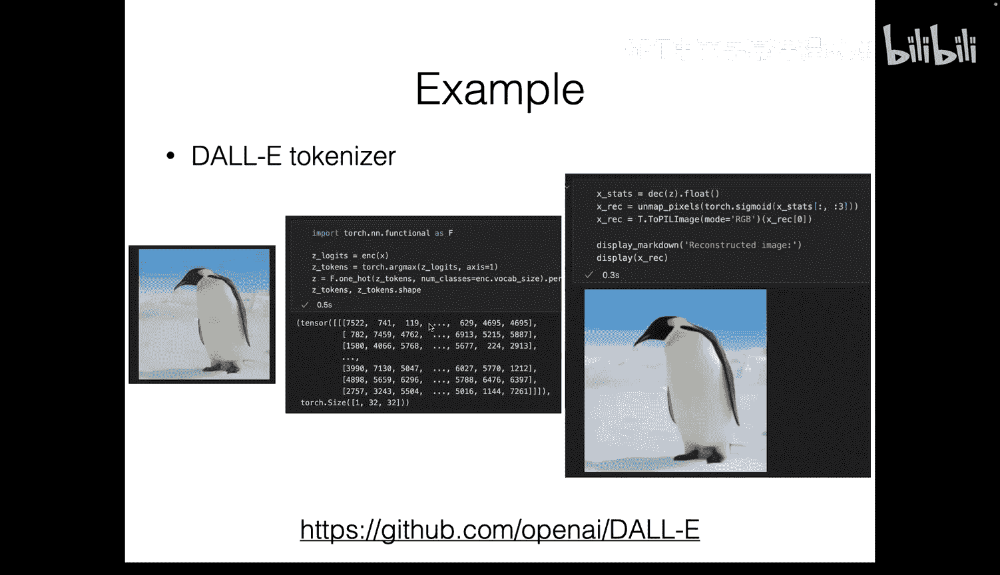

Okay， so then it turns out that you don't necessarily have to do this with VAs。

 so you can also use GAN to try to do the same thing。嗯。So maybe I won't spend too much time on this。

 but it's basically trying to achieve the same thing with。With guns。

And then the interesting thing with this paper is this is called vector Quas deganand。

The interesting thing here is。They。Actually train this auto aggressivegressive model on the resulting tokenized images Sililio was saying before。

So here again， they have this way of basically。Tokenizing and detokenizing images。

Then they take a really large data set of images and kind of turn them into tokens。And then up here。

 it's being visualized。That you could just learn this。

 this auto aggressivegressive language model to basically just generate the tokens。Okay。

 then if you've generated one of these token sequences， then you could try to produce an image。嗯。So。

Yeah， I'm not sure how much， how much you spend on this， but this is just。

 if you haven't seen GNs before， then here's the basic setup。So here you have this generator。

 and you have。嗯。Oh， for the VQ again， they have this generator and this encoder。

And then you have this discriminator。Ohoops。Yeah， this probably isn't enough to kind of introduce scans。

 but here's the basic setup， here's the basic loss function you have。

You want the discriminator to basically assign。One， two things that are real， so that'll be X。

And you want it to assign a zero to things that are fake， So it'll be X hat。

And this X hat is produced by first encoding an image and then generating it。Okay。

 so that's the basic setup。And。OopsYeah， maybe the reason I want to highlight this one is because in different papers。

 people use the VQN instead of VQVE， but also they actually do this second step of tokenizing a lot of images and then training an autoaggressive transformer。

And so here again， you know， remember we started with 3 million token sequences to represent an image。

Now they actually train one where each image is just 1024 tokens。嗯。

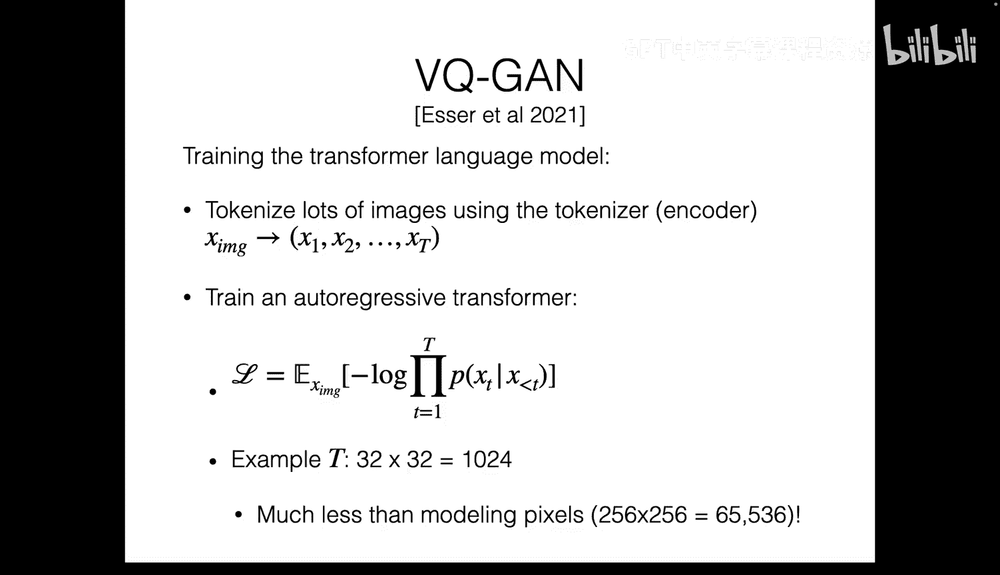

SoAnd then here's some examples。Here they are doing this like imagenet， which is these different。

Usually pictures of like one individual thing。And。They're able to get some。呃，Maybe第三。

Decent samples from that。

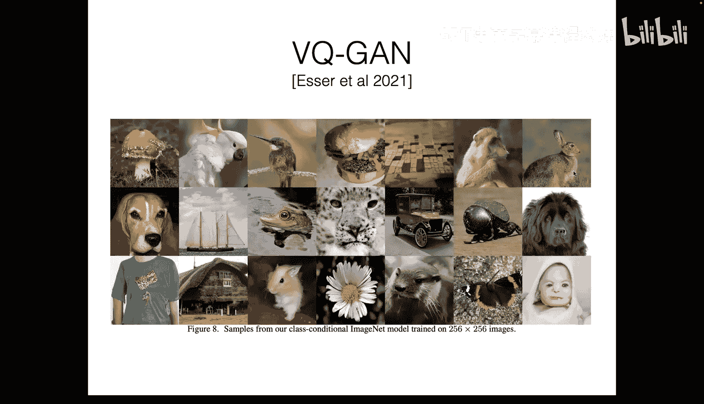

嗯。Yeah， and then like I said， usually， you know， in these papers。

 they'll do different variations and different tasks。 So you could， you know， say， like。

 what if you start with。呃。You know， this here and then turn it into an actual scene and so on。

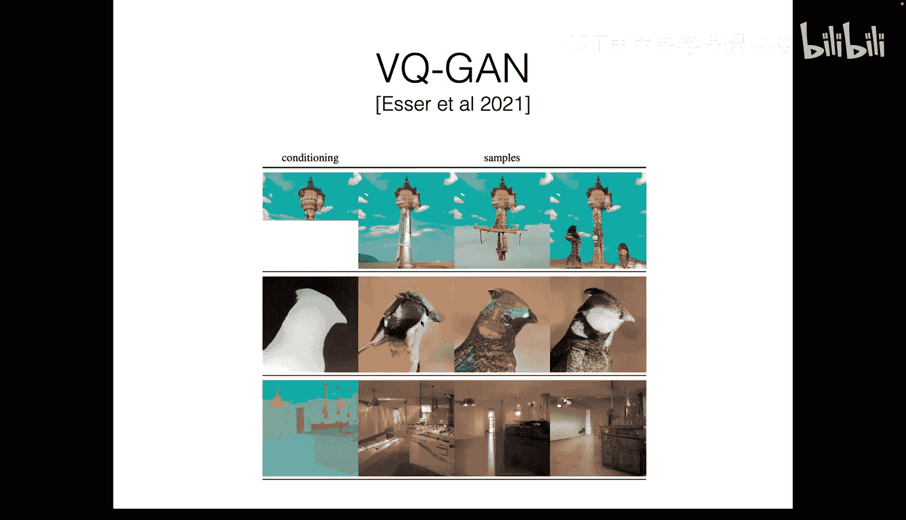

嗯。But I want to return to again， our kind of original goal， which was。

 let's try to incorporate this into a language model。

So we actually saw how to do this in the sense that we now have this tokenizer and this detokenizer。

And so next， we can just add these tokens。Two the language model's vocabulary。

And we can just train or fine tunena model on both text and image tokens。

So an example of this is this was from meta from 2024。And it was a model called chameleon。

And you can see here that basically they have the different parts that we've learned about。

So here they have some kind of image tokenizer， it turns out to be a VQgan。Similarly。

 they have this image detokenizer。And then what they do is they basically assemble this like pretraining scale data。

 which has not just text， but also images， so probably like a lot of web data and like hand cur did things as well。

And they just train a model on 10 trillion tokens of data like this。Then similarly， you could do。

 you know fine tuning， you can have a prompt， which is like what can I bake with this and some some picture？

And then the output is like， here's a recipe for banana bread。

And then maybe you also produce an image of banana bread。But the idea here is that， yeah， we really。

Have， you know， potentially achieved this idea of。Just using a language model to produce both kind of text and images。

And so here's an example where。They have it kind of interleaved。

 So you can see in the response it's generating some text。 It generates an image。

 and then it like explains。They generate more text。

This was just another example that I think I put this in last semester because it had come out like just just before the lecture started because people were exploring these types of models。

So this is just another example。 And you can kind of， maybe it's to help convince you that。

It's using what we introduced in this class so this is a screenshot from their paper you could see they have this VQ VAAE for tokenizing and also for detokenizing。

嗯。So。So yeah， broadly speaking。This can get you some ability to generate both text and images。

But as far as I'm aware， it still is difficult to generate like the most high quality images using this approach。

 but it's certainly still being explored。So there's other methods which are like specifically aimed at just generating the images and we'll briefly go over some next。

But any questions on。Thus， so far。我看一看你。Yeah， so basically what you have is you have your language models vocabulary and then you just add on extra。

Tokens into the embedding。Outlier。So so it'll just be different numbers， you know for。对。

In both of the look areas or is it different？Yeah， so the numbers will just be so you could take your language models vocabulary。

 let's say it's0 through V。 Then you could just make the image tokens like v plus1 to v plus， yeah。

Andmh。TheFirst step the transformer， we embed tokens and then make them continue time。

Like we go from a discrete a continuous so if we if we're going from discrete to continuous anyway。

 what's the point of this？Yeah， so that's a good question。

 So I think you would need some way of turning your continuous vectors into an actual image。

So what you're saying is possible to not。To not just produce a discrete token， but to produce。

A continuous vector。But then you basically you need some way of training the language model well to produce continuous sectors。

And then you need some way of turning the continuous vectors into images。

So it's potentially possible， it's just like a different， it would be a different。

Appreciative to take。So I presume the recognize and are pre chain before。

Are they also joint trained or are they fixed for this point？Yeah， that's a good question。

 So as far as I know， they'll actually be fixed， which to me kind of seems like a downside。

Especially because some of them are based on。Like older models， like even sometimes。呃。

Like models that were pretrain with the clip objective， or they'll just use like the opening high 1。

So it seems like a potential。Week point where it's， yeah， the model is somewhat。

End to end in that it's producing text and image tokens。

Then you're still re relying on this kind of pretrain。嗯。二。It is more of a random thought。

 but out of curiosity do these methods work all with different image proportions or resolution because when we disre it into a sequence of tokens。

 the information about the proportion vanishes right that we don't know it' 16 by1 like 1 by 16。Yeah。

 so you'd probably need to do some other。嗯。Some other。

Method to deal with like the different proportions， I think it just in the naive case。

 then it'll be somewhat specific to the proportions it was trained on。Yeah。

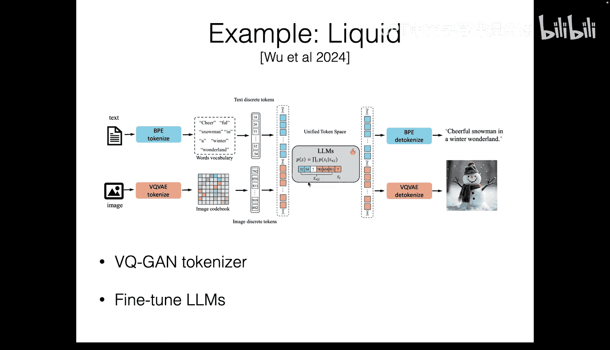

Okay， cool so。So then next， I'm going to briefly go over。The text and image to image。

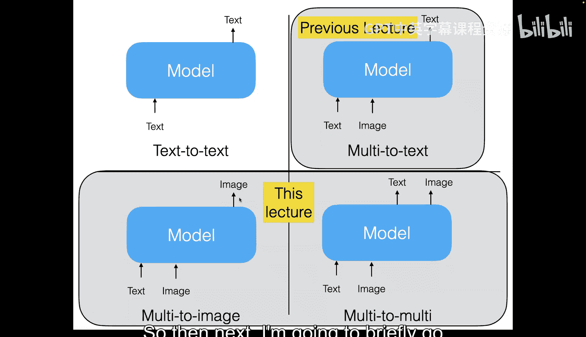

嗯。So。For this， again， I'm not going to be able to go over all the methods and even some of the recent ones。

 but one good thing to at least know about is the diffusion models。

So here I'm just going to go over a quick overview of some early references。And hopefully。

 you could at see the。Some of the key ideas。So there was kind of two different。

Forulations for diffusion that came out around the same time。And here's one of them。

And so this was called denoing diffusion probabilistic models。

And here you see this idea that I kind of was briefly introducing at the start of the class。

So here we have some notion of like going from noise to real images or from real images to noise。

And so the idea of diffusion is to basically have these two different processes。

So one is the forward process。And you are。That's basically croping the image by adding noise。

So you have some noise distribution Q。And this could just be， say， Gaussian。So at each kind of step。

 you are adding Gaussian noise。And then if you do this for enough steps， then it's basically。

You've lost all information about the image， and it's effectively a sample just from the Gaussian。

Then you have this other direction， which is reverse。

And so here we want to yeah basically reverse the process， so given some current time step。

 you want to produce some slightly denoised image， so x t minus1 given x T。

And so this will be the part that is learned。You can see it says P theta。

And you could imagine that like if you actually did this well。

 then you could run this for multiple steps or sample multiple steps。

And eventually get some real image in the end。Okay。

 so you can see here some actual examples from this kind of initial paper。

Where they're starting for noise and then they're running different samples。

 And you end up with different images that are。And from the distribution of the dataset set that they trained on。

嗯。So again， here the core idea is to learn to reverse this noise process。So again。

 forward process is the kind of noisy one and then backward process is the kind of generative one。嗯。

And。Yeah， I don't think I put。 I wasn't sure how much time I would have。

 so I didn't put too much detail here。 I I don't think Id put any equations。But again。

 the training is kind of what I'm saying， so you crop these images。

And then you basically train the model to predict either the image at the next step。

The trick is that you can formulate it in a way that it's sufficient to just try to predict the noise that it should remove at each step。

So if you were to look at the objective that's used to train the model。

 you'll basically see that you're learning this network to basically produce noise in some sense。

Okay， so I didn't really put the the details here， but at least hopefully you could see。

The basic setup of diffusion。And kind of what you get if you successfully trained a diffusion model。

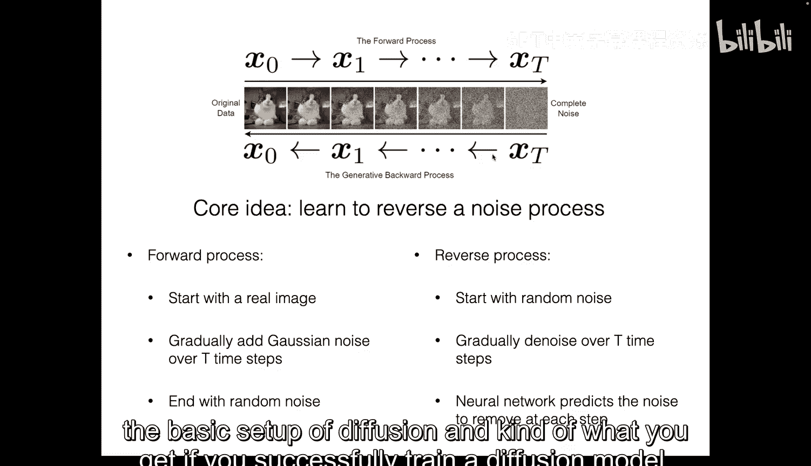

嗯。So what happened is these diffusion models came out and people started developing them a bit further。

So here's yet another paper from OpenI。And this was one of the first ones。

That well you could see the title， the defined title is diiffusion models beat GNs on image synthesis。

😊，So basically what happened is you know at first VAAs were the state of the art。

 then GNs came out and those were the state of the art and there was you know thousands of papers on GANs at every conference and so it's like a really big deal for the diffusion models to actually match them on these like benchmarks that everyone was using。

 people kind of trusted the metrics。And so in this paper they developed a lot of different kind of tricks if you want。

 I say tricks， but none of it is trivial and they're able to get it to get the diffusion model to produce these kind of really nice images which are much different than the ones in the original paper。

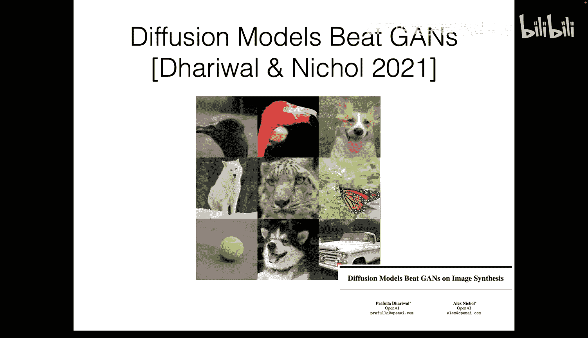

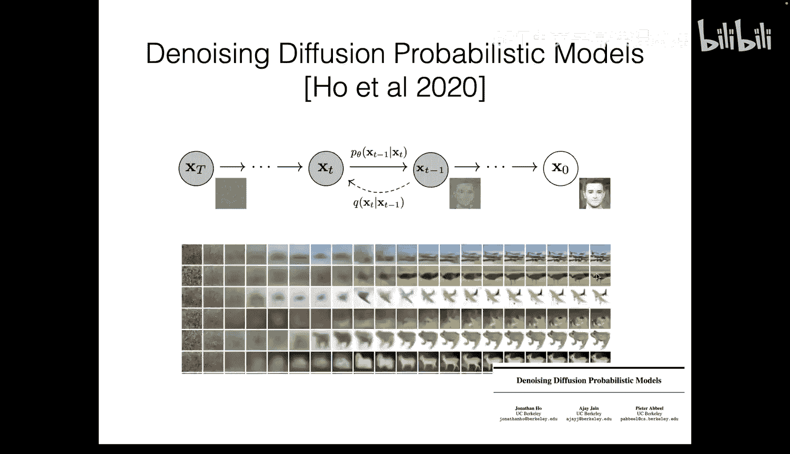

So then since then now there's like thousands of papers about diffusion models and then you could like incorporate these into different tasks because maybe we don't want to just。

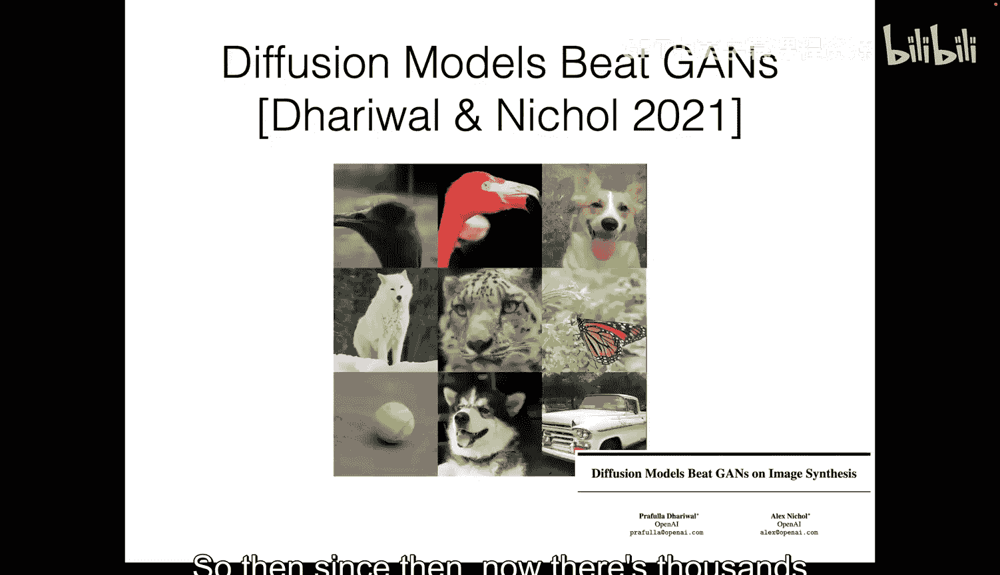

You know， generate random images， you actually want to like do different things。

So one thing you might want to do is this like very useful task of providing some text and then generating an image。

So like here， it's Shiba Iu wearing a bray and black turtleneck。

And you can see that this model has produced a pretty nice image for this prompt。

So this was the model maybe you've heard about it。There was like Dolly， Dolly，2， and Dolly 3。

So Deelli2 is， I guess， interesting for these lectures。

Because it basically combines the idea of using clip。

 which we learned about last lecture with a diffusion model。

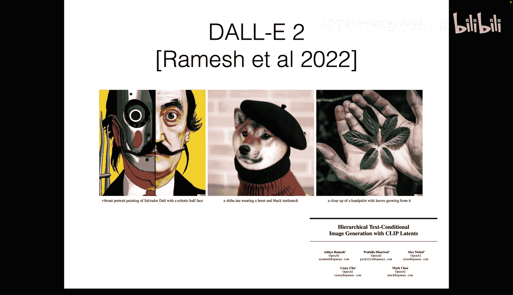

So let me just show you a little bit about the pipeline that they have。So first of all。

 you assume that you start off with a clip。So if you remember from last lecture。

 clip can basically give you two different things。So you have this image encoder and you have this text encoder。

So the image encoder takes in some image and gives you some image embedding。

And the text encoder takes in some text and gives you some text embedding。So here in the first stage。

 they are going to use this pre traineded text encoder。To basically represent the text input。Okay。

 so now we have some continuous factor。Now the question is。

 how do you actually produce some image starting with this representation of text？So for that。

 you can train， well， what they do is they train two different models。

So the first one is what they call the prior model。

And the prior model basically goes from the embedding of text to an embedding of images。

And for training the model， they could basically have a data set of text and images。

And they could train the model to basically produce the image embedding that they get from clip。Okay。

 so in some sense， it's trying to kind of。Oh yeah， produce image embeddings given text embeddings。

And then you can kind of see that both of these are kind of continuous。

 so you can use a diffusion model instead of training it to produce images。

 you can just train it to produce embeddings。Then they have the second model， which is the decoder。

And so now you can take in you could take in some text or an embedding of text。

 which you could get easily。And you can take in an image embedding。

 which you can get now from your prior。And now you want to produce an image。Okay。

 and so the thing is， is that like maybe this model is somehow determining like the semantics of the image。

And then this model， you can train it to， you know。

 produce like really large images or something like that。

So maybe that's one reason for having two models， you could imagine maybe just trying to build one model。

But this is what they did here， so then you can also train this with diffusion to basically take in these two different embeddings and produce an image。

Okay， so that's the idea of Dolly too， and there is a paper about it so you can。

Go read more about the details here I'm just kind of giving you an overview。

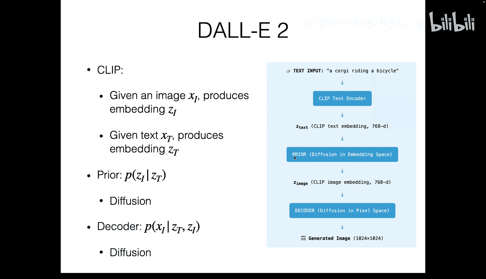

嗯。And then of course， yeah， so then at the end。You can get。Something which is。But pretty cool。

Now you can see this was 2022， so you could imagine that you know。

More things have been developed since then， but hopefully this gives you some starting point。

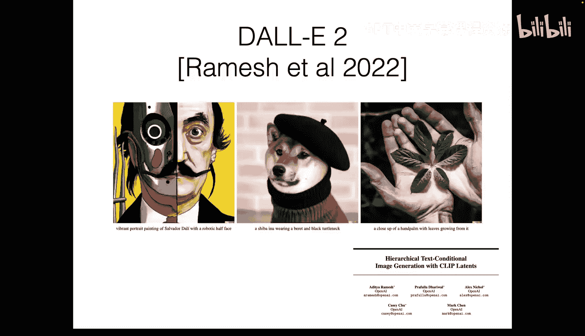

If you want to learn more about the area。So that's it for today's lecture pretty much。To recap。

 we tried to cover a lot。So hopefully at least now you've seen these different paradigms for geneative models。

 which is definitely a good thing to at least be familiar with so then you could go learn more。

So autoaggressive are the ones that we've been using so far in the class for text。

 but there's also GNs， VAEs andffus diffusion。At the very end of the class。

 we'll actually talk about trying to use diffusion for text。There it'll be not as trivial。

 it turns out because like text is discrete and these images you could view as being continuous。

But it's certainly something you can try and so at the end we'll have a lecture about that because it's still an ongoing area of research。

But that's the kind of overall picture。And then in the past two lectures。

 we talked about different models in these different areas。

And hopefully you got some sense that each one of these ends up looking slightly different， right。

Like this dolly model ends up looking different from the lava model and does end up looking different from like the chameleon model。

 which has like the VQ B and things like that。嗯。So that is it for today's lecture and I'm happy to take a few questions either here or in person。

嗯哼。😊，嗯。In。Yeah， so I think。I think here it's so you could。Well， one thing。 let's see。

So one thing is you can use C to get some supervision。So basically at test time， you only have text。

And so here it's kind of doing this clever thing where it's using the fact that ZI is a good image embedding to then train the diffusion model。

Whereas you could imagine training the decoder to just take in text。

But then maybe you can't leverage the supervision from clip。So my guess is that since then。

 people have probably trained end to end models， but maybe this is something they were doing at the time to kind of leverage club。

And then it does have this other nice， potentially nice thing， which is like。

This can kind of maybe generate like the semantics of the image。

 and then this you could optimize for like the size of the image or something like that。嗯。

你啱你睇到我你你只过眼啲都快啲。again， we did not look at any model which was from we。Yeah， so this one。

 this one was。So this one can take in both text and images and then can produce both text and images。

Yeah。And the BE in those function， we were assuming that the leadussians So we are values forcing them as toians why are we choosing any Yeah。

 so for the so for the discrete one， you do something different with the code books。

 but then for the continuous use normal distribution。So people have tried other distributions。

 but here the idea is you just want some distribution that's easy to sample from。

Because then let's say you want to just generate a random sample from the model。

Then you first sample from the Gaussian or this distribution that's easy to sample from。

 and then you sample， then you generate with your decoder。So， yeahep。In the， we had a problem。

 the likelihood of the image given the input how。So so that's a good question so there's different options for computing it。

One option， like what they do in the original VAAE paper is you just assume that each dimension is actually independent。

 like conditionally independent of one another。So then you just get this lost term for。

For each pixel。嗯 yeah。For each pixel， you just compute the likelihood of the pixel in the world。

if you want to compute the loss so you compute just loss of one pixel loss。Yeah， yeah。

 So that's a good question。 So it depends on the type of data。 So whether it's like。

Binary or categorical or actually continuous。 Then yeah。

 the exact loss you use could slightly differ。 but yeah， you're competing the likelihood。

the the definition of likelihood will。know， the formula for it will differ。

 but you're ultimately competing the likelihood。weekend we have two steps so we can what does the table look for it。

Yeah， so T， again， you could imagine that it will vary based on the model。

So it's typically like either in the hundreds or00。

 and then you can imagine that one goal is to basically have by having like fewer steps or being able to skip steps。

For each step are you using a different model or you have the same model the Yeah。

 so use the same model for all the stuff， yeah。So then you could basically get this。

Pretty efficient training， where you can。The model' only taking the noise image from the current step。

 it doesn't have to see all the previous ones， so you can just sample a bunch of different time steps。

 like throw everything into a batch and then you can train it easily。

The model is at least the model knows how to take out one some amount of noise from the image until it short circuit from the model to take out all the noise in one。

Yeah， so。Well， so one thing is like， I guess one intuition is that it might be easier to learn just these kind of differences than it is to just learn to generate things in one shot。

 yeah。嗯。

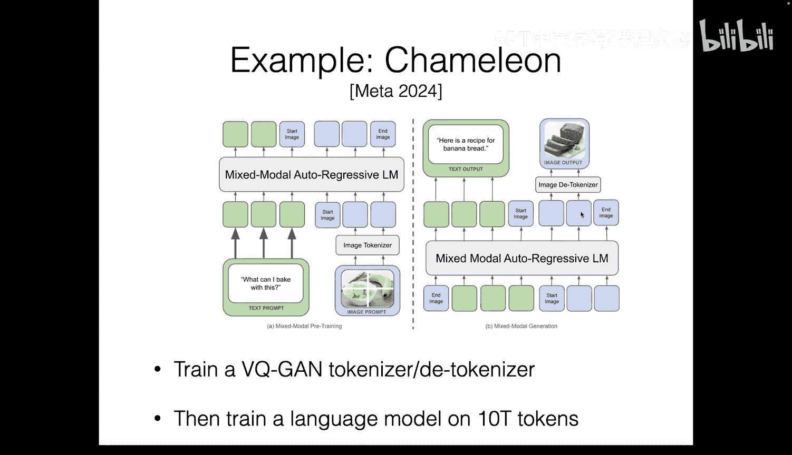