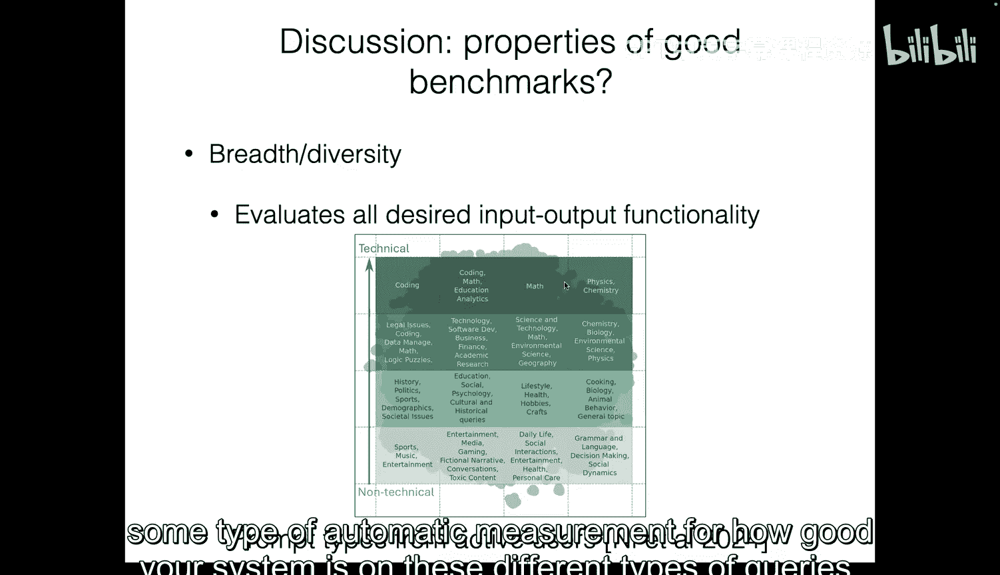
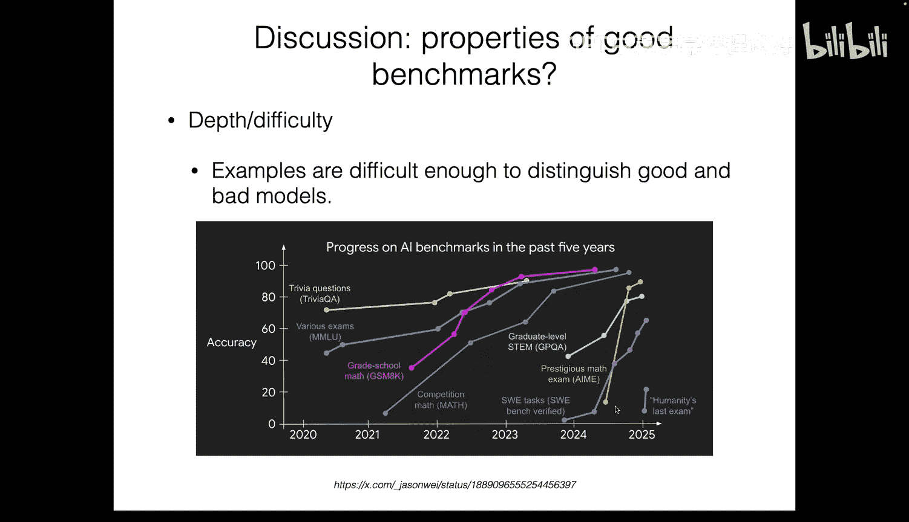
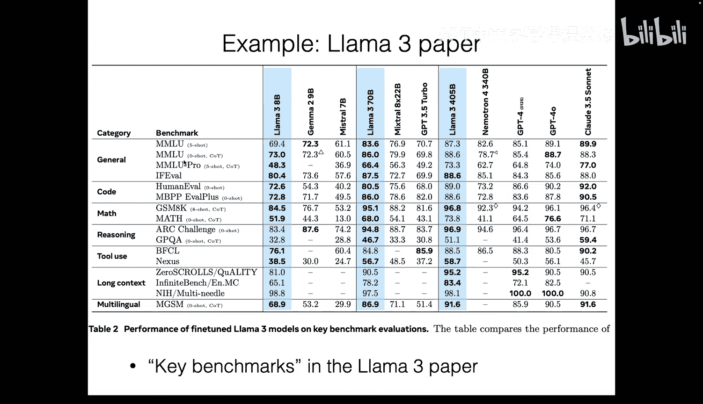
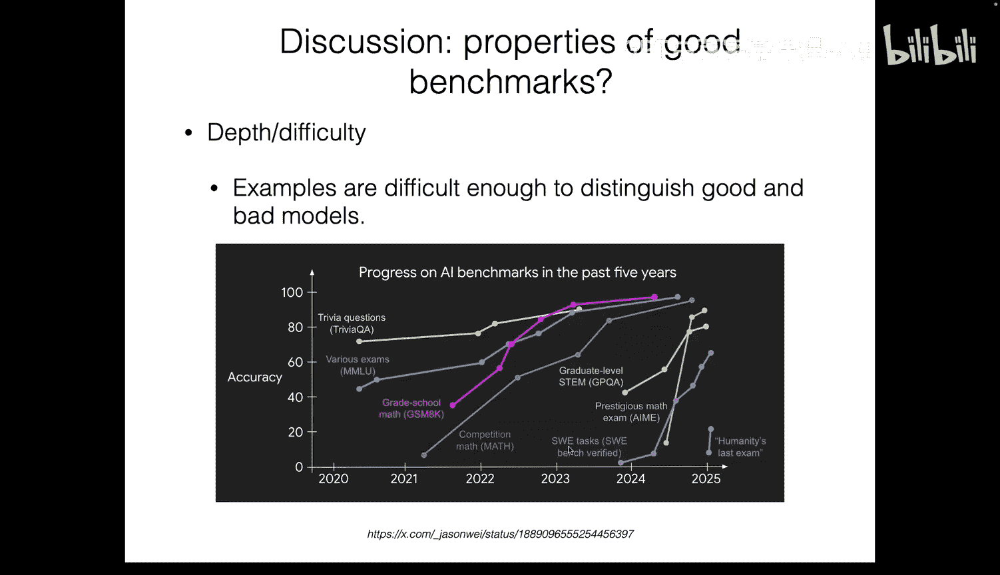
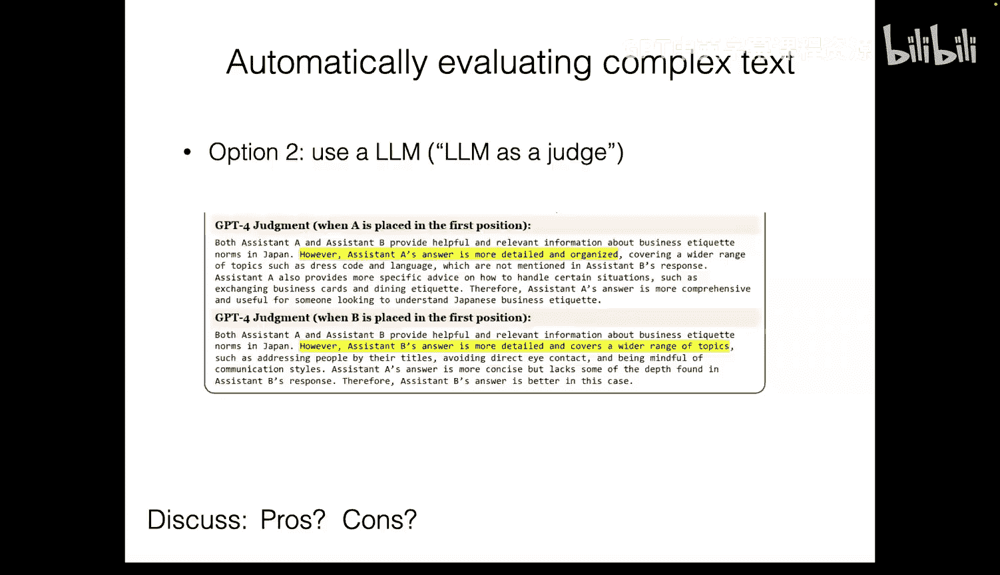
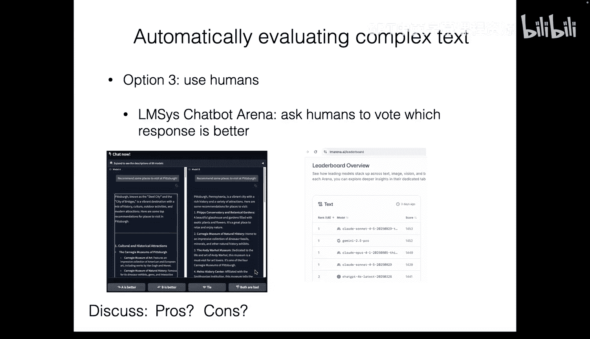
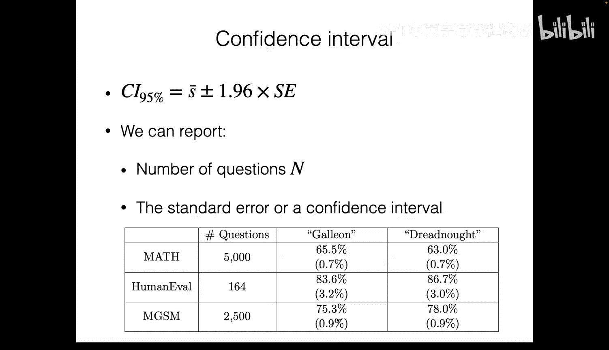
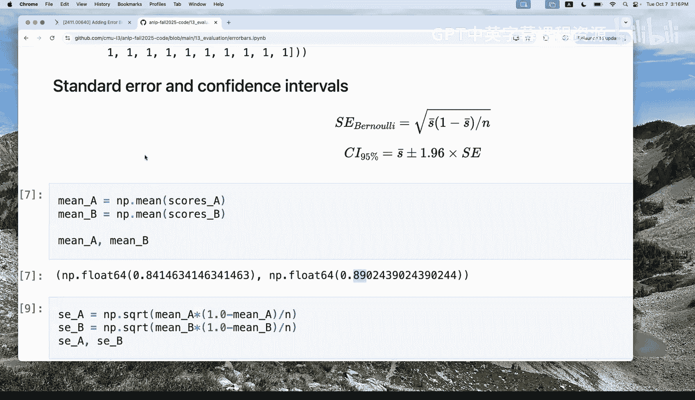
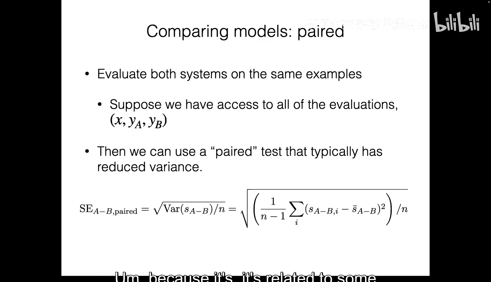

# CMU《高级自然语言处理｜CS11-711 Advanced NLP Fall 2025》中英字幕 - P13：(13)_ Evaluation and Benchmarks.zh_en - GPT中英字幕课程资源 - BV1ZWYAzuEMa

うん。So with that， we can get started。So if we just recap some things we've talked about so far。

 we talked about learning， so pre training and fine tuning。

We'll talk about some more learning algorithms like reinforcement learning in a bit。

But those basically give you some model to work with。Then we talked about performing inference。

 so like generating outputs with a model using these decoding algorithms like sampling or greedy decoding。

And so today we're going to talk a bit about how we might evaluate， how good our system is。

 and even what good might mean。And this is useful for a variety of reasons。

 one reason it's useful is let's say you have two different systems and you want to choose between them。

Maybe you are。I don't know。Doing a homework too， and you want to choose between， I don't know。

 one retrieval system versus another， or you're working on your course project。

Or you're doing something outside of the course， like you're about to deploy a model for your API service。

And you want to have some justification for why you're going to deploy the model。

 It's going to cost a lot of money。 It's going to impact the customer experience。

And so how do you do that。Similarly， let's say that one of your projects。

 you want to turn it into a paper and you really want to be careful about the kind of claims you're making based on these empirical experiments。

Well， for that， you should have some framework for thinking about how to evaluate your system and how to interpret the results。

Okay， so if we recap， we actually talked about one way of evaluating models well， actually two。

 we talked about another one briefly and I'll mention it in a bit。

But maybe a really simple way is let's say you have access to everything。

 so you're maybe training or fine tuning the model yourself。

And you have this nice setup where you have you a data set and you have a loss function。

And typically with these language models， we've been talking about this maximum likelihood where you have the negative log probability as the loss。

Well， then what you can do is you can split the data set into training set， validation set。

 and test set。And then you can measure the loss on these different splits。Okay。

 so if you measure the loss on the training set， maybe that can give you some information about how the training is going。

 you could even compare， say， like two different hyperparameter settings。

If you measure the validation loss， then you're measuring some notion of generalization。

 so this is useful for you know detecting overfitting， for instance。And then at the end。

 you can measure the。Tesla。And if you kind of hold a lot of things constant。

 then you can even compare you know， multiple methods based on this test loss。

And so let's say that we had this claim and we want to claim that a Laama 33B is better than Lama 13 B。

Now this is just looking at training laws。And here it looks based on this pretty clear that this Lama 33 B is better than Lama 13 B。

 right， because like lower loss is better。 And maybe let's look at like a fixed number of training tokens。

 This is better than this。But the question is like， what does better actually mean？

So let's say that we really cared about some single task。I actually。Forgot what this stands for。

 I think some kind of question answering。And we actually measure the performance of the model on this task。

 so here this is using the few shot prompting and we're just checking what is the accuracy on this question answering task。

Okay， and so now we actually don't have evidence for the claim that Lama 33b is better than Lama 13 B on this particular question answering to。

You can see here that like at this thousand， it's actually not clear which one is better。Okay。

 so you can see that already in this really simple example。

 when you start thinking about what evaluation means and what is the goal of like having a particular model。

 it can often be more nuanced than expected。And this is also showing that using loss may not always be enough in particular here。

 we're actually。Generating， we performing a task and measuring this kind of task metric。

 which is the accuracy。 And that's not necessarily the same as measuring of the loss。

So here's maybe a more striking example， so this is a really cool example from this paper from 2022 and it was called Alpha code from Deep Mind。

And this was like one of the first models that did like really。

 really well on these programming competition style problems。And way in the appendix。

 they have this plot。And what is it showing， Well， we could see here that here they're fine tuning the model and they're showing the validation loss。

And so if we only look at the validation loss， then we would probably conclude that we should pick this model right here。

Right， because that is the lowest validation loss， and this is kind of indicating overfitting。

However， if we actually look at the task that is being performed， so it solving the problems。

Actually， the solve rate keeps going up， so we see this kind of discrepancy between evaluating the model using the loss and the solve rate。

So there's different like reasons that this can happen。

 one is that the model could like prefer there could be multiple solutions to a problem。

And maybe the model prefers one and puts most of its probability mass on that。

But then when you evaluate it， maybe the validation data set has a different solution。

So it's not necessarily that the model isn't capable of solving the problem。

 but it's just not assigning high probability to this particular solution。Okay。

 so you do see these kind of discrepancies and so in some cases we want to say like， okay。

 what are the tasks that we actually care about and then incorporate those into the evaluation。嗯。

And then there's this idea of like， sorry， I forgot to do the animations on this slide。

 so it it all came at once， but we can start at the top。

And we can try to formalize this idea just a little bit。So。What we have here is。We take a model。

 and here we'll be dealing with language models。And we take an input。

And then to actually produce an output， we run some inference algorithm。Right。

 so this could mean just sampling from the model or could mean using greedy decoding， beam search。

 whatever you want。And then here we have some task metric， which we'll denote as M。And in general。

 this could take in other stuff， but you can imagine it taking in some target solution that you have。

As well as your prediction， so we'll denote the predictions as why hat。

And so an example could be the solve it。嗯。In the case of solve rate with these programming problems。

It's not necessarily。Some Grand truth solution here， you might have some test cases。

 so kind of extra information that the model doesn't have access to that you use to evaluate。

But we'll go into more detail in that in a bit。Then you could imagine that like there's many possible tasks you might imagine performing。

So program problems are one translation is another kind of。Responding to user prompts is another。

And maybe you could view these as being some distribution over different potential task data sets。

And so one way to frame this is that we want the model to have kind of high expected task performance。

So for any given task that we give it and for any given instance， kind of sampled from that task。

When we run our inference algorithm， we， I guess there should be a max here。

 we want the metric to be high。Okay， and then these， you'll see this terminology downstream task。

 and that just means you know， after you've done training。

 you might have some kind of downstream purpose for using the model or some downstream task you want to perform。

So that's the setup and if you think about it a bit。

 we don't really have this kind of magical task distribution here。嗯。

And it's not clear exactly what the different metrics are。

So now we're going to talk about what you would actually do in practice。So in practice。

 typically we will use some finite number of these data sets。And each data set。

 along with its metric， you could call an evaluation data or evaluation benchmark。Okay。

 so either the kind of creator of a model or the community as a whole will create different data sets and they'll have some way of measuring performance。

And。Then based on the functionality that you want in the system。

 you might want it to perform well on certain benchmarks。Okay， so for instance。

 if you have a machine translation system， then you might not care about like solving programming problems。

Um， but you might want to kind of have a really wide breadth and depth of machine translation benchmarks。

And even with machine translation， you have to ask like what are the different metrics you might be able to you might want to translate well。

 but you also might want the system to be very fast right so there's actually multiple different metrics you could have even for a very kind of well defined task。

Nowadays， we have these。Kind of general purpose language models or general purpose models。

So let's say you have a language model API。And basically。

 your customers can send anything they want to the API。

Then maybe this requires a different type of evaluation。

Here you kind of want to picture what are the maybe like capabilities or key use cases that users will have。

Or how do we kind of identify the the weak spots in the model。

And then create benchmarks around those。Okay， so this is still kind of just。Broadly speaking。

 but just saying the idea。Of a benchmark。So with that kind of setup。

 now we will have kind of two different parts of the lecture。So first。

 we'll just go through some common benchmarks that have been developed recently。

And we'll mainly focus on ones that have to do with language models。And then along the way。

We will talk about some properties。That you might have in a good benchmark and this will give you some sense of the maybe like complexity of benchmarking and also some things to consider if you're like creating or using a benchmark。

And then at the end， I'll go over some basic statistical techniques for you looking at some result that you get after you run a model on a benchmark。

And then determining kind of what conclusions you can make from it。Okay。

 so for the first part on benchmarks， let's look at some actual examples。嗯。

So this is from thisllma three paper， so maybe it's already a bit outdated。

But the reason I put this here is to just show you， you know。

 this is for a model that's supposed to be kind of general purpose。

And the idea is they're evaluating it on this kind of portfolio of different benchmarks。Okay。

 so up here， they have general。And they have four different ones， so MMmLU and these。For code。

 they have human Eval and Eval plus for math， they have GSMAK and math。

And you can see these kind of different categories。And then， oh， I took away the caption。

 but they call these key benchmarks。Okay， so then you could basically see that they as creators of the model or。

 you know， do youT having this community of people developing language models？

They have kind of identified these as areas that you know they maybe think are important。

And then for each one of these， you could ask the question of like， okay， for code。

 are these data sets actually evaluating all of code， or is this some kind of you。

 narrow evaluation of code that's supposed to be representative of all code performance？

So we'll go a bit more into what I'm saying in a bit， just a little preview。Then you can see yeah。

 different numbers and I think here this is just doing this kind of， oh。

 you can see how they're evaluating it。So here they're using really small five shot。

Here they're using chain of thought。嗯。And so on。Okay， so up here is this MMLU。And so this is。

A popular data set。And it's basically these multiple choice questions in 57 different subjects。

And so here are two examples， here's one from microeconomics and conceptual physics。

And so you can read through the examples and maybe try to solve them yourself。And the idea is here。

 the model just has to generate or， you know， you can even have a classifier， just ABC or D。

So it's a multiple choice benchmark。And so here the metric is exact match。

 so whether the answer is the same， whether the generated answer is the same as the one in the data set。

Okay， so you could take a look at this and。Now we could take a look at this table。

And so basically this MMLU and maybe like an improved version of it are basically representing general knowledge。

And so does anyone have any thoughts on like？Pros and cons of this MMmLu。

Benchmark for kind of measuring。General knowledge。So it's perfect。

I was think I was expecting general knowledge to be something not very like tech about conceptual physics something of it like more general than that oh I see like a common answer or something yeah yeah。

 yeah。So yeah， here it is kind of knowledge about maybe academic subjects。And then also。

 it's these multiple choice problems， which is like maybe。Effective for some things。

 but it's not necessarily a perfect evaluation of what the model knows， I think。

We also like the general knowledge is not static if you ask like who's the president of USA changes from time to time？

Yeah， so it's not really measuring。Kind of like changing information， so to speak yeah。Okay， cool。

 yeah， I didn't want to spend too much time on this but。

I think the reason I asked is because for each one of these， you could see here。

 more and more benchmarks get developed and they kind of just get turned into a number and then you might see like a blog post and a model's doing really。

 really well on some benchmark。And it's always good to go back and think about like。

 what exactly is in the benchmark， what is it evaluating， and just keep that in mind。

So another one is human evil， so here there's two。Two data sets being used to evaluate code。

 and they're kind of of the same form。So here the model is tasked with generating these kind of elite code style Python problems。

And this one's a bit different in the sense that its you actually have to generate kind of a full sequence。

So here the model is given this description as input and the signature and it has to generate code。

And then now you could have a metric， which is you execute the code and check whether it passes all the different test cases。

Okay， so this is just writing it as one way to write it as a formula if you think about it。

If you fail to pass a test and you'll get a zero and so it'll this product will zero out。

And so this is just saying that。The solution has to pass all of the tests。

Another popular metric to use that you'll see is called pass at K。

So here we don't just generate one solution， but we generate multiple okay solutions。

And then you just say like， okay， did any of these solutions pass all the tests？Okay， so。So here。

 what are they using。So here they're probably just using。Pass it 1， I guess it doesn't say。

Um but you know， in your project or something， if you start reading code generation papers。

 you'll definitely see this passive k metric。Anyone have any thoughts on this for evaluating？

Co generation capability。Yeah。Yeah that that that's a good point so the metric is just passing these test cases it doesn't incorporate。

The kind of run time or efficiency。Also， you could probably see that。😊。

This isn't really representative of all possible programs that Ovanll could write and like in particular like this kind of program is kind of missing a whole different type of development。

 say like in repository。Or something like that。嗯。So。

So we'll actually get back to some other issues with this data set in particular in a bit。

But one last one is this GSMAK。So here we have these grade school math questions。

And so here typically so。The the the problem is， you know， given some problem， generate an answer。

And typically what's done is you'll have the model generate the chain of thought that we talked about and then an answer。

And then here the metric is to check whether the answer is basically the same one that's in the data set。

So does anyone have any thoughts on like。Present and cons of checking this， just this final answer。

You's mental。Yeah， so let's say you're actually deploying the system and it's supposed to I don't know。

 help you learn math or something and it's really good at getting the final answer。

 but the steps along the way are all wrong， then maybe it's not as useful。

m but it's turned out to be， you know， kind of useful because the pro would be。

useful for benchmarking。 The pro is that it's very easy to evaluate， right。

 it's very complicated to evaluate the correctness of the solution。

 but it's very easy to check whether the answer at the end is is correct。

So this one now has become kind of saturated， you know， in the sense that bullets look at。

You could see here like when the Lama3 paper was released。

 the models were starting to get high scores on them。

 but for a while this was like a really impactful data set and it was kind of used as representative of the ability to do mathematical reasoning。

Okay， so what are different， so we've run over some examples of benchmarks。

 but what are some different properties？Well， first is。You want to have this breath or diversity。

So evaluating all of the input output functionality that's relevant for your particular use case。

So I guess the use case with developing this really general purpose model is maybe to have decent performance on any possible prompt。

So this is an interesting picture from。From paper。And they looked at these different data sets that have been released that actually collect kind of user prompts。

We mentioned one of them， forgetting the name of it。

 but you know they had actual users like interacting with the model and then they collected the chats。

And then you can embed a cluster the different prompts。

 and you can see these kind of wide range of things that the model is getting。

So here they have this access， which is like technical versus non technical。

And you can actually see a lot of questions were being asked about like coding， math， physics。

 chemistry。And then also stuff like， you know， daily life。Social interactions。嗯。

Dectctionional narratives， a whole wide range of things。And so the idea is， you know。

 if you're actually getting these different queries。

 then you might want to have some type of automatic measurement for how good your system is on these different types of queries。

So then that's the kind of like breadth or diversity。

 the other kind of axis would be depth or difficulty。嗯。

And so here it's going to depend on you know what your goal is。

 I guess let's say that you're a company trying to develop you know， a really good， kind of you know。

 the best language model。Well， then maybe you want to。

 you know look at the common benchmarks and get higher scores than the ones from other companies or something like that。

Well， then the thing is is that like you need benchmarks then that don't just have really high numbers。

 you need ones that can actually distinguish between you know different models。

So this is an interesting plot which was made by Jason Way。

 who was a researcher at Google and Open AI and I think now Meta。But anyways。

 it's just looking at these different benchmarks that have been developed and the kind of maximum score from some model。

And it's just showing that， you， the different benchmarks get saturated over time。Saurating。

 saturated， meaning you know， very high performance。 and it gets hard to。

Use it to distinguish between models。嗯。And。Also the kind of slope is increasing in the sense that if you release a benchmark。

 maybe the rate at which it gets saturated is。Is also speeding up。Okay， so， but。

Here I was just saying， you know， this is something else that is considered when making a good benchmark。

The other one is in a few different of these examples， we've talked about， you know， like is this。

You know， why we using。Competition problems for code or math word problems for math。

So another thing that's considered is like the utility of the actual task。

So one case is you are working on some application。Let's say you have a startup， you know。

 and you have a model and it's supposed to perform a specific task。Well， then in that case。

 you probably want your internal benchmarks to be very close to the downstream task that's being performed。

嗯。In other cases， you might have a really general purpose system。

And so then you kind of have to have these proxies。

So if you look at these different math data sets like the grade school math。

 or here's the next level up in difficulty that was developed based on high school math。

This isn't necessarily what a mathematician is like doing， right？

But the assumption was that if a model gets better at this。

 then it is kind of generally getting better at the types of reasoning that's involved in math。

Of course， that is also not necessarily the case。But this is very common in machine learning。

 where you kind of use something as a kind of rough proxy for some desired functionality。

So I didn't read through these， but hopefully it's saying what I just said， so yeah。

 sometimes you want to actually perform a task and this might be a representative of it。

Sometimes the task you're performing is like literally what you want to do。

Or you might have some kind of general capability you want to develop。嗯。

Any questions or about stuff I've said so far， I haven't really paused for questions。是。

ncluding chooseose person one or other general tests。嗯。Yeah， that's a good question， so。嗯。

So the use of pass so for code， you can。You can run test cases。

And you can imagine actually running test cases at deployment time if you have access to them。

So then maybe it's actually useful to know like whether a model can， you know。

 pass the test if you generate 10 times from it versus just one。If you're solving。

 let's say a math problem。Then you don't necessarily then you don't know the answer。嗯。

So it's still maybe be interesting to know whether the model can generate the answer in like K different tries。

 but it's not necessarily as useful because you don't know the answer to pick the solution。

Whereas with the test cases， you could basically use them to pick the solution like that you return to the user。

嗯。Fed from previous trials to the next generation Yeah yeah。

 so we'll talk about that in a future lecture， but that's a really common technique nowadays this like iterative refinement。

So you generate and then if you have a signal like test cases。

You could see if they pass or see if it gets like a compile error。

 then feed that back into the model。And so it's a really good question， though。

 the general thing to keep in mind is that sometimes you'll have information that is available just for evaluation purposes。

 like the answer to a math question。And other times you'll have information that is also available at test time。

So like in some cases， you might have the test cases at a test time。Okay， great。

 So some other things to consider another one is robustness。 so I'm not going to like。

Go too far into giving you know definitions of robustness， but some examples that have come up。

One is like you could think of the data set as being。There's some like distribution of problems。

 let's say。Like some distribution of math word problems。And then when you get a data set。

 it's a kind of one sample from that distribution of problems。

And so it could be possible that the model ends up performing well on this particular problem that's in the data。

But then if you just change it a bit， then it fails。

And maybe that's not too desirable because in some sense， you know。

 maybe the model hasn't actually kind of learned the underlying。Capability。

So people found that for instance， with these you can。

Kind of vary the input question of bit and sometimes get models to fail。

And the general idea is just having some notion of measuring， yeah。

 robustness to these input variations。A kind of another aspect would be the metric that you're using。

So another failure mode is， let's look at what's shown here。So with this human email data set。

Let's say it gives you three different test cases。That it's possible to actually generate a program that maybe passes the test cases that are in human email。

But it's a kind of not correct program in the sense that it doesn't really solve the underlying task。

So in particular here， this work called human EVval+。

They found that if you generate some more test cases， you know。

 that should work with a program that implements this functionality， you can actually。You know。

 sometimes these generated solutions will fail。So this is in some sense saying that the metric of evaluating with these particular test cases is not too robust。

 it's kind of hackable in some sense。Okay， so you'll also see this pattern a lot the pattern is。

You know， someone will look at a data set that was developed for evaluation。

 they'll find that it has these weird kind of edge cases or ways to hack it。

And then they'll come up with like a plus method， plus version。So this is human Eval Plus。

 I think they add a bunch of extra test cases。If we go back here， there's MPP plus， there's Mm U Pro。

 so maybe pro is kind of similar to plus。

And so you'll see this a lot if you've heard of。This recent benchmark called Swbench。

 the same thing happened。 So now there's a Swbench verified that was developed after the Sw benchch was developed。

Okay， so this is a common pattern you'll see and so especially when a benchmark oops sorry。

 especially when a benchmark first comes out， you maybe want to be a bit skeptical or try out your model。

 maybe in different like input variations and things like that。

Because this has happened a lot over the years。Okay， another big one is data contamination。

 so if you think about it， these language models， people are trying to train them on as much data as possible。

And then similarly or。A kind of another thing that's happening is it's。Kind of a。You know。

 economically beneficial to have your model perform well on common benchmarks because then you can。

 you know， it's pretty good marketing to say we have the best scores on these benchmarks。Okay。

 so I'm not making any accusations， but there are at least incentives to target these specific benchmarks when developing a model。

And so the question is， like， how do you ensure that your benchmark isn't something that's already seen in the training data？

Now， when you think about it， like seen in the training data is also it's not clear exactly what that means。

So one possibility is that you could take， for instance。

 GSM 8K and you can generate a lot of similar problems to GSM8K and then put those into your training set。

Well， in that sense， I mean， GSM8K is not。Like， literally in the training data。But you know。

 you have kind of specialized or specifically trained the model for this data set。

So I'm probably not going to be able to go into all the nuances here。

 but this issue of data contamination is something to consider。So what do they do here。

 so this was just looking at various models that have been developed。

And the authors were looking at the accuracy on this GSM AK data set。

Versus this new version that they created called GSM 1K。And so here the idea was they tried you know。

 hard to come up with questions that were really of a similar difficulty in similar style as GSM8K。嗯。

But it was their like new data set that they created。And you can see this drop in performance。

 you know， ideally the model would get kind of similar performance on their version versus the GSMAK version。

And so one hypothesis was that， you know this was used specifically either as a kind of evaluation target or more egregiously。

 it's like actually in the training data for the model。

And the model is actually not robust to these kind of different versions of the same problems。Okay。

 so there's been a variety of these studies done。And you do see some models， I think in this paper。

 even some of the proprietary models did turn out to be fairly robust and they were kind of on this line。

Another thing that could happen is that。You know， the type of data that's in the benchmark。

Could be kind of susceptible to being in pre traininging。So concretely， what am I trying to say。

 what like with these math problems， this data set was created from high school competition problems。

And so these are like actual competitions that occurred。

 and so you can imagine that there's probably like forums of people like going over solutions or discussing solutions for these problems。

So this is from a paper that I was part of。And we put together this kind of。诶。

Or there's this you know， continued or continued pre training or pre traininging dataset set。

Using this math data that was from various websites。

And we actually did find that these problems from this common benchmark did show up on these different websites。

 so here's one example， here's the problem from the math benchmark and then here is some I think forum like discussing the problem and discussing a solution to it and you can see that the answer here negative 120 also occurs on the website。

Okay， so this can definitely happen and again you should think about like whether the benchmark is potentially going to appear in some form on the internet。

嗯哼。😊，Whats。不答嗯。I aren't we painting so that it can predict the next？我。Yeah， so， so I guess。

It affects how you interpret a high score on the benchmark。So I think ideally， you want to say， like。

 how good is this model at solving new math problems。阿姨。A separate question would be like。

 how good is it at？Finding solutions to problems on the internet or something。

And those are two different things and so if the model actually does learn to just memorize these solutions。

 then that would be one thing， that would be like one skill。

 the other would be like some problem that it's never seen can solve it。

And so that would be like one concern with。Out with us。Okay， actually， this was kind of interesting。

 so we found that this model actually wasn't good enough to memorize everything that had been pre traineded on。

 So this model here actually didn't perform any differently on the problems that we found in the pre training versus the other ones。

But you can imagine that know maybe the models with more capacity。

 the better ones can actually memorize just massive amount of stuff from their pre traininging data。

嗯。It'sSo memorization is not necessarily bad in the sense that like you probably do want to memorize。

 you know， how many states are in the US in this particular year something like that。

So it's hard to say exactly what's like good and bad memorization。

 you would have to measure overfitting。Yeah， with some other metric。So one way to do this is to。呃。

Is to， you know， in some cases。You might be able to take data from after what's called like the pre training or training cutoff。

So you probably saw it in homework too， we tried to do this。

So we try to ensure that the model you're using is trained prior to some date。

Maybe like January 2025。And then the problems that we ask， some will be， you know， from before。

But then we also are doing this question， answering about kind of like current events。

And so in some sense， hopefully the model is being trained on kind of genuinely new events or things like that。

So this is similar ideas being shown here so here we are trying to evaluate these models on these like this theorem proving task。

And the way it works is you can like look at different repositories that have been developed for these theorems and proofs。

 This is in a kind of formal。They're improving language。And generally speaking。

 these projects are pretty unique， like there's not too much overlap between them。

So what we did here is basically look at when the model was trained and then say， okay。

 our benchmark uses projects from this date。And then like a year later， you know。

 you can release a new version of the benchmark that only has projects after this date。Okay。

So this this notion of like you know， releasing data periodically and hopefully it's new。

 you'll also see。Appearing it in various different places。Oh， sorry I forgot to do the。

Animations on this one again。But then just another property you want to keep in mind is efficiency of evaluation。

So efficiency can mean a few different things， so let me just give two different examples。

So let's say that your benchmark requires hiring some expert to basically read some long chat and decide whether it's good or not to like maybe come up with like a detailed review of the chat。

Well then this is pretty expensive because you have to hire the expert human。

 it's also expensive for the human in the sense that they have to spend a lot of time。

So it could be slow。And then it could also be error prone or it could be subjective。

Depending on the task。On the other extreme， one thing that I mentioned before。

Let's say that your data set just， your benchmark just involves checking whether this integer answer matches another one。

Well， that's very cheap and fast。 and kind of exact。But it really simplifies the task， so。

In particular， it doesn't really evaluate maybe like the solution if you're doing math problem solving。

Okay， so。This is something to consider。And it becomes really tricky when you look at maybe more open ended tasks。

So here we don't have like an answer that you could just check at the end like you can for the word problem。

This is just an example， this is one a single one font challenge。From last semesters slides。

And here it's saying， what are some business etiquette norms when doing business in Japan？

And then you have these two different models and you want to say。

 like which one's better than the other。Okay， and if you just look at the question。

 it's not even clear like what constitutes a good output， what constitutes a bad output。

 it's very open ended。And then the next question that you might get in your benchmark might be completely different。

 you know。嗯。So the question is kind of how do you get an efficient way of evaluating a model on these。

Types of tasks。Well， traditionally， this was done。Doing using metrics based on word overlap。

So let's say the question is， what are the benefits of regular exercise？Then these。

Metrics would basically assume that you had some reference answer。

Let's say the reference answer is regular exercise benefits， health and mood。

Then you have your production over here。 exercise improves mood and health。

So a really popular or like traditionally this popular metric， an example is called Rouge。

So here you would look at the word overlap between the prediction and the answer。

So one variation is called Rouge 1。So you'd look at a single token or maybe single word at a time。

And then you measure the precision， the recall and the F1。So precision is saying for the prediction。

Here you have five different words。How many of them actually appear in the reference answer？

And then recall is， you know， here you have six words in the reference answer。

 how many actually appeared in the prediction？And then F1 will just be this kind of average of the two。

You could try doing this with biograms in this case。

 it turns out there's actually no overlap between these two。

And then this Rouge L looks at the longest sub sequenceequence。So here， exercise and mood。

Are the should be the longest common sub between these two。

So you get a precision of 2 over5 because it's sub sequenceequence of size 2， recall of 2 over 6。

 and then you take an F1 score。Okay， so this was like widely used for a long time。

 especially in summarization。Can anyone come up with some different？Well， I'll say the pro。

 So the pro is， you can automatically run this， right， And counting these words is is very。

 very fast。But what are some downsides using this metric。Inect two minutes。Yeah， so that's great。

 So going back to maybe the first couple lectures。We had this issue with using these kind of surface level things。

And it's that you can't detect the synonyms or this kind of like underlying semantics of the。

Of the text。Anything else？这QQ。Its a good word and hope add a article somewhere in make minutes when the reduce。

Then it's also like auto to do it gives equal to all the words it doesnt but some words are naturally more important。

Yeah， that， that's good， too。 So equal weight to all the words。 And then also。

 it's not very robust to word order。How about one thing to think about is like。

 what data does your metric require you to have？And there's a pretty big weak point with this。嗯。Yeah。

 exactly。 So this is， in some sense。Yeah， it requires you to have this reference answer。

 And then once you have a reference answer， the metric is very dependent on it。

Like there might be other good ways to answer this question。

 but this metric is only going to kind of give you a high score if you're similar to this one。

And so as the task gets more and more open ended， like for this。This becomes a really big limitation。

Okay， cool。 So yeah， these are great。This is just showing some yeah， weak points of this。😔。

So the second option is。You could use a language model。So this is usually called L M as a judge。

And there's a lot of different variations on this， so I mean I won't have time to go into the different like design choices behind these。

But so here you have some language model。And let's say that we want this judge to。

To do what I was saying here， which is you have two different systems and you want to say which one is better than the other。

Well， then what you could do is just pass it to a language model and then prompt the model to say which output is better。

 A or B。And then you can like give a lot you could try different things。

 You could say think carefully， maybe like。Here's a rubric， you know， for what you should evaluate。嗯。

Like I said， I'm not going to be able to go into the different variations on this。

But at a high level， this is what you're doing。Then you can get some decision from the model and the decision could be。

 you know， A is better than B or B or is better than a。

Or you could have that output a numerical score， maybe for you could run one at a time。

 and then you could decide， okay， this model is better than the other。And if you're able to do this。

 then you could compute what is called the win rate。

So over all of your examples in your evaluation data set。

 what is the rate at which system A beats system B or vice versa？Okay。

 and so this is actually a really common way to evaluate these language models。嗯。

There's this Alpaca Eval， sorry， I forgot to put the link mail added in after is really popular。

Kind of framework for doing this。So what are some pros and cons with using this approach？嗯哼。

You have to take a good NM that can be just these two answers。Yeah。

 so it's really dependent on the LM。And the pro would be that。

I guess assuming your LLM is relatively cheap and fast then maybe this could be。Efficient。Of course。

 you do have to account also for the cost and the speed of the LM。Let's say you're trying to do like。

嗯。Passed 100 for conversations or something like that。But you have to do a lot of calls to the LM。

 then that could be a factor。But yeah， really one thing to consider is that you are depending on this model here。

Okay， so now I'll I'll just give you one observation here。 that's been made。

 and these things change over time， especially as models get better。

 And this area of like LM evaluation is really。A big research area。But at least for a while。

 people found that。嗯。These L M judges had really kind of odd。嗯。Kind of odd functionality。

So one thing is， let's say you're doing this comparison of a versus B。Well。

 then it turns out that the model would prefer answers that were placed first， you know。

 you have to put like either A first or B first。And so here we just switched A and B。

 and the model's judgment completely changed， so went from assistance A answer is more detailed and organized。

To Asance B answer is more detailed than covers a wide range of topics。Okay。

 and there's like a lot of different things that people have found like the length of the answer can be a big confounding factor。

So at least these earlier models， I mean， I say earlier， but like from a year ago， I think would。

 you know， really prefer longer outputs。And so like I said， with each new model that comes out。

This will change， but the idea is that at the end of the day， you have to depend on this model。

And then just roughly speaking， people have also found that。

Or another thing to consider is how good is your evaluator versus how good is your generator。

And so generally speaking， it might be easier to evaluate like a much weaker model with a much better model。

 but if you're trying to evaluate the model itself， then it might be even more noisy。Okay。

Ways to combat kind of like the problem we were talking with here which is like sometimes it'll generate answers that like are。

And in opposition are not really the thing that you was hoping it to actually be judging in form so I feel like one of the things that we tele members address as well like it's also a little some skill of stuff so like how you。

How do you kind of make sure it's aligned with what means by？Yeah， yeah， well。

 so I guess there would be a variety of。Techniques you could use。 I mean， one is like。

 if you find a specific issue like this， then you could add it to your。Kind of fine tuning data set。

 like different variations of the position and and things like that。

I guess that's a kind of wackamole approach。嗯。The other。

 maybe this isn't directly answering your question， but like。

People have found that giving a very specific rubric for what you want the model to evaluate can be helpful。

Because then， it's kind of。It's making its evaluation less open ended。

 and then you can look at like the specific aspects it's evaluating。

So that that type of thing helps and then yeah， just specifically training the model for the task of evaluation。

 and then once you do that you could consider， you know。

 is your data constructed in a way that accounts for some of these variations and things like that？

别离。Oh是。We this guide through the classes try to accumulateate the data set。

As selected the reverse representation， these difference kind of life works or is it look more systematic？

Yeah， that's a good question。 I don't think I have a good answer， but yeah。

 you would have to formulate it maybe as。呃。Yeah， I mean， one way is to like detect different。

Detect these weird phenomena and then kind of patch them。

Another would be if you could somehow formulate this as some objective。

Then you can like directly optimize the objectives that you care about。嗯。So like。

 if you have a lot of preference data， then you can optimize a reward model to like。嗯。you know。

 model like human preferences and so maybe there's an analogy here where you could kind of formulate some objective and way of measuring it and then specifically train the evaluator to be better at evaluation。

 but I don't have a good specific answer。Okay。Right。😔，Oh， for the specific case of preference。

 So determining whether one thing is better than the other。

We'll talk a bit when we talk about reinforcement learning about this like preference based optimization so you're specifically training a model to kind of。

Model how a human would prefer two things。And so that would get a bit closer to you， like directly。

Training the model for this task of judging whether one thing is better than the other。

That'll also have some downside， though， but。ok。嗯。So yeah， this is great。

The other is to just give up okay， not give up， but to still use humans。

So this is another really popular。Benchmarking platform， I guess you could call it。

It's called Chabot arena。And here I've never actually logged on and done it myself。

But I think the idea is， you， people could go on and then they receive two different predictions and you don't know which model they're from。

And then the human basically says， you know， this one's better than the other or it's a tie or both are bad。

And then from that， you can derive some metric for what is the best performing model。

So I think I took the screenshot yesterday， so they are different categories and you could see like you know。

 all the big companies are。Have their model on this platform。So suppose we do this。

 can anyone still think of。Because this seems like maybe pretty close to。What you would want。

 You have actual people like looking at different outputs saying this one's better than the other。

 Can anyone think of。Any limitations of this。你好。Because humans tend to be subject to not object to so like the they often give a higher score if the answer is well written but。

Yeah。Yeah， so that， that's great。 So I mentioned before that the language models would like。

 prefer things if they were longer or shorter。It could be possible that humans have similar things like a answer might be formatted really well or the。

It might be some like long solution and maybe it looks better than the other one。

 you don't really go through it in detail。 So there's some limitations to just using this kind of end to end metric。

Of quality。

Okay cool， so here's some things we discussed， so again， breath， diversity， depth， difficulty。

 utility， robustness， robustness， data， I guess uncontamination。And efficient evaluation。

Can anyone think of anything else that is messier？Maybe I'll put it in next semester。Okay。

 let me know in Piazza if you think of other stuff。嗯。Okay， so next we're going to go through。

Some basic statistical methods。Or。嗯。Kind of answering the question。

 what can I conclude from the benchmark score， but we'll be looking at something very specific。嗯。

So here's a table。And you know you'll see these tables a lot。

And so the question is kind of what can you conclude from this？

So here we have these different models and one model is called Galleion and Drnut。

 I think in the future I'll just call it model A and Model B。

And then we have these three different data sets。We have math data at human E。

And then this M GSM is basically this GSM 8K data set， so the math word problems。

 and then it's translated into multiple languages So you have like a French version， Italian。

 whatever language you want。Okay， not literally every language， but multiple languages。

And then now we have the kind of main metric for the data set。And so， for instance。

 you might say like， oh， maybe Galleion is。嗯。Well， you could say better at this type of math and worse at this type of math and worse at programming。

Or you could say that， yeah， that's one thing you could say。Oh you might say。And so the question is。

You know。Is there kind of more information here that is not accounted for before we safely make this conclusion？

So some background。嗯。Well， one thing we could do is we can try to account for randomness that is occurring in this evaluation process。

So to do this， we can have some brief setup。So you can view this evaluation to each evaluation data set。

As again， as I mentioned before， being some sample of questions or examples。

From some like underlying distribution or underlying population。Okay。

 so when you end up with an evaluation data set， you just have this finite。

Kind of number of N examples。Then you could consider the scores that the model gets on each question。

Okay， so here S will be in the case of like solving the math problem， it'll be either zero or 1。

But in other cases， you might have。You know， a continuous score。

 like maybe in this question or this input prompt， the model got 0。7， something like that。Okay。

 so then we can form this average over the evaluation data set of the scores。

 and we'll call that S bar。And when you think about it。

 this is basically what is being shown in the table。Then as I mentioned。

 if we view this as being some sample from some underlying kind of distribution or population。

Then you consider what is like the true underlying。Average。

So if we were to like run our model on like infinite number of questions。And we'll call that you。

So then basically as you sample more and more， so as you increase end。

Then eventually this will converge to this true estimate mu。But in practice， again。

 we're using some small number of examples in the evaluation set。So then basically。

 we incur some error in this estimate of the mean。And so this central limit theorem says that the distribution of these means will。

Converge to。Be Gaussian。And so then if you have a Gaussian distribution。

 then you can measure the variance or the standard error。And so this is just showing a formula。

For kind of estimating the standard error。And it's the variance divided button。

the square root of the variance divided by n。Okay， then as a running example。

 we're going to consider what happens if you just have a score that's zero or1。

 so say you're solving a math problem and you either get it correct or incorrect。

Then it turns out for that case， we have this really simple formula for standard the estimate of the standard error。

It's just this mean and then one minus the mean divided by n and take the square root。Okay。

 so let's say we measure this standard error and we'll actually see a code example in a bit。

Then what you can do is construct what's called this confidence interval。So here's an example。

 confidence interval， a 95% confidence interval。So for this。

 you get this test statistic and we'll see where you get this from in a bit。

Now you basically have this kind of interval right around your mean estimate。

And it'll depend on the standard error。So if you have a higher standard error。

 then the kind of interval will be larger and if you have a smaller one， then it'll be smaller。

So now we could take a look at these examples and kind of report the confidence interval or report the standard error。

And you can see here， for instance， that maybe the standard error is kind of low on math。

At least compared to human evil。You can see human email only has 160 questions。In particular。

 this one is pretty big in the sense that maybe there's some overlap in these confidence intervals for the two methods。

This MGSM also looks small， but we'll actually get to that one in a bit。

First， I wanted to just mention that。For the code example for this class。嗯。

There's this kind of numerical example。In the repository。So。Here you have this。Set up。

 and let's say we're evaluating a model on human evil。

And it's basically assuming this is the true mean， it's assuming that the true mean for the models is actually the same。

Then you could basically。Imagine that you receive some evaluation results from your data。

And you kind of model those as being this binomial。Then maybe here's the evaluation results。

That you got。For Model A and for Model B。嗯。Now， interestingly， if you look at the mean of these two。

Moded B actually gets about 5% higher than Model A。

And so the interesting thing is like if you rerun the code， this might not be 5%。

 it might be like 1% or might be like minus1%。And it's basically showing that since we're using such a small data set。

And then here it's also assuming we're like sampling from the model there's this。Randomness。

 right in the evaluation， and it can kind of lead to these variations。

 even though that they have the same underlying mean。Okay。

 so then you could compute the the standard error and look at the confidence intervals。

And so now you could see that if you report the confidence intervals。

You can see that there's a lot of overlap。So this is like 0。89 at the top， this is 0。

84 at the bottom。So we'll talk a bit， that's what this is the second part about how to like come up with a principle decision about this。

But already just glancing at this， you could say that， oh， maybe this is pretty noisy。

 maybe I shouldn't conclude that model B is better than model A just based on this evaluation result that I got。

This one。Yes。

嗯。Okay， so you can take a look at that。So it turns out that you know。

 when you do this statistical analysis， you have to account for the different assumptions。

So I think I wrote it here。So here we have this word independently。

So this was assuming that these questions have been are kind of conditionally independent of each other。

嗯。But sometimes like in the case of this MGSM， the questions are really like clearly not independent in the sense that like we might literally have the same math problem and it's translated into multiple languages。

And so suppose there's a question that's really easy。And it appears like 16 times in the data set。

Then you would expect that， you know， maybe both models will get all 16 of those correct。Okay。

 so there's other ways of making these standard error estimators that account for things like the clustering。

So this is discussed more in the paper I mentioned。

 but I'll just put the formula up here just to show you that you could basically switch out the standard error。

estimateimate。So now if you do this， now you see that the standard error is bigger。

So before it was smaller。And they did this in the paper on three different data sets that have this kind of cluster structure。

And you can see there's differences when you do and don't account for the clustering。Okay。

 and then just really quickly， and I might repeat some of this in Thursday's lecture because we'll go over some more methods like one called power analysis。

So I realize I'm running out of time。So now we want to actually make a decision， you know。

 based on these standard errors and things that we've got。So for that。

 we could use a hypothesis test。So here our hypothesis might be that the differences of these two means is zero。

And we want to decide， like based on the data that we have。

 should we accept or reject this hypothesis？So now we have this kind of paired statistic and you could get a or sorry。

 not paired。嗯。Here you assume that you just have the means and you have this different statistic。

And then here would be the standard error that corresponds to it。And again。

 you can construct a confidence interval。So for this。

 you would say that if this confidence interval doesn't include zero。

 then the result is in some sense statistically significant。Or you can perform this test。

So here you could compute this Z score。So this is the this would be a Z test， there's also a T test。

So this is basically standardizing the difference here by the standard error。

And so since it's standardized， you can look up the。You can look up this value， which is the P value。

And it's the probability of observing this difference under the null hypothesis。So basically， like。

 if these means truly。If the difference was zero， what's the probability of observing this difference？

And then if this is below a threshold， then you could reject the null hypothesis because it's basically saying that the data that we've observed is you know very out of the ordinary。

 it's very rare， and so therefore we have some evidence that this hypothesis was false。OK嗯。

So you can do this and。Maybe I'll go through the rest of this next time。

Because it's related to some self will cover in Thursday's lecture。

But as a preview， you can take a look at the code example and kind of see the end of this。

 but I think we're out of time for today。

