# CMU《高级自然语言处理｜CS11-711 Advanced NLP Fall 2025》中英字幕 - P14：(14)_ Research Skills and Experimental Design.zh_en - GPT中英字幕课程资源 - BV1ZWYAzuEMa

And so today is going to be on kind of research skills and experimental design。

And so it's a mixture of very kind of informal non technical things。

And then there's a few technical things woven in that again have to do with statistics。

 so some statistical methods are good to be aware of when you think about things like you know how much data should I have for my experiment or as you probably saw in homework too。

 how do you know whether like annotators agreed on data that they annotated？Okay。

 so given that that kind of content is in this lecture。

 it actually fits well with what we ran out of time in last lecture to go over。

 so actually just start with that。So here at the end of the last lecture。

 I was rushing a bit to go through this kind of statistical basic statistical framework。For。

 you know， you get some data and then you want to know what you can conclude from it and is it kind of statistically significant？

Okay， so we saw this table and it has three different data sets， so math， human E and MGSM。

And then up here it has two different models， and we'll just call them model A and B。

 but on these tables， they have these nice names。Okay。

 and so we saw these differences and we want to know kind of are these significant differences。

 are they meaningful？And so to recap， we talked about this last time。

So what you can do is you can view this evaluation that data set。So right。

 this was kind of the results of running these models on these evaluation data sets。

You can view them as being some finite sample of examples that are drawn from some distribution or from some population。

So each el will be these n different inputs or n different questions。

And then you can consider what is the average score that a model gets on the email？Okay。

 so here in the case of like a math problem， you your score is either zero or1。

 you got it correct or you got it incorrect。And then you can consider what is the average score on the Eval and that's nothing special。

 It's you know usually what you would expect to see in a table， you know， this is the average score。

Okay， but then we can consider like what if you were to hypothetically run the model on all possible questions from this distribution？

Well， then you would get what we call like the true underlying score of your model on this kind of question distribution。

 and we can denote that as mu。Okay， so then I won't go through the details。

 but you probably heard of this law of large numbers。

 so as you increase n as you take more and more samples and evaluate the model on them。

 it will actually converge to the estimate of the true mean。

 so that's just deed here as like mu is approximated by this kind of mean estimator。But in practice。

 we use this finite n， and we might be like sampling answers from the model。

 so this introduces sources of error， sources of randomness。Okay。

 so then you could consider these errors。And you could also consider the fact that these sample means are。

Distributed， you could view them as being distributed according to some Gaussian distribution。

Then if you remember， the Gaussian has some mean and some variance。

And so we could estimate that variance and see kind of。Yeah。

 some notion of how much it's varying given the number of samples that we have。Okay。

 and so in particular， you could compute what's called the standard error or you can estimate it。

 and this is just the formula for。For estimating the standard error。Okay。

 so here you can see your mean that you got and then you can see this like summation for each score and so you can imagine like given the results of your EVval。

 you can compute this pretty easily。Okay， so now that you have the standard error associated with your mean。

Oh， and then if you only have the zero and one values。Then you can simplify a bit。

 you could view them as being this draws from this Bnoulli distribution。And in that case。

 the standard error has this kind of really simple form。So then once you have the standard error。

 you can construct what is called a confidence interval。So you can choose some confidence level。

 let's say 95%。And then you could basically look at， let's say， a normal distribution。

And look at the number of standard deviations that you would need to account for like 95% of the mass。

Okay， so that number。Can show up here and then you can weight that by your standard error and get this kind of confidence interval。

So one useful thing to do is report that in your table so we haven't said anything like rigorous about how you'd use the confidence interval to draw a conclusion。

 but even just reporting it here you can kind of intuitively get some sense of the variation so for instance it looks like on this human E data there's a kind of large variation it's the sorry this is reporting the standard error the standard error is 3。

2% whereas on this data it's much lower。And you can see that this data set happens to also be much larger。

Okay， so maybe just our priori， maybe this number that we see on the math data set is a bit more reliable than the number that we see on the human E data。

Okay， so this is the part that we kind of got to right at the end of the last lecture and then it turns out that。

 you know you can imagine that what I'm saying here is a kind of basic version， basic introduction。

 and you can get more kind of nuance with the techniques that you use for coming up with these confidence intervals。

Or these like error estimates。So an interesting one is we can think about what is in the data set MGSM。

So MGSM， basically the way it works is they take the GSM8K data， which we talked about last time。

 and each example in the GSM8K data set is a math word problem。

Then they translate it into multiple languages。And so what you have there is that the different questions in the data set are not necessarily independent of each other。

You have this strong dependency between some questions in the sense that like it's literally the same question just translated into different languages。

Okay， so the。What I've presented to you so far， it was here written kind of quickly。

 but this assumed that these questions were independently drawn from this distribution。

So what you could try to do is account for the dependence that is in a data set like this。And。

Come up with this different estimate of the standard error。So here this is。

 you could call this like clustered inputs or clustered questions。

And I'm not going to go through like how you would like the full background of this。

 but here's the estimator that you get for the standard error when you account for the clusters and you can see here that it involves the summation with the。

What the clusters here。Okay， so now again， all of this is easily， if you look at it。

 it's like easy to compute if you just have the different scores and what cluster they're associated with。

 so you can just do the same thing that I mentioned before and construct the confidence interval or just report this kind of standard error。

So here's an example of this on three different data sets。And if you look at this MGSM data set。

 now the standard error is a bit higher now that it's kind of better modeling the structure of the or the assumptions are closer to the actual structure of the data。

So in particular just looking at MGSM for now here's the standard error that we had before and now it's much higher and you can see that now it actually looks like this measurement might be more noisy than we initially thought in particular it's about a 3% difference and so these two confidence intervals or these two。

The standard errors are kind of。You know， have some intersection。Let's see what else here。

 I guess here it's showing that on this data set there wasn't too much difference and again this is another example of a data where you do see a difference。

ok 嗯。

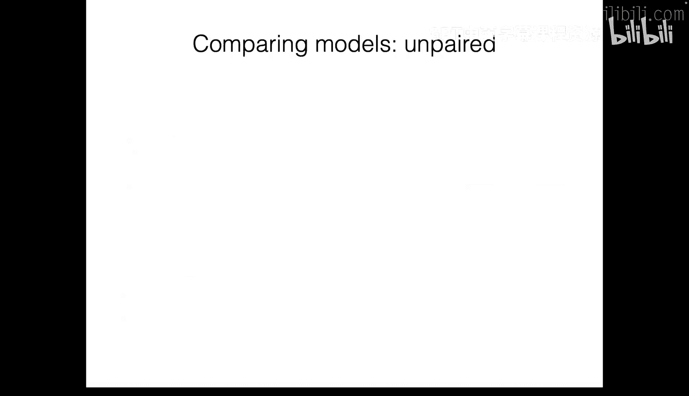

So。In the code repository for the course， just to make this really concrete。

 it has a little simulated example of this。

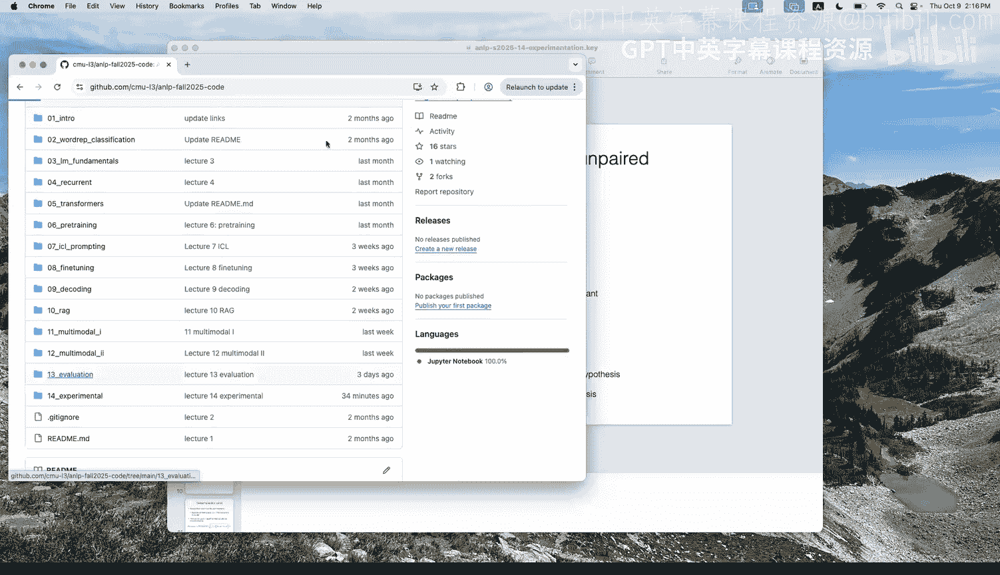

So here again， we have the setup where we have a question and then some score on the question and some number of questions。

And for fun， we can set it select the number that's in human E， which is 164。

And then here the interesting thing is that we're going to， let's assume that in the simulation。

 the underlying models have actually the same true average score on the data set。

Then what it's going to do is it's going to model the scores as being kind of samples from this binomial distribution with this given mean。

And so you can imagine this as being like some simulation of a evaluation you know result that you get after you run two different two models。

Okay， and now the interesting thing is that here we can really concretely see what I'm saying about this kind of statistical variation。

Here， although the two models had the same underlying true mean due to us only using 165 examples in the data。

In this case， actually Model B has like 5% higher performance than Model A。

And so if we looked at this naively， we would conclude that， you know， oh， model B is much better。

 we shouldn't use model A。Okay， and the idea of these error estimates or confidence intervals is to help you maybe be more careful about the claims。

So here we can。嗯。Here's just， like I said， you could compute this like standard error estimate。

 you could compute the two different confidence intervals。

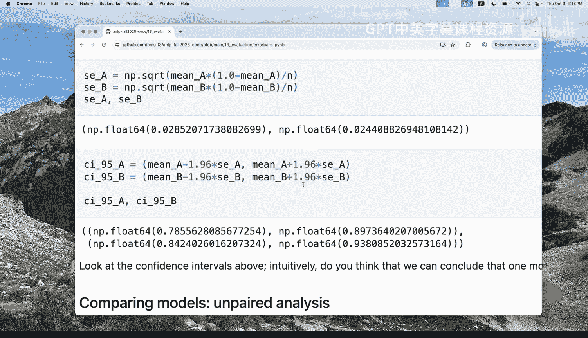

And then you can look at them。Okay， and so without going into the next section。

 which is how you make a kind of like a principle decision based on these。

You can kind of look at these and see， oh， well， they have a lot of intersection。

 so maybe we shouldn't conclude。Maybe it's difficult to tell what we can conclude from this experiment like is model B actually better than model A or are they actually the same it's kind of noisy。

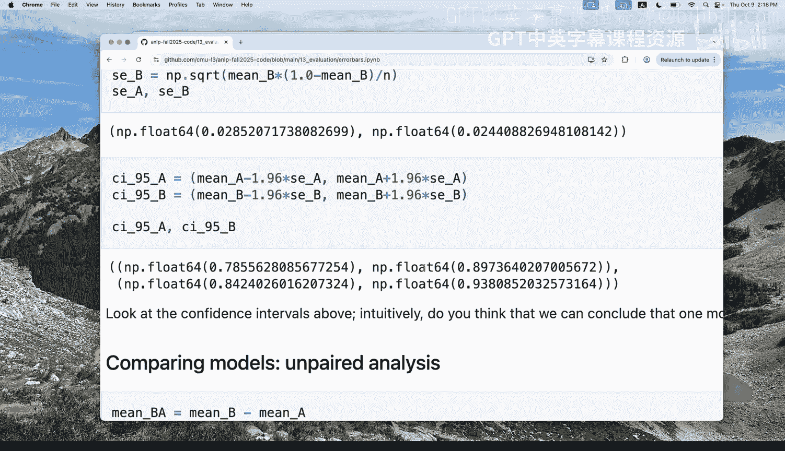

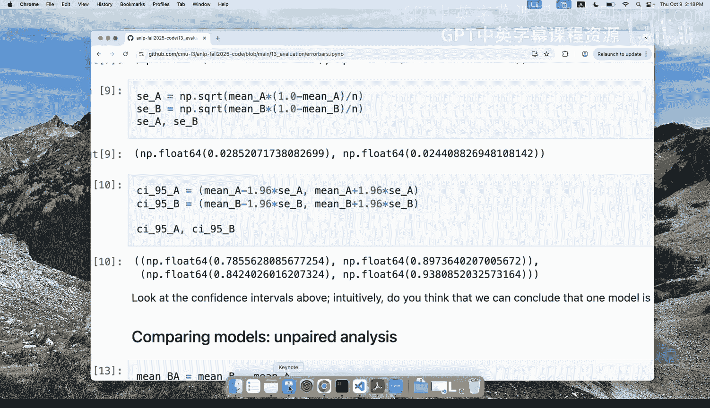

Okay， cool。That is that。 So then we could think about， like。

How could you make a kind of principled decision based on data like this？Well。

 what you can do is construct what's called a hypothesis test and so this is just a really basic intro or overview of what you do and again it's kind of concrete so hopefully you'll get a good sense of what's going on。

So here what we could say is， let's say we're interested in whether these models are actually the same or whether they're different。

Well， then you could have this mean， which is the difference of their means。

And so then the question might be， is the difference of their means zero or is it not zero？

Then you could get a standard error estimate， which isn't just associated with one of these means。

 but actually with this difference and this is what it turns out to。To look like in this case。

In this case， we're assuming that。We are just looking at these means。

 so that's why it's called unpaired。On the next slide or two slides from now。

 it turns out you can get a different error estimate if you actually have the data on the individual problems。

 so like how did the score differ on each question？Okay。

 so now you could have a confidence interval and one thing you could say is if the confidence interval doesn't include zero。

 then this result is statistically significant for a confidence level 95%。嗯。

Another thing you could do is to compute these to do these tests。 So like a T test or Z test。

So here we want to compute this Z score。And what this is doing is it's basically normalizing or standardizing this mean estimate。

So we're dividing it by this standard error。And then this gives us some number that we can look up in like a table of these Z values。

And we could basically see like where on， for instance。

 a normal distribution does this standard deviation lie？Okay， so then with that。

 we can get a probability of observing the difference under the null hypothesis。So this means like。

 okay， suppose that these models are actually equal。

 then what's the probability that we saw this actual difference in the data？

An idea is if the probability is very， very low。Then this data is maybe not just due to random chance。

Maybe in fact， actually the null hypothesis is not true， and the models are actually different。

On the other hand， if the P value is very high， then there's a chance that we just saw this difference due to the kind of randomness。

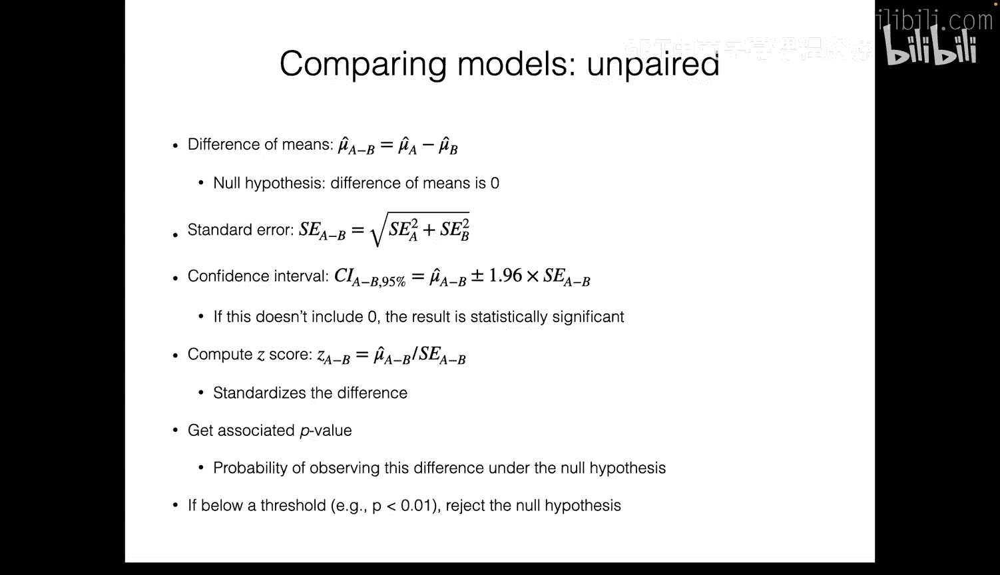

Okay， so we can see this concretely in the code example。So here we construct these different means。

And we compute the standard error。And then we can get this Z score that I told you about。Now。

 if you remember like statistics class you probably saw these tables so you can look up the z score here so 1。

2 or let's just run up to 1。3 so point。9，0，3，2。You can also get that by yourself by looking at this normal distribution and looking at its cumulative distribution function。

Okay， so now the idea is we want to compute this。嗯。

We want to look at like the part that's not captured so like one minus this。

 and you also want to look at it for both sides of the distribution。

So that's that's what this is doing here。And now we get this number 0。193。

And so the interpretation is that like there's actually roughly a 20% chance that we actually saw this difference just due to randomness。

And it kind of makes sense because we know we made the data ourselves。

 we know that the means are actually equal。And if you run the code multiple times。

 then you know roughly every every five times， you'll see something that。呃。

You'll maybe see like a big difference。Okay， and so then we can go back to like making a decision based on this data and you usually establish some kind of confidence level you want or some P value。

So a typical one， typically a high one is 0。05。In some areas， you'll need， 0。

 0001 or like 1 to the e minus6 or 10 to the e minus6。

But here maybe it's not like two high stakes so we can decide this but。

This P value is even over this threshold here， and so we would conclude that。

 yeah the result isn't that rare and so we can't really reject this null hypothesis。Yeah。嗯。Okay。

 so that's a kind of whirlwind intro to the hypothesis testing and you can imagine that like most things I've talked about。

 you could either vary or you could try to improve in some way。

 so like you don't necessarily need to use the normal distribution。

 you don't necessarily need to do this kind of two cited test but hopefully this gives you some concrete sense of what's involved。

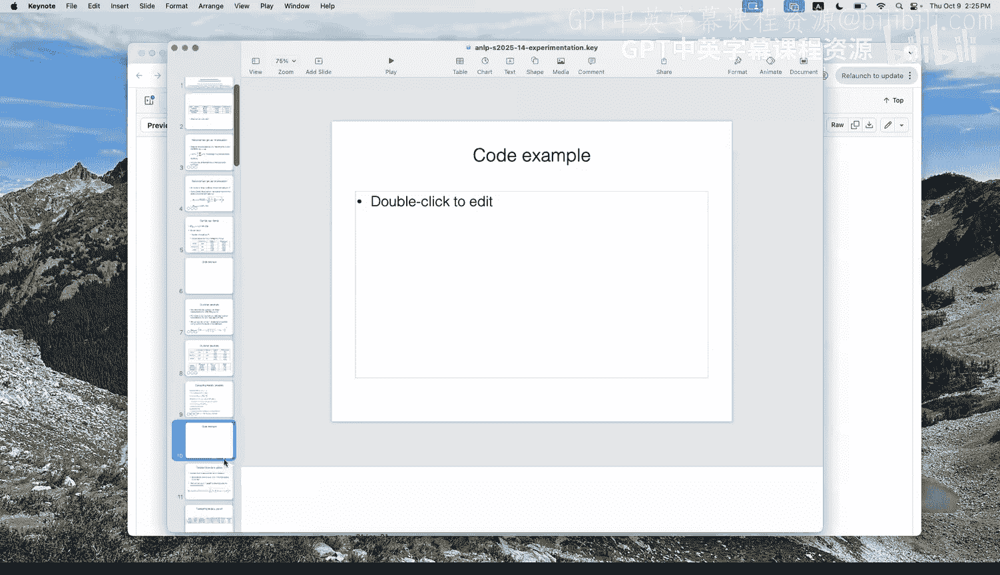

嗯。Okay， so next we could consider what happens if you use。The fact that。

You know have the same you might have two systems and you evaluate them on the same examples。

And you have access to the results on individual examples。

So it turns out that you can get a kind of better standard standard error estimate if you use this kind of paired data。

And the reason is that。You know， you could imagine that， let's say on a math word problem data set。

Then some of the problems are probably pretty easy。And so both systems are， you know。

 with high confidence going to get those problems correct。

Whereas other ones are harder and maybe there's where there is more variation。

So this takes that into account in some way。So now you could look at the final table and this is using all these different methods。

And so now we can look at like the difference between the model and some baseline。

And so here it looks like on the math data set。嗯。What can we conclude？So first of all。

 the 95% confidence interval doesn't include zero for this difference。

So we could probably conclude that， you know， this is。

This is like a real advantage of this model on the data set。嗯。In contrast。

 both of these actually include zero and so at this 5% level we can't really reject the null hypothesis that the model in the baseline are actually the same we might have just seen the data due to kind of statistical noise。

Okay， so I think it's pretty interesting because if we just looked at the table at the beginning。

 in slicesa like this weren't really that obvious。嗯。Okay。

 so maybe I don't want to spend too much more time on this。

 but you can imagine you can improve things even more。

So this one's kind of intuitive and important to go over。

So you can actually look at the way the test is built。And look at the variance of this mean。

And it has this term here， which is the variance of the score divided by n。

And so a really easy way to reduce number of the variants。Is to increase the number of questions。

So that kind of gives some intuition for， you know one benefit of having a larger data set。

Another thing to be aware of in practice is based on the decoding algorithm you use。

 stochastic decoding algorithms might introduce some noise。

 because like each time you sample you got a different output。

And so you also want to account for that。And so you can also make a really clean argument that if you take kind of multiple samples and average their outputs。

 then the variance will be lower than say， taking just one sample。Okay。

 so if you want to look into more detail on this， the paper I mentioned last time is a good starting point。

 and then there'll be a whole kind of literature on these kinds of things。

Here is just in this synthetic setting， showing the。The reduction of variant。

And so it's basically saying if we， let's say our data set was 5000 and we saw。You know。

 we saw some observation， then you could probably be more confident in it than if we had 156。

So any questions on this so far before we move to the next part？Okay， cool。 So then， yeah。

 the main part of this lecture is on。Kind of experimental design。And so， the stuff I。

Or the main theme of the lecture is on experimental design and so the stuff we just went over certainly does relate。

 but for the next part， it's kind of structured around what is the scientific method。

So in some sense， the previous part was someone gives you results and then how should you interpret them？

This is saying like， let's say you want to pursue your own scientific question and structure and experiment around it what is involved in that。

And yeah， traditionally， you can think of this in terms of the scientific method and so this is from Wikipedia and there's kind of these six different parts。

So let's think about concretely in the case of NLP， what each one of these parts corresponds to。

So first is observation and question， and here it's kind of the question of how do you identify a good research direction or good question to go after in the first place？

Well， this is sometimes the most difficult part of research。

And so it's going to be difficult to maybe like fully describe the way to do that。

But certainly you could come up with some way of kind of structuring your thinking about it。

And one way to do that is to think of kind of broad categories， right of research。

So one category of research could be driven by a particular application or set of applications。

And so here you might say I would like to make a useful system or make one work better。Okay。

 so you might have a particular application that you have in mind。

 let's say I want a language model to run on this phone。Okay， and then you'd think about like。

 I run the language model， maybe it takes like an hour， okay。

 what are the different research questions involved in actually getting it to run faster？

And then as you break it down， you'll eventually settle on some problem。Similarly。

 let's say you want to make a system that translates one language to the other。And for a while。

 like a lot of research in the community was structured around kind of applications like this。

And so the particular application might change over time and might become either more like specialized or more general。

 but this is a kind of a good way to start thinking about different research problems。

The other is kind of curiosity driven research， and of course。

 both of these do intersect in practice。But here you could say like you know。

 independent of a particular application or maybe some system doesn't exist。

 I'm not trying to make a system better。You could just ask a question like I want to understand more about how language works。

or I really want to understand you know， why synthetic data or like whether synthetic data is better than real data。

 something like that。Okay。So。Yeah， in practice， you'll see examples of both and there's kind of intersections。

 but maybe it's useful to at least have this in mind。So here's some examples and these are。

 well I should mention this lecture is based on slides made by Graham for a previous version of the course。

And so here are some maybe like classic examples。Um， but the ideas， you know， are kind of timeless。

 the idea of like application driven versus curiosity driven。So here back then。

 you know this idea of doing sentiment analysis so assigning some sentiment to something like an article or movie review was yeah。

 something really interesting and something really challenging and so here they were just proposing this task。

嗯。Similarly， question answering is you know another application。

 and you can see that the reason they're proposing it。Is。

Is really based upon this idea of having some kind of virtual assistant。

 so there's something like concrete in mind。Okay， similarly summarization is another application。

 and then here's an interesting one， they're proposing a method for word segmentation and you might think like。

 oh， that's actually not necessarily in application。

 but then the question is like where does the problem come from in the first place。And here。

 at least based on what they've written， they are kind of concerned with the task of you know training a multilingual model。

 and on the way to doing that， it looks like this like language dependent processing was a kind of roadblock。

Okay， so then given that roadblock， you can think about， okay。

 how do I come up with a new method for kind of overcoming the roadblock？

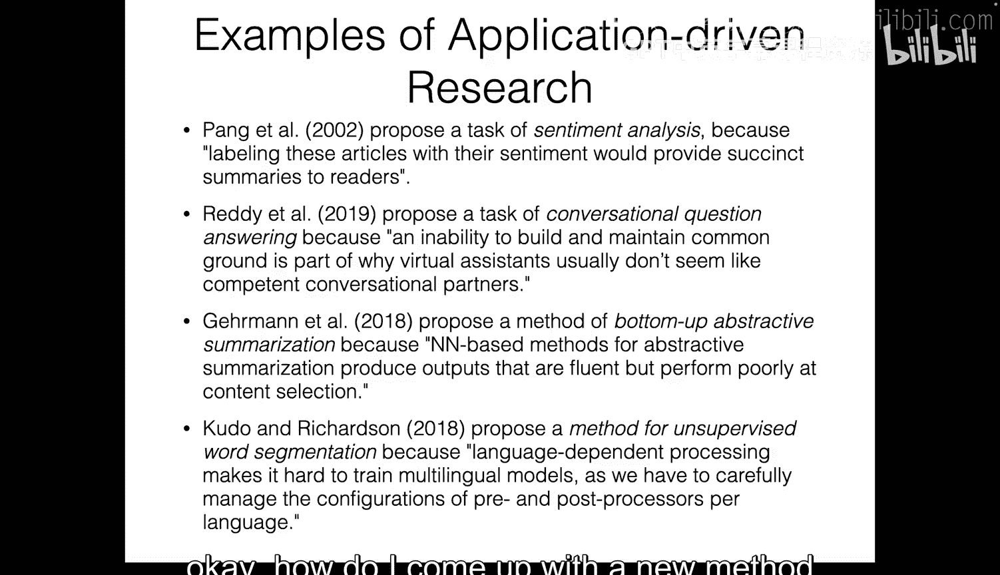

Some examples of the curiosity direct research。So here they asked。

 what is the difference between the language of real news with that of satire， hoaxes and propaganda？

Okay， so here you can imagine that if you answer this。

 you could probably use the knowledge to you know build some kind of system。

 but at least the way it's phrased here， it's not necessarily you know。

 built with some particular application in mind。Similarly。

 are all languages equally hard to language model？Again， it's kind of like an interesting question。

 it's maybe like a property of these language models。And again， if you knew this。

 then it could be really useful for various applications or building a practical system。

 but you can maybe see that it's you could view it as being coming from a different starting point。

And then similarly here， they're quantifying where specific types of linguistic information are encoded in BRT。

And so again， the idea of like linguistic information is a kind of you know abstract concept if you want。

 and you might have to look at particular applications， but again。

 the kind of question is coming from a different starting point or a different perspective。

And so if you think about like where to get research ideas。

 another useful kind of contrast that you could think about is bottom up or top down。So bottom up。

 one way to do it is you look at existing research。And then you see kind of where it fails。So again。

 let's say that I look at， you know， I try to run a language model on my phone and I actually try really hard and I use all the different techniques for it。

And then I have a really good understanding of where it's failing。And then I could think about like。

 oh， I noticed this thing and this method is you know suboptimal and so maybe the research question is like how do we improve that method or you get an idea for a completely new method？

And so when you think about it， there is a risk that you know in doing this。

 I really narrow down the problem space like by looking at running the language model on my phone。

 I might not discover like the concept of deep learning or something like that。

 I mean maybe you could like maybe fundamentally the model is limited so I'm going to invent a new type of model but yeah the kind of tradeoff to keep in mind is that oftentimes when you're looking at an existing system。

 by definition they've kind of already defined part of the problem space and they've already kind of built a system in the area。

So the other would be top down。And so get at。A good example of this is like you know deep learning so at the time。

The best performing systems on different applications were not based on deep learning。Um。

 but the kind of people researching deep learning had some sense that if they kept putting effort into it。

 that it was ultimately going to pay off。And deep learning like looked much different from like a rule based system。

 so it wasn't necessarily looking at the rule based system and saying like how do we modify it？

Maybe the most they could do is say like， here's the rule based system， we don't want to do this。

 we want to do something completely different。So you can kind of see how it's a different kind of flavor of getting research ideas。

So this can favor bigger ideas。But the danger here is that sometimes it could be disconnected from reality。

So imagine that like you spent your whole career pushing deep learning because you thought it was a good thing and then it actually didn't work out and it actually like wasn't interesting at all then in some sense you。

Yeah， that that would be the kind of trade off there。

Maybe like a less extreme example is and this happens a lot。Is that you might have some idea like。

 oh， this type of method should work pretty good on this。This type of method should work pretty good。

So you like build the method and then you start searching for problems that it should work well on。

And then sometimes you actually don't find any problems and you spent a lot of time kind of building the method。

So that's something very concrete that can that can actually come come up a lot oh it's actually here as a bullet point so you can basically be solving a problem that's actually not a problem。

Or you could develop a method that in theory works for a bunch of problems。

 but then in practice you actually can't find any problems that it works for。嗯。Okay， oh。

 so that' that's the second point。So that's the observation and question part。

 maybe let me pause for questions on anything we've discussed so far。

Okay cool so the next is researching a topic area， so in homework three you'll have to do this。

 so I should say that like not every research project is as structured as the way we do it in the course but you know some are and then in a course format it's kind of useful to break down the project into different parts。

And so actually， like the first thing you'll do is to do a kind of literature review。

And so this will be very， very relevant。So here it's just a broad overview of some methods。

So first you could start off with like thinking about， well。

 so first you should have something in mind， maybe that's not on the slide。

 so you can't just do a literature review about about nothing。

So you want to start with at least some area that you're interested in right。

 so that was the first part where you're coming up with a question。

Then with your area or even better like your specific question in mind。

 then you want to go and or then you can go and kind of learn more about the area。Okay。

 so you can start searching for papers。You can find older and newer papers。

And there's a variety of techniques for searching for papers now。

 I think I'll have a couple slides on some other ones。嗯。But suppose you find some papers。

Then you do want to have some technique for kind of。

I usually view it as kind of two things just because two is easy to think about so either like a fast way of reading papers or a slow way。

And so at this stage， you probably most of your reading wants to be kind of fast in the sense that you might be looking at a lot of different papers。

And you want to know kind of whether a given paper is kind of worth spending a lot of time on。

I should mention， though， that if it's a brand new area for you。

Then the first papers that you run into， you might actually want to spend a lot of time just so you kind of learn the vocabulary of the area。

 just learn like what an example research paper looks like in this area。

 and so it's actually good to do a kind of a slow read of a paper in the area。Okay。

 but then at some point， you'll get to the point where you want to get through kind of a lot of papers。

And so you can consider like trying to extract like what is the key insight or key result or even just like what is this paper about or what is it claim？

Okay， so then you can kind of like sort you know， in your mind what these are and maybe get some sense of which are the most relevant to the area or to the idea that you have in mind and then spend some more time on those。

So some different sources of papers。So here's just listing some of the common conferences。

So in this area， like these ones are very popular nerves， eye clear。

ICML and probably TMLR are more just general machine learning。

 but nowadays there's lots of stuff on language models， NLP stuff we talk about in this course。

There's this recent conference on language models column it's actually going on this week。

So this will have stuff， really relevant to language models。And then there's this ACL anthology。

 so there's these variety of conferences aimed specifically at NLP and they're kind of grouped under this one organization。

So one way to think about these is that these are papers that have been you know。

 filtered in some sense by the peer review process。

You can also look at like which paper got like best paper or like an oral presentation or poster presentation。

Or which one's got like best paper at a given workshop or something。

 and sometimes that could be useful information。The other thing is you can actually look at the reviews of these papers and sometimes they're very insightful so you can look at。

 yeah， kind of like strengths of the paper， weak points of the paper and also just get an insight into like what did the reviewers kind of find interesting or noteworthy in this paper？

The thing about conferences is that this field does move very fast。And so for like very。

 very up to date stuff， if that's what you're trying to look into。

 the conferences will have some lag because you know papers have to go through the review process and then like the conferences a few months after that。

 so also just keep that in mind。So for the very， very recent papers。

 most stuff is posted on archive and then it'll be indexed by a Google Scholar。

And then there's a variety of。ways to， I don't know if I have any slides on it。

 there's a variety of ways to start like narrowing down things here。嗯。So。You can， if you know。

 like certain you researchers or research groups， just look at their papers。

Some people use like Twitter or X to get。To stay up to date on a particular area。

There it's kind of like the statistics stuff I was talking about， there's a lot of noise。

But you can get some like some good signal as well， and it'll be very up to date。嗯。Okay， and then。

So this is ACL anthology and then another like really just useful thing is really just using a Google Scholar so again。

 if you have a certain like researcher or research group in mind you can see all their papers there and then it has this kind of network of things。

So one useful thing to do is。You can look at a paper and then you can see which papers cited it。

So then in some sense， you can get let's say it's like an older method or。You know， in this field。

 it's like a few years old。And you're curious to see like。

 did the method actually get used in more recent methods？Well。

 then you could look at what sites it and you know sort by the date and kind of scan and say like。

 oh， well， maybe it's actually showing up in this paper here， for instance。Okay。

 so it might be slightly old fashioned， but it's actually a really useful technique。嗯。

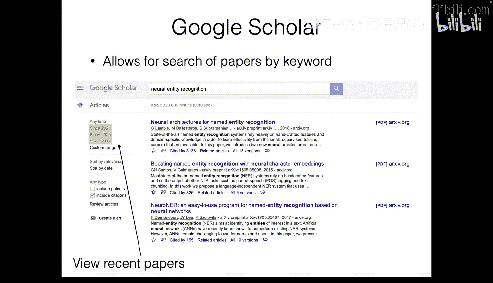

So， okay， yeah。And then another thing to so what I just mentioned is like finding a newspaper paper by looking at things that citeted。

Another thing is to go in the reverse direction to find the older papers。

And basically if papers are doing a good job at citing， then you could eventually with a few hops。

 you know， find these really kind of core papers in a given area and the reason is that they'll be cited in papers and like discussed。

Okay， so usually if you're able to kind of read a paper。

 identify the related work in the way they're writing about something。

 then you can usually find kind of what are really important or foundational papers in a given area。

And want be those might be good candidates for， really reading in depth。

Sometimes if a paper is too old， it might be written in it like a different style or have different kind of assumptions and it could be difficult to read so also。

Just be aware of that。嗯。Now we're telling you to do a survey for the course and I'm going on about surveys。

But really you should also be aware that there's actually some pros and cons to doing this。

So in a good sense， it could prevent you from duplicating work。Like let's say you want to， yeah。

 like you're doing research and you want to work on something new。

Then you could find that someone has already maybe done it before。

And I think that the really good thing is that it can increase your toolbox of methods or just the way that you think about things。

Like by definition， none of us knows everything and especially when we're going into a new area。

 just like reading papers and spending time on them in an area is basically just learning you know。

 about the area。And so that's obviously really useful。

The downside is that this really can constrain your thinking or even prevent you from working on something when in reality。

 if you actually started working on it， then you would end up doing slightly different something slightly different than what was done before or you would kind of you know work on it and then you get deeper into the problem and you end up doing something completely new anyways。

And then secondly it can kind of give you some prior on what the solution should look like for a given area you know it's like let's say you're trying to solve a math problem and you look at a solution then maybe it's a bit harder to come up with like a completely different solution same thing happens in research so if you spend a lot of time looking at the way people are solving things then it can in some sense constrain constrain your thinking。

Okay， but I'm not saying it's bad these are just pros and cons and so in practice you kind of have to balance both of them。

So this one I should add it to the secondary reading， so this very in 1994。

 it's a paper by an economist。And he basically says that instead of reading economics papers to get ideas。

 he reads the newspaper and magazines and like one thing is that like if an economics paper has already been written。

 but this holds in any domain。Then in some sense， the problem is already like done and maybe it's already like a couple years old。

Whereas if you like base it on kind of current events or things outside of the field。

 then you could have a chance of kind of expanding the scope of problems that you look into。嗯。Okay。

so。So that's that and there's a lot to say here and I would be aware of this and kind of a lot of good ideas come from maybe having something in mind you're having something you're interested in and then almost like starting to work on it and then you kind of find out what's been done or how it's different。

嗯。Okay。So。Next is forming a hypothesis。So。Next， we want to， you， you can imagine that like。Well。

 I mean， especially in a course like you have to have something done by the end of the course and so at some point you're really going to have to pick something to work on and this happens in any setting if you're if you're in a company。

Then， you know， you might have some meeting or you might have like your annual。

Or semiannual review or something and you want to just like pick something to work on or if you're doing research you might spend some time you know exploring and then ultimately you want to like you know zero in on something to actually work on。

Okay， so there's always this question of like， what is the research question or the hypotheses that you're looking into？

嗯。And so it can be helpful to kind of go through the exercise of trying to write out like what exactly are you looking into or what have you like what are you trying to test？

And if you think of this as like， you know， doing science。

Then you have to have some falsifiable or some testable hypotheses。

And the reason you do experiments and things like that is to actually just get empirical data on whether your hypothesis is correct or not。

And so the hypothesis would be like what you think the answer to the question is kind of a priori or based on what you know or what you think。

Okay， and again， these should be falsifiable， so if you get a certain result。

 then that will kind of provide evidence that the hypothesis is validated， otherwise it's disproved。

嗯。哎不是。😔，哎都对不起啊。😔，Okay， so here here's the examples we were talking about before。

 here they had this question， are all languages equally hard to language model？嗯。So ultimately。

 you can't just keep this as a question， you have to like take some a position or some hypothesis。

And so here they're saying that it's unlikely that all languages are equally easy or that methods are equally good at all languages。

Okay， then you could imagine that this can turn into a set of experiments， for example。

 I mean one clear one is you take the methods and you evaluate them on different languages。

And if they're equally good， then that's one outcome， if they're not equally good。

 it's another outcome。Okay， so this is actually useful to do to think about like how do you start with a broad question。

 how do you kind of operationalize it into these kind of testable questions and then different experiments。

Similarly here， there's one about podcasts and then they narrow it down to some a small set of things that you can test。

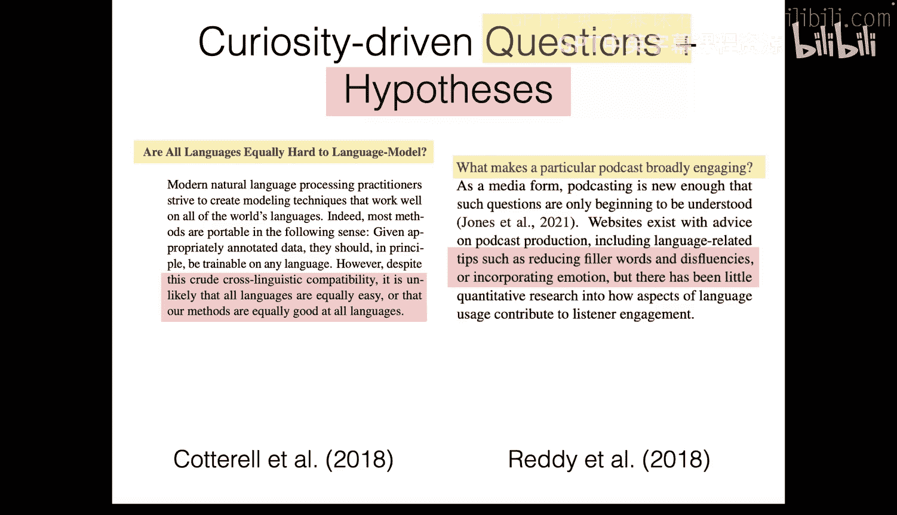

Here's one that's more application driven。And you see this a lot where people will enumerate like different questions。

So here， like one is， is the behavior of pre training affected by language families and other linguistic features of source and target languages？

So sometimes they're like very， very specific。嗯。But here they're kind of explicitly writing out different questions。

Here， maybe it's a bit harder to come up with a very clear testable question。

It's just that whether and how contextual information benefits this has received a little attention。

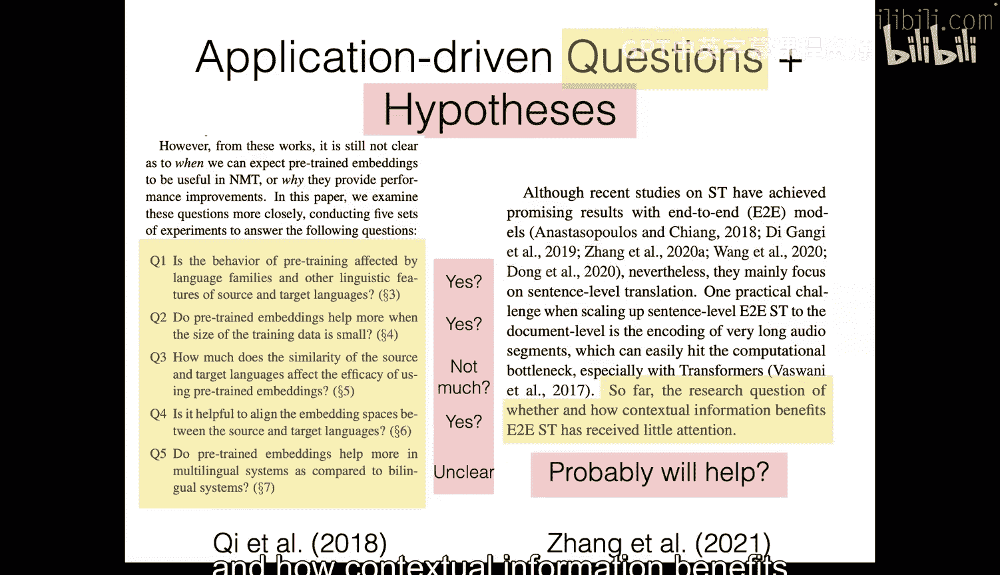

嗯。So。So yeah， like one thing to to look out for is。嗯。

You could have like does x make y better and the answer is yes or no。Well。

 then I guess is if the answer is yes， then it might be interesting。

 but then answer if the answer is no， then kind of what do you do？

So if you really like think deeply about what you're doing。

 you usually have some intuition about why you thought X would make y better。Okay。

 and so maybe like that assumption you now know like doesn't work。

 and so maybe in your mind you had like a variety of things you could have tried。

And so now you can go back and like try those or。Think about the problem in a different way。Yeah。嗯。

Okay， so those are just some， you know， rough guidelines for forming the hypothesis and maybe my broad takeaway is just like。

It's really useful to kind of。Try to have some like structured thinking about what you're what you're doing。

 So often even just like writing is is very effective while you're doing the research even before you do the research。

And oftentimes you can cut down the number of like potential experiments you have to run by really narrowing down like this is what I'm interested in。

 it is an interesting question and now here's like specifically what I need to do to get evidence about it。

嗯。Okay， so well， so that leads into testing with experiments。And I don't think there's too much here。

 but basically， find data that will help answer your question and then run experiments。

And then we've talked about different techniques for。呃嗯。For this。Actually， there is there is here。

 so this is the kind of structure that we'll go through。

So first you have to find data and the question is like how do you get good test data and how do you get good training data？

So for different data sets。嗯。It's often useful to think about whether the data already exists。

Because building a data set。Is often in itself a kind of big project。

If you're answering a new question， you again want to first think like can I repurpose a data set to answer the question？

Okay， so like。Take this like math word problem data set， for example。

Then you don't have necessarily have to use it for you know math word problem solving or like improving math word problem solving。

 you can use that as a data set that you know has an easy way to check answers and involves generating some sequence and so maybe it's actually used in some like reinforcement learning project and so you don't necessarily care about the fact that it is or isn't a math word problem but you've kind of repurposed it or use in this like reinforcement learning setting。

Of course that's nontrivial and you want to be careful about what you want to do there， but again。

 the idea is， yeah， you can try reusing data because it takes a lot of effort to get really high quality data。

If not， you have to create your own。And we'll get into that in a bit。So again。

 throughout the course I've showed you this hugging face site。

 hopefully you're familiar with it by now， but you can access a lot of data sets from there。

 another thing to do is you know if you have a specific work in mind。

 then go to their code that they've released， and sometimes the repository will tell you exactly how to get the data。

 how to format it， how to use it， things like that。嗯。I forgot this papers with code。

 I haven't checked in a while。嗯。So。So next， suppose you actually want to create your own data or create your own evaluation data at least。

And so you want to annotate it， so the first question is， you know， how much data should I annotate？

Let's say you're getting。Let's say you're building a system for like math problem solving。Well。

 then it might be difficult to write a bunch of like math solutions or check whether they're correct or not。

And so a really important question is like， how much should you collect？

Then there's various steps involved in actually annotating the data。

 so you want to like create really good guidelines and think about is it just like the project team annotating or do you actually have to hire and supervise annotators？

So an example is if you remember like at the beginning of the course。

 we talked about training this classifier to classify a movie review。

 so let's say we really simplify it and we want to just train it to predict whether a movie review is positive or not positive。

Um， so what we'd want to do is we'd want to collect movie reviews and then ask human annotators to label them as positive or negative。

And so the question is like how much test or dev data do you actually need？Well。

 based on what we've discussed， ultimately you want enough so that you have these kind of statistically significant differences or so that you can draw statistically significant conclusions when you run your experiments。

Otherwise， like if it's too small， then you might be wasting your time because you might run the experiment and then you can't really conclude anything from it。

So there's one technique， so one technique is to just get more and more data and then evaluate your model on it and then do the statistical analysis。

And it might be bottlenecked by like the amount of time or money you have。

But there are techniques for trying to estimate how much data you need。

So one is called power analysis。So here we want to make some assumptions。

So we want to say you want to have like some accuracy difference in mind， first of all。

 I'll actually go through this in detail。So let's say you want to build a data set that allows you to detect a difference of like 0。

03 in the performance of two models， something like that。

Then given this size and some threshold that you have。

What this power analysis can give you is some number that is necessary to get the effect in most trials。

So concretely， again， we could have this like null hypothesis and some significance level。

And then you can have what's called the power level。

And so the significance level is the probability of falsely detecting a difference。

So it's kind of what we were talking about before。And then the power level is the probability of detecting a true difference if it actually exists。

Okay， and then you'll have the kind of smallest difference that you care about detecting。

You can imagine that if you want to detect a very， very small difference。

 then you probably need a lot of data。If you expect there to be like 10% differences between systems。

 then maybe you actually don't need as much data to kind of detect that。Okay， then。

Like one way to do this is you assume that you collect some data and then you evaluate system A and system B on it。

 and so now you have this kind of pilot data or pilot evaluation results。

 and you want to decide how big you need to expand like how many more data points you need to annotate。

Okay， so here's a formula and it's again from the paper from the same paper that we used in the last course。

So again， the power analysis is there's a whole set of different methods and each one has their different assumptions。

UmAnd so here I'm just using this one because it was written with kind of NLP or language model evaluation in mind。

And so you have these different terms。So here are these Z scores。

 so these are what I was talking about before that you can look up in the table。

So those are not too big of a deal。And then here you have things that you actually don't necessarily know。

So here is the variance。Of the true performance difference between these two models。

And then these are the variants that you get on average like per question。

 if you're using multiple samples or let's say you're using like LLM as a judge and that is stochastic。

 then that introduces some possible error。So the idea is we can actually use this kind of pilot data that we have to estimate these things。

And so just to make it simpler， let's assume that we're using the deterministic decoding and we're just using deterministic evaluation so that we can get rid of these two terms。

Then in order to use this， all we need to do is kind of estimate。This this variance here。

And that can again， again， be done using this pilot evaluation data that you have。

So let's say we collect a pilot set and it's equal to the size of human e。And again。

 our models achieve。This like similar performance with and this is the variance we got。

Then if we want this power level and this significance， and if we want to detect the difference of 0。

03。Then if we use this formula， it says that we basically need a data set size of size 674。Okay。

 so then could you could say like， okay， if you want higher power。

 then the size of the data would go up， if you want to detect， the minimum size is like larger。

 then that would actually reduce the amount of data。

And then also a lot is going to depend on this variance as well， so with higher variance。

 you're going to need more data again， with lower variance， you're going to need less data。Okay。

 so as with all these statistical models， there's a bunch of different assumptions。

 but I do think it's pretty cool that you at least have some way of giving you some rough estimate of data size。

Then terms of training data， well， I mean like more is typically better。

 one thing you can do is just try you know， try getting some amount of data。

 try actually performing some experiment with it。Or like say you collect you know， 10。

000 instances for training。Then you could try training a model with like 1000。

 2000 or some you know partition， and you can see whether you're getting like big improvements。

 like linear improvements， or if you're kind of just getting like marginal gains with additional data。

So that's something very practical that you could do。And then we not going to go into them， but。

You can imagine that there's techniques to kind of select your training data more intelligently。

Then if you're actually annotating， so remember we want to like annotate these movie reviews。Well。

 then what happens is。Like you want to have really clear guidelines on what someone should do。

So this comes up in like anytime you do human evaluation in one case， you know a few years back。

 we were having students annotate these like mathematical proofs that were generated by a language model。

And we wanted them to say like the different types of errors that the model was making。

And it turns out that even whether like saying which part of the proof becomes incorrect。

 even that becomes kind of unclear and there's variance across annotators。And you know。

 that's in the case of a math proof， which is supposed to be a clear and objective。

And so one thing that helps is to write like very detailed description of what you want。

And then you basically have a clear definition of what you're measuring。

 and not it might actually be a bit more specific than this kind of higher level thing that you originally had in mind。

Here's just some more advice in this from this， you know classic paper， but it still holds true。

 sometimes showing like difficult cases and things like that can be really useful。

I think nowadays you can try with a language model and probably like a clear description for a language model might be a good proxy for a really clear description for annotation as well。

But on the other hand， it's good to have some things in your mind， some like u。

Princiipples for how you're writing the description。Okay。

 so then if you're actually hiring human annotators。

 then sometimes you do do it yourself or within the project team。Or colleagues。

If you actually hire people then things get more tricky so first of all you yeah。

 you have to make sure that based on the situation you're in it's like okay to hire people if you do there's these different sites that are kind of facilitate hiring freelancers or crowdworkers for annotation。

Typically， you'll have to do this IRB approval， so institutional review board。

If you're conducting one of these studies to make sure that things like。Just for instance。

 like the salaries you're paying and the content of what they're。Annotating and things like that is。

It is okay。So just a general tip is you always want to do something small first。

 oftentimes you'll see that the way the instructions you gave are unclear or something like that。

 or it turns out that your task is just like too difficult or something like that for the particular you know annotators that you're able to get。

Okay， then the last kind of technical topic is on assessing the annotation quality。

So you may have already had to do this in your homework。

But here let's say that we do get our labels for our 674 examples， right that's the amount we need。

To get good conclusions on this sentiment analysis task based on our power analysis。

Now we have people actually， you know， label things as positive or not positive。

And we want to see how much the rateers actually agree beyond what we would expect by chance。

So basically， you know， for each question， we can have multiple graders and you have to check the agreement。

So for this， there's these different interAnnotator agreement or IAA measures or statistics。

So here's maybe the simplest one and it's called Cohen's Kappa staistic。Okay。

 the general theme here is that when you hear statistics。

 you usually should think about like what are the assumptions？

So here this is assuming that you have two different rateers。

And I think it's like this just binary task。So I'll show the the slide later。

 but if you have kind of ordinal data or if you have a different kind of。By。You know。

 multiple annotators， things like that， then you'll want to use a different statistic。

But this one looks like this and it has these two different terms。

 so you have the observed agreement。And then you have the expected agreement。

 So the agreement that you expect， just due to random chance。

So here's concretely how you would measure this， so first of all you make this confusion matrix。

 so confusion matrix is looking at all the different possibilities and kind of coming up with these counts。

So here again， it's just on this binary with two。Two annotators。

And so you could see how often they agree and how often they disagree。Okay。

 so that will be the observed agreement is like the sum of the diagonal over the total， which is 674。

This is number of each one of these is like number of questions So out of 674。

Then the expected agreement is， again， intuitively the agreement you expect to have by chance。

And so here you can see that it's saying like， okay。

 what is the just marginal probability of getting a zero from annotator a？嗯。Or a0 from annotator B。

And this would be an agreement because it's saying that we they both agreed。

 they both got zero or they both got one。Okay， so for instance。

 one of these terms would be calculated like this and they're all just based on thistent or confusion matrix。

Okay， so now with these two， you could estimate this Kappa。

And there's these different kind of conventions if you look into the details of these。

 they're kind of arbitrary， but you can look at these different conventions for saying like， okay。

 there's high agreement， almost perfect， no agreement and so on。

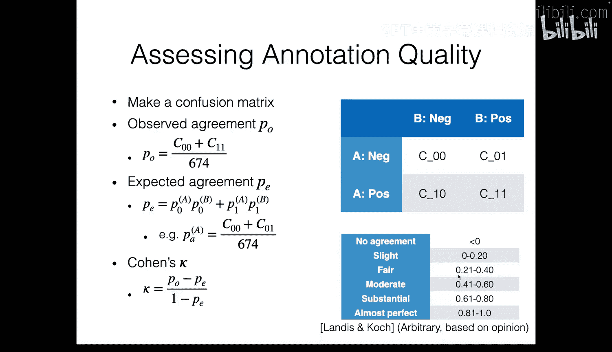

So as I mentioned， there's other versions of this and again。

 hopefully you know enough about this that you see what annotator agreement is about so you could look up these different ones on like Wikipedia or something and then think about how to apply it in your setting。

Okay， so we're almost out of time， but these were really the main topics that I wanted to go through。

The computational resources， we've been posting them on Piazza。

And then finally you'll want to you know put all of this into a paper and I really recommend actually reading this so I actually when I was getting ready for this lecture I thought I would have time to go into this in detail。

 but like it says here too much for a single class，But it's really。

 really good so this researcher Simon Peyton Jones has this talk and there's a PDF of the slides。

On tips for writing a good research paper， also giving a good research talk and highly highly recommend it。

Okay， so I guess that's it and we are right at time， so that's it for today。

And have a good fall break， please enjoy it， thanks。

