# CMU《高级自然语言处理｜CS11-711 Advanced NLP Fall 2025》中英字幕 - P15：(15)_ Reinforcement Learning Fundamentals.zh_en - GPT中英字幕课程资源 - BV1ZWYAzuEMa

Yeah， we'll go ahead and get started， so I hope everyone had a good fall break。

And today we're going to have a lecture on reinforcement learning。

So this is an area which is rapidly gaining more and more prominence in NLP and advanced NLP。

So this semester we're going to have a slightly larger focus on it than last semester。

 the way things are structured is in today's lecture。

 we will go through the kind of basics and background of reinforcement learning。

And it really doesn't have anything to do almost with NLP。

But the ideas are really important to at least see once， at least see the foundational ideas。

And then in the next lecture， we'll look at some applications of these ideas to NLP into large language models。

Then in the third lecture， it's kind of related this semester。We'll take a look at agents。

And a lot of these tools or even ways of looking at problems that we get from reinforcement learning will be very useful for thinking about those kinds of problems and even training models to to kind of function as agents。

So with that， we can get started with today's lecture。So first。

 I do want to just motivate this and contextualize it using language models and using things we've talked about。

So really the primary learning algorithm that we've used。

Has been based on what's called supervised fine tuning。So here we start with some base model。

 of course that was pretrained with some pre training algorithm。

And then here we have this task data such as instructions and inputs and outputs。

And then we fine tune the model and you can get。A model here like an instruction following model。

And the algorithm that we used to do this was maximum likelihood。So in a bit more detail。

 we had this data set of inputs X and outputs Y。And really。

 the objective or the goal was to maximize the likelihood of predicting the next word in the output given the previous words。

Okay， so today we're going to be looking at different loss functions or different objectives。

 which is why I'm putting this equation up here again。So we'll see different versions of this today。

And we'll kind of compare and contrast them。But first。

 we could just intuitively think about what this is trying to do。And when you think about it。

 it's really just using this data set that is provided。And in some sense， learning to imitate it。

RightLike we're specifically increasing the probability of outputs that are provided in the data。

And we're only focused on these outputs that have been provided to us。Okay， and then in doing so。

 the hope is that you're not just memorizing this data set。

 you actually get some useful generalization， so for instance you can give the model a new instruction and it might actually have enough generalization to give you a kind of good output。

Okay， and so this can be very powerful， but what are some limitations to doing this？Okay， well。

 first one， I'll call it a task mismatch。So typically we want to use a model to actually perform specific tasks。

So for instance， we might have。A dialogue system and we want it to have kind of helpful responses or ones that are non offensive。

Or we might want to say solve a problem and you really want the model to produce some correct solution。

Or maybe you want the model to generate some code and you want it to be correct code。

 so you might run some test cases。Okay， and when you think about it。

 what we're saying is that we're kind of assuming that a probable response is the same thing as a response or output that satisfies our task criterion。

Okay， so it's kind of saying， well， maybe if we make a lot of good solutions more probable。

 then we'll get a correct solution， things like that， or we'll get code that passes test cases。

And the issue is that this isn't always the case。And a second question is like。

 if our goal is to perform a task， why don't we just directly optimize for that task criterion。

 So what if we could like specifically train a model and set its parameters so that it maximizes。

This kind of reward， which is like a correct solution or a helpful response。

Second is this supervised fine tuning is based on data。And sometimes there's a mismatch in the data。

 So what do I mean by that。Well， let's say that we train a model on like responses from Reddit。Well。

 then maybe some of those are offensive and then when we go to use it in our task。

 our task criterion is to have non offensive responses。Or let's say that we trained it on some code。

 like from GitHub repositories or something like that， and there's some bugs in the code。

And a second issue is that sometimes we don't really have data specific to a task or specific to some functionality that we want out of the model。

Okay， so a good example of this is these chains of thought。So if you take， say， like a you know。

 a kind of difficult math problem。Then maybe on the internet， if it's a popular problem。

 you could find like one human written solution for it。

But you could imagine that like maybe the model wants to solve it in some different way and we just don't have a large amount of examples of this functionality。

 we we in some sense have to kind of like try generating data with the model。And then similarly。

 let's say that you have some different prompts for like your chatbot。

 then maybe you don't have helpful examples of helpful responses for all different prompts。

Like maybe you have some detailed， I don't know， critique of some essay in some like specific area。

Then kind of getting a lot of data to be able to just supervise fine tune the model so that it's good at responding to that prompt might start to be difficult。

And then the third， and this is somewhat like a technical issue， maybe。

You could call it exposure bias。So this is just saying that if you look at the supervised fine tuning。

 then in some sense， it's telling the model to imitate the examples that we shown it。

But what it doesn't do is it doesn't really train the model on mistakes or on bad examples。

So for instance， let's say that we train our model and it solves a problem and then it makes a mistake。

Well， then it's actually never been trained on data that actually shows a mistake。

And then you could say like， okay， maybe we can collect a lot of that data。

 but then you get into the issue on the previous slide that it gets harder and harder to kind of collect these more specific types of data。

Similarly， let's say that we want to train something which like navigates web pages。Well。

 then maybe we can kind of navigate the page ourself and show how to perform the task。

But that doesn't necessarily show what happens if you click the wrong thing。

 and so we want the model to be able to kind of recover from these mistakes。

So today we're going to talk about a framework called reinforcement learning。

And when we apply it to language models， which will mostly be in the next lecture。

 it will look something like this。So first we'll generate with the model and then we can evaluate the model's outputs with some reward function。

Okay， and then based on that reward function， like here we have a correct output here we have an incorrect one。

 based on that reward function， we then do some learning so we update the model parameters。

And the cool thing is that as long as you have a good reward function。

 then you can try to apply this to a variety of tasks， so it's a pretty general framework。

So some key differences now we can directly optimize for our task criteria。

 say like correctness or useful responses。As long as we can kind of build a reward function。

 which kind of quantifies the task criteria。Second， the data is now being generated by the model。

 or at least the outputs。And so this kind of lifts the constraint on needing the kind of human written data。

And the reward function even tells you kind of how to use it， should you use it to kind of you know。

 increase this type of behavior or should you penalize this type of output or behavior。

And then third， as long as we can evaluate the reward。

 then the models can basically learn from any output or any trajectory。

 so in particular here we have an example of some like offensive output。And if you think about it。

 it's not clear how to use that with maximum likelihood。Whereas here with reinforcement learning。

 we can kind of assign a negative low reward to it。

And the reinforcement learning algorithm will actually get some learning signal even out of this kind of wrong or mistake kind of trajectory。

Okay， so in today's lecture we're going to focus on what is reinforcement learning。

 give you some of the basic ideas and basic tools from reinforcement learning。

And we will focus on this class of algorithms， which are called policy gradient methods。Okay。

 and the reason I'm focusing on these is。Currently they're the ones that are mostly used with language models okay and I think it's really good to see the kind of details of them and even to see the methods presented separately from language models。

And then these will be the next lectures， as I mentioned。Okay， so what is reinforcement learning？

Well， you know， coming up with these general definitions is always hard。

 so actually you got this one from a textbook。And it says it's a branch of machine learning concerned with learning from interaction。

Okay， we have a notion of interaction。And you have a notion of an agent and an environment。Okay。

 so the agent is interacting with the environment and broadly speaking。

 the goal is for the agent to learn what it has to do in order to maximize some reward signal。

And then reinforcement learning itself is kind of corresponds or refers to multiple things。

 so it refers to a problem like the problem of reinforcement learning， how do you do this learning？

It refers to a class of solutions， so we'll see some algorithms today。And then sometimes， you know。

 you use reinforcement learning to just。Refer to the field that studies both the problems and the solutions。

 So you could say like you're a reinforcement learning research or something like that or submit to a reinforcement learning conference。

So in a bit more detail， and we'll go into all the technical details of this today。

Here the agent is receiving some observation from the environment。It's receiving some scalar reward。

 so this will just be a number。And then it's executing some action and kind of doing this in a loop。

The environment is receiving the action， and then it's providing this new observation。

And providing some reward。Okay， so we'll see a few different examples of this。Okay， and again。

 the agent is trying to maximize reward。

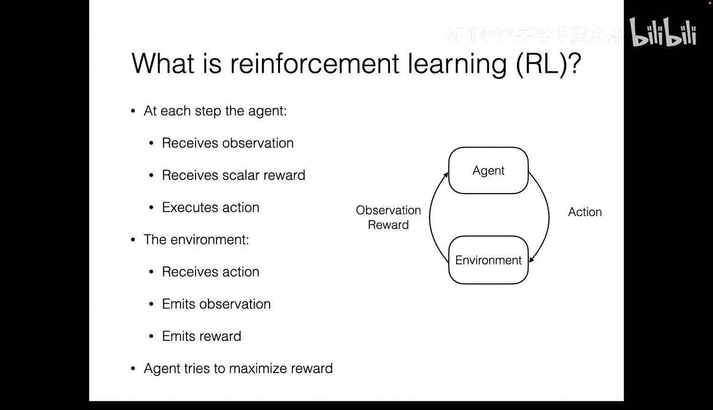

So one example is that we' study it a lot， especially like when I was doing my PhD in 2016。嗯。

Is these Atari games， so here we have an agent which is playing the game。

And your observation would be， let me see， yeah。Your observation would be the screen。

And then your actions are to press different buttons。Okay， and then you could imagine like， okay。

 if you train the agent really well， well， maybe you want to train it to maximize the score at the end of the game。

 you can see up here it's like 41 to  five。And so maybe you could use this as the reward signal。

Here's another example， and you can see as the agent lasts longer in the game。

 it's getting a higher score， so maybe you could try to maximize that reward。

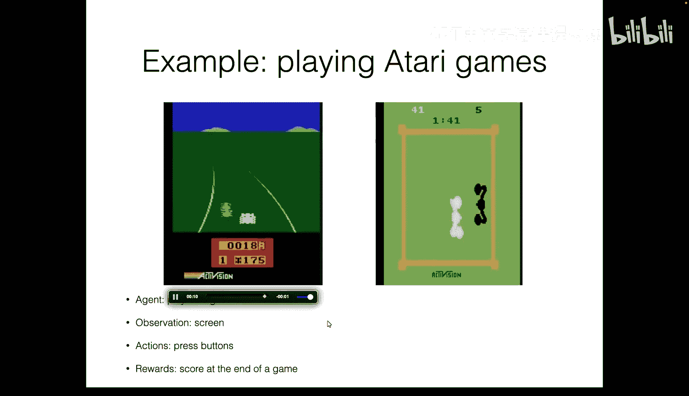

Another kind of common。Place to use reinforcement learning。

 I'm not really giving specific examples here are in motor control or robotics。

So here just broadly speaking， your kind of agent would be the robot。Here。

 the observations could be a variety of things， it could be camera images。

 it could be the specific angles of the joints in the robot， things like that。

The actions could also be a variety of things， for instance。

 let's say you want to control the specific joints in the robot。

And then your rewards can be a variety of things as well based on the task you could want the robot to stay balanced。

 you could want it to like move something to a target location， things like that。

So even in this description， I'm kind of saying you know this could be a lot of different things。

 so you can imagine that this is a whole field， actually CMU as a whole like insit on robotics。

 so we're not going to go into much detail on this today。But actually。

 we will see one a simple example of kind of controlling something in this class。Okay。

 and then there's text generation， so here one way to frame this is your agent is the language model。

Your observations are， let's say， like the input and what it has generated so far。

And your actions could be generating like the next token in the output。

And then your rewards will depend on the application。

 we'll see a couple examples in the next lecture。Here。

 let's say that we're solving these math problems and so our reward is basically。

 is the final answer correct or not？Okay， so these are some examples and then now we'll start to go into a bit more of the technical details of how you view these different problems。

So there's this formalism， some way of formalizing these different problems called Markov decision processes。

And so you can view the setting as being kind of four different parts。So first。

 we have what is called the state space， the set of states。So like in the Atari example。

 this would be maybe the image of the screen。Then you define some action space。

 so this is the set of possible actions you your agent can take in the environment。So for example。

 for Atari， maybe you have the different controller buttons。Then you have these transitions。

 so this is basically modeling or you know assigning notation to the kind of underlying environment。

So here， for instance， you know， when you press a button when you're playing Atari。

Then the system is going to generate some new state and then show you some new screen。

 so the transition from some state and some action to a new state。Is these environment transitions。

Then you can imagine that， you know， sometimes you have multiple choices for the next states。

 so this is going to be a distribution over possible next states。Yeah。

Then here you have the ro function。So you could also view this as being part of the environment。

So you could have a kind of probabilistic reward as well。

 but here we're just saying that you know it takes in some state and some action and then gives you this scalar number。

Okay， so for example， you could return the game score at each time step。Okay。

 then the agent is going to take actions using what is called a policy。

 So this is like the typical name and the typical。Kind of symbol used is pie。

So here we have this policy pie。And it is taking in some state。

 and then it gives us a distribution over different actions。Okay。

 so it might give all of its probability to like some， you know。

 button press that will win the game and give like zero probability to something which would cause the。

You know， the agent died。So these are the basic parts of this MDP。

And the reason it's called a Markov decision process。

Is there's this kind of assumption that the state contains all of the relevant information that you need。

So basically like this state is equivalent to giving like all the previous states， for instance。

 and that's this kind of Markov assumption。And so it makes it really easy to kind of reason about these things because we just look at。

 you know， a single state and a transition from one state to the other， things like that。Okay。

 then one more bit of just formalizing this a bit so then you could think about like actually。

Having the agent interact with the environment and you can think of this as being a sequence。

 So here you get some initial state from the environment。You then take an action using the policy。

So here it's like sampling some action from the policy。Then you give the action to the environment。

 as we saw it in the picture before。That gives us some state。We can then get the reward。

And then you continue so now with your new state， you can take a new action and so on。Okay。

 and then eventually you'll get to some terminal state， let's say that you in the Atari game。

The terminal state is when the game ends， so either you die or you win。Okay。

 so then a bit more terminology and you'll see this come up all the time。

So you can call this sequence here of like states actions and rewards a trajectory。

And then you can also call this a kind of episodic setting。

 so this would be a kind of one episode being played out here。Okay。

 and then if we try to formalize the goal a bit more。

 like the goal of learning or the goal of the agent。

We could consider like here you have some distribution of trajectories in the sense that like you can interact with the environment。

 you can choose actions with your agent。Maybe there's like different starting states。

 like different game states。And so you can get some distribution of interactions or distribution of trajectories。

And the kind of goal will be to find or learn some policy which maximizes the expected reward or expected return。

Over this kind of wallet it's interacting with the environment。Okay。

 and so the return here just means the sum of all of the rewards from a given state。

So basically like from your starting state， you want your policy to give you high expected reward。

And that's just kind of what's written here。

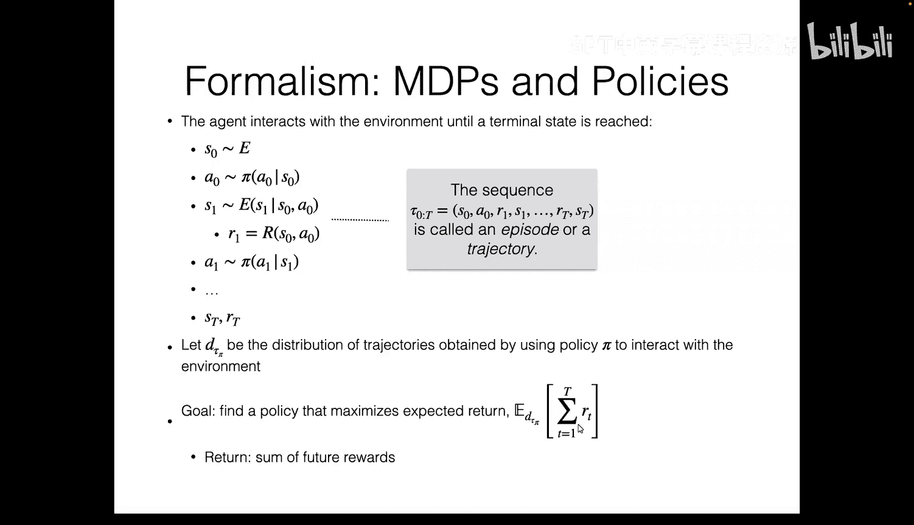

Okay， so let me just go just to make sure it's clear， let me go through this example。

In some more detail。So here's another one of these games， Pong。

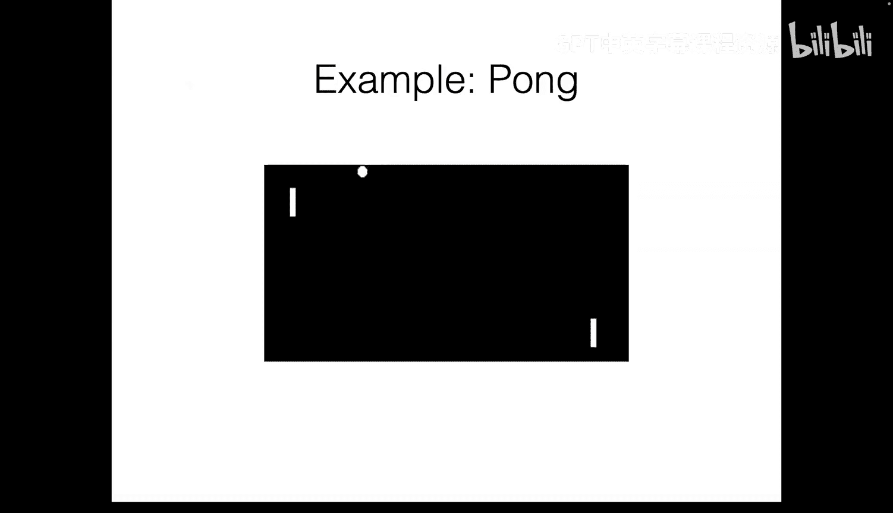

And here we could say that。Yops。Here we could say that the state is。Like a screenshot of the。

 of the game。For instance。Then we can give that to some policy， the policy could be you know。

 a neural network that takes in images and outputs。嗯。Outputs actions。

Let's say it takes the action down。Then here you can see that it's moved down a bit。

We would actually send that to the environment and the environment would give us this kind of new observation or new screenshot。

Okay， then you could continue this and actually kind of play the game until it ends。

 and then your ro function could be zero， maybe for all of these kind of intermediate states。

And then at the end， you can see whether the agent won or whether it lost and give it a plus one or a minus one。

Okay， so that's a concrete example of the kind of MDP in this p setting。嗯。

So there's one thing that I want to just clarify just so that you've seen it before。Which is。

This difference between states and observations。So here， when you think about， let's say。

 like the system that is running Atari， like the actual implementation of the game。Then that is。

 in some sense， some state which the agent is not able to see。Right。

 like the agent doesn't actually look at the state of the code that's being run。嗯。Instead。

 it sees this observation， which is like the。Screenshot。

Corresponding to the current state of the game。Okay。

 so there is this distinction between this kind of environment state and an observation。

And then you could define the agent' state as whatever information it's using to kind of pick the next action。

So here， if you want， it could be a function of this entire history。Um， right。

 like you could implement the agent in a way that it just saves the prior observations。

 it's not like cheating or anything。But then you could define this state and then kind of use this MDP formalism to think about the problem。

嗯。So。You'll see this distinction between states and observations come up。

 there's actually a different formalism called partially observed MDP。

 and you might see that pop up in different papers and that is just helping distinguish between a state and an observation。

Let me just go through。This example here and we'll talk about it more next time。

So instead of the Atari games， let's look at one way of framing text generation or this like math problem solving as an MDP。

So here our state would be a prompt X and the tokens that you've generated so far。

So at the beginning， you just have the prompt here。 you have the prompt plus， you know， these。

And your actions would be to generate a next token。

And here the policy or the agent is just the language model。And you could see that， you know。

 it's you could use the letter pi if you want， it's this distribution。

 which is getting the current state and giving you a distribution over actions。

Now here is like why it's maybe not the most exciting。Use of reinforcement learning。

 the environment is in some sense kind of boring。The environment is saying basically at each step。

 we are just appending the token， and that will be the new state。And then the reward。

 let's say that you only are able to evaluate the final answer。

Then your reward would basically be one if you are at the final step and the answer is correct and otherwise for all these intermediate steps。

It's just zero。So then if you consider the return， it'll be the sum over all the steps。

So it'll include the reward at the end。Okay， so although I said this is maybe a boring environment。

 it turns out that this is the one we'll use in next class。

 and it's the one used in a lot of like state of the art uses of reinforcement learning and language models。

嗯。Okay， and then just one more thing to know about。

So I'll pause in a bit because this will be the end of this section。

But today we'll focus on one type of reinforcement learning algorithm。

And here I wanted to just give you some broad picture of， you know。

 the idea that there's other kinds of algorithms。So。Typically， your agent will include。

At least one of the following。So one way to build the agent is to learn or build this policy that I was talking about。

You could kind of represent this as。neuralural network and try to learn a really good policy directly。

It turns out that you can also， there's algorithms that will try to learn a really good value function。

So a value function says for any given state。Or you could have one that takes in a state and in action。

It says what is the expected return from this state？Or if you taken the action。

 what is the expected return if I'm in the state and I take this action？

And then when you think about it without going into the details， let's say you did this perfectly。

Well， then maybe you can actually use this to kind of build a policy。

Maybe you can look at each possible next action and say。

 let's just pick the one that leads to the highest expected reward。And that's a perfectly， you know。

 valid RL reinforce and learning algorithm。And then the other thing is you can try to learn this model of the environment。

So here I've written it with a lowercase E， so this isn't going to be the actual environment。

 this is going to be one kind of inside inside of our agent。

And it's going to try to learn like given the current state and maybe given an action。

What would the future state look like and what reward would I get？Okay。

 and so without going into the details again， you could imagine that if you did this really well。

 then you could probably do well at the reinforcement learning problem。For instance。

 you could simulate like， okay， if I was to take this action， what would the next state look like。

 what would the next state look like and what would be my eventual reward？Of course。

 it's going to be difficult to learn a good value function or learn a good model， but these are like。

Yeah， kind of approaches to to consider。Okay， so in summary。

 these policy based methods will try to learn this policy。

Value based methods will try to learn a value function。

And model based methods will involve learning a model as well as some other things。

So today we're going to focus on these policy based methods。

And then we're actually going to see this value function come up。

 it's going to turn out to be useful for kind of stabilizing the training。Okay。

 but you'll see these terms come up， so it's good to at least have。I seen these once。Okay。

 so in summary， the kind of problem setting is we have this MDP or Markov decision process。

And our goal is going to be to learn a policy that maximizes the expected reward or return in this setting。

So any questions about this so far before I go to the next part？Okay， great。

 so next we're going to go into these policy gradient methods。And。These will give us some way of。

 you know， this is an algorithm for like solving this reinforcement learning problem。

And here we're trying to directly learn the policy。Okay。

 so we could formulate this as some learning objective。Let's say that we want to find the parameters。

That just， you know， here's like the。The objective of reinforcement learning。

Let's try to directly optimize this， so let's try to find the parameters that maximize this expected return。

So in this class we've talked about using gradient descent。

 so given some objective or given some loss function。

We would take the gradient of the objective with respect to the parameters of the model。

And then we can use an algorithm like。SGD or Adam or something like that。

So the question is like can you do this for reinforcement learning。

 can you just say here's the reinforcement learning objective。

 let's just do kind of gradient descent on the objective。Well， it turns out to be a bit tricky。

 so for instance。Let's say that a reward is。You know， whether you win an entireari game or not。

Then it's not clear how to take the derivative of winning in a target game with respect to the parameters of a network。

So in general， like sometimes we have these non differentiable rewards。And then second。

 I'm not going to go into the details， but it turns out to also be tricky because here we have a full trajectory。

And the trajectory involves these transitions to the environment。So at least in the naive case。

 we would also have to back propagate through the environment。And again。

 it's not really clear how to backproagate， say， through the implementation of Atari。

But there's still kind of hope and so the solution is going to be use a kind of clever trick。

And get some estimate of this gradient。based on kind of interactions or based on sample trajectories。

Then once we get a gradient estimate， we'll be able to use just normal back propagation。

 normal SGD atom， things like that。So the key idea here， and again。

 this really like underlies you know most of the methods that are used today。Is。I mean。

 probably the idea is from earlier than this it was probably invented in statistics。

 but then the first work putting this into kind of machine learning setting is from 1992 and it's called reinforcefor。

And it uses this kind of you know， simple trick to come up with some estimate of the gradient。

So here， let's say you have some distribution P。And some function， F。

So the function on the next slide will turn out to be like the reward。

 and then here will be a kind of trajectory。But the idea isn't even specific to reinforcement learning。

So here we could say like， okay， we want to take the gradient of this this objective here。

 which is like the expected。A function value or it'll be expected reward。

And so this is just writing out the expectation。Then what you could do is you can move the gradient inside of this summation。

And then here it's just multiplying by1， so you have P theta of x over p theta of x。

Okay nows here's really the key trick and if you think back to like you know intro to calculus。

 you might remember this。And it's kind of clever here。

 so it basically just replaces this gradient of p theta over p theta of x。

With the gradient of the log。Okay， so this is just this identity from calculus。

Now why is this interesting， well now we can basically view this as being some expectation。嗯。呃。

That looks like this。And now we have the gradient。Kind of inside of the expectation。

And so what we could do is we can approximate it by just drawing samples。

So let's say we draw a single sample。Then now you have this gradient approximation shown here。Okay。

 now you can imagine， oh， and so then this is called reinforce or kind of reinforce gradient estimator。

Okay， and so it looks like this here I've just moved this here， you have the function value。

 and then you have the gradient。Kind of add a sampled output。嗯。

So you can imagine like maybe this is not the best approximation if you're just drawing one sample。

And we'll actually get to that later。But。It nevertheless is some approximation。

 and so now we have some gradient that we can use。So if we applied this to reinforcement learning。

 then here's what we get in the end。So recall that we want this gradient of the model parameters with respect to the expected rod。

Then it turns out that it ends up looking like this。

 So we have this summation over time steps and then we have something here which looks like was on the previous slide。

 You basically have the return at that time step and then the gradient of the。诶。

Log probability of the， of the policy。嗯。Of the action given the same。

Now I did something kind of subtle here， which is you actually have to be careful to break this trajectory apart into time steps。

And it turns out that you can kind of get rid of the environment transitions。And so， you can。

Kind of safely write things in this form。The details of this are not like， I mean。

 they're kind of interesting， but they're kind of tedious。

 so I made some slides with the details if you' curious after。But basically。

 the important thing is we get this kind of gradient estimate， which looks like this。Okay。

 and so again， this capital RT is the return， so at each step， it like the future rewards。

And then this little hat is saying that we've sampled some trajectory。

With the policy and by interacting with the environment。

So then we could think about like what this does。It's actually， you know really simple。

 so let's just look at one time step。Then it's basically saying like， okay。

 if our return from this state or if the reward is high， then we're going to push up the probability。

Assigned to the action that was taken at that state。Similarly， if the return is low。

Let's say it's negative。Then we're going to push down the probability of taking the action from that state。

So it's actually really kind of intuitive。And you could see that it actually looks kind of similar to maximum likelihood。

So here if we ignore the reward， then we basically have the log probability of the next action。

And if you remember when we were talking about language models。

 the next action is the kind of next token。And so in fact。

 maximum likelihood is actually a special case of doing this procedure。

And it basically says that the reward is one。And we only sample trajectories from our data set。Okay。

 so really the core difference with reinforcement learning is that we are sampling these trajectories using these interactions。

And then we are incorporating the reward function。So if you follow that。

 it's kind of cool and kind of interesting， I think。Okay， so then if we put this all together。

 I've kind of just been showing formulas， but we could put this together into an algorithm。

And the algorithm will be as follows。First， we collect trajectories。

 so we interact with our environment， we call our policy， you know， you play the tar game， whatever。

Then you compute these returns， so at each state you kind of sum up the rewards。

Then you have everything that you need to compute the policy gradient。Now。

 if you think about Pytorrch， it's kind of easier to write down a loss function than to maybe like program in a gradient。

So you can also just use this implementation trick。

 which is if you just set this as your loss function。Then when pieytorrch takes the gradient。

 then it ends up being the policy gradient。And I'll actually show a code example in a bit。

And then that's it。 So then you use。Back propagation and use like atom or SGD and kind of run this in a loop。

And then the reason it's good to walk through the details is。You know。

 if you followed the argument from before， then this， at least in principle。

 should maximize the expected reward。

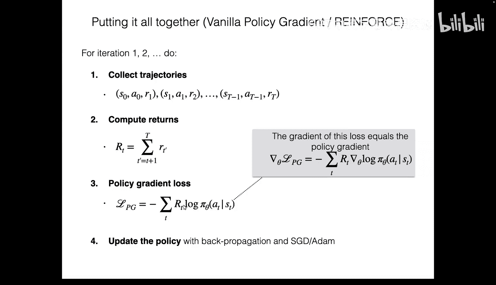

So here on the course。Code webpage。 we have this example。And it's based on this environment。

 which is called cartpool。So here you have this like poll and you need to keep it balanced and so your actions will be either left or right。

And so here it's just showing the kind of full implementation。So。Let me just， yeah。

 take a look at the code。

嗯。Okay。So I think we can probably run it。Okay， so just to make everything concrete。

 So these environments are implemented using a kind of common interface。嗯。

So here you're creating the environment。And then here we could take a look at the states and the actions。

So it turns out that in this environment， it's not actually receiving a screenshot。

 you can try solving this task using a screenshot， it's just not here。

It's actually just giving up these four different numbers。So you get the position of the carts。

 you get the velocity， you get the angle， and you get the angular velocity。

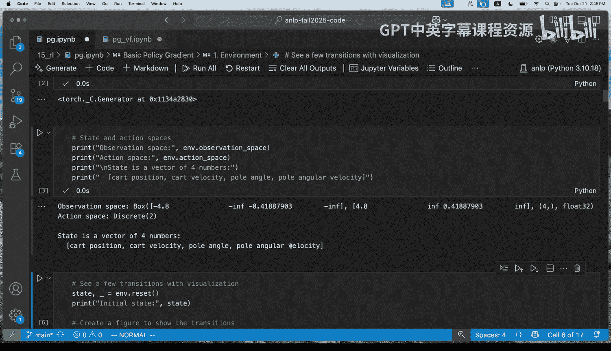

嗯。And then if you here's how I generated that screenshot earlier。

 here you can actually take different actions。

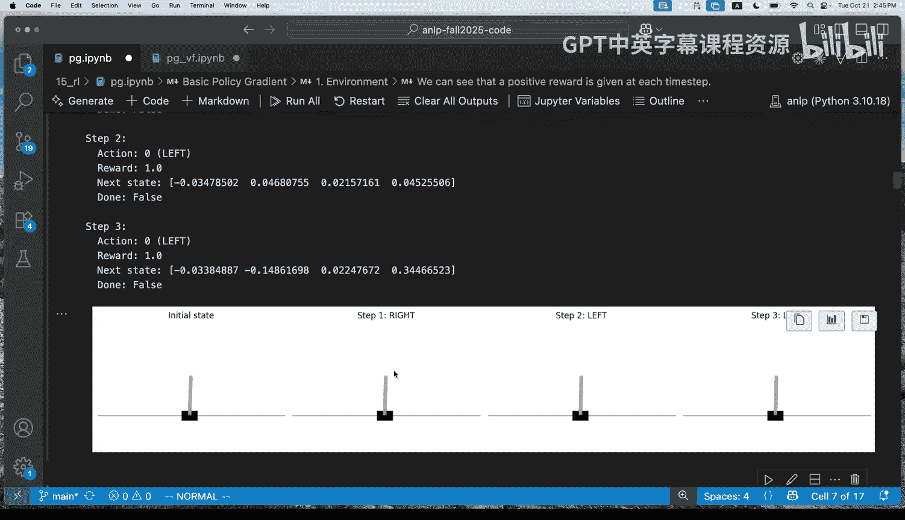

So your actions will be left or right。

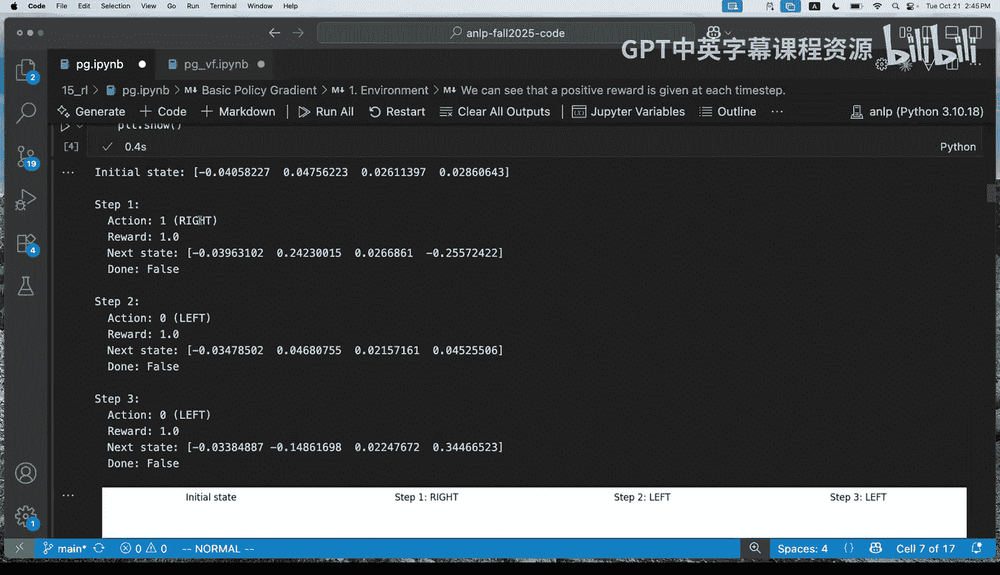

And then here it's just showing the environment transitions where the environment's actually changing。

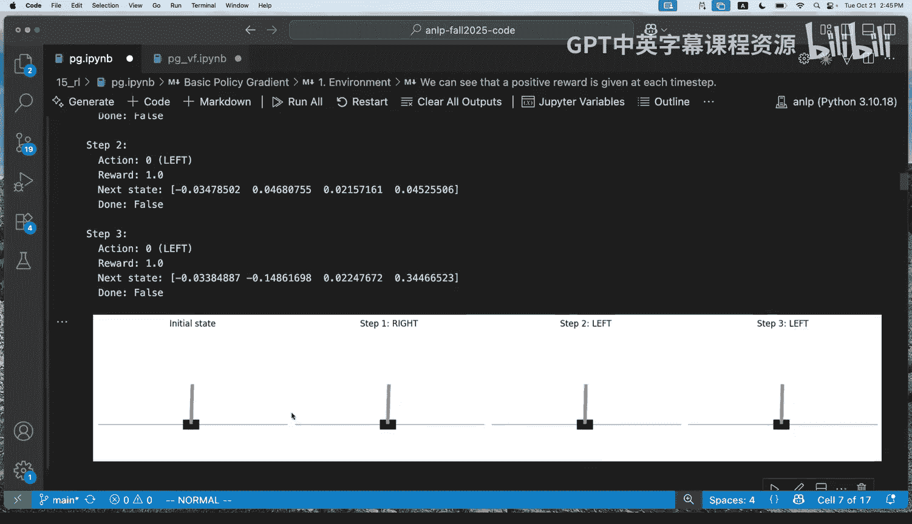

Then here's an example of a policy， so it's a neural network and you're taking in the state。

 so remember it was four different numbers。And then you just have the simple。You know， a network。

And it's giving you scores and you're taking the softm。For each different action。

 and so you can see here there's two different options。So for example， before training。

 it kind of gives us。These two action probabilities。Okay， and then here's the training loop。

You could go through all the details and use debug statements and stuff if you want later。

But it really does follow exactly what I showed you on the slide， these four different steps。

So here we're basically collecting a trajectory。So you could see we're giving the state to the policy。

 we're taking an action， then we're getting the next state from the environment。And the reward。

Then we compute these returns。And I'll get to this discount factor in a bit。

 but you can see it's kind of summing up the rewards。Then here's the loss that I showed you before。

And then it's just doing this normal。update here。Okay， so。

So this is this is the basic policy gradient。 And then you can run it。 let's see。

Should be able to run。Here， and you can print out the。The rewards。

 So it's just training like on my laptop。And。I think the maximum is。

Hopefully it's it varies based on the。You know， every time you run it， which we'll get to in a bit。

But hopefully， it eventually solves it。Whileace is running， any questions。Okay， great。

 so it actually solved it。 So each one of these environments has like a threshold。

 which means it's solved。

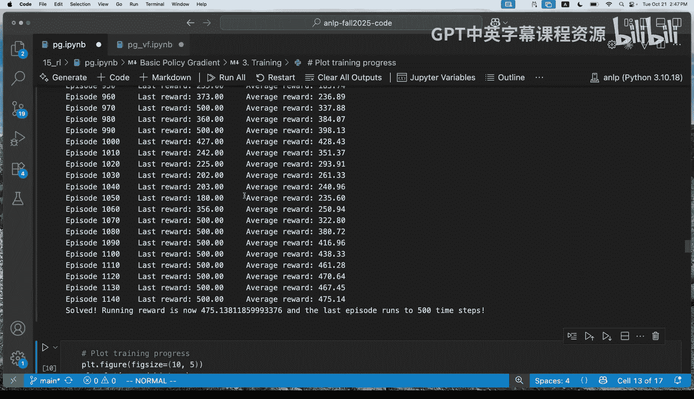

嗯。

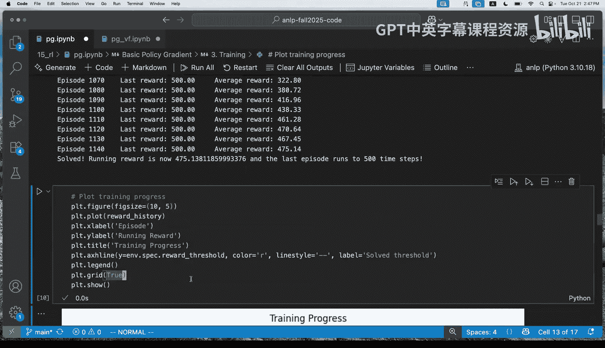

So we could take a look at this and you could see it's yeah this is the you could see it's kind of crazy so it was kind of successful at increasing the reward。

 but you see these kind of wild fluctuations so we'll actually talk about that in a bit this is an example of it being kind of unstable and you see this a lot with the reinforcement learning。

😊。

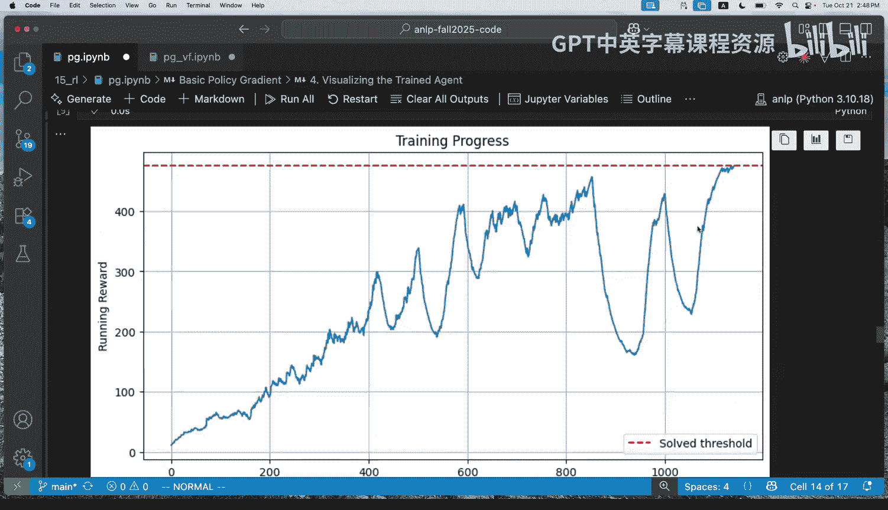

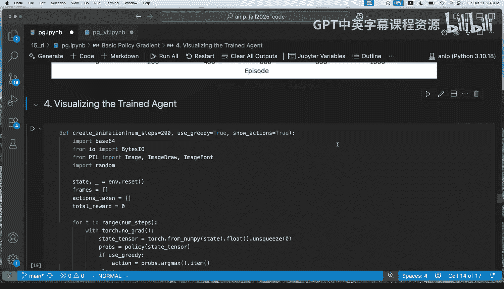

Then you can visualize it。 And here's the， this should be the actual。Visualization。

 you can see it's pretty good。 So it's。Taking all these actions shown here。嗯。

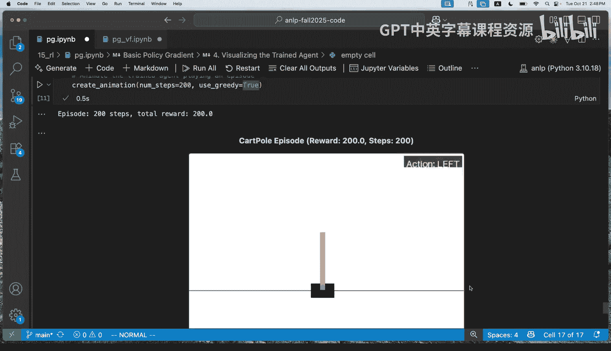

Okay， so that's the really basic policy gradient。And。

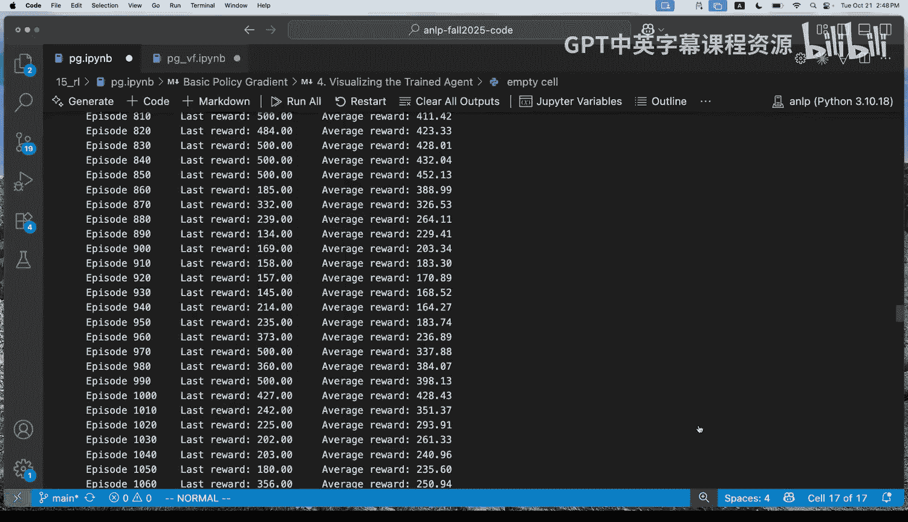

Yeah， hopefully I convince you that at its core， it's fairly simple。

 but then if you follow all the arguments， it's actually kind of you know one way of solving this reinforcement learning problem。

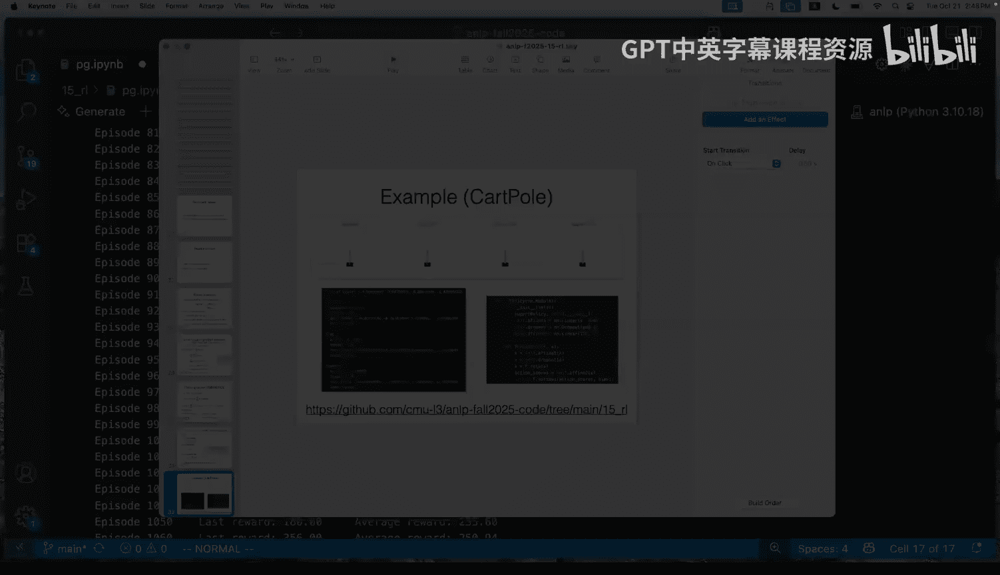

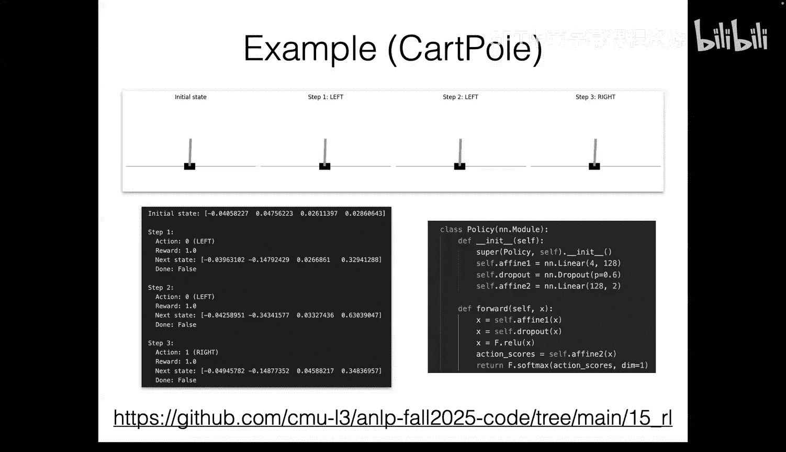

嗯。So。The question is， let's call this policy gradient that I just introduced vanilla policy gradient。

And as we saw it could be kind of unstable and this environment is pretty simple right it's just like balancing this poll and so maybe this becomes an issue in a more complex environment。

Well， indeed it does turn out to be an issue and so there's been a lot of research into kind of。

Better versions or better algorithms aside from this basic policy gradient。

And you can kind of interpret all the different strategies in， well。

 there's at least like two different types of strategies。

One is instead of just using this return here， we can come up with some better way of kind of reweighting the gradient。

And then second is maybe we can somehow control the step size。So， you know。

 maybe this is becoming unstable because it got some really high reward and it like took too large of a step and then the whole thing blew up。

So here's a few common things that you can use for the first strategy。

 so coming up with a better waiting term for the gradients。And the first is called discounting。

So when you think about it in a lot of these different environments。

 there's a delay between taking an action and actually receiving a reward。

So let's say I'm playing that Polen game。Then in some sense。

 like the very first action that you take in the game。U really has a very。

 very loose connection with the eventual reward， which is like whether you win the game or not。

In contrast， like right at the end of the game， maybe the ball is。You know。

 moving and it's clear that you're going to win and so that has a really clear correlation with the reward。

So what you can do is you can take into account this delay and use what's called discounting。

And so you introduce this factor which basically reduces the amount。That in action is。

Are kindind of rewarded based on how far it is from their reward。

So let me just show the example because the。You know。

 the formula can be kind of tedious to go through。But let's say that we use a discount factor of 0。9。

And we receive a reward only at the very end。Then our action at the end would get1， this would get 9。

 this would get 0。9 squared and so on。Okay， and then this is the kind of general formula。

 which allows you to get rewards at different places， things like that。So this is a kind of naive。

 it might seem kind of naive， but when you think about it。

 it's kind of really general in the sense that you don't really have to have any assumptions about your environment or the problem you're working on。

 this gives you some way of kind of assigning rewards to these intermediate steps。

 even if you get a reward right at the end。And the other thing you can do is called baseline。So here。

 let me just motivate it kind of intuitively。So let's say that we're training a language model。

And we have these two different prompts。So one is summarize this paper and the other is prove this theorem。

Then what the baseline does is it can take into account the kind of expected rod or your current state。

So maybe the model is good at summarizing things or natural language tasks。So just our priori。

 we expect it to get a kind of relatively high reward。

And we can adjust our rewards kind of with respect to the baseline。Okay， so so for instance。

 let's say we got a 0。8 on this like summary that was generated。Then relative to what was expected。

 it's slightly higher。But if we got a 03， then that's actually a pretty bad summary relative to what was expected。

In contrast， if the models look not very good at proving theorems。

 then maybe you don't expect to get that much reward， so in that case getting a 0。

3 we might actually want to increase kind of up that or give it a positive reward。

So that's the kind of intuition behind the baseline。

And what you do is you basically do what I was saying before。哦。

Here you could see where the baseline is included。You are basically subtracting it from the return。

 and that is coming up with a new weight for the radian。

Now you can kind of formalize what I was saying before。

This idea of like better than expected or what is the expected reward？Well。

 you can literally define the expected reward。And try to use that as a baseline。

So does anyone remember？This formula and maybe where we saw it come up earlier。

Like what is this function called？Yeah， the value function so a really common choice is you can try to train a value function which predicts at each state what is the expected return or expected reward。

And then you can use the value function as a kind of baseline。

 and that'll help stabilize the policy gradient。So actually there's a code example。Of this as well。

And this has this nice intuition， which is you are going to increase the log probability based on how much better than expected this action is。

And then technically you can actually show that these baselines can reduce the variance like the statistical variance in this gradient estimator。

 so they're kind of very justified things to do and very common if you're using policy gradient。嗯。

Then you could say like， well， why do we have to follow this format here？in general。

 like what is just the best possible weight for the policy gradient？嗯。So nowadays。

 especially this is referred to as advantages， there's like a technical definition of advantage。

 but a lot of times people just refer to this weight as an advantage。

And then you could think of a variety of methods。For computing this。

So you could think of the baseline as being one way of computing the advantage for this time step。

There's other ways based on what's called。TD temporal differences。

So here you could see you could see that there's a value function involved and it's basically looking at like the difference between。

The value functions prediction for like the current state and the next state。

I'm just going through this。You know， a bit quick is a bit of a survey。

And then these TD methods have been incorporated into kind of more。Recent or more complex methods。

So this is one and you'll still see it。Pop up nowadays。Called generalized advantage estimation。

And this is basically this really general formula and based on setting these hyperparameters。

 you can either get baselines or this like temporal difference as a special case。

And then you could also do some kind of like interpolation of them in between。But anyways， you know。

 there's been research like specifically going into estimating good advantages。

And so in the next lecture we'll actually look at ones that people use with language models。

 so one of them is based on like generating multiple outputs from the model and kind of using the mean and the standard deviation。

嗯。So yeah， remember this idea of advantages because we'll see it in the next lecture。Okay。

 and then the kind of last improvement is。Large updates。

So you could imagine that these gradients of these updates that you're doing are pretty noisy。

And so if you kind of commit too much to a particular update。Then it can kind of derail the training。

 and maybe that's why there's some of these crashes。So one at a high level。

 one mitigation is to try to not move the policy too much at once。

And it turns out you can do a bit better than just like reducing the learning rate because that would you know。

 cause things to not move too much at once， but then that would really slow down the training。嗯。

It turns out that you could use this kind of ratio。

And what it's saying is it's saying you have some old policy。So。Let's say this is your model。

You like yeah， take a copy of your model。Then you do a few updates and you say， okay。

How much does my new model's prediction differ from the old model？Okay。

 and so if the prediction differs a lot， then that means that the policy has moved a lot。

And if the prediction is roughly the same， then that means it hasn't moved that much。Okay。

 so it's a kind of way of formalizing what I was saying。And then given this ratio。

 you can kind of incorporate it into a loss function。

So this is a really popular loss function or training method called PPO or proximal policy optimization。

And this has been used in a lot of the works on language models and reinforcement learning。

 so we'll see this again on Thursday。And it's basically this combination of this ratio and then this A is the advantages。

And then you basically do some clipping。So the clipping here is saying。嗯。If you kind of move too far。

 if the ratio is too large， then you'll just truncate it at a given point in either the positive or the negative direction。

Here it's using X and Y， so this is kind of showing a language model。

 so maybe it's a preview for deck lecture， but you could basically apply this to the general you know states and actions as well。

嗯。Okay， so now if we put this all together into an algorithm。

 there's been a lot of formulas and things like that。

 but really the core is just a few different changes。So again。

 we collect these trajectories with the policy and by interacting with the environment。Now。

 instead of computing just the returns， we compute these advantages。And the advantages might involve。

 you know， based on the strategy we use， it may involve some baseline。

 it may involve some value function， it may involve discounting。

But you can imagine just like some function called compute advantages。

 and then you can you know pick your strategy。Now instead of just the policy gradient loss。

 there's these different options that have you been developed。

 so for instance here we could use this PPO loss that I showed on the previous slide。

That one in particular requires this like old copy of the model。So。Yeah。

 you have to think about what's needed to compute loss。And then again， you update the policy。嗯。So。

So yeah， just as one example of this， so in the next lecture we'll actually see this PPO loss。

 I made an implementation of it for the next class to like train a language model with it。

But for this one， I made this really simple value function baseline。So here again。

 the value function just takes in the state and tries to predict the future reward。

And so now when we're collecting these trajectories， you can just get the value of the current state。

And then here you could see， I guess this is just say compute advantages。

Here you can see we're basically subtracting the value。From the returns。

 So that's basically the formula that I showed you before in the slides。

Then you could say like how do you train the value function， well here it's pretty simple。

 so you have the true returns that you observed。And then you have the predicted values。

And you could use this like mean squared error between the two things。

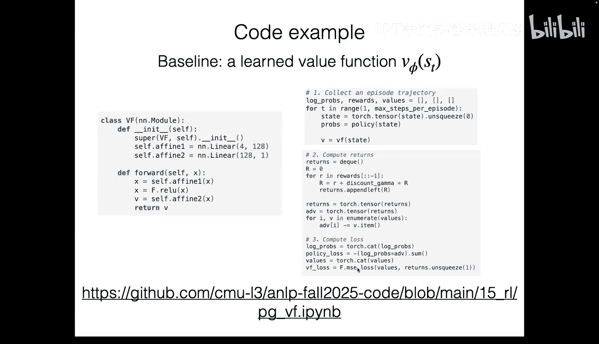

嗯。So。

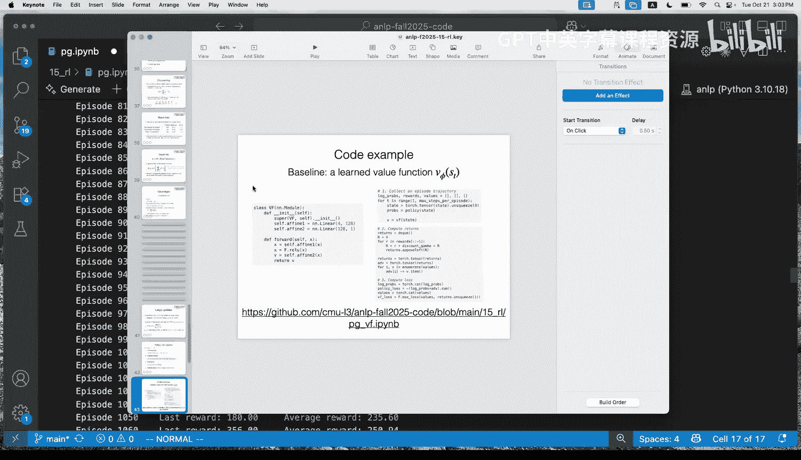

Yeah， you would really want to do maybe some like。Systematic experiments to。Do you investigate this。

 but。Here， when I kind of implemented the simple value function。

 the training did turn out to be a bit faster and a bit more stable。

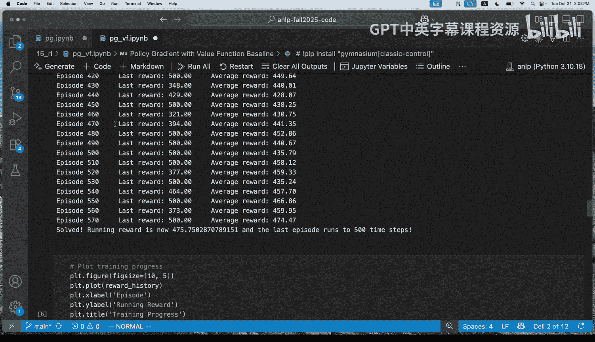

But in general， yeah， these kind of techniques really do help and you it's one reason why a lot of the current methods will not just be using the very。

 very basic policy gradient。

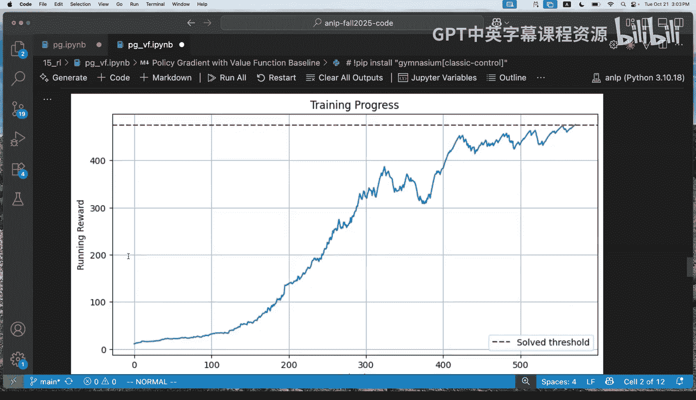

There's also this visualization showing like which states。

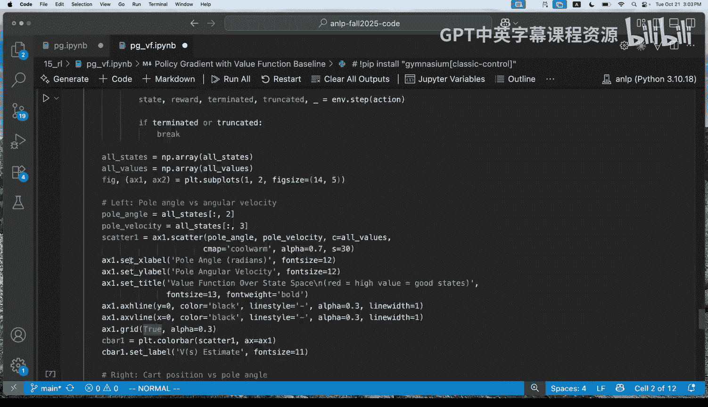

嗯。Or basicallys， what is it assigning high and low values to？So， for instance。Let's take a look here。

It looks like。You know， if the cart is roughly in the middle of the screen。

 then that's probably a good thing and it kind of learns that。Whereas if it's way off to the side。

 then maybe it's already。Kind of going crazy。So that seems to be learned。

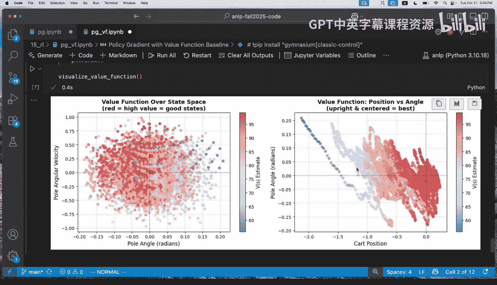

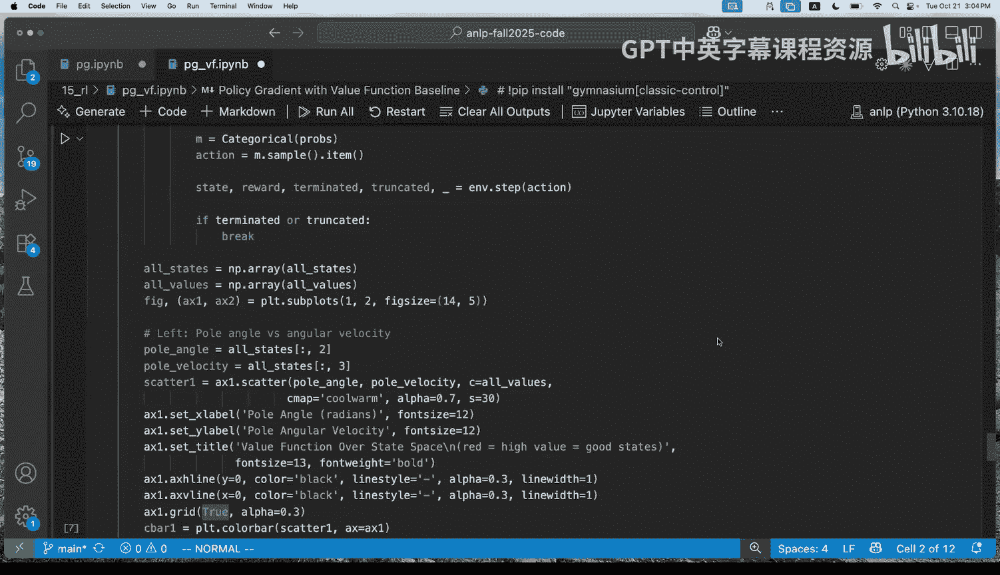

Okay， any questions， I guess I haven't paused for questions in a bit。

 any questions thank you for watching。Are there a lot of modern methods that share ways between the promised student Valley Yeah yeah。

 so one one common thing to do is you just attach an extra output head to compute the value function？

嗯。for fine training or is that just the fit？Yeah， as far as I know， it kind of。

 it kind of depends you， you try each different thing。 So one thing is to just， just train， yeah。

 like a。You'd want more than one layer so that it's nonlinear。

 but you could try to just train that part， or you could back backproagate through Yeah。

 and then sometimes it's better， you know， for a really complicated value function。

 it might be even better to like pretrain the value function or have separate parameters for it。

In this carpool example， there's like。Many different algorithms work for cartpo。

 so probably any of the combinations work for for cartpool。Yeah， it turns out even like。

These evolutionary style algorithms that， like。Take the gradients and then use random noise。

Even that can solve cartpo。But anyways， okay， any other questions？嗯哼。😊。

So it seems that the tweets that we're doing are just to like slow down updates when we are close to like a good solution。

 but for example， in like a three pendu problem。There are like two steelless teeths。

 that's like outside childhood like the the way around。嗯。So in that case。

 they're in a good states and bad states， but that's not reflected on what we are doing here， right？

Yeah， I maybe what you're getting at is that we're not really saying how to explore or how to find。

Good states or bad states。 I that yeah。Yeah， so here the exploration is just based on sampling from the policy。

And so for really long horizon tasks， so let's say you're playing the Atari game and you don't get a reward until like 10。

000 steps。Then you're going to need some strategy for doing better exploration。Um， so in those cases。

 just the just what I'm showing before actually， yeah。

 probably won't be enough because you'll just never stumble upon these kind of good states。Yeah。

 actually， with the guitar games， there was like one of thems called Monzuma's revenge。

So back in the day when people were trying to solve these。

 it was like all the scores were high except for monoma's revenge and some other environment because again。

 they're like really， really long horizon， so the model would just never get kind of positive rewards。

Okay， and then just as a preview， so again， we're going to apply this to the language models in the next lecture。

嗯。And it'll kind of be these special cases if you want。 But then， you know。

 you could imagine to get it to work and practice， there's still a lot of。

Innovations and important details。So we're going to take a look at this setting called reinforcement Learn from Human feedback。

Here we will want to basically train a model so that it optimizes human preferences。

So it like generates responses that humans prefer。 So we'll talk about how to， you know， one way of。

Kind of quantifying human preferences and then optimizing it with reinforcement learning。

And then we'll also talk about this kind of recent setting， which is maybe arguably even simpler。

 but it's more recent。That it's kind of taken off and it's called RL with verifiable rewards。

So here you can imagine like human preferences is kind of hard to evaluate。

But there's things that are really easy to evaluate。

 like whether the answer to something is correct or not。Like in these math problems。

And so you can use that as a kind of reward and then do reinforcement learning。

So you may or may not have heard of this deepse R1。It kind of made big news and everything。

 and this kind of led to a whole new。Kind of area of research that people have been looking into recently。

 so we'll take a look at this in the next lecture。

