# CMU《高级自然语言处理｜CS11-711 Advanced NLP Fall 2025》中英字幕 - P16：(16)_ Reinforcement Learning for LLMs.zh_en - GPT中英字幕课程资源 - BV1ZWYAzuEMa

So today we're going to continue with， yeah， really exciting lecture it's probably one of the you most exciting ones in the course。

 I would say。

And。We're going to continue talking about reinforcement learning and today we're going to talk about how it is applied to language models。

 large language models， especially for these kind of language generation tasks。

We'll talk about some more in the next lecture about kind of multi step tasks with the agents。

But yeah， today we're going to focus on reinforcement learning for language models and language generation。

So。This is really going to build on last lecture。 so last lecture we kind of did a lot of the hard work in learning the background and the fundamentals behind reinforcement learning。

So like the code example， for instance， was on this environment which didn't really have to do with language models or language generation。

 it was， you know， balancing this cardpole。But along the way。

 we saw a lot of the ideas which were actually used directly for the language models。

So we saw the idea of formulating things in terms of this Markov decision process。

We saw these policy gradient methods like reinforce。And then we saw a variety of improvements。

 so using baselines and advantages and using better loss functions like the PPO or proximal policy optimization loss。

And so today we're going to use these with language models and we're going to see a variety of。

You know， adjustments or improvements that have been made when applying these to a variety of different tasks。

So first this is just from to recap from last time。

 this is the basic picture we're going to be looking at。

 so here we have some task for performing you have an input prompt and you have your language model。

And now we're going to be generating with the model， and we have some reward function。

 so the reward can tell us you know whether the generation is good。

 So here we have a correct solution and also whether it's bad。

And then we're going to update the model using some reinforcement learning algorithm or loss function。

 like the ones we saw in the last class。And then the cool thing is that this is a pretty general framework。

 so you don't have to just use it for say solving a math problem。

 you can also use it for like you know making your responses to your language model more acceptable to humans。

And so the key differences with the supervised learning methods that we've been talking about in the course。

So we talked about this last time， but just to recap， so first。

 now we can basically directly optimize what we kind of care about in a task as long as we have a really good reward function that measures that kind of property that we're optimizing。

Second is now we don't necessarily have to rely on human created data or kind of static data now we are kind of dynamically generating data with the language model。

And we kind of use this reward function for determining how we use the data。So in particular。

 we don't have to just use the good data， we can actually get some learning signal from the bad data。

And then kind of related， now we have the model in the learning loop and so then when you actually go to use the model at test time。

 actually the test time procedure kind of resembles the training time procedure。Before。

 if you remember， we talked about this idea where with supervised learning。

 you might train on these certain trajectories， but then when you actually use the model at test time。

 it might make mistakes， things like that， and it's never kind of encountered those types of mistakes。

Okay， so the way this lecture is structured is to basically go through three different kind of case studies。

And then along the way， we're not just going to look at the case study。

 We'll see kind of important concepts that apply to a variety of。You know。

 ways you can use reinforcement learning for language models。

So first we're going to start with a really simple one， just reversing a string。

But this is actually going to be pretty representative of a lot of these kind of。

It's called RLVR reinforcement Learning with verified rewards。

And so the second example solving a math problem will actually end up looking pretty similar to reversing the string。

 but then for this one we'll actually look at a recent paper and kind of see what results they got。

Then in the third example， we will talk about alignment with human preferences。So in this setting。

 the reward is a lot more tricky to kind of evaluate。

And so this has a somewhat different pipeline in the sense that we will have to learn a reward function。

 and that'll actually lead to some different issues and some different modifications to the loss function。

 things like that。Okay， and then there's a lot of these different acronyms that you'll run across。

 so hopefully by the end of the lecture， you'll have good understanding of these acronyms。

And then as long as we get to it， kind of a good understanding of how you might modify these algorithms。

 and that's something that people are doing a lot right now in research。

 kind of every day there's a new kind of modification to one of these algorithms and it can get pretty confusing。

So hopefully by the end of this lecture， you'll see kind of the major different parts of these algorithms。

Okay， so really， if we kind of zoom out， then there's these three basic ingredients that are involved。

So first we're going to be generating the outputs， then we're going to be evaluating the reward。

And then we're going to be updating the models parameters。

 and we're going to kind of keep doing this in a loop。

But if we want to frame this as reinforcement learning and basically use the algorithms that we talked about in the last class。

Then the first step is to frame the problem as an MDP or Markov decision process。

And so let me just introduce two different ways to do this。

And the first one is actually a kind of really， really simple。

So one option is just to kind of view text generation as being just one action。

So this you might call it a one step MDP。So here you basically have just two different states。

 so the first state is just your prompt and then the final state is your prompt plus the response cells generated。

And the action would be generating a full response。Here the policy is going to be a language model。

 so this mapping from states to actions。And the environment is kind of trivial in some sense。

 you're basically just concatenating the response to the prompt。Then the reward。

 we just have a single action and kind of you know two different states。

 so basically all you can do is evaluate reward on the full response or on the full generated sequence。

Okay， so you could view this as being some reward function， which takes in x and y。

And so this is simple and but surprisingly， we're able to basically use this one step MDP for tasks like the math problem solving and for reversing the string。

So it's surprisingly useful。Then you could do， so I introduced this in the last lecture。

 you could also view each kind of token as being in action。

 so maybe we could call this token level MDP。So here we have a state and sorry the state is the prompt and the tokens that you' generated so far。

 so here's some kind of intermediate states being shown。

And your action will be generating a next token。Again， the policy is a language model。

Now you're viewing it in terms of these next token distributions。

And your environment transitions are again， kind of you know。

 somewhat trivial in the sense that you're just appending the token to the previously generated tokens。

Then your reward， so this is just。You know， you could do other things。

 but suppose you only have access to this kind of full reward on the full output sequence。

 like checking the answer at the very end。Then you could kind of define the reward as being zero for these intermediate steps and then running your reward function at the end。

Okay， so can anyone tell me like what the potential advantage of this token level MDP is versus the one step MDP？

Okay， so the one difference is that if we want， we can assign different rewards or different advantages to these intermediate steps。

So we'll see this in detail later when we look at the loss function again。But if you remember。

 we had， for instance， this idea of discounting。 So discounting said。

 suppose you only get a reward at the very end。 Well。

 then you can still assign rewards to the earlier steps by kind of discounting them in time。

Or you could imagine learning some， say like value function。

That tries to give you some score for each intermediate token as well。

And if you kind of want to write those things down in terms of some equation。

 then you need to break things apart into kind of individual steps。So it'll be the key difference。

 And then， like I said， in both cases， the environment is kind of。嗯。

You know it's somewhat trivial so in the next class when we talk about the agents there willll have a less trivial environment it might be like you know interacting with a web browser so you I click and then the web browser actually does something and gives you a new state so that'll be a difference with the agent setting that we talk about next time。

Okay， but nevertheless， now we have this MDP and so we can basically use the algorithms that we introduced from last lecture。

So as a review， let's look at how a policy gradient would work。

So first we'd be given some pretrain language model or some fine tune language model。

And then we assume that we have some data set of inputs like prompts and some reward function。

Then we could basically go in this loop。Of kind of doing rollouts。

 So that means here generating some outputs with the language model。Computing the rewards。

And then competing the loss。And then if you remember with this loss。

 you could just do the back propagation and then update the model and you kind of go into a loop。

Okay， so it's actually you know， really similar or the same as what we talked about。

In the last class。But then if you think about literally going to do this for some task that you care about。

 then there's still some decisions and the decisions can actually。

 you know be really important in practice。So the first is which model do you choose？

If you use a pretrain model， then like maybe the performance depends on how the pre training was done。

Or another question is like， should you fine tune the model specifically for your task and then do the reinforcement learning。

 or should you just do the reinforcement learning starting from the pretrain model？A second is like。

 you know which specific input data set do you use， so how do you get these different inputs？

And then a big one is your reward function。So as we're going to see。

 sometimes it's difficult to kind of define a good reward for the task。

And so sometimes you have to put a lot of effort into。Coming up with a good reward function。

And then down here， there's kind of all the details of doing the optimization。So in particular。

 like how are you actually competing these advantages？

Which loss are you using and then other hyperparmeters that are involved in actually running the reinforcement learning？

Okay， so broadly speaking， it really is the same as what we did in the last class。

But then this time we're going to go into kind of a bit more detail and look at these concrete cases so that you can have a kind of really clear understanding of using the reinforcement learning with the language models。

So yeah， that's what we're going to do in these three examples。So to start。

 we're going to start with just reversing a string。Before that。

 does anyone have any questions before I go to the next part？Mmhmm。😊。

Break down we have full sequence versus two the tokens do you want reiterating where that decision comes into play in the like the the decision slide talking？

Oh， yeah， yeah。 so。So here， if you have the one step MDP and you want to like actually write up what you're doing in terms of these equations。

Then the One step MDP wouldn't have the sum over time stepss。

So you basically have to come up with some advantage for just the entire sequence Yeah。

 so that's really the key difference。嗯。Okay， so first is reversing a string。

So this is the task and it doesn't require too much explanation。

But it's going to turn out to be pretty useful and we basically have this implementation that you could run on a Google coab notebook and you can train it in like an hour and so it's really good for understanding。

The algorithms and you can kind of modify it if you want after the class if you're interested。

So first thing we're going to show is in this case， with this really small model。

 it's pretty beneficial to first fine tune on some data set of inputs and outputs。So in general。

 there's this kind of decision like should you fine tune or should you not fine tune so here's just some general。

Some kind of higher level points for thinking about it。

So sometimes it is beneficial to do the supervised fine tuning before the reinforcement learning instead of just doing the reinforcement learning on the pretrain model。

Some benefits are a kind of really practical one is it teaches the model the format of the task。

So let's say that you want the model to like solve math problems and you want it to output the answer in like latec with like boxed around it。

 something like that。Well， then you could just do a small amount of supervised fine tuning。

 and then the model will be probably pretty good at adhering to this task format。

In a more extreme case， if you remember in like the prompting lecture or the fineing lecture。

Sometimes if we prompt a model to like reverse a string。It will a pre trade model。

It will think it's like an internet text and output like a conversation or something like that。

And so what happens is you， the model basically like never gets。Positive reward。

And it's not really for an interesting reason。 It's just that the model isn't like adhering to the format that your reward function is assuming。

 something like that。Second is if you have a， I mean。

 if you do have this data set of inputs and outputs。Then you do。

 you might want to leverage the kind of supervision in them。 You know。

 the model might just get a lot better from。Just doing the supervised fine tuning。嗯。And as a result。

 then when you start the reinforcement learning training， you're starting from a higher point。

 it's seeing a lot more high reward examples， and so the reinforcement learning is really focused on maybe more difficult cases。

Some cons are of course， in order to do the supervised fine tuning， you need a data set。

 sometimes you don't have a data set or it's really expensive to collect one。And so in that case。

 you。You might not do the fine tuning。And then a second one is there's a chance that doing the fine tuning can kind of narrow the model's distribution too much or kind of bias it too much。

And so for this one， I don't know if anyone remembers from the prompting lecture。

 there was a good example of this。 Can anyone say an example of kind of。

Basing or narrowing the model's output distribution。Okay。

 so if you remember in the prompting lecture。There was this interesting experiment where the authors found that just giving the model inputs and kind of telling it about the task format was actually better than giving it inputs and outputs for these math problems。

And I think one reason is that like by giving it a solution to the math problem that was written by a human。

 it wasn't necessarily the optimal solution for the model to write。

And so suppose you fine tuna model on all of these like human written solutions。

Then when it goes to do reinforcement learning， it'll be kind of generating solutions that are kind of similar to the ones you fine tuned on。

And so it may be possible that it's actually better to just let the model kind of explore on its own。

So yeah that's one thing to just be aware of and it kind of follows from stuff we've talked about in the class。

 we also talked about how this fine tuning is really like fitting the model's distribution to the distribution from the data set。

 things like that。Okay， but in this case， you know， we can't。

 we do have some data to and the outputs are pretty good。 You know。

 we're literally showing the model examples of。Of reversing the strengths。

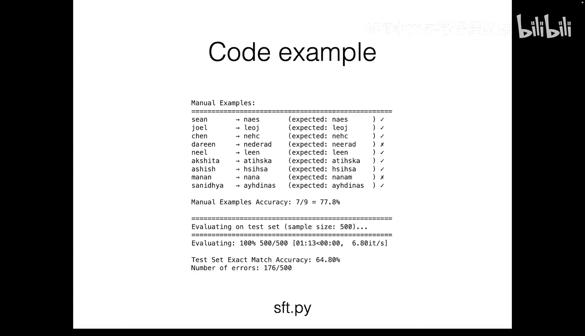

So here we have this code example。And it has the whole pipeline。

So first it has the supervised fine tuning。And then in here， it has the reinforcement learning。

And it has the script to you evaluate。And so here we're just using basically the exact same code from the fine tuning lecture。

 so if you remember in the fine tuning lecture， we fine tuned the model to reverse these strings。

So that's now just in this file called sft。pi。And here it's just fine tuning the model for one epoC on the data。

Okay， so we can do that and now we can evaluate the model and it's much better than the pre trend one。

 but it's still making some mistakes。So here we have the course staff are different names。

I guess my name's pretty easy and then some other names are more difficult。

And then when you evaluate it on the test set， you could see that it's far from perfect。

 So it's like a 65% accuracy when you're looking at the exact match。Okay。

 so now the hope is that we can improve it further with reinforcement learning。

So the next decision is the reward and so here the reward will be pretty simple。

 basically we check whether the generated string is the reverse of the input string。

And so you can do this and it's a kind of exact reward and we could just write a program that does that。

So rewards of this form， it's maybe hard to give a like a formal definition of them。

 but there's these kind of rewards that you can implement with some rule and maybe you can kind of trust the correctness of the reward。

These go by the name of rule based or verifiable rewards。

 so it's just some easily checkable property of the output。So again， in the case of strings。

 it's reversing a string， it's pretty， you know， easy and reliable to check whether the string is reversed。

And so your your rule is basically just you doing this check。In other cases。

 you can frame different tasks in this way。So like let's say you have a math problem and you know that it always ends in some integer。

Then you can pretty reliably check whether the answer at the end is like equal to some ground truth answer in your data。

So here again， you would assume that you have a data set of problems and answers。

 not necessarily solutions。And then your reward is basically checking whether。

The answer at the ends of the model generation is correct or not。

Can anyone think of a downside of doing this though？

It might be hard to implement such a large risk verfi。Yeah。

 so I would think like there's kind of two at least two downsides that I can think of。

 so one is that yeah， you still have to come up with these answers。

So you might have kind of complicated。Problems， you know。

 and then someone has to be sure that the answer is correct。And then the other is。

 even if the answer is correct。Let's say that you really care about the solutions being corrected。

Then in principle， the model could still have a kind of buggy solution and still come up with the correct answer at the end。

And that actually does happen in practice。But you do get some kind of guarantee on you know。

 whether the answer is。Matching your grand truth one or not。So yeah， that's that and then。

You could do this for other cases。嗯。Here。This is just showing that， you know。

 it doesn't necessarily have to be a binary reward。So you could have like the fraction of。

Test cases that are passed and things like that。In this case， it's not necessarily。Bly reliable。

So with programs， if you write a bunch of test cases， then it's still。

Possible that you don't have like perfect test coverage。And actually。

 we're going to see an example later where。If you kind of optimize against these test cases。

 the model can still。Kind of exploit the reward function。嗯。Okay， but anyways。

 this is just contrasting it with a kind of model based or learned reward， which we'll see later。

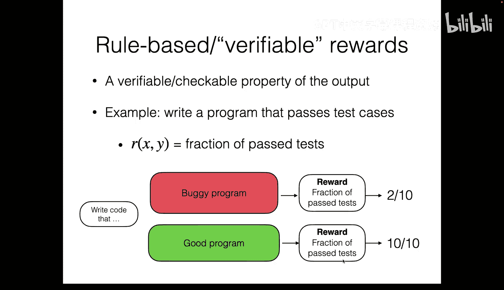

Okay， so here， I mean， this code isn't too interesting， but this is just， you know。

 you could see that。Your reward is either one or zero based on whether it's kind of correct or not。

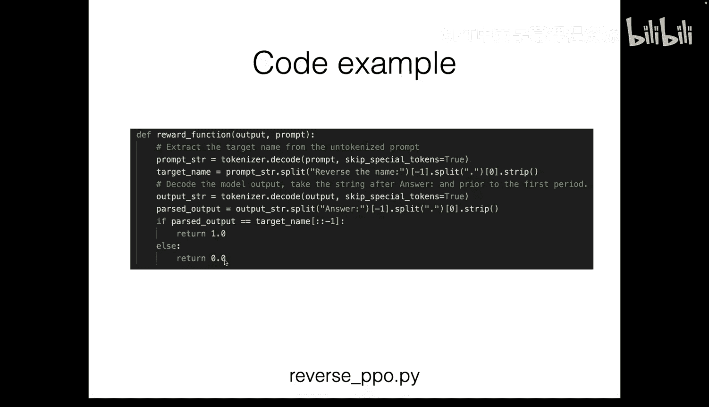

Okay， and so now here we will use this one step mP so again， the action is just。

Generating a full string。And the algorithm will have these two different parts。

So I'll introduce these on the next T slide so the first is。

What are called group based or group relative advantages？And then the PPO loss。

 which we also saw in the last class。So these group based or group relative advantages。

They're kind of based on generating u having an input and then generating multiple outputs and kind of comparing them against each other。

So here， yeah， for each input， we will generate say K different outputs。

And then what you do is you subtract the。Mean of the reward in the group。

And then you can also do other forms of normalization。

Like a really common thing to do is also have the standard deviation of the group's rewards。嗯。

So for instance， here， here's an example， so let's say that we have this input and we generate four different outputs。

Then we get these ros， so 0，0，0， and1。Then if you take the mean， the mean will be。25。

And so then when you subtract the mean， you could see that these have negative rewards and this has a positive reward。

And then you could think about the different cases like， okay， let's say that the mean was 0。5。Well。

 then maybe this is somehow like a you know easier problem and it kind of adjusts dynamically。

And the key idea is， you know， among your outputs， you're kind of pushing up the probability of the good things and and pushing down the。

Probability of the bad things。And then here， like I said， the the。Original。

Kind of proposal for this would use the standard deviation of the rewards。And so again。

 that would take into account， how much they're varying across the group。嗯。

But it turns out that you can also do other things。

 so you can also normalize by like the statistics from the entire batch。

And that's basically viewing the batch statistics as being in the kind of population statistics。

And people have found that to be also a good normalization。

People have also found that even just not using the standard deviation is also fine as well。

So these are kind of like really recent papers that I'm mentioning。

 but you might see this come up if you start reading recent papers about。嗯。

These RL algorithms for LLMs。But anyways， broadly speaking， we are， yeah。

 using this kind of group of outputs and then computing these kind of relative rewards or relative advantages。

嗯。Okay， so then why would you want to do this so first of all it doesn't require learning this value function。

 so if you remember in the previous lecture we talked about using a baseline which was based on a value function that was learned。

I actually showed you an example of doing this for the cartpo where you had this neural network。

 which was predicting like from a given state， what is the future return？Well。

 this one doesn't involve learning the value function。And with these really large language models。

 that could actually be a big savings in terms of kind of computational cost。

The cons is it becomes less clear how to assign really good advantages to earlier states。

 so like to earlier tokens。You could try doing kind of like for each given token。Multiple rollouts。

 but then that can get pretty expensive to do for every single token。Um。

 whereas like with a value function， you could just learn a function that like gives you some number for each u intermediate token。

said there'll be a potential trade off with these types of advantages。And then yeah， as I mentioned。

 they do require generating these multiple outputs and so you have to account for the kind of computational cost of doing that。

But this method has turned out to be。Pretty， pretty useful in some settings。

 And it's at least currently used in。Yet used with language models。

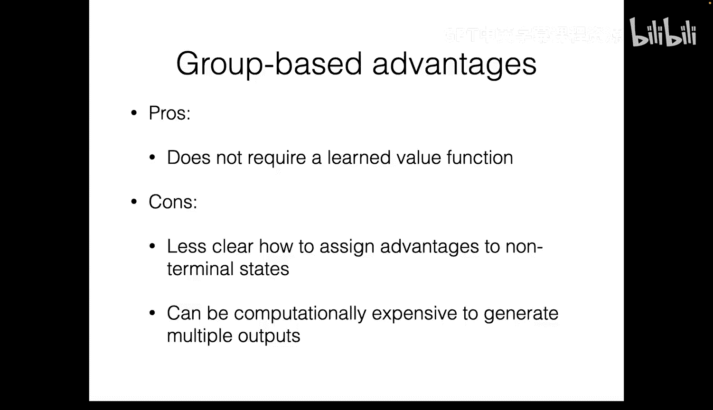

So here's an example。It's probably not the best implementation。

 but here you could just see the idea of collecting the rewards and then here is subtracting the means。

And then， it does the。Normalization， I think by the batch statistics afterwards。Okay。

 and then for the PPO loss。This is just from last lecture， so to recap here with reinforce。

 we have the gradient that looks like this。And here's the PPO loss。

And here we have these kind of two different ideas。So the first is to use this ratio。

 so you have this old model and you have the new model。

 and the idea is this gives you some notion of how far the model is moving when you're making the updates。

Okay， so for this， you have to keep some copy of an old model。And compute this ratio。

And then you also have this notion of kind of clipping。

So if the update is kind of going too far in either direction， then you're going to clip the update。

And then you can see here again， the advantages coming in， so this is just kind of you know。

 in place of this up here。Um so。Here's just one part of the implementation。Here we have collected。

These old probabilities for the model and these kind of current probabilities。

And there are log probabilities， so you can kind of do this trick to compute the ratio。And this is。

 I guess I hard coded these epsilon values。Here's doing the clipping。

And then here is computing the loss。So this is actually， I forgot to change this back。Basically。

 these clipping parameters can affect。How the model explores。

So some people have found that sometimes you actually want the model to。

 if it gets a higher reward to actually make a large kind of positive update。

So I was actually just playing around with the values here and you could see that the。

High epsilon value is that。To be kind of 1 plus 1。0， whereas the low one is1 minus0。2。

I was also playing around with the normalization and the current version might actually be。

Slightly off， so I might fix it afterwards， but anyways the。

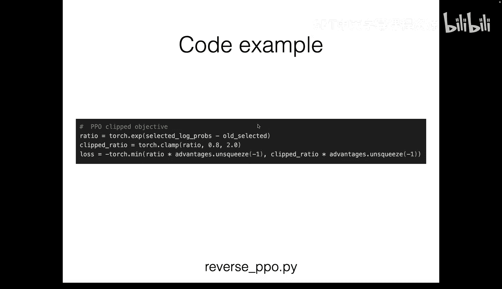

嗯。The nice thing about this is if you're interested in this。

 then you can go in and you can change the code and run the experiment really quickly and you could get a really good understanding of these different things that I'm talking about。

Yeah。So。

嗯。Okay， and then this is just saying put it together so you have this loop and。

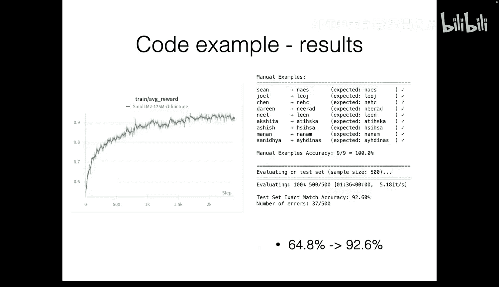

Kind of do everything。So again， here， if we take a look at the the code， then。

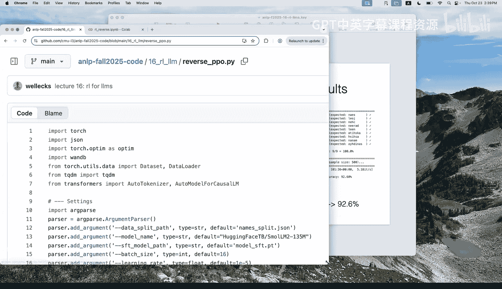

嗯。It has everything in kind of one file。So here our base model is again based on this kind of small model。

 and we're going to initialize it with the SFT model。And then。

Some other things to note here it's basically saying for the group relative advantages。

We are using kind of eight generations for prompt。嗯。And then this is another parameter with PPO。

So we'll see below that with PPO。Kind of what once you collect some data。

 you can do multiple updates。 So here it's just saying kind of do three updates before moving to the next round of generation。

嗯。Okay， so here's just setting up the data set and everything。 Here's the reward。

And then here's the loop。Again， to do this PPO loss。

 you have to have this kind of other copy of the model， so this is just setting it up。

And then we go in this loop and it kind of follows what I was saying。So first。

 you generate your outputs。Then you compute your rewards and your advantages。

And then you compute these old log probabilities。And then you can do these kind of multiple updates with p p。

So given your generations， you now want to get your kind of current log probabilities that'll be the kind of top of the ratio。

You calculate this objective。And then you have to be careful to like mask。

 padding tokens and things like that。And then you yeah， kind of aggregate the loss。嗯。So。Yes。

 and that's that's pretty much it。 and then there's still some more kind of subtle design decisions here。

 so another is like how frequently you update your old model So here we're doing like three updates and then just updating it after that。

But you could imagine doing something different， especially if you're like at scale and it's expensive to do that。

嗯。And yeah， things like that。嗯。But this is， yeah， this is the implementation and so hopefully it's a bit less mysterious now。

And so what I did is I noticed actually just this week that maybe you've already signed up。

 but if you have an education account， then you could get this coLB Pro。

And so you can get this a 100 GPU。And I'm not getting paid to say this， by the way。But anyway。

 so then you could run this whole thing just on coLb and it basically trains in about an hour so the SFT step takes like three minutes。

And then you can evaluate it。And then here's actually doing the training。

So if you haven't seen one of these RL training loops， you'll usually take a look at this。

This reward， so you can see that it's kind of it's starting around 0。5。

And it's kind of steadily increasing over the course of training。So。有人。

So you can keep running it actually for even longer， it turns out the reward's still increasing。Okay。

 there we go， but then when you do the evaluation at the end。

 you can see that the model has gotten a lot better。So in particular。

 it could reverse all of the core staff's names successfully。And now the accuracy is。

 I think it was like 64 at the beginning， and now its at about 92%。So it really did。

Do something and then you can kind of look at these。You know， plots that are also。

Tracked during training and kind of see the steady improvement。Okay。So， that is。

The reinforcement learning example。嗯。So anyone have any questions about this before we move to the next kind of case study。

嗯。😊，All of the box are correct or all of them are wrong then the advantage would be zero were there a cause of problem for training Yeah yeah so you do have to take care of this case and it's another one of these things where people try different things so sometimes you will discard you'll just discard that training example。

especiallyial if they're all positive， then it's saying that like maybe the models already learned this one and we can kind of discard it。

嗯。So yeah， that's that's one option。And then especially definitely if you're doing the normalization。

 then you have to account for like the dividing by zero so your code doesn't blow up。

Okay。So that's cool。 And yeah， definitely take a take a look at that and it was pretty fun to put together that notebook and and it's fun to be able to run the reinforcement learning pretty quickly because sometimes the I mean。

 reinforcement learning in general is，😊，Very computationally expensive。

 So it's good to have a kind of simple。I think to play arounds with。Okay。

 so if we recap this example， then we actually saw some ideas which you'll see come up again。

So this idea of first initializing with the supervised by。And I forgot the exact reason。

 but this has been referred to recently as cold start。

 So like first you come up with a supervised finening data set。

And it's a kind of cold start and then you do the reinforcement learning。

And then this idea of using a verifiable， this should be verifiable reward or kind of rule based reward。

 people call it RLVR reinforcement learning。With verifiable rewards。

So you might see that term collab。These group based advantages we'll see in the next example， oh。

 it's down here。So basically like this combination of a few different things is referred to as GRPO or group relative policy optimization。

So here you have like this p p style loss，You have these group based advantages。

And then at least in the original GRPO， they also have this additional。

KL divergence term that we'll talk about later in the lecture。Okay。

 so now we can move to solving the math problems。And so for this one。

 it's a kind of case study about this paper。Deeps R1 and so recently this was accepted to nature so it was a kind of big you know breakthrough it's pretty big deal to get accepted to nature and the nice thing is to get into nature you have to kind of make all the reviewers happy so I think the reviewers requested like all of these details and so the supplementary materials for this paper is long it has a lot of details so you can kind of get a decent understanding of what was done。

But anyways here， the problem is not going to be reversing a list。

 it's going to be solving problems that look like this。So yeah。

 you have these math problems and they always end in some answer that's checkable， so for instance。

 if it's like an integer， then you can easily check whether it's correct or not。

So here the input is just going to be some problem statement X。And then， yeah。

 the reason I want to kind of go through a paper is we could look at。

 you know exactly what they're doing。So here the output is going to be a chain of thought plus an answer。

So it's not necessarily going to be a solution， it's going to be basically like sequence of any sequence of tokens。

And the model can kind of think， however it wants in order to maximize the reward。

So what they do is they say like， okay， you have this conversation between a user and assistant。嗯。

And so it says it first thinks about the reasoning process in the mind and then provides the user with the answer。

And so you put the reasoning process and the answer in these think tags and answer tags。Okay。

 and so then you basically substitute in。For this prompt here， the question。

 and then you have the assistant output， the thinking tags and the answering tags。

And then here they start with， they have two different settings。

 and maybe the one interesting one is just starting with a pretrain language model。

They also kind of redo it with a fine tune model。But here let's just talk about this freetrain one。

And again， they're just using this really simple MDP where they have just basically one step。

 even for this giant potentially giant chain of thought and answer。And then again。

 they have this kind of very simple reward of just checking the answer zero and1。

And then it also turned out to be beneficial to have this reward for the formatting。嗯。

Then the algorithm is GRPO， like I mentioned。So it's basically this PPO loss。

And it uses these group based advantages， which we just saw。

And then they also have this k divergence penalty in the loss。And I'll go into details about that。

 actually， later。Then for their data， so this is from the supplementary of materials。

So here they describe the data you can see like for math， they have 26，000 different prompts。And。

Let's see。 It covers these different。Domains from like regional and difficulties from regional contests to Olympia adss。

And then。It's something that you can。A reasonably check， so I usually can use you know。

 like Si or something like that to check equivalentvalence of these simple equations。

And things like that。In contrast， you can't really easily check a proof that's written in latex。

So it's focused on these kind of。one that ends in an answer。嗯。Okay。

 and then here's so here's kind of some of the results。

So then they run this process and here's showing a similar curve to the one that we saw with the reversing the list。

Say you have the steps on the X axis and the reward or or the accuracy， I guess。On the Y axis。

And this would actually be， well， yeah， not the reward， but the。

Accuracy on this kind of evaluation set。And then these are two different inference algorithms。

 so we'll cover this later in the class。But this is basically saying， you know， generate one output。

 this one's saying generate 16 different outputs and take the majority answer。

And you can see that the process is working in the sense that the model is getting better and better at solving the problems during training。

嗯。And one interesting thing and。Kind of the。In addition to the really strong performance。

 but the really kind of interesting and maybe like breakthrough thing here。

Was this kind of long chain of thought phenomena which？K kindd of came as a result of this training。

So here on the Y axis， oh， sorry， I removed with the label。Here on the Y axis。

 you have the length of the chain of thought， you know， within those think tokens。

And you could see as the training is going on。The thoughts are getting longer and by the end。

 they're actually pretty long， so it's like 15，000 tokens worth of thinking before coming up with an answer。

And so the interesting thing is that the model is not just producing， you know。

 a solution or even just these like， okay， next I will do this， next， I'll do this。

But it actually can do things like backtrack so here it's saying it's like trying to solve it and then it says wait and it has some kind of insight。

And then it reevaluates what it's doing and maybe try something else。

And there's a variety of these different patterns， so yeah。

 like trying different alternative strategies and then picking one or kind of backtracking when it realizes it made an error and things like that。

And so yeah， before this， it wasn't clear how to kind of train a model to do this。

 and it was also surprising that with this kind of relatively simple framing of the reinforcement learning。

 you were able to kind of achieve this behavior。嗯。So。So I guess that' that's all they have here。

 but let me talk through a few more things。So here they had two different settings。

 so they had the pretrain model， which is called starting from the pretrain model。

 which is called deepse R10， like starting from zero。And what they found is that。I mean。

 it does work if you look at these plots， but it would also do things like it would start switching languages。

So I think in particular， the model would switch between kind of Chinese and English a lot。

 and then they said when they want to like deploy it。

 they want the model to just choose one language。嗯。And so in general， the model can basically learn。

 you know， however， it wants to use these thoughts in order to maximize the reward。You know。

 it can do that。So they saw these kind of interesting phenomena come as a result。

So what they did is they did a second round， and they also maybe want to boost the performance further。

 They did a second round where they used this model to first generate a bunch of inputs and outputs。

And so now they had a kind of big。Disttillation data set， if you want。

Then they trained the model on that and they filtered it so like everything's in one language or something like that。

And then they trained a second model。So now you can have a second model which was now initialized from fine tuning。

But the fine tuning data kind of came from this R10 model。Then after that。

 they additionally tried to expand it beyond just math tasks。

So they did this kind of preference based learning， which is actually the next part of this lecture。

Okay， so I wanted to just say all that because I think this it is a really good paper to read and so you'll see all this in the paper so I want to just。

Yeah， contextualize what I've shown here with kind of everything that's in the deep seek or one paper。

嗯。Okay， and so I think I checked。I' forgot exactly when this paper came out but。

It was something like last December。And so it is October now， and I think it already has。

Over 4000 citations。 So basically， this LED to this kind of explosion of interest and。

These techniques and using reinforcement learning with language models and these kind of reasoning reasoning language models that produce these really long chain of thought。

So we'll actually return to that later in the class， it's not the last time we'll talk about this。

Okay。If there's any questions。Before I go to the next part。你。这是吗？Situation。

 if we look at broader domains， maybe one。These all maybe like request of taking hill physical war is maybe harder to。

Yeah， yeah。 so that's a great question。 So in this third part。

 we're going to talk about a case where the reward is harder to define。

And it turns out that it does get more difficult。 So we'll see this idea of like reward hacking。

 which is for any given reward。These reinforcement learning algorithms are very smart and they'll find any way to maximize the reward。

And so you discover all of these like weird edge cases when you don't have a perfect ro function。

And then also sometimes it is beneficial to， you know。Maybe you don't just have this final outcome。

 maybe you do have to look at the kind of intermediate steps or have some kind of like checklist of items that needs to be satisfied。

 so it does become more complicated and this is still a big kind of open question and active area of research。

So yeah those kind of perfect timing for that question so here we're going to move to a different setting which is maybe very general。

 so let's just say that we have a chat bot and we just have we want to optimize we want to perform the following task。

Generate a completion that is good， according to a human user。So it could be a math problem。

 but it also could be like an essay or it could be like advice about life or basically anything that you could input to the chat bot。

And so that actually seems pretty difficult and the question is like what does good even mean and kind of how would you formulate this as a machine learning task？

So if we think about using reinforcement learning， then maybe one question would be。

 how do we evaluate the reward？And so the approach is going to be try to learn some reward function because we probably can't write like a Python program to evaluate this notion of like。

 is it a good response or not？So first， we're going to go on a little bit of tangent about learning a reward function。

So broadly， you could think about at least to start like two different strategies。

So one is you can make。What we might call a direct assessment model。

So here the model would take in some input and some output。

And it would basically try to give some number to kind of how good this output is。So here。

 let's say that our we want to give low rewards to things that are like offensive。

So here I've censored some offensive words。And so here you might have a label of one for this output and zero for this and the model would basically predict。

You know， this number。嗯。Let's say you try to go to something more abstract， like helpfulness。

And you collect a data set of。Outputs and humans kind of rate them as either helpful or not helpful。

And people actually did this and there's like a data set from Anthropic called helpfulness or harmfulness。

And they tried to do this， have kind of annotators， yeah， give these labels。Once you have that。

 you can try to train one of these models。

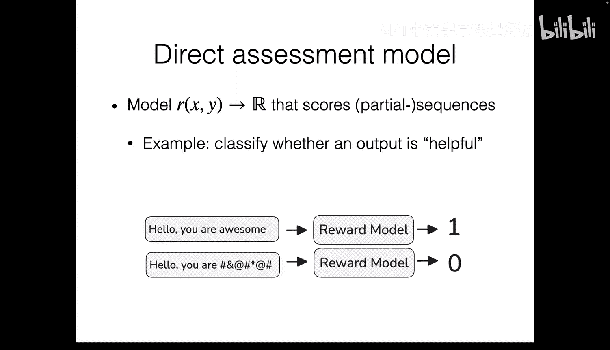

嗯。So here is an example。And generally speaking， you know。

 sometimes if you have like one property that you want to predict。Like。Okay。

 it's still really difficult and like abstract， but let's say you just want to filter out things that you consider to be unsafe。

Then maybe you can collect a lot of different instances of things that are like clearly safe and clearly unsafe。

And so people will not necessarily have a model for like， is this a good output。

 but you could have a kind of property specific model？And in fact。

 you can go on hugging face and kind of find these。 So here， this 1， I think is from Nvidia。

And it's called， you know， content safety。嗯。And the approach is basically， like I said。

 so try to collect data and then have your model predict this kind of classification。

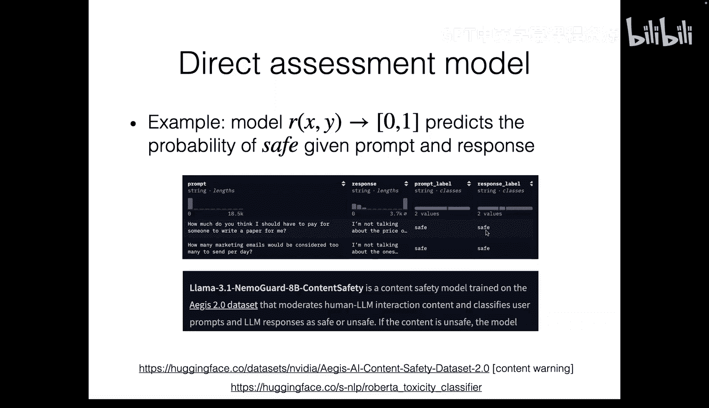

But what becomes difficult is it becomes difficult to kind of collect this data and especially for like all the variety of things that you might want the model to do。

So another thing you could try to do is just collect preference data。

So this is basically saying that like。You know， maybe it's difficult to say whether to assign some number to how good this output is。

 like is it you know， a four out of five is it a two out of five output， like I don't really know。

But as a human， maybe when I'm presented with two outputs。

 it's maybe easier to say that this output is better than this other one。

And so if we collect tons and tons of examples of that。

 then maybe we'll have some kind of nice you ordering of or preference ratings that we can train a model with。

So here the goal will be to collect this preference data and then still train the model。

That gives us numbers and the numbers should be， you know such that the things that are preferred more get a higher number than the things that are preferred less。

嗯。And so we'll talk in detail about how to do that。

 but first I wanted to just show you how this fits into this pipeline with reinforcement learning。

And the pipeline is called reinforcement Learn from Human feedback。

So the idea is the human feedback is going to come from these preferences。

And then we're going to kind of optimize this reward model。So first。

 we're going to fine tune in the model。Say on some data set of like prompts and responses。

Then we're going to actually train this ro model using the preference data。

And then we're going to optimize it with reinforcement learning。So for example。

 now that we have this ro function， you just use some prompts。

 you run the reinforcement learning algorithm， and it's now optimized the reward。

So this was a really famous paper in 2022 that did this and you could basically see these this is from Open AI and you could basically see these three different steps。

 so collect the demonstration data。Collect the comparison data and train the ro model。

And then optimize the policy against the reward model using reinforcement learning。

So we're going to go through each so you don't have to like read through everything on the image because we're going to go through each one of these steps and hopefully get through it in time。

So first is the SFT， so an example data set they would use that you would use is if you think back to the fine tuning lecture。

 we talked about this idea of like instruction tuning。

So you have a bunch of instructions and you have a bunch of outputs and maybe use that as your supervised fine tuning data。

Or if you collect a lot of different conversations。Then you can kind of have yeah。

 different like actual prompts and different actual responses from users。So we went into， yeah。

 some examples of this in the instruction tuning lecture。But again。

 we're kind of in the setting of just you know， performing general tasks or just responding to kind of user prompts。

So I want to just show a like more recent example of。Kind of like really doing this in practice。

So this was a model that came out maybe at the beginning of 2025。So it was kind of like very。

 very recent last semester。And here they've collected this data set and it has like 900，000。嗯。

You know， prompt response examples。And it has a variety of different categories。

 like general knowledge。Math reasoning， coding。Safety， multilingual， things like that。Okay。

 so this is just showing you this step really is done in these models， a lot of effort goes into it。

And you try to build like as big of a data set as you can。

So now the next step is you want to improve the model with reinforcement learning and so first you have to get a good reward。

And so here you want to train this ro model somehow using this preference data。

So the preference data again is going to be for each given prompt。

 you want at least two different examples where one example is labeled as being kind of better than the other one。

So if you want to do this in practice。Then you have to decide kind of what。

Are your inputs and then how do you collect these preference ratings？So just as one。Example。

 there's this paper which kind of did this whole RLHF pipeline and they for instance took some of their data from the SFT step or from the same like data and then set it aside for training the reward model。

And then to get the responses， typically you'll use your model that has been fine tuned to sample multiple responses。

So the next we need these kind of preference ratings and then some method to actually train the reward model。

So here again， the task is to basically rank these two responses or you could even do more than two。

 like you could have someone kind of rank five different responses if you want。

But maybe just focusing on。呃。Or yeah， so either of these approaches will work from that。

But we'll mostly just talk about using two。So broadly speaking。

 you can either hire human labelers to do this。Or try to use a strong language model to do it。

So probably if you're trying to train like the absolute best system。Then you can't。

 you maybe can't use the same language model。 And so you have to hire the the human labelers。

Or it's just beneficial to have some kind of human preferences。And so as you imagine。

 this like costs u money， but you can kind of frame this as an annotation task。In other cases。

 let's say we're trying to like train a small model， something like that。

 then it might be good enough to use kind of the best model available to come up with these preference judgments。

So here's just an example from。Yeah， 2024， where they were trying to do the RLHF pipeline with Lama and they were using the GPT model to basically grade the responses。

And then here's the kind of large scale example， and you could see here that。

They have these variety of input prompts they're using。

And then what they did is they use this pool of 22 different models to actually generate the responses。

And then those are the ones that they then annotate using for the preference judgments。

And so here they were using this GPT model to actually do the preference annotations。

Because you could imagine that using the human data is probably too expensive for。嗯。

For how much data they had。Okay， and then you can see here that it really just comes down to。

Is it chosen or rejected？ So it's basically saying。

 like which one is better than the other one when you。Other output when you pair them together。嗯。

Okay， and so now for training the reward model。You basically have this data set， oh。

 and there's also the input X here， but now you have this kind of pair of a good output y plus and y minus。

And the basic idea is we're going to use this loss function so that the model assigns higher scores to the positive one compared to the less preferred or negative one。

嗯。Os。And so here you can see that it's kind of intuitive， maybe。Here， like if。If this was。

Lower then it would be negative if it's higher then it's positive and you can kind of reason through the two different cases。

 and it seems pretty sensible。But it turns out that there's actually like a。

Good justification for this loss function。 And it's good to at least have seen it。

 You'll see the idea pop up from time to time。So here there's this classic model called the Bradley Terriot model。

And it's a model of the outcome of these pairwise comparisons。So it's basically saying， okay。

 given items I and J。It will estimate the probability that。The comparison I is greater than J。

As follows， you have these two different parameters， so you have P and PJ。

And the kind of modeling assumption is that， yeah， this probability is modeled。

Using this kind of simple fraction here。So then what you could do is you could start with this kind of Bradley Terry model。

And then kind of put a neural network。Into the。Into the picture to drive a loss function。

So here you could say that these parameters， PI and PJ are produced by a neural network。So PI is。

 you know， you run the network on input Yi and similar for PJ。

And then this probability would then be of this form。

Then you could do some simplifications and maybe just do the time of。But I mean。

 they're pretty simple。Here you're dividing by。This exponent。

And then you can get things to look like this sigmoid function。

And then you have this thing down here， and if you remember the previous slide。

 now this is starting to look like the loss function that we saw。Okay。

 so it's basically saying that like under this model。

 the probability of this kind of preference rating。Turns out to be of this form。

 so we have sigmoid of R of Yi minus R of Yj。So then you could say like， okay， under this model。

 we could use the one kind of trick that we've been using throughout the class。

 which is a maximum likelihood estimation。So you could say， okay， given your data set of preferences。

 we want to train the parameters so that they maximize likelihood of the data。Okay。

 and so now we again see this。嗯。This loss that we've been seeing。

 usually you'll use the log and this will correspond to minimizing the negative log likelihood kind of given your data set。

Okay， so that was a kind of quick overview of where that comes from。

And now given this reward function， you can do the reinforcement learning。

So I think we're kind of getting low on time， so I have to go through this。嗯。Maybe a bit quickly。

But here what's going to happen is that since this model is， you know learned。

 since the reward is a learned model， then it's going to be susceptible to reward hacking。

So like I was saying before， the reinforcement learning algorithm will basically discover any possible way to maximize reward。

So for example， if our goal is to train the model to say how offensive an output is。Well。

 then actually the model could just learn to output an empty response because then that is not an offensive response。

And in general， you know， it'll find like all these weird flaws。

 or it'll just find kind of out of distribution inputs for the ro model。

So here's an example of this happening actually with code generation。

So here the model is getting higher and higher reward doing reinforcement learning。

But then its performance on the actual evaluation data set ends up starting to plummet。

 and this is usually a demonstration of the reward hacking。So this really does happen in practice。

And so you have to do something。So one kind of mitigation that you could do is you could kind of limit the distance that the model can kind of travel during reinforcement learning。

So you can constrain it to remain close to the original model。Okay， so for instance。

 maybe the original model never outputs an empty string。

So you could prevent a behavior like that by just kind of keeping the model after reinforcement learning close by to the original model。

So this is usually formulated in terms of this k divergence。

And so you'll have some way of kind of penalizing the model if it gets too far from the original model。

So a simple way to do this is just through the reward function。

And it turns out that if you have a reward of kind of this form， again， you see this ratio here。

Then this corresponds kind of in expectation。To be equivalent to having this scale div penalty。嗯。

Okay， so I guess we're at。Were at time， but this was the last part of the。RLHF pipeline。Again。

s now we have this kind of model based reward and we have this pipeline of like supervised fine tuning。

 reward modeling， and then optimizing the reward。And here we have to constrain the model to kind of not go too far from the original model。

One motivation of that is for the reward hacking。Okay， and then just kind of to go one minute over。

 again， you can think of these different methods as varying based on the reward。

 the advantages and the loss function。And so here's like three different things that we talked about。

 the GRPO， the kind of。PPO without any。Specific design choices。And then here's PPO。

 as it's typically used for the RLHF。Okay， and then as I mentioned。

 if you start reading papers like recent papers about RL and language models。

 you'll see various different tweaks to these。

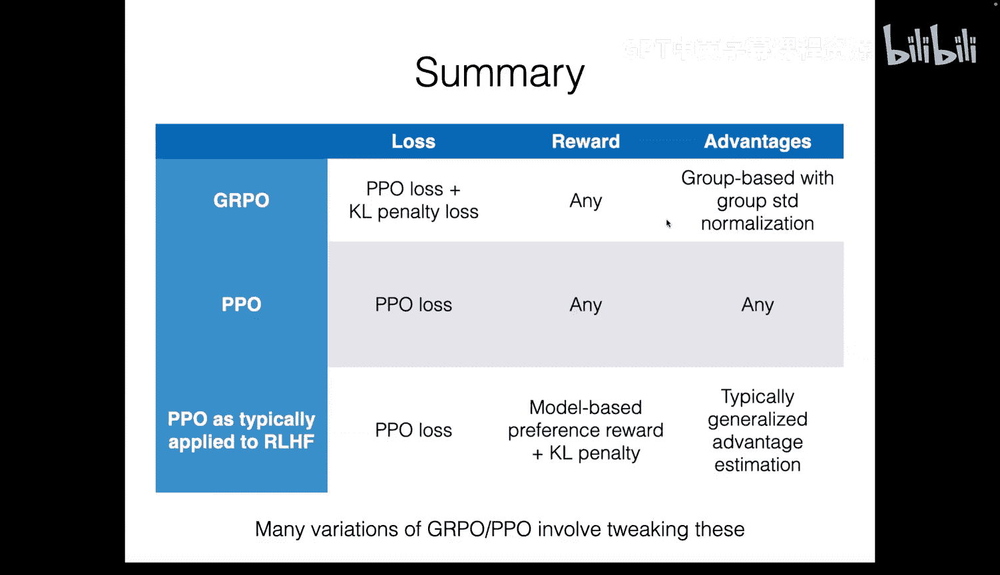

Okay， and then here's some two different tools， TRL， and also Verl if you use this in practice。

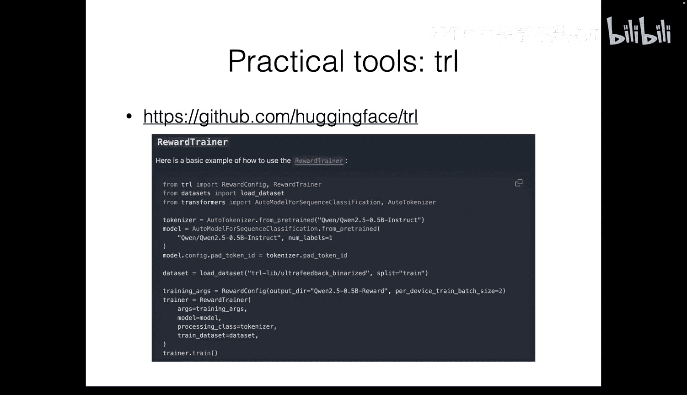

嗯。

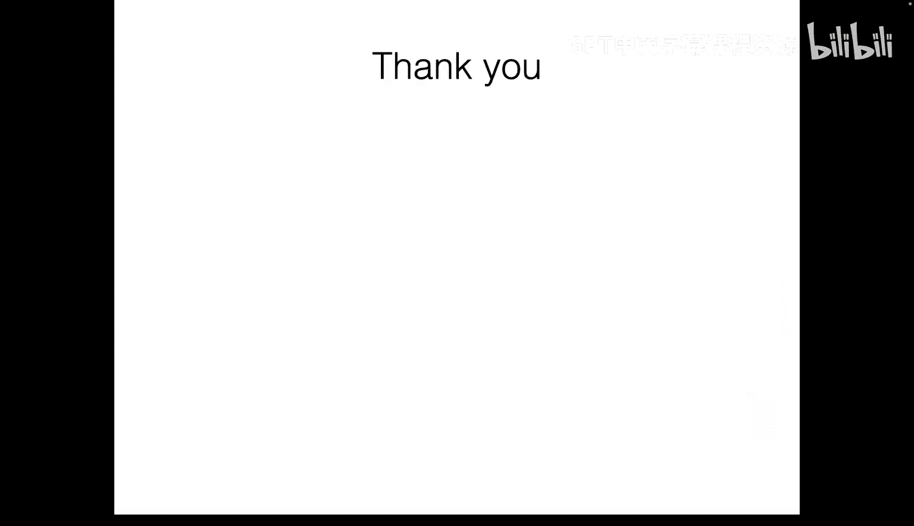