# CMU《高级自然语言处理｜CS11-711 Advanced NLP Fall 2025》中英字幕 - P17：(17)_ Agents and RL.zh_en - GPT中英字幕课程资源 - BV1ZWYAzuEMa

で？

So we can go ahead and get started with the lecture。So as I mentioned earlier。

 this semester we are putting more of an emphasis on reinforcement learning。

 it's a really big part of advanced NLP， and so this is the third lecture on the theme of reinforcement learning and agents。

And so this lecture will be about agents。And actually at the very end。

 we'll talk about how we can use the algorithms from reinforcement learning that we've discussed so far to train these agent models。

 which is really an ongoing area of research so a lot of the stuff I'll talk about today is very ongoing research it actually changed or was just developed when I was putting together these slides last semester。

But I'll also include some more historical things。Because although there's a lot of activity right now。

 there was earlier work that kind of led up to it。Okay， so if we recap then。

We can take a look at these language models and at a high level。

 they give us some way of taking in input text and generating output text。

So we've really talked at length about how to do this， how to train these models。

 how to use different inference algorithms to produce text。

And so now maybe we can try to treat these as a kind of。

Black box that we incorporate into kind of more complex tasks。

Second thing to recap is the idea of the MDP from reinforcement learning。

So we're really going to be thinking about this today and so again。

 we have this policy that is interacting with an environment by taking different actions。

The policy receives states， it also receives rewards， and then it issues actions to the environment。

Okay， and in the first reinforcement learning lecture。

 we went through this example and by now we've gone through a few different examples。

 so hopefully you have a good picture of this kind of formalism called。

MDP or Markov's decision process。So today we're going to focus on agents and language model agents in particular。

First， we're going to go over what is an agent。It turns out maybe there's not a single definition。

 but we're going to go with the definition and then kind of see what the implications of that definition are。

Then we're going to go over three different things。

 so different environments that are used with agents。

 so you'll get a sense of the different types of tasks that these are amenable to or at least the ones that people are commonly looking into。

Then we're going to go over some common design patterns for actually implementing some of these ideas。

And then finally， at the end， as I mentioned， I'll talk about reinforcement learning in agents。Again。

 as always， we have code for this lecture and I'll go through I think three different code examples that you can also try out yourself。

Okay， so what is an agent， so here we'm going to define an agent in these kind of reinforcement learning terms。

And just consider the agent to be a policy that is operating in some environment。Okay。

 so we really have nothing new on the slide here we have an agent。And I guess an agent has a policy。

Which is a mapping from states to distribution of actions and it is operating in some environment。

So then you could say， like， okay。Clearly， the important things here are the environment that the agent is operating in and then how you actually kind of realize this and where LLMs come into the picture here。

So as some concrete examples， here's some early environments that people were looking into with these agents。

So this one is called mini。Wob， many world of bits。And this was a paper from a few years ago。

 and here they basically have these really simple websites。Okay， so any， I think it's an animation。

 There we go。 So each one is an individual website。 It's actually HTML and ja。 And then up here。

 you have a task。 So， for instance。Here it says， let's look at one that's kind of slow。

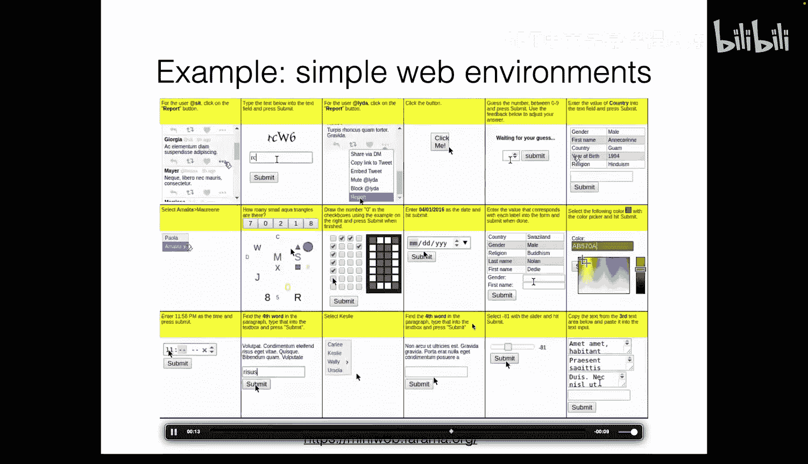

Okay， it's moving too fast， but you can see the description of the task is at the top and what is happening？

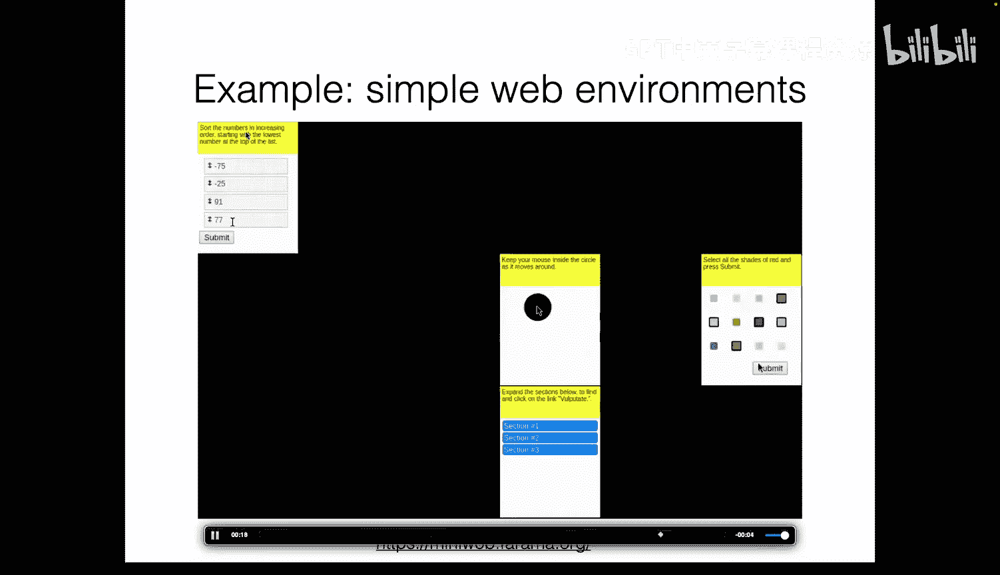

Oh， and as each one of these is completed， it kind of leaves the screen， I think。But anyways。

 here you have something that's clicking and doing things in the environment。

 trying to solve the task， and that would be the agent。

So we're going to see some examples of other environments， it doesn't just apply to web pages。

But it's kind of useful to think through this one in detail。

 and we can kind of go through all the details and then see that this idea is not too mysterious。

So let's take the simplest possible environment。And so here we have a web page and the task is to click the button that's indicated。

Okay， so we just have to click this button here and then the task succeeds。

I forgot to write it on the slide， but then the reward is basically going to be how fast do you solve the task？

Or proportional to that So for instance， maybe it's a negative reward and at each second you get minus1 reward。

 something like that So you maximize reward by kind of solving it as fast as possible and we'll actually look at exactly what it does in the code example。

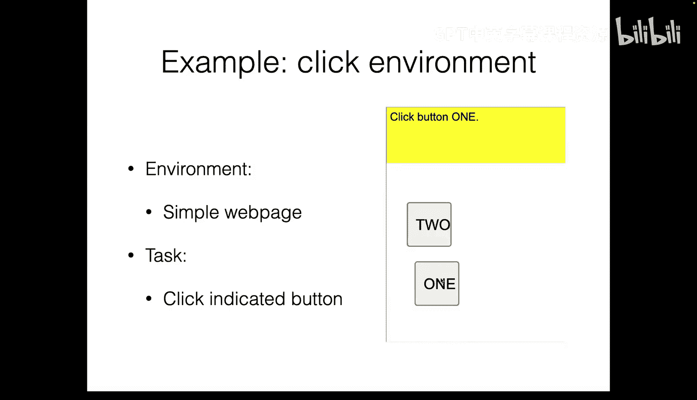

So。Here we can use this。We can get access to this environment programmatically。

 and you can see that it looks like things that we saw in the reinforcement learning lecture。

 So here we have making this clicking environment。 And then here we have stepping through this loop of。

Passing our agent and observation。Getting an action and then submitting it to the environment。Okay。

 so now the question is going to be， maybe we want to understand some of the specifics like what actually is this agent doing。

 what do the observations and actions look like in this environment？

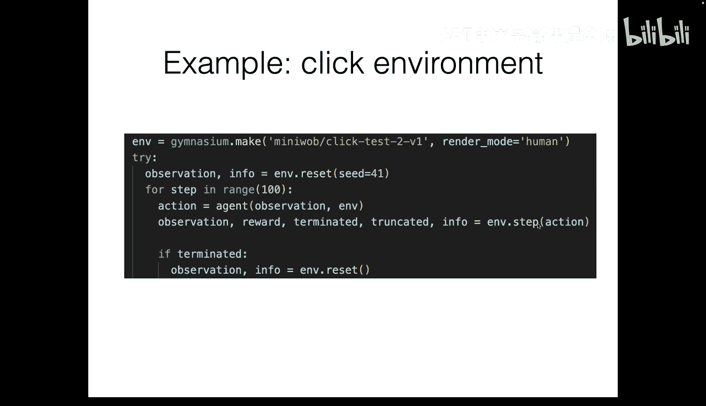

So when you start to think about it， it actually is a bit unclear and this comes up a lot of times when you try to use language models for things like web page navigation。

Here you can actually take one of two different approaches。

 you could either choose to represent the current observation as sort of text or as an image。

So on the left here， you have a screenshot of the observation。And on the right hand side。

 you have all of this text and actually this text is just representing the HTML from this page。

 it's these document object model elements。Okay， so then the question is， well。

 one way to design the agent is to have it receive this kind of textual representation or a similar one。

 or you could have the agent take in this image or maybe you could have it do both。Okay。

 so this is actually a question that comes up。When even when you're building these more sophisticated agents now。

Now， if we。Well， yeah， we'll get back to the observation in a bit。

Then you have to consider what are the actions that you want the agent to take。

So for this environment， whoever designed the environment kind of defines these actions。

So you could see that there's ones about moving， so moving the cursor to the specified coordinates。

There's other ones about clicking。And maybe this one is actually pretty relevant。

 It says click element。Ref and the ref refers to the reference I D in this。htO。Okay。

So here are the different actions that are available and the observations we saw。

 so now we can consider designing a variety of agents。

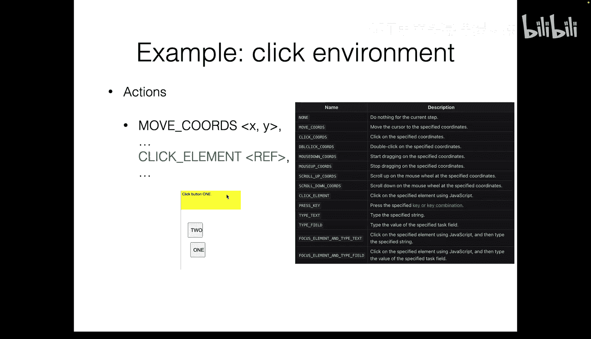

So。First， we could design an agent which is just a kind of rule based agent。

 so it doesn't have to do with LLMs or machine learning or anything。

What we can do is we can take a look at this and we can take a look at that。Jason。

 which represents the page。And then we could just find the document element that has the text one。

We can get its reference and then we can output the action click element reference。

So here here it is implemented， so here we have the agent and it's finding the HTML element with text one。

Then it is issuing this action， which is。Clicking on the element。

And then here， the action is。十。

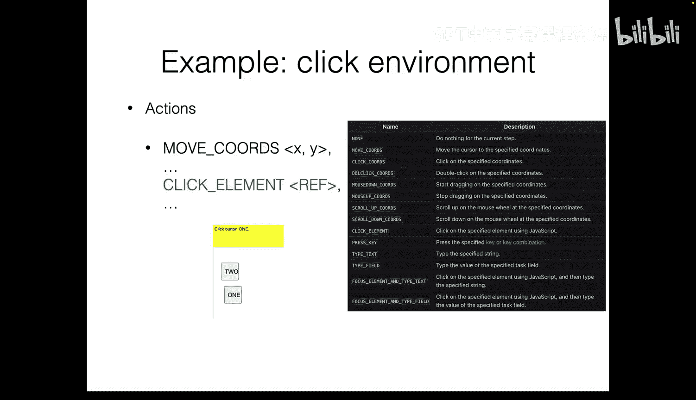

Something here and this is just kind of code for looking up the name of the action and things like that。

So you can do this and you can actually solve this problem， it turns out。

 using this kind of trivial agent。

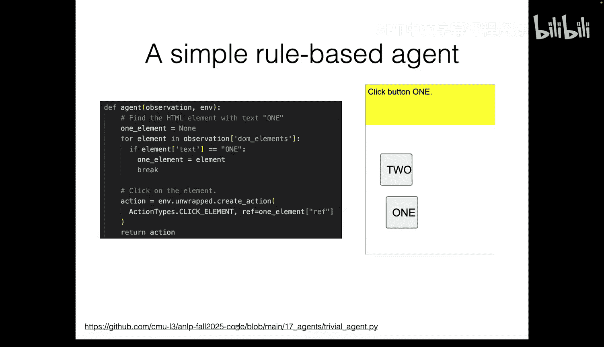

So let's take a look here。And。I think I have everything set up， so。We can try to。喜欢的事。

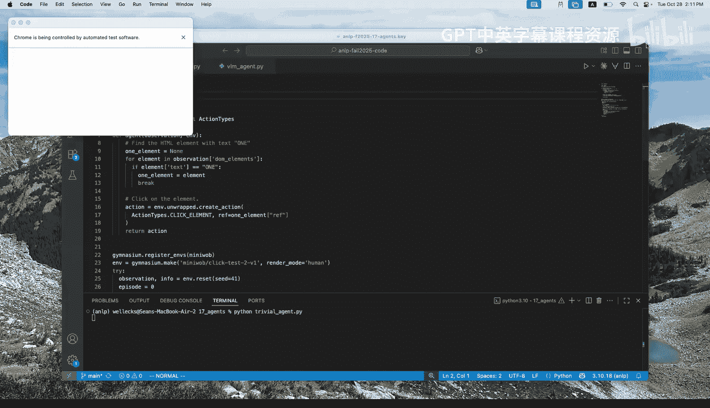

So here we see the task I'm talking about and everything's kind of small。咩叫食啊。

So here we have the environment and the task' office to click the button one and this agent that we kind of programmed is actually perfectly solving this environment。

And down here， just to show you the environment， you can see what's happening。 It's basically taking。

 it's one step， right。 So it just clicks。 and then that's it。

And then here you could see the reward based on how fast it's solving that environment。So can anyone？

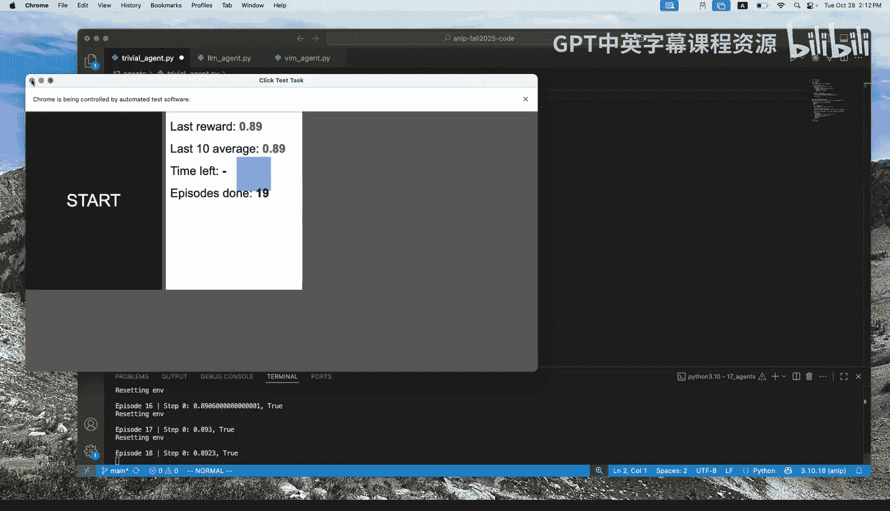

Hopefully， hopefully there are some downsides can anyone identify a downside to this rule based agent。

Because it completely solves this environment。嗯。我。嗯哼。😊，So possibly if we have a new environment。

 then this agent won't work on the new environment。

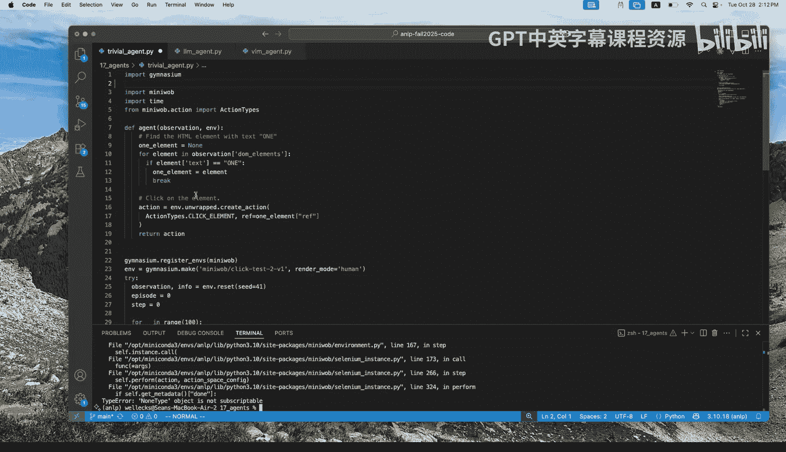

Yeah， that's really the key thing I was looking for。

This rule based agent really only works for one narrow task。

So it might be representative of even in a really complex application。

 let's say you are trying to optimize some workflow at work， something like that。

Then if you really want， you can kind of go in and you can program a specific kind of agent for that task。

And it might actually work really well， and maybe it's a really important process。

 and that's actually what you need to do。But then the question is like whether you can take that same code or that same agent and basically apply it to any new task。

So that's this issue of how kind of general purpose the agent is。

So then I think one reason why these LLM agents might be exciting or at least there's a lot of excitement building in them。

Is it possibly gives us a recipe for building a kind of general purpose agent。So here。

An LLMA agent just refers to or a language model agent just refers to somewhere in this process using a language model to help determine next actions。

Okay， so now we'll somehow represent the state， then we'll pass it to a language model。

 and maybe the language model is kind of good enough。

That it can either take actions or we can train it to take actions。Okay。

 so now to use a language model。What do we have to do， we have to represent things as tokens。

 so we have to represent this state and the actions as kind of tokens。So what does this look like。

 well， here's an example and it's actually implemented in this code example。😊。

So here what we're doing is we're writing a prompt and the prompt says you're on a web page hear here available actions。

And it's just writing a description of the different actions it can take。Then it says observation。

 you see the following elements。And so here we're using this textual representation。

 the kind of Json representation at the page。And then we're giving it the task。

 so it turns out you can also get programmatically， you can get this task description。

And now you can give it to the model。And so now maybe we don't have a fully general agent。

 but you could see here that there's not anything specific now to this specific clicking environment。

Maybe I could have written more actions here， but I just wanted to make the prompt small enough to take a screenshot。

But basically， we could imagine trying to use this agent for maybe any environment that's here。

Then what we have to do is we have to represent the actions as text。 That's kind of straightforward。

 We can just have the language model literally generate or we tell it what to do in the prompt So we say I'll generate the text。

 click click element， and then some element I do。Okay， and so then you have to write some code。

 which actually calls the language model and pares the outputs and then。

Gets the action and takes actions in the environment。Okay。

 so there's actually a reason I'm going to this like painful， maybe it's not painful。

 but this level of detail。Because actually these are the major components in a lot of these agents that are built based on just prompting models。

So you'll typically write these different prompts that describe the kind of setup。

 describes the actions that the model can take。Then you have code， which is called scaffolding code。

 which is actually kind of calling the model， parsing it correctly and providing it to the environment that's running。

But we'll see some examples of that later。

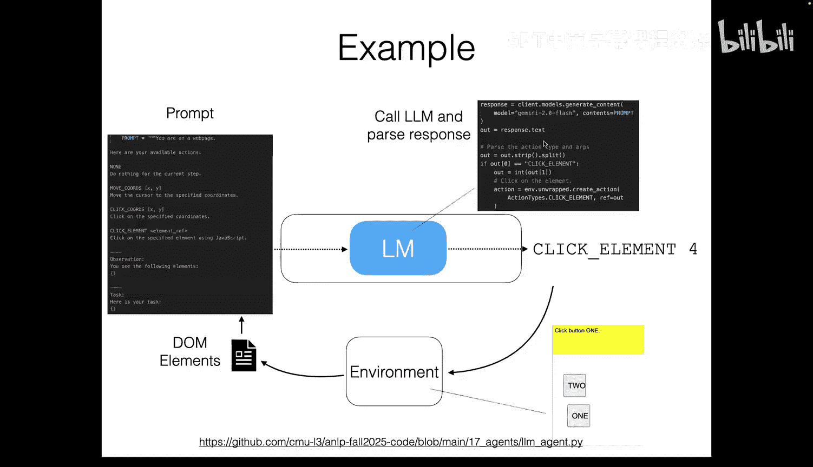

So now we could take a look at。This example， and it's basically implementing what I have on the screen。

And so here it's using Gemini。And。So you could actually try this out。 you can get a Gemini key。

And the thing is， is that like sometimes the Gemini API。嗯。Throws errors。But let's see if it works。

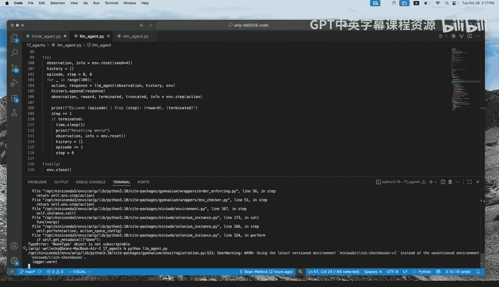

Okay， so now we have a more interesting environment， the clicking one is kind of boring。

 but this one's actually non trivial。 So here it's saying select these two elements。

 click them and then submit。Sa the model has to basically select only the correct elements。

 and then here we go。

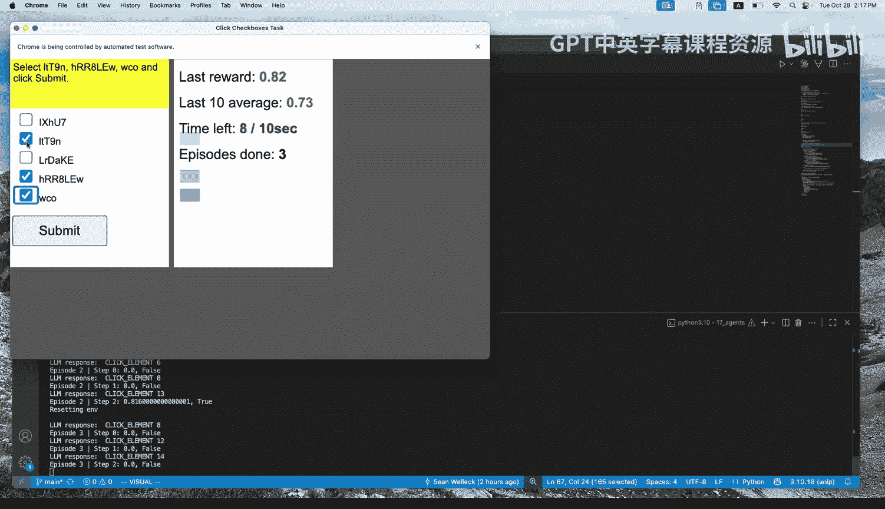

I exceeded my quota so with the free API key you don't get many requests。

 but hopefully you saw it so the agent was basically in action。

 you know clicking these checkboxes and solving the task and it was pretty good at it。So here， again。

 it's maybe pretty easy though， if you look at the observation。

So when we represent the web page as this JON。

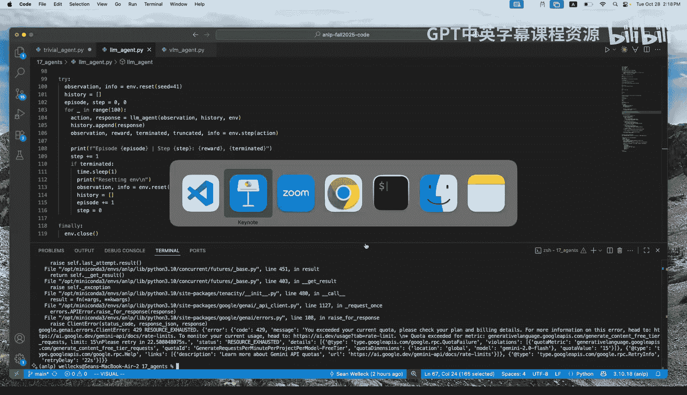

Again， you have like the different element IDs and you have the text written right next to it。

 so all the model has to do is kind of you know identify that element and then issue this click action。

But still， it already gets kind of more tricky to directly program that in。

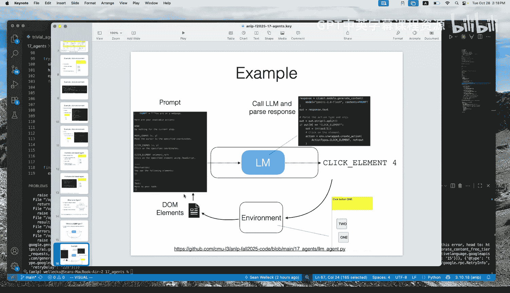

嗯。So then we could consider using a vision。Model to kind of receive this screenshot as input。So。

Here the model is potentially it's getting different information， right。

 So it's no longer getting this JSsonN representation of the page。

 It's just getting the visual representation。And so in some sense， it's more。

 it's less maybe specific to the specifics of the JSON。On the other hand。

 to it has to be able to understand what's in the image。

It has to be able to extract the relevant information better。

And then it turns out that a big thing is for these little checkboxes， if it issues in action。

 now it has to click in a particular location because it no longer knows the kind of element I。

For it's where you click， right。And so this issue is。Often referred to as grounding。

 So the model has to kind of map these。Coords to where it should be clicking on the screen。

 And this turns out to still be pretty difficult for even some of these data of the art language vision language models。

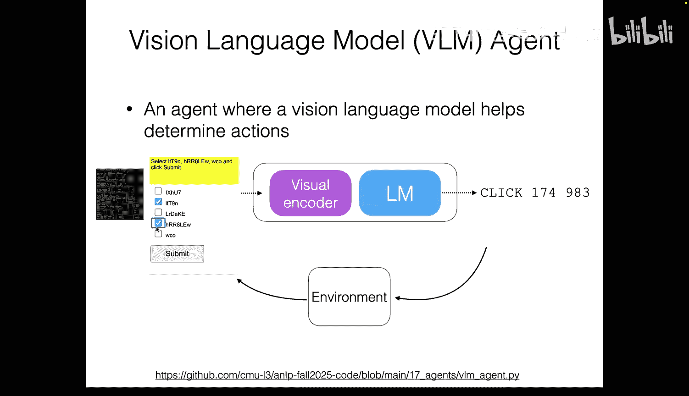

But again， we can implement this pretty easily with。Here it's using Gemini again。

I wonder if it'll run or。Whether I already exceeded the quota。Okay。So here it is。

 in an on the right hand side， you can see where it's clicking。 And sorry it's really small。

 but the little dot in opposed to clicking。 So you can see in this example， it actually。

Is not able to click。This button， in the sense that it has to produce these kind of coordinates。

That corresponds to the button， and it's kind of missing it。

So you could imagine like training a model specifically to do that and things like that。

 and maybe we'll talk about it a bit later。But this is an issue that you run into if you go to the visual representation。

 and it's one that people are still trying to solve。Today with the kind of visual agents。Here again。

 so we had a couple lectures on， okay， this is enough。

A couple lectures on the vision language models， here's just if you haven't used one of these APIs before。

You know， probably at Google or I mean， this this would be some type of fiss language model。

But here you can just basically get the observation。

 turn it into this image and then provide it to the。To the model and get back a response。It。

And then down here， as with the other two examples， we have this kind of loop。

 so we are going through the environment， we are passing the observation to the model and it's taking different actions。

Now something else here， you could see is。Here， it's kind of。Trying to collect the history。

So we talked about this in the reinforcement learning lecture that， you know， if you want。

 you can kind of collect the history of past observations or past actions。

And your agent can use that。So again， kind of using this as representative of more complex or kind of current areas。

How you kind of represent the history or how you kind of have a long term memory for the agent is also still a kind of open question。

 something。The people are researching right now。Okay。

 so here we actually saw a lot of different ideas in this fairly simple example。

 but I wanted to just show you this concrete example of an agent working on these kind of web tasks or even vision related tasks。

 just to make it very concrete and kind of less mysterious。

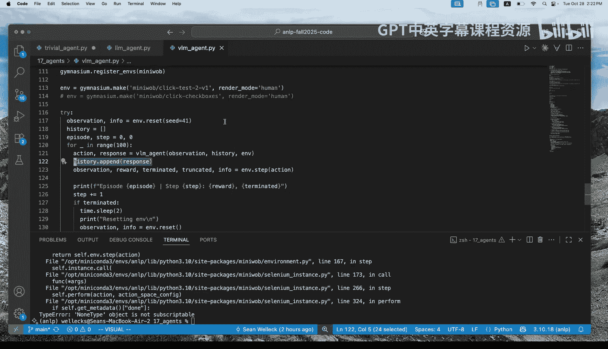

Now， we're also going to talk about tasks that are closer to maybe。

Traditional NLP tasks like answering a question。And we'll also get to that soon。

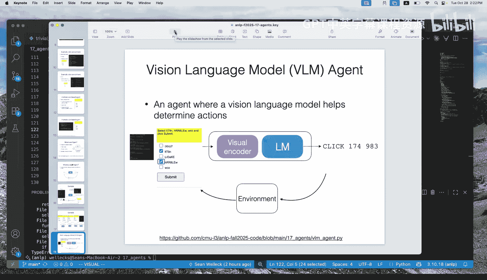

And then finally， I want to just mention this other type of agent。

 So this would be typically a vision language model agent or vision agent。嗯。

But I want to talk about this， because there's a kind of。You know。

 area of research growing around it。And these are called computer use agents。

 they're also GoI agents， so graphical user interface agents。

So here what you do is you try to have the agent have kind of minimal assumptions。So first of all。

 the agent's observation is not some like specific。Json representation or something like that。

 It's just getting。What a human would see from a computer。 So say the a screenshot。

And then its actions， again， are not something specific。To a particular environment。

They are just general purpose actions that you have。You know， with a computer。

 so typically things like clicking， typing， things like that。And then if your agent is of this form。

 then at least in principle， it could perform anything that you can perform as a human using a computer。

Like you could frame like making this lecture as being some sequence of observations and clicking and dragging and dropping actions。

So this was a kind of interesting idea and。We started off talking about these very。

 very specific like rule based agents， and this would be an example of you know。

 a very kind of general purpose agent if you're able to achieve this。嗯。So to recap this first part。

 again， here we're treating this agent as a policy。

 so something that is taking actions given some state in some environment。

And you can build these agents using language models in different ways。

 so you could have text agents which are representing the states and the actions using some kind of text。

Or you can have these visual agents， which are additionally trying to use images。And so recently。

 there's been a lot of interest in these agents and。Here's some of the major categories。

And I think I made these categories last semester。 So there's probably， you know。

 new ones you could put here as the kind of major ones。

But certainly a major application for these is in software engineering。So traditionally。

 people think about。Code generation， so kind of generating individual snippets of code maybe bo some input prompt。

Now it's。With this kind of agent view， you could say like， okay。

 my agent has access to different tools like it can run code， it can。You know。

 maybe have anything in the IDE， it can have like file operations， things like that。

And now maybe I can give it some more ambitious task， like here's a PR for my repository。

 can you close it？So maybe the agent like searches online， maybe it tries to write some code run it。

 things like that。And。Kind of does something which is a bit more than just this kind of input output task。

Similarly， you may have heard of these kind of deep research tools。And so here again。

You could frame this as a kind of agentic task in the sense that the model receives some query like compile this research report。

Then， it can kind of。Do some chain of thought if it wants。It can go search the web。

 it can like look at the results， it could generate more text， maybe do some more searching。

 and eventually compile some report for you。So there the kind of environment would involve。

The actual searching operation and we'll actually talk about this in a bit。

And then there's these web agents and you could think of a variety of tasks。

That you might want to perform on the internet now whether you trust the model to kind of。You know。

 have full rain over your computer over your web browser， that's a kind of separate issue。Um。

 but at least in principle， this could like do anything that you would kind of use a web browser for similar to what I was saying with the computer use agents。

So this was from January 7th and Vdia said 2025 was going to be the year of agents。

 and I think since then there's been yeah a lot of interest in these different things that have come out。

Okay， so in the next few parts of the lecture， we will。Take a look at。

Some more applications and then some more ways of designing or viewing these agents。

As well as ways to train them at the end before that， does anyone have any。Questions。

About what has been discussed so far。嗯。😊，是。哦，对不行。你不你多。Yeah， so。

So most of the stuff I'm talking about today， it's not solved。

 and so I would say a major failure case for the agent is hallucinating。

And then what that means kind of depends on what environment the agents acting in。So for example。

 we've been working on these computer use agents recently。And sometimes the model will。

 it'll say that it clicked something， for instance， and then it just didn't。

 so that's the kind of hallucination。Or it'll say that， you know。

 there's a search bar here and there's just not things like that。And so， yeah。

 all of these things are very much。Still。There's no answer for kind of how to solve it in general。

 I think， yeah。嗯。Distribution DC sort of like text ballooning agents versus ones that are incorporating more modities like images because I sort of mentioned for like the VLMs sometimes just has to。

Also like in what cases where we can really warrant moving out of so yeah， that's a good question。

So I guess there's one， there's one case where the。Task or the environment you're working on。

Can be kind of sufficiently represented with text。Like a lot of these code environments。

you can represent a lot of what you want to do in the inputs and outputs in terms of text，呃。

Then you could consider， like。The task might actually require images。

So then you at least need the ability for the kind of text agent to kind of read in an image。

 So an example of that is like， let's say you're doing web development。 So again， it's code。

 Most of it is text。 but then maybe occasionally the model has to like take a screenshot of the。

webbage something like that。So sometimes the tasks will naturally require at least the ability to take in images。

And then in other cases， you want to design a really general purpose model for like computer use。

And then you just want to keep it as general as possible。

 And so one way of keeping it general is to have like a small number of。Actions。

 and then to typically take in images。 But then the agent can also like do some stuff with text。

 like run bash commands， things like that。 So a lot of it depends on the kind of use case。Okay。

 so let's take a look at some more environments and actually yeah here it's broken down into kind of text environments。

 visual ones and。The computer use。Okay， so here for text environments。

 the kind of high level strategy is， you know， pick a domain or a problem that you're interested in。

And then try to think about， like， what are the different actions or different kind of tools that。

Your model would need in order to kind of solve the the problem。So here。

 let's take the example of a software engineering agent。Well。

 then maybe the actions that you want it to be able to take are things like searching a repository or executing code or editing a file。

So then the idea is like you have to somehow actually implement you know。

 each one of these things so that if the model says search repo。You know。

 you literally have to go and search the ref and return the results。

So you can consider that part of the kind of environment。

And then the observations would kind of return the outputs of these actions。So for instance。

 if you search repo， then you would return maybe some search results formatted somehow if you execute some code。

 then you know。The environment would actually run the code and you'd have to return it so that the agent can then use it。

So just to walk through an example， here's an example and there's this repository called LLM lean。

And the task is to say， like， okay， how many commits did this person David make to this repository？

So let's say that I give this model this kind of execute code action。Well。

 then what it could do is it could execute some code which says， okay， go to this URL。

 kind of get the response， and then parse it and then print the answer。嗯。And then， of course。

 like outside of the LM or outside of the agent， you actually have to have something which is actually executing this code。

 That's the kind of point。 Gu， you have this distinction between the model and the agent and then the kind of environment。

Later， we'll actually view this in kind of another perspective。

 which is these are kind of tools that the model has access to。

 and then you have like implementations of the tools， but I'll show that later。

So then here's a kind of real example in the sense it's like from a paper。

So this was one of the really impactful works on the。Software engineering agents。

And we could take a look at what they do and we could kind of view it in terms of what I've been talking about。

So here they have this language model agent and they have these different commands。

And those would kind of be what I've been calling actions， so you have open a path。

 go to a line number， search a file， so on。Then you have the thing which is actually implementing these things。

You know， on top of your file system and your terminal。

 and then you have the output being formatted and provided to the agent。

So here they use this fancy fancy term which is like agent computer interface。

 and you could also view it in these terms that I've been giving in terms of like observations and actions and environment。

嗯。Okay， and then just to make this like really concrete， here's some examples from their environment。

So what they want to do here is kind of solve these GitHub。Not Po issues， GitHub issues。And so here。

 what it's saying is it's describing the issue。And。Then， you can pass that。

To the agent along with like a long system prompt of what it can do， things like that。

And then here's the output， so。Sorry， it's really small， but I'm kind of reading through it。Here。

 the agent says， oh， to address this issue， we first need to blah， blah， blah。

 So this kind of chain of thought。Then， it is。Outputting its kind of action。

 So fine file sessions of height。Then the environment will come back， and actually。

Retrieve sessions that pie， format it， and now the agent can take its next action。Okay。

 and so then you could imagine if you iterate this。

If the agent has access to these different tools and knows how to use them。

Then eventually can like look through the code base， they could think about how to solve the issue。

 write the code for it。Run the tests。 things like that。So that's the basic idea of。

This kind of software engineering。Softter engineering agent。嗯。And then here's just。

 here's just to say， like， you don't have to just use the functionality that's。You know， the tier。

 you can also support other things。 Like， here's some more fine grained。

Kind of actions like search class and file， search method， search code。Here。

 they're designing these actions for like decompiling or debugging， things like that。

And so as a kind of agent designer， you have to decide。Kind of what things will。

Be eligible for your agent to kind of call， and then you have to somehow implement them。

So if you run a Cla code or an agent like that， then sometimes it'll print out which kind of actions or which kind of tool calls it's using。

Right， so sometimes it'll run some bash command， sometimes it'll search the web， things like that。

Okay， so the next example is maybe related to a more NLP style task。

So and this really relates to these deep research systems。

So this was one of the early papers called WebGPT。So again， this was from Open AI。

And here they were just dealing with kind of answering questions。

They were actually using some of the ways they benchmark the model were on a kind of。

Normal NLP data set， I think it was called Explain it like on5 it was based on Reddit。

But then they're trying to kind of take this new approach to doing it by kind of searching for things and having an agent interact with an environment。

Okay， so what do they do here， well your observations are your the question。

 so why do we decide that certain words were bad and shouldn't be used in social settings？

And then the different actions it can take are things like searching the internet with some query。

It can。Click on a link。It can find text in a page。Here。

 let's say it's reading a really long web page， then it can kind of quote the text。

 maybe to kind of condense it， oh yeah add it as a reference。And。Oh， sorry。

 that's the kind of added as a reference in the answer， oops。And then。Here。

 can kind of scroll up and down the page。And then at the end here， it finally says， okay， I've。

I've done all my browsing。 I've kind of collected all the info。

 Now I'm going to just produce an answer。嗯。

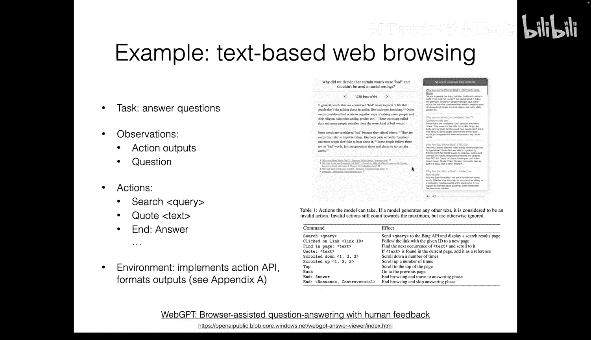

So just zooming in a bit， so they have this public viewer online， which is actually pretty nice。

 but let me just go through this example here。

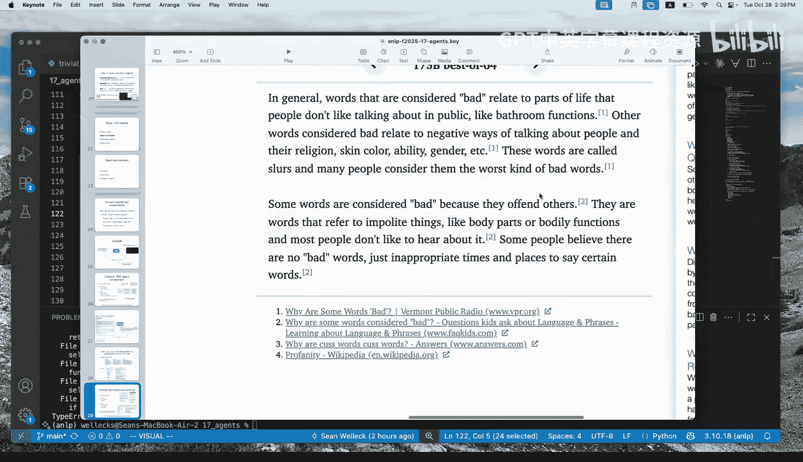

So here it's creating this kind of answer and you can see that it has these citations。

And then their visualizer also shows them kind of which web pages it navigated to in order to produce the answer。

Okay， so this is in some sense， it's not just the language model producing this。

 given its own internal knowledge， it's somehow interacting with this environment that's made available to it or interacting with these tools that it has。

So this was really nice paper and it was maybe like a few years ahead of its time because you could imagine that like a lot of similar tasks kind of fall into this format of going and searching the web for some information and then producing some textual response。

Okay， and then here is maybe relates to the question that was asked。

 so here we are going to do web browsing， but just treat everything as text。

So here you have the H T of a webage。And some instruction。

And then you have different actions like search， choose。I guess choose is like。

Coses maybe like clicking， something like that， but they actually have these custom actions so it's not like a standard web browser。

And so an example is like， I'm looking for a small folding desk。It should have X， Y。

 and Z and a price lower than $140。And now the model has to go look around and then find the desk。

So I don't remember how they handle images here， or even if they handle images。

 but certainly one weak point would be like if you're just looking at the HTML without the images。

 then the model wouldn't be able to kind of use this as it's performing the task。And then second。

 they。Here they kind of designed this custom action space， which might not necessarily apply to say。

 like any web page on the internet。So then if we go to the visual environments。

 so here the difference is。We're somehow providing image observations。

So these ones that we saw earlier， we already saw an example of this。So here。

 the observation would now be an image of the webage versus this kind of textual representation。

So aside from these kind of trivial tasks， people you know。

 built on this idea and then tried to get more and more realistic。So then， here's another paper。

Which has been really impactful visual web arena。So here again， they have these kind of。Tasks like。

 help me make a post selling this item and navigate to it。

 price it at $10 cheaper than the most similar。I don't want the site。

And then here they basically created these fake versions of different web pages。

So it was like a fake Reddit that they were running their。And some other ones like a shopping one。

 things like that。嗯。And then here's their action space， so clicking， typing， things like that。

And then here you can see that they're also incorporating vision language model agents。

 so getting some visual representation of the webage。

And you can see this idea of the model just outputting things as outputting actions as kind of text。

And then finally， for these computer use agents。There's a popular benchmark or environment it's called OS World。

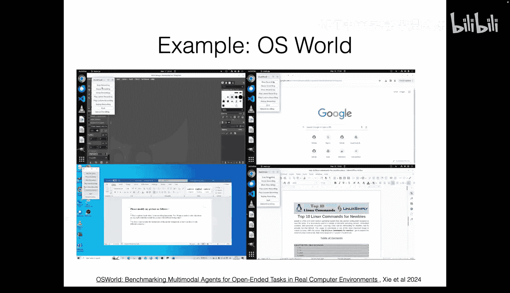

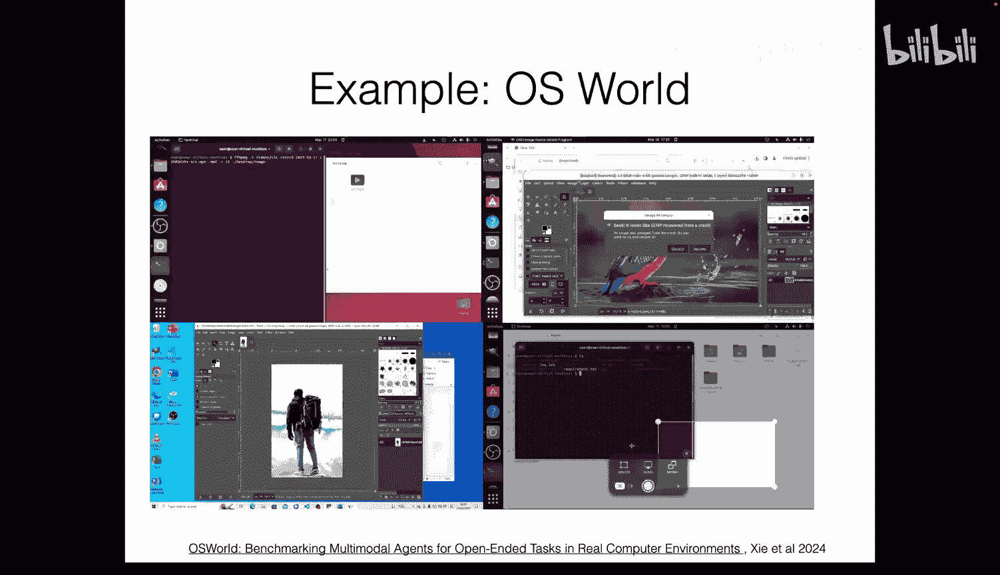

And so what they did is try to go over different types of software on an operating system and try to build a lot of different tasks。

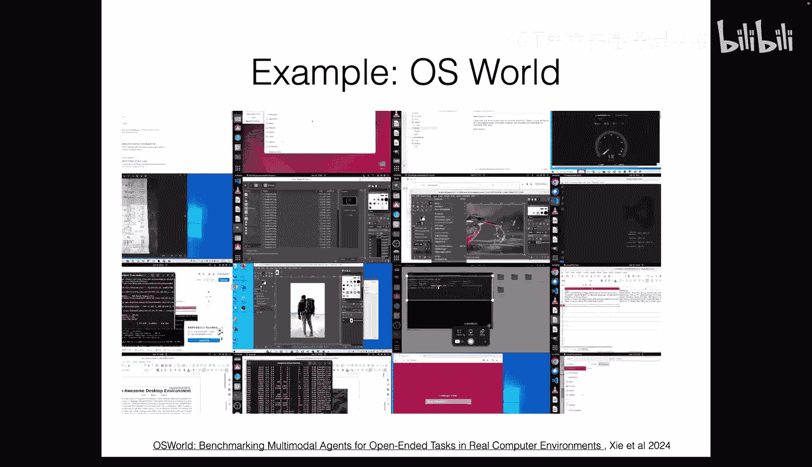

And so for each given one， I mean， if you look at the actual tasks， they're fairly simple。

It might be like。I don't know， adjust the setting in adjust this one setting in Photoshop。

 something like that。But then the idea is like a single agent has to be able to do things from。

 you know， all of these different。Aplications。And then if it solves this， of course。

 you could try to make the tasks more difficult。嗯。So let's take a look here。 So here， for instance。

You have an Excel spreadsheet。And it says update the bookkeeping sheet with my recent transactions。嗯。

So here it's looking at screenshots of like receipts and putting in the results。Yeah， actually。

 this would be pretty useful for doing like reimbursements as long as you can trust it。

And then here it's like tweaking code in this kind of snake setting。Okay。

 so then here you could see the kind of。Set up， and it shouldn't be too surprising based on what I've told you so far。

 you have this kind of initial state， which is setting up the task， then you have this environment。

You have different actions。And then you kind of go in this loop。

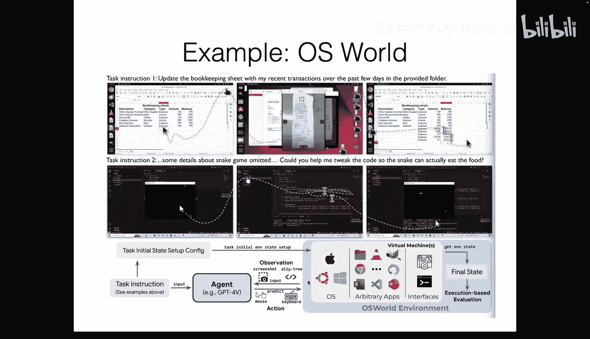

Oh， and then the reward here， of course， like with these really general purpose environments。

 you have to think about how do you provide a good reward？

So here I think for each different tasks task， again， they're fairly simple， so。They could。

 for instance， like write a program that checks whether you some button has been clicked or they can check if they're looking for like the name of a setting or some computation。

 they can look for the correct answer。But in general。

 you do have to start to think about how do you actually build a good reward function for these potentially really open ended tasks？

And then this was just mentor some work that we did， so this was led by Prongel。

 who's a PhD senior in my group。And so we are interested in like， okay， if you take。

 there's been all this work on software engineering agents that are kind of tech based。

So those serve as kind of really strong baselines。嗯。

For this kind of general purpose computer use agent。 and you can ask the question like， okay。

 if you take this general agent and it's just interacting with an I DE like VS code。

Kind of how does it compare to the more specialized agents that are designed specifically for software engineering。

So when we first started this， the peer vision agents。

Were just really bad at this kind of grounding so they basically couldn't click in the right place。

 couldn't type in the right place， things like that， and they were really quite bad。

And then what happened is like the， at least the kind of frontier models， like。Anthropic clo。

 things like that， they've been getting better and better。

 and I think they're designing them specifically for these computer use environments。

And so now you can actually do kind of non trivial things。

 so if you're just working from images and clicking and typing。

 you can actually solve some of the tasks。And then it turns out that the model still struggles with especially like typing in the right place。

 things like that， so if you give it access to just a few different tools like。嗯。File editing。

 things like that。Then it can do fairly well。Then if you have tasks that involve images。

 for instance， like HTML editing， things like that。

 then it's really natural because the model's just observing in the image of it。Okay。

 but then in general， you， one hope for these computer use agents is that you can build a kind of single agent and then it'll work you in all these different settings。

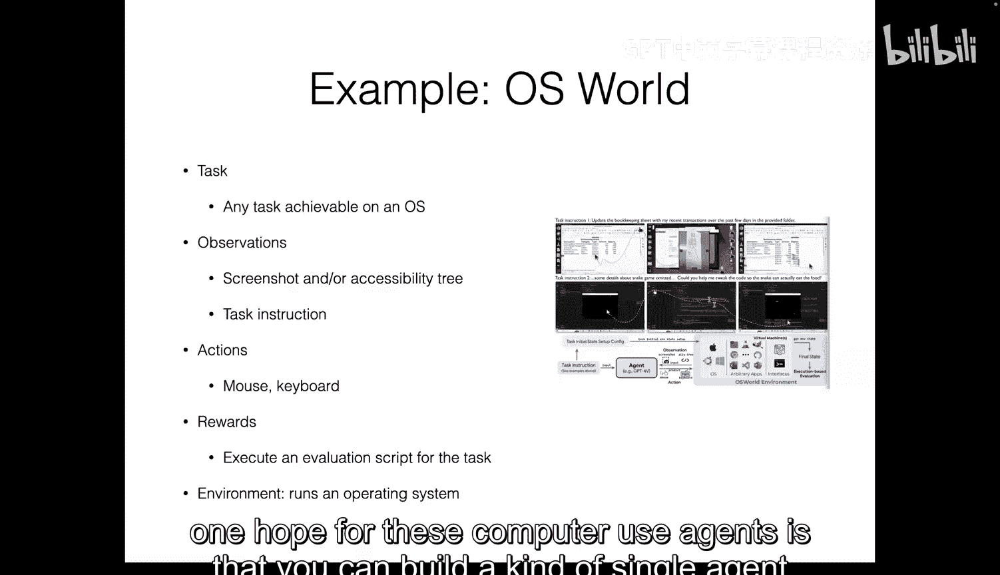

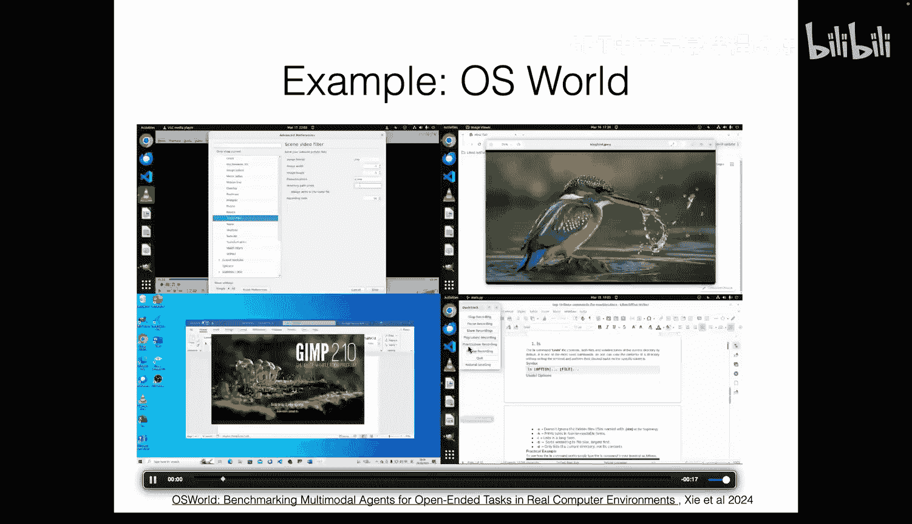

But I would say like in general， you know， if you're going to design these。

 you could think about there being a kind of spectrum behind how much effort you're putting in for your particular application versus like how general of an agent you're trying to build。

 that's something you always kind of need to decide between。嗯。Okay。

 so that was the different environments。 And again。

 just wanted to give you some sense of some concrete examples of。Places these are being used。

 maybe you'll even do your project about them or they're at least good to know about。

So any questions on this before I go to the next part？不 course。Yeah。

 that's a good question so by like kind of by default。

 the environment will have a fixed set of actions。And so the computer use environment might be。

 you know， click， type， things like that， a specific environment for。

Software engineering might give you like different tools。

But then what you can do is and this is like another research area。

 which is like can the model kind of look at what it's done so far and say。

 I want to create a new tool or a new action。Of course。

 then you have to have some way of like implementing that action。

 but it's something you can feasibly do。I like in principle。

When you are designing the application specific as reflect like software engineering there there is no like the guideline on what kind of tasks your actions you want the agent to be able to take it's more based on your design choices。

rather than actually have like if you have if you build software your engineering agent。

 then you go to some other application， you have to like start back from scratch and you don't have any guidelines on what you want to do。

Yeah， I mean， that's a good question。 So， so basically the question is like。

 what actions or what kind of tools do you provide to the agent。

And I would say that like one way to do it is you always have。

Some actions that are fairly general purpose， like。

You can actually do a lot of things with just the ability to run code on a terminal and edit files。

And then。So you try to have like some set of kind of general purpose actions。

 even though it's still somewhat specific to software engineering or like a screenshot action。

 then the model can like do anything with like any image。And then as you like once you have those。

 you might discover that， yeah， maybe for your specific case or if you want to support like debugging like a visual debugger or something like that。

 then that's not supported by your current set and you kind of add them on。But then I would say that。

 like， although they're specific， they are still fairly general purpose。

 If you do have these kind of。呃。General purpose or kind of useful actions。

There's no scientific approach to how you want to design。嗯。Yeah。

 so part of it is insight into the domain。 Another is just the。Availability of。

Different things to have as tools or actions。 So， for instance。嗯。Like for instance。

 you can make a tool for， say， accessing a database or accessing Google search。

And those are just kind of things that exist and then yeah。

 I guess you're still using your insight to say this will be useful for the model and so yeah。

 that is some kind of human insight that's being put into it yeah。嗯哼。😊。

the agent how can understand the what we can do to and fully understand。Yeah， yeah。 Yeah。

 That's a good question。 So how does the agent understand the environment， So I'd say that's another。

Area， which is。Just still an open question。There's a few things to say so like one is if you think about the language model or the vision language model。

 it was probably pretty trained with different types of tasks in mind， you know。

 like maybe you trained it on a bunch of HTML text on the internet。That's been like parsed。

 then that's a bit different than actually like taking actions in some environment。

So it seems like probably some pre training， which is specific to these different agentic tasks。

 would be helpful for them adapting to some new environment。

And then another thing is like for a given environment that's pretty complex。The thing is。

 is that like， yeah， you might have to do kind of non trivial interaction to find。

Like interesting functionality like in VS code you can kind of click the things that are obvious but then to like really use VS code you have to kind of know how to perform some interesting task in some sense and so that idea of like exploring the environment is also there's not like a single solution to it or anything。

 but it's just a problem。Yeah。Okay， great， yeah， these are great questions and I think we should have time to get through everything。

 but yeah， let me go to the next section。So here's three different patterns that i'll talk about so the first is。

Pretty straightforward， but I guess important。 So it's just the use of chain of thought。

 So here we will prompt the model to。Or train the model to output a thought prior to taking an action。

See you might have noticed in the example before the model kind of had this thought and then it issued an action or here's like an edit action。

And so if you kind of want to think about this， then you should maybe like。

Be careful to think about what's happening。So here we could now say that the or you could view this in a couple different ways。

So here you could say that internally this policy is generating some thought and then it's still just producing this distribution over actions。

But then if you take this view， then。This。You might not like train the model too。Generate the。

Let me just show this example， so also you could view this as the action decomposing into two different parts。

 so now you have a kind of joint distribution over thoughts and actions。

And so then what I was getting at is you can decide like。

when you go to apply a loss when you're training the model。

Yeah it can be over just the actions or over the thoughts and actions。

 typically it is over the thoughts and actions and then typically the state。

 you're not training the model to like predict the next state or something like that。But anyways。

 the simple idea is to basically incorporate these chains of thought prior to taking actions and it seems to help。

Okay， next is what we might call scaffolding。So we saw this in an example of this actually in this really simple agent where we had to write some code to actually like parse the output from the model and issue the right action and things like that。

And so scaffolding would refer to kind of all the code that structures how the agent or how you kind of use a language model to operate as an agent and interact with the environment。

So typically， this involves some loop of like observations and actions。嗯。

It involves defining the different actions and their formatting and their syntax。

It involves the state management between turns。So in the simple example。

 I was kind of appending the state into that history。And then formatting it for the model。

 and you kind of have to do that。And then also having some system prompt。

 which is kind of defining the model's role and its different capabilities。

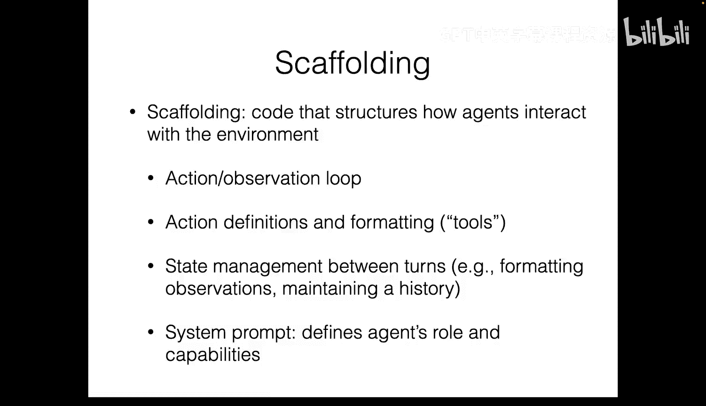

So an example of this is this。Project called Open hands。 So this was started by。Graham。

 who's a professor here as well as a team of some other people。

And so here they were trying to make this kind of open。

 you could view it as being kind of scaffolding for these code agents。And it's open source。

 so you can look at exactly what they're doing。And so this was taken in February。

 so maybe it's changed since then。But up here is the system prompt， and it's actually pretty short。

 So it says you're an open hands agent， a helpful。AI assistant that can interact with the computerh blah。

 blah， blah。And then here it's describing the different kind of tools or different actions。

So this one is like execute a batchsh command， long running commands。Anyway， anyway。

 some documentation。Here it's saying for this browser。

 there's these 15 different functions that are available， go to， go back， go forward。

 and then showing some examples。Okay， and then also they have this loop of， you know。

Let's say you go to some URL。 Well then they actually have to implement like， you know。

 calling the web browser。Getting the result， formatting it， providing it to the agent。

 things like that。Okay， so the reason I'm like identifying this is it ends up being important how you kind of build the the scaffolding and it can kind of either make the agent really general or can kind of limit the agent based on。

What's。Kind of what is surrounding。The actual calls to the models。

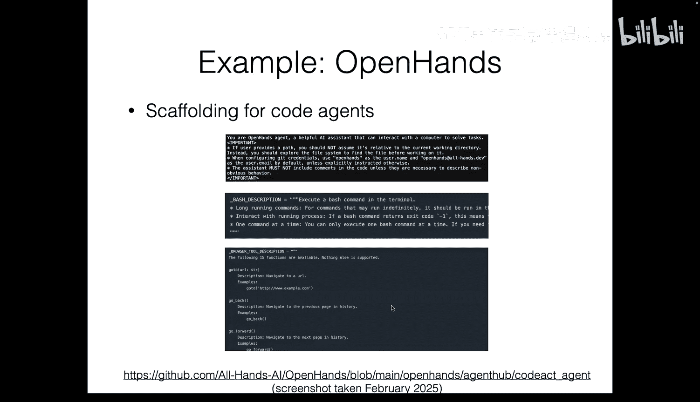

嗯。Okay， and now so a few times I've mentioned this idea of tools。

And I kind of think it's useful to think of two different perspectives and they're kind of complementary or they're often。

The same。So so far， I've been talking about this perspective。

 which is really close to what we're talking about in reinforcement learning。

So here you have this loop which involves observations and actions。And it's described here。

Another perspective is。You might call it a kind of augmented language model perspective。

So here you have a language model and you want to augment it with these additional functionalities。

 like these additional external functions。And so each external function， you could call a tool。

 so you might have a calculator tool， search engine tool， database。And so again。

 you can kind of frame this as an environment in an agent。

 but it's useful to also just kind of view things maybe from a different perspective of like you have a model and you want to kind of add on these external tools。

So this turns out to be a really kind of useful perspective and it's actually been implemented in these different commercial APIs even。

So basically what you want to do is come up with some consistent interface for specifying what a tool is。

Then someone implements the tool and you can kind of get the output in a standardized way。

So this screenshot we'll go through the example and the next slide is from Open AI and。你啊。Again。

 it's from last semester， so maybe they updated it， but I think the concept will stay the same。

So here the developer would define a tool as JSON and we'll see an example。

 but you want to define this kind of get weather tool。And it takes in some location。

You want to somehow provide that to the language model。

 Now the language model knows that it can call this Getwe tool and it knows the right syntax for it。

Then the model can actually generate a tool call， which is。

 again just some text which is in the correct syntax， but you know that it's a kind of tool call。Now。

 the developer or what I've been calling the environment can kind of execute the tool call and then send the output and the model could have。

You know， the weather and then decide what to do with that next。

So then here's a concrete example and again it's a bit small。

 but so one way to standardize this is to have a kind of consistent JSON schema。

So here they have a function that's being defined， it's called get weather， you have a description。

 and then you have the different input arguments， so the location is a string。嗯。The unit。

 and you could say like which one is required。Okay， now if you're designing an LLM。

 you have to basically train the LLM so that， I mean。

 you ultimately need to represent this as some kind of string and then you have to train the LLM so that you know given some description of a tool。

 it then knows how to call the tool， if that makes sense。So then here's a actual tool call。

 so the models produce some text and then you could be represented as JSON again。

 so it's calling get weather and the argument is Paris。And then here's the result being sent back。

 so it says weather in Paris。2 he degrees partly cloudy。Okay， and then the thing is。

 is that like this is pretty general when you think about it instead of get whether you could have a lot of different things。

 you could have。You know search the internet， you could have run code， things like that。

You just need some way of kind of implementing it and then your model too。

Kind of understand the new tool description and then use it effectively。So again。

 you'll see this in these different commercial APIs nows nowadays or commercial models。

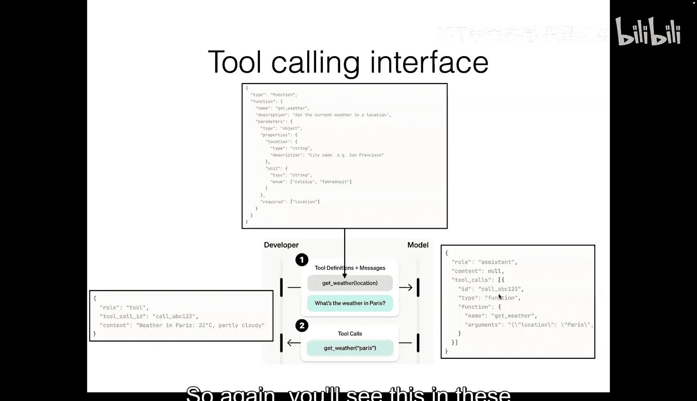

Then this is another interesting example， so the companies are now developing these computer use models and if you look at what they're doing exactly。

 then typically they're not just you clicking and typing， they have some additional tools。

So for instance， here they have these like a string， replace， insert， create， I think。

 create these kind of file tools。And then they also give it kind of bash tools， whereas， you know。

 in principle， the model could like open up a terminal and type and execute things。

But at least in this case， they're providing it with these kind of fairly general purpose， but。

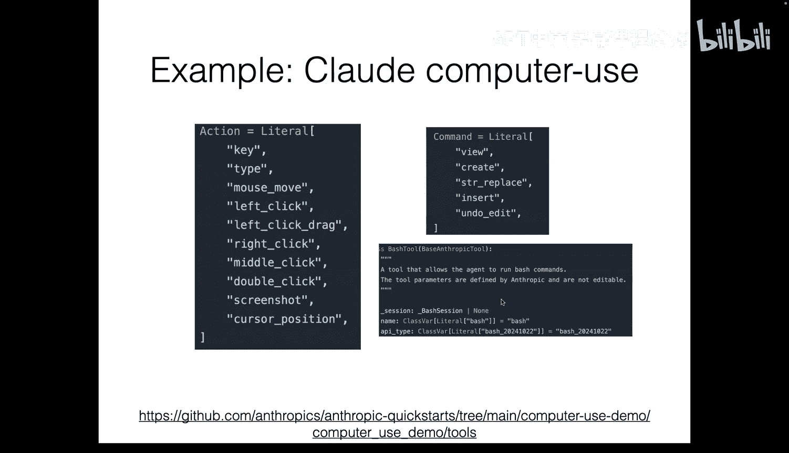

Other kind of tool calls。Then here's just an example。 and again this is from a few months ago。

 so the model's probably gotten better。But then here's an example of this cloud model。

 which at the time was the kind of state of the art computer use model。

 and here it is kind of editing code。2 fix and error。

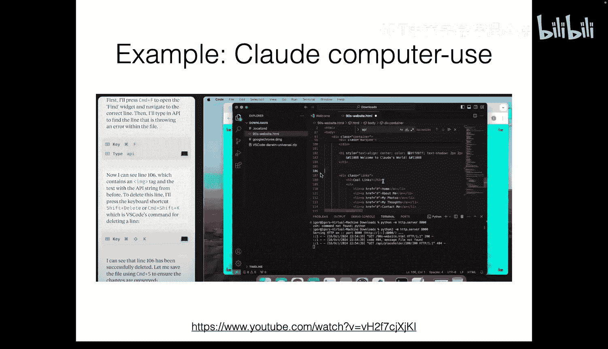

Okay， does anyone have any questions about。What I just discussed， and then we have one more section。

Yeah嗯。So I'm looking at this from safety perspective。

 so it seems that to make sure that the model vector the agent doesn't do anything harmful。

 you're goingt to limit the actions。But。Are there any other studies that look at this from a different perspective。

 because you can use the same actions to perform something harmful。嗯。Yeah。y， so。I mean。

 I think any given action set if your environment becomes non trivial， it gets。

It gets really tricky to rule out all harmful behavior。 So here it's maybe more about like。

If you have a software engineering agent， then you don't necessarily need a tool about。嗯。Or right。

 like sometimes you define the tools， not because it makes。

Not because it reduces the chance of like a safety violation。

 but because it's either very general purpose or it's kind of specific to the domain。

And then for safety there's probably a wide variety of approaches see yeah one would be if some specific actions are particularly risky then you could like remove the action。

 but then in general， especially if you're training the model with reinforcement learning。

Then it gets very tricky to avoid the model finding some sequence of actions that that is safe。

 So it's very much an open problem， especially。As the agents get more and more general purpose， yeah。

Okay， so now on the note of reinforcement learning。

 we could take a look at some differences with what we've talked about so far are mainly differences with the previous lecture。

 which was focused on text generation。So really， the fundamental difference is that now we have an environment which is in some sense kind of meaningful。

So I don't have the equation here， but if you remember with text generation。

 the environment was kind of silly in some sense， it was just appending the previous token to the tokens generated so far。

And then at the very end， maybe the environment actually runs the reward function。

But now we have these meaningful transitions between the states。 So， for instance。

If our action is search， now the environment in the next state is actually coming back with some search results。

 And so there's kind of new information， kind of nontri things happening in these transitions。

Similarly， if you click， then， you know the computer is actually executing something and then giving you the next screenshot。

So then really you want to frame this， you no longer want to use the one step MDP that we've been focused on。

And you really have to consider multiple steps， so this will really be the key difference。

 kind of multiple step reinforcement learning or multi step MDP versus the one step。

And then there's other things to consider， so another thing is these environment interactions can be expensive remember before we were just kind of appending the previous token。

Now you're actually， you know， running a search engine or sorry， running a search query or you know。

 clicking something on。You know， an actual device that's running， things like that。

And so just rolling out a trajectory in the environment now becomes kind of expensive and you have to factor that into。

The implementation of the algorithm or kind of the feasibility of different approaches。Also。

 this is just a general statement， I mean I guess you could have long really long tax generation tasks。

 but to really solve some of these environments。Like I think there's a question about like how do you fully explore an environment you know？

Take a computer use environment， for example， then you can easily come up with a task that would really take a long time to。

To complete。 And that would just be one trajectory。 And so it's a bit different than say， like。

 here's a。Here's a high school math problem， just generate some text and kind of solve it。

So then here I want to just provide a case study that was recent so this。Came out。

 this paper came out， you know。Barely recently， I think in the past month。

Just so you can look at something that people are doing right now。

So here they are basically trying to apply this kind of GRPO recipe to the computer use agents。

And so again， these examples are not like solving the problem of RL for agents。

 more just showing you an example of。Things that people are doing。So here again。

 you have this formulation of having some task instruction and some screenshot， possibly the history。

 and your action will be as I mentioned before， you know， not just clicking。

 but also this chain of thought。And so then you can actually roll out a trajectory in the environment。

And again， the environment here is going to be a kind of computer use environment。

So here you can see the system prompt that they give， sorry， it's small again。

But it says here's your output format， here's your action space， so click left， double click。

 right single click drag。Key type scroll weight finished。嗯。Okay， so then。

What they do here is use GRPO， but then as I mentioned。

 you have to kind of break it into these different steps now。

So now you want to apply the loss and kind of give the model of the current state and the preceding actions。

And then you have the loss here， which is just over the。Current step section。And then you could。

 for instance， like sum over the different。嗯。Or aggregate over the different states and actions。

So again， the only difference is that， you know in the things we were talking about last time。

 you just had this kind of one output sequence。So， yeah。Then here。

 the environments they're working with just have a single reward again at the end。

And so here they're just using this kind of single advantage that's applied to all the steps。

And so again， this isn't necessarily。Oh， they do have they do have one trick， though。

So in these computer use environments， you could imagine there's a lot of kind of like mundane steps like you know clicking dragging。

 and then there's kind of important ones。And so what they investigated here is trying to get some estimate of the entropy at each state。

So the entropy is you know kind of how spread out the distribution is。

And then only apply this GRPO loss on these kind of high entropy states。嗯。And then the reward is。

 again， they were just using the one provided by the environment。

And then another thing they discuss is this kind of CPU bottleneck in the sense that running one trajectory in this environment involves actually running this virtual machine and clicking。

 dragging things， things like that。And so if you want to do this in reinforcement learning where you need lots of trajectories。

 now you have to think about how to do this kind of quickly and efficiently。So， you know。

 GPUs are always a bottleneck， but then here the CPUs are a bottleneck。

 so they had this kind of cluster of 180 environment instances。And then you have to think about like。

 okay， what's the optimal way of performing rollouts and updating the model。

 you could do it sometimes like asynchronously or you could try to interleave things as efficiently as possible。

So those kinds of things come up。In these kinds of environments。

And then here's just one more example and it's just a screenshot。

 but then here's just showing the idea of。You know， if you want to build。

 say a library to do this kind of reinforcement learning。

 then you have to do slightly different things。So like I introduced Verl last time here now we have these multi turn rollouts。

 like I was mentioning in the agenttic setting it's kind of multi turn。

Then you have to think about like， how do you execute these tools， which the model is calling？

And then， of course， how do you do everything kind of efficiently。Okay， so this is just one example。

 but if you look around now you'll probably notice in different RL libraries。

 it might say like multistep or RL for tool use， things like that。

 hopefully now you have some sense of that。Okay， so that's everything。

 And I think we managed to get through everything today。 So we went over what an agent is。

 we went over some common environments。We went over some of the major design patterns。

And then briefly talked about reinforcement learning。And gave some recent examples， because this。

 as well as a lot of the things I was talking about are kind of。

Rapidly being developed and rapidly being looked into right now in research。So that's it。

 I think we have time for a couple questions if anyone has any。嗯。

Where do you see sort of the main focus of age systems going。

 especially more of this industry application what are has been remaining？每个付款选择个保。嗯哼。😊，Yeah。

 so I think you could view it in terms of like， again， kind of specific agents and general agents。

So for specific agents， there's been a lot of focus on code and software engineering。

 right there's like many startups and the big companies even have like their own code agent。

And so I think the question will be like for different applications。Kind of， can you make a useful。

Agent for that application so I think a good example of that is I think just yesterday hear something anthropic released an agent for exc。

Like Microsoft， Excel， these spreadsheets。And I don't know， maybe it'll be successful。

 maybe it'll be a failure and really error prone and things like that it's just too early to tell and then Excel is just one example there's like a lot of different applications and you could think about like if a given application is important enough。

 then it makes sense to build maybe an agent specifically for the application。

Then you have also the really general agents。Like a computer use agent or web browsing agent where maybe the set of tasks is less clear upfront。

I think what that is a big question is。Number one for these kind of longer， more， more complex tasks。

嗯。There's a variety of challenges， so one is kind of how do you verify or how do you assign rewards for the task？

Again， like you know in a math problem where you have an answer。

 it's clear what the reward is or if you're like having the model compute something with like a spreadsheet。

 maybe you can check something at the end， but in general it becomes really difficult to kind of have a really good reliable reward function for a more complex task。

A second thing is like the more complex tasks are longer。 So then you have to think about like。

How does the model either retain the information that's needed or even kind of learn over time so this kind of continual learning setting。

And yeah， the idea of having an agent that kind of learns continuously instead of this kind of fixed。

 you know， input output setting is still like really open。

And then also like even in the input output setting。

 kind of what's the right architecture for memory or for like compressing a long history into the model。

 things like that。Then maybe one more is like again for a really complex task。

 the problem of exploration， so how do you get the model to kind of do useful things that it can learn productively。

It's still a kind of open question。Mmh。😊，对。There were a lot of books which use a G I be to are there any books which other。

Working on like a research based slippers， you say Monte Carlo research first。Yeah。

 so that's a good question。 So Mon Car research， things like that。So。So well。

 so first with the GRPO and things like that， it might be the case that a lot of the algorithms that were used for。

For this kind of text generation setting are't necessarily the best for the more complex agent settings。

 like maybe you do need some reward at intermediate states and things like that。

 or like just in this paper， they had to do something to kind of just assign rewards to given states。

 So even that recipe is not。Kind of clear out。And then you can consider like okay。

 given some agent how do you kind of use it in Prince time and that's maybe where the MCTS will come in so the MCTS we'll talk about it in a later class is a tree search。

And so to implement the tree。One tricky thing is you need the ability to backtrack。

Or you at least need the ability to kind of run multiple things in parallel。

So those are usually the considerations like。Is it computationally efficient or realistic to run multiple things in parallel。

 that's a kind of naive search just like tribe multiple times。And then for a tree。

 kind of can you backtrack and can you actually do better even if you can。

 can you do better than the naive search this are some of the things that people run into。

But it is tried in some papers。There's a paper from CMU on the tree search in the visual web arena。

I'm creating the exact name of it， but I could send it after and then the general idea of doing this kind of parallel sampling so trying multiple times。

That's very， very common， so you'll see you know pass K metric， things like that。

And there are specific papers about it， maybe that'll actually be in the inference lecture later。嗯。

You use your and stone。But the reward is still at the last step how do they assign rewards the inter。

Yeah， yeah。 So that's what I was mentioning earlier。 it's still kind of。Nive in the sense that。嗯。

Yeah， it's just using the single reward and then applying it kind of uniformly over the outputs。

But then they did thee the step of， they just dropped the loss for some like nonimant states。

 So they look at the entropy of certain states and then only use those in the loss。

But I think the general problem is， I mean， the general problem is called credit assignment。

So given some reward， say at the end of a sequence。Or only some like， you know， low frequency reward。

 how do you kind of。Assign credit to individual actions in the trajectory。 And that's another。

Open problem， I would say like yeah， just using the same advantage for all steps probably won't be the solution in the end。

 but you know I've been wrong before。嗯。Oh， and then before I forget。

 I want to mention another big research direction which was asked is of course safety because like I know like before letting a agent like just use my computer arbitrarily I don't necessarily trust it yet and in general there's just like so many safety。

There's so many possibilities related to safety with these general purpose agents。

 and so I think that's a really big and important area as well。Okay。

 thanks for the great questions and the attention oh I guess we're a bit over time so yeah thanks。

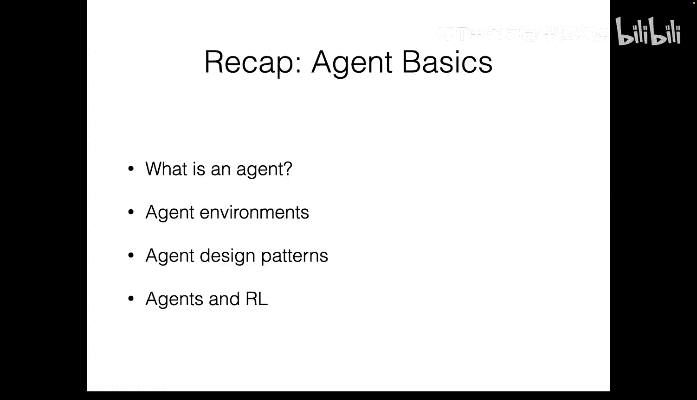