# CMU《高级自然语言处理｜CS11-711 Advanced NLP Fall 2025》中英字幕 - P18：(18)_ Parallelism and Distributed Training.zh_en - GPT中英字幕课程资源 - BV1ZWYAzuEMa

So now we are in this part of the course， which is kind of advanced topics。

 So today we have another advanced topic and it's on parallelism and scaling and specifically。

Let's say that you want to scale up the pre training of a language model。

So we'll talk about some of the key ideas or key concepts around that that are actually just really useful to know about。

 even if you never pretrain a language model， they're kind of interesting concepts and patterns that you'll see appear in other places。

So the content for this lecture， I want to specifically call out because it's very much based on this really nice book here。

So。Basically， there's another startup， I guess you'd call it hugging face。Oh。

 we know about hugging face， you know， because they host the models and things like that。

But earlier this year， they put together this really nice book。Outlining， you know。

 a lot of the topics that we'll go over today。And they actually ran a bunch of experiments where they trained different models with different settings that we'll go over today。

And this would be really expensive for you know any particular individual to do。

 so it's a really useful resource that we have。And so you can go if you want to read more in depth about stuff we talk about。

 I of course can't cover everything that would be in this book。

 but this is kind of the source backing。Orre corresponding to a lot of things we'll talk about today。

So again， as we do a lot in this course， it's kind of giving you entry points going over the key ideas so that if you want to learn more in depth。

 you kind of have a good started place。So with that we can start the lecture so here we can motivate things in terms of pre training so with pre training if you remember we saw this plot and it's a kind of nice plot in the sense that it has some simple messages。

One is that it looks like as we make this model larger and larger， we are getting better loss。

And then also as we train it on more and more tokens。

 we are getting better loss and kind of getting a better model。Now， one thing。

We also talked about was the amount of data that is used to do pre training。

 It turns out that now this is about an order of magnitude off。 So this is 1。

4 trillion tokens of data。 Now models are typically。You know， public basic models。Are reported with。

 you know， say 10 trillion and 20 trillion tokens， so it'll actually be much more than this。

And then you can see here that the model is 65 billion parameters。And I mean。

 you saw on the documentation I was just showing you you could have models withs hundreds of billions of parameters and even more than that。

So then the question is like how do you actually implement those right like trillion is a pretty big number we have billions of parameters。

 how do you actually run this if someone gives you a lot of。Say GPS。So again here。

 the key problem is we want to scale up the training or pre training of language models。

And we want to take advantage of computation on multiple devices。

So your devices don't have to be GPUs， there's also， you TUs。But we're mostly going to focus on GP。

 Kuda GP。And， you know， if someone gives you， say， a cluster of。I don't know，16000 GPUs。呃。

Then it turns out that it's actually non trivial to kind of optimally use all of that computation。

So hopefully by the end of today， you'll see。Some techniques for kind of taking advantage of this compute resource。

And really just at a high level， if we do this， then we could possibly train larger models。

Or given some amount of time， let's say we have a week to pre train our model。

 then we can process more tokens and as we saw in the previous plot。

 that corresponds to getting a better model。Okay so sometimes just training a really good model actually comes down to these kind of systems level questions。

 given some amount of resources， can you kind of use them in the best way。

 just train a larger model or process more tokens， and that'll give you a better model。Okay。

 so then if we think about some different。Factors to consider。One is memory usage。

 so for a given training step of say like a really large model。

 we just need it to fit into memory right， like if it doesn't fit into the memory of say our single GPU then we really can't do anything。

The other is compute efficiency， so say someone gives us 16。

000 GPUs and then we only use and we have a week to train and only say1% of the time the GPUs are actually performing computations。

Then that's a kind of， you know， waste of the resources that we have。

And then related is if someone gives you all of these GPUs。

 then and you're training your model on all of them somehow。

Then there's going to be some communication， so this idea of communication overhead will come up in the ideas that we talk about and it turns out that you can kind of think carefully about it and come up with strategies to minimize this communication overhead that you have。

 which is causing the GP to stay idle。And then again， here's just some broad overview。

 but it turns out that these things can have a large impact。So let's take a look at what is here。

 so this is stuff that we'll go over today and hopefully you'll have a good understanding of what's on this image by the end。

But even without kind of understanding what's going on。

 here is each dot is a different kind of configuration for the training。

And you could see the parameters here， so there's like 32 nodes。Something called MB S 1。

Something called TP2 and so on。And then this one has a different configuration。

And then you can see these different metrics， so this one MFU， and we'll go over this。

 you can see that they're much different for these two different configurations。Similarly。

 there's this metric here， tokens per second， this one's in the millions， this one is like 60，000。

Okay， so this is just trying to give you the sense of。

These configurations or these strategies that you pick can have a really large impact on the amount of tokens you can get through or just more generally on how efficient you're using your resources。

Okay， so the way today's lecture is structured is these。Three different parts。

 And I think most of the time is on the， on the second part。

So first we'll go over the basics of just training on one GPU。

 this will help introduce some of the terminology， some of the metrics that we actually saw on the previous slide。

And then we'll move to parallelization。 So if you have multiple GPUs or multiple nodes。

 what are some different strategies。So we'll go over four of the main strategies。

Called data parallelism， tensor parallelism， pipeline parallelism。

 and these kind of sharding or zero strategies。And then briefly at the end。We will。Look again at。

You know， a similar image where you try a different。

Try many different configurations and try to see whether there's patterns in like what is the best strategy or。

How much gain can you get if you choose the strategy Well， things like that。嗯。Okay。

 so first we'll go over training on one GPU。And so if you kind of think， you know， abstract out from。

The training procedure or fine tuning procedure， which you've seen now and like implemented now。

 then you have these kind of major parts。So first of all。

 you have your model here on the top and the model consists of different layers。

 so we're visualizing the layers horizontally。And then you have the forward pass and you have the backward pass。

So again， the forward pass is kind of performing the computation in the layers and then your backward pass computes the gradients。

嗯。Then we have the optimization step。 So this would be， you know。

 applying your algorithm of choice like Adam， for instance。And then after doing that。

 you now have some updated parameters or some updated model。Okay， so nothing crazy going on here。

 but we'll kind of use this diagram。And the to introduce the following ideas。

So then we could think about two different aspects。

 we could think about the computation that is being performed in each one of these steps。

And we can also think about the memory requirements。And so we'll go over two strategies for memory。

Called activation， recomputation or checkpointing and gradient accumulation。

So first is compute or the computations that are actually being performed。Well， so what is compute。

 so we could think about it as these floating point operations being performed。Right。

 like if you're doing a matrix multiplication， then you're doing these different floating point operations。

And so what we could think about is like how much compute is being performed in this forward pass and the backward pass。

Now we actually went over this really quickly in the pre training lecture when we talked about scaling laws。

This is a kind of approximation that people use， so if you have a transformer language model。

Then you can kind of roughly approximate the number of floating point operations that are used using this formula。

So you have six。You have the number of model parameters。

And you have the number of tokens that are being processed。Because if you process， you know。

 transformers are kind of parallel， and so here you do have this dependence on the number of tokens that are being processed。

Now， this actually comes from this paper from Open AI on scaling laws from 2020。

So you can go in their appendix and you can look at what they do to come up with this approximation。

So you can start off with like you know the different layers that are in a transformer。

 and then you can just compute exactly how many floating point operations are being computed。

And so other papers will have different approximations。

 but this one is actually widely widely used and。It's kind of simple to think about right it's just six times these two different things。

 so you have the size of the model and you have the number of tokens being processed。Okay。

 now there's this distinction and sometimes it's written different ways。

 but I'll just write it this way for this lecture， so you have floating point operations and then you have floating point operations per second。

And if you think about it， then operations has an S at the end， so sometimes you see this as flops。

 but here we'll just write flop and then floating point operations per second will be called flops。

And sometimes I might mess it up， but hopefully from context， it'll be clear。 So here at the bottom。

 we have， you know， some notion of。Given some。Time， so given seconds。

 how many operations are actually being performed？Okay， so。This becomes relevant when we think about。

 actually executing operations on a GPU in a given amount of time。And so here comes in this metric。

 which we saw on that visualization slide。Called MFU or model Fop utilization。

So this will essentially measure how effectively you are using the available compute during your computation or during training。

Okay， so what you can do is for a given GPU， you can actually look up theoretically what is the most flops that you can do on the GPU。

So just like theoretically， for this hardware。What are the most computations you can do per second？

Okay， so then this is like I actually went to the H100 documentation and you can look this up。

So you can see that it varies based on the data type。So in the next lecture on quantization。

 we'll go over these data types in detail。So don't worry if you don't know the the details of this。

 but for this lecture it is helpful to know that， you know。

 you have to pick a certain data type for representing numbers。So you could represent them。Well。

 FP 64 is not widely used， but you could represent them with。F bytes， so FP 32。

 or you can also use 16。And then the GPU has to basically implement each you know the operations for each one of these things。

 so that's why it's varying。嗯。And so anyways， you can actually look up the kind of theoretical limit of the device。

Then you can actually perform some training or perform some operations and measure how many flops were actually performed。

And then you could say like， okay， how efficient was it in the sense of what is the fraction of the theoretical peak？

That we achieved。Okay， so then on that visualization。

 we saw that these two different configurations had much different MFUs。

 so one was utilizing the compute much better than the other one。So then the question is like。

 why are things less efficient than others and maybe it's like a big question。

 but here's actually like three different factors that can come into play。So one is communication。

So if you have multiple devices， then you can spend time sending data to and from one device。Um。

 or if you have to like write to different types of memory， then you can lose lose time doing that。

That's kind of a memory related to this memory bandwidth。

And then also you could have idle time for a variety of reasons it could be due to communication。

It could be due to other factors as well。Okay， but this is one metric that you could use MFU。So。

Now we'll start to go a bit into more details， but maybe I'll pause just if there's any questions so far。

是。What so。Yeah， so so again， this is just some approximation so you can go through and compute the the actual floating point operations。

 you know， given the layer types。And then。It's just， I forgot the exact argument。

 but you kind of look at the formula and you say like， oh。

 we can replace all of this with this constant six， something like that。So again。

 it's a rough approximation， but it turns out to be a useful one。So when you compute the slopes。

Would did that depend on like the model we are using because like if we use a transformer we have like all that information at the same time so we can just like compute in or like the phonenet notification at the same time。

 so if we use a transformer we get like a faster computation which it's like same efficiency but we use L NM then like that's。

Yeah， yeah。 so it does it depend on the architecture so so yes。

 so then the the things we'll talk about here is。You have a fixed architecture。And you。

Want to just change the way that it is kind of executed on devices。And。

How you do that will actually change the efficiency or the flops， yeah。Okay。Okay， great。😊，Okay。

 so then so I mentioned memory usage so then we could think about where memory is using。So。

It's used to store the weights， the gradients。If you remember Adam。

 so hopefully you have a good understanding of。Of Adam after doing the homework。

Then it it has to save these kind of per parameter statistics， right？And so when you think about it。

 that's actually kind of expensive， so you also have to think about the memory that's used to save these optimizer that you could call them optimizer states。

And then're performing as you're doing the forward pass， then there's these intermediate activations。

And so you can imagine those can also grow very large and so you have to factor those things in。

And then at the end of the day， everything is these kind of tensors。So。You know。

 you have the batch dimension and you have your hidden dimension and you have your sequence dimension。

And you'll have a particular shape。For the weight matrix or the activations。

And then each one of those things will have each element is some number。

 and then you can represent the number with some level of precision。

And that will impact the amendment memory that's used。Okay， so then we could consider。

 we have to factor all of these things in。Because they'll have an impact on the memory usage。

So here's another approximation so we could consider how much memory is being used。

So here we have the。You know， this kind of equation with five different terms。So。

This is this maybe requires some background to talk about。

So one thing that is done is when you're performing training。

You can do some operations in a lower precision and some in a higher precision。So for instance。

For a given batch of data， you might perform the forward pass and the backward pass， let's say。

 in the 16 bit precision。The 16 bed would use two bytes per number。

 so that would have lower memory requirement than using 32 bits。Okay。

 but then what happens and again， we'll go over this in detail in the next lecture。

But what happens is like at a lower precision， you can't represent the same well the same precision of numbers。

 so if you have like really small numbers， things like that， then you can get errors。

So it's common to keep a copy of the model in higher precision。

And let's say you're aggregating multiple gradients from multiple batches。

 then you might write those to like this higher precision copy of the weights。Similarly。

 you might have like really small numbers for these optimizer states and so you store those in a higher precision。

So here's one example of what you might have。 you have this。This B F 16， so 16 bit copy of the model。

And that will again be two bytes。Times the number of parameters。

If you have a 32 bit copy of the model， that'll be 4 bytes times the number of parameters。Similarly。

 you have to do that for the gradients。And then you again have these optimizer states。

So for instance， for atom， you have two different states that you keep。

 so that'll again be four bytes for each parameter。Okay， so there's actually a lot of memory usage。

 It's not just the， it's not just the model you have。Kind of a lot of different usage to account for。

Okay， so now the equation appears pretty simple， it's basically just summing these things that I talked about。

And then you also have these activations。That you're。

That you have as you're performing the actual computation。嗯。Okay， good。So。Then of course。

 you can actually measure like what is happening when you are doing the training so you could actually see the memory usage。

 you know， it's a real thing。So here's just the visualization from the book。

 and they're looking at these the training steps of Lama 1 B。

And then each color is a different type of memory usage。So here we have the parameters。

 which are kind of loaded in the entire time。We have the optimizer states。

So maybe initially they're not initialized yet。And then you have the gradients in orange and the activations。

Here。And then there's some like a unknown， there's some other stuff。嗯。Okay， so。

 and then you could see it varies， right， So if you do a forward pass and a backward pass。

And in an optimization step。So。Then you could say like， okay。

 you have these fluctuations and at you want to consider like at the maximum point。

 what is the maximum that。You can do the training or're fine tuning with given your compute resources。

And at a first glance it's kind of depressing in some sense。 So let's look at what we have here。

 So let's say you get an H100。You know， decent GPU。 and it has 80 gigytes of memory。

Let's say we have this1 billion parameter model。And we do kind of what I was saying before。

 So B F 16。 And then you do the the gradient accumulation with。FP 32。

Then that will require 16 gigabytes。Oh， sorry without。

 if you add in this FP 32 gradient accumulation， now you're up to 20 gigabytes。

And I forgot to put the batch size here， but this is like with a given batch size， right？

Then if you go to 7 billion parameters， you're already at 140 gigabytes， so you already can't。

Train or fine tune the model on this H 100。And then just like， this looks just impossible， right。

 You're at。8，100 gigabytes with this 400 billion parameter model。

So we have to think of some way of getting something more favorable than this。So first， let me just。

Let's think a bit more carefully about what the batch size is。嗯。So。

One option is to just reduce the batch size。 So I apologize for not putting the the。嗯。IP it here。

But if you want， you can reduce the batch size and this will lead to some different trade offs。

So just roughly speaking， the small batch sizes in some sense adjusting the parameters。

Quickly are based on smaller amount of data。But it could introduce noise。

And then if you use a large batch size， then it's kind of averaging together gradients from many examples。

And so hopefully it's a better approximation。And then if you just think of this in terms of like processing tokens。

Then。呃。It leads to fewer steps on a given data set。

So let's say that like performing the optimization。Step is pretty expensive。

Then you can just process more tokens in a given amount of steps by just increasing the batchsh size。

So typically you don't see these really small batch batch sizes for pre training。

 you'll see ones that are like four or even 60 million tokens per batch。嗯。So。Hopefully。

 that gives you some sense of like this dispatch size in terms of tokens will be kind of non trivial。

Of course， if you make it too large， then you'll。Get out of memory。

 and this is due to the activations。 So you're actually performing the computation with multiple things in a batch and you'll get out of memory due to the activations。

Again， here you can see the activations are pretty large。So well。

 this is a whole slide about it actually， so then if you want。

 you could consider what are the different factors in the memory that's used for the activations。

So here's an equation this is from the book。And maybe there's two interesting things to note here。

So one is you can see that it's linear with the batch size。

 so as I was saying before as you increase the batch size， that is going to increase the activations。

And then you could see that the sequence dimension here。It actually appears in two different places。

Here you can see this there's something about heads。

 so this is the sequence length factoring into the attention computation。

And then here it is kind of factoring it into the number of tokens that are being processed。

 you could view it as being kind of batch elements。

So you can see here that it's kind of quadratic in sequence length。

 so this is a really big issue if you want to train a model with really large number of tokens。

And in fact here， empirically， you can see that it's very real。Here， if we have， say， 16，000 tokens。

 then the activation memory is just massive。It's actually dwarfing all of the other sources。Okay。

 so if we can somehow reduce the memory requirements for the activations。Then。These at look smaller。

 maybe there's a kind of more hope。嗯。So it turns out that there are tricks to save memory here。

So one is called activation recomputation or activation checkpointing。

So if you think about how you perform the forward and the backward class。

Then it turns out that to perform the backward pass。

You often have to save the activations from the forward pass。

If you think about what's involved in the back propagation。And so the activation recomputation。

Will basically recompute the activations。嗯。As you're doing the backward pass。Okay。

 so like looking at this diagram， when we do the forward pass， you might save some。I mean。

 they're called checkpoints。 That's why it's also called activation checkpointing。

 Let's say you checkpoint the。Activations from here and from here。

Then when you're doing the oh sorry， let's do a more interesting one， like here， here and here。

Then when you're doing the backward pass， you have to go back and recompute this one。

So what this does is it increases the amount of computation that you're doing because you have to recompute the activations。

But you don't have to store all of the activations in memory。

And so you have this trade off right between compute and memory requirements。Okay。

 so that's the basic idea of。The checkpointing or recomputation。

And you can see that this can actually have a huge difference。Let's see here。

 so here's without recomputation and then here's with recomputation。

Here you can see that there's different strategies， so when we looked at this diagram。

 I kind of just picked you know a couple layers to checkpoint。

But you could have different strategies and， you know， different strategies will。

Have different compute requirements。嗯。So。Here's one。

 and you could see that there's a huge reduction in the memory requirements。

Probably it can increase the runtime rate because you're doing more computations。But now， we are。

Well below even 50 gigabytes， so much better than before。嗯。Okay。

 and then there's one more trick you can do， which is we can just kind of reduce the batch size。

So what you can do and this idea will come up later as well。

What you could do is you could just split the batch into smaller batches called micro batches。

So let's say we start off with 10 million tokens in our batch。

Why don't we split them up into say1 million tokens？

And what you do is you just do the forward and backward pass on a given micro batchch。

But then you don't update the model's parameters。 You just save them。

Then you move to the next micro batchch， do the forward and backward pass。

And then what you can do is you can just add together the gradients and divide by two so you can take take the average。

Okay， so what this has the effect of doing is。You can kind of artificially increase the batch size。

By just processing multiple micro batches and then averaging the gradients together。嗯。

Let's take a look at the visualization as I'm talking， it's hard to process the visualization。 Okay。

 so here I think what they're showing is they have three different micro batches。

And so it's just visualizing doing the first micro batchch， the second， the third。

 and then averaging the gradients and doing the optimization steps。Okay。

 so can anyone tell me the drawback of doing this gradient accumulation。

Or did anyone have any questions about it。 was it like。If it's not clear。嗯。😊。

have about the import wooden blocks or the important blocks。So this would be the whole model。

 so you do a forward pass and you do a backward pass。对。怎么的？那是。We要找个场嘛找。

Transform the full architecture， yeah。你啲特警歌咧。Deder only， yeah。

So what's the one not the bad says is what？Let's say that we're using based on this other slide。

40 million tokens。嗯。Order order of the F， they say， is it 100 or 10 or10？Yeah。

 it could even be a million tokens at the pre training scale。Yeah， and so the idea is， if you。

 if you have this really large batch size because you want to process tokens quickly。

 then it's not going to fit in memory。So this is one trick you can do。

 you can basically break it into smaller batches。And then process them sequentially。

So what would be the downside of this， it seems pretty good。We can have kind of constant memory。

我 think啲你出咁都。因为佢唔咁决个。Yeah， so what happens is here what we're doing is。Let's say our batch size is。

 but let's use a smaller number。2048。And we break it into。the mini batches of five hundred twelve。

Then we'll have gradient accumulation of4， right， so we'll have 512 times4 is 2048。

Then what this diagram is basically saying is we want to do one forward pass and backward pass。

With 512 batch elements。We wait for it to finish， then we do another forward pass and backward pass with 512 elements。

We wait for it to finish and then。You do the third and the fourth。

So basically the downside of this method is you are doing things sequentially。

 you are only processing these micro batchches kind of one after the other。

So in the methods that follow， we'll come up with ways of kind of doing this in parallel and it'll be faster than using the gradient accumulation。

嗯。But as we'll see later， this is still。Kind of used。

 and it's one parameter you could decide like what is the level of gradient accumulation that you're using。

Okay， so again， this is just focused on a single GPU。But along the way。

 we were able to see some kind of important ideas。First， we saw how to measure compute efficiency。

In terms of this MFU and measuring compute in terms of flops。We saw the sources of memory or。

Things that require memory as you're training the model。And then two different kind of strategies。

 activation， recomputation， and gradient accumulation。If you do this， again。

 you can train with a larger batch size so you can process more tokens。

Or you can increase the size of the model。That you have。Okay。

 so any questions about these things before we move to the next section？嗯哼。😊，St hard。

The activation after we have done the backward propagation on this specific layer。Yeah。

 you can discard it。Yeah。So yeah， you'll have to save the the checkpoints and then the。

Part that you' are currently computing， and then you can discard。Ths that aren't used in the future。

W want to do radio and communication。So。It seems like for you to store。4 gradients。

Four times theiness if we just compared with the。Yeah， that's a good question。If we go back here。

 then。What is typically done is you set aside some memory to store your gradients。

And then since you're just taking the average， you can just add。Like as you're doing each mini batch。

 you just add to this buffer。 and then at the end， you divide by the number of mini batches。So， yeah。

Right， yes。Exactly， yeah， yeah。 So you're kind of accumulating it in the buffer and you normalize at the end。

Okay， and I should say gradient accumulation， it's actually very simple to implement and you don't it doesn't have to be pre training。

 basically any training code you can have you can。You can kind of implement gradient accumulation and it's very。

 very practical technique。I probably should have had a code example。

 but it's just a few lines of code in a normal training loop。嗯。

So it's definitely something good to know about。嗯。Okay， so now if we move to the multiple GPUs。

We will come up with different parallelism strategies。So there's several different strategies。

 there's actually more and we'll see two more actually in the future lectures。

 but we could just get started because there's a few。So the first one is called data parallelism。

And here now we have multiple GPUs。And we'll use the following strategy so we will replicate or make a copy of the model on each GPU。

So let's say you have four GPUs， you'll have four copies of the model。

Now we again have this notion of micro batchches similar to gradient accumulation。But instead。

 we're going to send the one micro batchch to each GPU。

Now you could perform the forward and backward passes。

And then you can kind of communicate and average the gradients on each GPU。

So that was some kind of hand wing， maybe it's useful to also see one of these diagrams。So again。

 you could see that it's similar to gradient accumulation。

 but now we have each micro batchch being processed on a different GPU。Okay。

 so this will allow us to leverage parallelism。Because they're performeds at the same time。

And then we'll have to somehow communicate the results so that each copy of the model is updated for the next round。

Right， because you have a copy on each GPU， but it has to aggregate these gradients from the three GPUs。

So。It turns out that you can actually like think about how to do this and even improve it。

So here is the most basic way of doing this。So what you can do is you can have。

You can do the forward pass。And here this is showing the different layers of the model。

 let's say we have three layers。Then you do the backward pass and backward pass kind of goes backward through the model right。

 so you have layer  two， layer 1， layer  zero。Then after this has been performed。

 you do this communication I was talking about。So you take the gradients from the different GPUs。

 add them together， and divide。So this communication step or this specific one goes by the name of all reduce。

So the reduced operation will be taking the sum across the gradients from multiple GPUs。And then。

All means that like it's a kind of all to all operation。So。If you haven't seen this before。

 then this all reduce is kind of one type of communication operation。

So different libraries will implement these and then you kind of need these operations to implement the actual kind of training code。

So a really simple operation is this kind of like one to one operation。

Where you're like sending a message from one device to the other device。

You'll see this word called rank come up and this is like the term that's used to refer to kind of different logical devices。

Could be a process， whatever。

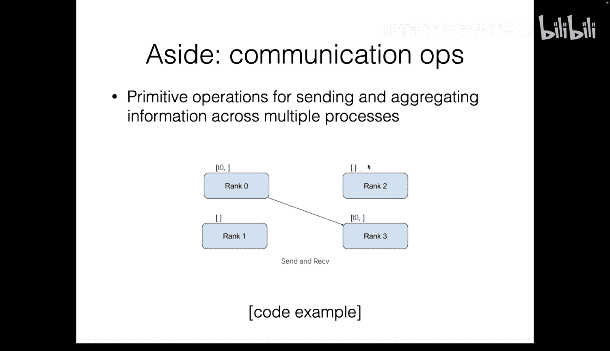

So here， the Pytorrch documentation actually has some nice。

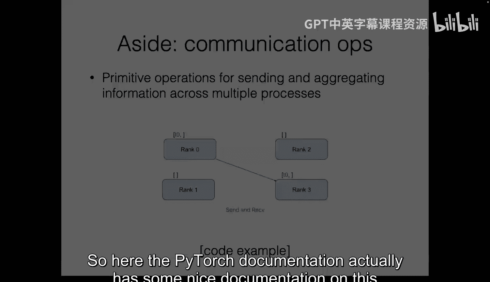

Documentation on this， and。I'm not going to be able to go through all of them。

 but I thought I'd show this to you and then you could go in and learn more if this is interesting。

But here is basically just showing this communication operation。In a kind of multi device setting。

So here the device is going to be a process on my laptop。

 but what you can do is you can just change this backend to say like couda。

 if you have multiple GPUs。And then at least in principle， the coach you run。

 maybe you have to change a couple other things。But。Yeah。

 so basically here we're initializing this kind of group of processes。

And then here we have some code to communicate。So here we take in the identifier of the rank。

And we're going say like， okay， if it's the first rank， so rank  zero， then we're going to send。

Some tensor to the other process。I don't know why， but it's just because we're showing these operations。

 So you can see here that like。This distributor library has implemented this as a kind of primitive that you can use。

On the other hand， if you are process number two， then you will kind of receive the information from process number zero。

And if you're some other process， then you just do nothing。So then you can。

 let's say you run this and。Hopefully it should work。Okay， so here you could see that。At the end。

Rank0 and rank1 both have thisor tensor one。

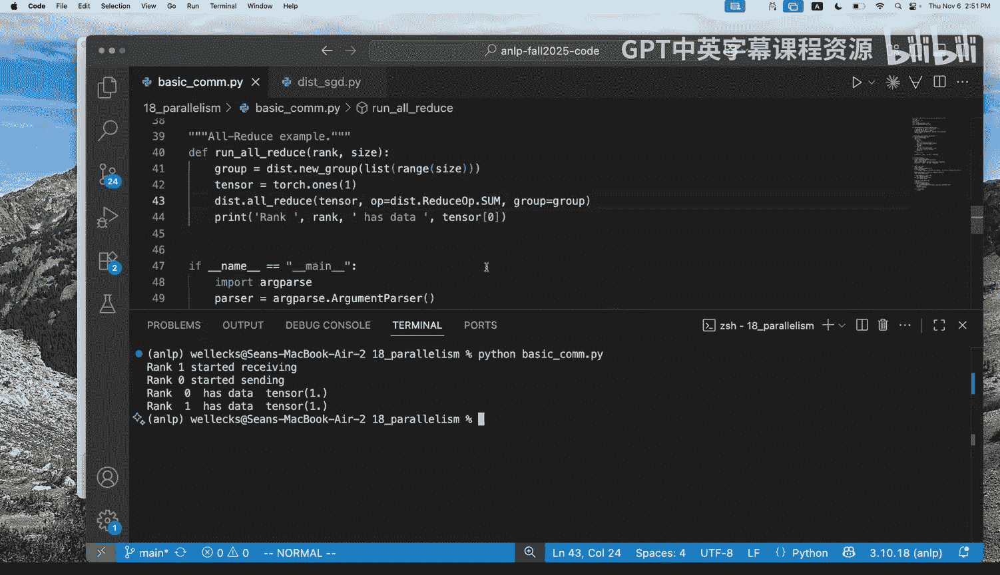

And then similarly， you could do this， let me go back to the slides。

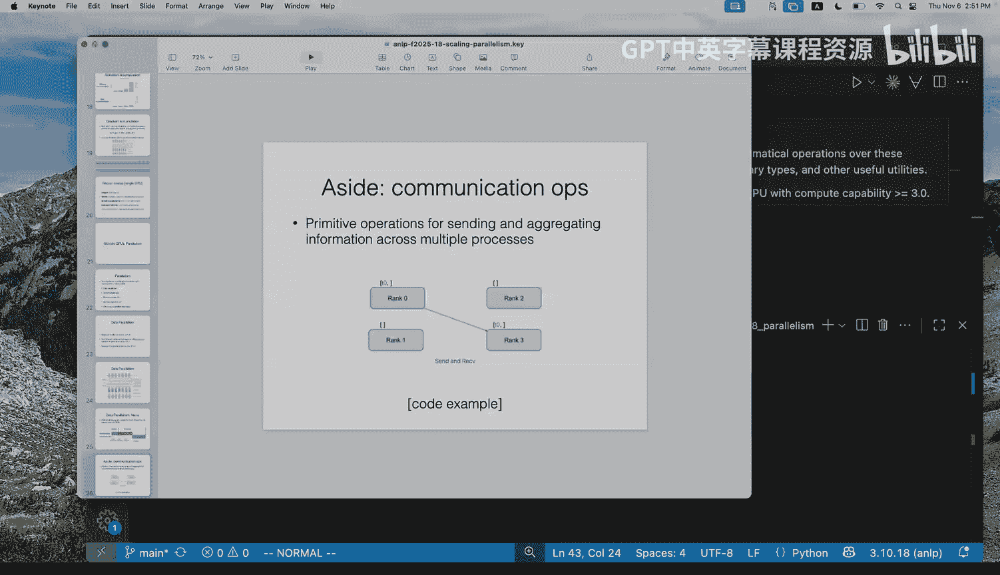

So similarly， there's these kind of less trivial operations。

So here's the one we were looking at before， or reduce。

And you could see that each GPU or each kind of rank is getting the sum of these different outputs from the other ranks。

In general， you don't have to use the sum you could use。Other kind of reduction operations？嗯。

And then you have other types of operations like all gather。This one will actually be relevant later。

You could see that here it's just kind of gathering the data from multiple GPUs or multiple devices。

Okay， then there's other things like broadcast， reduce， scatter， gather， and so on。

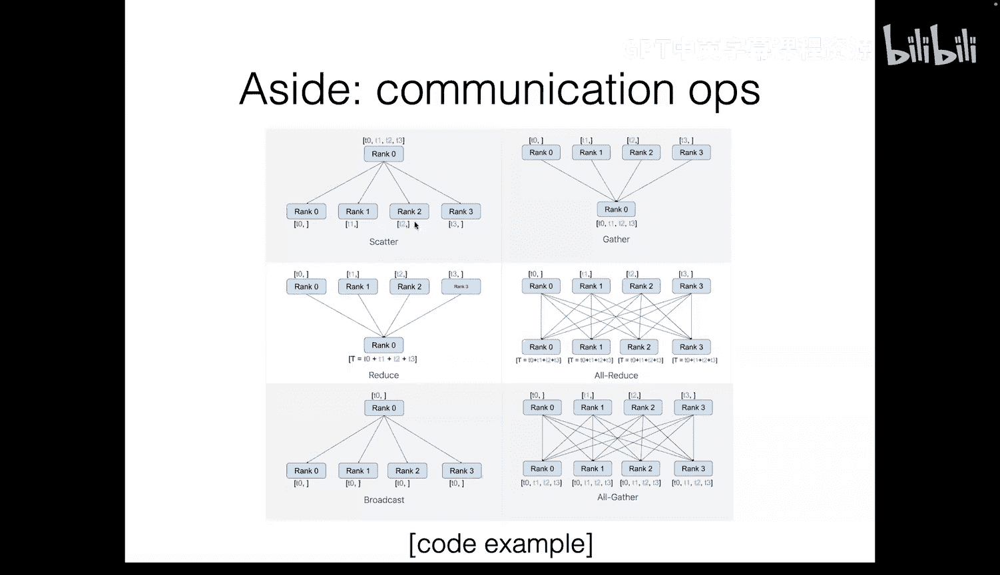

嗯。

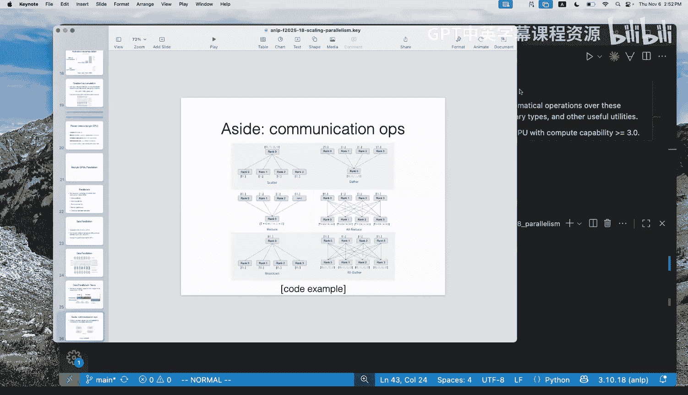

So to actually implement these strategies， you kind of have to use these things。 And then again。

 this is just showing you that it's not。I mean， it gets tricky to implement this of course。

 but like here's the actual all reduce operation for this library。

 you can see that you specify the operation， so it's doing a sum。And then so can anyone tell me。

What data you should have after executing this？With a rank of size 2。

So here it's just doing an all reduce with a sum。And。If you have a rank of size， too。Okay。

 so rank means the number of devices。And then if we look at on each device， it has this tensor。

 which is one。So then if we do an or reduce， we are summing from all the devices。

So it basically comes down to what is one plus one and that equals 2。

 so hopefully this should print out two when I run it。So let's see have to do。😔，这跑了。Or reduce。

And yeah， indeed， you get to。So then what happens is if you increase the number of devices。

So this is usually called world world size。嗯。Then now we could see that now it's summing from four different devices。

So one plus one， plus one plus one， and we get four。Okay。

 so it's maybe going a bit quickly so if you didn't catch it， you can take a look at this afterwards。

 but the idea to remember is that you have to somehow do these operations that are taking data from multiple devices and kind of aggregating them。

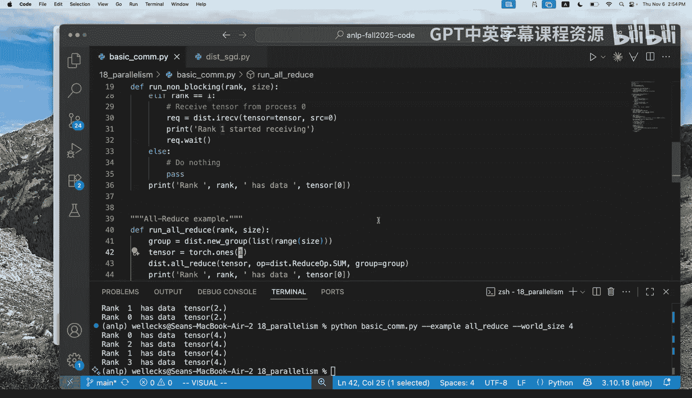

Okay， so then if we're able to do that， then we can。

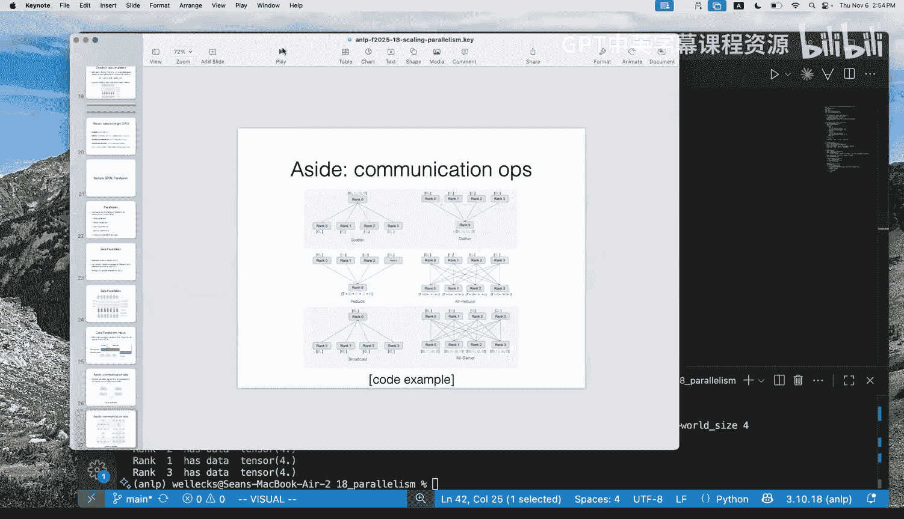

Implement this data parallelism here again， it has this all reduce。嗯。Okay， now。Maybe yeah。

 we won't have time to go into these too much， but you can get clever and actually save computation。

So what you can do is you can start doing the start computing the gradients for a layer kind of right after。

Sorry， start doing the all reduce。For a layer right after its gradients have been computed。

So before you even even finish the back propagation through the whole model。

And you can see that you can save kind of a bit of time doing that。

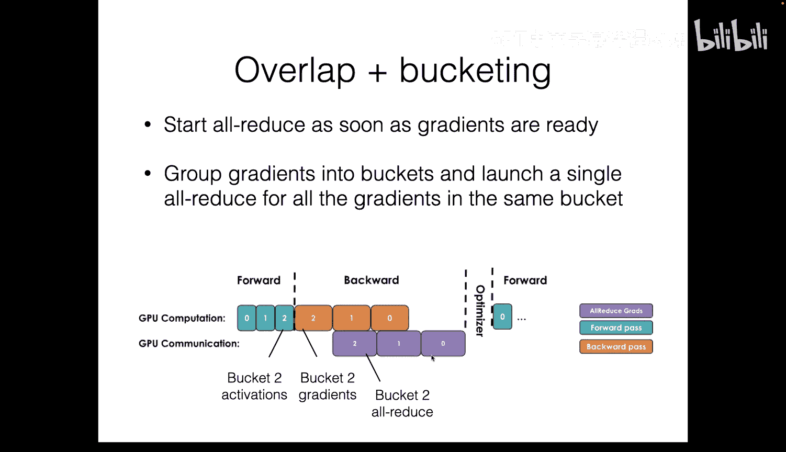

So that's called overlap or kind of bucketing。This is just showing some code just to show you that these strategies are kind of real in this library。

So it has these kind of parameter buckets， and then you could perform the synchronization or the all reduce for one bucket。

At a time while the other ones are still。Being processed in the back propagation。

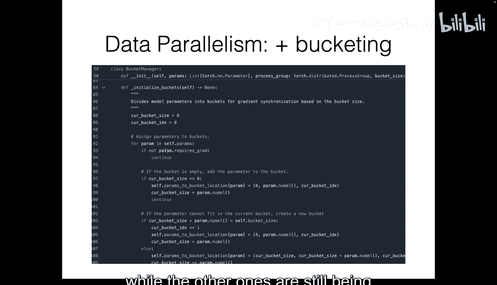

Okay， so now we could say that this batch size that we have actually depends on a few different things。

So first of all， it depends on the micro batch size that we have。

Then we could decide how much gradient accumulation we're using。

And we can also decide how many parallel instances we're using。

And you could see that the strategies are kind of complementary in the sense that like you can parallelize。

 but then on each device， you can still use gradient accumulation if you want。Okay。

 so it starts to become this problem of like this like high dimensional optimization problem of what is the best setting that kind of gives you the best efficiency。

嗯。Okay， and then here's just a concrete example， so let's say we have a batch size of 4 million tokens or our goal is to get a batch size of 4 million tokens。

And our sequence length is 4，000 tokens。Then that means the kind of batch dimension。

Will be 1024 sequences。Now let's say that our GPU only fits two sequences。Then， that kind of。

Forces us to use the micro batchch size of， I guess， other one or two。 Let's pick two。

Then you could say like， okay， then in order to achieve this target batch size。

 we have to do some parallelism and we have to do gradient accumulation。

So the parallelism might be determined by how many GP you have。 So if you have 128 GPs。

Now you can get up 256 sequences。If the target is to get 1000。

 now you can see that we have to use gradient accumulation of four。Okay。

 so you can see that the kind of practical constraints can help you determine kind of the settings so that you can meet a target batch size。

Okay， so then you could think about like。You what if you had 512 GPs and you can kind of check your understanding on that？

Okay。So。Here the question is like， can we just do this and is everything solved？Well。

 it turns out unfortunately not。First of all， if you have more GPUs。

Then you have to you have more coordination。So in these all reduced operations， for example。

 you're kind of sending datalight。Potentially really large amounts of data。

So that's going to incur some cost。And so as you scale up the number of GPUs。This is looking per GPU。

 the throughput that you get， so the tokens per second。And so you can see that per GPU。

 you're kind of getting less throughput as you scale up。Because of the communication costs。Now。

 you can still multiply this by the number of GPUs 256。

 and the number of tokens that you're processing is still much higher than with8 GPUs。

But it's just saying that the kind of efficiency is decreasing as you're。Kind of scaling up。嗯。Okay。

 but then the good thing is that the memory stays constant， so。Again。

 you have these micro batches and you could just increase the number of GPUs and the memory kind of staying the same。

Okay， and then the other issue with this is what if the model is just too large。

 So even with a really like a batch size of one， the model might be so big that you can't。

Do anything。Then you can't really use the strategy， right， You have to do something else。

So by definition or not by definition， but just at a high level， you could think about like， okay。

 if I have a really big model， maybe I can try splitting it apart。Or。Yeah， or yeah。

 splitting things apart。So that'll kind of be the flavor of the different strategies we'll talk about。

This is just showing that this can happen， right， if you have a 70 billion parameter model。

 then even without。Factoring the activations， it's just too large to fit on。This GPU。Okay。

 so then the next strategy will be tensor parallelism。And basically。

 this takes advantage of the structure of the matrix multiplications。

So that you can distribute the computation across multiple GPUs。

So here we have a matrix multiplication。And what you can do is you can split this up。

So here what we've done is we've taken this weight matrix and we've kind of chopped it into two different columns。

Okay， so what you can do is you could have a device up here computing just this part of the matrix multiplication。

 so just on this column。You could have this GPU down here， computing on just this matrix。Now。

 the number of parameters on a particular GPU has decreased。

 so you might be able to fit it into memory。As you might imagine。

 you now have these communication costs， so you have to send the data to both GPUs。

And you have to gather the results to kind of come up with the final result。Okay， so again。

 you see these primitives that I was telling you about before， like the Allgaer and the broadcast。

But this will be like the output's the same， it's not like an approximation。

You could also kind of reason through that it's sensible to also split off the rows so here we have one device。

Doing this row， this one， doing this one。And then the computation at the end changes。

 It turns out that now we basically want to， you know， some things together。

So how you do this will kind of vary based on the model and even based on the layer。So again。

 we're not going to be able to go into all the details， but I want to just give you some flavor。

 this is from a paper I think from NviDdia。And they were obviously trying to come up with a really efficient strategy here。

And so we could just look at what they did。 So here they determined that。呃。It's better to。

Do this kind of column parallel here。And then row parallel at the end。

And the reason was that there's no intermediate all reduced or gather。So again。

 we're not going to be able to like go through the details。

 but I'm just giving you a sense of maybe what would be involved。Basically。

 any particular strategy you kind of take， you'll incur different costs。

 and so you have to figure out like for your particular network architecture。

 what is the most efficient kind of strategy to use。So again。

 the key difference here is now we're actually going in and we're kind of hacking with the specific architecture。

Whereas the data parallelism was more kind of hands off。

 we' just making copies of the model on multiple GPUs。Okay， so that means this is somehow more。

 it requires more effort， you have to go in and think about a particular model architecture。

So then again this is just showing here's the attention layer and you want to do something different here。

 it turns out that here they have each GPU handle you know some group of attention heads and then you can kind of distribute it and then aggregate the results at the end。

So again， here， now it's feasible to。Actually， just train these really large models at all because you're splitting them apart onto multiple devices。

So here， for instance， you have。16 different devices。And you can see that now it's feasible to train。

The 70 billion parameter model。With this amount of sequence length。嗯。Yeah。

 this is just showing the the maximum batch size。So again we you know we have these communication costs we kind of saw it in the diagram that you have to do these operations and those will each incur costs so again we don't have this kind of perfect。

Efficiency from just scaling up。Similar to the date parallelism。This is maybe a more kind of。

You know， there's other things that come into play， so it turns out that with're this。嗯。

Communicating across nodes is particularly slow。So， again， we don't have time to。

Go through everything that's involved here， but。Just， yeah。

 mentioning this these other factors that come up。Okay。

 and so next we can go to the pipeline parallelism。嗯。So pipeline parallelism。

Is this kind of interesting idea， which is like， okay。Your transformer is multiple layers。

 So what you can do is you can take say like the first。Set of layers like one through4。

 and put that in one GPU。You could do the forward pass and then when you get to layer five。

 you switch to the other GPU and finish the forward pass。So that's why it's called pipeline。

 you have this kind of pipeline of computations。And so here we're again splitting off the model now by layers and putting them on different GPUs。

And so now we can fit really large models on particular devices。So that's what， yeah。

 this is basically showing。嗯。Moreover， it's。If you do just split up by layers， then。

Its it does have some assumption like that your architecture is multiple layers。

 but maybe it's less like specific hacking into the architecture compared to the data parallelism。

So what happens here is these diagrams like this。So as you might imagine。

 if you're processing things in this kind of pipeline， then it's this kind of serial process。

So you do the first four layers in this GPU， now you do the next four layers in this GPU。Meanwhile。

 the other GPs are just sitting here doing nothing。 so kind of wasted。Wasteted potential， right？

Similarly， for the backward pass， again， the backward pass really goes from the last layer to the first。

 so there's a lot of wasted time here。So this gray space is referred to as the bubble。

 and so the key kind of challenge will be can you come up with more clever ways that reduce？

This bubble or the time lost due to the bubble。So。There's kind of。

There's a few different methods and each one it can get kind of nuanced to to。

To really see what's going on， but。Let me try here， and I could at least give you a sense。

So here this one's called one forward and one backward。And so again， the quote。

 like the first time I saw this， I was like， you know what？

How do you actually do better than this so。It is pretty surprising that you can actually save a lot of time by being a bit clever。

So。Here again， we use this idea of start doing a backward pass as soon as possible。

 So we kind of saw this with the data parallel。So here you could see that。This one has been。

Comped everywhere。And so now we could start performing the backward pass here。嗯。And so。Again。

 you have some some bubble times。But the。There are some reductions。And so here again。

 it's kind of tricky because the forward and backward passes have been。呃。

But I actually forgot what the what the numbers are corresponding to。Here。嗯。So， oh。

 so I wrote it here。 Okay， I knew I was a bit confused。 So here， the numbers are these micro batches。

Rea I got confused was because in the previous visualization， the numbers were the layers。

And so here suppose you have these different micro batchches being processed。And yeah。

 sorry about that。 So again， micro batchch number one。

 this will be like layers one through four for micro batchch number one。

Then it gets passed to the next GPU。Or layers5 through nine， and eventually it completes。

So now you can see that you could start the backward pass for this micro batchch and kind of interlea things。

Okay， and so then the interesting thing is like will some micro batchches will complete before you even start the next ones。

And you can kind of interleave stuff in this way。Okay， so that's the idea there and again。

 just be careful about the or I have to be careful about what the numbers represent。嗯。Okay。

 so then if you have two small of number of micro batchches。

 then you kind of can't take advantage of this， it would correspond to actually the first diagram we are using。

And so this is just showing。Yeah， if you。In then this is at 32。

 then you can benefit from the pipeline parallel compared to over here where you just have a smaller number。

嗯。Okay， so I only put one strategy here， but I think if you take a look at the textbook。

They'll have an additional strategy， I think that you can take a look at。So。

Then with these different ones， the other thing I want to mention is they are， in some sense。

Typically compliment。So。Again， you can basically have different groups of devices。So you could say。

 let's say I have eight GPUs。Then you could have two groups of four gpUs。

And then within your four GPUs， you can split up the model with you know。

 data parallelism or pipeline parallelism。You have to be careful how you split up the model for sorry a tensor parallelism or pipeline parallelism。

 you have to be careful how you split up the model。

 but again you can have these be kind of complementary。So then the last technique。

 and you'll see this come up in different libraries is called zero。

One reason you might see this come up is because you can kind of dramatically reduce the amount of memory that's needed。

So sometimes you can even fine tune a pretty large model on， say， like  one GPU。

 if you use this technique called zero。Of course， it'll be slower， unfortunately。But。Yeah。

 you might see this come up even in。Different libraries like if you've seen a deep speed before。Okay。

 so in data parallelism， we typically have each GPU replicate the model parameters， the gradients。

 and the optimizer states。So what this zero does is it'll partition these things across GPUs。

And then the difference is it'll like temporarily gather the required data to perform the actual computation。

So there's kind of different levels of zero， zero redundancy optimizer is' called。And again。

 the observation is that if we just make copies across multiple GPUs。

 then there's somehow redundancy in what's being stored。

So one thing you could do is to have no redundancy for the optimizer states in the sense that you can store one shard of the optimizer states。

On each CPU。You could go a step further and shard the gradients。

And you can even shard the parameters。And so what happens is。You have this kind of trade off。

 You could see that any particular GPU is storing a。Increasingly smaller amount of things。

 so 03 will have very low memory requirements。But then what happens is when you're performing the forward pass or backward pass。

 you still have to kind of gather the required。呃。Data or parameters that are needed。

And so the amount of communication is much higher as you do more and more shardening。Okay。

 so if you find one of these libraries and run 0，3 for 0，1，0，3 will。

Almost certainly be slower than 0，1。Maybe there's a counter example。

 So be be careful with almost certainly， but。Generally， that's what you'll see。So more specifically。

 what you have is， let's say we have a model with one billion parameters。And we have four gUus。Then。

Let's say that each one is storing 250 million parameters。Then as we're moving through the layer。

 what you can do is you can do an allga to fetch the parameters just for the layer。

And then you can compute the activations， discard those， and then proceed to the next layer。Okay。

 so at any given point， you're never storing the entire model。

 but you can see that this requires a lot of these kind of allga or communication operations。

And so in some sense， this is sharding the memory， not sharding the computation。

 so it's slightly different than what we were doing in the tensor parallelism or the pipeline parallelism。

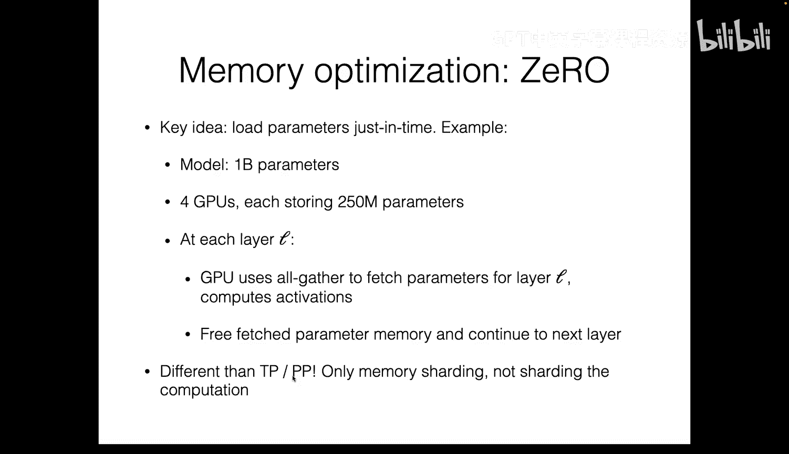

嗯。Okay， and so。Here is a kind of summary of everything。Again， here we have data parallelism。

 which is parallelizing on this batch dimension。The trade offs are that you have redundancy and you need the model to fit on a single GPU。

And so if you have like， I du'n know，7 billion parametermeter model。And multiple GPUs。

Then it's fairly straightforward。 you could just do data parallelism。

 you just split the batch dimension on multiple GPUs。And when I say you， I mean。

 this will be now implemented in different libraries。

 so you just set the parameter for date of parallelism。嗯。Here with tensor parallelism， again。

You could think about it as like parallelizing on the hidden dimension or you're like splitting up the。

The weights are the parts of the model。As I mentioned before。

 it's kind of fine grains you even look at。Specific or someone will look at specific layers and figure out what is a good way of parallelzizing this layer in the transformer and then implement that into the library。

But you can get some high communication cost。With pipeline parallelism， again。

 you have this kind of pipeline。Paralyzing maybe on the layer dimension。

And you have to overcome these bubbles or the library has to overcome these。

And so this is really good with these large and deep models。And。

It turns out that this could be also better for。Paralyzing across nodes when you look at the specific。

Communication is being done。Then here you have this notion of sharding。

It has these high communication costs。And again， the use case is you have a big model that doesn't fit in the memory。

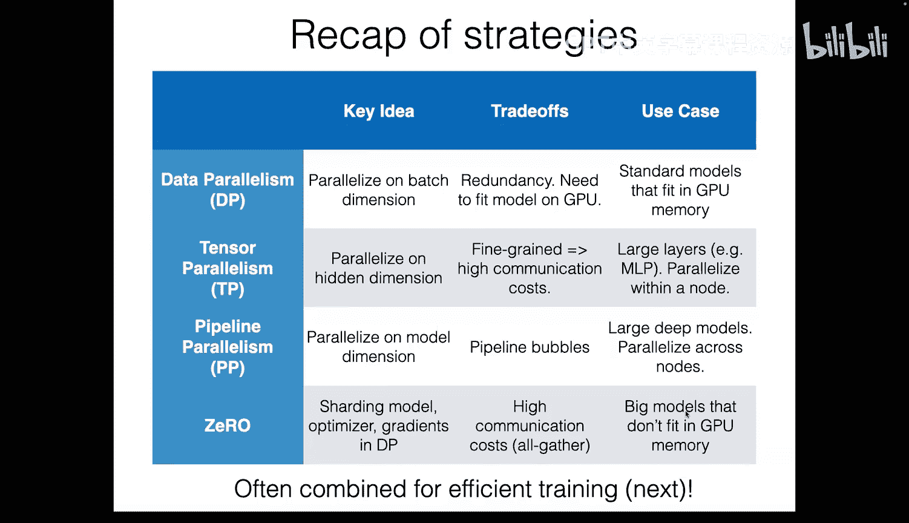

Okay， and then in practice， you can kind of mix and match these so you want to fit your model into memory。

 like in the example。That we gave with data parallelism。You might have some target。

 global batch size。And then you want to find the configuration that optimizes your throughput。

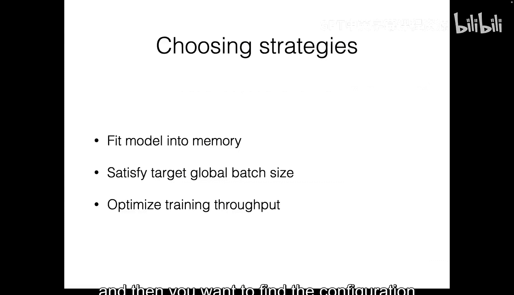

So in practice， there's different， like best practices。 And you can reason about how the。

You know the type of model you have and your target batch size and things like that。

Here's just showing you all of these different experiments that they performed in this book。

So this will be with a fixed model architecture and fixed global batch size。And sequence length。

And then they have up to 64 nodes。On the X axis， they're varying the model size。And on the Y axis。

 they're varying the nodes。And then each one of these will be some different configuration。So。

 for instance， here with the small model。Let's see。 The lighter is better。So， it turns out to be。

Best to actually use just one node。And then you can look at the specific choices， choices here。

So again， just to emphasize you kind of mix and match these things， you have some data parallelism。

Some pipeline parallelism， etc cetera。You could see up here at the larger models， as I mentioned。

 it's just showing empirically， it literally doesn't fit even on a node， which would be A GPPUs。So。

By definition， it's not going to be the same as this configuration。And if you want。

 you can kind of go read through。

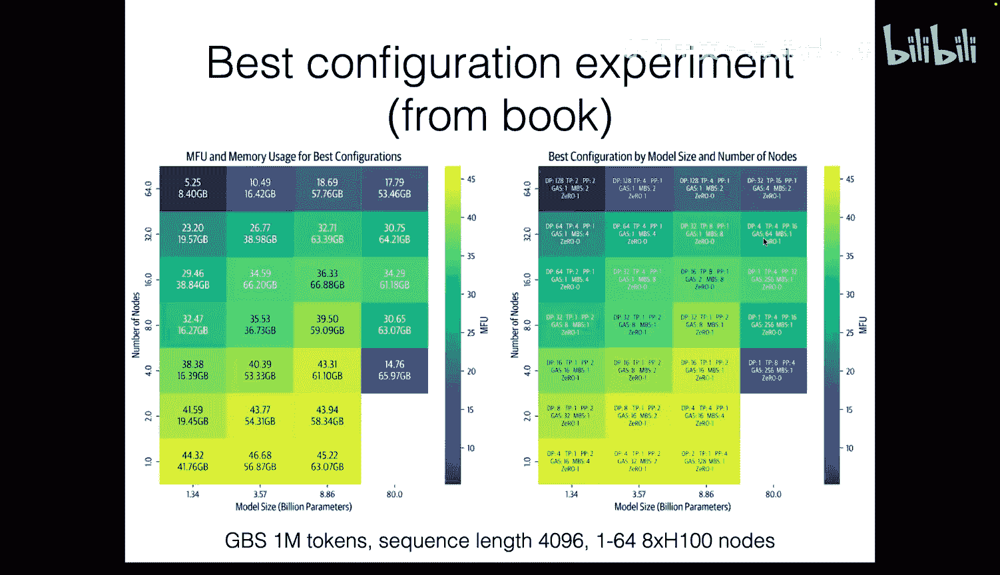

This after。So briefly， we're right at time， I wanted to just show some libraries。

 so one is called torch Titan， so this is like part of P torch now。

And so you can go look through this。And hopefully now you'll have some understanding of what's in here。

So here， this is slightly different this FSDP， but it's some sharding technique。

 you have tensor parallel pipeline parallel。wo lectures for now we'll talk about context parallel。

But hopefully you have some gradient accumulation， hopefully you have some idea of this stuff now。

Here's another one called Megatron LM。This is by NVIDdia。

 and then this will be used to train very large models。

And you see some of the ideas that we're talking about today come up in these。And then again。

 if you're interested in looking at more， you can look at the experiments they run or the configurations。

And you could see like which types they're using for which kinds of models and things like that。

 and it's pretty interesting。

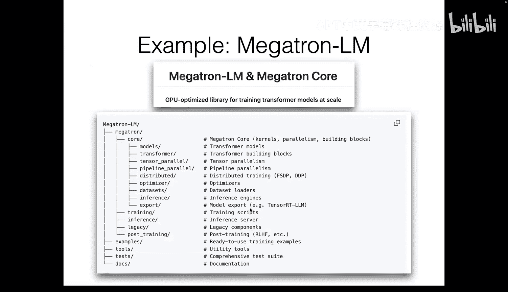

But。