# CMU《高级自然语言处理｜CS11-711 Advanced NLP Fall 2025》中英字幕 - P19：(19)_ Quantization.zh_en - GPT中英字幕课程资源 - BV1ZWYAzuEMa

Go back。So today we'll be talking about quantization。And the motivation here is that， as we all know。

 these models， these language models are very large。They have a lot of parameters。

And so this makes it difficult to run inference on a variety of devices。

 let's say I want to run inference of a language model， have a generated text for me on my laptop。

Or let's say that I only have one GPU， let's say I'm using like Google coabab。

 and I just have a T4 GPU， but I want to use， say， an 8 billion parameter model or one that's even larger。

It also makes it difficult to fine tune on a variety of devices。

 let's say again that I only have one GPU and I want to fine tune。

 say a 72 billion parameter model am I completely doomed or is there actually something that I can do？

So hopefully by the end of this lecture， you'll have some insight into some of the answers for these challenges。

And then also even if you're considering pre training or just training a model from scratch。

 then the previous lecture was really the main underlying idea was。

How do we use compute most efficiently。And so there's a question of like， as we'll see。

 do you even need to use kind of full precision to pretrain a model or can you kind of save compute or use it more efficiently by quantizing it still an open question。

 but again， hopefully you'll get some insight。Into it after seeing the techniques today。

And as I mentioned， what we'll talk about today is very practical and you'll see it in a lot of places。

 so let me just start with a concrete example。And here this is just introducing the problem。

So let's say we want to use this modelquin3 APB， really recent model。

And so we go to hugging face and we start taking a look at it。Well， first of all。

 what are the implications of 8 B， so we have 8 billion parameters？

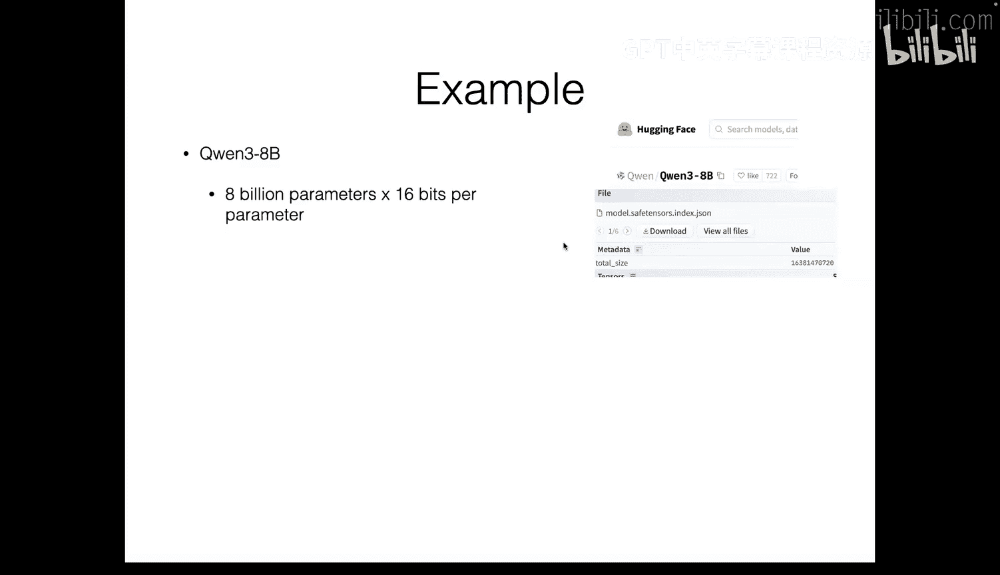

And if we， let's actually just look on the website。

And if we take a look at how the parameters are stored。

Then here we see that they use something called B F 16。

 so I'll introduce what B F 16 is in the lecture， but you can see here that this means it's using 16 bits for each parameter。

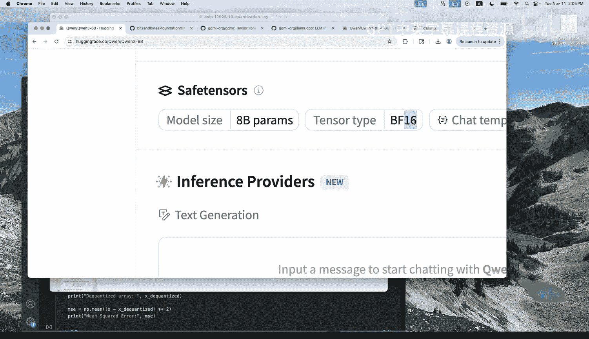

And so。That means so 16 bits will be 2 bytes， so it's 8 bits per byte。

And so if you multiply those two， you get 16 billion。 and so that is the definition of gigabyte。

 So now you have 16 gigabytes is required to kind of store this model。And in fact。

 here you could see the exact number of bytes and you see 16 at the end。

So just to double check the argument there。Okay， and then this is just a rough approximation。

 but hopefully in the last lecture， you got some appreciation for the memory that's involved in using a model。

 so we don't have to only consider the memory required for storing the weights。

 but you also have to factor in things like activations as you are performing a forward pass through the model。

So just for this really simple argument， let's just say you need about 1。

5 times the gigabytes needed for the model weights to actually run inference。 Again。

 it's just the kind of。I just made that up， but it's going to be some multiplier of your modeloids。

So let's say it's 24 gigabytes of memory。Now this is a MacBook error， and so this one it's。

 I think it's a cheaper one， and so it has 16 gigabytes of memory。

And so what are the implications here， well essentially in order to run inference with this model。

 it's going to actually have to write to disk and kind of swap out it's not going to be able to hold everything in memory and so that's really going to slow things down。

Let's say that you're using Google CoLB， so these T4 GPUs that you get for free are 16 gigabytes。

And so again， we're going to run into an issue here Basically we're either going to run out of memory or the most recent version of Huging face。

 I think will again offload things so you won't be using the GPU memory。

 it'll be swapping things in and out and it'll just be really slow。Okay， so this is an issue。

 but it turns out that there's ways around it， which is what we'll talk about today。

So what we'll talk about is quantization and so here the key idea is to represent each model wave and if you want the activations。

Which are just numbers using a smaller number of bits， so instead of 16， for instance。

 let's say that we use just four bits。Well， now we can have a smaller version of the model。

 so here's an actual example。Here they have a version of qui3 AP that is4 bits。

 and you can see it's just 6 gigabytes。Okay， so now there's some hope of actually running this。

 say on my laptop and having it run a bit faster or fitting it into that GPU that we get for free on Google Code Lab。

And so today we'll talk about three different topics。First， we'll go over。Might be a review。

 but I think some of it should be new， just how you represent numbers on a computer and so we'll look at indeed we'll get a kind of really good understanding of what we mean but when we say like B floatloat 16 or F 32 or in 32 things like that。

Then we'll look at two different categories of methods and we'll mostly focus on the first category。

 which is， let's say that you want to run inference with a model。

 so you want to generate text with a trans model。How can you use quantization to help with that。

Then in the third part， we'll talk about the intersection of quantization and training。

 so either training a model so that。You can use it as a quantized model during inference or using quantization to help make training more efficient。

Okay， so you'll see what I mean by both of those things when we get to it。Okay。

 so first representing numbers， so you might remember from， you know。

 if you took this like computer architecture class or something like that going over this stuff。

 but it's good to recap it and kind of start from first principles and we could build up an understanding of what's involved in quantization。

So really just starting at the top， we represent data in the computer using sequences of bits。

And so a bit is either zero or1， and then we refer to8 bits as a byte， so here's two example bytes。

Now the way that you'll represent numbers or store them。Depends on the type of number。

 So three different types you could you might consider are。

 let's say you only have integers that are。Not negative， right， so01，2，3。

 those will be called unscient integers。Or you could have negative numbers。

 so that would be integers。Or you could have real valued numbers， so things like1 12。 3，4。

 things with decimals， that could be positive or negative。

So starting with the unsigned integers here let's look at a byte and so here each position will represent a power of two。

 so this first position will represent two to the zero。

 the second will represent two to the1 and so on up to two to the seventh in this case。

And then the value of the number that this represents will be the sum of the。

Powers corresponding to the positions with a one。Okay。

 so this is basically saying ignore this position， ignore this position， and take the sum of these。

Some of the ones with one。And so our number will be。

1 times 2 to the sixth plus 1 times 2 to the fourth， plus1 times2 squared plus1 times2 to the first。

You can add those up and you get 86， and so that would be the integer represented by this by。Okay。

 and so then here we have eight bits or one byte， and so you would refer to that as U8 or8 bit ons integer。

And then you could think about what is the range of this data type？Well， it's two to the eighth。

And then subtract one。And so you have 200 and。55。You could also have 16 beds， so 2 bytes。

Integers that would be U 16。Here you have a larger range now，65000。 And then if you go up to 32 bits。

 you have。Right2 to the 32 minus1， which is much bigger。So basically。

 as you use more memory or more storage， you can get wider range of values。

Then if you want to also have negatives， then you have to have the notion of a assigned integer。

So here we'll use the leftmost bit to represent the sign。

 and so now we just have these seven bits for kind of representing the value。

And then the common algorithm or representation that's used is called tos complement。

And basically it boils down to doing the following。

So let's say I have this number and I want to represent its negative。

Then what you do is you flip all of the bits and then add one。

 it's kind of what the algorithm boils down to。And so here this would be the negative of the number of those previously shown。

Okay， and so then here now you could have an int8 data type。

 which means a signed integer represented with8 bits。And so now again。

 we're using this first bit for the sign。So now we have from。Between negative 128 to 127。

 and so for the positives， you kind of use up one of the values to represent a zero。Okay。

 so you can see that this is relatively kind of small window of numbers。

 Surly we're going to actually use this to store the model weights。

And then you can go up to in 16 or in 32 if， again， you want a kind of wider range of numbers。Okay。

 so then we could move to real values so it turns out that you can't actually represent every possible real value。

 you have to kind of choose a subset and so what are called floating point numbers and a particular representation of floating point numbers will give you the ability to represent some amount of real value numbers。

So the way these work is a bit different than the integers。

So this is again going over the kind of standard way of representing floating point。

So here you have these three different types of values。You have a sign， you have an exponent。

 and you have what's called the Sign。And so， the。The value is going to be what's down here。

And you could think of it as being like， okay， let's say you have a decimal。

 Then the significant significant is。Kind of helping represent what is to the right hand side of the decimal。

And then the exponent is helping kind of scale the value。And then the sign is， of course。

 whether it's positive or negative。Now what's done in practice is to use what's called a bias。

So we'll see in the example in a bit。You can use this bias so that you can represent this exponent as an unsigned integer。

 and it turns out to be a good for hardware and for。It's kind of what's done in the standard。

And so what you could think of this as is a kind of analogy to scientific notation。

Except here the tricky part is that we're actually using base2。So for instance。

Here if you have one point。1，0，1 times 2 to the third。Then it doesn't actually mean 0。101， it means。

呃。1 plus。0。5。And then a zero， so this is what。Two to the minus1。

And then this position is 2 to the -2， and it's 0 out。 Then this is 2 to the -3。

 And so you see 2 to the -3 appear here。So it's a bit weird if it's the first time you're seeing this。

 but it's essentially this kind of scientific notation， but in base two。So again， here。

 instead of having 10 to the。Whatever power like in scientific notation， we have two to that power。

So let's walk through an example just to。Just to make sure we understand what's going on here。

So let's actually think about what number is represented by this and kind of step through it。

So first of all， we see that the sign is。APoitive， if it's a one， it would be negative。

And then we could consider the exponent。So here we have this unsigned intetor。

 So this is 128 and this is one。 so we have 129。And then as I mentioned。

 you typically have this bias， so for this version of floating point， this is floating point 32s 32。

B they use a bias of 127。And so actually， this exponent represents the number two。

Then the significant， so all of these are zero， so we can just look at this starting point。

And the one here is kind of implicit， so it's basically saying that okay， this represents 1。011000。

And then again， we're using this base2， so this is basically saying okay。

 1 plus0 times 2 to the minus1。Plus， one times。2 to the minus2 plus1 times t to the minus3。

 and then the rest are zeros。So that equals1 plus0。25 plus。嗯。Yeah， yeah。

 one over four and then one over eight。Okay， so this part。The significant。Ends up representing 1。375。

Okay， so now we can combine all of them and you have 1。375 times t to the 2。

 so this floating point number represents 5。5。Okay， so it's a bit complicated。

 but it turns out that this is how you represent。The kind of decimal values in the computer。And。

So we'll see variations on this， so it's good to kind of sub the details。Slash。

Is the 127 with the bias， is that just like a fixed number that's kind of pretty determined by Peter's own architecture or like almost all this？

Yeah， so I think here it's because we have this unsigned integer。And so you can represent。

You could represent a negative exponent by having。Say like  zero minus127。

 so then you could have minus127。And then you could represent。-126 by setting1。

 So you basically have the range of a unsigned integer， but then you're just storing sorry。

 you have a range of a signed integer， but you're storing the unsigned integer。 Yeah。

 so it's determined by how many bits you have in the expon。是。

Sort of split determined like to we sometimes see torture and not allocated to exponent versus significantific can or is that like？

Yeah， that's a great question。 So I think it's the next slide Yeah， so I'll talk to you this a bit。

So here we have float thirty two，Which is what we just went through。

 And this is usually referred to as full precision。 You'll see these terms。You know。

 you'll come across them so it's good to know what that refers to。

 and that just refers to what is shown here。Then you could have float 16。

 which is called half precision。And so now you could see that both the exponent and the significant were reduced。

So then there's actually one more that's commonly used and it's called B floatat 16。

Does anyone know what the B stands for。It's kind of trivia。Yeah， brain。

So this was invented by Google Bra， so it was like invented in a machine learning context。

And so we could think about like what are the pros and cons of adjusting the exponent and the significant？

You could see that this B floatloat 16 is basically keeping the exponent the same as floatlo 32。

 and then you just have a budget of 16 so they reduce the significant whereas floatloat 16 kind of reduced both。

Anyone have any thoughts？嗯。The kind of trade offs。Yeah， exactly。

 so the exponent in some sense controls the range right your。Yeah， the kind of， yeah。

 the range or the scale and then the significant really helps with。More finer grain precision。

And so I think what was observed in training is that。In training the neural networks or。

It might have not been language models， just neural networks。

Large values were being encountered and then training would basically crash。

And so here you could basically retain the same。Range as full precision and then maybe that leads to fewer crashes in training Of course you do give up some ability to represent yeah the more kind of fine grained differences。

Okay， so then this B floatat was invented and as we saw in the case ofqui3。

 they're actually representing their model in B floatat 16 instead of floatloat 16。Okay。

 so does that help answer the question？Okay。So。Okay， so we went over this。See， again。

 we can look at the Qnt3 example and you can see here that here's the exact weights。

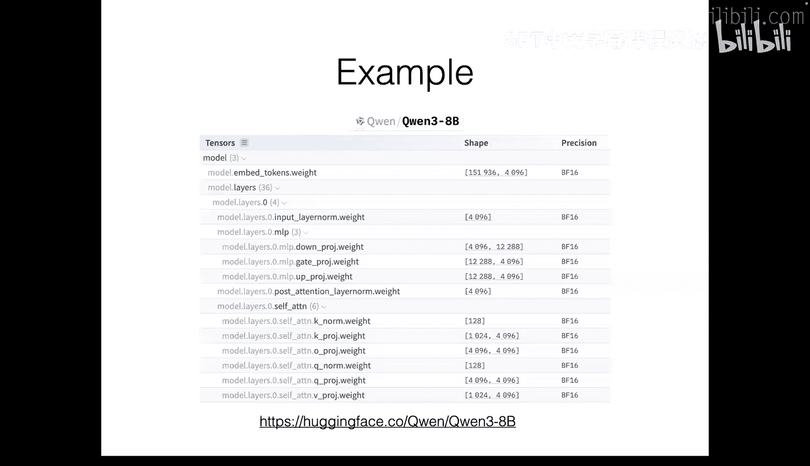

And if you haven't seen this before。

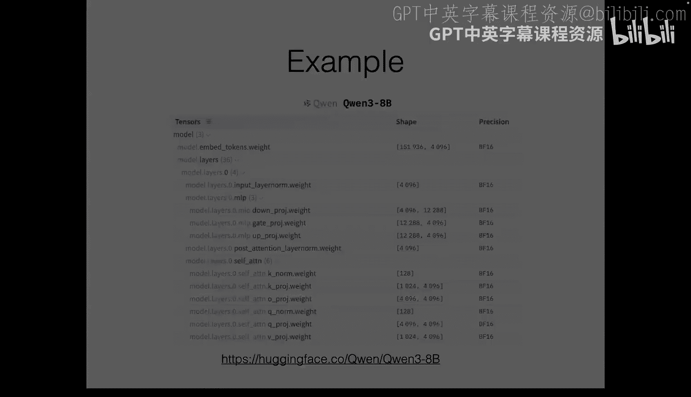

You can take a look at this。😔。

喂 hell这个。There we go。 Okay， so any model that's on Huing face， you can kind of look at it。

The weights。And so here you can see that everythings stored in。This B of 16。Okay。

 and then of course the trade off with Flo 32， F 32 looks kind of strictly better， right？

But the trade off is going to be memory， basically the size of the model will double if you go to floatlo 32 instead of the B floatloat 16 or float 16。

Okay， so that's the basics of representing numbers。 So both integers and。The floating point numbers。

 anyone have any other questions on that before we start to talk about the actual methods and language model inferenceferen things like that。

好，So。They they all have the same kind of decision。Rose do we generally see kind of that happening where like we all use the same precision from the entire thing or do we see like kind of the？

Yeah， that's a really great question so， so yeah you'll typically actually see this mixed precision so some operations。

😊，Will be。More like more important to kind of represent in a higher position。

Or they'll be particularly kind of cheap layers to just represent in a higher precision。

And so especially when we actually start talking about the quantization。

It's typical for not 100% of the model to be quantized。

 You'll pick the kind of most expensive layers。 So like the feed forward layers。

 things like that to quantize。And then you'll have other layers in a higher precision。

 so like the output layer might be in a higher precision。Yeah。嗯。是。刚才。

This is much more a bigger data set and training， but rather than evaluation wise。

 it' always the inference that wes memory。Yeah， so here we're just。

Spttting it into two different parts for almost like practical reasons。

 So let's say that you know these big companies train the model and then a variety of people with variety of devices want to run the model on their kind of budget。

It's like such a common use case that you could consider。

Like trying to do really efficient inferenceprints。

But then training is actually typically more expensive because you have the gradients involved。

 all the stuff we talked about last lecture。One difference is that during pre training。

 you might pre train with a small context length。And then kind of post train with a really long context length。

And then in inference， you also use a really long context length。So that could lead to。

Some some differences between like pre training and inference， but。Yeah。

 it's just broken into two different categories because。

Kind of doing efficient inference is useful on its own。

And then you could consider different methods for training。嗯哼，我的 beautiful方。

bs been offer special you education and something that。Yeah。

 so the different representations will be yeah， you you want them to be supported by different hardware and so I don't know the history of that one in particular。

 but yeah like the GPU will only have certain operations like。Certain floating point operations。

 certain integer operations。 And so you're kind of。In the short term。

 tied to whatever the device supports。 And then if you do develop。

A number representation that's like better and people start using it then maybe the hardware will build it in。

What so ability to。It' the。十么自己夫。Yeah， I mean， I I think you should yeah。

I'll actually talk through a couple more examples on this theme of the hardware support too。嗯。Okay。

 so。Yeah， maybe I didn't say what quantization was yet， which why the slide is here。

So quantization is just in general， the process of mapping。

Input values from some large set could be a continuous values。To output values in a smaller set。

 And I guess the name quantize usually means that the smaller set is also kind of discrete。

And so an example， in our context is we want to map some higher precision format like F 32 to some lower precision format。

 like say， into eight。And so an example quantization method is just kind of normal rounding。

 so you could take a real number x and then just round it to the nearest energy value。

And that is a kind of legitimate quantization method。Now the question is。

 how much error do you incur with a given quantization method？

And so error would be the difference between the input value and its quantized value。So here。

 for instance， if we take 1。4 and use the technique of rounding。Then the error would be what point4。

Similarly， here we would incur an error， and you can also see this issue that comes up since we're going from a larger set to a smaller set。

You can run into these kind of collisions like two different numbers are being mapped to the same quantized value。

And so the question is， can we do a bit better than just rounding？And so let me introduce。

Two different methods， but first。Let's like specialize it a bit to language models。

So if you look at the large transformer language models。

 then this is something I was mentioning before。That。

Just the feed forward and attention projection layers and the kind of involved matrix multiplications。

Make up about 95% of the model's parameters。And。Between 65 and 85% of the computation that's involved。

Right， so there's all these other layers like activations， like layer norm， things like that。嗯。

If you look at these， which are kind of repeated multiple times。

 they're going to make up a large percentage of。The parameters and computation。

So the goal is going to be to quantize these parameters to fewer bits。So for instance。

 B floatloat 16 or floatloat 32。To into it。So here I'm going to introduce some of the， I guess。

 early methods for really large language models。And I think at the time。

 one reason that this int8 was very popular was again， because it was supported by hardware。

 you could do like in multiplication， intake addition， things like that。Since then。

 there's been specific data types developed like specific for bit representations of floating point。

 so I'll mention those later。But for now， we're going to focus on going to these。

Quantizing into integer values。Okay， then if you can do that， then you can use this little bit。

Matrix multiplication， which you again assume is kind of supported by the hardware and then you can save a lot of memory。

Okay， so let me introduce two different methods， so this one is called abs max or absolute maximum。嗯。

And so here we start with some input matrix， let's say it's in F 16。

 it's actually not too important what you start off in。

And you have kind of sequence length times the hidden dimension。Our goal is to produce。

A tensor of the same size， So sequence length and hidden dimension。

 except the numbers will be different。 Now we'll have into 8。Kind of values in the tensor。Okay。

 so this absolute maximum is like like it sounds， so basically you look at the matrix and you get the maximum value after taking the maximum magnitude value。

And then you divide every value in the matrix by it。 So now you have things that are between。

What negative one and one？Then you scale it to be in this 8 bit range。By multiplying it by 127。Okay。

 so kind of simple method。

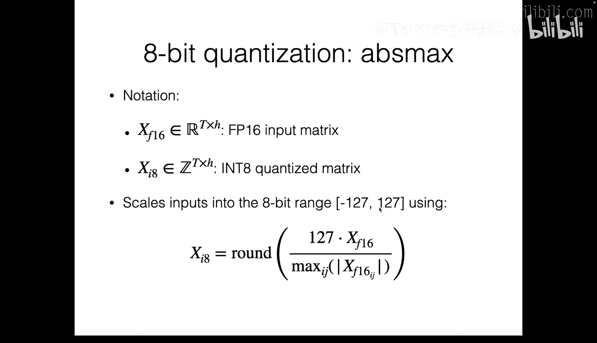

嗯。And so here in the code examples， we have。Some examples of actually doing this。So， let me just see。

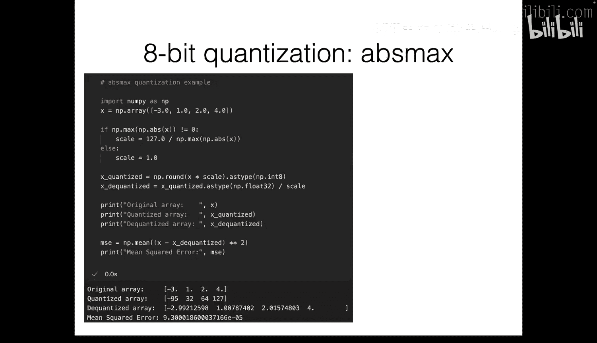

Should have a running here。So。Yeah， so we can start off with this array。And then just implement。

What was there。And then to de quantize， you would basically。

Kind of do the reverse that you divide by this scale。The scale being 127 divided by the max。

So here we have our original array， and now we have our quantize array， which is integers。

 and then after we de quantantize， here's what we get。

 And so you can see we incur some error a little bit here。 the four is kind of perfect。

And that's our error。Here is just if you want to play around with different examples。

 here's just showing how you could start off with something that's a decimal。And I don't know。

 at least the first time I saw this， it's kind of surprising that you can actually you know。

 map it to integers and kind of recover the decimal value， of course not perfectly。

 you do incursive error。

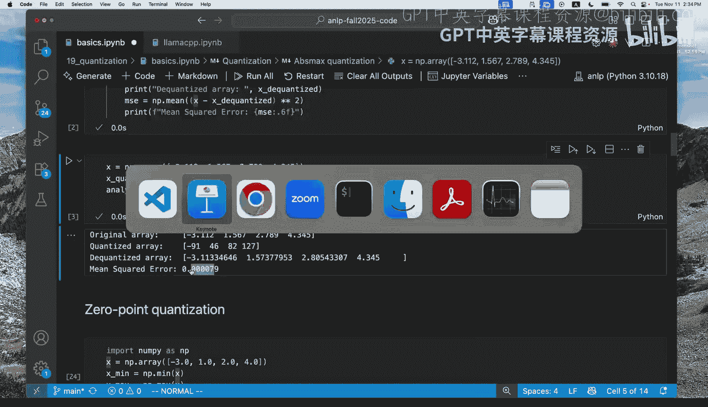

嗯。So。So then we could consider。What is involved in doing a matrix multiplication， again， right。

 matrix multiplication is kind of this fundamental thing where you want thrilled to do。

So here's one way to do it。 So here you have。An input matrix and a weight matrix。

 you want to multiply them together。Well， what you can have here is the kind of two scales that you get。

During quantization。And then here you have some integer matrix。We'll come back to this in a bit。

 but you can see here it is basically quantizing this matrix x and quantizing the matrix W。

 that's what the notation represents。And then。Yeah， for each one， you're going to have this。

Scale parameter that you can divide by to kind of de quantize。

So this is representing both the quantization and dequanization。Now。

 what happens is let's say you multiply two8 but numbers together。 Let's say you have， you know，100。

27 by 127。Times 127。Well， then that's going to exceed the capacity of aPD。

And so what's typically done is you have this buffer。That is。In a higher precision。

 say like 32 bit integers。And you would implement the matrix multiplication where it's kind of adding to this buffer so it doesn't exceed the value。

Okay， so then on the actual hardware， it's going to be up to the kind of hardware provider to do this efficiently as possible。

Now there's one other thing you could do， and I'm going over this kind of quickly。

 but you could think about matrices and you could think about the way that you do matrix multiplication。

And it basically comes down to a bunch of you know， row times column。

 and then you take the dot product and add together。

So what you can do is you can actually separately quantize each row of the input matrix and each column of the output matrix。

And then kind of for each dot product， you'll have one of these scale multiplications to de quantantize。

And so you can do this kind of more fine grained， it's called vector wise quantization。

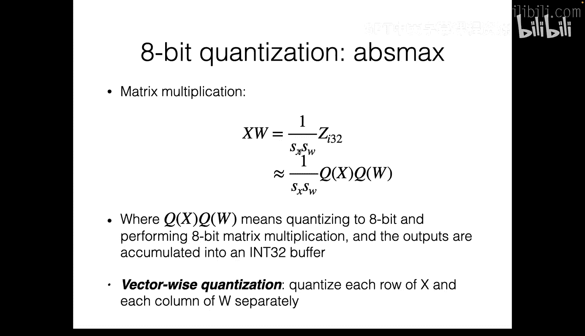

And that'll turn out to reduce the error。So this is also in the code example and。

Again it's kind of just cool to look through so here we have just a random matrix that we're starting with。

And。Well， you have the weight matrix and some input matrix。After you run the quantization。

 now everything is integers， so this will be what happens you know in the actual neural network。

 this is just little toy example。Then you can perform the matrix multiplication。

 You could see that it exceeds the range of in8。 so you need to。

Have the output be stored in a you know higher。And then here is kind of rescaling it or kind of dequantizing it。

Okay， and then if you do the actual just or if you do matrix multiplication without the quant。

Here's what you got， and so then you can look at the errors。

So that's really what's going to be happening in these techniques instead of these toy examples。

 we're going to have actual weights in the neural network and we're going to have actual you。

 like input features。Yeah， kind of cool， kind of crazy that you can just convert things to integers。

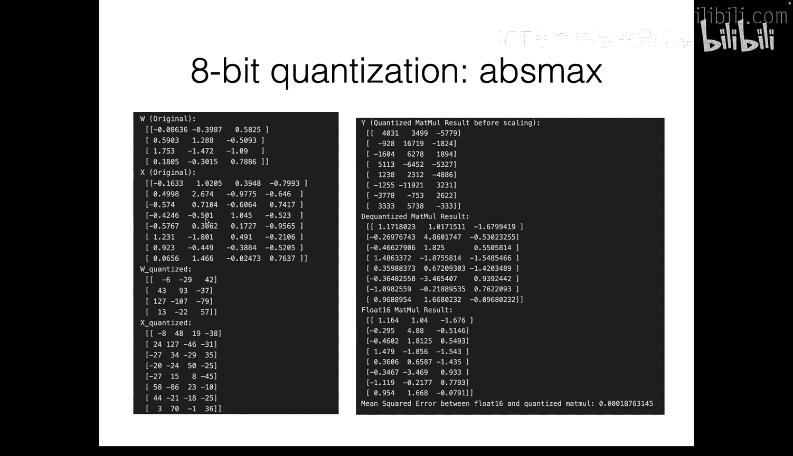

A bit unintuitive in some sense。

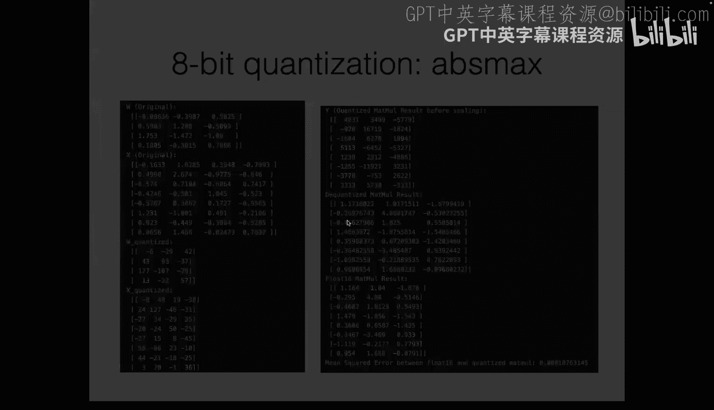

嗯。Okay， so then here's just one more method and the reason I'm telling you about this is if you do go do more reading about quantization。

 then you'll see some of these ideas come up like like offsets and scaling and so it's kind of worth。

Going through these and。呃。Yeah， knowing about these techniques。

So here's another one called zero point。And the basic idea is to kind of implement this concept here。

So here we have the minimum and maximum for some flow values。And we want to basically map map the。

 oh this shouldn't be minus should be plus we want to map the maximum representation sorry。

 the maximum value to the maximum intake value。And we want to map the minimum value to the minimum intake value。

Okay， and so the reason is that now we can kind of take advantage of all of the numbers that we have available to us into eight。

So what it boils down to is something that looks like this， so you take your floating point number。

 you multiply it by a scale and you round， and then you add this kind of offset。

And that'll be sufficient to do this。So there's a blog post that goes through the steps of all this。

 I should add it as a supplementary reading if you're curious you can like walk through the derivation。

But it comes down to the scale is the basically the total。A numberumb of values you have in aid。

And then you subtract the range， so this is sometimes called a dynamic range。

Because here you have this maximum in。And then the offset turns out to be this。Again。

 if you kind of step through the argument， it's nothing crazy。

 you can see that this is this scale is appearing here and the minimum。

 and then you're kind of shifting by this minimum value and there's a rounding operation as well。

So I won't go through the full justification for it。Then if you want to de quantantize。

 you basically do the kind of reverse operation， so you have into eight。

 you would subtract the offset and then divide by the scale。Okay。

 and so the key difference here is that it's kind of designed so that again。

 you're taking taking advantage of the full range of in8。And so in particular。

 this is really good for really asymmetric data。So if you consider the activations after a relu operation。

Then they're going to they're going to be non negative。And so if you use this Abbs max method。

 it's going to just divide by the maximum and basically nothing is going to be negative。

 so you're only going to use kind of half of the available numbers that you have in intake。Okay。

 so that's an advantage of using this kind of zero point method。

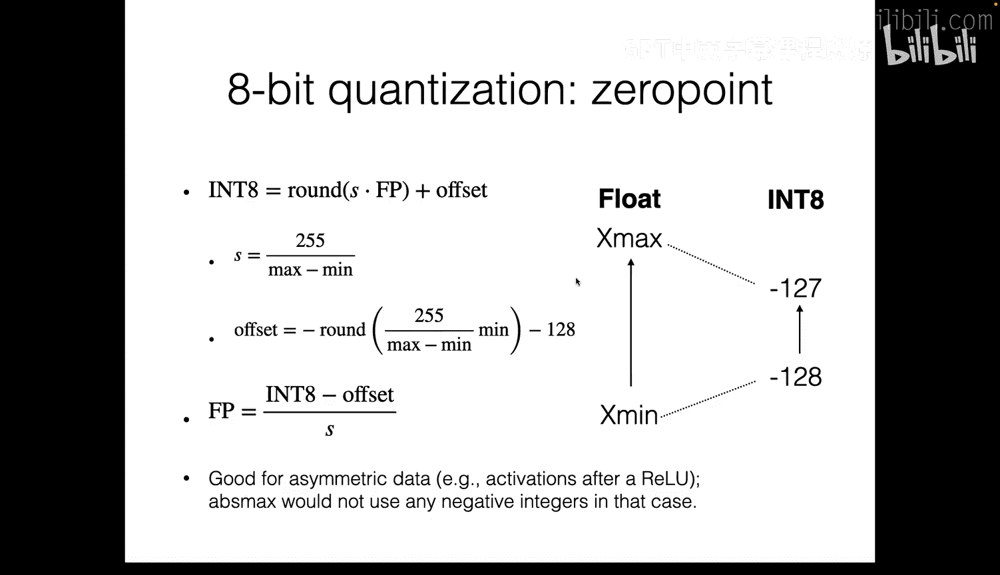

嗯。And so this is just showing the same thing as implemented again in。

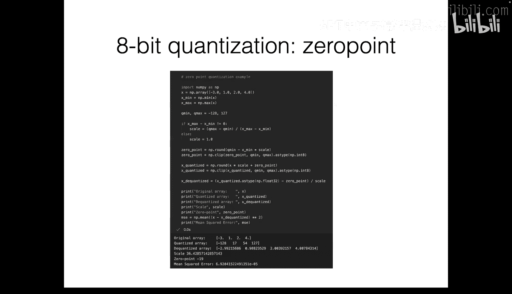

The notebook， let me see if on this example。

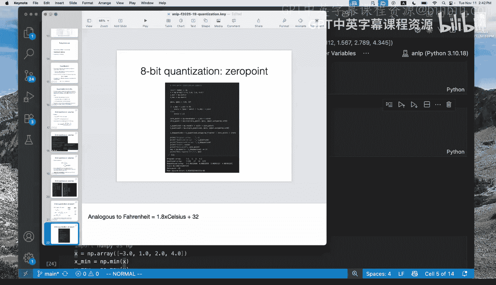

Does it use the same。So here we got 9。3 times 10 to the minus5 this is just one。example。

This is slightly lower， so 6。9 times 10 to the  minus-5 error。But the point is that or I mean。

 one interesting thing to see here is again， here you have minus 128 show up and 127。

 like I was showing you on the slide。

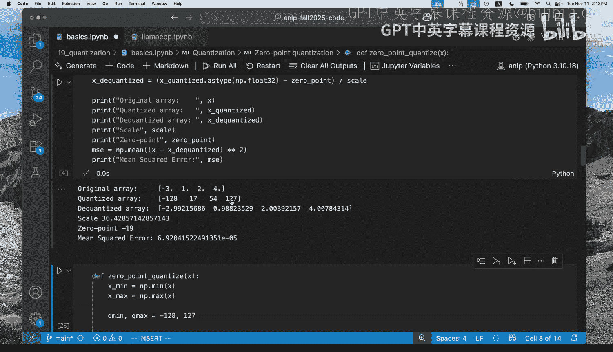

嗯。Okay， so。As we observed， even in these really simple examples。

 So this was like a vector with four elements。And they weren't。Kind of high precision decimals。

We do incur errors and so these are going to accumulate when we have like really large weight matrices like the total error。

And so you are losing some information when you're doing the quantization。Now the issue is。

 if you kind of think about these for a while， then there's actually a big issue in both of these quantization methods that I talked about。

And the issue is what happens if we have a really outlier value？Well， both of these methods。

 they in some sense depend on the minimum and the maximum， you know。

 we saw like minimum maximum appearing in both formulas。

And so it turns out that they're going to be very sensitive。

Or they're going to have kind of poor performance if we have outlier values。

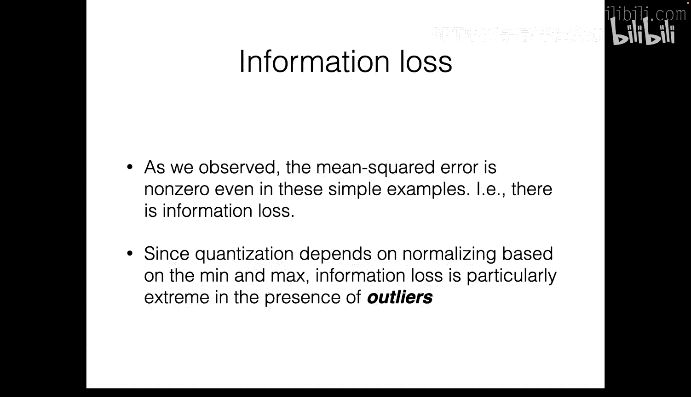

So here's an example。 And again， you could run this on your own if you want。

 Here's an example where we have this array， and it basically differs。嗯。By this last element。

 So in this case， the last element is 100。 and in this case。

 it is kind of similar to the other elements。Now we can look at the quantized array。

 and you can see that。You know， everything's either being mapped to zero or one。This。

Outlier kind of you know screwed things up。And so。Yeah， quantitatively。

 you're going to have a high mean squared error。Same thing is happening here with the zero point。

 you can see everything is being kind of packed into these low value values here。

 all due to this one outlier。Without the outlier， it's different。

 you get a lower error and the quantizations look a lot different。Okay。

 so you're probably wondering like， why am I going into so much？

Detail on this like why is this interesting well you might find it interesting just in its own right。

 but it turns out that this outlier phenomenon actually appears in large language models and really leads to huge degradation and performance of the quantization。

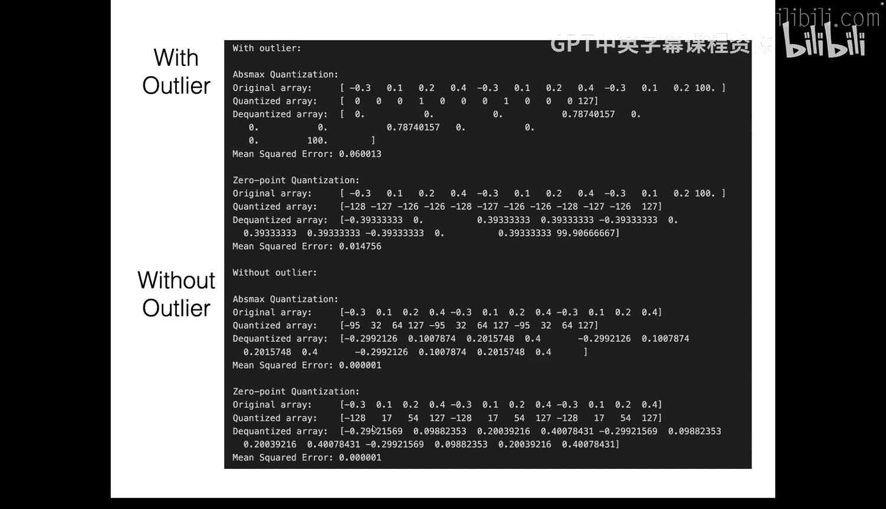

And so here's a really kind of influential work and it's by Tim Detmert。

 who's now a professor here at CMU。And it's called LOM。t into8。

So what they basically observed is that these transformer language models have certain features that are outliers。

So if you look at the columns of the activations。Then they noticed that consistently the networks would have。

 yeah， these columns， which were just like much bigger than the other ones。

And the interesting thing is like these these outliers were appearing mostly in large language models。

 so models of over。6。7 billion parameters are over。These would occur kind of more frequently。

And in particular， some outlier would there would be at least one outlier in 100% of the layers in the network as you kind of pass activations through on kind of you know。

 reasonable or real data。And so the hypothesis then， is that。

Quantization kind of wasn't working well for the really large models。

 and so the hypothesis is that there's this huge performance degradation due to these outlier features。

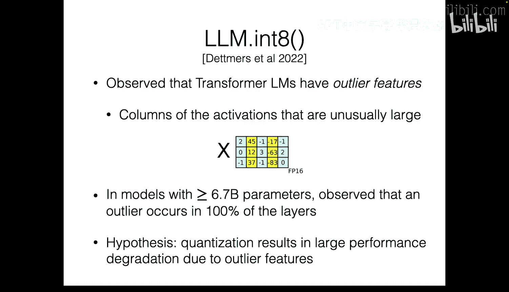

And so here you could again kind of convince yourself of this by looking at a really simple example。

So here what we've done is we've taken this matrix multiplication example。

And we've just set one column to， we've scaled it up by 100。

And so now you could see here you have this。What we are calling outlier feature。

And then when we quantize and do the matrix multiplication。

Now you're getting a much bigger means square error， maybe I should have shown the previous one。

 but the error was kind of ors of magnitude smaller without the outlier。

And hopefully it shouldn't be too surprising based on what we were just discussing。

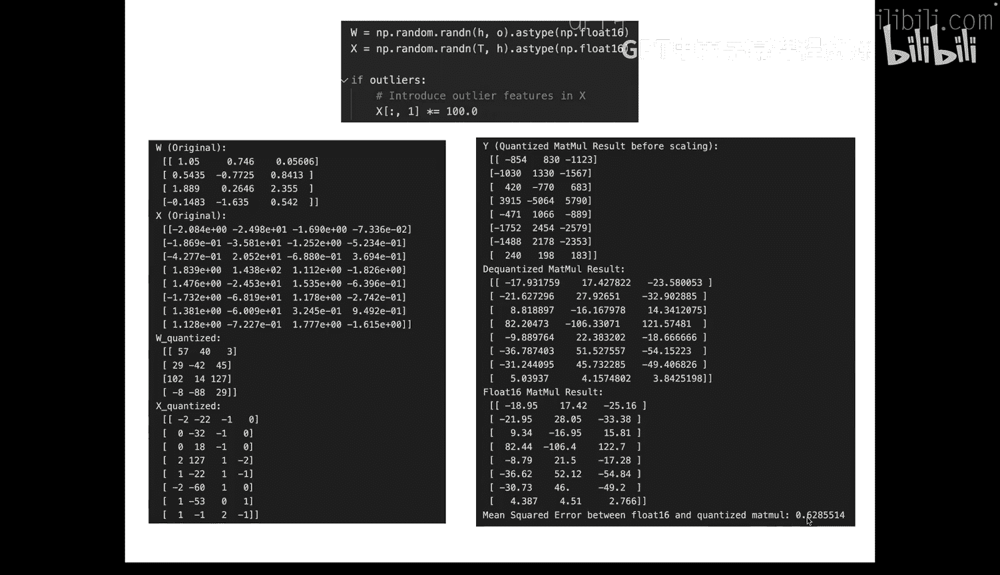

So what they basically did is say like， okay， if these outliers are occurring。

Then maybe we can break down the matrix multiplications in the network。

Into high precision and low precision。We can perform the outlier computations that involve outliers in a high precision and perform the other computations in low precision and then kind of merge the results。

And so the interesting thing is that although these outliers appeared in every layer。

They would only be some really small percentage of the features。 and so only like 0。

1% of all features in the network are outliers。So this is kind of good because then if we break apart the computations。

 we're still saving a lot of。Memory or a lot of compute。Because this is only a kind of。

I guess the features themselves are outliers in some sense。So here's the picture。

 so again here you have x and you have the weight matrix。And you could consider again。

 how matrix multiplication is performed。And you can see that， okay， for this outlier feature。

 it corresponds to you performing some multiplication with these rows of。

 or it'll be multiplied by these rows of the weight matrix。

So you could basically split up the computation， so down here you could do say 16 bit multiplication。

Up here， you could do say8 bit multiplication after quantizing and dequantitizing。

And then you can kind of merge the results， so add them together。

So that's really the key idea behind。This method， L M into 8。

And they have this really cool plot if you haven't seen it before。嗯。

So here on the X axis we have the parameters in the language model。

And then here we have accuracy on a bunch of benchmarks like average together。

And you can see here that if you use quantization in orange。To 8 B。

 it's actually doing kind of well for these smaller models。 And then right when you hit。

S billion parameters， it's not working too well。Okay。

 so then they found that these outliers were really occurring in the large models。

 and then after use their method， which kind of splits apart the computations。

Now you can do pretty much just as well as the 16 bit model。So it's really cool。

I think on Tim's blog， he goes into some possible reasons for these outliers。嗯。

I think one reason is that the network can use it to kind of erase things。

 so if you have a really large value， then you can cancel out。

Things after taking a softm kind of hand waving you'd have to。

Look at the details to convince yourself of that。嗯。But yeah， so it could be that， you know these are。

 these outliers are effective for like implementing different things and the model kind of learns to use them somehow。

And then here's just showing， well， one part is to show that the stuff I introduced is kind of showing up here and then also to show their improvements。

So you can see the apps max and zero point and then this is perplexity so lower is better and you can see yeah。

Their L intake method is。Basically recovering the perplexity。Of the 32bit model。

 which is pretty impressive。嗯。

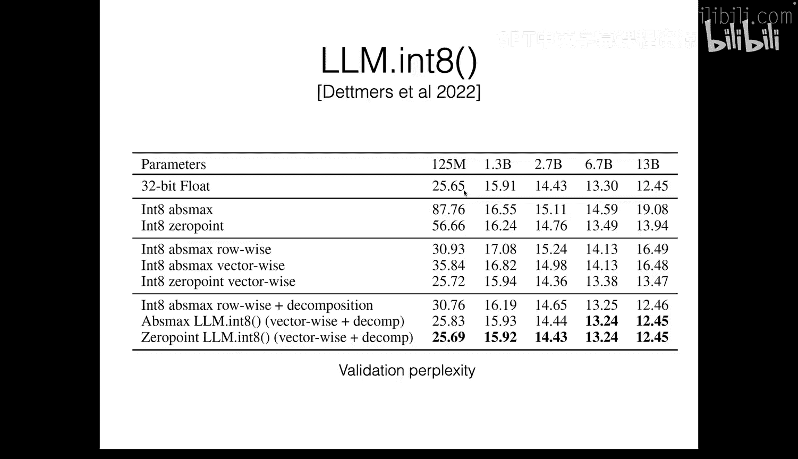

So I think that's my last slide on this in 8。 I want to show。

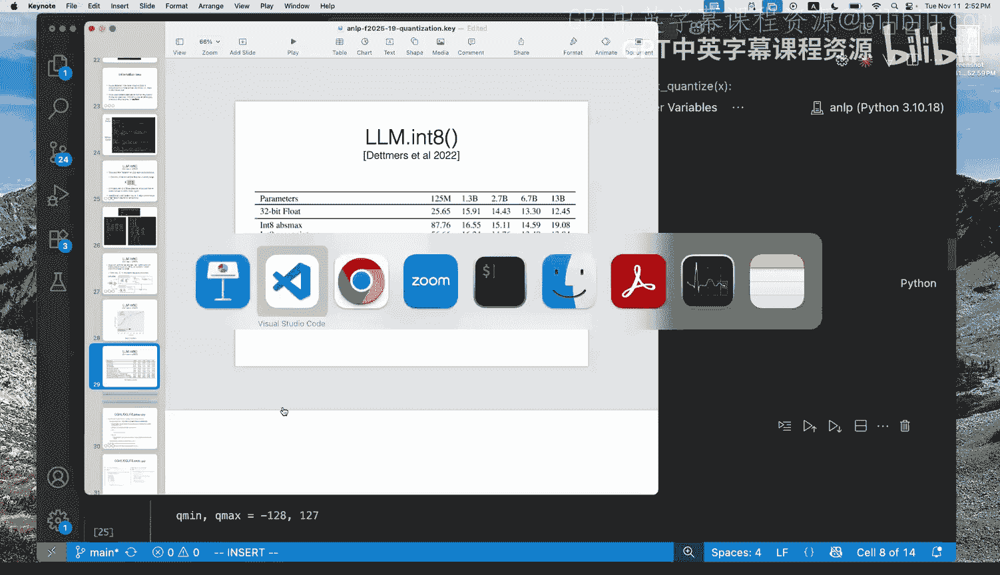

This library， so if you want to use this， then it's also implemented。

 you can see it's a pretty popular library， it's called bits and bytes。

And it's also integrated in with Huging face。So here you can see that you have this。L M into8 or。

A big quantization。And so then you can use this to kind of run inference with a model on a variety of devices。

So instead of doing a code example with this， I'm going to go over another library that's really popular。

But any questions on this before we kind of go to the next part？

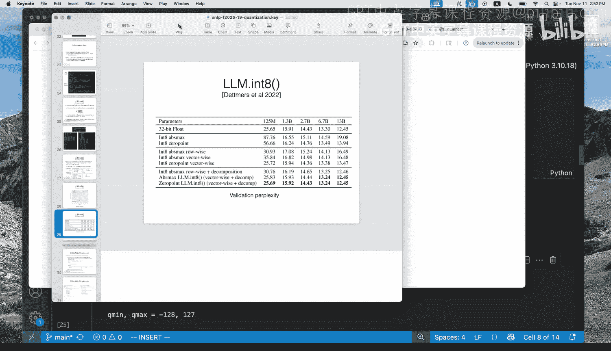

Yeah so it seems from the quant the first we have covered done now that you scale and shift。Maybe。

 which is like you're assuming that you would want to quantize uniformly across like there and Marine are there methods where we explore like non uniform quantization so that you have more precision at like a smaller。

 but not as precise than like very small numbers of very large numbers。嗯。

Probably so there's other methods that we're not going over that will。

Actually do a kind of learned strategy， so they'll say if you if you consider quantizing this one column。

 then you'll incur some error。So then set the rest of the weights to values that like minimize the error。

And so it might end up looking a little bit different than the techniques use here， yeah。

Any other questions。Okay， so yeah， I was considering whether to put that in the lecture。

 the method I just mentioned is called GPTQ。Or a follow up is called AWQ and you'll see that used a lot as well。

 so you might take a look at that after。嗯。So but here I want to introduce this method and it turns out to use kind of more naive quantization。

 but this library is really popular and I'm sure you'll run into it。

So it's kind of three different things， GGML， GG UF and Lama CPP。

So GGML refers to this library for tensor operations。

 and it kind of has its own quantization methods。And so an example is they have these kind of this naming scheme and they have like you know。

 20 different types of quantization。So we can just walk through an example here。

 and then I'll show you that this is really used in practice。

 which is why I'm going through the details。So an example method is called Q4 underscore K。

And so what this does is it basically groups the weights together into blocks。

 so you break apart the weights into blocks。And then you're going to quantize each block individually。

So here， for instance， this particular method will use。嗯。It'll have these super blocks。

 each one will have eight blocks， and then each block has 32 weights。

 and then this will use a four bit precision。Okay， so some of the variation methods will be kind of how they split things apart。

Then you'll compute， it'll again be based on this kind of scaling and offsets。

And then you can store those numbers。As。Using some format here they choose six bit。

And then this Q4KS basically means use this strategy for all tensors in the network。

Then you'll also see this like Q4 km and that means you use this Q。Oh， sorry， Q6 k。

 this is what typo， you use six bit for half of certain layers in the network。

And you use this Q4 for the rest。And again I'm not sure how they decided this。

 I looked at this pull request and they don't have a paper about the quantization method and they say we don't want to write a paper。

 we just want to build a tool so but yeah， these are the methods。

And so there's some mixture of basically deciding this block size。

 deciding how many bits you're using， and then they decide like。

 do you have everything in low bit or some other layers in slightly higher bits？

And then the idea is the library will support multiple backends。So you can run it on metal。

 which is like the the。Mac specific runtime， you could run it on an arm CPU or on KUDa。

Then two more things， so then this GGUF is made by the same group。

And it's just a file format for rest storing architectures。That kind of use the things up here。

And then finally， there's this really popular library called Lama CPP， again by the same group。

And it'll be a kind of library for language model inference。That uses these things。

 so it'll use models that are stored in this format and it'll use these quantization techniques。

So this is just， so it's open source so you can go look at the code if you want and they basically implemented everything and it's supposed to be efficient。

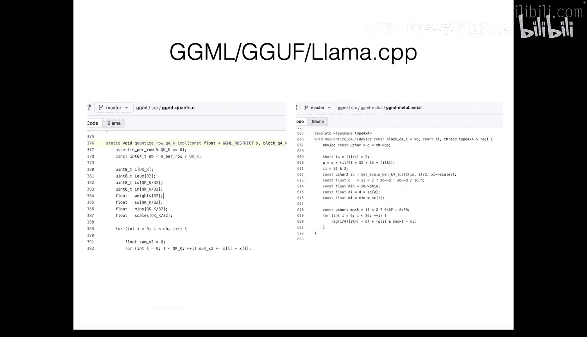

And then we can look at an actual example。 So as I mentioned， this kind of took off in popularity。

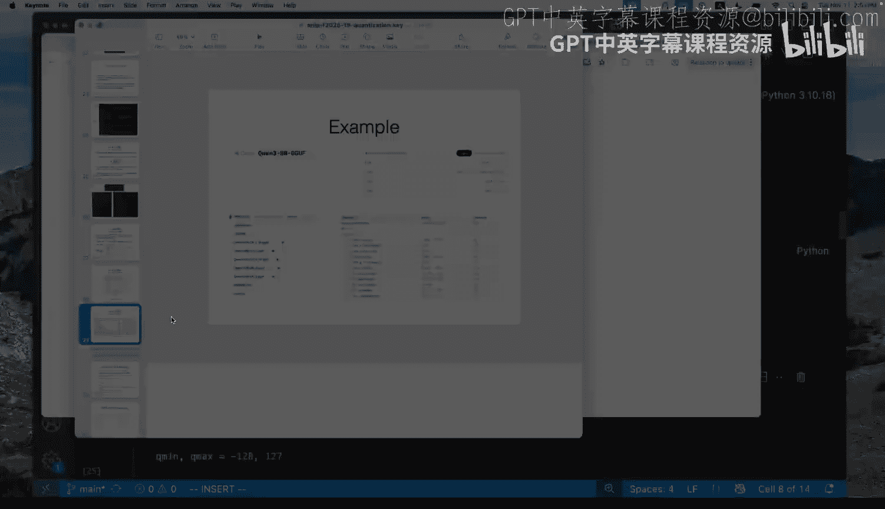

And so you'll see these types of methods being used lot。

 So here you can seequin like the officialquin team released these G G UF versions of Quen3。

And here you can see what I was just explaining， so there's a Q4 km that'll be 5 gigabytes。

Or you could go up to Q5 km or Q6 or Q8， so that's what I was just explaining before。And again。

 as you go up in a higher bit， typically it'll have less error or less performance degradation。

 but it'll be a larger model。嗯。Then what you can do is you could go to the Sma CPP library and install it yourself。

 and then you could run these versions of models that people have uploaded。

So then here in the second part， there's this notebook that just has two lines。So first of all。

 it's installing Lama CPP。And then here it's actually taking the model that I just showed you whenn。

Quent3， the Quaized version。And here it's just running on my MacBook Air。

So you could see here maybe a few things， so you could see that its detected that it's Apple M4。

 so it's going to use the relevant。ABack code for that。And。Yeah， then here's just some。

Some other stuff。And then the interesting thing is that。This just came out a week ago。

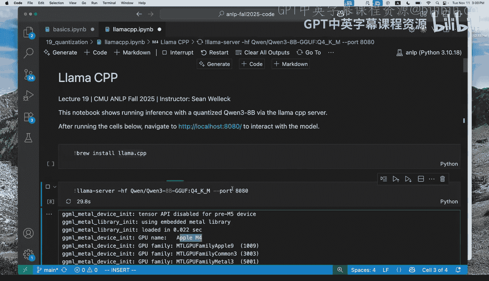

But you could basically have your own version of chat GPT。Just running here。😊。

So this is on local hosts and it's basically hosting this Q3 model and then I have this kind of chat GPT interface。

So tell me about。It's up here。Let Cm u。Now， you do get an appreciation for how fast chatGBT is。

So this will be one of these reasoning models， so here it's kind of reasoning through the query。

 but this is literally running like on the laptop。😊，Okay， so I need to explain。

What advanced NLP like at CMU， Let me celebrate。So thanks for a while。

 hopefully eventually we'll get to the。Output anyone have any questions about this walls generating？

So anyways there's a few of these libraries now and I'll probably go into the more in the inference lecture Lama CPP there's other ones that are maybe by startups Oama or LM studio and so now with these quantize models you can kind of feasibly run。

You know， reasonably sized models and。You could see that， I mean， the speed is not too terrible。

Just on your laptop if you want。So when I tried this before， it wasn't very good。

 it hallucinate a lot or it just doesn't know that advanced enLP is a course。Yeah。

 I just talk about advanced NLP education。Okay。So。Yes。

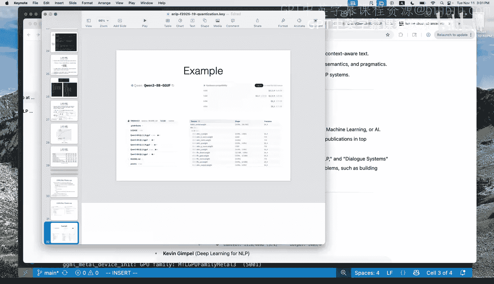

嗯。So that's that and then again you'll probably see these models everywhere so now you have some understanding of them and you can also quantize your own models。

If you want。So then here is what I was talking about before。

 so I've been talking a lot about the integers。But especially since this quantization started taking off and LLM started taking off now even like new formats are being designed。

So here's one that NVIDdia created NVIDA FP4， and it's basically their own four bit representation of floating point numbers。

And you could see that here they released it with this GPU architecture。

 so the old architecture wouldn't support this format。And as I was telling you about before。

 if you want to read about the details， you see some of these ideas that we talked about come up so they have like blocks。

 they have scaling， things like that， so hopefully you should have enough understanding if you want to learn a bit more。

Okay， so the tradeoffs， so quantization of course， reduces the memory requirements and I guess I didn't go into too much detail。

 but in practice you may or probably will see some performance degradation based on the method。

So if you look at different papers like the In8 quantization paper。

 they do argue that by taking care of the outliers， you don't see any performance degradation。

 I'm not really sure like since then whether there's different findings。

 but as we'll see on the subsequent slides that you are able to improve over these methods with some additional training which suggests that there is a degradation。

Then as I mentioned， the dillma CPP。Excuse me。Uses are more if you want naive quantization。

And there you can look at like their benchmarks and usually see this trade off with。

Amount of quantization and performance in terms of like perplexity， things like that。Okay。

So in the last part， I wanted to briefly talk about quantization and training。

So here there's this idea of quantization where training or。Q A， everything is an acronym。

And so the motivation here is。Let's say you've pre traineded a model now you want to somehow fine tune it so that it's kind of ready to be deployed as a quantized model。

嗯。So the basic idea is to insert these quantization operations into the computational graph。

And then fine the model。 And then so basically， it's learning。Like the the quantization is occurring。

 and so it has to learn how to， you know， get good loss。

With this quantization operation kind of inside of the network。So concretely。

 what you could do is something like this。So you could look at a given model layer， let's say。

 you know， some feed forward layer or something like that。

And then you could basically simulate the process of quantizing and decoquitizing。

So here you have the input， which will be or the current activations in the network。

 which will be X float。Then， you can。Yeah， simulate the quantization。And then， de quantize。

And I'm saying simulate because here it's never converting this into an actual。

 you know integer or something like that。Everything is still in Float 32。

 you're just doing the actual operations like rounding and scaling and then the reverse operation。

Okay， so now the model has to learn to kind of not have its performance to grade。After。

Now that it has the quant values。Okay， so this screenshot is actually from this Pytorrch blog and then here's some experiments they ran。

 and it's a bit small， but this is what I was telling you about before。

So here you have no quantization in blue， and you have the。Quantization and wear training in orange。

And then at inference time， this is going to be using an actual lower precision。

 whereas the blue bar is using a higher precision。Now PTQ refers to the set of methods that just quantize a model after it's been trained。

 so post training quantization。So that'll include things like。

You know what Lama CPP is doing or anything in that family method。

And you could see by doing this additional training， they're doing a bit better than the PTQ。

 maybe actually， there's an exception right here。Here's another example from NVDdia。

And you could see， again， this difference between the training and the non training based methods。

The dark green will be the training based one。This one is actually， they go one step further。

And they do this quantization where distillation。So again， I'm not going to go into too much details。

 but basically， they have the。The quantization aware。

So they basically do distillation where one version of the model is the original model and the other one is like the quantization where model。

 and then you can minimize this like distillation loss between the two and basically train the model。

To be quant aware。Okay， so sometimes you do see these kind of large。Differences。

 and I think this is a kind of active area that's still being investigated。

But here's a kind of really recent example， I think this model was released。

I don't know last week or two weeks ago， I was something that。

And here you can see that they did this quantization of wear training。And so the model。

Is kind of trained to specifically operate in in4 so then you could do kind of efficient inference。

 you could have really long context lengths， things like that。嗯。Okay。

 so I think that was all I want to say。Here and then this is the last thing to mention again I'm just kind of pointing you to these things I wasn't sure how much time there would be so I'm not going into too much detail。

This is a kind of different motivation， this is saying we want to fine tune a really large model。

 say on a small GPU。How do we do that Well you could try to take advantage of quantization。

So here is this method called Q Lauraura， again the first author was Tim。

And here what they're doing is you represent the model that you want to fine tune in four bits。

Then you do the actual updates in a higher precision。So oh sorry。

 so then you do the Laura thing where you have the lower layers and those can actually be in a higher precision。

So you save a lot of memory by representing the model this way。

 but then you can still have high precision updates。Then additionally， they do this kind of paging。

 so if you run out of GPU memory， you can kind of split things apart and offload things to CPU。

So this will slow down the fine tuning， but then they have these kind of nice results that were like kind of shocking at the time where they fine tune。

 I forgot exactly what it was like 175 billion parameter model on one GP or 3 GPU or something like that。

Okay， so again， if you look through different libraries or this will be in bits and bytes。

You might see this Q laura technique and it's so really helpful if you want to kind of fine tune a large model with a small。

Number of GPU compute。Okay， so to recap， we went over。thThree different things。

 So we went over how to represent numbers on a computer， talked about floating point and integers。

We talked about。Quantizing for the purpose of doing inference efficiently。So two different methods。

This issue of outliers。And then some different approaches。

 So this LM into8 and the Lama CPP approach。Finally。

 we kind of quickly went over some topics related to training。

 so training a model so that it's kind of ready to be used， quantized at inference time。

 and using quantization to make fine tuning more kind of feasible or efficient。

And so it turns out that there's a lot of。Other methods， there's just a lot of research in this area。

 but hopefully you should have enough。Kind of。Knledge to go like read about these things if you're interested。

 like I mentioned another method that I've seen pop pop a lot is this kind of GPTQ or AWQ method。

 so you might see these things come up and you could kind of look into what supported or what are the tradeoffs with them。

And then I showed you at least one library that you could use。

If you want to like run the quantize models on your laptop something like that。Okay。

 so that's it for today's lecture and there's time for questions if anyone had any。

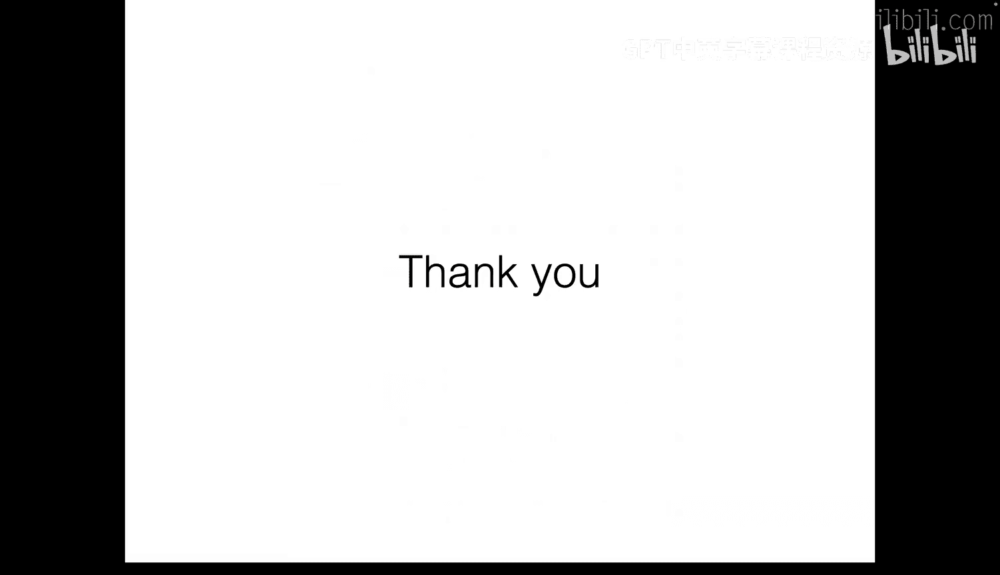