# CMU《高级自然语言处理｜CS11-711 Advanced NLP Fall 2025》中英字幕 - P1：(1)_ Introduction & Fundamentals.zh_en - GPT中英字幕课程资源 - BV1ZWYAzuEMa

よ。嗯。So today I'll go through an introduction and some fundamental ideas and the ideas kind of give。

A broad framework that actually captures a lot of things that we'll cover in the course。

So towards the end of today's lecture， I'll go through and go through each lecture that we'll have and then say how it kind of fits into the framework that I just introduced。

And then at the very end， we'll go over kind of all of the fun stuff like the course policies。

 late days。嗯。Registration and things like that。So we actually have a lot to get through today。

 so with that I'll get started， oh I also want to mention that we have the course webp page here so I'll talk about it at the end。

But the course webage is here， so it has readings， there's actually readings for today。

 but some people might have not seen the web page so it's not a big deal。

But if you want to go after today's lecture and read more in depth about some of the ideas I introduced。

 then definitely check this out。We'll also have code examples throughout the course so there's this code repository here and it'll basically be added to prior to each lecture so currently just has the code for the first lecture in there。

Okay， so。First question is this course is called advanced NLP or natural language processing。

 so what is natural language processing？Well， it's one of these things that doesn't really have a。

You know one single definition， so here's one that I kind of came up with。So it。

Involves technology that enables computers to process， generate and interact with language。

And some key aspects of NLP are that we're often concerned with learning useful or good representations。

So we want to capture some sense of meaning that's present in data in text data and other types of data。

In some way that we can ultimately use for different downstream tasks。So for instance。

 some embeddings that we can use to classify document or to answer a user's query or something that。

嗯。Most of the techniques nowadays involve a notion of generation so generating language。

 so creating language， whether it's text or code。And this could be for various tasks like dialogue。

You're probably familiar with chat GPT translation， question answering a variety of different tasks。

And then finally。Kind of going beyond maybe traditional NLP nowadays。

 a lot of people are thinking about how you combine language with actually taking actions in some environment or in some world。

So here you might use language to perform different tasks to solve different problems or interact with some environment and so language is just part of this larger environment and then ultimately you're taking actions to achieve some goal so we'll talk about that in the course as well。

So here's three different examples and this I didn't change from last semester so these are actually from January and as you might imagine with this field。

 these do become outdated， but at the same time they're also still very relevant so here was at the time the state of the art model deepse version three。

And here's this site called Togetherge。AI， and this is one of these language model API websites and they have this interface where you can chat with a language model。

And so here I just typed in this message and it's a bit small， so maybe I'll read it and it says。

 hello， I'm showing example of large language models or LLMs to my class。

Can you generate some cool looking text。That shows off your capabilities。Maybe something brief。

With English， Japanese and Python。So kind of creative combination and it comes up with something。

And it generates some Python code。 It says language models can bridge cultures and technologies creating。

Something， something。And then it gives us some Python code called with a function called bridge cultures。

 and then it prints out the message。So just kind of random。

 but as I'm sure most people are familiar with nowadays， if you use something like。

Chat GPT or some type of you know generative AI tool now a lot of people are familiar with stuff like this。

 but even just you know one two three years ago， this kind of thing was like brand new and so we'll learn about you know most of the key ideas behind building a system like this。

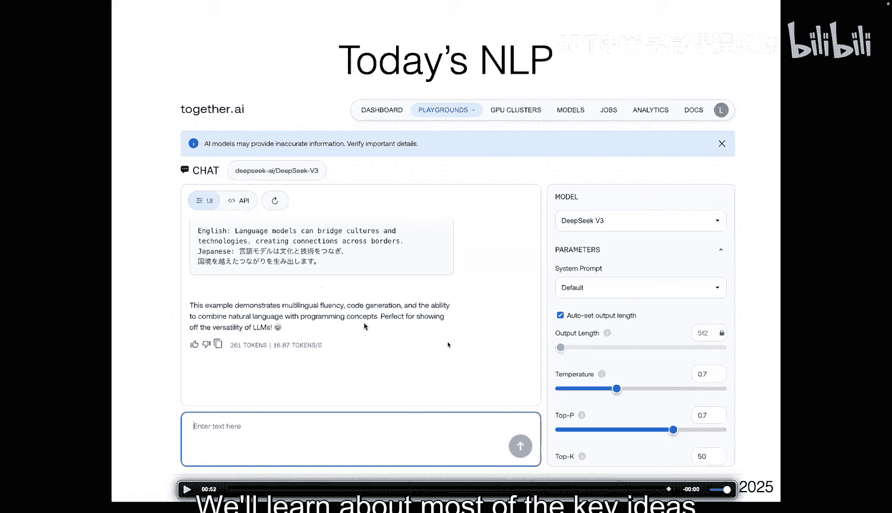

Here's another example and this was again really recent in January of this year。

 so this one's called Open Scholar and this predated， if you've used these tools like deep research。

 this kind of predated those so the idea is you can type in this query。

 so I asked it to summarize the key contributions of this paper。

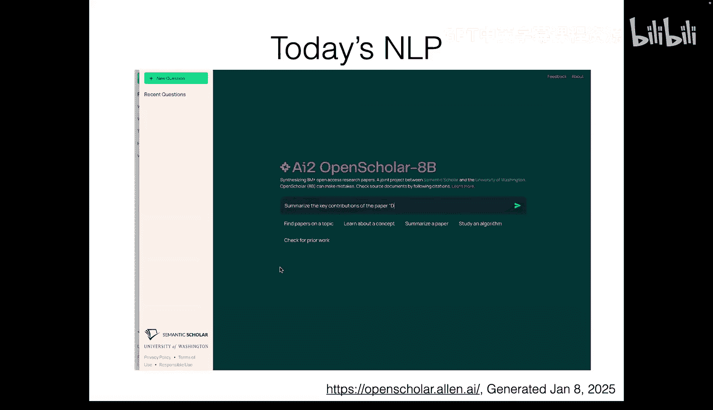

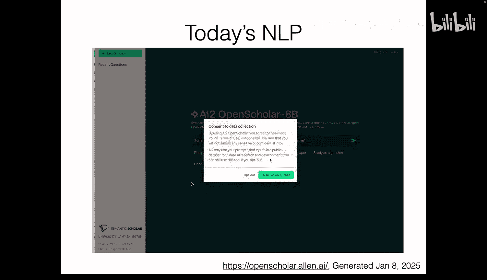

And then it's going off and it's retrieving various documents and combining information from them。

 and then it's using a language model to come up with a summary。

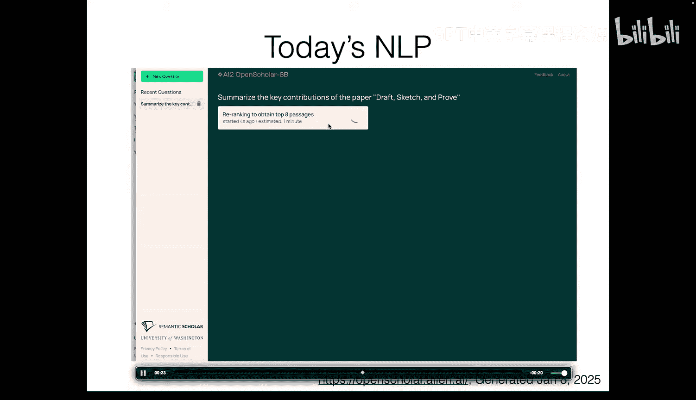

So I won't read through the whole summary， but this is a paper that I was a part of。

 so I was able to kind of check it and it turns out it's a pretty good summary。And so again。

 here you'll actually have a whole homework on these kind of retrieval augmented generation models that are really one of the key ideas behind you know。

 systems like this。

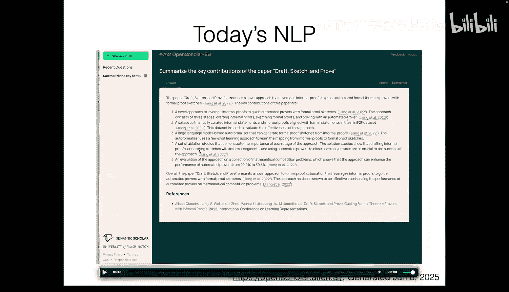

And then here's one more example， so this is。This tool called Open Hand。

 so this is developed by Graham who has taught this course multiple times。

 he's a professor here at CMU。And here we have what is called a software engineering agent。

 and so on the left here you can kind of have this conversation with the agent。

 so I said I want to learn about matrix multiplication and Pytororch。

 maybe to review you know some basics for this course。Here it searched the web。

 it got some documentation， probably and then came up with this message。And then I said， cool。

 can you make a simple example in a file？And then so over here you have this code editor and。Yeah。

 hopefully pretty soon， it will。It'll do some code here。So here it comes up with this example。

And then you can keep going。 You know， you could say， like， how about。An example。

With different dimensions because this one's kind of boring and then it can go and edit the code。

So again in this course we'll go over agents， we'll go over techniques for training agents based on reinforcement learning。

 things like that， and so you'll see you know some of the key ideas behind。This area。

 which is like one of the active research areas in NLP right now。

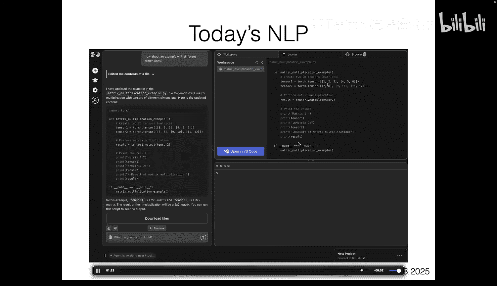

Okay。And so if we think about starting to formalize things a bit。

 these different tasks that are performed by NLP systems。

 they often involve some input and some output， so you have some input X and some output Y。

 and maybe we could define an NLP task as you know X and y somehow involve language in them at some point。

So some examples， your input could be text， your output could be a label that's typically called classification。

 text classification。Your output could be text in another language then you have translation。

You could also have non text inputs so you could have an image and then output some text。

 so an example of this is image captioning and we'll go over we'll have two different lectures on these kind of multimodal models。

Or you could have。Instead of just looking at， you know， something like。

Translation you could have a search query and then your output is not necessarily just some text。

 it's actually a list of documents。And so that is this information retrieval。

 which we'll talk about as well。Or your input could be some state of some environment it might be。

 you know in this code agent， it might be the state of the。

The repository and the conversation you've had so far。

 and then ultimately you want the agent to output some action。

And you could frame many different tasks in this way。Okay， so then just at a pretty high level。

 we could think of what are some different ways of creating these NLP systems？嗯。So one way。

 one valid way to do this is to basically go through and write a bunch of rules and try to come up with a system that's useful。

So let's say you want to build a classifier。And it classifies whether。

 you some document is a sports document or some other document。

And so what you could do is you could try to write down every single sports related word and then basically do a loop through your document。

And if one of those words appears， then you could say it's sports。

 and otherwise you say it's other document。Or you could do some type of machine learning。

So in supervised learning， we would have this kind of paired data so you'd have your inputs paired with some output label。

And now you don't necessarily have to write down all these rules。

 the hope is that by applying this training algorithm or learning algorithm。

 you could get some model which can take in some text and then output the class。And then finally。

 this is becoming more and more common in NLP， so even like last semester I don't think I had it on this first lecture slide。

 but it's being important， it's becoming an important part of developing the state of the art systems。

 which is reinforcement learning。So here you kind of set up some environment。

And then you get some states and take different actions in the environment。

And your goal is to maximize some reward function in the environment。

And so we're not going to go into detail here， we'll have lectures on this。

 but you can kind of see how it's a bit different from the supervised learning setting。

And then these different settings will have different data requirements。

So another way that you could create a NLP system is to do prompting so for instance。

In the input to a language model， you can describe a task and maybe give it a couple examples。

And so there you might have very little need for data you're just kind of describing the task。

You could also， as I mentioned， give the model a few examples and so that increases the amount of data that you need。

And then if you actually go to train a model or fine tuna model。

 then you kind of have to assemble this training data set， and so the data requirement increases。

Let's say you want to do reinforcement learning then you have to construct this environment and kind of frame your task in terms of what are your inputs。

 what are your states and your actions and then what is a reward that kind of。

Says whether given actions are good or not。So the basic idea here is whatever strategy you use。

 you end up having to think about what type of data you do or don't have available to you。

 what other forms of supervision you might have， and then how you can use that。

Or building your NLP system。Okay， so。Just to motivate a lot of the- so most of the techniques in this course will be based on machine learning。

And it's actually kind of fun to kind of motivate why do we need machine learning。

 why do we need neural networks， and so here we're going to actually build one of these rule based NLP systems to kind of motivate the learning based ones。

So here we are looking at the task of classification。And so。

We're given some review from some website and we want to decide whether the review is positive。

 negative or neutral。So these might be movie reviews and so I hate this movie。

 I guess we'll say it's negative， I love this movie， it's positive。And I saw this movie is neutral。

So if you formalize this a bit， then the goal is to design this classifier。

And we'll use G denote the classifier。It'll take in some input X， which is the input sentence。

And then we have these three different labels， minus1， which is negative zero， which is neutral。

 and one， which is positive。And so here we're going to assume that we are given some data set of paired examples。

 X and Y， and we can kind of use that to build the classifier。

So a general pattern which will apply to this robust based one。

 but it'll actually apply even to you know， using like a large language model is to kind of break down the。

The procedure into two different parts。So the first part is computing what's called a feature vector。

 and this will basically give you some representation of your input sentence。

Then you will compute a score and the score could be basically weighted sum so here we have。

These weights， so this will be a vector， and there'll be H different weights。

And then here we have a feature vector， which is8 of dimension H。And so here again。

 this feature vector is basically what is the representation of your sentence that's being used to compute the score。

And then。We'll use this。Data to denote the parameters。So here the parameters of the system are W。

 we have to set these weights when we're doing the weighted sum。嗯。

And then we'll have this step and it's called inference。

 but in kind of natural language making a decision。And so now once we have our scoring function。

 we want to actually decide which class。This given input X belongs to。

And so here we have this inference algorithm or decision function。

 and it's basically saying look at the sign， so if the score is positive。

 we're going to classify as1， if it's zero， it'll be neutral， if it's minus1。

 it'll be a negative review。And so actually。In this really simple example。

 we can kind of see the three key ingredients that will appear in almost any method that we talk about in the course。

So the first is what I'll call parameterization。So this is saying that you want to build the scoring function。

And you have to decide actually how it's kind of implemented。

Here we're doing this feature extraction step and we're assuming that we're like multiplying the features by some weights。

And that's something that we had to decide。 We had to like， design that。

And so all of those decisions will kind of go under this umbrella of parameterization。

And once you have your system， you want to actually set the different parameters。

So typically we'll use a learning algorithm in this really simple example。

 we'll just set them by hand。And then when you actually go to make a decision。

 this step is called inference。So you've。Defineed your system。

 you've done the learning and now you want to actually use it， that up is called inference。

So here we have these code examples for the course。

And we have this implementation of this classifier。

 and you can kind of break it into these three different parts。So let me actually go through。

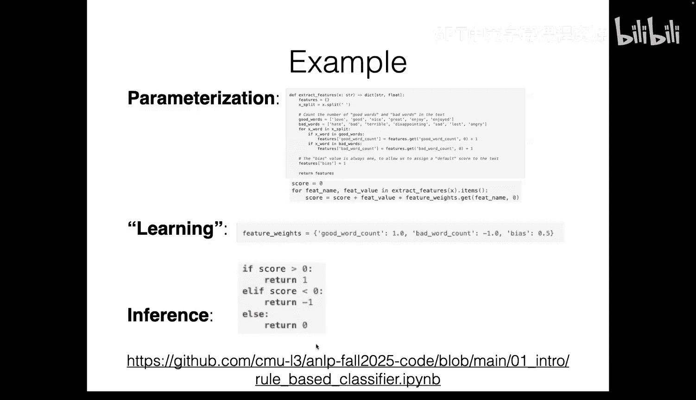

This code here。 And let me see if I can make it big enough。嗯。So I won't read through everything。

 but here we're building one of these classifiers。And so here is this feature extractor。

This was denoted as F of x in the slides。And so here you could see that。

What we've done is try to list all of the possible good words and all of the possible bad words。

And any time a good word appears in the document， then you'll increment this feature up by one。

Similarly， any time a bad word occurs， you'll implement this bad word feature up by one。

 So it's basically counting how many。Good and bad words。 Does a document have。

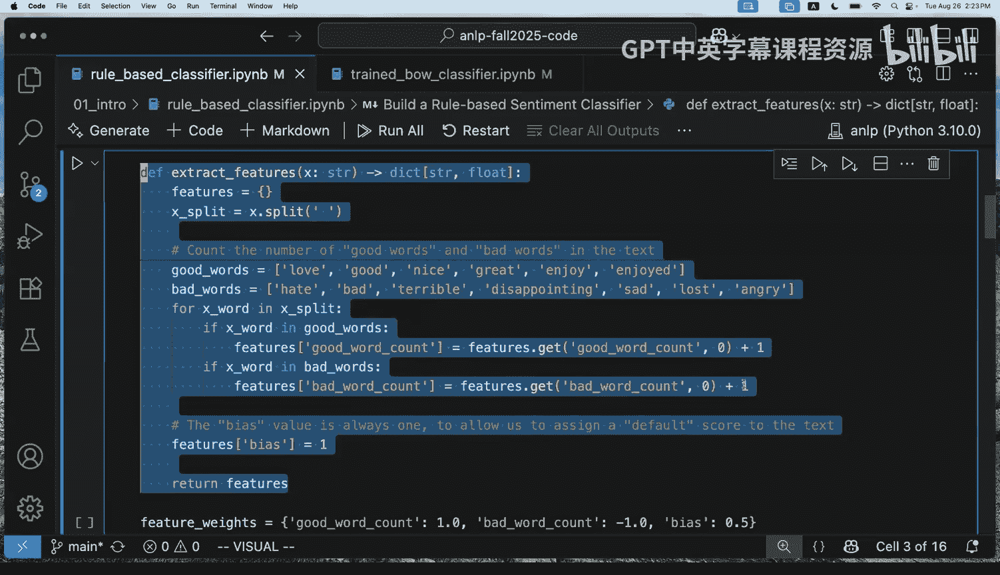

嗯。Then we have an additional position which is called a bias。And this is basically saying， like。

 what is a good default score to put into。What is a good default score for the classifier。

And so maybe we set it to something positive。Then here we have to set the weights。

And so we can kind of use our intuition and say。Well。

 maybe we can wait the good words as positive and the bad words as negative。And maybe choose 0。

5 for the bias because it seems like a good number。

And then what you could do is you could actually use the training set and as a human go through and try to you know build up this set of rules。

 expand this list of good words and bad words， and try to build a really good classifier on your own。

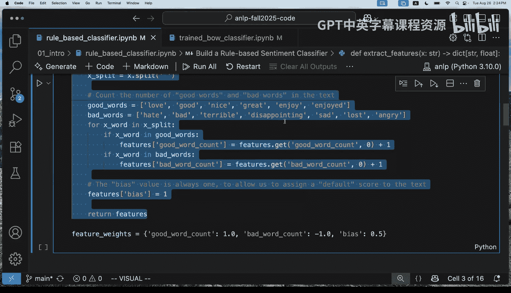

嗯。So now we can read in the the data， so this code example， if you want to run it actually has data。

 here's an example。Movie review。And the label is one， so it's positive。嗯。

And then here is our inference function， so here we're basically going through。

And this is implementing the weighted sum。 So yeah。

 here we have the the feature value and then the feature weight。 and it's just。Kind of this you know。

 naive， simple implementation of weighted sum。And then we。Choose the class based on the score。

So now what you can do is you can go over your data like your development data or if you're done with development。

 then your test data。And then you can measure the accuracy of this classifier。And so here it got。

This is just the label counts。And then here's the different acuracies。

So it gets 43% training accuracy and 42% dev or test accuracy。And then finally。

 you can do some error analysis。So you can look at examples that were classified incorrectly。

And so let's take a look here。The leads we are given here are simply too bland to be interesting。

So does anyone know why this was classified as positive？We thought investing is a good word。

 and we only focused on that and blind words。other negative wordsmen not daily large。Yeah， exactly。

 so it gets hard to kind of capture all the different cases。

 all the different nuances with this kind of hand specified word list。嗯。So。😊，Yeah。

 I won't dwell on this too long， but you know， these are the same steps that you'll go through with most NLP systems and it you can often get a lot of insight by actually looking at the outputs and kind of seeing where it goes wrong。

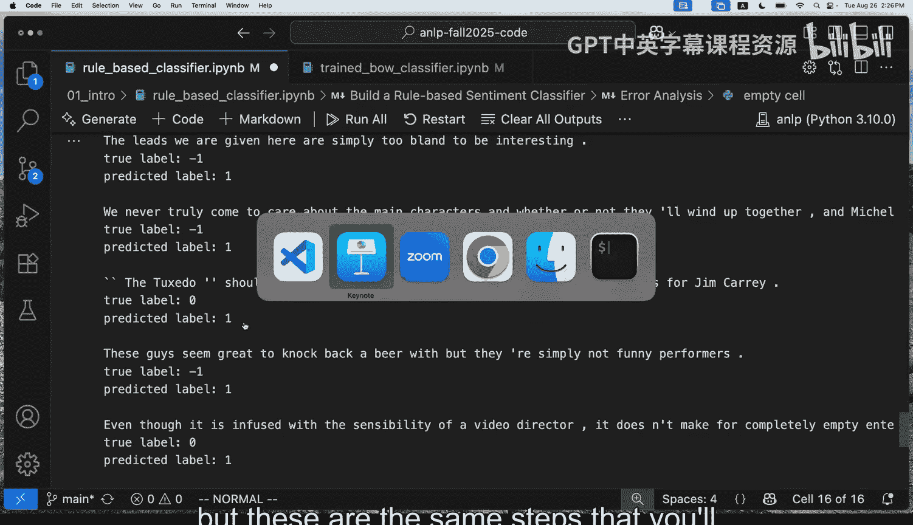

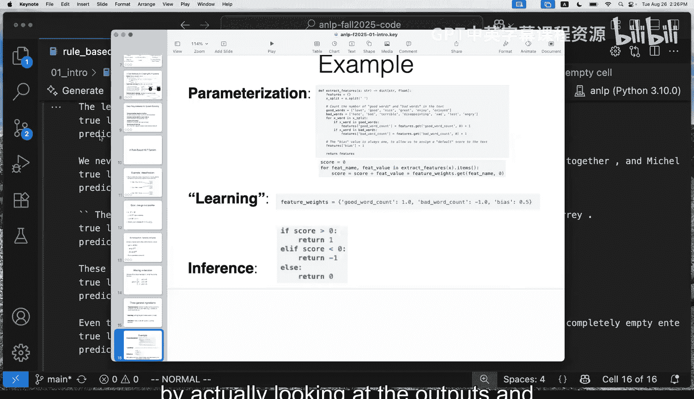

嗯。So。Again， to kind of motivate the methods that we'll see。After this。

 some cases that this really struggles with are low frequency words。So， you know。

 we might have not thought to put the word tenuous in our negative word list。

Or this other word purport。Yeah， similar like this。

 so your your set of rules basically have to cover the common words。

 but then also these kind of lower frequency rare words。嗯。Also。

 let's say we come up with a really good word list。

 well then there's kind of like different forms of words。

 so if we only have entertaining or like entertained。

 then we have to account for these different forms of the words。啊嗯。Or if we have long。

 then you could say over long。And so possibly we can build in some kind of。嗯。You know。

 linguistic analysis here， and it kind of makes the system a bit more complicated。

Then you could start looking at the structure of text。And so sometimes we have negation。

So this one is not nearly as dreadful as expected。And so you kind of have to program in this logic that starts appearing when you have negation。

So here you could start to come up with rules。As the inputs get more complicated。

 you might miss some edge cases。And it actually turns out to be kind of hard to kind of program in all of these。

Nuances that come up with negation。And then here's a tricky one。

 let's say you want the system to understand kind of metaphors or analogies。嗯。

So puts a human face on a land most Westerners are unfamiliar with。

And you ultimately want the system to say that's positive。And so here again， it starts to get。

Difficult to imagine， like， how do we。indPro this in in a way that it'll work in all different situations。

Okay， and then just one more just to drive the point home。

 let's say you do all this work and you actually have a really good set of rules。

 well then maybe you want the system to work in other languages and so then you might have to redo all the work for every new language。

嗯。And then this is just for classification， right， So there's a lot of other tasks other than classification。

And so in general。It's like nowadays we have things like language models and things like that。

 but it's actually kind of amazing that this seems really。

 really difficult and ultimately we want some some really general purpose system。

Where for any given input or any given task， we actually don't have to spend that much effort and we can use the system on the task or on the input。

So this kind of motivates techniques that will try to learn the scoring function。

Let me actually pause for a second。If anyone has any questions so far， otherwise I can keep going。

Okay， great。嗯。So here we want to take advantage of the supervision that we get from a training set。

And try to use some algorithm which kind of sets things in the classifier automatically。

So that would be the learning algorithm。And so ultimately。

 we'll get some learned feature extractor versus one that we kind of。Our hands coat ourselves。

And then also we can learn these weights to do the weighted sum at the end。Then given this。

 we can use our inference algorithm on some test examples so we can take a test example or a dev example。

 give it to the inference algorithm。This should also have x as an input。And then it can classify。

New impulses。So here。We can actually think of a kind of。

It'll turn out to be like a very general recipe for doing this。

And it all comes down to learning this really good scoring function。So。If we think about it。

 what we want to do is take an input。And then for each possible class。

Say how compatible that class is with the input。So like for this review。

 is it compatible with the class positive or negative or neutral？

And so this could be called a scoring function。And it's also called an energy function。

So there's this really cool tutorial from 2006 by Jan Laoon。

 if you're interested in this perspective。And it turns out you can frame a lot of these different learning tasks using these energy functions。

And the energy function is just minus scoring function。

So we'll just keep with scoring function and so the idea is you want to assign higher scores to things that are more compatible and lower scores to things that are less compatible。

And so here， if we have a binary classifier。Then again。

 we can do this feature extraction and the weighted sum。

And then if you want to view this as one of these scoring functions。

Then this is kind of a trick here， what it's basically saying is。If the label is positive。

 then you look at the kind of how positive it is。If the label is negative。

Then the system should be outputting a negative score， so you'll do minus1 times that and。

That'll give you some score。If you have a multiclass classifier。

 now we want to have this matrix that we're learning instead of just a vector。

So what we'll do is we'll again have features of dimension H。

But now we'll have features for each one of K different classes and when we kind of stack them together。

 now we have a matrix。Then when you multiply that together with your features。

 you'll get something which is。K by one， so you'll basically get a score for each different class。

So then this is a really nice interpretation， yeah。

 basically like every element of this vector that you get is going to be the score of that particular class。

嗯。And then again， we have these three different things involved in learning the scoring function。

 So we have to decide。What is the form and the different parameters of this function。

 like what is the neural net architecture and its weights？

Then we want to have some learning algorithm， so how do you automatically adjust these parameters using your data？

And then how do we actually perform inference， so how do we make decisions after learning？

So an example， parameterization is what's called the bag of wordss model。

So this will kind of motivate the better architectures that we'll look at in just like one or two classes from now based on things like recurrent networks or transformers。

But this is a really naive one called bag of wordss。So what we'll do here is for each word。

We'll basically look it up in this vocabulary。So here you list out all of the different words in your training set。

And then you will represent this word as the kind of position in the word list。

So it'll be a bunch of zeros and a single one。Does anyone know what these types of vectors are called。

 yeah， one hot one hot vectors？Then what we'll do is just simply sum them up so here we have four different words。

 so our feature vector will have these four ones and。The rest zeros。And then again。

 you'll just do this weighted sum， if you're doing the binary classification。

 it'll just be a vector and you'll get a single number， which is a score。Okay。

 and so now you want the score to be positive if it's。A positive review and negative。

 if it's a negative review。嗯。And so。Now， you know。Now at least we're not writing down this list of like good words and bad words。

 it's a bit more general， it's just looking up kind of word identities， adding them together。

So can anyone think of maybe one problem that？This would solve that the。Ral based1 I had。

They can solve PvC neation because they can try the negative ors as all。So yeah， you can， yeah。

 you can get around some of the problems because， yeah。

 you can do this weighted some and some of them will have the。The negation。

A downside of this is since we're just doing a sum， the word order gets lost。

 so some of the more kind of complex cases of negation will still need。Something， something better。

Okay。So we'll go into this a bit more in the next lecture。But here's some actual。

Prameterters just to make sure this is all clear。So here again with binary classification。

 we just have this vector of weights。And then with multi class classification， we have this matrix。嗯。

And。So here， for instance， after learning this word love has a high weight and hate has a low weight。

And then on the right hand side， you could see。One way to look at it is like， okay， forgiven word。

 look at the row。So， for the word love。Very positive is high and then very negative is。Is negative。

 and then it's kind of switched for hate。嗯。So yeah， ideally。

 you can kind of get this learned matrix and then it could even have this kind of interpret interpretable form and the question is。

You know this is a lot of numbers， how do you set those automatically and that will be where the learning algorithm comes in。

But first， let me just talk about inference。So here。

 what we want to do with these different models is we often want to find what is the highest scoring class for given input。

So this will be called。Optimization， maximization， map inference。

 we'll go into this in a whole lecture about language models。嗯。

And so here we get our Scalar from the D of wordss model。

 and we want to choose the class that's the highest。And to actually write it with notation is like。

 you kind of have to do this trick with the multipleplication。😊，But you know。

 it basically comes down to looking at the sign， like if your model is。Giving something negative。

Then you'll choose to classify it as negative。 And if it gets something positive。

 you'll choose to classify it as positive。 So nothing crazy here。And then。For the learning algorithm。

 what we want to do is given this training set。Split it into three different parts。

 so a training set， a dev set and a test set。This is the kind of standard idea in machine learning。

So hopefully you've seen that before， I think I will have one slide。

Kind of justifying this in either the second lecture or the third lecture。But anyways。

 you split your data up like this and then you want to define some loss function and here the loss function is going over each individual input and output example。

And then you want to run some algorithm that minimizes this loss function。O。So。

So we'll talk about a variety of algorithms in this class just because this is the first lecture and this is like one just kind of quick overview。

Here's an algorithm that we after today probably won't use， but it's a simple one。OrI mean。

 it's an algorithm called structured perceptionceptron。And so here the idea is kind of intuitive。

So what we do is we extract features。And then we actually perform a classification， so， you know。

 take a document and actually run our classifier。And then we want to update the weights if the prediction is incorrect。

So let's say our classifier predicts positive when the data says that we should predict negative。

Then you basically use this update rule right here。嗯。So let's see。

 So if the data said that it's negative， then this y will be -1。And so basically。

 you can see that it is decreasing the value of this weight。So kind of intuitive idea。

You could spend a lot of time going into。The details of this and what it can do and can't do。

 I won't do that in this course， but here I just want to give this you know。

 simple algorithm to kind of complete the story。

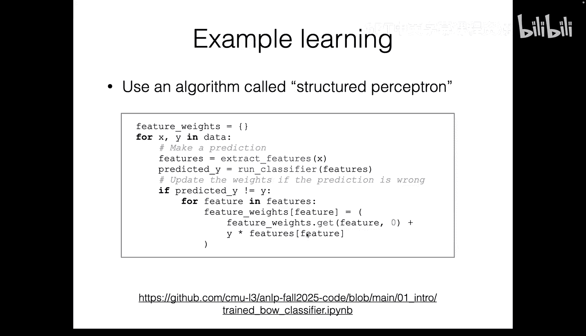

And again， we have an implementation of this。

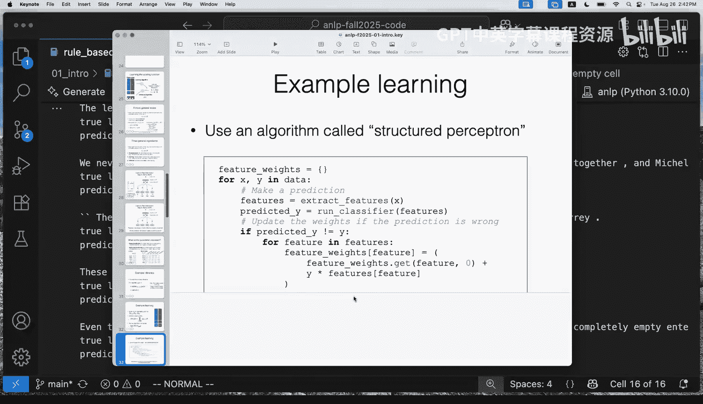

In the in the code repository。So here you can go and。And run this code。And you can actually train it。

 and you can see the trainings pretty fast。 You might have missed it。Nice， yeah。

 much faster than the large language models。嗯。And。Now we can evaluate it and the results are kind of yeah。

 they can be kind of interesting。 So one thing is we get much higher accuracy than training accuracy than with the rule based model that we had。

 So now we get about 80% instead of 40。We also get higher。Deev and test or test accuracy。

Which is 58%。Does anyone know why there might be a gap between these two things？Mmhmm。😊。

Pa data that you didn't train on， so it's like。Unknown data whereas train is what is actuallyhe like trained on so it's going to know the thing it's training on better than like this random other not random。

 but like this。Have to part bit data that you're test yeah exactly so when you run this learning algorithm。

 especially if you run it for a while。Then it will be capturing the patterns in the training data。

 and it could actually learn things that kind of overfit to the training data and don't generalize to the dev and the test data。

So we'll see that idea come up in the course。And then here the error analysis is。I don't know。

 I think it's more fun than than the previous one。 So now what you can do is you can look at the incorrect outputs。

😊，And then you can also look at the weights that the system has learned and try to get some some insight into what's happening。

So。This one， the true label was neutral and it predicted negative。嗯。

And you can see it learned that comma is actually pretty positive。😊，嗯哼。嗯。

This is actually kind of yeah， so a is zero。嗯。Period is negative。And little is very negative。

 actually。So you can see it's kind of， you know some things are reasonable。

 enjoyable is very positive， but you could kind of imagine that you know。

 when a lot of these things are kind of off， then the systems classifications has these a lot of these weird kind of weak points。

嗯。Okay， and then the other thing you can do is you can look at like what are the most positive or what are the most negative weights。

And again， it's clearly learning something so kind of cool with such a simple learning algorithm。

 it is learning to assign a pretty high weight to。You know。

 fairly fairly positive things at the same time， you can find counter examplesles pretty quickly。

Let me see the negatives。Okay， yeah， stupid。 yeah， pretty negative。嗯。TV is negative， though。

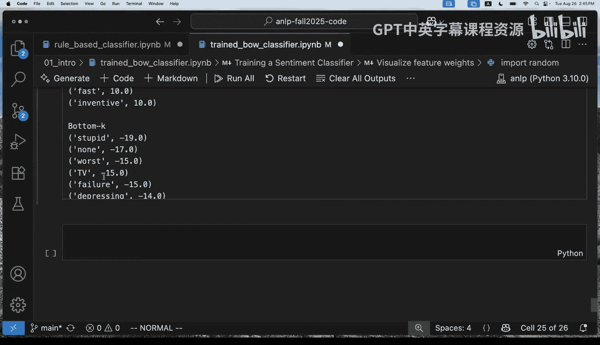

So anyways。Yeah， this this is pretty cool。

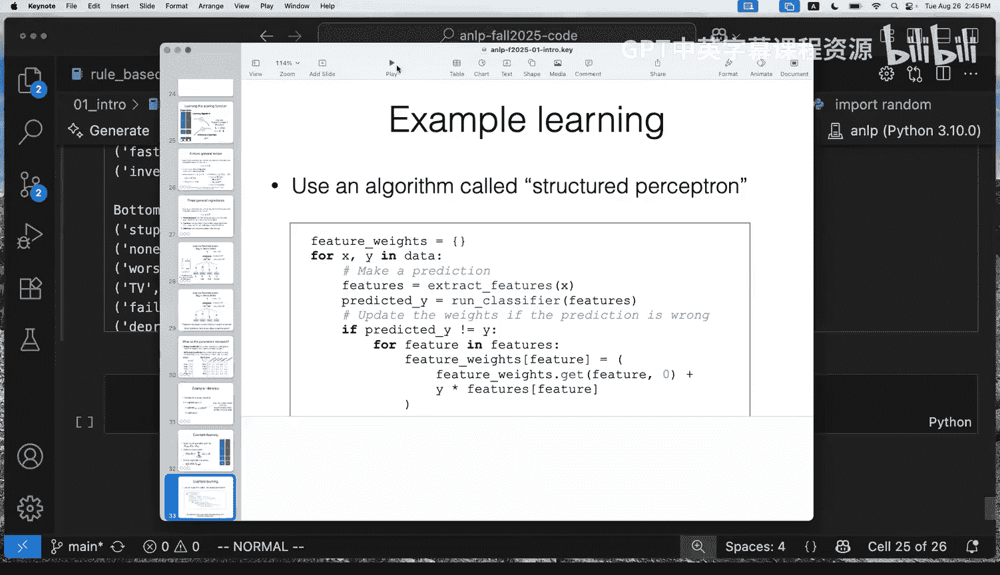

But there's still a lot missing in this right so we still haven't dealt with this idea of conjugation or compound words we'll actually talk about that next lecture。

嗯。And we don't really have a notion of similarity。 So it's still just looking up these words in the dictionary。

 It's never saying， like。You know， if two words are similar。

 they should have similar representations。And then again， as we mentioned。As I mentioned。

 the answer to the to the。诶。To the question earlier。嗯。

This doesn't really capture the sentence structure because we're just summing everything together。

And so we'll need to account for these things somehow。And so broadly。

 the approach is to use neural networks in deep learning。

So here now we start with some vector representation of each word。

And then we pass it through this function， which is going to be learned from data。

And it's like this complicated function that ultimately produces some feature vector。

So now instead of kind of hand designing the feature vector with these different rules or with just these like word identities。

 now the hope is that this neural network can actually learn a really good feature vector。嗯。

And then again， at the end， we have the same thing where we do some weighted sum and get a score。

So the big question is， this is kind of magical。And so we have to actually figure out a lot of stuff。

 we have to figure out how do you design this neural network。

 like what is a good architecture for different types of data， so that's the parameterization。

We have to figure out how do you actually。Learn this kind of magical function that gives you a good feature vectorctor。

 which algorithm do you use， what are the different assumptions for the data that you need。

 things like that。And so a variety of questions still need to be answered to build the system。嗯。

And then I just want to comment that we've been talking about classification。

 so this kind of very simple task。But it turns out that this perspective of just learning this。

Function that is really good at scoring things。Actually is pretty general。

So it's a kind of cool idea。 And again， it's from this perspective of。Of oops building these。

Kind of scoring functions or energy functions。So this is just repeating what I said。

So you could imagine for classification， as I mentioned。

Want the model or the system to assign high scores to correct classes and low scores to incorrect classes。

But you can also design a ranking system for like retrieval。So if you're able to give a query。

 assign scores to documents。In such a way that they're in the correct order。

Then kind of all you need is this really good scoring function。And then similarly。

 let's say you want to build this probabilistic model。

So like large language models are probabilistic models。Well， then when you think about it。

 the probabilities are kind of like scores， it's saying given some input X。

 so conditioning on some input X。What is the probability of a particular why？And so again。

 if we can just learn a really good scoring function。

 then we could probably turn it into a probability distribution。And if we're able to do that。

 then you could frame a lot of different tasks in this way， like given some English sentence。

 what is the most probable Japanese sentence， given some conversation history。

 what's the most probable response。and so on。So let me just say a bit more about this because the idea is really simple。

 so here we have our scoring function， S theta of x and Y。And then here。

 what it's basically doing is turning it into a probability distribution。So you have to on the。啊嗯。

So you have this exponential。And in the numerator， you have the score and then in the denominator。

 you have what's called the normalization term or partition function。And so this is something。

Up all the different scores， and this ensures that things are each score is between0 and one each proba is between0 and1 and that collectively they add up to one。

So you can go to probability distribution。Does anyone know what this thing on the right is called？

Yeah， soft next。So we'll talk about this some more and if you haven't seen it before then yeah。

 we'll talk about it some more。But now you have a system which kind of had these。Scores。

 which could be scaled in any different way， like we saw that。

One of the words had a score of you know， 15， another one is like minus2。Now with probabilities。

 everything's between0 and 1 and everything sums to1， so it's kind of nice in that sense。

But then you can also kind of build general algorithms for sampling from a probability distribution。

mSo if we can， you know， like if you have a， if you have a coin。

 then you can kind of flip it and see if it heads or tails comes up that's that's drawing a sample from。

The distribution that the coin has。And so if we can come up with some way of sampling from。

These learn distributions。Then again， this could be pretty general。嗯。So the way to see this is。

You know， here， imagine that x is basically anything you want。So it could be text。

 it could be an image like represented as in some way。It could be the state of an environment。

And then similarly， imagine that why is anything that you want， so it could be。

 you know chat GPT's response to you， it could be the next action that your kind of agent is taking。

 it could be an image that you want the system to generate。嗯。

And so here we can maybe build a more interesting。Classifier that also kind of gives us a reason。

 So I hate this movie， and it outputs。嗯。Because it isn't creative or something。Or yeah。

 this is a kind of contrived example。But anyways， the idea is that you can frame a lot of different things in this kind of probabilistic formulation。

 and so if we can successfully learn models like this。

 then we potentially have something that's pretty general。

And so an example of this is going to be the large language models。

 ultimately they are a probabilistic model like this and you can give them inputs and you can sample different outputs。

So again， if you haven't seen this before or if the language that I'm using in terms of probabilities and stuff isn't familiar。

 we'll go over this in the next few lectures。ok。嗯。So。This is good then。Of course。

If you have one of these probabilistic models， you can also use it to kind of take actions。嗯。So。

Typically， when we think about a model that gets some state of an environment and takes an action。

 we call it a policy。And again， you could just represent the input to your model as being the state。

 and then it could give you this distribution over next possible actions。

So let's say that the system was like looking at some movie streaming website and then the user said。

 I hate this movie and then maybe the agent then clicks the pause button or something I don't know。

So this will be the kind of key idea behind these AI agents that are using techniques from NLP like language models to take different actions。

Yeah， here's some cool pictures。嗯。Okay， any questions on this next I'll just kind of go to an overview of how the course is structured and then the logistics。

Okay， cool so yeah broadly the reason I introduced this is is first because I think it's a kind of interesting general way of looking at things and it helps you break down the different。

Parts of a learning based system into these kind of high level categories。

So we can now think about what we're going to cover in the course。

 we're going to cover different architectures， so these give us good parameterizations。

 ones that are really general。We're going to talk about different ways to build the probability models so you can have an auto aggressivegressive model。

 we're also going to talk about diffusion models， which is different approach。

And then we're going to talk about how you incorporate things like images。

 things like retrieved documents。And things called tools。

 so if you have some like functionality outside of the learn system and you want the system to take advantage of it。

Then we're going to talk about a variety of ways of learning。

 so learning from unstructured data kind of data just from the internet。

Paired data and then learning if you have some environment with a rewards function。

 that'll be reinforcement learning。Then we'll talk about inference。

 so how do you actually do this with I mean， we'll mostly focus on large language model inference。

So optimization and sampling。Some more recent kind of multi sample strategies。And how you get。

The models to run very efficiently。 So like how you get a language model to run on your laptop。

 we'll see some of the。key ideas behind that。And so broadly。

 the way the lectures are structured is the first half of the course goes over kind of fundamentals。

 so these are things that。You know， as you're。Going throughout your research career or whether you're building applications with NLP are really good to know and they're kind of underlying ideas。

Are the foundation for a lot of other things。And then the second half of the course will have more advanced topics。

 so this might relate to more recent research areas or it'll kind of build off of one of the earlier lectures and we' go into some more depth。

So roughly speaking， that's how it's structured。And then there's a few different themes。

 so in the first few lectures we'll go over different fundamentals。

So we'll do a pretty quick review of。Deep learning basics and language modeling。And then pretty soon。

 we will get to。嗯。Yops。Pretty soon we'll get to you know methods and architectures that are being used in the state of the art systems。

So like by lecture five， we'll talk about transformers and attention。嗯。

And then this is the topic of architectures， here's an example of the advanced。

 so towards the end of the course we'll talk about these models for very long sequences or these mixture of experts models。

Then we'll have a variety of different lectures about learning and inference。

 so things like pretrain， fine tuning and different decoding or inference strategies。

We'll also cover these various model types that I mentioned so like retrieval models。

 incorporating retrieval models with language models， multimodal。

 and then at the very end of the course， talk about these diffusion models for text。

 which is a kind of active research area。And then finally。

 we'll have a couple lectures which will kind of。Give you some。Additional。You know。

 evaluation techniques or sorry we'll cover evaluation techniques and then give you some additional things related to experimental design and kind of basic research skills so this lecture 14 could be helpful for the project。

In kind of conducting the literature review and and things like that。And running， you know。

 solid experiments。And then as I mentioned， there'll be a few different lectures on this RL and agents。

And then how do you make the systems kind of scalable or efficient for real world use？So。Yeah。

 this course is called Adv NLP and over the years it's kind of evolved based on the current state of NLP。

And so the idea here is we're trying to give you an introduction to the various areas involved in advanced NLP。

In practice， I'll focus a lot on language models because those are very prominent in。In today's NLP。

But the course is not just about language models， we do have a whole course here about language models。

We'll also cover some other things like， yeah， the stuff I've mentioned。

 like we'll have a whole lecture on just on reinforcement learning that does but also could not apply to just language models。

But for any one of these different areas， we're really lucky here at CMU that we have this amazing set of courses。

So you can also go into depth more depth in a particular area， so here i've listed some different。

Courses that will kind of intersect。With。You know， a couple lectures in this course。Okay。

 so now the class format and structure。嗯。So again， we're going to learn in detail about building NLP systems。

And it'll be from a research perspective， I'll go over some。

I'll try to incorporate things from recent research and then throughout the course you'll。

 especially in the second half of the course， you'll actually do a kind of mini research project yourself for the project。

嗯。And yeah， we'll learn basic and advanced topics and see several case studies。So before class。

Please take a look at the course website。So on the course website。

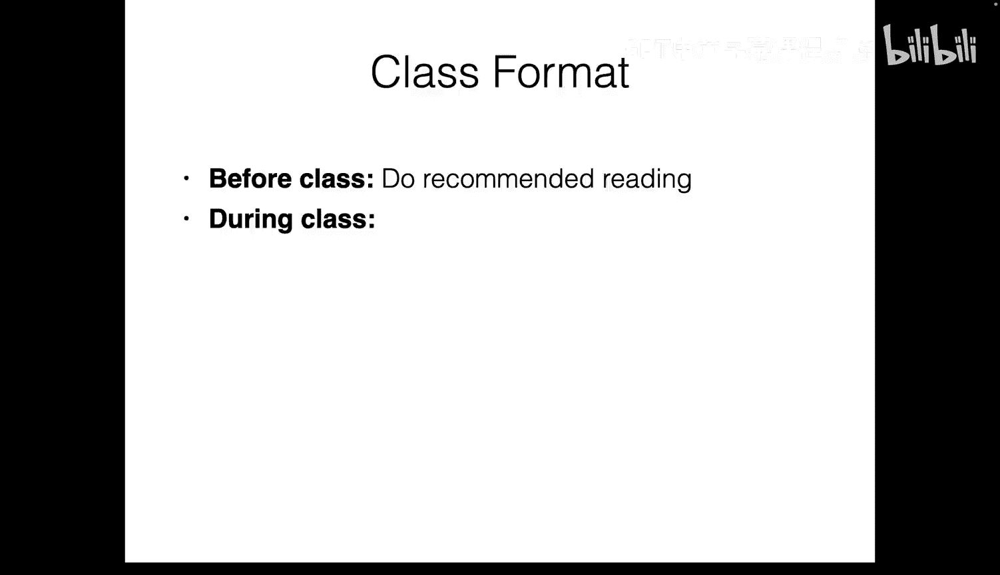

We will have。These different。So we have the schedule here。

And the schedule here will have main readings and additional references。

So sometimes the additional references is pretty long。

 it just means that somewhere in the lecture I mentioned the paper。

 it doesn't necessarily mean you should go read everything， but it's kind of like， yeah。

 if you see something in the lecture and want to see the citation for it and want to read more than that's what the additional references are。

The main readings will be a kind of。Key paper that I think has。You know。

 important ideas for the lecture or provides additional background。

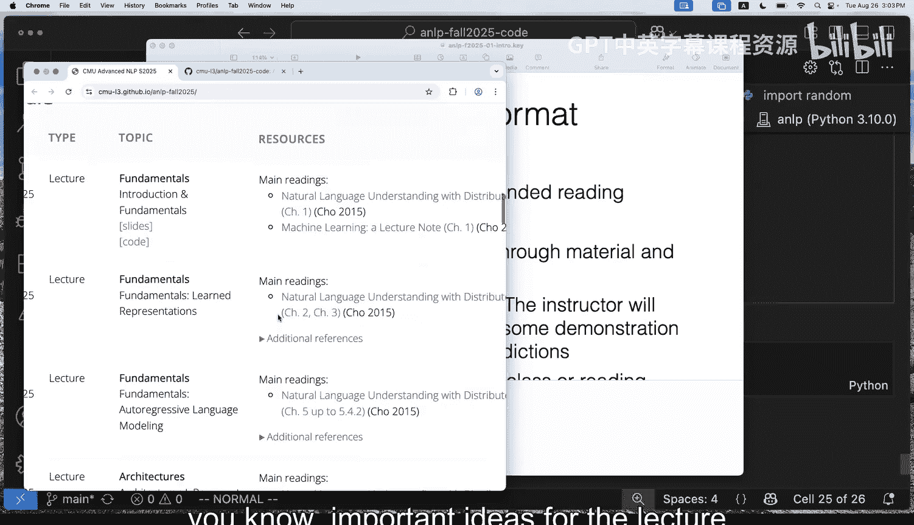

嗯。Then。

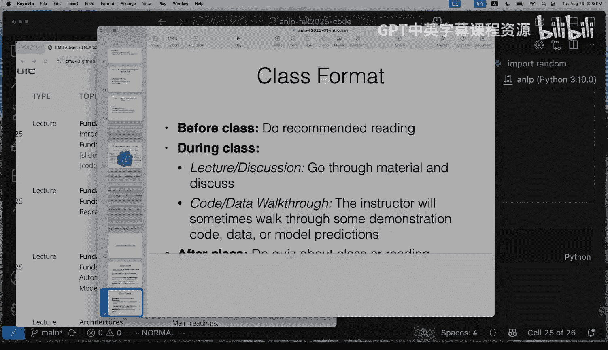

Oops。Then typically I'll try to pause and ask questions and have discussion questions during class。嗯。

This one I had a lot of stuff to get through， I wasn't sure if I'd get through all of it。

 but I'll try my best to kind of stop， see if there's any confusion， things like that。

 and typically students will ask really good questions and it'll clarify things and kind of everyone benefits。

and so also just feel free to raise your hand and I'll pause and there's kind of time built in to do interactive。

Question answering discussion。And then as you saw， sometimes there'll be a code example。😊。

And then it'll be posted to the code repository。And then after class， we'll have a quiz。

 which is about the class or the reading material。So I think I have a whole slide on the quiz logistics in a bit。

 but this is just the broad format。Then for the assignments， we'll have four different assignments。

And so the first two are kind of。You know homework assignments， the next two are about the project。

So first， you'll go through and with some starter code given。

 build one of these Lama language models。And train it。

 it'll be a small one that you can train for a specific task。

And you'll kind of see the details of the architecture and things like that。

And then in the second one， it'll be more of a。Kind of what are the big parts involved in an actual real worlds NLP application？

So you'll have to do data collection， you'll have to build a model and you'll have to evaluate it and kind of justify the evaluation。

 things like that， and so we'll release the details closer to the time of the assignment。

And then the next few are focused on the project。So broadly speaking。

 you could think of the project as being a kind of mini research project。

 maybe many just due to the enforced time limit of one semester。

 sometimes research projects take longer。But really you can kind of use this as an opportunity to。

 you know， try to do something that interests you， try to do something new。

 sometimes the course projects end up turning into papers， things like that。

 sometimes they don't and that's perfectly fine。But here we want to basically group together this assignment three and four。

So assignment three you could think of as， you know， doing a literature survey。

About the topic of your project。So here you want to go out and kind of find out what's been done in this area。

 categorize it into different parts， we'll give some guidance on you know how to put together a a literature survey。

 but this is a typical step that's done while you're doing research。

Then you'll reproduce results from some paper， from some baseline model。

And so this will basically serve hopefully as some baseline for your final project。So again。

 usually a step in these projects is yeah， looking at what exists and then。

In the task or in the area that you care about， you want to compare your new method with some old method and you have to be able to you know。

 run the result and reproduce it and get some number。And then for your final project。

 you will try to do something which improves upon the method or takes。

Some method or some idea and applies it to some new and unique task。And so again。

 we'll give more kind of guidance about。Or some details on what this would and wouldn't involve。

And then throughout the course， you're encouraged to come to office hours， things like that。

 post and piazza to yeah， figure out a good project idea。And then at the end of the course。

 you'll present a poster and write up a report。嗯。Okay， so as you can imagine。

 you can look around it's kind of big horse。And so everyone has various like different unexpected circumstances that come up。

And so in order to scale to a large number of people instead of like。

Analyzing any particular situation， what we do is just give you the set of late days to kind of cover different things that come up。

So for assignments one through three， we give you a total of five light days。

Where you can turn in the assignment， you know， a day late。

 that'll be one of you five and you won't get a penalty for it。Assignment4。

 unfortunately it's right at the end of the semester and we have to get the grades in by a certain time。

 so we can't have any extensions for assignment4。The quizzes are released by the end of the day of the lecture。

 so by 1159。So there's no quiz for today， it'll start on Thursday。

And then the quiz will be due at the end of the following day。And so here the idea is to kind of。

Yeah， see if you have some understanding of the content and it'll be based on the content of the lecture and then potentially of the reading。

So just make sure it's clear， for example， next Thursday。

 the quiz will be released by 1159 and then it'll be due by 1159 the following day and it'll be released on the quizzes are done through Canvas。

And then again， to account for you know various situations that may come up。

 we will also drop your three lowest quiz grades， so if you have to miss a quiz or something like that。

 then we'll drop three of them。So we'll do our best to send a Zoom recording by the end of the day of the lecture。

However， we don't make any guarantees and sometimes。嗯。You know。

 various errors come up or it gets delayed。So really the only way to guarantee that you've seen the content for the quiz is to come in person。

But we will try our best to send a zoom recording， as well as a zoom link。Again。

 because in such a big class， there's so many different cases that come up。

 so we do try to make that option available。Unfortunately。

 we do not allow registering for the course if you have a schedule conflict。

We do really encourage you to attend the course and participate in the discussions。

And then additionally， you absolutely must attend。These courses。

So when you're deciding whether to take the course or not。

 please look through your calendar and make sure you can attend these because they're directly related to the course project。

And so these are very important to attend if you want to get a grade for the course project。

So please do look through your calendars and make sure you can attend these because unfortunately we can't make exceptions。

嗯。We also have a very long wait list and so yeah it's really great to see all the excitement for the course。

 so out of fairness due to the size of the wait list and because there's so many different cases and everyone has a pretty good reason。

 we can't prioritize any individual case。So there's basically a way that the wait list is automatically prioritized。

And then I don't make any changes to that， so unfortunately， if you email me。

 I unfortunately can't make any changes to that。So then again， should I take this course？

I might be biased， but you the content is going to be exciting to me be a great course。

 you get a chance to do your own project。But please be sure that you'll be able to deal with the kind of logistics。

Take the quizzes， the attendance aspects I talked about。Um。

 for the final project and things like that and just make sure because you don't want to kind of run into an issue later where you're not able to make it to the project hours。

Okay， and then the teaching team。 So I'm Sean Sean Wallick。And we have eight different TAs。

So I don't know are any of the Ts here。我。Do you want to introduce yourself。就。I'm interested in that。

Okay， great and so everyone will have office hours， so all have office hours。

 each table will have office hours， we will begin the office hours next week。Monday is a holiday。

 so they'll begin on Tuesday。And all of the office hours will be posted on the course website by the end of this week。

 so we're still reserving rooms and things like that。

 but we'll have it all set up and then if you want you can start coming next Tuesday。Again。

 the website is very important for staying up to date。

Please do sign up for the piazza if you're in the course。

 also very important for communicating things about the course， homeworks， etc。嗯。And with that。

 that is everything I want to cover today。 So thank you。

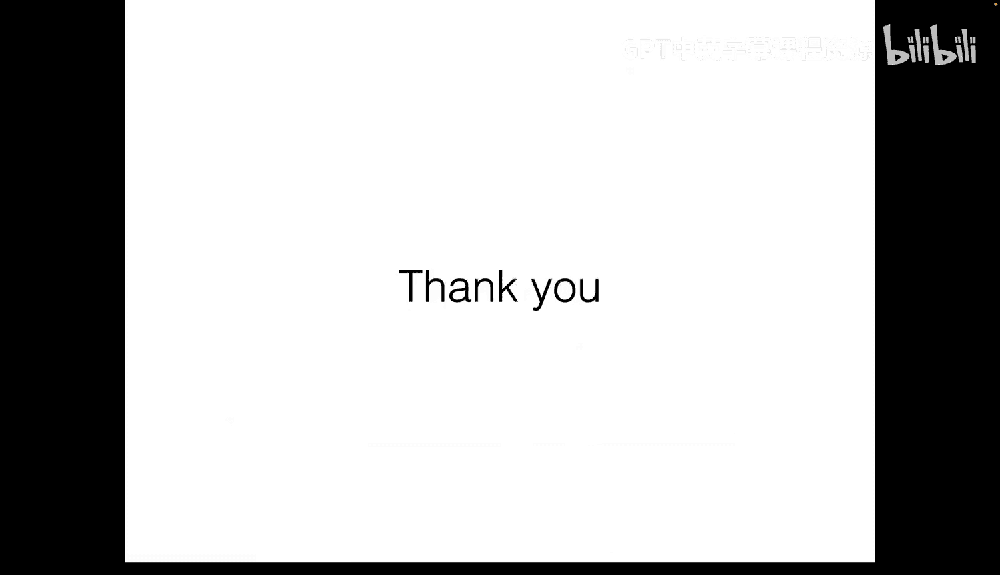