# CMU《高级自然语言处理｜CS11-711 Advanced NLP Fall 2025》中英字幕 - P20：(20)Long Sequence Models.zh_en - GPT中英字幕课程资源 - BV1ZWYAzuEMa

So today's lecture is another exciting lecture on long context models。

 and so this is another really active area of research。

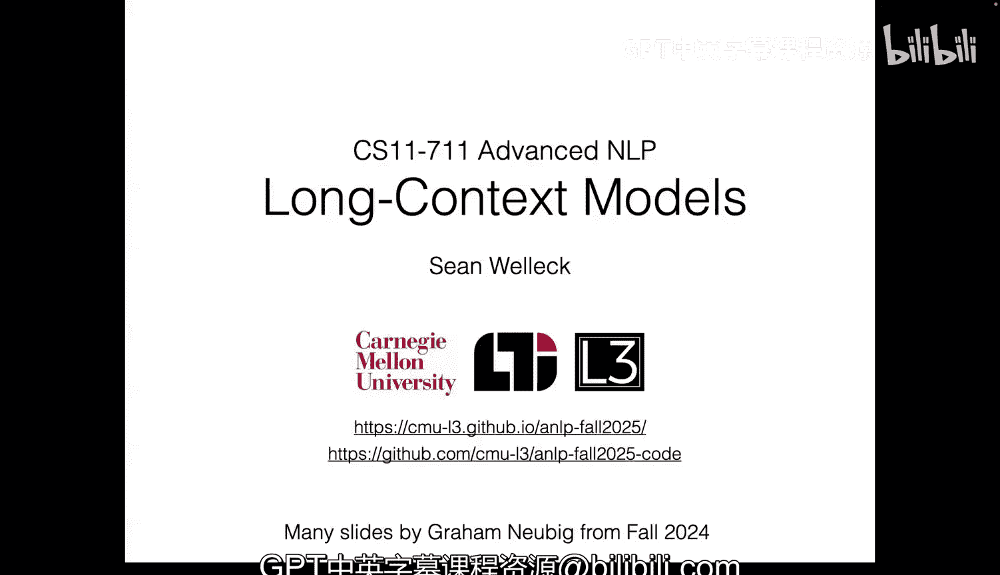

If you use things like language models or agents， you might frequently run into the issue of them kind of running out of context you might have already run into this problem before in practice。

And there's really a lot of interesting ideas and modeling。

Choices you can make to try to support really long sequences or long context。

 So hopefully you'll have a really good understanding of that after today's lecture。

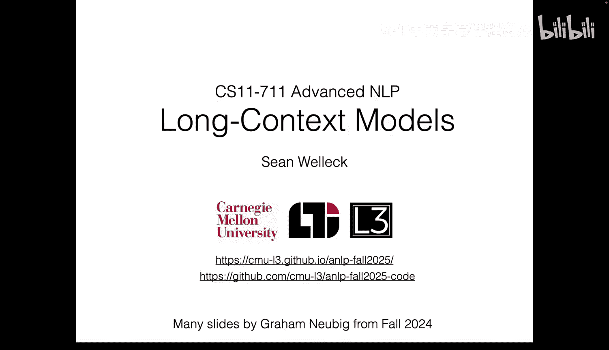

So the first question is， well， when we say long context， we mean kind of long sequences。

And the question is like， how long are different sequences。

So if we consider maybe the traditional setup for NLP。Back in the day。

 we were doing things like translating a single sentence， and that might just be， say 20 tokens。

And of course， now if you use something like chat GT or some agent。

 you're operating on much kind of longer sequences。So for instance， a document might be 100。

 short document might be 100 tokens， longer one might be 10，000。

 and of course you can make even longer documents than this。

If you consider a book now we're at another order of magnitude， you might have 50，000 tokens or 300。

000 tokens。And of course， these are maybe relatively short or kind of medium sized books。

 so you could definitely find books that are much longer than this。In this course。

 we've also gone over， I mean， most of the techniques that we've gone over in this course are not really specific even to sequences of text tokens right as long as we can kind of represent some modality in tokens。

 then we can at least think about applying the message we've talked about。

So let's think about kind of tokenizing a video and modeling a video。Well， then as you might imagine。

 this can get really long。Up to a million tokens for even a relatively kind of short video and if you had like a full movie。

 then it would be just really large number of tokens。

Another really common use case is having an agent or a language model operating on a code based。

 So now instead of just kind of getting some prompt and generating a function。

 now we're in these much more realistic scenarios where you might have。

 you know your company's custom code base。And the model hasn't trained on it。

 so you want the model to kind of take in the whole thing and then give you useful suggestions。

I think I got this number from someone from a blog post。 I don't think I imagined it。

 but something like these really large code bases like all of Google might even get up to you， say。

 a billion tokens。 So very large。Then also at the end。

 we'll briefly see results where they take the model and basically train it on another type of。

Language if you want， which is these kind of genomic sequences and these can also be very long so here we might have in one genome 3 billion nucleotides and so if you want to generate or even just like classify different things based on entire sequence。

 you have to be able to support very long sequences。

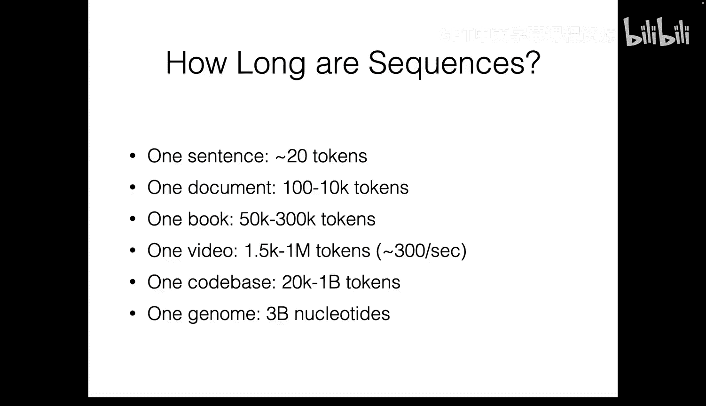

Then the question is， do we actually have to do anything different， well the answer will be yes。

 so why is modeling long sequences actually hard？So first of all。

 mainly we've been dealing with these transformer models。And as we'll see later in detail。

 we'll go through this in detail。They scale quadraically in memory。So basically。

 when we do this attention operation， we have this quadratic growth in the memory requirements。

And it turns out that this actually is one of the main reasons why supporting long context efficiently is difficult and so we'll walk through that in a bit。

In addition to memory， there's actually performing the computation here。

 the transformers are also scaling quadraically in the amount of computation。

So we will also take that into consideration。And then another thing is。You know。

 I mentioned like a code base with a billion tokens。 Maybe there's actually not that many of those。

And so just getting training data that is kind of truly long context。

Might actually be kind of difficult， especially for a very specific use case。

And so it turns out that training data is kind of lacking or the signals that you get by just applying a standard algorithm might be weak。

And then if we want to actually train on these long sequences， then it's very costly。

So this is going to be another challenge that we kind of have to deal with。

So we'll go through a variety of strategies to tackleies。

 but first I wanted to just give some intro to different ways。

 different tasks and different benchmarks， things like that for。

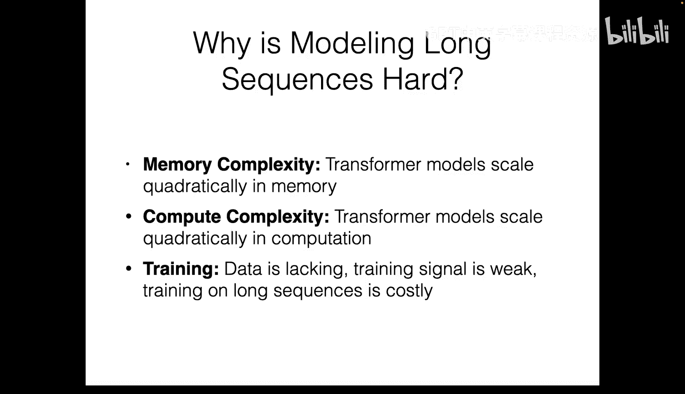

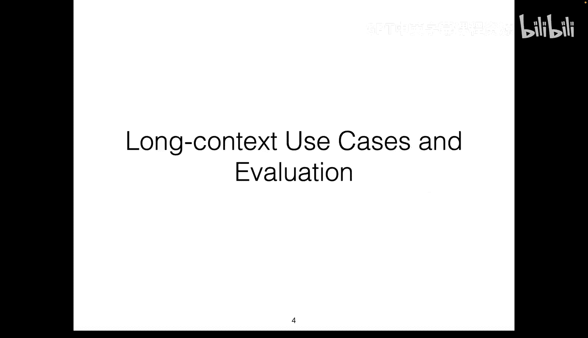

This kind of long contact setting。So I'm writing here early benchmarks。

 these were maybe from like two or three years ago， so some early benchmarks are okay five years ago。

 this one called Long range arena。And here they， they came up with these tasks that。Kind of。

By definition， would require。Kind of referencing information from a long sequence and a lot of these were non NLP tasks。

 it might be kind of you know， synthetic tasks， things like that。

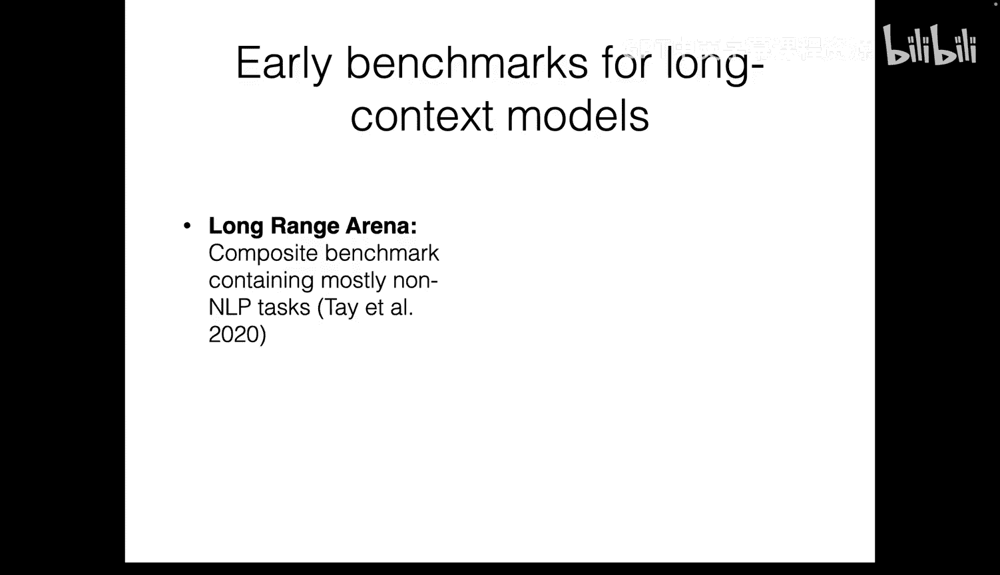

Here's one which is maybe looking at some more。NLP style tasks。

 so here we have a really long context and we want to say summarize it or we want to answer questions about it。

So on data sets called scrolls。So here on the X axis， we have the number of words in the input。

 so this would be the kind of context size。And here you can see that for this QA task in scrolls。

 it is between 10 of the four and 10th of the five so at the time。You know。

Baically the best model that was available didn't support context lengths of that size。

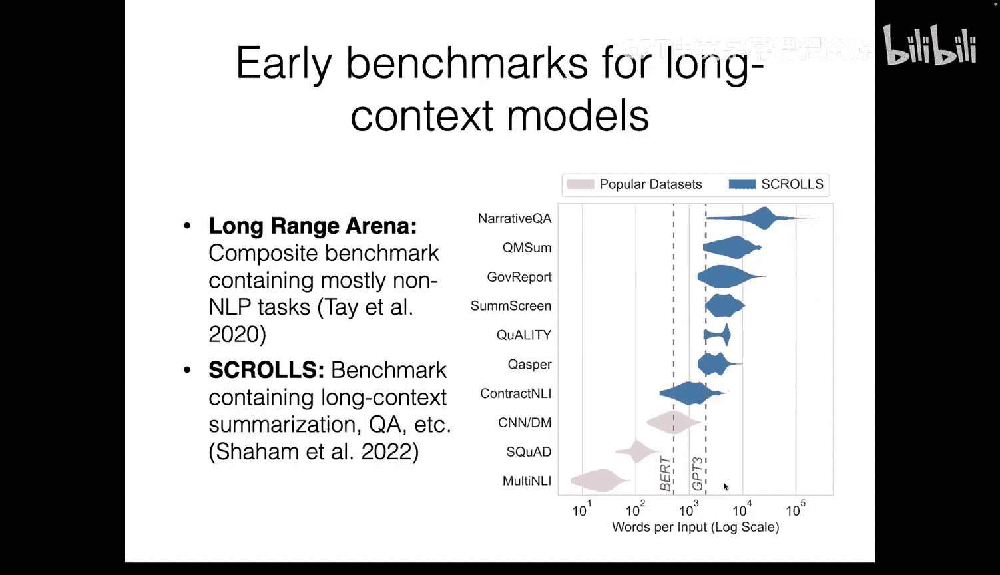

In addition， there was this kind of。Really interesting finding in 2023， and they took again。

 the best models that were available。 Now it's G 3。5 Trbo。

And just even with like a very artificial task， you can kind of demonstrate this。

And they basically found that， okay， if you feed in a really long context to a model。

Then the kind of creator of the model might claim that it supports the lung context。

 but they found that。Often the models were kind of biased either to the very beginning of the sequence or the very end of the sequence。

 so they called this phenomenon kind of lost in the middle。Okay。

 so the model was failing when the answer was occurring， say in the middle of the。Context。

Now you can imagine that once someone points this out and the paper becomes very famous。

 probably this has been addressed or fixed in different models。

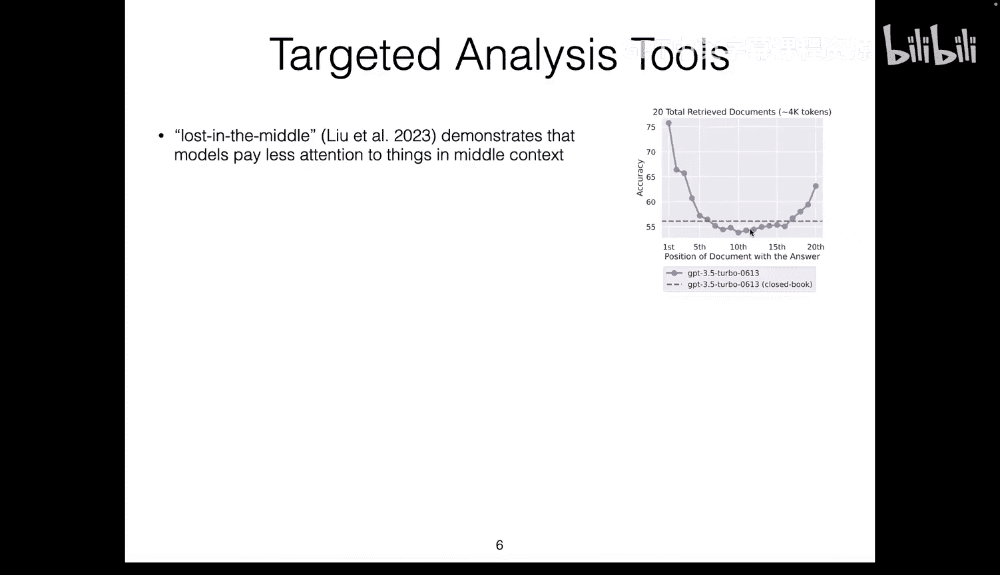

But this was kind of， you know， really interesting at the time。And of course， as we'll see。

 I'll show some really recent results， models are still not perfect on even relatively kind of simple tasks。

So here's a really simple task which has been used to probe the use of long context in language models。

And it's called needle in a haystack。And so here what you have is， let's see on the x axis。

 you have the context length again。And then the task is to basically， you know。

 you have this really long document。 and then somewhere in the document， you just place。

A kind of keyword or something that I always forget exactly what it is。

 I think it at least used to be about Paul Graham， this venture capitalist。

And you basically have to say， you know。The magic word is X， Y， Z。

And you just place it in a document， and then you prompt the model to say， what is the magic word。

 something like that。And so when this first came out， again。

 you could find these kind of failure modes in the different models。

Here it was succeeding at the task further back in the context at maybe。You know， disjoint positions。

 it was failing， things like that。This is also really simple and popular to run。

 so after this came out the kind of new versions of the models you would read their paper and they would have this green block where they kind of solved this crbing task。

So since then， you could think about making this a bit more difficult。

 maybe maybe you could have multiple needles。And or you can kind of aggregate information over multiple points。

And so here's just another reference， you can take a look at this paper called ruler。

 basically compiled a number of these different needle in a haytack tasks。

So I'll give one more really recent example， but before that there's one thing。

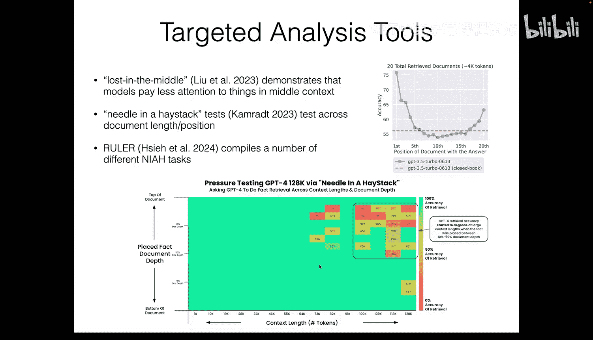

In between。So another thing you can do is also try to。

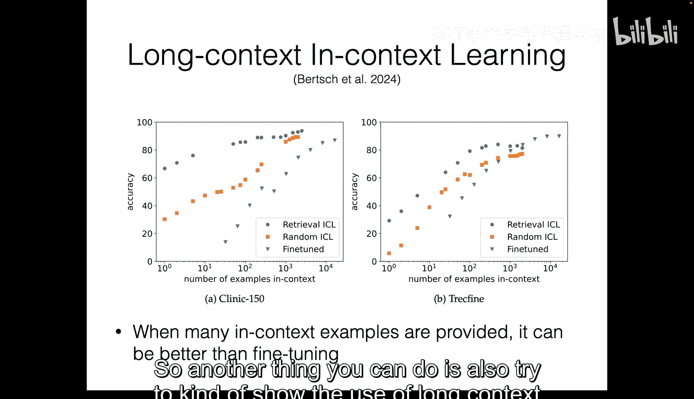

Kind of show the use of long context by testing this kind of many shot learning setting。

So we actually saw this in the prompting lecture， this is a different reference。

 this one is from here at CMU， Amanda Amanda Birch。

So here they found that as you increase the number of examples in the context。

You can see that the model's accuracy is improving。And in particular。

 sometimes they're even able to be fine tuning using just the in context learning。

I guess this would be showing that the model actually is capable of leveraging information from the examples in the context。

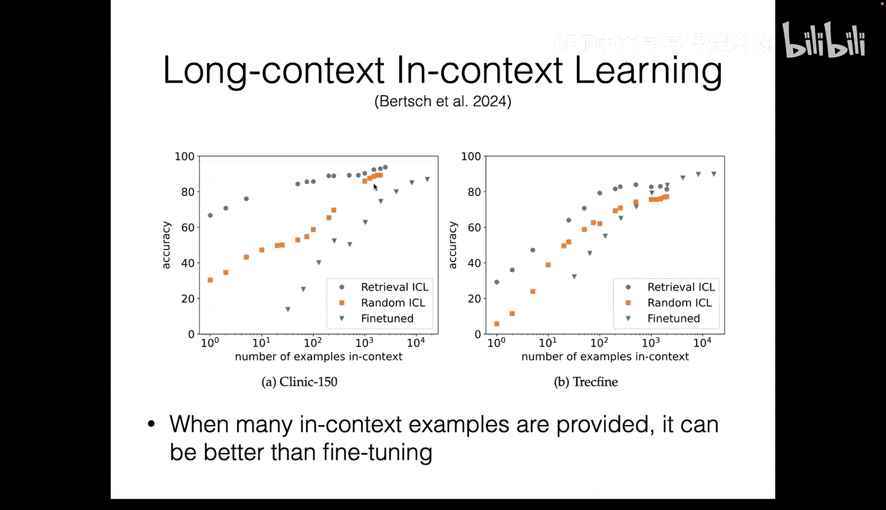

Here's some some other tasks， so another it is dialogue so as you probably。

Have encountered something like chat GT， you have a dialogue with it。And over time。

 it gets longer and longer。 And so the question is。

 can the model kind of use long term context from the conversation？

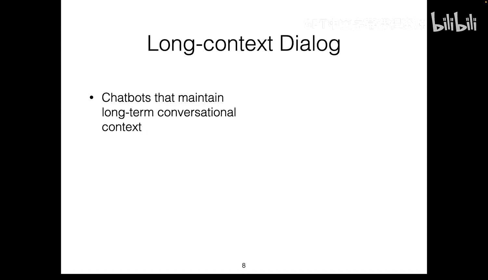

So here is a data set released in 2024。And they have these different。Conversations。

And then you could basically evaluate different tasks so you could。

 you know ask questions about the conversation and construct the questions that the model has to reference information in it。

You could have a summarization task or just a response generation task。

 and then they'll kind of pick the examples。Such that the model would have to kind of reference information in the long context。

Okay， so here again， you can take a look at these and there's probably been follow ups since this was released。

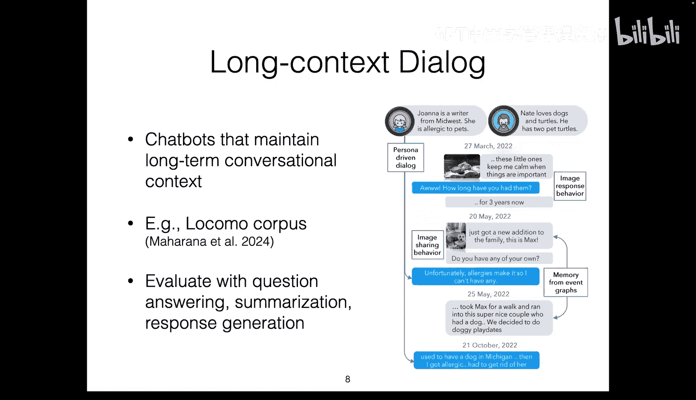

I wanted to put one example that was very recent， so this paper was actually， I think from last week。

 and this is again from Amanda here at CMU。And so they constructed this。Data set or benchmark。

 and it's called Ulong。And the idea is。We there's been these needle in the haystack tasks。

 but they observe that none of the existing ones really test specifically the ability to aggregate information across multiple places in a long context。

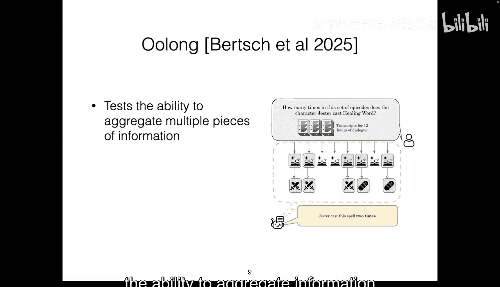

So what they do is construct two different types of data。So first， they have a synthetic task。

 which is you could take。Let's say you have a document and you have a classification task for the document。

 Like， I don't know。 what is the。Sentiment of this movie review， something like that。Well。

 then what you can do is you can just concatenate like 100 of these different tasks together。

And then you can ask a question， like， what is the label？For all of the documents in the context。

In order to solve that， the model has to basically。Internally， classify each document。

 and then it has to aggregate the classes and say， oh， it's 50% positive， 30% neutral， 20% negative。

 something like that。So you can construct construct different tasks like this where the model is basically forced to。

Use information from across the context and kind of aggregate it together。

Then here what they did is they also took some real data。

 so apparently there's these dungeons and dragons。Transcripts and they're really long。

 but like here it says 12 hours。And so you basically have these dialogues of people talking。

And then you can ask like specific questions about things that occur in the dialogue。

So here it's asking， like， how many times does this character cast this specific spell。And so right。

 the model has to basically look over the entire dialogue and then answer this correctly。

 and it's really easy to evaluate。

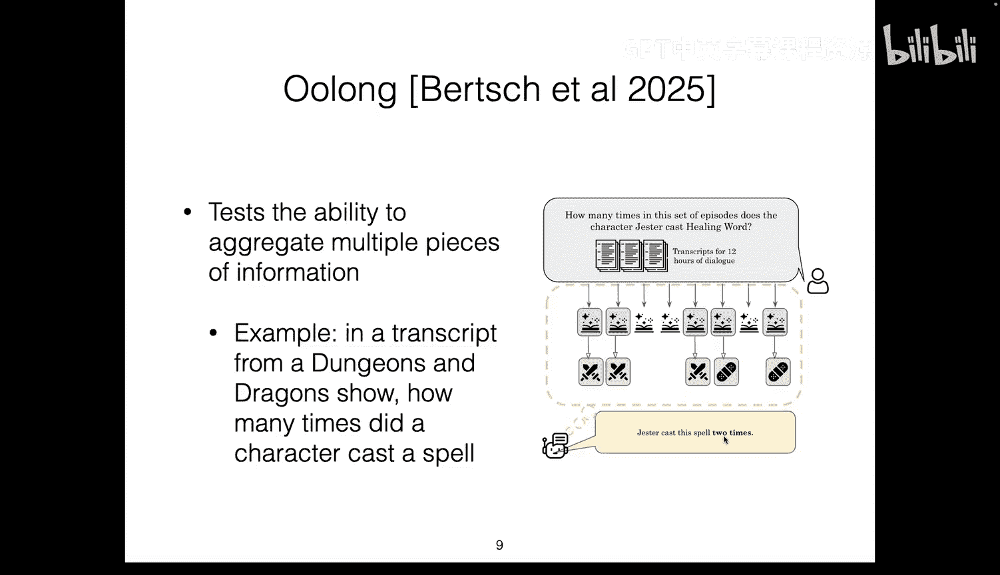

So kind of clever and kind of。Really nice intuitive thing that it's evaluating。So then again。

 this is really recent， so it's on the kind of newest models and you can see that the performance on both the synthetic data and the real data。

 it's， I mean， it's nonze， but it's actually decreasing as the context length is growing。

And no model is。Kind of doing perfectly on this。And so。Yeah。

 even for the kind of tasks they constructed。It's clearly the models are not yet perfect at kind of leveraging the context。

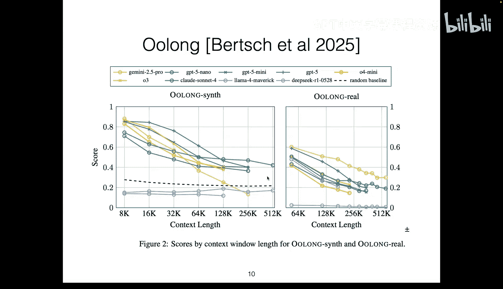

So that was a kind of quick overview of some different areas。So one that I。

 I didn't make a slide about， but one that is definitely。

Ting it or kind of falls into long context or long sequence modeling is the agents。

So let's say you have a coding agent， I don't know if anyone's used something like cloud code。

Then if you use it for a while， you're interacting with it。

 it's maybe looking at your code base generating edits， things like that。

 and eventually you get to the point where it runs out of context and then it just you can either just delete everything or compact it down somehow。

Similarly， let's say you have。A web agent or you have this computer use agent。There， again， I mean。

 in the case of computer use， the models seeing some screenshot at every time step。

And so you have to do something to kind of reduce the context length。

You might just save the chain of thought that the models produce， something like that。

 but in some sense， those are discarding some of the available context that you could feasibly use。

So again， in these agentic tasks that are really the active area of research。

This issue of having really long history or long context is very much there。

So before I go to the next section where we'll start to talk about techniques for addressing long sequence modeling a long context modeling。

 anyone have any questions。

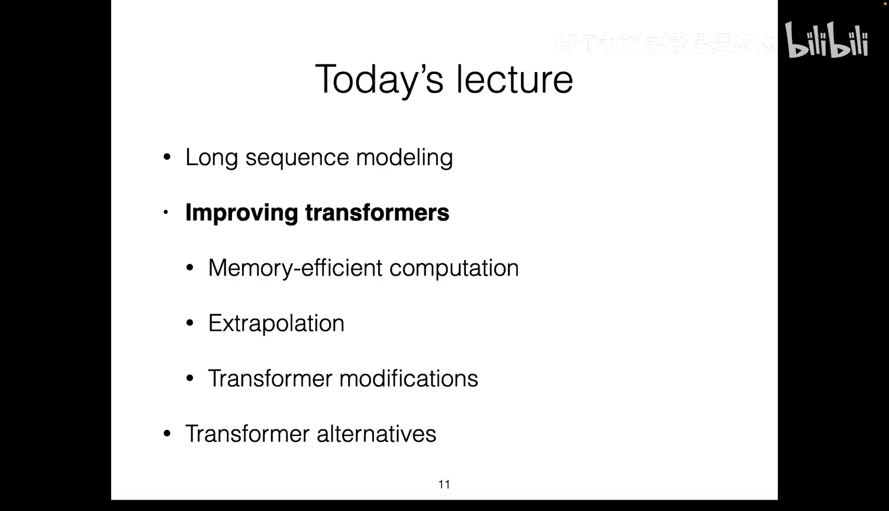

OhIt was the side of the document。

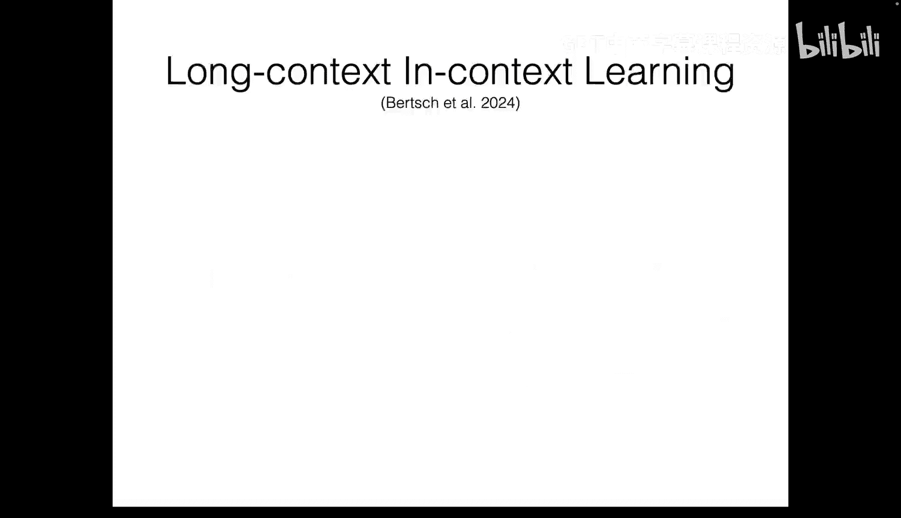

Nate， this is cute the we side of the document。Much like they are doing worse when the needle is in the start of the documentary So any reasons as to why that means。

I see。 So yeah here is context length and then here's position and document in case yeah it's kind of small。

 So here's the top and then here's the bottom。 It might relate to this up here。

 So this was the kind of finding at the time that models would basically struggle if the relevant information was in the middle。

And then， you can see that。At the beginning， it's also higher than at the end。

So I'm not sure exactly the reason it could be that a lot of the model's training data。

Is actually not really long context， like a lot of the times you can predict the next token by just looking in the set of。

 you know， previous tokens。And so possibly after training just on so much data。

 the model has become bias， its attention patterns are biased too。Looking。You know。

 in the closer context here。So that would be my hypothesis just thinking about it right now。

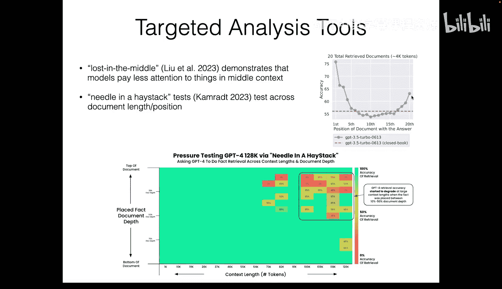

Okay， so next we're going to go over two classes of approaches so the first。Well。

 two classes and then in the first class， there's three different kind of strategies。

So the first is really aimed at taking transformers and trying to improve them。And then at the end。

 we'll talk about using a different architecture， so not using transformers。

In the name of having something that hopefully works better on long contexts。

So we'll talk about memory efficient computation。And extrapolation。And I'll probably skip over these。

 but they'll be in the slides if you want to look over them later so that I can be sure to have。

Time to talk about the methods at the end。 So here we'll talk about these state space models。

 so it takes。A bit of time too。

Kind of go through it。Okay， so first， the memory efficient computation。Really。

 the issue here with the transformers is we can take a look at this attention operation。And。

Hopefully this should be familiar by now， right， we had this in the lectures and in the homework。

And so here's really the key operation where we are。

Getting these scores right by taking the dot product between the keys and values。

Were taking the softm， and then you could take the weighted sum of the values using these attention scores or。

Kind of outputs of the softm。So we could take a look at this operation。

And here you have this matrix multiplication。And so here it's a kind of tensor。

 you have a batch size， you have the sequence length， and you have the hidden dimension。

Here we're taking the transpose。And so you， at the end。

 get something which is like sequence length by sequence length。

Which makes sense because each position in the sequence。

 you want attention scores for the rest of the items。

And the compute that's involved in doing that is。Written right here。

Then you can consider the memory and here you run into this quadratic use of memory as well。

So here you have some intermediate computations and then you have the final computation。And so again。

 we end up with something which is batch size times sequence length squared。

And we'll have to store that in memory。And so this will turn out to actually be a kind of issue。

 which we'll talk about in a bit。Now， if you have this actual。Just matrix multiplication here。

 so this is a。Then this again， has the same computational complexity。And the memory will be。

Kind of lower because now we're reducing this kind of sequence dimension because you're doing the weighted sum。

So really， we want to focus on this and potentially come up with ways of。Reducing this。

Comput computational complexity or memory。

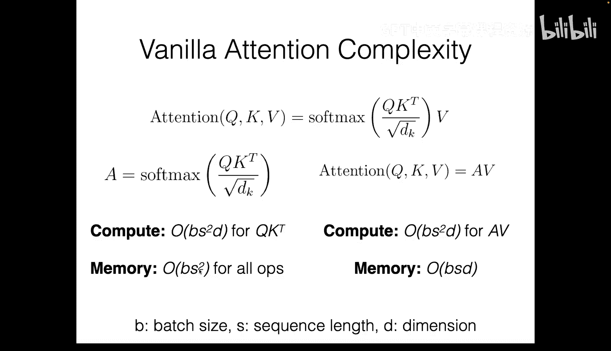

Require。So before we talk about that， it turns out that things actually get worse if you have multiple attention heads。

So here， if you remember， when you're implementing it。

 you can kind of just reshape and do a similar matrix multiplication。

If you think about how much memory is being used， then essentially by increasing the heads。

 you are adding on this extra term for the memory。If you want though。

 you could kind of consider what happens if you just。Reshape the matrix and。

Of view the memory that way。

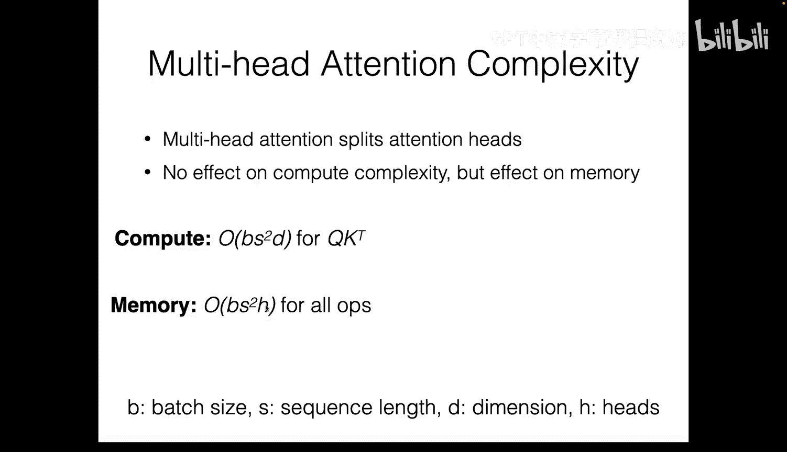

So what is the issue here with memory？So this is a really nice plot and it's from or a figure and it's from this paper and you may or may not have heard of it。

 it's called flash attention， it's a really influential paper and we'll actually talk about it later。

So here they have the kind of memory model for a kuda GPU。

And you could see that it has three different parts。

So up here you have this memory SRAM and it's really fast。

Here you have what's called the memory bandwidth， so how fast you can kind of transfer data。

And it's 19 terabytes per second， it seemss pretty fast。The trade off is that it's very small。

 so you only have about 20 megabytes of this really fast SRM。Then the second level down。

 you have this HM。And you can see that the memory bandwidth is lower， but it's much bigger。

 you might have， say， 40 gigabytes with this particular GPU。Then down here， you have the CPUU room。

And you could see that you really don't want to have to write to CPU memory。Now。

 instead of terabytes per second， we're dealing with gigabytes per second， 12 gigabytes per second。

And of course， the benefit is that you could have， say， a terabyte on a really nice。

Server of this CPU memory。Okay， so the challenge will be。

 how do we kind of do all of our operations in the fastest possible memory？

Because otherwise we'll have to incur these transfer costs。

Kind of communication costs due to the limited memory bandwidth。

So if you think back to two lectures ago when we talked about scaling up the language models。

We were talking about these communication costs that involved multiple GPUs or multiple devices。

But it turns out that we actually have to consider the communication costs even within a single GPU based on what kind of memory is being used and transferring between them。

So basically what happens is。If you have this memory requirement。

 which is quadratic in the sequence length。Then if you just make the sequences longer and longer。

Eventually， you'll get to the point where you can't perform this operation in the really fast memory。

 And so you have to transfer to this。HBM， and that will really slow things down。Okay。

 so the first time。The first time I saw this or if this is the first time you've seen this。

 it might be kind of counterintuitive that it's not necessarily the computation that's involved。

Because the GPUs are kind of built to do these parallel computations。Of course。

 that can slow things down， but really a big bottleneck in practice is going to be these kind of memory transfers。

And again， the amount of memory that we need is。Going to grow based on the sequence length。

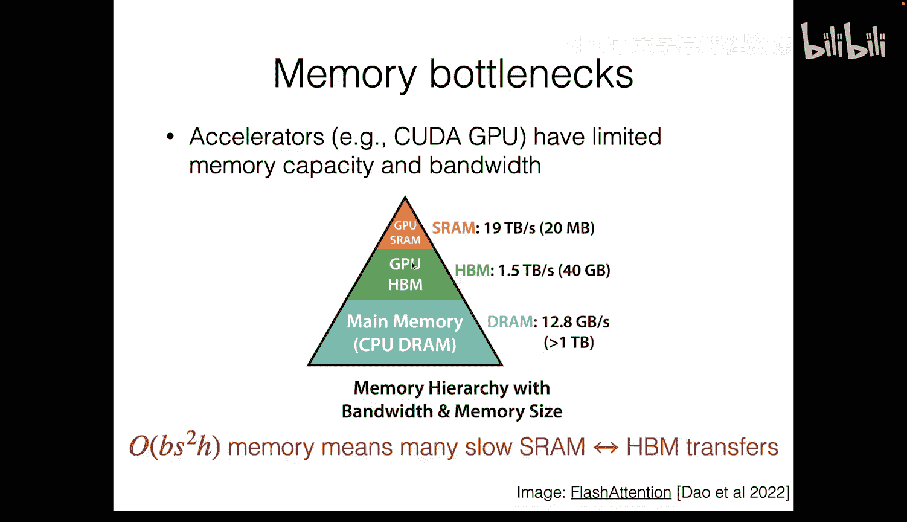

So as a result， it becomes really expensive to pre train a transformer with a long contact length。

Again， if you remember two lectures ago， we basically viewed pre training as trying to process as many tokens as you can。

 just in the most efficient way。And so if you have this really。

If it slows things down to just increase the context length。

 then that's not going to be a very good trade off to make。Also。

 if you're generating this is going to slow things down。

 let's say you're generating and you have really long context or you're generating some really long chain of thought。

And here， expensive can mean either two different things。It can mean that it is slow。

 so you're doing these transfers and the limited bandwidth results in slowdowns。

Or let's say that your library doesn't offload to the CPU and it just crashes and。Well。

 then if you use a large enough sequence length， then you might literally just not be able to run the model。

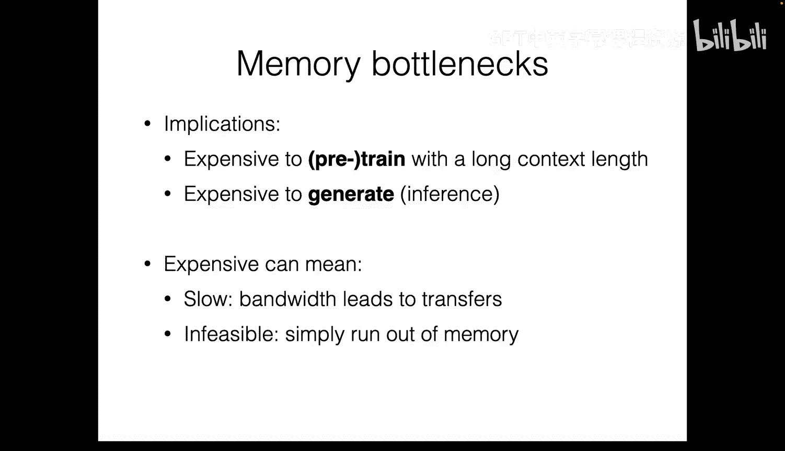

Okay， so hopefully you have some idea of the kind of specific technical challenges that come up with transformers and the long context。

So now we can look at this kind of clever way of overcoming this。And again。

 if you look at the formula for the attention， it's just this one matrix multiplication and a soft Mac。

 so it's actually not clear kind of what we can even possibly do。

But it turns out that there's this kind of。Really clever solution。

So the insight here is that it's actually possible to compute the softmax online。

And so if you're able to do this， then it turns out that you never have to store this S squared size matrix in memory。

And so this goes by the name of， well， it's called various things， lazy Softms or online softmax。

And there might be an earlier paper that did this， but there's this reference from 2019。

And then here in 2021， these two researchers from Google。

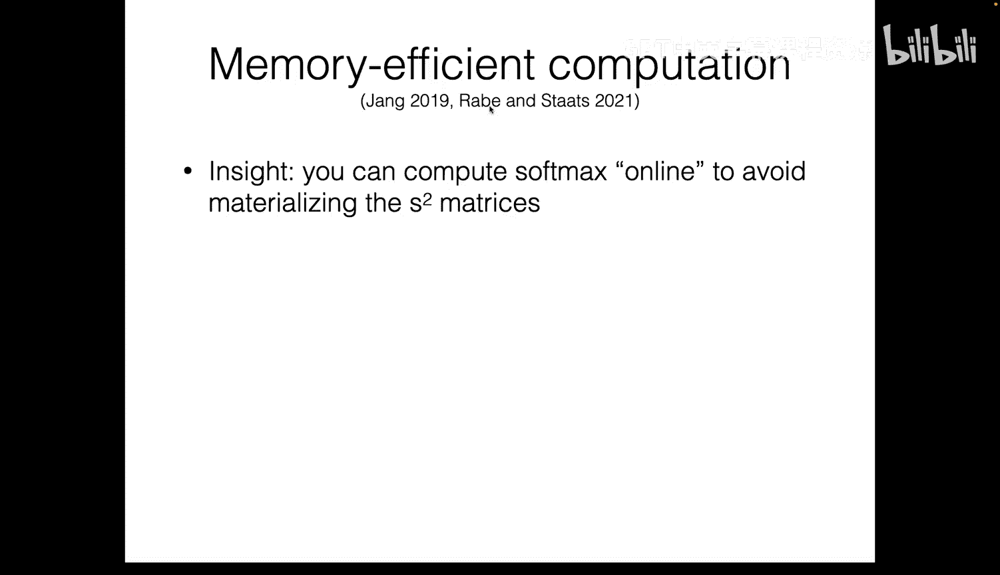

Basically use this in the context of implementing efficient attention in a transformer。

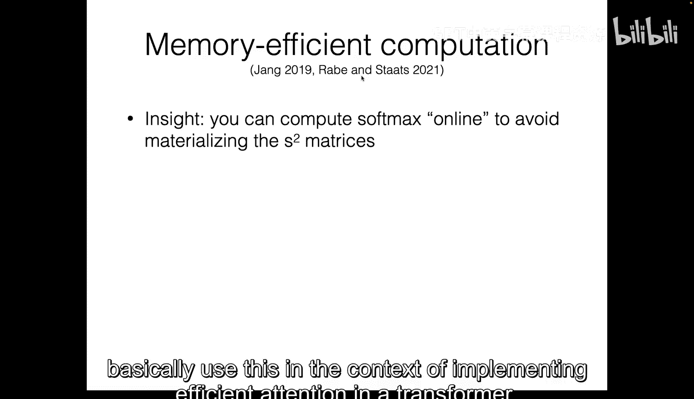

Actually， the paper was just on archive， it was never published or anything， but it's。Still， yeah。

Really interesting and as we'll see it kind of is used now in a lot of different places。So again。

 here， the trick is going to be okay。You can consider this。After you take the softm。

Then you can break it down into some numerator and some denoator denominator。

And it turns out to be able to compute this with only this kind of linear amount of memory。

 linear in the sequence length。So here we have the numerator of a softmax。

And here you have the denominator。And so the goal will be to compute each one of these and then just divide at the end。

 using only the linear amount of memory。

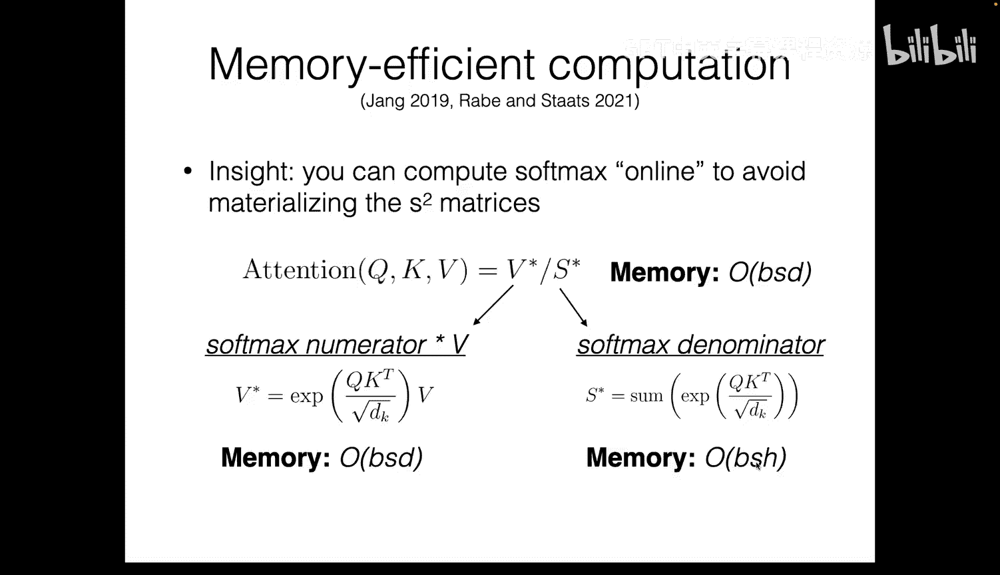

So here's the kind of algorithm。And it kind of goes one query at a time， right。

 So we have a query for every item of the sequence。So the trick is going to be， you can go。

For each given query。You can take the dot product with。So this is for a given query， sorry。

 we're going to go over in this loop。And take the dot product with each key and get this weight。

Then you can basically accumulate this result into this buffer。

 so here we have the weight and you have the value and you're taking the exponent。

So you can see that its somewhat looks like what appears in the softmax。

 and you're basically accumulating it into this buffer。Similarly， for the denominator。

 you are also accumulating this buffer。AndThen it turns out that this algorithm。

 if you divide the numerator in the denominator， it turns out to be equivalent to the attention operation。

Multiplying the keys and the queries， and。Taking the softm。So to really kind of internalize this。

 you probably have to go and look through the paper and think about it for a bit。

 it's a bit unintuitive。But basically you are able to compute this operation in this online fashion。

And you could imagine that it probably slows things down because now we have this kind of loop。

But the key thing is it slows things down， you know， computationally。

 But the key thing is that now we're just storing。This kind of one piece of。Memory。

 which is linear in the sequence length。And so you avoid this kind of quadratic growth。

So this is really the key idea and then you can imagine like okay， once you point this out。

 then you could try to get more clever。So then it turns out that instead of just separating things into like an individual query and individual key。

You could think about segmenting things into blocks or tiles。

And then like what is the optimal block size or tile size， it's not necessarily just one item。

 it could be a group of items， something like that。So that's what they actually do here。

 they have this kind of online softm and it's broken up into different tiles。

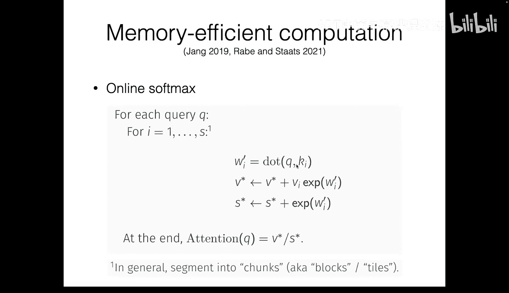

So now we could look at the results and here we have the standard attention and we have the memory efficient version。

And up here we have the sequence length， and this is during inference。

So you can see here that if you get up to 1 million tokens。Then you simply get out of memory。

 This was actually in a TPU versus a GPU， but you ran into similar issues。

And then you can see with the efficient attention， now they're able to fit this 1 million。

Or they're able to do inference with up to1 million tokens。

 and it just requires kind of 256 megabytes。So really cool and this was， you know， back in 2021。

 they were already experimenting with kind of  one million token size context length。

So they also demonstrated that you can do this for training。

 so not just inference and empirically you can get。

These you could have this ability to basically train on longer sequences。

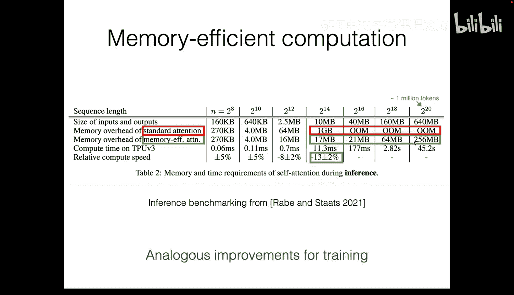

So then since then， this idea has shown up in other areas。

So if you look in the flesh attention paper， for instance。Then flash attention， it's。It's amazing。

 they do a lot of different things。 One of them is to basically incorporate this online softmax trick。

And they write this kuda kernel so that you can manage the memory of the GPU device kind of optimally。

 and again they kind of break things up into tiles and do this online computation and that's really needed to implement this flash attention。

Flash attention then enables you to speed up inference， speed up training， things like that。

 and so soon after flash attention came out it was incorporated into all these different libraries and I think now it's at flash attention two or three or something like that。

Also， I'll talk about this on the next slide。You could imagine that okay。

 now that we can break up this attention into a kind of streaming fashion。

Then what we can do is actually put each one of these blocks or tiles onto individual GPUs。

So now we could basically break up the computation of attention。On multiple devices。

And so this might be needed if you have。Kind of really large sequences with really large models。

 you have to actually distribute the computation across multiple devices。

So that goes by the name of ring attention and so here we can go into it in a bit more detail。

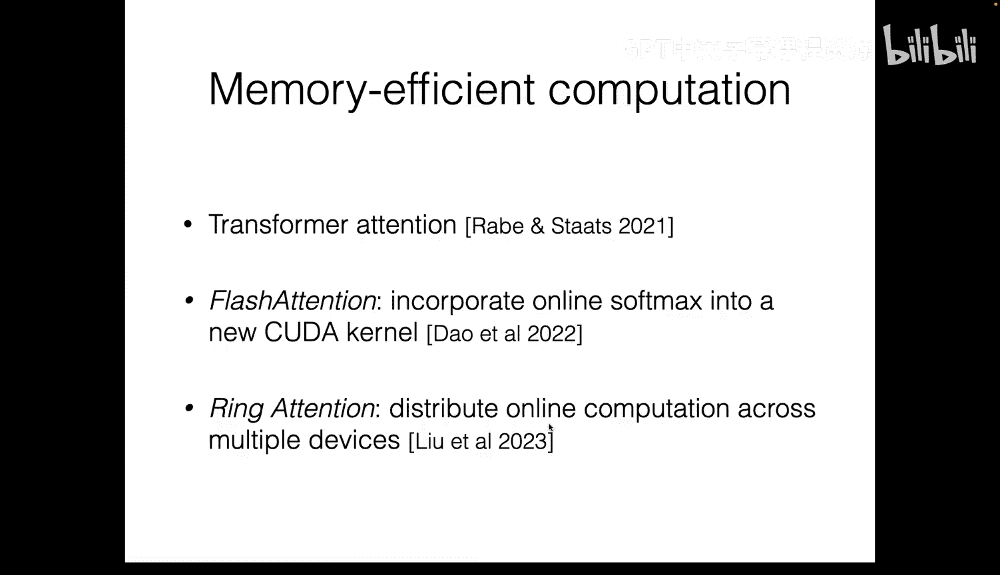

So one reason that this is interesting is it kind of fits in with the lecture from two lectures ago。

So you could view this as a kind of new dimension of parallelism。

The idea is you have this really long sequence and you are splitting up the computation of the attention on the multiple devices。

So that's a bit different than what we saw， like pipeline parallelism or data parallelism。

 things like that， So you can kind of call this context parallelism。

So the basic idea is each one of your devices or hosts will host one query block。

And then if you go back and look at the。Alrithm from before。

 remember for a given query we' basically cycling through。

The different items and doing the dot product with the different keys。

 and then the value was showing up as well。So this kind of handwaving that I'm doing is kind of what is being implemented here。

The idea is the keys and values kind of pass around in this rig。 And then eventually。

 each device has。Kind of multiplied it's blocked by the keys and values。And then at the end。

 you can kind of aggregate the results。So it's really clever， it's called ring attention and again。

 you could view it as being。Another dimension of parallelism or another strategy that you could mix with the other stuff that we were talking about two lectures ago。

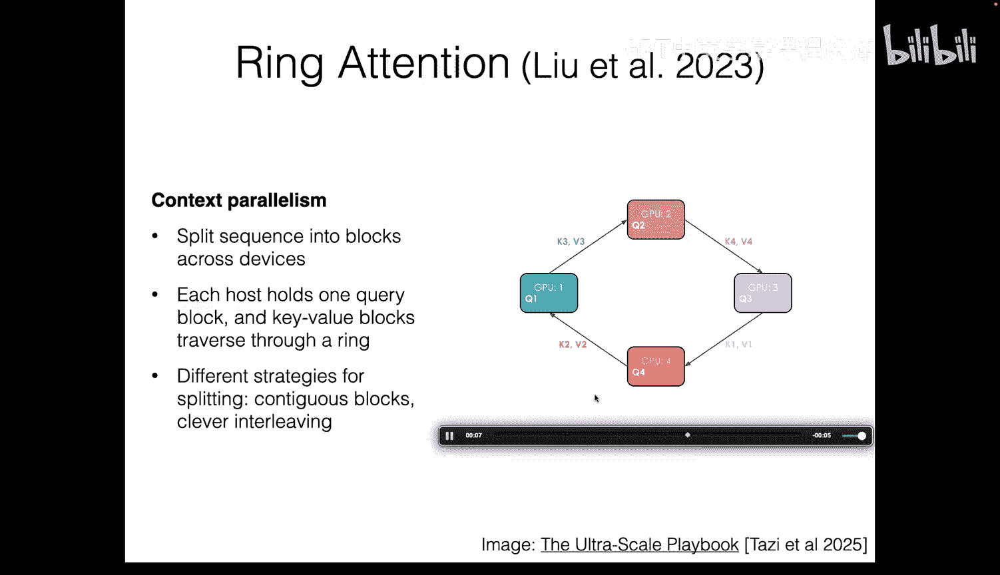

So。Here's some results。 and so here。We could see， for instance， there could no parallelism。哪里去来接啊。

Here we're trying to use the tensor parallelism。And you could see that as the sequence length is going up。

 it's still out of memory， this is during training。 so you have the activations。And。Now。

 we are increasing the context parallel to4。And these have been reduced， there's still expensive。

 but at least now we're able to train， say with 16，000。Whereas with just a tenseor parallelism。

That wasn't feasible in this experiment。So。That's the idea of ring attention or context parallelism。

And this is again， from the same book， so you could view it as another kind of strategy。

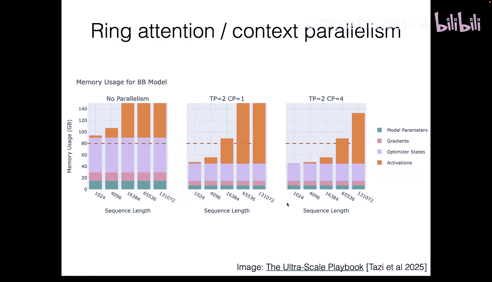

So I think if you look at the paper， the proposed， the ring attention。

 they also test the model on sequences with。Millions of tokens and it might have been videos。

 something like that。

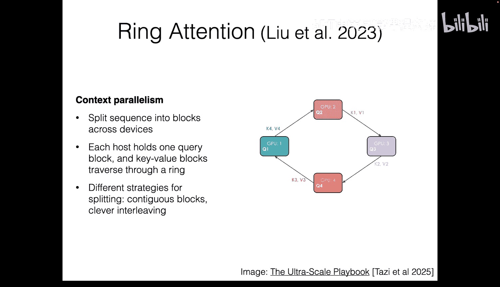

Yeah。Okay， so any questions so far before I go to the next section？

How is flash attention compared to ring attention， I mean。

 are they like comparable or can you maybe do both。I yeah， yeah。

 so flash attention is going to be for a single GPU kind of how do you manage the memory of that GPU really well So it's implementing this softmax and then。

It is。And sharing that everything is in the really fast memory。So it should be compliment。

You'd have to look at the now that I'm thinking about it。 Yeah。

 you'd want to make sure that the the computations that are involved in ring attention would allow you to still run the flash tension kernel。

 So maybe out of the box it's it's not compatible。But in principle。

 the idea of like optimizing what you're doing on one GPU versus how you're splitting things up across multiple GP。

 you should be able to do something incompary， yeah。That's a good question now。Okay， cool。

 So next I'll talk about extrapolation。

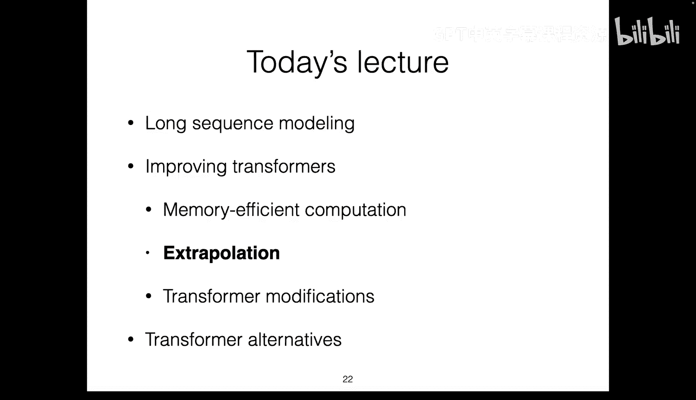

So。Extrapolation refers to， let's say a model is trained on say forth it。Sequences of length，4000。

Now someone gives you an input and the length is 4001 tokens。The question is。

 what happens Does your model。Blow up， does it fail kind of what happens？

So if the model is able to extrapolate， then it will basically be able to function well on sequence lengths that are longer than what it was trained on。

So again， let's say we train it on documents of length 4K。

 now at test time we give it a document of length 5 k。And it's able to still。

kind of function properly Use information from this longer document。So。

What happens is the positional encodings end up being kind of problematic。

 or you have to think carefully about what you're doing for the positional encodings。

So if you remember back to the transformformer lecture。

We introduced this idea of using these really simple， absolute positional encodings。

So this basically says。For positions in this example， 1 through 4000。

 we're going to learn a vector that corresponds to the given position， so you have 4000 vectors。

Now if you get a document， that's of length， 4001。Well now the model basically gets。

Say a random embedding for these new positions。And now it's kind of out of distribution。

 and typically the model will just fail。So this learned absolute。

Encoding or positional beting is not really a good solution。So the fixed absolute encodings。This is。

 so we didn't go into detail this semester， but in the original transformer paper， for instance。

 they have these positional encodings that are based on。Kind of like sine functions。

 cosine functions， and they have this periodic structure。And the hypothesis was that。You know。

 since they're based on functions with a periodic structure。

 then they'll kind of extrapolate because the the functions are kind of。You know。

 have these symmetries。What happens is that when you combine these together into some embedding。

Then still the point that the model gets when you get to a longer context length。

Is still new The model's never seen it during training。 And so it kind of moves out of distribution。

 and you still see the model failing on longer context。 So unfortunately， those。Types of embeddings。

 if you're familiar with them， don't turn out to be the answer as well。Similarly。

 the relative encodings， so say some。Kind of。Early one， like pre rope encoding。

 which was looking at nearby positions in the like attention operation。Or it turns out， as we'll see。

 even the rope embeddings。In theory， it seems like they should be able to extrapolate because you're kind of shifting this relative。

Encoding around。But what happens is that they still fail。

And so one possibility is that the model can actually get clever and kind of figure out what absolute position it's in based on a variety of information。

So， for instance， the model can。Look， and maybe like certain types of information is usually at the beginning or at the end。

 and it can kind of work out where it is in the sequence。 that's one possibility。

Another that we'll see is that there's this kind of flaw in rope that itll naturally。

 the magnitude will naturally go down over time。

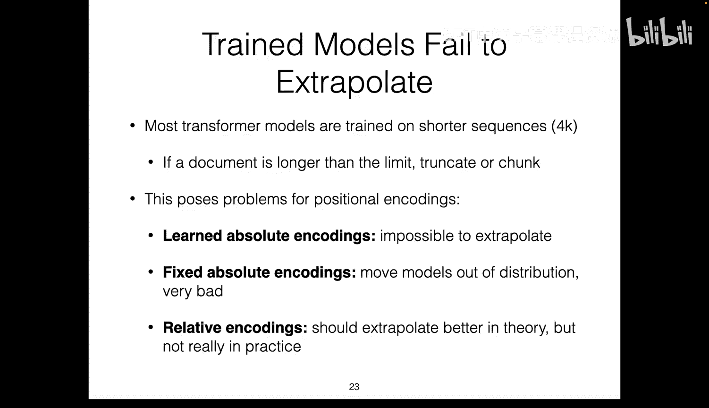

So。Here's a concrete example， and it could be kind of really striking。

So here they have a model which is trend with rope。And it's been trained on 32 k sequences。

 and then they test it on longer ones。And you can see that the rope embedding actually does。

Exttrapolate a bit。So。Potentially， since it's relative and it's also based on these kind of。

Periodic functions， it is able to actually get some extrapolation。

 but then clearly it's just not doing very well as the sequence like。Exceed some limit， about 40 k。

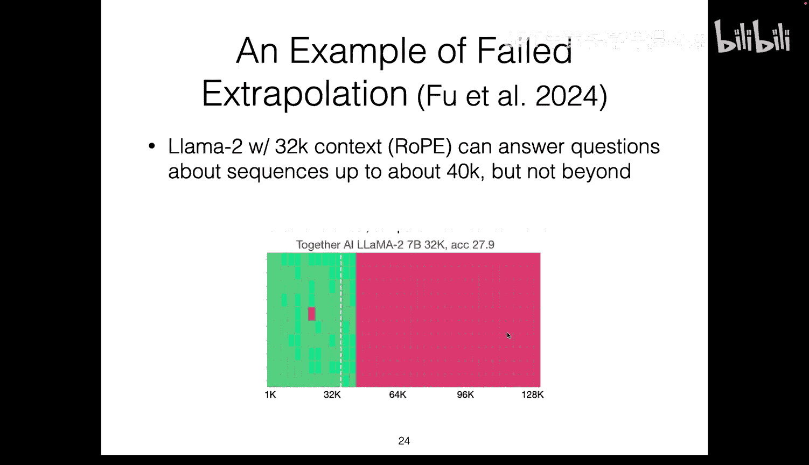

So there's kind of two different approaches you can take to this or at least two。

So the first is maybe kind of。Ovious， in retrospect。You can just train on longer documents。

So if the model has been exposed or trained， on longerer documents。

Then the embeddings are kind of adjusted to those and your model should kind of work on the longer documents。

So here you have to think about where you get the data。

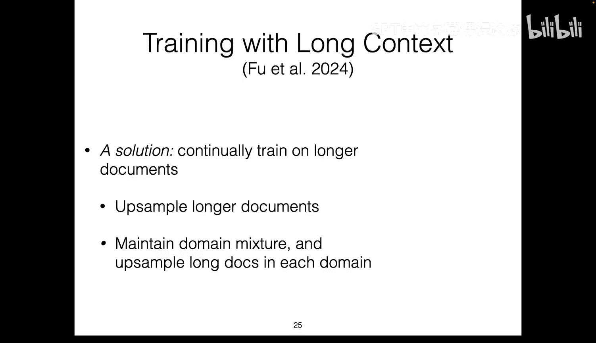

And so sometimes it could be tricky again to find like real data that's a lot of real data that is truly kind of long context。

 has these long context dependencies。So people do different tricks like they'll upsample longer documents。

Or you could just synthetically make a document longer。嗯。And。Yeah。

 anything that involves data usually involves， you know。

 a lot of trial and error on what you should do。But then you could see that as long as you can kind of computationally do the fine tuning or post training with the longer context。

Then here， even with the standard embeddings， it's。

Pd of fixing the issue in the sense that now you can support 128K。

The issue that it's not fixing is this isn't necessarily going to extrapolate to say 256 k。

 you have to keep。You know， post training on longer and longer。Documents。

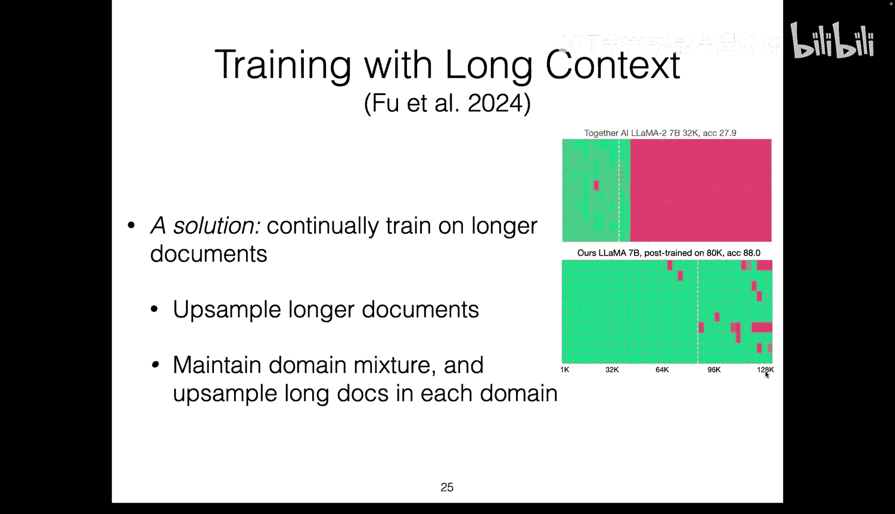

So the other thing you could do is take a look at the position embeddings。So。Again。

 if you remember these rope embeddings have this form here， you have these signs and cosines。

And then this parameter theta impacts the periodic structure or the period of the function。And so。

Here you can parameterize theta using this form here where you have this base and say in practice you might use a base of 10。

000。And then you have these two other items， which are based on the。Poitions。

So one way to visualize this is you could have this kind of cylinder and this theta parameter kind of controls how fast the rotation is occurring。

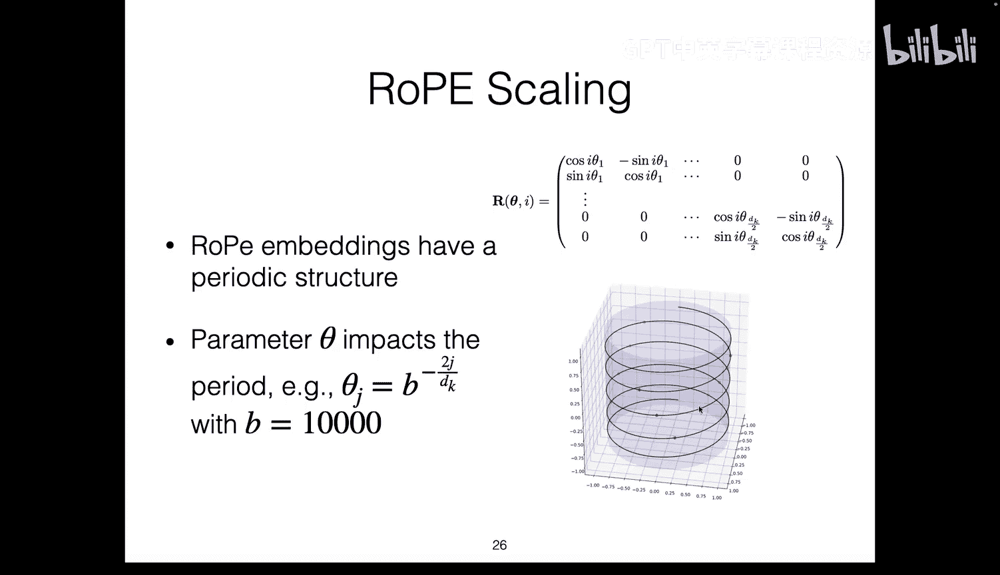

So people took a look at these rope embeddings and kind of multiple groups。

Identified issues and different solutions。So one thing that they noticed is that。

Based on how rope is formulated。Or what was learned。

 it is kind of naturally decaying as the sequence length is increasing。

And so possibly this could affect things because just the。The attention scores are。

Here the attention scores are just getting very low。

Based on the distance of the query and key tokens。And so this is kind of concretely showing one issue that you could try to fix。

 we basically don't want the attention scores to vanish。As the length is increasing。

So there's kind of two， at least two different things you can do one is you can increase this base frequency。

So in some sense， it's maybe staying in a similar range。

 but now you're kind of sampling the points more frequently。

And this turns out to be somewhat effective for kind of overcoming the issue。So specifically。

 this would be in a kind of post training setting where the models been trained with one base frequency and now is your post training it on longer outputs。

You would increase the frequency。Similarly， you can also adjust the period by some constant。

And this technique is called position interpolation。So again I'm not going into too much detail here。

 but if you want you can take a look at these papers and you can to some extent alleviate some of the issues with rope by。

Using one of these modifications。

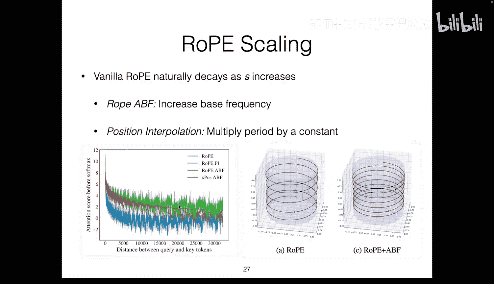

Okay， and then the third class of methods。嗯。I'll just put them up really quickly。

 but we won't go into details here。

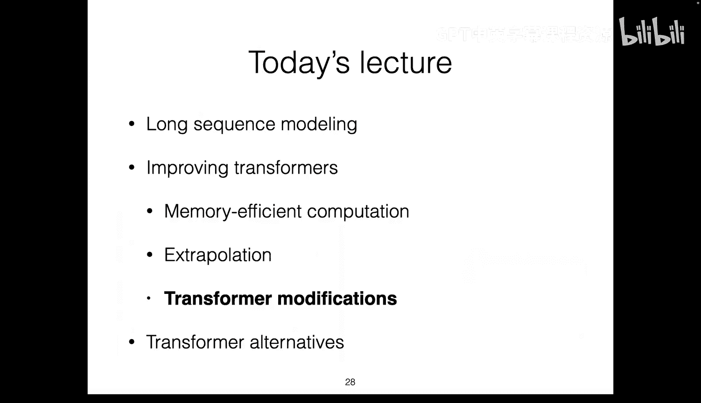

So。Basically， there's。There's other things you could imagine doing so you could imagine making the attention operation sparse or having this other this sliding window attention or even doing compression or approximations。

 things like that。And so if you read a paper， say like a paper about the latest myal model。

 for example， you might see some of these techniques come up， it'll kind of vary based on。

You know what。What they chose to do。Another thing to be aware of is to look at whether the modification is approximate or exact。

So for instance， if you introduce some approximation to attention， then maybe in the long run。

 you're kind of losing losing out on some modeling capacity。So in the long run。

 the exact methods might tend to win out。However， it's often kind of a trade off。

 And you kind of figure out。What works best for the model that you're training？

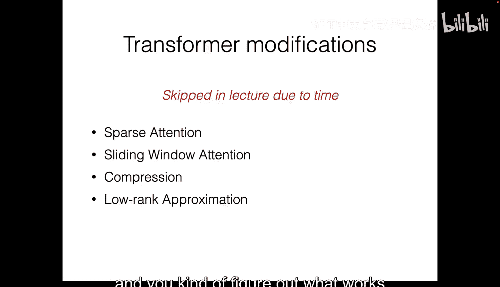

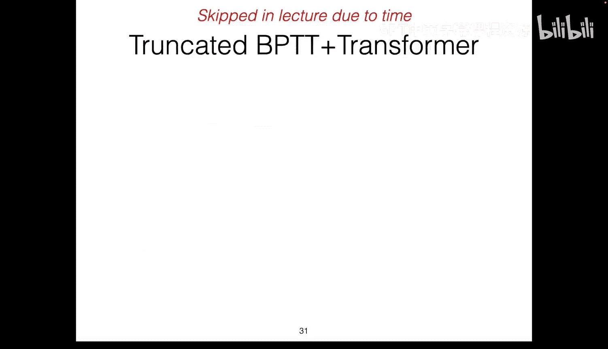

So again， I'm not going to go too much into detail here。

 these these slides were from Graham from a previous version。

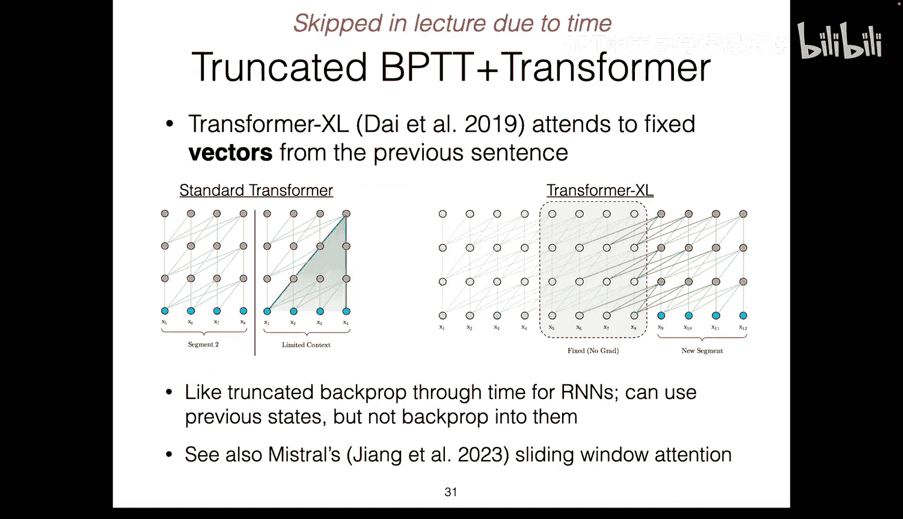

Of the course。

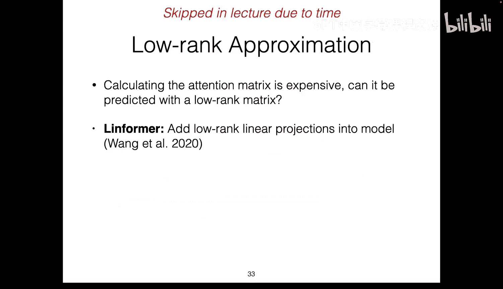

So the reason is I want to make sure we have time to go through the transformer alternatives。

 specifically the state space models。

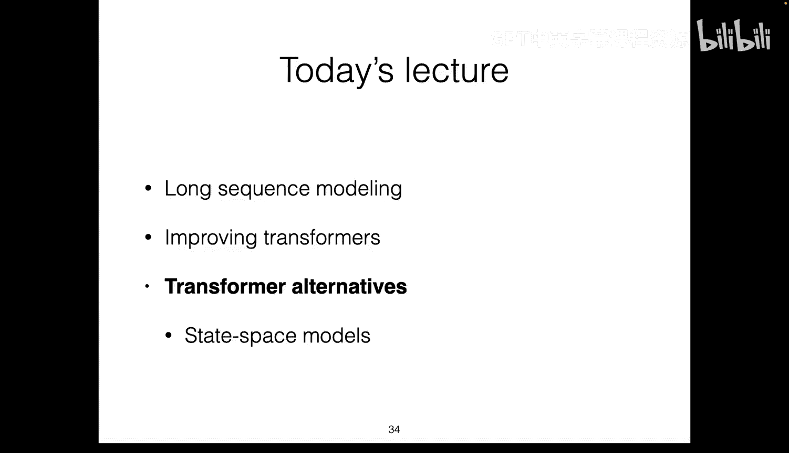

So here we're trying to do something maybe ambitious。

 which is switch the architecture from transformers to something different。

And the state space models were really。Kind of pioneered by Albert Gu， who's now here at Team U。So。

If you remember， we had this lecture on R&Ns and maybe at some point I said this will be relevant later in the course。

And so actually， what we're going to see is kind of uses a lot of similar ideas or kind of similar。

Prinncipples come up with the state based models as with RNs。So if you remember with RNs。

 we had this hidden state that was kind of being transformed over time。

And then you have some output layer for actually making some prediction。

And if you remember the kind of nice thing about these is that at least in theory。

 you can get kind of infinite context with the RNN。In the sense that， you know， in theory。

 the R&N could learn to at each time step， kind of retain the required information and add new information and kind of just keep passing this hidden state and you can kind of just keep doing this forever。

Similarly， in order to perform inference。Regardless of how many previous tokens there have been。

 all you need with the basic RN end is this one vector and so you have this nice constant memory requirement。

Of course， in practice the。It's kind of。Not as straightforward as that。So first of all。

 it can be difficult to parallelze the training of these RNs。Well。

 that's maybe not related to this infinite context thing。But it is hard to parallelize the training。

 as we mentioned， unlike the transformer models。Also with this infinite context。

 it turns out to be tricky。One thing is that in practice。

 the RNs ended up using some attention mechanism because it was hard to kind of compress all of the necessary information。

 maybe into this one vector。Similarly， it was tricky to train the model。

So there were different variants like the LSTM and GU。

 but it tends to you know get actually tricky in practice。

So the state based models will try to get the best of both worlds。

We'll try to have this kind of RNN like inference where everything is just based on a single hidden state。

But we'll also try to simultaneously have training that is parallellyzable。

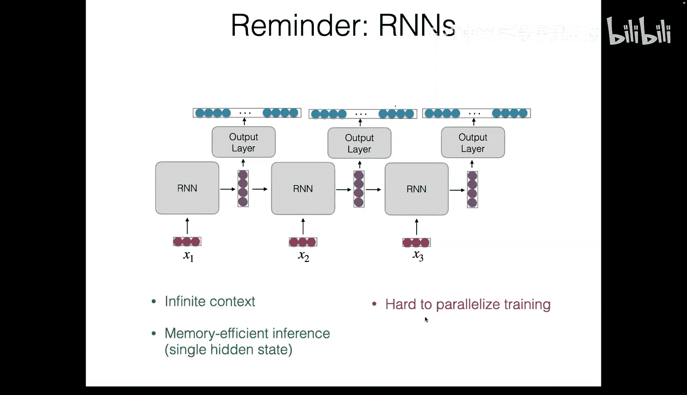

So to do this， it'll also draw on ideas from convolution。So again。

 we never really went through this in too much detail。 But if you remember， the basic idea is。

You have this kind of kernel and the kernel is coming up with some representation based on some kind of window or local context。

And again， you can kind of look at this and see that， okay， you can kind of parallelize this。

 you can break this into two different parts。And it's a bit different structure than the RNN。

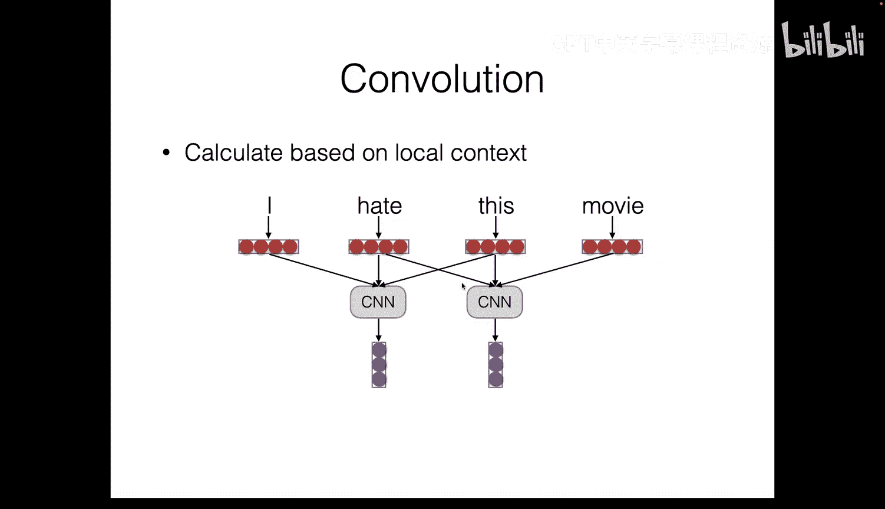

So。Oh， and then this is just showing for auto aggressive models you of course。

 have to like mask out the future。

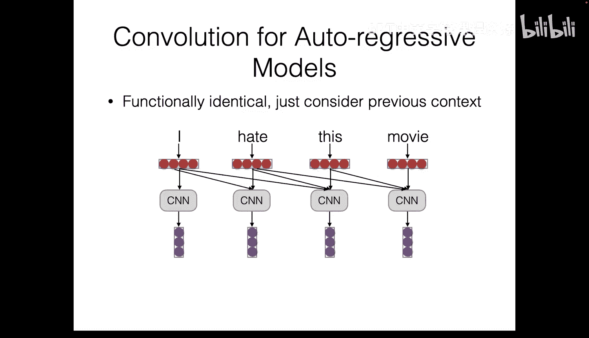

So the state based models will try to have kind of best of both worlds， as I mentioned。

So what is a state space model？Well， it's any model that takes a form like the following。

So here you have this hidden state and it's multiplied by some matrix。

And you also have some input from the current time step so you can multiply that by some matrix。

 and that will make up the current hidden state。So that actually looks kind of like an R&N。

 a kind of really simple linear RnN in some sense。Then here they also have this kind of skip connection。

So your final output will be。A kind of a function of the hidden state。

 as well as this kind of skip connection。So let me show this in a couple different forms。

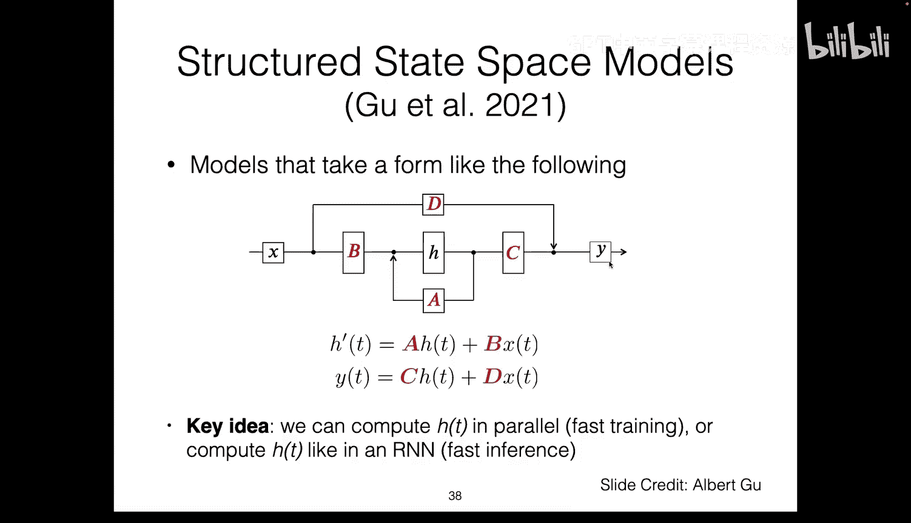

So one thing you could do is say like okay， skip connection is maybe an idea that's not specific to these types of models。

 so we could just consider this part as being the state space model or this is kind of what we want to figure out how to do efficiently。

U，So yeah， from here on out， we'll just be considering these kind of operations。And here。

 where you have this matrix。A， which is modifying the hidden state， and then some matrix B。

 which is modifying the inputs and then a matrix C， which is helping determine the outputs。

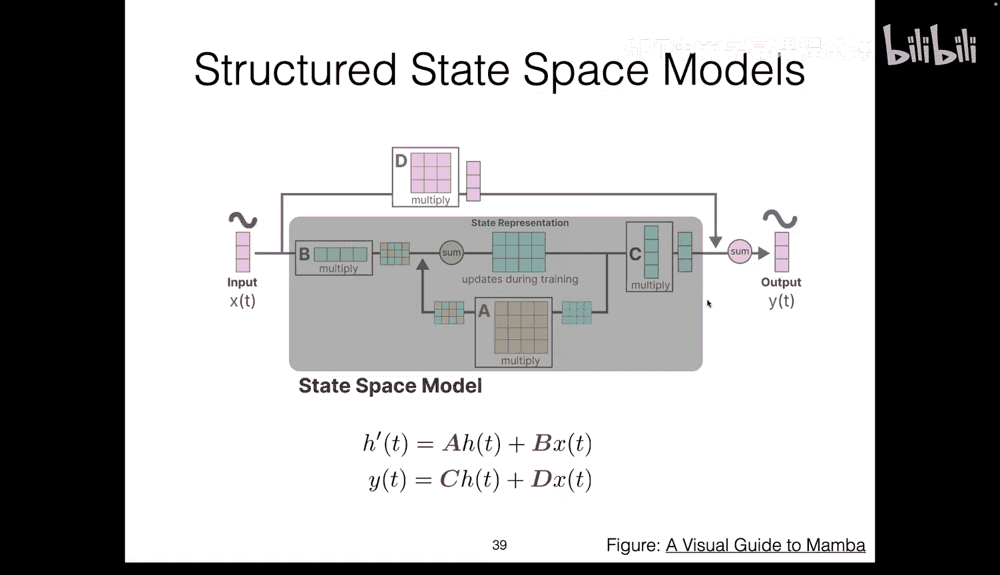

So if you notice this is using this notation where it's like a function of time。

So really the kind of original state space models are these kind of continuous type models。

 so you have some continuous signal。And your output is also a continuous。

Sign and you have these equations and they're kind of differential equations that are kind of governing the mapping between input and output。

Okay。So the first thing you have to do is。You know we deal with these discrete tokens。

 so you have to somehow discretize。And the idea is kind of simple。

 So here you have some continuous signal and you basically sample at discrete time points。

Or you consider each time step to be some sample from the continuous signal。Now。

 if you view things in this way， then the question is kind of what time points do you sample from and so we can call this difference between one time point and the next。

Delta。So for our purposes now we can just look at the state space model this way。

And now you can see that it's starting to look kind of like some linear R none。

 so we have a hidden state， you have some matrix。You have the input in another matrix。

 and then you have an output。So then what happens is if you kind of want to convert this。

Continuous version to the discrete version。Then here you have something which is kind of the rate of change。

So you have to consider。Yeah， converting this to something discrete。

And when you kind of work out the math， this matrix here would correspond to this form here。

 So you have the original kind of continuous version。 you have the。Granularity or the delta。

 And then you have this xon。So I'm not going to go through like the derivation。

 but you'll see these equations come up when you're reading about the state space model。Okay。

 so now we basically have some representation of these。Two matrices。In terms of。

These matrices and then this parameter delta。

So。Again， we can kind of view this as being very similar to an R&N。

 so this is just showing you yet another representation of this equation。And。Yeah。

 one thing to note is that there's no nonlinearities here， so everything is kind of linear。And。

The thing is that。When you view things this way， it's again not really clear how to parallelze the training。

So again， with an R&N， you can do efficient inference because predicting the output just depends on this kind of hidden state in the current position。

But it's not really clear how to parallelize。So then the cool thing is。

The kind of insight with the state space model is that you can view this exact same model from a different perspective from a kind of convolution perspective that you can take during training that allows you to parallelize。

So here， what you can do is you can kind of view what's happening as being some kind of kernel。

And so at one time step， you have。This year， so like C B。

 and then you can see that as you move back in time you're basically applying this matrix。

According to how far back in time it is。So this kind of follows from the fact that everything in the model is linear。

And yeah， again， I'm not going to。Kind of walk through the full justification。

But the kind of cool thing about this model is that they're able to。😊。

View the same model equivalently as being this kind of convolutional operation。

So you can see here that a given output。Is determined by these things here。

 I think there should be a square in one of them。And then these can kind of be broken up and just computed in parallel。

So again， here， you could imagine this kernel being。Kind of really long。

And you can compute these kind of however you want。And then you can do this。

 you can kind of view the entire model as being kind of applying this kernel。

To eventually get some output。Okay， so kind of zooming out again， again。

 the kind of interesting thing about these is that you can have this recurrent view or you can have this convolution view and both of them have kind of complementary tradeoffs。

So。What happened is like in practice， some modifications had to be made to get this to work really well。

So there's been a few kind of improvements or variance on the kind of pure state space or discrete state space model。

So the first thing that was done is called S4。And I think so the S stands for structured。

Structure structured state space。There's a fourth as， but I forgot what it is。

But basically here they found that you can structure this， say this matrix a。

 you can see it's being kind of applied multiple times。

And so it's important for kind of the memory retention in the model。

And so what they found is that you can structure it in a particular way。

And the P one of the P's here stands for polynomial。

So they basically show that you could use this kind of polynomial formulation or representation。

And it was kind of better at retaining long term memory。So again。

 not going to go through the details， but this was the paper that it's in if you're curious about reading about it more。

And then a kind of really famous paper from， I guess a few years ago at this point or a couple years ago。

 is a paper called Mommba。And so here， this basically took this S4 model so the kind of improved state space model。

And they added some ability to selectively retain the information。

So。We'll go through MMba in a bit， but first I wanted to just introduce。

 we'll kind of go through MMba precisely， so let me just introduce this kind of algorithm diagram。

So here is with S4， and you can also see exactly what's involved in the state space model。

So you could see here we have these different matrices that I was showing you in the slides， A。

 B and C。And then what's kind of interesting is they treat this delta as a kind of learned parameter。

So even though you're feeding in a kind of discrete sequence of tokens。The model can still decide。

 kind of。In continuous time， how much of a transition would this be。Okay。

 now here you have these equations that I showed you before。And。That will let you kind of discretize。

And then you could pass this into the state space model。Okay。

 and then the key difference with the hippo is they're kind of structuring it。

Strturing this matrix A in some clever way。

So then Mamba， basically， oh， so one thing to note here is that。

These parameters are basically time invariant， right， So over time。

 everything is kind of staying the same。And the parameters aren't changing based on the current input。

And so what you could view this as is being a kind of。Extreme。

And it's kind of something we encountered with RNNs。You could view like， one extreme as trying to。

Have something that's time invariant and just like compressing everything into a hidden vector。

 and that's the only thing that's evolving over time。

Or another extreme is like a transformer where it's trying to attend over everything。

 And so every position is like looking at every other time step。And so conceptually。

 Mommba is trying to do something maybe a bit in the middle。

And it'll basically introduce some time dependence into the S4 model。

So what they do in the paper is they actually demonstrate that this S4 model would fail on these kind of。

Synthetic or toy probing tasks。So for example， it would fail at this kind of simple copying from。

 I think like really far back in the context。It would also fail on this task of induction heads。

 which is kind of related to just like repeating something in the input。And as a result。

 the model is like not that good at fu shot learning because fu shot learning involves kind of referencing。

Obviously， things in the context。 and then in general。

 it's not like performing too well as a long context model。So what mama does is trying to。

Improve this。And so their version is called S6。Selection， I guess。

And for some reason they add on like two ss onto the number， but but anyway。

 so now we have the selective S4 model and you could see that the key difference here is that now this parameter is actually a kind of output of the model。

 so you take in the current input。And you have， say， in multi layer perceptron。

 and it actually outputs a parameter that's then discretized and kind of passed into the state space model。

Okay， so now you have something that is time varying。

 it can kind of change the transformation based on the current input。And so it can， as a result。

 kind of select from or modulate the information flow a bit。Now， if you think about it。

This kind of breaks one of the nice parts of the formulation。

 so now it turns out to be difficult to parallellyze the model because now we have this time dependence。

And it's kind of easier to more difficult to。Just break things apart independently。

So what they have to do is use this kind of clever thing called a scan。

And。You can parallelize this kind of scan operation a bit。So。Here is the kind of diagram。

So the observation is that you can still break。Some of the computations apart。

And then kind of merge them and eventually get。Everything at the end。

And so now it's not perfectly kind of linear， but it's。

You can get some parallelism and some speed up。So you'll also see this come up and yeah they use this parallel scan and then another part of the maMba paper was going in and implementing some kuda kernel。

 which does this kind of efficiently on the GPU memory。

Okay， and then finally。What does the name mamba refer to precisely。

So Mamba is actually some specific block。That incorporates this S6。

Kind of operation that we saw before。So when you incorporate the SX into the overall model。

 there's still going to be linearities like in the neural network， just not within the SSM block。

And so Mamba was this， like specific design and。Yeah， it looks like this。Okay。

 so now once you have a block， you can stack them together and now you have a full。

Neurural network architecture。So here's some of their results。So。It's a bit small。

 Let me just talk through them。 So the first one is on text data。

And here on the Y axis we have the perplexity， so where lower is better。

And here they were doing pre training， so you can see the flops that are spent during pre training on the Xxs。

And then here， at least in their experiment， you could see that the maba model is basically matching。

This transformer。The reason it's called transformer plus plus， actually。

 I think I put this in the transformer lecture。This is the transformer with some of the upgrades from the original transformer。

 which is shown here。So like you might have the group query attention or better embeddings。

 things like that。嗯。But here they're able to kind of match the performance in their setup。

And then here we're looking at kind of very long sequences， so you have this genomic data。

 which I mentioned at the beginning of the lecture。You're going up to 10 to the 6。And again。

 audio data can be very long。 You could have like a whole podcast or something。 And so again。

 going up to 10th to the sixth。Here， I think maybe they couldn't even use the transformer for their experiment。

But you could see the comparison between。Hyena was the model that had this， like hippo matrix。

So you could see that whatever they did in Momba is kind of important。And then here again， yeah。

 you had this S4 model and the mum mumbas improving upon it。Again， here lower is better。Okay。

 so then since then this is another one of these papers that you know it came out a few years ago and has thousands of citations so this kind of led to a lot of excitement in the area and there's been a lot of follow ups。

 things like that and again。You know， this was really kind of pioneered by Albert Go。

 who's now here at CMU， so maybe you can go talk to him or something if if this is interesting。

Okay， so to recap the state space models。At their core。

 they're trying to combine these insights from kind of recurrent models and convolutional models。

And they're trying to get the best of both worlds， so have both efficient training and efficient inference。

And to recap with the long context models。We talked about some concrete examples of like benchmarks and different tasks you can do。

Then we talked about improving transformers， so。The quadratic constraint we have on memory and trying to improve that。

 and then also trying to improve the embeddings that are used for extrapolation。

And then we just talked about these transformer alternatives。And again， this is just one example。

 but there's really active research on trying to come up with other alternative architectures and one of the key motivations is having really fast inference or supporting really long contexts。

So really， for the more kind of cutting edge methods we would probably need。

We would need another lecture， guest speaker， something like that。

 but just know that this is another kind of active area of research。

Okay， so that's all I have for today there's time for maybe like one or two questions or I can take them here in person。

