# CMU《高级自然语言处理｜CS11-711 Advanced NLP Fall 2025》中英字幕 - P21：(21)_ Mixture of Experts.zh_en - GPT中英字幕课程资源 - BV1ZWYAzuEMa

So with that， we can get started with the lecture。

So I might say this before every lecture but this is another exciting lecture and we're going to go over a mixture of experts this is actually a new lecture for this semester so these mixture of experts models as I'll show you kind of evidence of are really used in most frontier language models and even in the language models that you're trying to run locally so this is really really important kind of class of architectures and so it's really good to know about and so hopefully you'll have a good understanding of these by the end of the lecture。

So。The key idea behind mixture of experts， let me just put up this diagram here。

Is to take the transformer。And then take a specific layer。 And in， in particular。

 pretty much everyone uses the feed forward layer in the transformer。Layer。

And we're going to replace it with a different type of layer。Okay， and so it's a bit small here。

 but you can kind of see the standard。Feeed forward layer here。 So we have two different tokens。

 It's going through and each tokens being processed by the feed forward。Network。

The abbreviations can be FFN for feed4 network。And on the right hand side。

 we have the mixture of experts layer。And you can see here there's some kind of multiple feed forward networks here here we have four。

 and there's some notion of sort of choosing one of these networks or choosing one of these experts。

Okay， so this is really going to be the key idea and we're going to go into a lot of detail on it。

 but really the idea is very simple。 We are no longer going to have a single feed for network。

 We're going to basically have multiple that we can choose from。And in particular。

 the other ones are not going to be used at all after we've selected one。 Okay。

 so this idea is called sparsity。

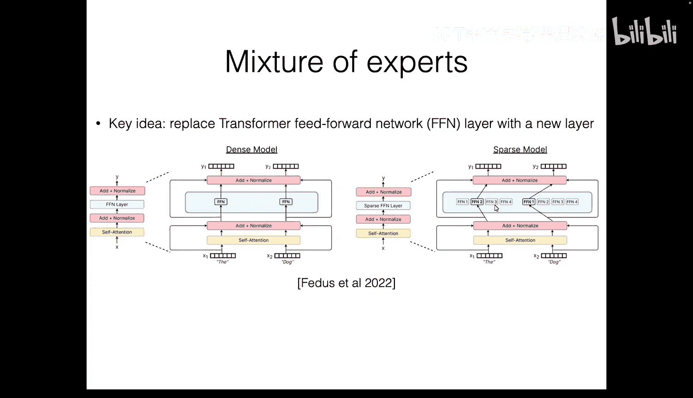

So this is really going to be the key idea behind why these are maybe interesting。

Is that the model is able to have many total parameters， right， So for each one of these networks。

 you have a bunch of parameters。But only a small number of them are going to be active。

For a particular example， during both training and during inference。Okay。

 and so there's a lot of questions here like how do you select how often do you select。

 it turns out that what we're going to do is select these experts for every single token so this can vary by token。

And then really the key idea here is we can increase the number of parameters in the model。

But then during training and inference， it's kind of fixed number。

 relatively small number of parameters that you're actually using。

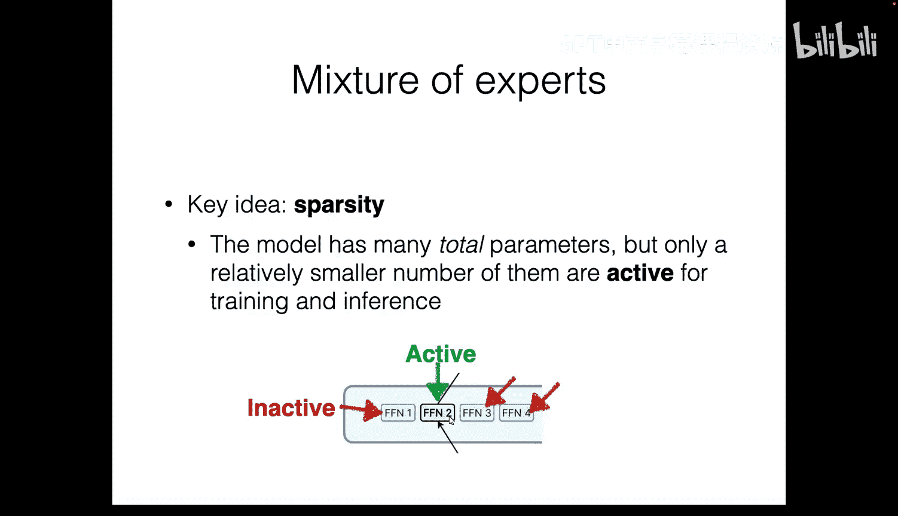

And so why are these so interesting， Well， they have these really nice properties or there's been these really nice kind of empirical results with them。

So when you think about it， what this does is it gives you this new dimension of scaling up。

Your model。So in particular， now we're able to keep the amount of flops that are being used fixed。

And what we can do is increase the number of experts。

 so increase the number of kind of options for this feed forward routing。And again。

 the number of flops that you're using is fixed， but now it can increase the number of parameters。

Now the question is， is doing that actually useful and that's what these plots are showing the answer is yes。

 so as you increase the number of experts here， you can see that the test loss is decreasing。

And here are some early results from one of the early papers from。People at Google。

You can see that they have this model which is called the switch transformer and again here you could see the perplexity。

And this was a kind of baseline of using a non mixture of experts model。

 and you can see that these models are also just performing better for a fixed amount of flops that they're spending during pre traininging。

Okay， so if you remember back to the pretraining lecture。

 really the key question with pretraining was how do we spend our flops efficiently right。

 you have all this compute and you want to spend it and you want to get the best model at the end。

 Well this looks like a pretty convincing plot here we basically have a better way of spending these flops at pretraining time。

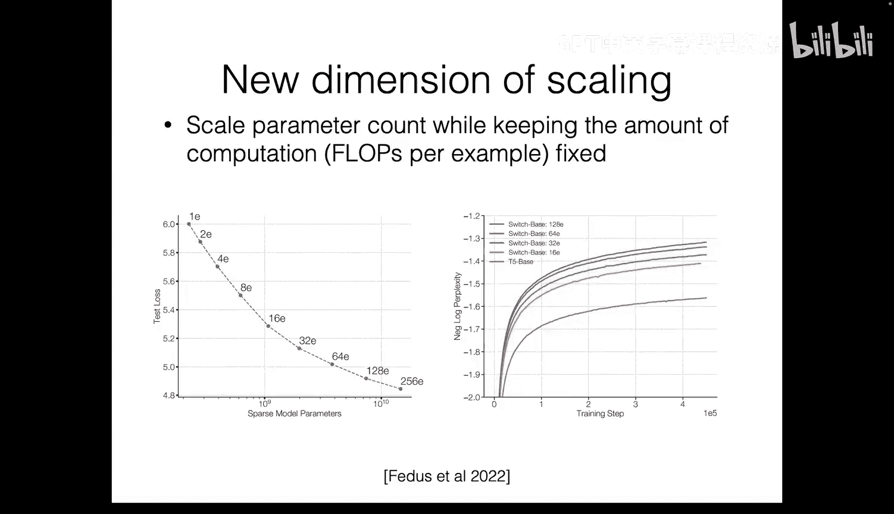

Okay， and so then there's been you know， a wide kind of swath of results on these。

 there's another really nice paper from AI too。So kind of this company is really focuses on making everything open。

 so they made a basically open version of one of these mixture of experts。

 and then they did a bunch of ablation so you can get a lot of insights from it。

So here this is showing。Compared to a dense architecture。

You can just see the benefits of the mixture of experts， which is in pink。First of all。

 for a given number of tokens or a given number of training time， you're getting a better model。

And you can view this as， you know， another option is you could just stop early and basically get an equivalent model with much less flps spent or much less training time spent。

Okay， so really kind of intriguing if we can make this happen and these are kind of real real results。

 so it turns out that this is possible。

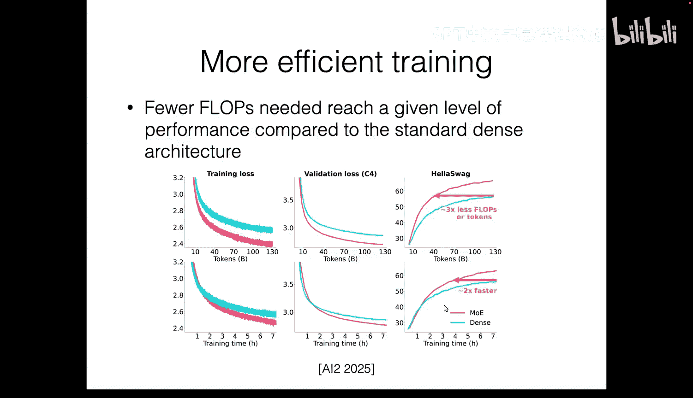

Here's just some more you know kind of results to convince you that these are interesting and that these can lead to benefits。

 so here's going back to this earlier paper showing again the speedups that you can get in terms of training time。

Here， you know， it is actually possible that for a given number of flops， you are。

Having a better model， but maybe it you know slows things down so much and so this is just trying to convince you that it's going to be possible to actually do things kind of cleverly at a systems level so that you can get an actual wall clock speed up as well。

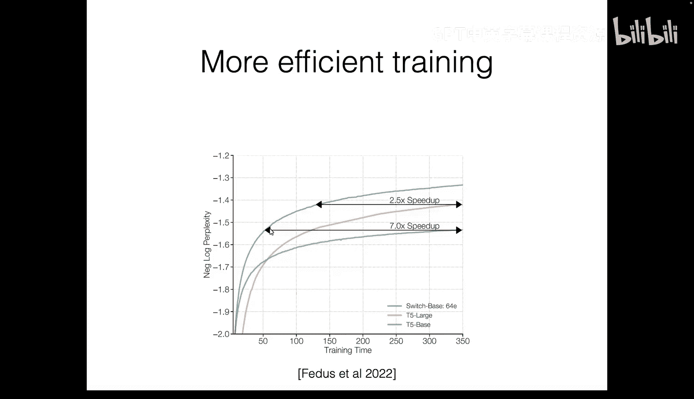

And then this is kind of viewing things， you know， just from different perspectives。

 but you also see these kind of plots come up。So this was the first mixture of experts model from deep Deepse and they've now had another one。

 deepse V3， this one's called deepse mixture of experts。And now you can consider like， okay。

 let's say someone is going to use this model。Well。

 then you can consider how many parameters are activated as you're using the model。Right。

 so in this diagram， we had this kind of selection operation。And the number of parameters that are。

That the model has after doing the selection will be the number of active parameters。

And then you can compare models with a given number of activated parameters。

So you can see here that these non mixture of experts models are just much worse than the equivalent mixture of experts model in terms of the activated parameters。

Okay， and so again， this is going to be beneficial even at inference time。

 because although we're going to have to manage all of the 16 billion parameters somehow。

 when you think about， for example， the activations that are used，It's going to be you know。

 similar to a model with， say， 2。7 billion parameters。

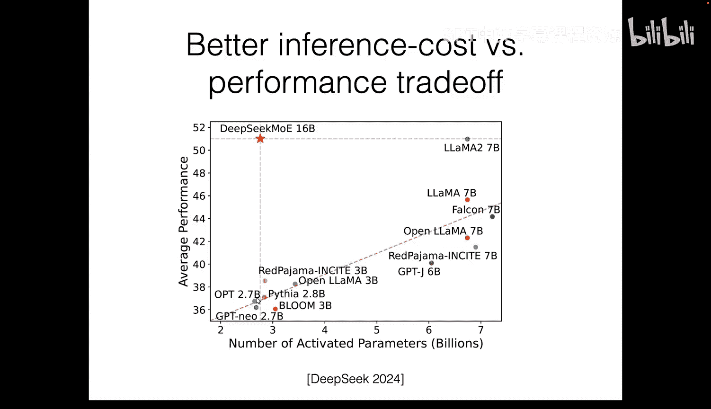

Here's just some more plots showing the same thing， but from different groups。

 so this is from AI too again。So here you can see that they have this mixture of experts model。

 which is 7 billion parameters， and 1 billion of them are actually active at inferenceprints。

Or during training。And so one thing you could do is compare it to a 1 billion parameter non mixture of extra model。

 and you can see that it's just you know， much， much worse。

You could also try comparing to a 7 billion parameter dense model and again you could see here。

 as I said before， for a fixed number of flops， the mixture of experts models is going to be better。

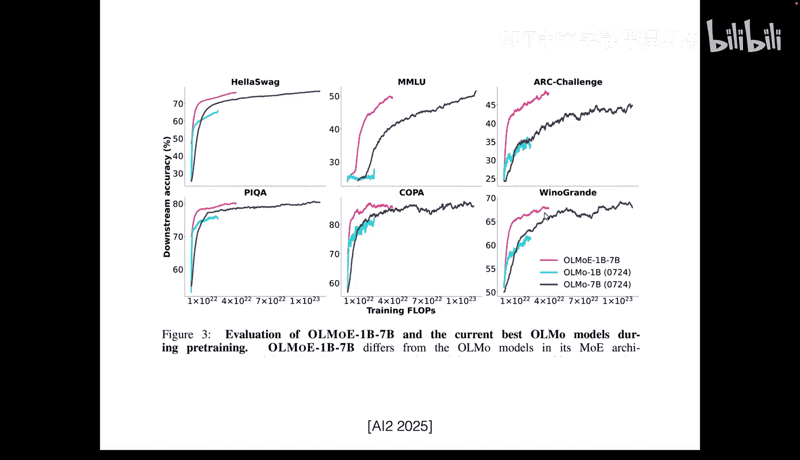

Yes。Maybe one more plot so here's another one for Mistrral so all these different companies now are coming out with their version of their mixture of experts model and so here again you see。

😊，On the X axis， the number of active parameters and then the dense version versus the mixture of X version。

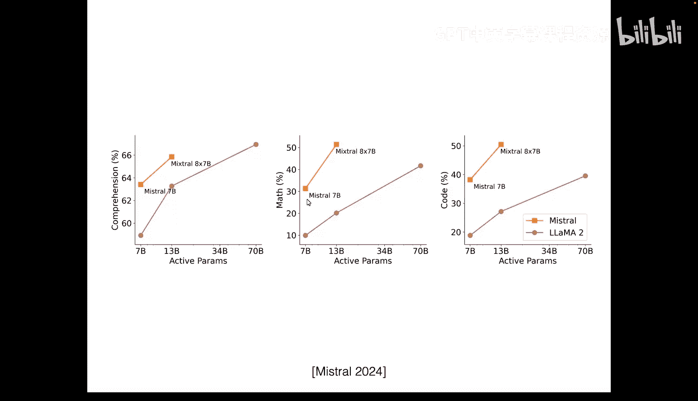

And then what I did is， you know， started looking at some recent models and it turns out that actually today。

 so today is November 18th， Gemini 3。0 came out and you could see here that they're using a spas mixture of experts model。

So this is pretty much as up to date as we could possibly get， this is just released a few hours ago。

 so you can really see that these frontier models， this technique works so well that they're being used in kind of the very best models。

And then as I mentioned， if you go to use a model kind of on your own。

 the best kind of open source models will have mixture of Xers version as well。

 here's this one from Open AI， and then you can see here thisquin model， the name here says 30 B A3B。

So 30 B is the total number of parameters。3 B is the number of active parameters。Okay。

 so hopefully I've convinced you now that these are kind of interesting and used widely and potentially can have a lot of benefits when it comes to training a better model or training a model and using it more efficiently。

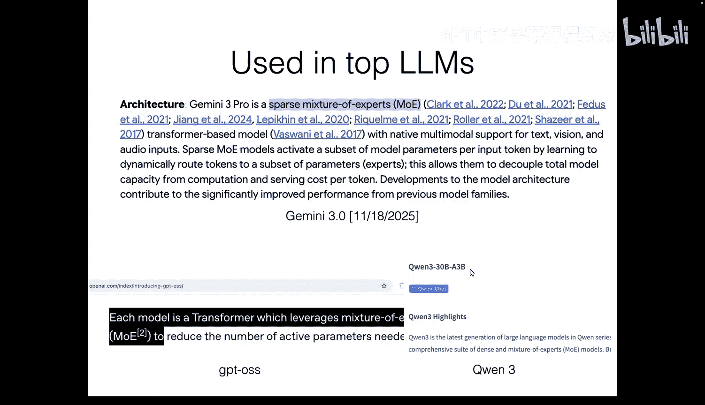

So what are the potential downsides and again we'll go into these throughout the lecture。Well。

One is kind of maybe it's hard to pin down exactly， but we'll see a few examples of it。

 but just in general， using this model kind of complicates things。So first of all。

 instead of this kind of simple， you know， single layer， now we have these， you know。

 multiple V4 layers and we have to figure out what's the best way to route between them。嗯。

These models have much more parameters。So we want to do things like balance。

 like make sure all the parameters are being used。We have to figure out。

How are we we going to manage all of these devices that are hosting the parameters， right。

 So we've talked about parallelism and we'll see that， you know。

 there's new notions of parallelism with the mixture of experts。

And then it turns out that in order to get these to train in a stable way。

You have to come up with the right loss， you have to choose hyperparameters。

 and actually a lot of research went into kind of figuring out what is a good recipe that actually scales。

Okay， so now with the benefit of hindsight， we can kind of look at what works。

 but also give examples of things that haven't worked as well。

 and hopefully you can get some appreciation for the kind of complexity that's involved in really kind of refining the mixture of experts recipe。

And then the one that we're currently using is in no way kind of optimal。

 and hopefully you can get some sense of that as well。

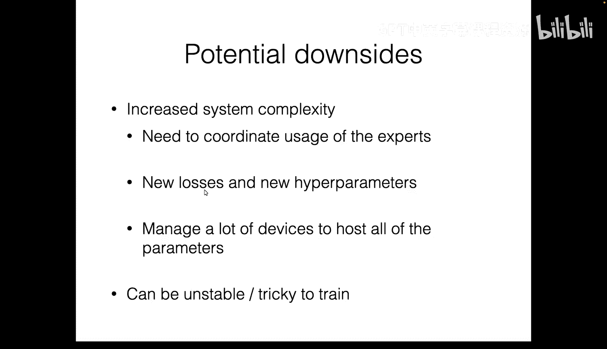

Okay， so。What are mixture of experts actually yeah so we don't have a bullet point for intro but intro was kind of convincing you that these are interesting now we can go into different you know topics so first we'll go into a bit more detail on what are mixture of experts then we'll talk about a variety of things so various things related to the design or like how many experts you might want。

How you do this routing？How you train， do you need kind of extra loss functions？

We'll go briefly into systems， so the kind of new dimension of parallelism that you get with the mixture of experts。

 just very brief。And then at the end， we'll go through some case studies。

And so the idea is in all these sections， I'm going to frequently have like plots and screenshots from papers。

And we'll go through all the different concepts， and then at the end。

 I'll basically restate the models that we've been talking about as a kind of list。

And so hopefully you'll kind of fully understand what is in these different models。

 and then you can go and look at some other models that aren't listed in the case studies。

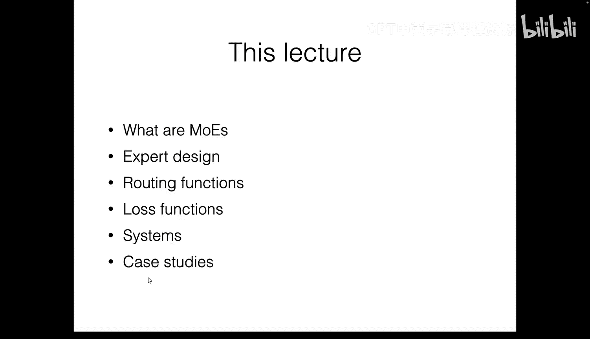

Okay， so what are mixture of experts？So again， still at a high level。

 it's some neural network layer that only activates some parameters。Now。

 if you go back and read the papers， even like the early language model mixture of experts papers from Google。

 say 2020。2017。Then they reference other things called mixture of experts from you know 2013 and 2016。

So really， you could use this term to refer to a kind of general sense of。You know。

 routing computation too different。Prerameters and not using some parameters。

But we're mostly going to stick to what is。Being used now and what has been used like since。

 say 2022。Okay， and so that will be， we'll take this transformer。

Architecture and will'll basically replace this feed forward layer with what I was showing you before。

So what you have again is this notion of a router。And a notion of having multiple copies of weights。

 so in particular， multiple copies of the feed forward layer。

And then the problem is kind of how do you decide to route different inputs to different。

Wais or experts。And then combine them at the end。

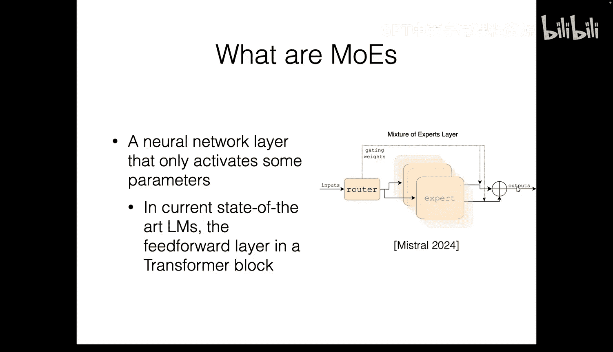

So。Let's go into a。Assign a bit of notation to this just so it's a bit more precise。

So if you remember back to the transformer layers。Then we can kind of， you know。

 this is ignoring some of the details like normalization and things like that。

 But there's these kind of two important aspects or a few different important aspects to them。

What you do is you have your in your incoming。Hidden state from whatever layer you're you're looking at in the network。

 So that'll be this H1。This H， and then here we're just saying we have it for all the tokens in the sequence。

Then you have the multi head attention function， whatever hyperparameters you're using。

 and then here you have this kind of residual or skip connection。Okay， then if you remember。

 then we get some kind of intermediate output and we pass it through this feed forward network。

And again， we have another kind of skip connection。Okay。

 then you can consider this as the output of this transformer layer。

 and then you know you can stack them together。So again。

 the key idea here is we're going to take this feed forward network and turn it into a new kind of layer。

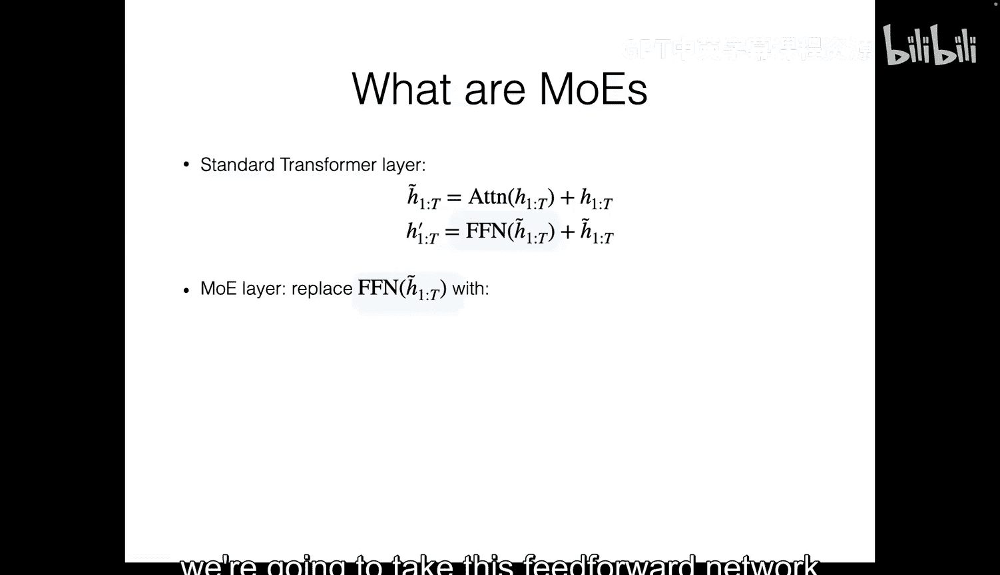

And internally， it really has two different things， and I've said this kind of a few times now。

 but maybe now I'm just being a bit more precise and putting some notation to it。So again。

 we're going to have these multiple feed forward networks， FF and1 through FF and N。

And each feed forward network is what is called an expert。Okay。

 and then the important thing is that each one of them has their own parameters。

 so the parameters are not shared。You're going to have separate perimeters。

And then you're also gonna have a router and we'll go into the details of the router。

The router can itself have some parameters， you know， so it's a learns function。

And it's going to choose one or more of these feed forward networks。To use for a particular input。

Okay， so that's really the idea of mixture and experts。

I'll briefly talk about some other things that have been triedd， so one question is like。

 can you do something other than the feed For network？So other papers have tried this。

 One thing you could try to do is have a kind of mixture of experts attention layer。

You could try other kind of clever things。It turns out that， I mean。

 that itself is an active area of research， maybe the answer will change in a year or two。But so far。

 as we'll see， these mixture of experts are kind of tricky to train。 They could be pretty unstable。

And so far， trying to do this with say the attention layer has just made things kind of too unstable and we haven't really seen the same kind of empirical gains that you get with doing this in the feed forward layer。

Also， the F forward layer is going to have a lot of parameters。

And they're in these kind of two weight matrices that are kind of easy to split up。

 So it's also very amenable to， you know， these parallelization techniques we talked about。

 and so it's a kind of nice place to do this kind of switching between experts。

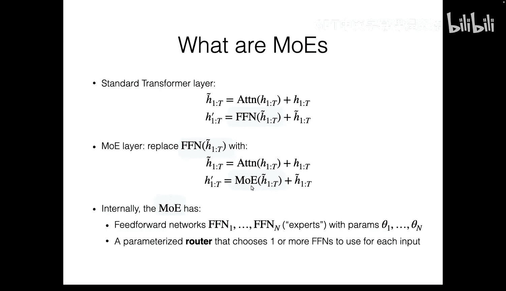

嗯。So then we could consider like， okay， what are different options for。Designing。

This mixture of experts layer。嗯。So maybe before this， anyone have any questions so far。

Based on what I said， or everything's pretty clear。Okay， great。

So here's a few different considerations and we'll kind of just go through each one one by one。

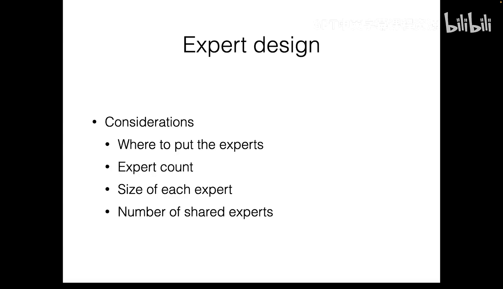

So this is really what I was saying before， so really it's become common to do this mixture of experts layer on the feed forward layer。

There have of course， been other attempts， some of them could be unstable。And。

Another question to ask is like， you know， do you do this at every layer， do you kind of skip layers。

 things like that？So the really early models from Google were doing things where they only place it。

 say every fourth layer， something like that。If you look at the more recent models。

 it's now become usual to just put these mixture of experts on layers on every single transformer layer。

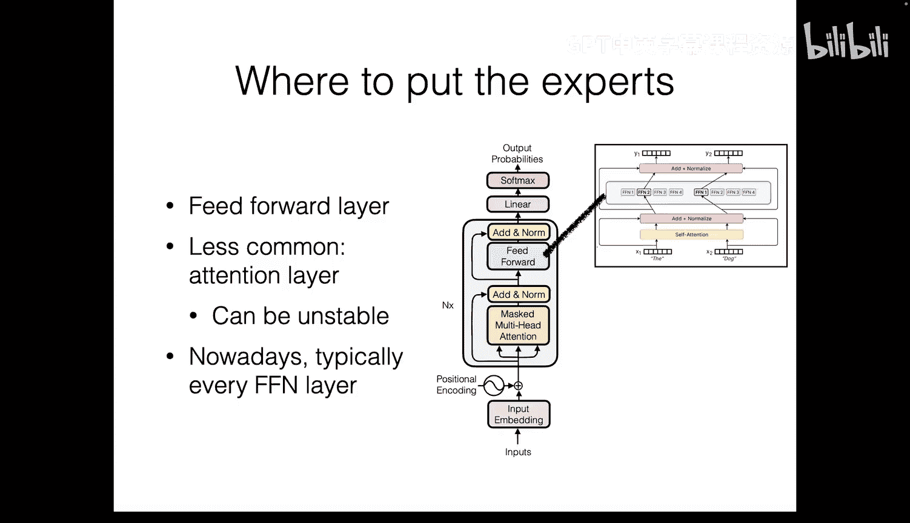

嗯。Then the question is like， how many experts should you have， right。It's kind of a hyperparameter。

Well， again， the benefit of increasing the number of experts。

Could be increasing the number of parameters。So what you could do is let's say that each expert。

 so each feed forward network layer has n parameters。Then what this is saying is just really simple。

 but what you could do is just increase the number of experts and thereby increase the number of parameters。

So this is the plot we saw before where they have experts of a fixed size。

And here they're just choosing one。So all of these will have the same。

Flops that are used during training or inference。And again。

 they're just increasing the number of them。 And you could see that this actually gets better。

However， if you kind of look closely， then here we're going from 64 experts to 128。

And maybe like there's not that big of a gang。And so in general。

 there is going to be these kind of diminishing returns that you get。

And so what you have to decide is like， okay， if you just keep adding parameters。

 then you do still have to use computational resources to you know manage the parameters。

 let's say you have one expert on one device， well then you have to keep using more and more devices。

And so although the number of flops is fixed， it does keep you increasing the number of resources you need to actually train and host the model。

Oops。So that's that's one consideration and so in practice people don't keep going to like infinity。

 you'll usually see numbers like you know 64， 128 things like that。

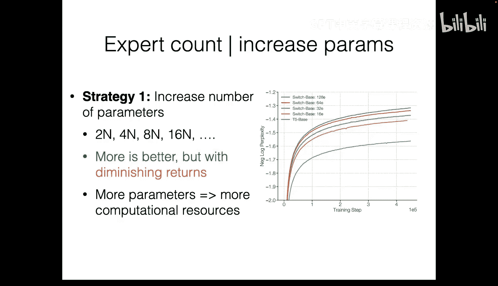

Another thing you can do is， okay， let's say that we want to increase the number of experts。

 but you don't want to increase the number of parameters， so slight kind of difference there。Well。

 then what you could do is basically just like chop experts in half or you know。

 in fourth or something like that。So this idea was proposed by Deepsek in their mixture of expertise paper。

And again， here， the idea is。Potentially， it's beneficial to just have many experts。

Because I don't know， for instance， they might be able to specialize to certain things。

And so the idea was we can take a fixed amount of parameters and again。

 just chop up the experts so that they're kind of smaller。Okay。

 so here the idea goes by the name of fine grained experts or other people call them small experts。

 but that's kind of the idea。

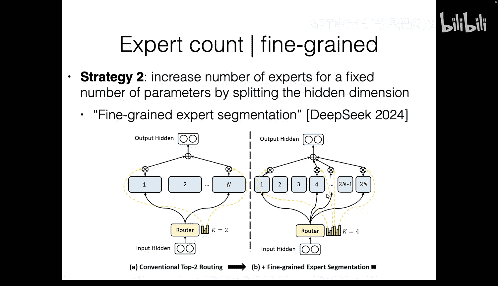

So just to again， make sure this is kind of clear and work through an example。So again。

 we have some dimension that we have。 Let's say we have。8 experts pork per layer。

And each expert is of dimension D。 So let's say， I don't know，024。

And let's say that we choose to activate two of them at a time。

 so this router is going to choose two of the eight experts。

Then the idea of the fine grain experts is to have the same number of total parameters。

 but now let's say we want 16 experts， so that would mean their dimension would be smaller d over 2。

And you want the same number of parameters to be activated， so now we multiply that by two as well。

 and so you'd have four so now you're adding to four experts。

Then what this does is you can go through this kind of simple argument and say， well， in some sense。

 this increases the flexibility of the model or the number of choices it could make。

So with this baseline model， you have basically 28 different combinations of routing choices that you can make per layer。

So this is， this comes from doing， you know，8 choose 2。Down here now you have what 16 choose for。

 and so you can see that the kind of flexibility or number of possible decisions has increased by a lot。

Okay， and if you up the numbers a bit more， then this kind of grows really fast。

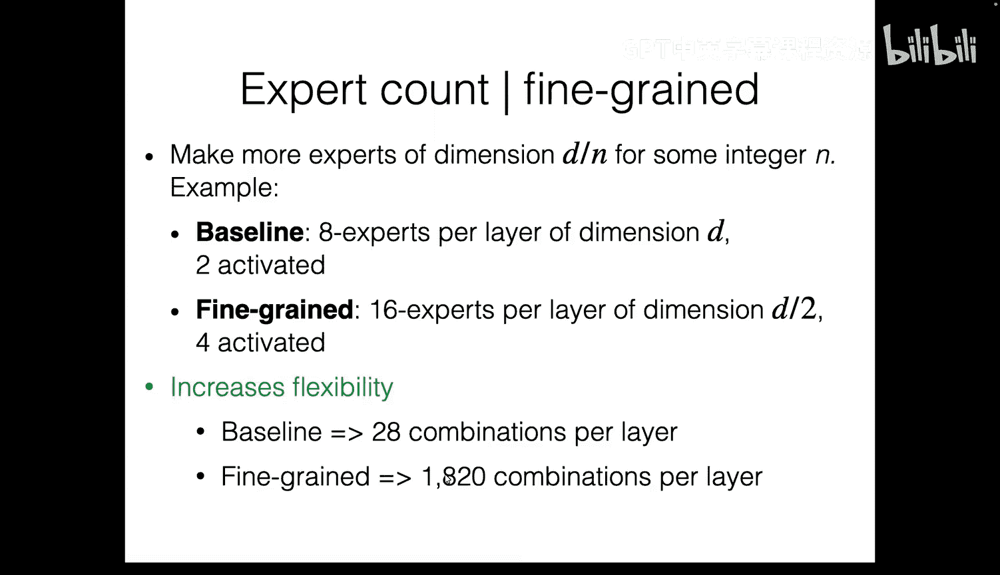

And。So here you can see some some benefits of doing this。 So this is again， the AI2 paper。

And here they're using this notion of fine grain experts。 So everything is。

Total parameters and compute cost is the same。And you could see that going from 8 to 32 really helps a lot。

But maybe again， we're seeing this idea of kind of diminishing returns， right， So when they go to 64。

 it's， you know。Maybe helping， maybe it's just statistical noise。

So there's going to be some kind of sweet spot and it's a kind of maybe hyperparameter that you have to set。

You could also， you know， imagine that。Potentially， this can make。

The kind of system side of things more complicated。

So let's say that your systems is pretty naive and all of these experts are kind of just on like random devices。

Well， now if you are making more possible decisions， then there's going to be more sorry。

 if you're writing to more experts right， we increase the number of experts that are getting gratitude to。

Well， now there's potentially more communication costs。So again。

 some of these things will be kind of solvable， but you know， in practice， again。

 the kind of complexity increases if you start to have too many experts。

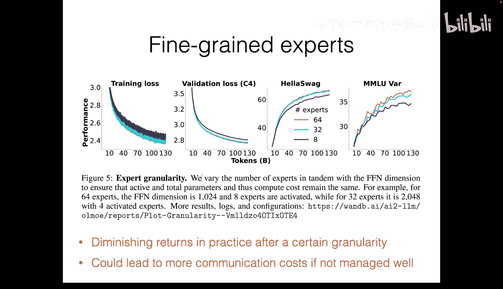

Um so then another thing you could do is like， okay， maybe intuitively。

You could think about what the model is learning。And maybe there's actually a lot of shared information that's required to say。

 predict the next token。And so maybe there's actually some redundancy between these different experts。

And so again， in the Stese paper， they had the kind of hypothesis that， you know。

 maybe it's good to actually just always route to one or say two experts。

 so that'll be called this shared expert。And then for the rest。

 you again have this kind of dynamic routing that depends on the input。So again。

 if you read through their kind of intuition is that these shared experts can potentially learn the kind of common information and reduce the redundancy among the other experts。

 so these can become you know， in some sense more kind of specialized。

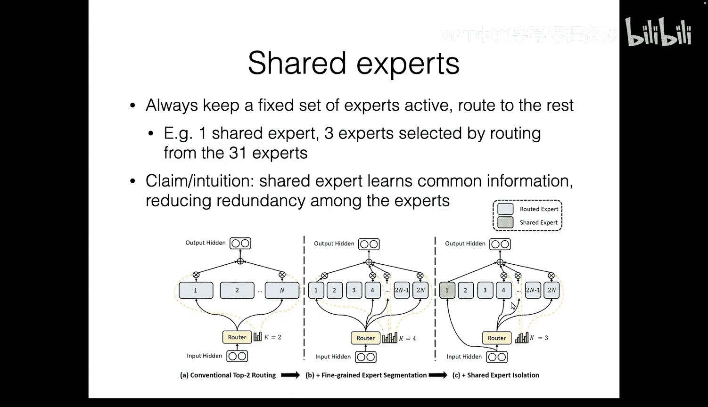

So。It's a bit small， but here's the kind of result from the deepse paper and they do these kind of nice alationations。

So first of all here they have zero shared experts and they have what two。Out of 16 routed experts。

So they're yet routing to two and they have 16 total。Now， here they add in the shared expert。

And then here in green and red， they're basically boosting the amount of fine grains experts they have。

Okay， so the fine grain experts and shared experts were both proposed in this paper and you can see that they're getting these nice gains from doing both of the techniques。

Now， sometimes what happens is， you know， different groups try these different techniques and。

Either the setup's a bit different or there could be a variety of factors。

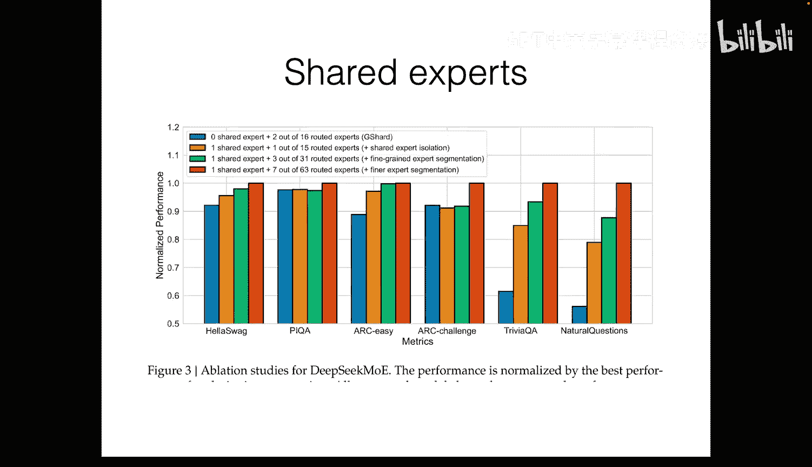

But if you look at， for instance， the AI2 paper， then they actually found that the shared expert was not really helping。

 In fact， maybe even hurting a bit。 And so they ultimately didn't use the shared expert in their model。

Now you could actually make， you could go back to this you eight choose two argument。

And now we have now you're modifying that， right， So you're saying 31 choose。31 choose1， say。

 instead of 32， choose two and so you could argue that you know the shared expert。

 while intuitively kind of you know， nice， maybe it's actually just reducing the flexibility too much。

But again， you kind of see variation across different studies。

 so I think maybe there's not a consensus on what the best configuration is。

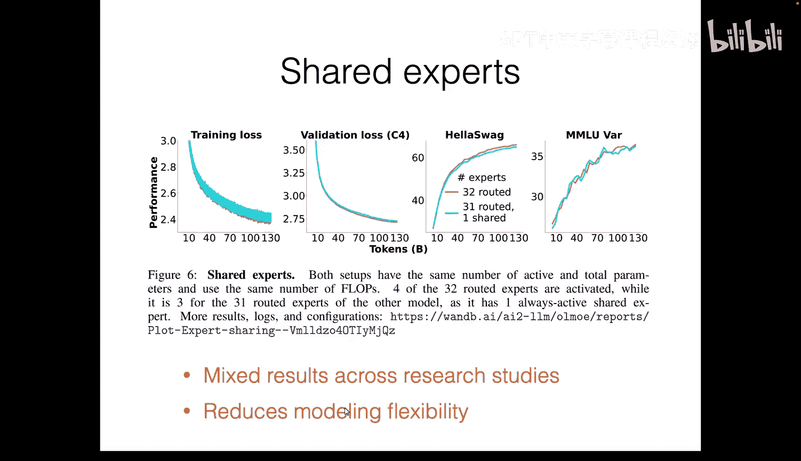

Okay， so that's a bit about what our mixture of experts and the expert design。

 any questions so far until we go before we go into the routing。M。嗯。

s the layer or like the number of experts chosen frozen the hair to differ across because I remember you saying initially that it's like nowadays you typically have ME and every keyboard forward layer rather than interesting one so do we often see variation across them or has it been kind of standard to just adopt the same choices have loss？

Yeah， that's a good question。 So do you want to route to different numbers of experts based on the layer。

 So I think some early papers did look into this And from what I can tell now， you know， things。

Just get maybe refined to， you know， you really just want to set a single hyperparameter and so a single hyperparameter will be chosen for the various layers。

Whether that's the best globally optimal thing。I guess probably not， because you could imagine。

 you know， if the model is able to choose。How many experts it's routing to， then a special case is。

 you know， it learns to route to a fixed number。But again。

 you're going to have to come up with some way of either setting the number per layer by hand or some way of kind of learning that。

 And that could lead to instabilities， just more complicated this and things like that。Okay。

 so now we could talk about the routing function。

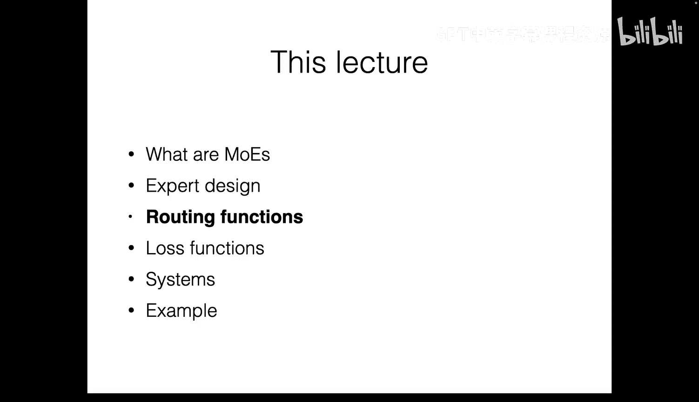

Okay， here， so the idea is again going to be pretty simple。

So what we're going to do is compute some score for each token expert pair。Okay， so maybe again。

 I should say what the goal is， the goal is going to be for each token in the sequence。

We want to decide。1 or more experts to send that token to。

Then the experts will kind of process the token and we'll get the hidden state for it。

So what we're going to do is compute a score for each pair。

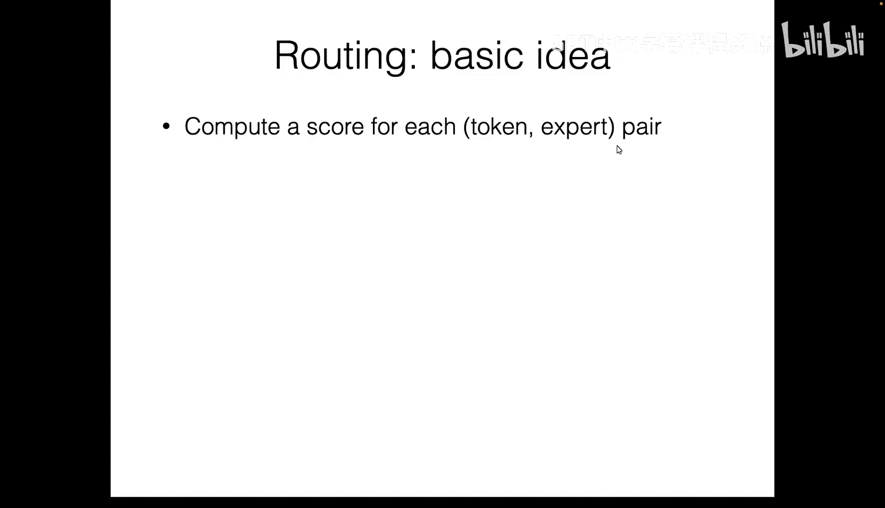

And then choose the experts according to some strategy。

And so here's maybe some possible things you could do。 So here on the Y axis， we have the experts。

 E1 through E 5。And here we have three different tokens。Well。

 one strategy is you could call it token choice。So each token will choose， say the top K experts。

Okay， so let's say the K is two， then for each token。

 you're going to route to two you know possibly different experts。

The other thing you could do is what's called expert choice。So here， the expert kind of says。

 you know， which tokens do I want to process？So now the expert is choosing the top K over the tokens。

And then the third， and this is maybe a really general one is， you know。

 you can go off and you can come up with some clever way of taking these scores and then coming up with。

 you know， some algorithm or some。You know， procedure for choosing experts。Okay。

 so this is kind of you know global optimization， and you could imagine that， you know， maybe again。

 this is kind of optimal。But as a kind of spoiler， what ends up being used in practice is one of these top K methods。

So we'll go through each one of these and in particular this token choice is really used in a lot of the current methods。

So we'll go into the most detail on this one， but then we'll talk about the trade offs of the other ones。

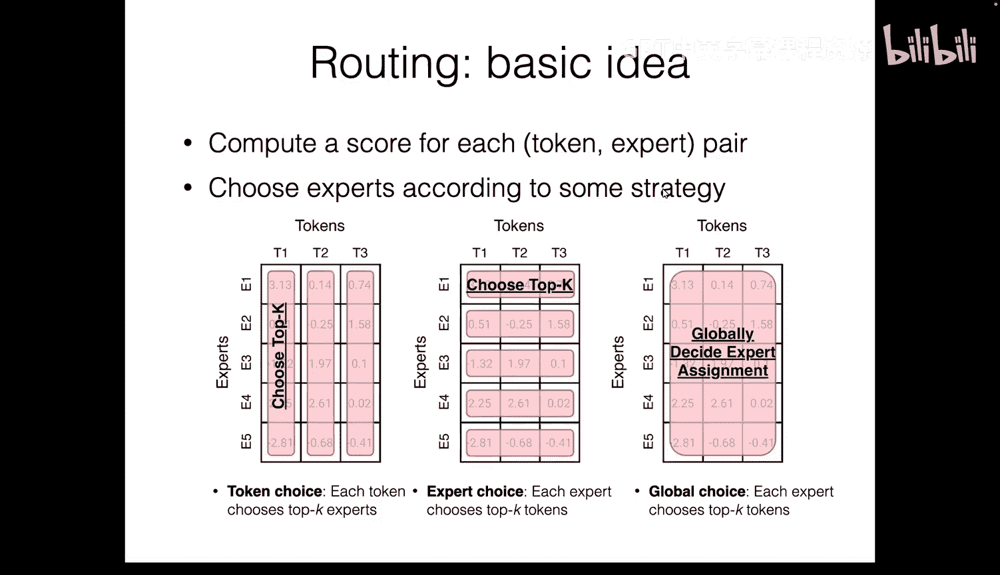

Okay， so the first question is， how do you compute these scores？So again。

 the current method that's used ends up being really surprisingly simple。

So what you do is you introduce a single vector。Of weights for each expert。

Then you have this incoming hidden state for the token， right。

And what you're going to do is just take a dot product between this one vector of weights for the expert and the hidden state。

Okay， so basically it's this kind of just linear， there's no linearities。

 you're not using a kind of deep network to do this。

It ends up that doing this very simple routing is kind of what's currently used and what can be very effective。

So let's just go through this in detail and then we'll think about， you know， maybe why is this。

Being used， you know， why isn't kind of a deeper network used for the routing？

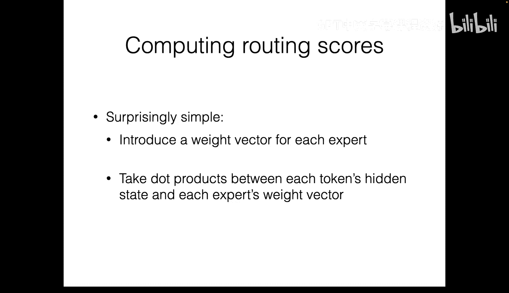

So again， here you have these different experts， one through five。

And you're going to introduce just a single vector of weights。And then again。

 you have for each time step， the token representation。And then again， it's just doing what I said。

 you just take the dot product and now you have this matrix， which is on the previous slide。Now。

 what you also want to do is somehow normalize these scores。

So let's see how the normalization is done here。So it looks like we have the columns are summing to one。

 right。So this would correspond to the token choice。So we're basically saying like， okay。

 for each token， you have this kind of distribution over experts。

Doing the normalization is going to be important because what's going to happen is。Later。

 we'll talk about a loss function that tries to encourage these allocations to be kind of balanced。

And it's going to do that by actually like penalizing the score if it's too high in some sense。

And so if you don't do the softm here， then you know you could minimize this loss function by just setting everything to zero。

 but the softmax forces you to you know have everything set to one。

 and so you're going to have to have some nonzero scores。

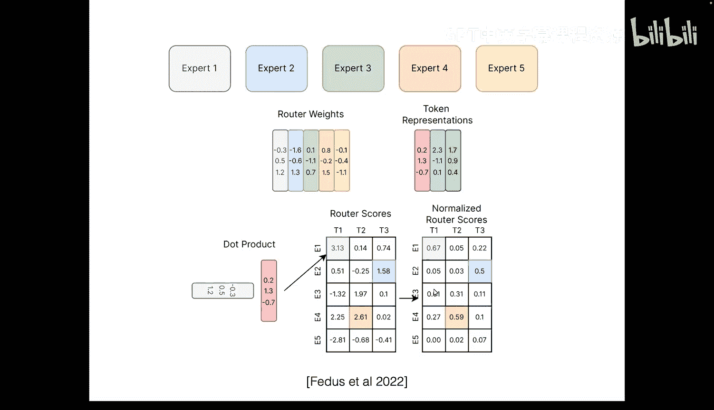

But anyway， so okay， now we have these scores computed and we could decide how to select the experts for each。

 say token。

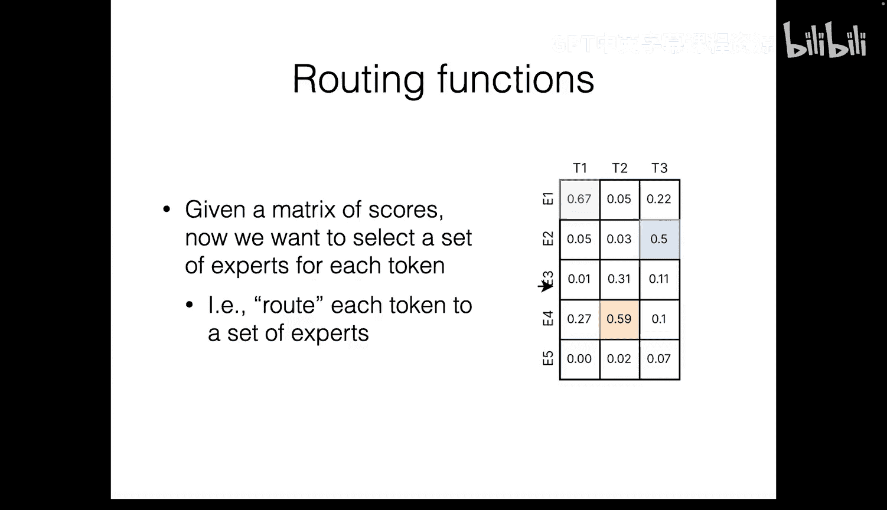

And again， here the idea is going to be to take the top K， so really simple idea。So here。

 for instance， we have top 2。And we're going to have this router。 Remember you do the dot products。

 you take the softmax。 So now you have， okay， expert number one has 065 probability。

 Exp number 4 has。Po3 and the other ones collectively have what 0。05。Okay。

 so these will be the top two， and you'll route the token into these experts。Again。

 just to emphasize， this is going to be per token so the routing decisions can change based on the token。

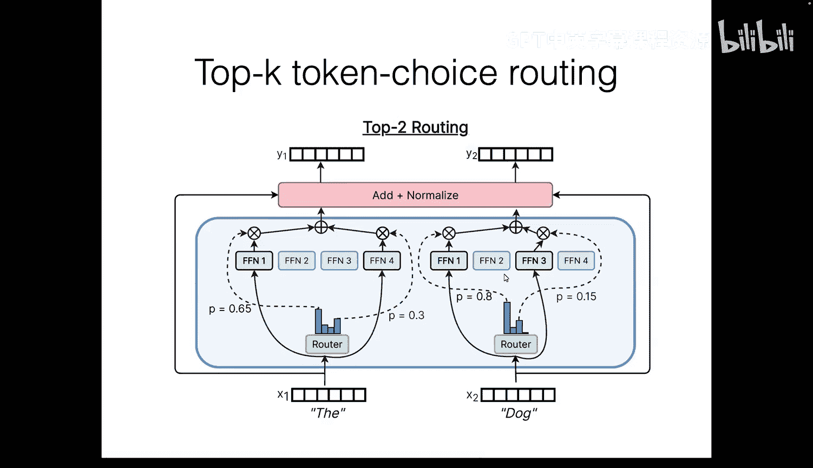

So just to see this in notation， like if you go through papers or if it helps to just think about it more precisely。

 here's basically the you know。What I showed you written as notation。So again。

 up here we have our this will be the weight vector for the given expert I。

And we'll have the kind of current， you know， intermediate。Vctor state for token tea。

You're taking the dot product。And then maybe this is kind of shorthand。

 it's saying that you are taking the softm over experts。Now。

 here you could think of this being a kind of gating function。So again， you're taking the top K。

And then you're going to set to0 all of the other experts。

So now you could view this layer as being this kind of gated weighted sum right。

 so some of these will be between 0 and 1 and and some will be 0。

And now we're kind of combining the outputs by just doing a weighted sum。And then again。

 you have this kind of skip connection or residual connection。Okay。

 so another reason another thing that's good here is we can really see clearly this idea of sparsity。

 you can view this as this kind of sparse layer， a sparse in the sense that you know a lot of these things will just get zeroed out and so the layer is kind of you know dynamically allocating the computation or routing the computation。

嗯。Okay， so let me just talk through it。One question is like， you know。

 this is surprisingly simple routing， we're just taking dot products。

And I don't know if I have like a， you know。Definitive answer on this。Basically。

 the if you look at the history of these models， then。They can be really tricky to train。

 So really unstable， things like that。And one issue with these。

 which I guess I'll talk about in the next slide。Is this operation here is not differentiable。Okay。

 so this is going to somehow break the differentiability。

The gradient is only going to pass through the top K elements。

 It's not going to update the kind of non selected elements。And so possibly one reason is that。

 you know， if you have this complicated network here。

 then it's not kind of getting a reliable enough gradient signal to really train it that will。

That's kind of one hypothesis。The other hypothesis is。You know。

 you have to think about like how you're spending parameters in the network and so if the simple thing is working pretty well。

 then maybe you just spend your parameters somewhere else in the model。

And then the third thing is that。In practice， as we'll see。

 we're going to use a loss function to kind of encourage a somewhat uniform routing。

And so in that sense， maybe the loss is already helping kind of you know。

 biased the routing in a certain way， and so maybe it's not too important to have a really kind of detailed routing。

But again， in general， like from kind of first principles， it's not necessarily the optimal thing。

 but this is going to turn out to be what's kind of currently used in practice。

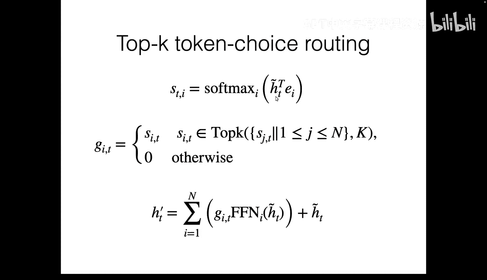

Okay， so now we could think about some potential downsides of this or some considerations。So。Again。

 what you're going to want to do here is try to。Oh， so， okay， so。Here。

 maybe it's jumping ahead a bit but。The basic idea is， you know。

 if you can imagine some of these mixture of experts models。

 you can just keep multiplying the parameters and so eventually you pretty much have to move to this kind of distributed setting where you have multiple devices。

And so there， these kind of issues start coming up。

So what happens is let's say that we put one expert on each device。Well。

 then when you think about it， you have to decide， like， okay， for a given expert。

 what is the maximum。Tokens that can be processed by it。

 What is the kind of batch size that you have for the expert。

And the tricky thing with these models is that you don't know how many tokens are going to be past kind of a priori。

 right， so the router can decide to send a lot of tokens， say， to one device。

And then you kind of have to define what happens One option is， you know。

 your device goes out of memory and blows up。What's done in practice is you kind of just drop。

 it's called token dropping。So if you remember， the model has this kind of skip connection。

So what you can do is just drop a token and then basically the representation just passes through without any processing for this layer。

But of course that's going to be bad， you're basically skipping you this layer of the network。Okay。

 so but I mean， this is a downside where if we don't have kind of good load balancing。

 then you're going to start dropping tokens。So another thing you can do is like， okay。

 let's say that we increase the capacity for each expert。Well。

 then maybe you get less frequent token dropping， but now you're going to be kind of， you know。

 wasting your。Potential capacity that you have on the GPUs are on the device。Okay。

 so these kinds of things will come up with these models and you always get into these different kind of trade offs do you。

Do thisken token dropping more often。Do you even change the parallelism strategy so that there's no notion of token dropping。

 Some models will actually do that。Or like， how do you kind of optimally。

Set this capacity so that you're using your device as well。Now， if you think about it。

 this picture here kind of depends on using this token selection strategy， right。

 it kind of comes as a result of us saying， you know。

 a token can decide which expert it gets sent to。

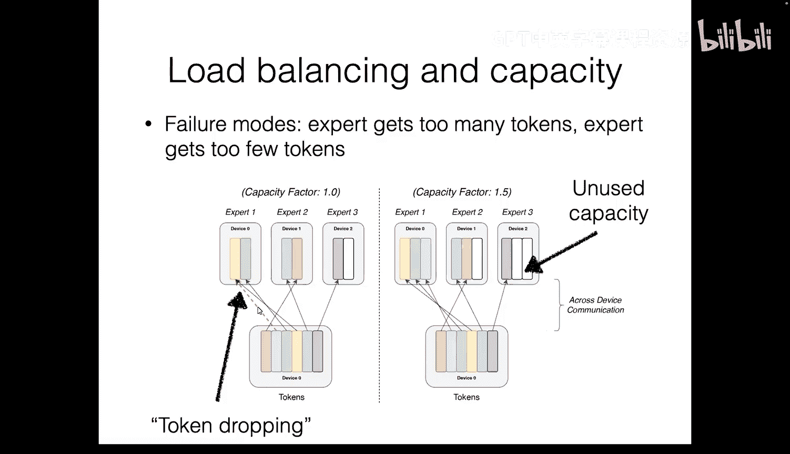

And so in fact， when we think about the present cons。

 we'll kind of list this as a potential con with the token choice。So again。

 the pros are that this ensures that each token is assigned to an expert。But as we saw it。

 depending on your implementation， sometimes you can have this notion of token dropping。

And the kind of more general problem is。This load balancing is tricky。

So even if you're not necessarily dropping tokens， you want to make sure that all of your devices are being used optimally。

Again， I kind of passed over it， but another pro is that it's relatively simple， right？So again。

 it's not maybe。Optimmal in the sense that， you know。

 it's somewhat heuristic to just pick okay and this selection operation is not differentiable。

But it's simple。 and one thing to keep in mind with these present cons is this is really the strategy that pretty much ever every major。

You know， mixture of experts LLM， at least publicly。

 you know what they've released about them will use。

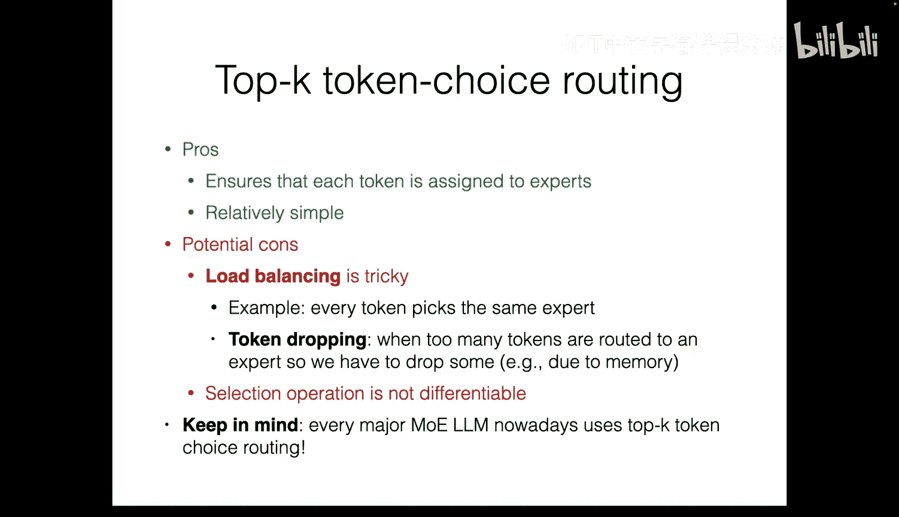

Okay， so now we can go into two different alternatives， so let's say that you do the expert choice。

Which again， is saying like， okay， a given expert can choose the set of tokens that it's going to process。

Well， what this does is it actually solves the load balancing issue。So it's really saying， you know。

 each expert is going to choose， say， k tokens。And so now you're guaranteeing that。Well， I mean。

 by definition， each expert is processing K tokens。

There's this kind of interesting thing you could think about， which is like。

 let's say that a token is maybe requires more processing。Well。

 then many experts might kind of choose to process that token if they're kind of clever。

 and so potentially you can get some kind of you know， dynamic allocation of compute。

Whereas before we were saying like for a given token， it's limited to choosing， you know。

 K different experts。Now， I think there's， yeah， just as a reminder， you know。

 this is what what we're talking about。So some cons are when you think about it。

 this is maybe nice for training right， we have this sequence in in our training batch and then you kind of do the selection。

But you know at generation time it's a bit weird， so remember at generation time we are kind of generating one token at a time。

So now we have to decide kind of how do we select， do you recompute the scores for all the tokens so far。

 It's a bit different than training because， you know。There could be future tokens， things like that。

And so that's something to。Yeah， that you have to decide how to take care of。

And then it turns out that there's a kind of different notion of token dropping。Right。

 you could think about it for a bit and like， oh， wait。

 what if every expert just chooses to process the same token？Well， then， you know。

 these tokens we have to drop them， so again， you have this issue。Of kind of， you know， theres。

 there's a possibility ability of。嗯。Suboptimal。Allocation。

 now it's kind of allocation to tokens instead of allocation to experts。

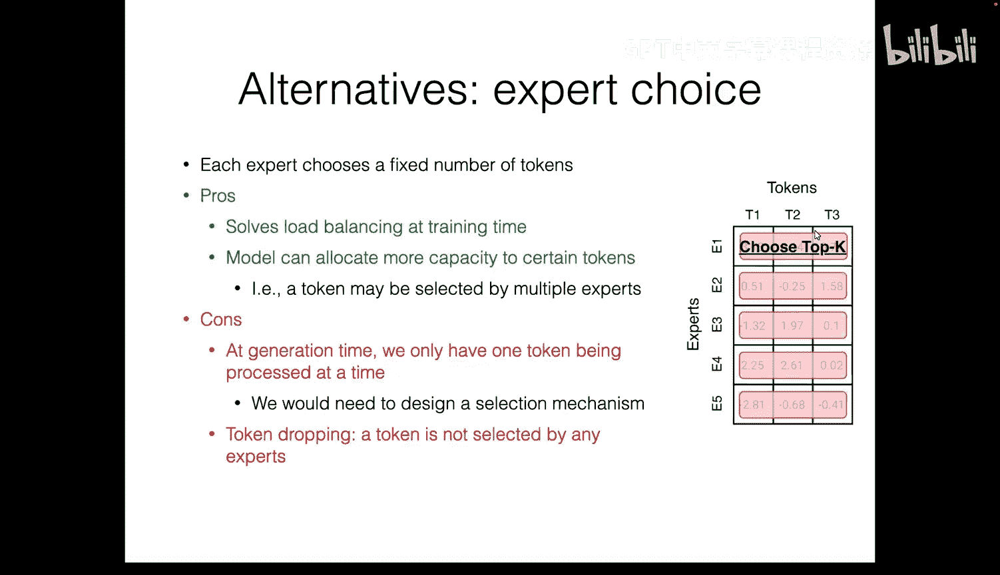

So that's the pros and cons of this and so again in this AIT paper they have a ton of nice alations and so they tried both of these things。

And so let's take a look here， so in their case。The token choice is doing better than than the expert choice。

Again， you could probably find。Or there are some papers right that where the expert choice。

 like the paper that is going to propose expert choice probably working better than the token choice。

But yeah， here you see at least evidence with this model in this setting。The token choice is。

Doaring better。嗯。

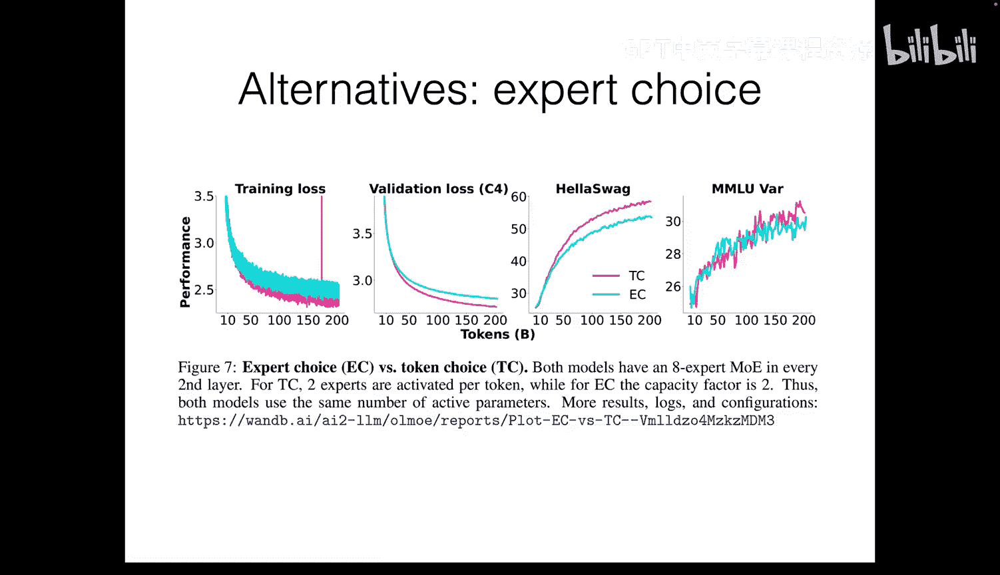

Okay， so。Then you could think about like， what could we do other than this。

So I'm not going to go over all the methods， there's been tons of research on this。

 but just to kind of think about it in broad strokes。

One strategy is like can we go even simpler than this top K？So people have tried this。

 So here's something called hashing。And hashing is basically going to have just some you know。

 deterministic function for taking in the current vector and then just choosing you know an integer between one and four。

So you could just run this hash function。And that will kind of function as your router。

 so no learning at all。And broadly speaking， this actually ends up performing surprisingly well。

 so you can have it as a baseline and you know it it'll perform surprisingly well。But again。

 just like broadly speaking， if you kind of look through the history。

 this isn't necessarily used now， so it seems like not doing any learning at all is kind of a bit suboptimal。

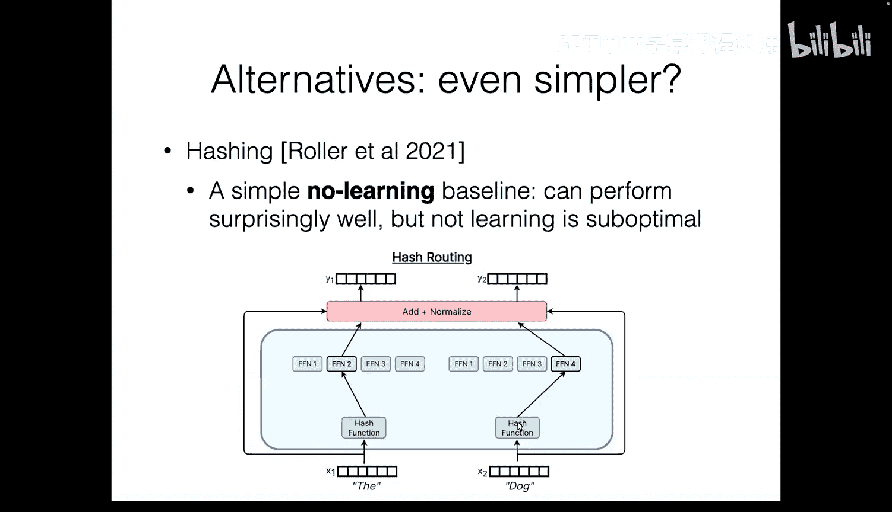

The other extreme is you could try to go more complicated。

So a really natural thing to do if you kind of think about this problem for a bit is reinforcement learning。

So reinforcement learning， if you remember， really gives you this way of potentially optimizing these kind of non differentiable decisions in your network or in a given problem。

Right， so here you're basically saying。Each choice is going to be a kind of action in the reinforcement learning sense。

And so you could take an action and you can get some reward function。

 and then you could basically optimize the the policy to say， you know。Minimize， maybe the reward is。

you know， related to the modeling quality so something like log probability。

 and you could basically learn the router， like learn the policy for routing that does the best。

So the present of this is， again， it's a kind of principled solution for this part of the network。

Or for this problem？And the cons are， you know， again。

 you can kind of get this to work and maybe you get some gains。

 but now we can kind of have the benefit of hindsight and and at least so far， this is not what's。

What's kind of used currently？One reason is that it can increase the cost of training。And again。

 I've mentioned a few times that the training can be kind of unstable。

And if you think back to like those reinforcement learning curves that we saw in the examples。

You know， the reinforce or reinforcement learning is kind of well known for also having high variance。

And so if you're really trying to scale up the model。

 really having kind of reliable training on you know， trillions of tokens。

 maybe the variance of the reinforcement learning is just not going to be worth it。

Now you kind of can implement it and you know get it to work and so if you're curious。

 there's this paper here from， I believe Deep Mind。

And they implemented all these different methods kind of at scale and looked at scaling laws。And。😊。

Again， they got it to work in the sense that the models training， but empirically。

 it actually wasn't showing too much benefit over the simpler methods。Now there's been other。

 you know， you could think about other clever ways of framing this like some kind of linear assignment problem or optimal transport。

And。Yeah， those things have been tried as well。嗯。But yeah， as I mentioned， we can kind of。

Focus on this top K operation， at least we're looking at what's currently used。

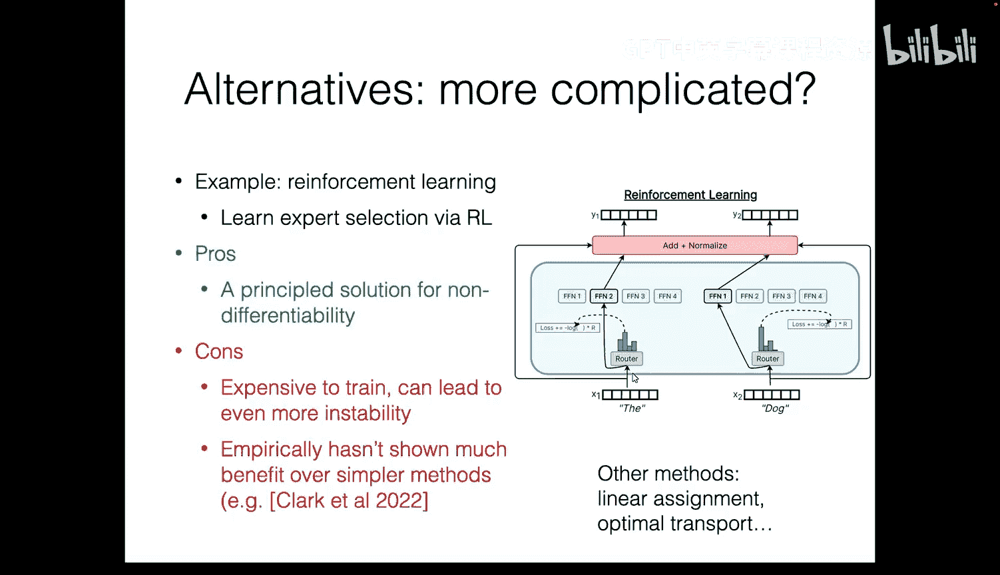

Okay， so that's the routing functions。 Any questions there before we talk about。

The loss and training the mixture of experts。嗯哼。😊，Maybe like it's in how optimal transport will be used in this scenario。

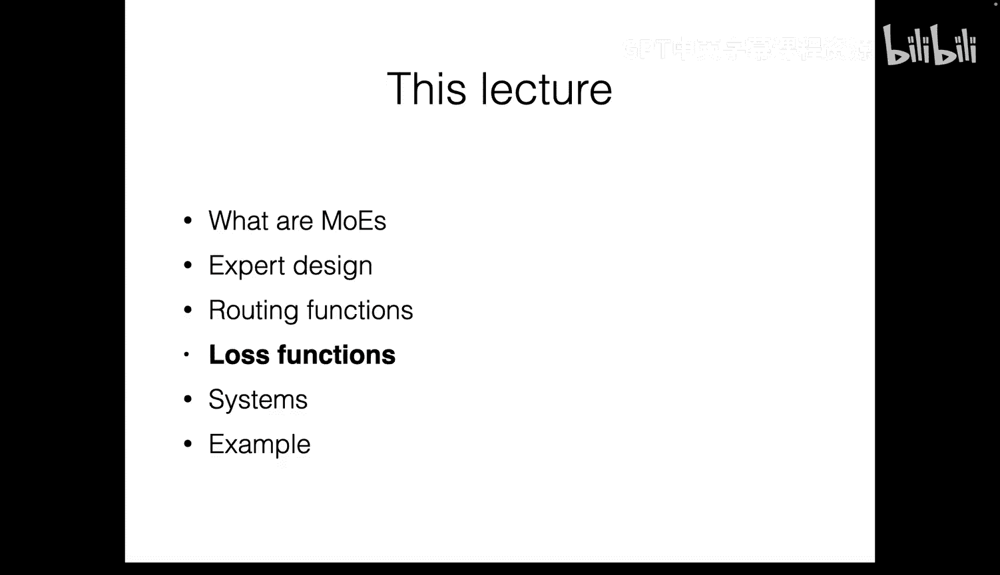

Yeah， so I guess optimal transport will be focused on kind of making one distribution match another distribution。

So I actually don't know the details of that method， but they probably look at this。

 you know routing distribution and then you somehow have a target and think about like what's the best matching between these two things。

You also see the ideas from optimal transport come up in these models that are trying to do like permutations。

 so like some of the graph neural network models。So again。

 the ideas come up in the context of like you know permuting things or things like that。

 and so you could probably frame this rotting decision as one of those types of problems。But yeah。

 I'm actually not too familiar with the details in this context。Okay， great。

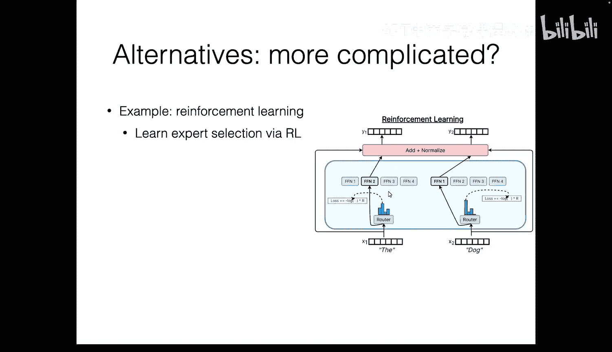

So。

Okay， so now we could talk about training the mixture of experts。So again， by and large。

 these are going to be。You know，In the context， we're talking about language models。

 so you're always going to have the language modeling loss， And then the question is。

 do we have to do something different because it's a mixture of expert model versus the standard dense architecture。

Okay， so some considerations we want are we want a good model， of course。

And another is we really want to utilize hardware optimally。

This isn't just working at a kind of small scale， you could see these companies want to use this for pre traininging。

 and so there's going to be tons of compute and so you really want to use the hardware optimally。

And then second， we saw that if you kind of don't have good load balancing。

 then it could actually lead to a worse model because you could start dropping tokens。

 things like that。And then third， as I've mentioned， the routing decision is non differentiable。

 and so potentially you have to take that into consideration。As a spoiler。

 the solution is going to be to kind of ignore the problem， but we'll see about that in a bit。

So again， one option is to do RL， we've kind of talked about that already。

Another is you know maybe it's good to somehow add noise in in the routing decision again i'm not going to go through the details。

 but this is actually you know。Really， the。ind of initial paper for。

Scaling up these mixture of extra models。 So if you're interested in this。

 you'll probably read this paper and the method they use there will be a bit different than the ones I'll mention it has this notion of using some kind of noise to explore the different routing decisions。

And so what's going to be used in practice is these kind of heuristic balancing losses。

And these were introduced in this paper here from authors at Google。

 and then you can see this occurring in even the most recent methods。

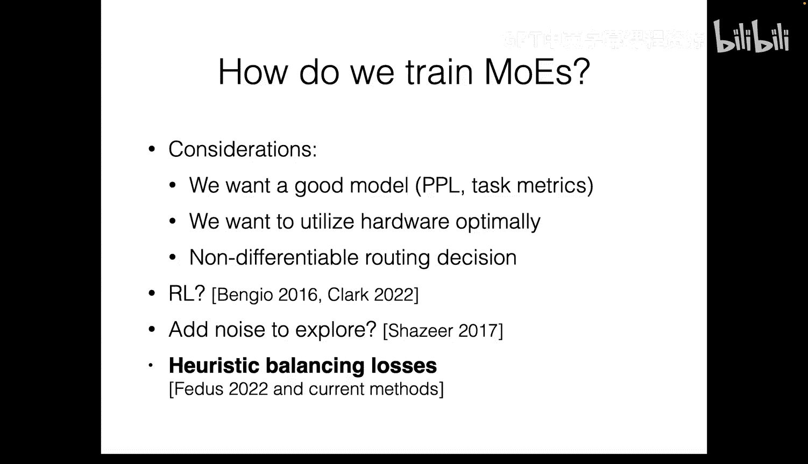

So here this expert balancing loss， the idea is we want to somehow penalize the expert if it receives too many tokens。

Or if it gets too much probability mass。So the way they formulate it is maybe kind of simple。

 and again， you could probably think of other ways of formulating it。

But here we have these two terms。So this FiI is going to be the proportion of tokens in whatever your unit is。

 so it could be a sequence， it could be a batch， it could be you know group of tokens。

You're going to kind of take those tokens and then say like， okay， how many。

 what proportion of them were routed to this expert？Let's say that the proportion is very high。

 let's say that it's 1。0。Well， then 1。0 is going to receive a higher loss than if you have， say， 0。1。

 right？So again， just coming up with some way of penalizing。

Probabilities if kind of too many things are getting granted to this expert。Again。

 this is going to just be computed。 The actual gradient will kind of flow through this routing probability。

 Remember， again， the routing probability is we compute the scores and then take the softmax。

And so then you can also have， okay， the proportion of the routing probability that was assigned to the given expert。

And so again， if you have a really large probability only on this one expert。

 that's going to receive a higher loss than if you have a lower probability on the expert。Okay。

 so it's a kind of heuristic formulation， really， but it turns out to， I guess。

 be effective and you'll still see this in even the most recent methods。

Oh here this alpha is you know， just the hyperparameter。

 so how much weight you want to place on this loss。Okay， so。

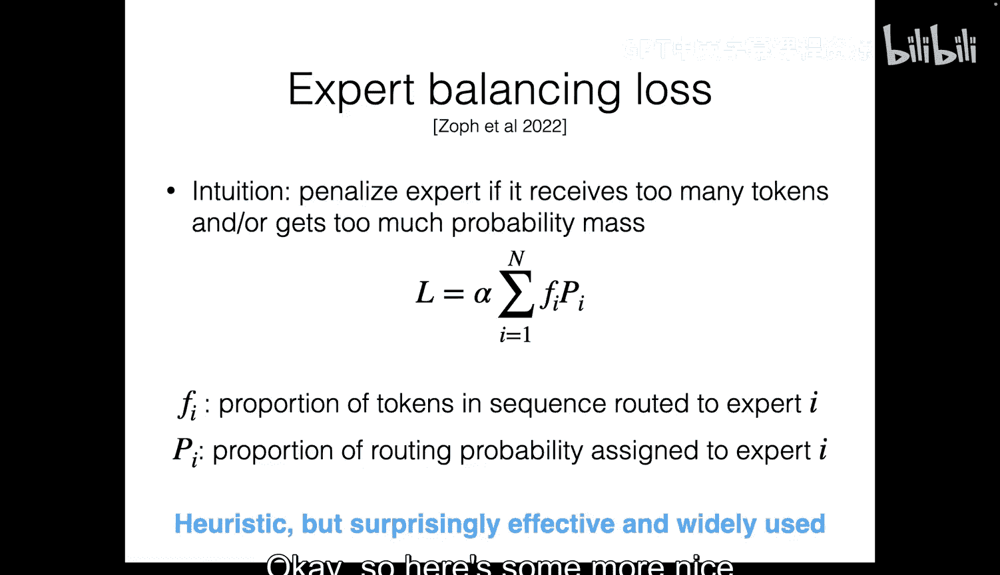

Here are some more nice abllations from the AI T paper。So here we can see that this loss is really。

 really important。So， let's take。Let's take a look here。So this is basically saying like， okay。

 each different color is going to be a different expert and then on the y axis。

 we have the percentage of tokens that are routed to that expert。

And you could see that without the load balancing loss， well， at first。

 it basically learns to route 100% to this pink expert。Then maybe it gets a bit more reasonable。

 but still it's only using two， I wouldn't even call it reasonable。

 but it's basically using two out of the eight available experts and setting the rest to zero Okay。

 so it's a really real phenomenon that happens。Here you can see with this heuristic balancing loss。

 it's kind of fairly uniform across experts， so it actually works pretty well。At the bottom。

 you can just see this kind of expressed in terms of metrics。 So you could say like， oh， well。

 maybe this is actually good。 It turns out to not be。 So here you can see the。

 the losses higher and the。The training loss and both validation loss are higher。 Again。

 the models not becoming completely useless， but again， at pre training scale。

 these things are are going to be pretty meaningful。And then this is just showing what the loss is。诶。

Different stages。 And you could see the， you know。If you were to apply the loss in this imbalanced case。

 it would be fairly high， whereas here， the models can of learned out， learned to do the balancing。

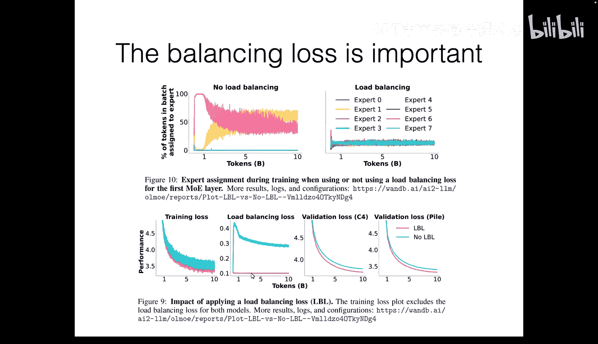

Okay， but then you could say like， okay。This is cool this now it can route out to different experts。

But let's say I'm thinking about how to optimize the kind of systems aspect。

And let's say that on a given device， I have。Let's start with， like two experts。

Then what happens is you could still route kind of uniformly across experts。

 but they're not necessarily lining up to load balancing on the device level。

 you could still get into the situation where everything's being or you know more things are being routed to certain devices versus other ones。

And so。Some other tricks you can do is basically do the loss。

 but instead of having the loss be on experts， it's kind of on devices or in general。

 on kind of groups of experts。Hey， so I'm not putting the formula， but it's very， very simple。

 it's basically compute the same stuff as before the frequency。

 the percentage of sorry proportion of tokens and the total mass。And we'll just check。

 you know what is being sent to a group rather than an individual expert。This is again。

 something that was in the deepse mixture of experts paper。If you look at what they do。

 this is again in deep sea mixture of experts， at least they end up using the expert balancing loss again。

 so you're just kind of adding on these different losses。

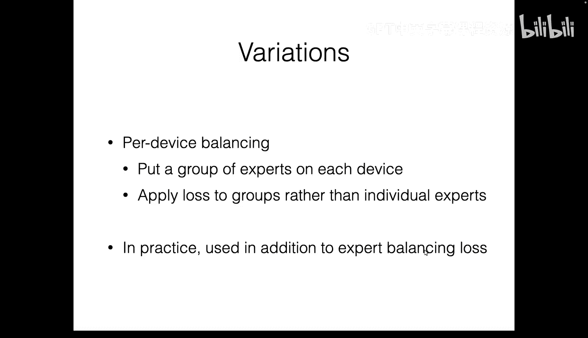

Okay， another thing that comes up is。You know， we had the quantization lecture and so it's nice to see some of the ideas。

Kd of appearing here。So what people found， I think this was found by some of the Google paperspers in 2022。

Is that a lot of times you would get into these kind of precision related complications。

At this routing layer。So you could think like， you know， maybe。Oops。

 maybe if I put all of the mass onto one expert， say early in training。

Then that corresponds to having a very large logit value。

And so then the precision actually becomes an issue， things like that。

So what they found is that you can kind of use Float 32 just for the expert routing computations。

So maybe that's yet another benefit of just having the single this kind of simple dot product。

It's going to be in a higher precision and so it's good to have a relatively small number of weights。

But what happens is it still is an issue where you have these large logits even if you kind of go up to float 32。

And again， hopefully it was it was clear， but just to be clear， everything else is going to be in。

 you know， B float 16 and you're casting up to F 32。That doesn't turn out to be。You know enough。

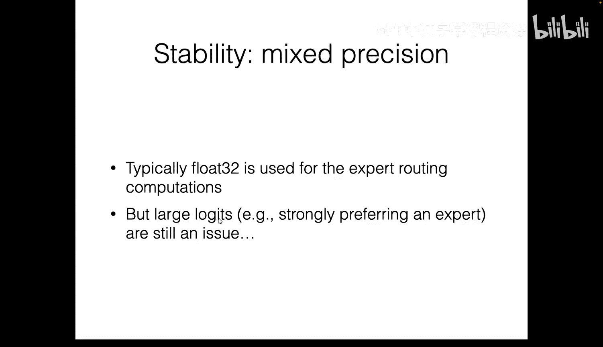

So what's also used is this kind of Z loss。So here we want to explicitly penalize having really large lowitits in this kind of roing layer。

 and so you can attach kind of another loss to the layer。So here what do we have， again。

 we have some units， so this could be you know a batch， it could be a sequence whatever。

And then you you're saying like， okay， for each different expert。You might recognize this。

 this is kind of the denominator in the softmax。And so again。

 you're just applying a penalty if this kind of gets too large， right？As this gets larger。

 you get a higher loss and so the loss will try to bring it down。嗯。So yeah。

 here's just the notation again here x， this is going to be these logits or the kind of scores that you're using in the router and you're going to kind of attach this loss to it。

嗯。嗯。

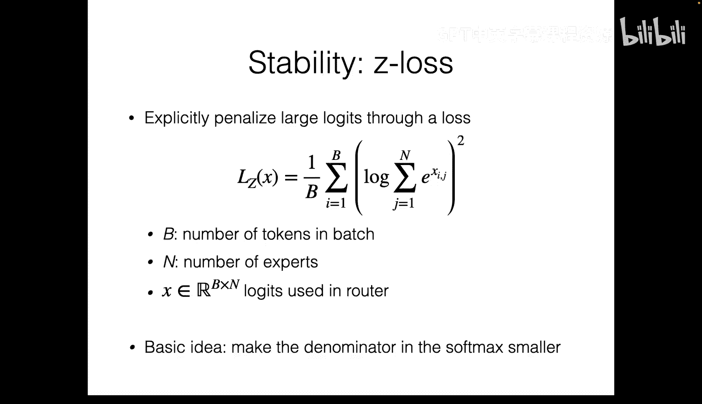

So I already mentioned that。So again， I mean， this paper' is great。

 I hope there's you know more papers like this， it's so great for teaching too。

So here they alate this Z loss and you could see again。

 this really kind of matters in practice without the Z loss， you're just getting these explosions。

And with the Z lossOS， it's a bit more stable。

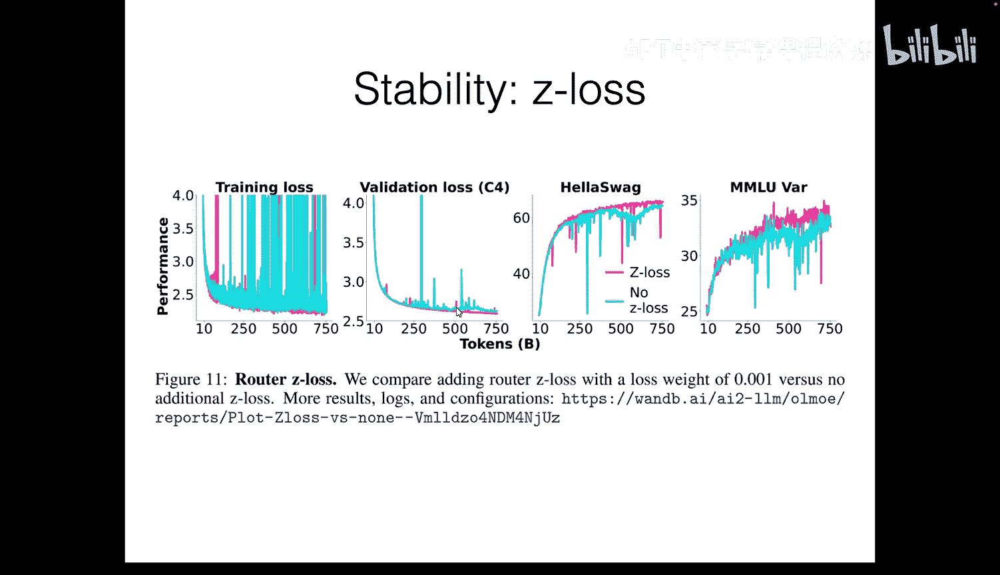

ok。😊，So。Any questions about this stuff before we move to the last two sections。嗯哼。😊，This evils。

 where did this experiment term come from。

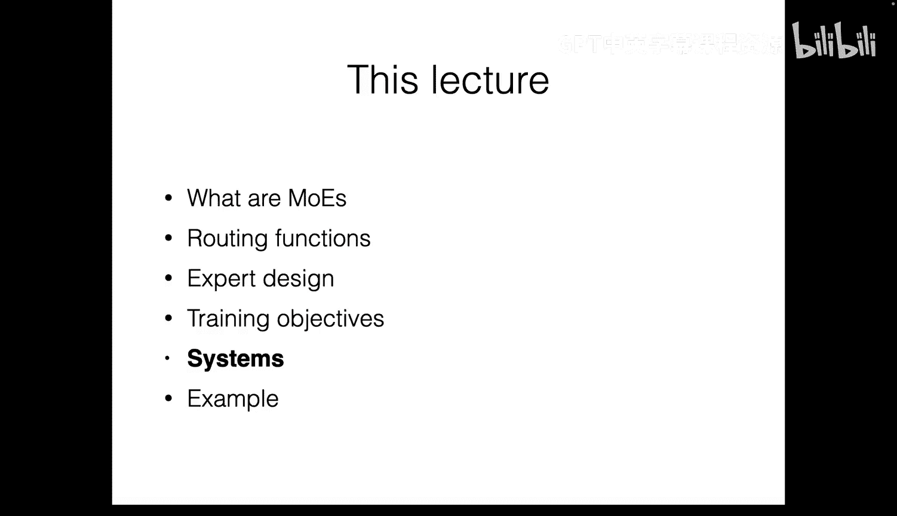

Yeah， that's a good question， so。I guess it's just saying something like squared error。

 so just penalize it， you know， penalize large values even more。Yeah。

It's introduced in the same paper that。You know， it's it's a Google paper。

 So they kind of like things that work and can be simple。

 so probably found that it worked to have squared error。

 but it's possible that maybe can see it without the square as well， yeah。

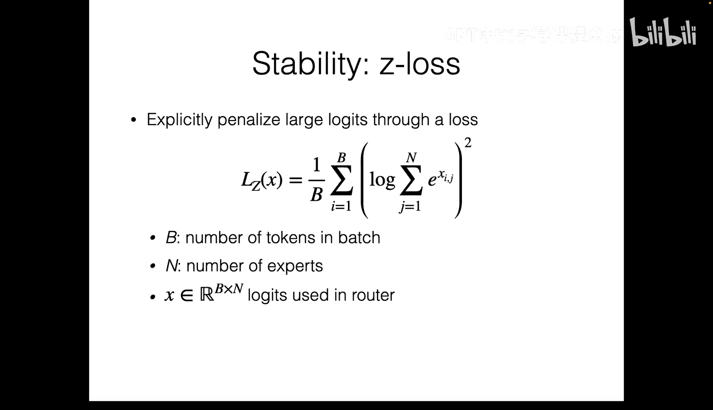

Okay， so here we're not going to go into too much details。But。You know。

 if you remember from the parallelism lecture， if you remember from the long context lecture。

 then we have these different notions of parallelism。 So we have data parallelism。

 pipeline parallelism。What else context parallelism， model parallelism。

 Well it turns out now you can have expert parallelism。And the idea at least is really simple。

 So here we're going to try to have each expert reside on a different device or different accelerator。

And so then the data is going to be dispatched to them and fetched from them。

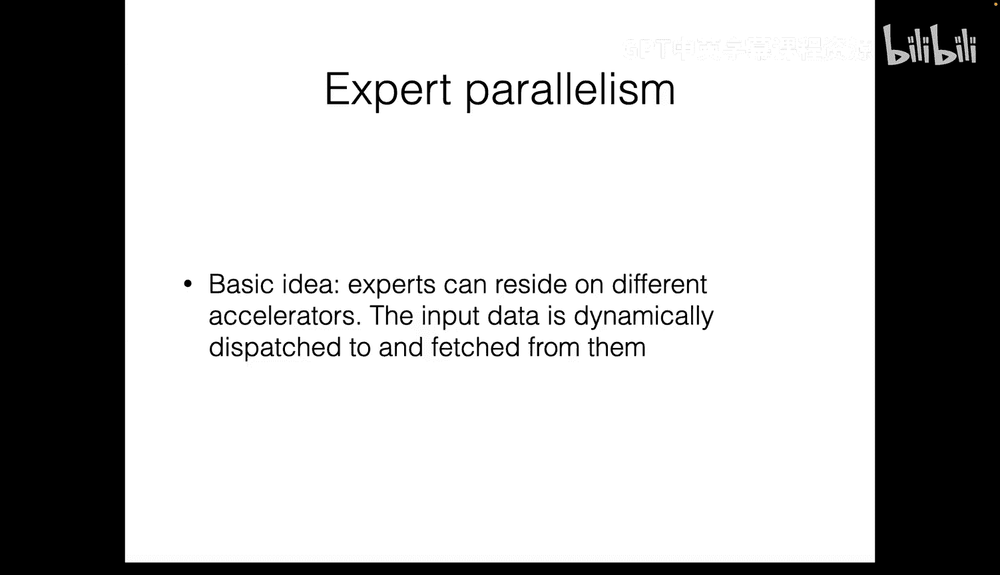

So maybe I should have had a picture here， but maybe I'll do some hand waving。

 so if you think about what's happening， it's saying like， okay。

 let's see you have four different experts and you put them on four different devices。

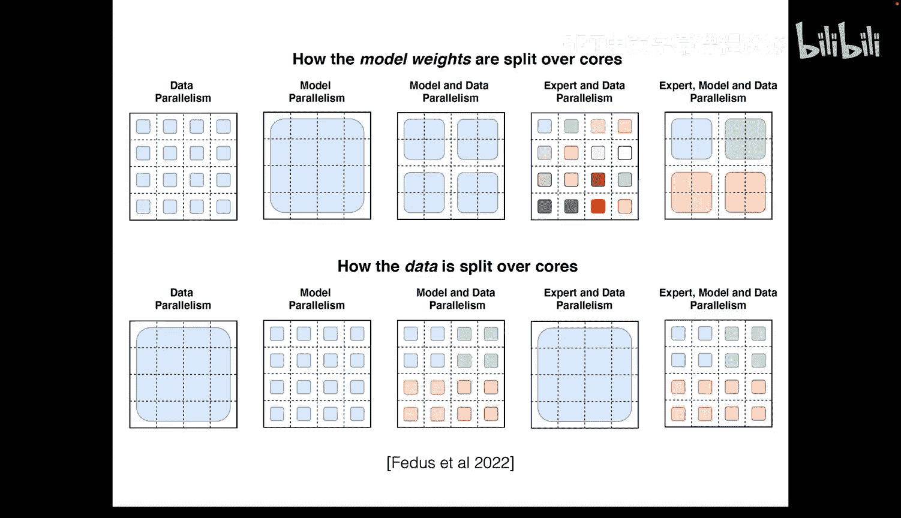

Well， then now let's consider expert one。It basically has to process across an entire batch。

Any tokens that go to the expert， right？And so you're going to have these operations like all to all operations。

And so there's going to be potentially， you know， a lot of communication costs。

 and that's going to be what you want to minimize again through having good load balancing。

And so here's the kind of image from this survey paper。

 again showing all of these complementary types of parallelism。

And so let's see if there's kind of interesting things to。Say here。

 it kind of takes a while to get all of the points that are contained in this diagram。

But here's basically saying， and it's kind of a good review。

 So if you remember data parallelism is we basically have a really large batch。

And then you're going to basically split up the batch into mini batches。

 And so each device will kind of manage。This。ItIt'll have a full copy of the model。

And it will manage this kind of slice of the data。So up here is the model weights and down here is the data。

On the other hand， you can try to kind of slice up the model， so that's model parallelism。And then。

You know， if you don't use any data parallelism， then you have to process all the tokens and so you're going to have these communication costs for you know communicating with the other parts of the model。

Then， of course， you could try to combine the two。And so then expert parallelism is going to be these kind of different colors。

Where yeah， now you can have different experts or different kind of parts of the model on different devices。

And I guess the idea is just that there are ways of making these kind of complementary we're not going to go into too much detail。

 but hopefully you can kind of see the overall idea。Okay。

 I think another thing you could maybe get an appreciation for all these different parallelism strategies。

First of all， you have to have really good kind of infrastructure for implementing all of them。

So that's going to be， you know。You know， people's full time jobs at these different companies and it could be kind of really interesting。

And then for a really large training run， you have to have some way of you know。

 choosing your final kind of configuration that you're going to use for the training run。

嗯。Okay， and then here's just some other topics you might see come up。

I don't know how many I have of these。 This might be the only one。But there's this idea of like。

 okay， I've been talking about training a model from scratch。 But the question is。

 can you take an existing dense model and basically turn it into a mixture of experts model after the dense model has been pretrain。

This might be good because you people have spent a lot of money pre traininging the dense model already。

So potentially now you can introduce more parameters。

Maybe you can make it more kind of efficient at inference time， things like that。

And so this goes by the name of sparse a cycling kind of fancy name。

 but the idea is going to be very simple。 So you basically take the。MLP， sorry。

 so the feed forward network and just clone it multiple times。So again。

 now we're kind of doing the strategy of just increasing model parameters by making copies。

You introduce the router parameters and then you continue the pre traininging。

And so when you think about it， why would this be useful？Well， so one argument is。Yeah， so。

 so we're increasing the number of parameters。 So it's not necessarily going to。呃。

So it's not going to reduce the amount of flops that we need at inferenceprints。

 but maybe it does become better than a comparably sized model。

But if you think about it in terms of like pre training terms。

 then this is kind of useful if the flops that you spend on pre training plus the flops you spend on the sparse upcycl。

Ends up with a model that's better than if you just do sparse pre training for scratch。

That's the kind of reasoning that maybe like a company might go through。

 should we sparse upcycle or should we train a model from scratch。And in fact。

 some of the companies have actually chosen to sparse upcycle。

 and then of course others have kind of pre traineded from scratch。So just broadly speaking。

 what are some potential downsides to this， well， when you think about it。

 it can kind of bias the optimization in some sense。And maybe the intuition is， you know。

 this pre trained model， it's， you know， found this configuration of weights that's kind of really well trained。

And so possibly if you're just doing this continued pretrain， it's maybe already you know。

 biased in some sense， it's not going to find all of the possible kind of weight configurations that you could find if you pretrain from scratch。

And。So that's kind of， you know， broadly speaking， a potential downside。

And then another is just like， you know， the model's been pre trained with some hyperparameters。

And some of them you're just stuck with， right， whereas if you prechan from scratch。

 you can maybe find a different configuration that's better。

 given that you're gonna have a mixture of experts model。

So again， they tried this in the AI2 paper。So as I mentioned， I didn't show any positive results。

 but some groups do use this， I guess here again， they found that they kind of got this negative result。

What they found is that the sparse pre traininging alone is not doing that upcycling。

Can actually catch up quickly。In particular， using just 25% of the dense model's pre training budget。

 they could basically catch up already。

And so。If you remember。This thing that I was showing you before。

 this kind of didn't hold in their case。 And so。

You know， at least in their setting， it's kind of better to just pretrain from scratch if you have the compute to do it。

Okay， so。

Really yeah， cool stuff and then another question is you know。

 I think it's a kind of natural thing to ask with this， especially the name， you know。

 there's this a name like mixture of experts you know。

 maybe each one is a kind of expert in a different topic or something so the different papers will try to analyze a bit say like which tokens are being routed to which experts。

And again， the the results are， you know cut and mixed。 I mean， usually you can find some patterns。

 some experts will get you know， like punctuation， things like that。But again。

 there's kind of a lot of layers in the network， so it's maybe a bit hard to draw any like really general conclusions。

But here's an example， you know from the AIQ paper， what they did is look at different domains。

 so they have GitHub archive Wikipedia books and just general pre training corpus。

And I guess what they end up discussing in the paper is they found that， you know， in some layers。

For some domains， you know， some experts are really getting activated 100% of the time。

 So here's maybe an archive expert， you can argue。嗯。But yeah。

 so you'll see this type of analysis know come up in the different papers。

嗯。Okay， and then just to kind of review everything we can kind of go back and look at。

Two of the models that I've been talking about throughout the lecture。

So the first is this deepse mixture of experts model， which came out in 2024。

And we can look at what they did。 So well， they did a bunch of experiments with a smaller model。

 and then they did this kind of final run with the larger one。And their larger one was still。

Actually， I should have put another example， so these early Google papers were actually training like trillion parameter mixture of experts models。

So like the first trillion parameter models， maybe the only trillion parameter models will be a mixture of experts。

So this is maybe small by comparison， but here's exactly what they do， you have 16 B total and 2。

8 b active。They chose to have 66 experts with eight activated。And if you remember。

 they propose this idea of the shared experts， so they have two of them。

 and then you're going to route， you know， to the rest of the 64。

And just to concretely see they have this like 512 dimension。

 so they are splitting it up into these kind of fine。Fund grants experts。And again。

 as I mentioned before， all of the feed forward network layers are using the mixture of experts layer。

They do the per token routing， as I mentioned。And interestingly。

 they actually don't do the expert parallelism。So what they do is the pipeline parallelism。

 if you remember pipeline parallelism is basically， you know， as you move through the network。

 you can kind of allocate it to different devices。So， then。In their case。

 they're able to basically fit all of their experts on a given device。So basically。

 as you're going through the pipeline， you're just moving to different devices。And so as a result。

 they end up not having an issue with the token dropping。If you look at the exact loss。

 it's basically what we went over， so they use this expert balance loss。

 they have the device level a loss。And I。Maybe I should have looked in the appendix。

 but in the main text， they didn't mention the Z loss actually in the deep mixture of experts。

 but maybe you go back and check that。And then a kind of key result that they have is with 40% of the pretraining compute。

 they were able to reach the performance of their kind of dense deepse 7b model。So， again。

 the numbers are slightly different， but again， the argument is going to be we're using much less。

Active parameters at kind of inference time。And with much less pre training compute。

 you're already matching the performance of this dense model。

And then finally， we have you know one minute left， we can look at this one。

 which I've been talking about a lot。So here they had a kind of  seven billion parameter model with 1。

3 B active。And again， they don't do the shared experts。

 they do do the kind of small experts where they're chopping up the dimension。

They again have this per token routing。And again， they come up with a scheme where they end up not dropping any tokens。

Then they again， have these losses I've been telling you about expert balance and Z loss。

And then again， here's kind of one of their main results。So。嗯。

If you look at the tokens per second per GPU。It's， you know， going to be。

 in their case a bit slower than the dense model because of the different。

 you know systems considerations。But since the model is getting better so much faster。

 you end up kind of reaching the performance of the dense model two times faster。

And then now you should know enough to go off and read the papers on your own and you can see the different innovations。

So there's been a better version of deepC canal V3， there's the mixture of experts from Miel。

 I mentioned Quen models and GPT OSS are also a mixture of experts。

 so hopefully you have a really good understanding now when a new model comes out you can kind of you know take a look and see what they're doing。

Okay， we're right at time， so I'm happy to take maybe one question in person。

 but otherwise that's it for today's lecture。

