# CMU《高级自然语言处理｜CS11-711 Advanced NLP Fall 2025》中英字幕 - P22：(22)_ Advanced Inference Strategies.zh_en - GPT中英字幕课程资源 - BV1ZWYAzuEMa

So we can get started for today。So。Today we're going to have a lecture on advanced imprint strategies so this is an area that is again really exciting。

 really interesting and really over the past year has had a really large amount of progress in it we've had some relevant papers from our own group in this area and yeah it's just another very interesting and exciting area to learn about。

So。Last semester， we had two different。Kind of lectures on advanced strategies advanced inference so we had one on strategies and on efficiency Unfortunately we just ran out of time this semester to have the efficiency lecture。

 but if you're interested， let's say you're looking for something to do over Thanksgiving。

Or Christmas break you can go back and watch the lecture from last semester we have a recording of it and you can learn a lot about the kind of core concepts and some techniques for very efficient inference so trying to run language models quickly whether it's on your laptop or if you're trying to kind of serve a lot of quests in parallel。

 things like that。

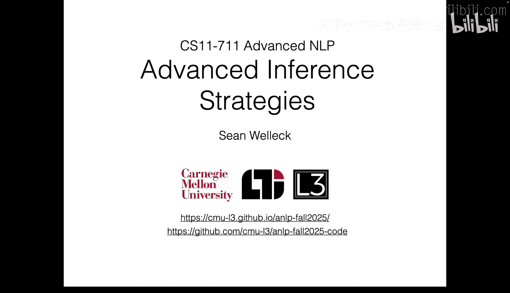

So。If you remember this term inference， hopefully by now you should be familiar with it。

Really broadly speaking， it just refers to generating some outputs with a model and some inferenceprint algorithm。

And so here， of course， we're going to be talking about language models and generating kind of sequences of text and other types of discrete sequences。

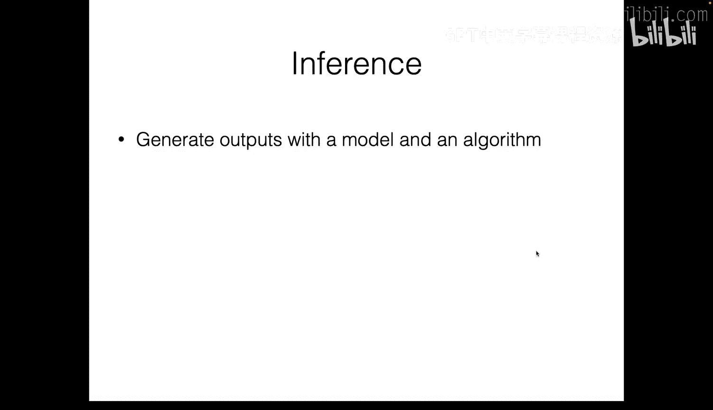

So why is this area so exciting and interesting， Well。

 here's a plot and you might have seen this blog post at the time。

 this was from Open AI and they had this model called01 and on the X axis you can see that they have something called test time compute。

And on the Y axis， you have the accuracy on this benchmark。

 which at the time was like extremely difficult people were really having trouble kind of making progress on it。

And so the techniques we'll talk about today can give you this new kind of dimension of scaling so here when it says test time compute。

 it's essentially generating more and more tokens with a given model and in that sense is kind of spending compute and you can see that the model's accuracy is getting higher and higher。

And so the strategies that you would use to do this would fall under this umbrella of inference strategies or what I'm calling advanced inference strategies。

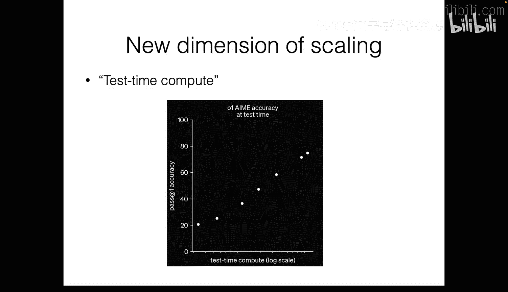

So the question is how do you do this， well， this isn't necessarily exactly what Open Air was probably doing here I'll get to that in a bit。

But we could think about doing this kind of test time compute in two different ways。So， the first is。

Let's say we want to kind of generate more tokens to improve our performance。 Well。

 then what you could do is just try generating multiple times。

 So let's say you're trying to solve a problem。 Why don't you just generate multiple solutions。

And then let's say you have this really good evaluator model that can evaluate whether solution is good or not。

Then maybe you can do something like pick the top ranked solution。Okay。

 and you can see that this doesn't involve kind of training the model or。

Finding new data or anything， it's just some technique that you're using after the models trained and you can hopefully get better performance from it。

And it turns out that these ideas have been around for a while。

 so here's just one notable example because it kind of got a lot of attention and was really kind of big jump in performance at the time。

So this is called Alpha code， and this was from Deep Mind from 2022。

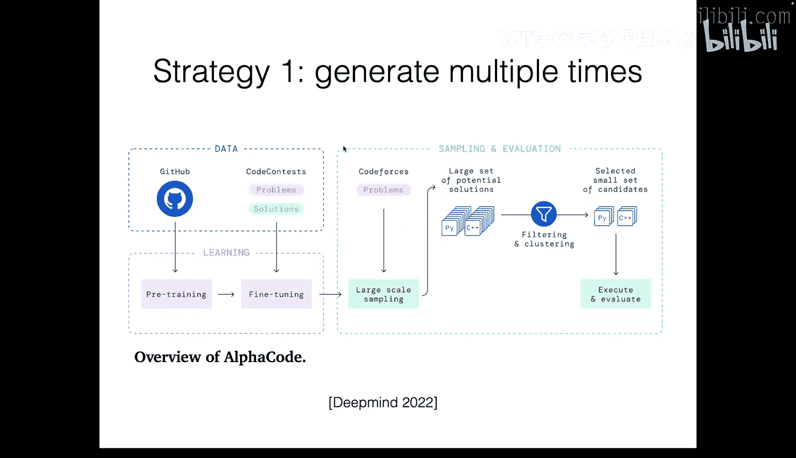

And so you can see here they have this kind of setup of gathering some data here they're trying to have a model that takes in some problem description and generates some code。

That passes in test cases。So they pre train and fine tune the model。

 and then they have this kind of inference time set up here。So in particular。

 instead of just generating one output program， they generate hundreds or even thousands of potential output programs。

And then they have some way of kind of filtering them， clustering them。

 and they narrow it down to a smaller set。

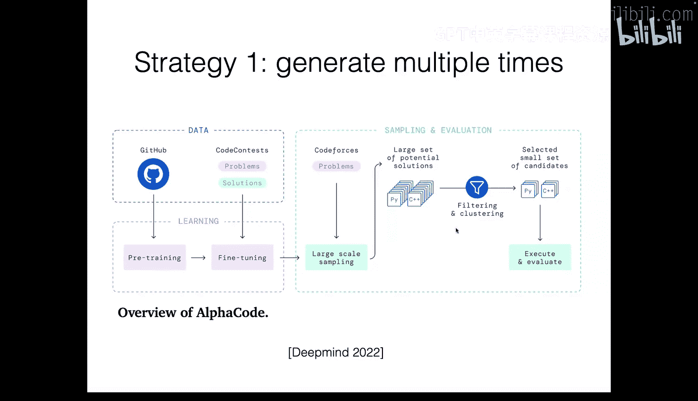

And then on this really small set， those are the ones that they actually kind of submit to the platform and say。

 okay， were these practicalctor or not， do they kind of solve the problem？Okay。

 so you can think of this as being a kind of inference strategy like what I was showing on the previous slide。

And then you can even go back to you know 2022 and see plots that look like this。

 so here on the X axis you have the number of samples that they are taking and then on the Y axis you have the pass rate so the success rate of the programs。

And then one thing one interesting thing to note here is you can see that this is kind of complementary or maybe orthogonal to scaling the size of the model。

 so in particular if you just sample more with a smaller model。

 then you can actually you know find some correct programs more often than if you sample less with a larger model。

Okay， so these ideas like Im kind of introducing here are now kind of really common things to think about with large scale language models like do you train a kind of smaller model and maybe do some kind of inference time technique or do you have a larger model and maybe you can just get a better answer in kind of fewer calls to the model？

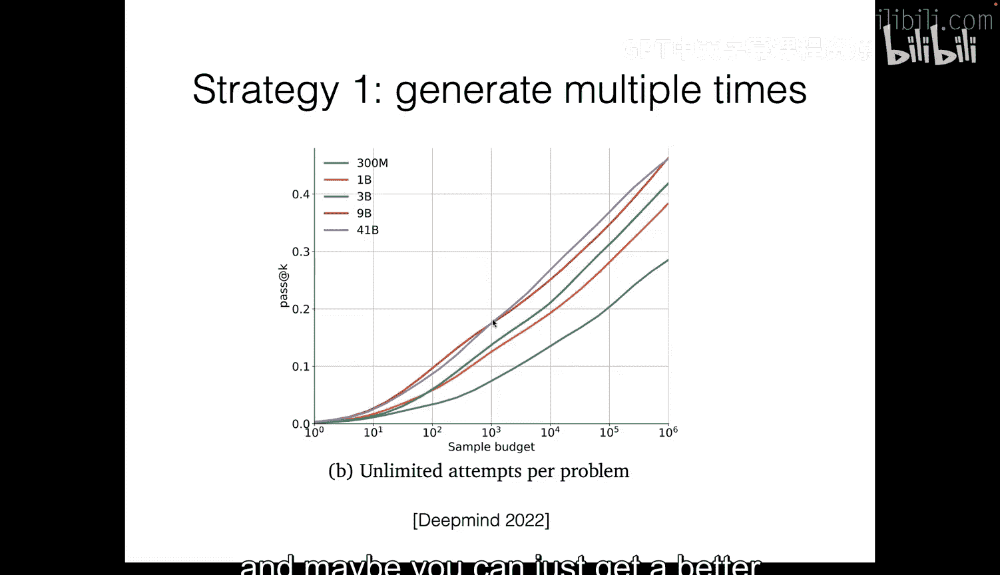

Here's just another example， so this obviously wasn't just you know with code generation。

 so another big area where these are investigated is in math。

 so trying to solve problems or generate proofs， things like that。

So here we'll see the details of these different strategies later in the lecture。

 but again you can see this kind of you know， nice relationship between the amount of compute you're spending in terms of the number of generated solutions you have and this kind of return which is to say that the solve rate is。

Going up montonically。Another thing you can see here is that I'm not telling you the names of these strategies。

 but you could see that the strategy that you pick can actually matter right so we'll go over a variety of different strategies and hopefully you should have a good sense of kind of some common patterns that people use。

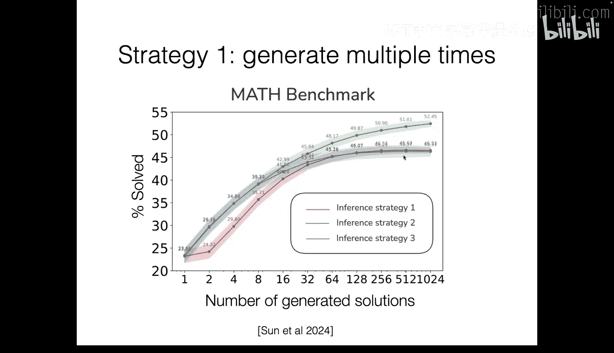

Okay， now if you're familiar with these kind of long chain of thought models。

 then you're probably saying， well you don't necessarily have to generate multiple times。

 another strategy you could take is you could somehow just try to generate a longer output。

Okay and when you think about it like each token that is generated with the transformer。

 you are performing a feed forward pass， and so that is in some sense spending compute。

So you could also consider just like doing chain of thought or trying to do a really long chain of thought as a type of test time compute。

Okay， so here we saw this in an earlier lecture， here's just the original paper that the chain of thought。

 and you could see here that like instead of just generating an answer。

 you could have this intermediate sequence， which is kind of a thought。And then produce an answer。

So even if we go back to this kind of initial paper doing this。

 then you can see that this can change the kind of scaling。

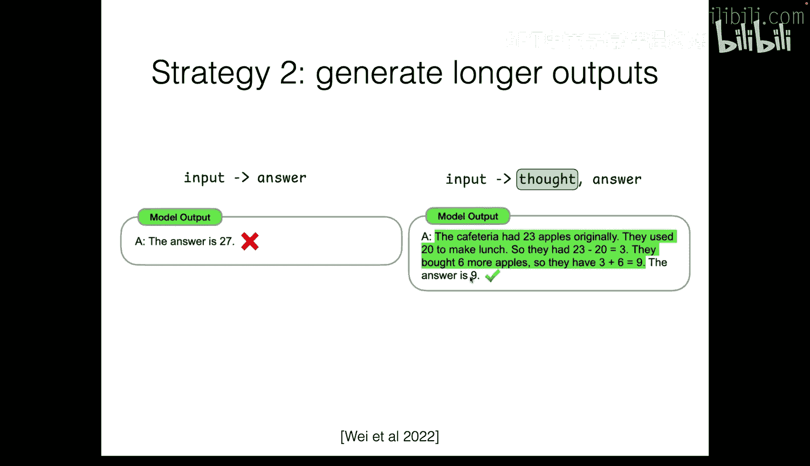

You know， relationship here it's looking at the number of model parameters and and the solve rate。

 you can see that if you just do standard prompting at the time it wasn't it wasn't even clear how to solve these kind of simple meth word problem data sets。

But then when you introduce this chain of thought， now it kind of dramatically changes how things are scaling。

 and it turns out that the chain of thought is pretty important for kind of breaking these problems down into multiple steps and as we discussed in the prompting lecture。

 it's a kind of pattern that's used of。

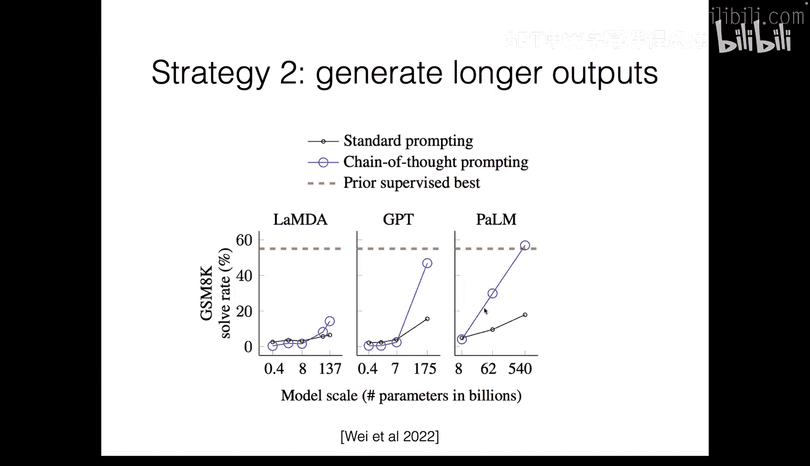

Now you're probably saying， well what is Open AI doing here。

 well I don't know they didn't release the details of their system。

 but now we actually know a lot about this area so probably what they're doing is similar to what the open systems are doing so now what people do is generate an extremely long chain of thought and if you remember in the reinforcement learning lecture we actually talked about this with deepS R1。

And so here， what it's basically saying is as the length of this chain of thought is kind of getting longer。

Then the model is actually know learning to solve more and more problems or able to solve more and more problems。

And again， we'll come back to it in this lecture， but the deepSQR1 paper kind of demonstrated a way of doing this through reinforcement learning。

 of enabling this in the model through reinforcement learning。Here's just two other examples。

 So this group from Stanford found that you can， to some extent。

 kind of distill some ability to have this。Kind of trade off between a longer chain of thought and better problem solving accuracy。

And then here's another paper this is from our group where we train the model with reinforcement learning and you can basically give it a budget of how many tokens you want it to generate and you can see that you can in some sense control the models's pass rate by just generating more or less tokens so you do have this kind of tradeoff between the inference time or test time compute you're using and the kind of performance of the model。

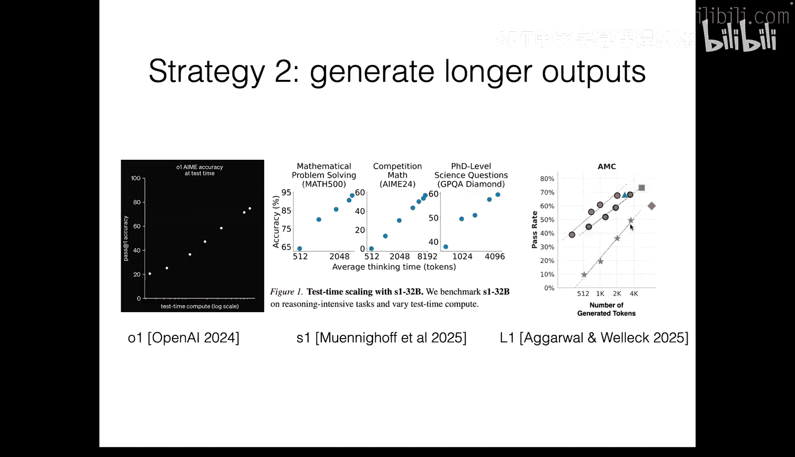

Okay， so in today's lecture we're going to go over these two different approaches。

 we're going to spend more time on the first one so generating multiple times because there's a few different kind of patterns to look at and then I tried to put in some you know concrete examples so we could see exactly what people are doing。

And then at the end， we'll just briefly talk about the long chain of thought models。So again。

 we've already talked about them a bit in the reinforcement learning for language models lecture。

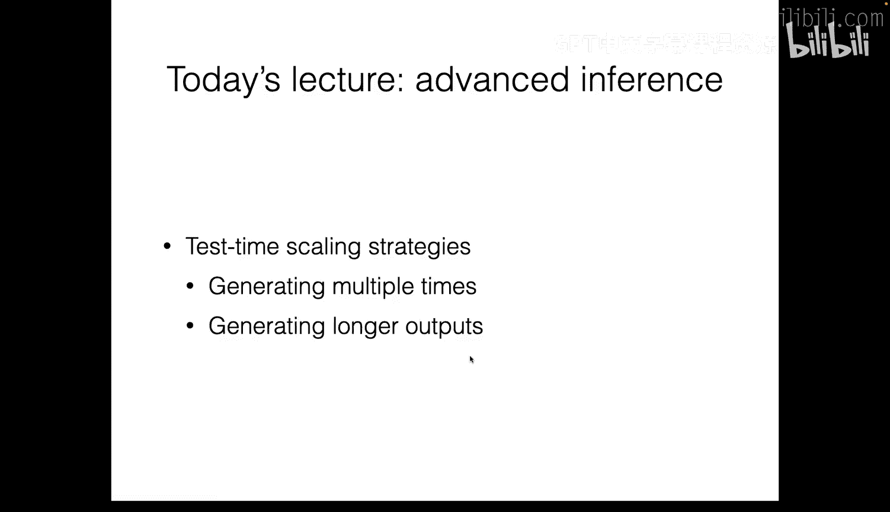

So here we're going to have this notion of kind of generating multiple times and then somehow。

 you know， coming up with an answer。And so it's useful think to kind of abstract out a bit and you could view a kind of call to a language model as a kind of primitive and then we're going to build kind of things that you know call this primitive operation。

So here we can have some idea of a generator and this is， you know。

 you give an input to a language model and you get some sequences output。

So an example could be calling an LLM API once。And you could think of this as like calling one of the decoding algorithms that we talked about in the decoding algorithm lecture and which by now you've had to implement and use and things like that。

And if you remember， these types of algorithms were things like you know greedy decoding。

 temperature sampling， beam search， and they're kind of aimed at you know producing kind of one output sequence。

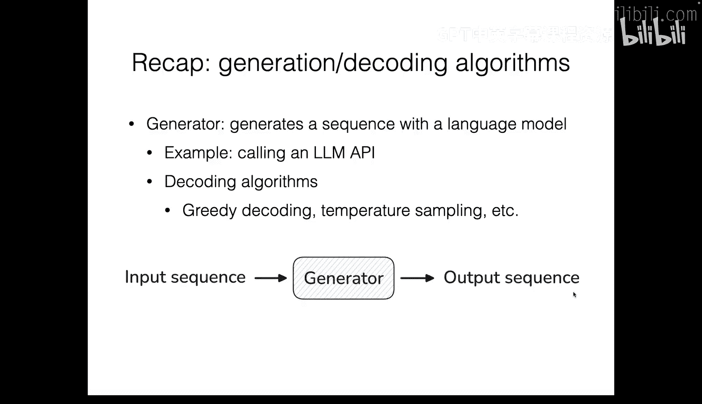

So then what we can think of is like an algorithm that's built kind of on top of the generator。

 and so you could call this a kind of meta generator and it's just some strategy for。

Calling this generator multiple times， and then you can incorporate other models or other information like here。

 this meta generation algorithm is incorporating this evaluator model。Okay。

 so today we're going to go over two different common patterns。

 so sort of parallel generation or parallel sampling。

 which has actually been being shown here and then this sort of iterative refinement。Tique。

Now there's actually other patterns， another one is tree search。

So we talked about this in the last semester， but there was kind of a lot of content。

And really in kind of general uses of language models。

 we haven't seen as much use of the research strategies。So I left it out for this semester。

 but again you can kind of check out the other version of the lecture or the papers that were linked to I still left all the papers there if you want to read about the tree search。

You do see tree search in some kind of specialized areas。

Like there's an area called formal de improving and there we have this really nice kind of。

Division of the output into individual steps。And you also have a way of kind of。

Printing candidate next steps， and so it actually turns out to be pretty amenable to research。

So again， I'm not going to go into the details， but if you saw like in the news。

 there was this method called Alpha proof from Deep Mind。

 they actually end up using a research to kind of search for a proof using a language model。Okay。

 but we're going to focus on these two because there are things you should definitely know about and we can kind of go into a bit more depth。

 maybe on them。

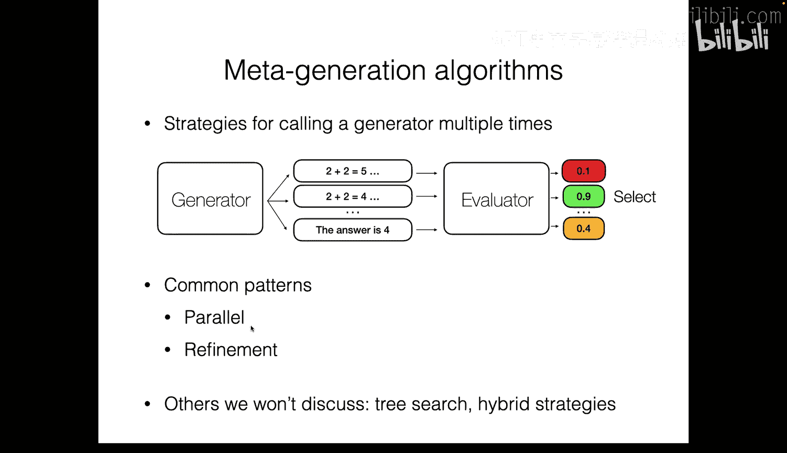

Okay so parallel generation is just like it sounds and it's a pretty simple idea。

 so here we have a generator and we give it some input and we generate multiple output candidates so here we generate n candidates。

And then you have some strategy for aggregating。 So that means you take in the end candidates and produce one。

Technically， you could have one or more outputs， but let's just focus on producing one output。

So the question is， you know， how do we do this aggregation and kind of is there something more interesting about this because it looks pretty simple？

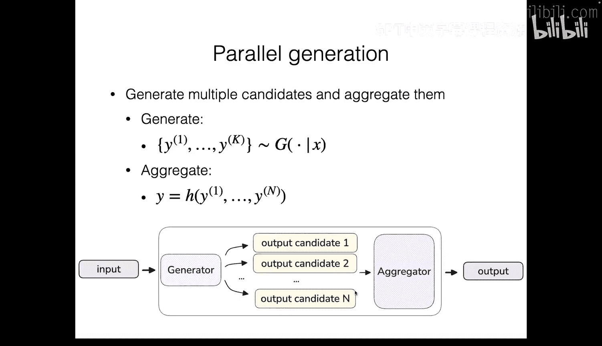

Well， it turns out that like doing something fairly simple can be pretty useful。

 so here this algorithm called best end is basically saying let's say that we have some way of assigning a score to each output sequence。

Then we could just take the maximum and return that as our output。Okay。

 so like here we generated multiple solutions。This one， if we have a reasonable scoring model。

 then it gets a low score， this one is cracked， so it gets a high score。

 so that's the kind of output of the system。Now one thing to know about is kind of terminology and you'll see many different names for these kind of scoring functions。

 I think in this lecture i'm going to use you know I wasn't able to consistently use one term。

Ill I'll try to use the name reward model but。I'm also using the letter V。

 so verifier is also frequently used。Also value model or evaluator or scoring function。

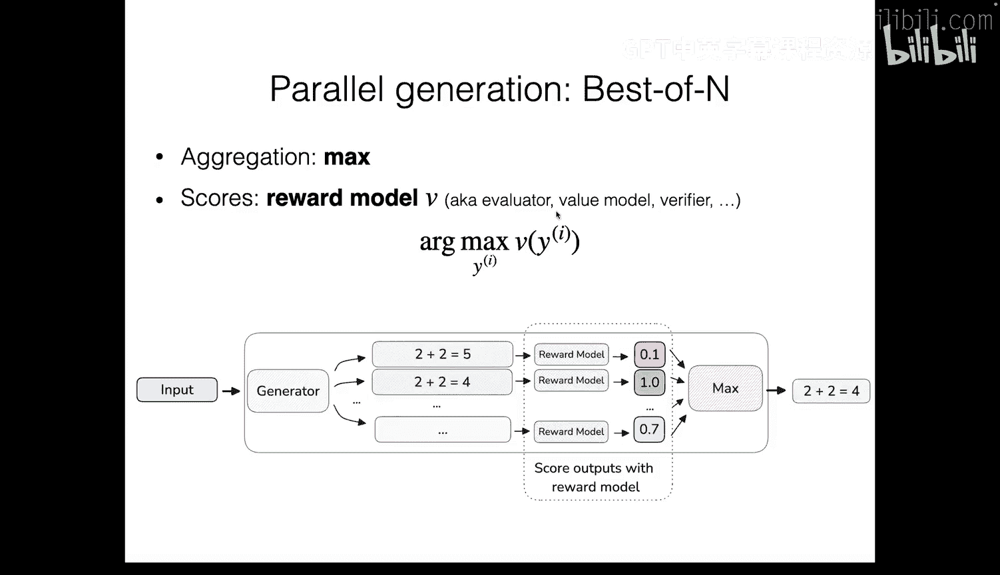

So。An example is， let's say we're trying to solve this math problem here， so you have some input X。

 you have some solution Z， and you have some final answer Y。

And the reason I'm breaking it up into this solution and the answer is because a later method that we'll talk about actually kind of just looks at the answer。

 whereas here we're saying that this scoring function or reward model is kind of looking at the entire solution and also the answer。

So a question is like， okay， given today's language models。

 what if we actually had a perfect verifier for a math problem like this？

Of course it's difficult to have a perfect verifier because this is kind of， you know。

 how do you automatically verify whether the solution is correct or not？

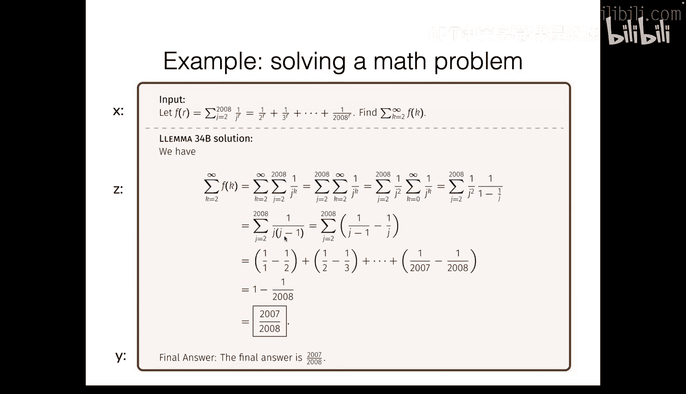

But it's a kind of interesting question。 Like what if he had a perfect verifier。

So here is a paper that looked into this and it turns out that like with a lot of language models。

You're able to get almost 100% you could at least have the model produce the correct answer to the problem。

To kind of 100% of the problems in this data set。If you were to have a perfect verifier。Okay。

 so here we have on the X axis the number of generations。

And here we're just cheating and we're checking like， okay。

 is the answer in the solution equal to the ground truth answer from the data？And of course。

 if you actually go to you know deploy the model， you don't have this ground truth answer。

 so it's kind of just like a you know， oracle verifier。But it's kind of interesting it's saying that。

 you know， if we're able to maybe learn a verifier that's very good。

 then it looks like even just like given the current models， you can do you know。

 pretty well potentially。嗯。So before we go to learning a verifier， learning a reward model。

There's another question which is like this is pretty convincing。

 are there domains where you actually do have a perfect verifier？

And it turns out that there are a few domains， so this is one that I mentioned earlier。

 there's a domain formal Theem improving， and so here the math is not written as kind of latex。

 it's written as essentially a special programming language。

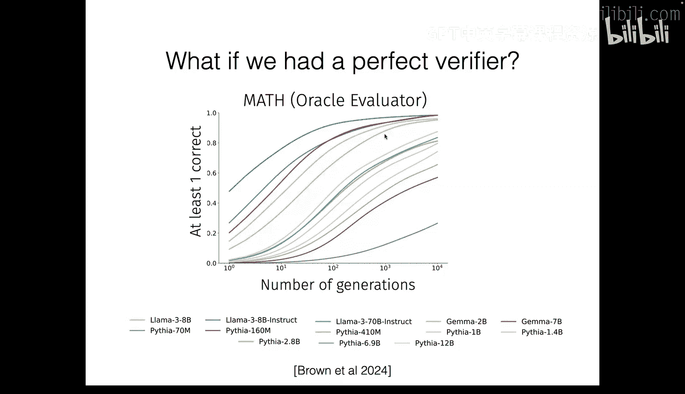

And then if you kind of write a proof in this language。

Then the nice things that you can automatically check whether the proof is correct or not。Okay。

 and so if the language like to draw an analogy， you're basically kind of compiling the proof。

 and if the proof kind of compiles， then it's mathematically guaranteed to be a correct proof of the statement and the statement's also written in the formal language。

So then the nice thing is that you have this kind of perfect verifier and you can apply these kind of inference time techniques。

So here's just one example from a few years ago， and you can see that as you attempt more and more proofs。

 you can just all you need to do is just find one proof， you know which is verified by the system。

And you can see that this is very effective。 So it's kind of silly to try just generating one proof。

 You can just generate more and more。 It does level off at some point， but。Yeah。

 you do see this kind of inference time。Scaling your air test time。Skicallling。

So this is now like a pretty widely kind of active subfield and again。

 a lot of the methods here will take advantage of the fact that you can kind of perfectly verify things。

Okay， so there's other domains as well， they can be kind of rare。

 but if you do have a kind of very reliable verification signal。

Then you can really exploit this idea of， you know。

 just trying many times with your language model and just trying to find kind of one success。

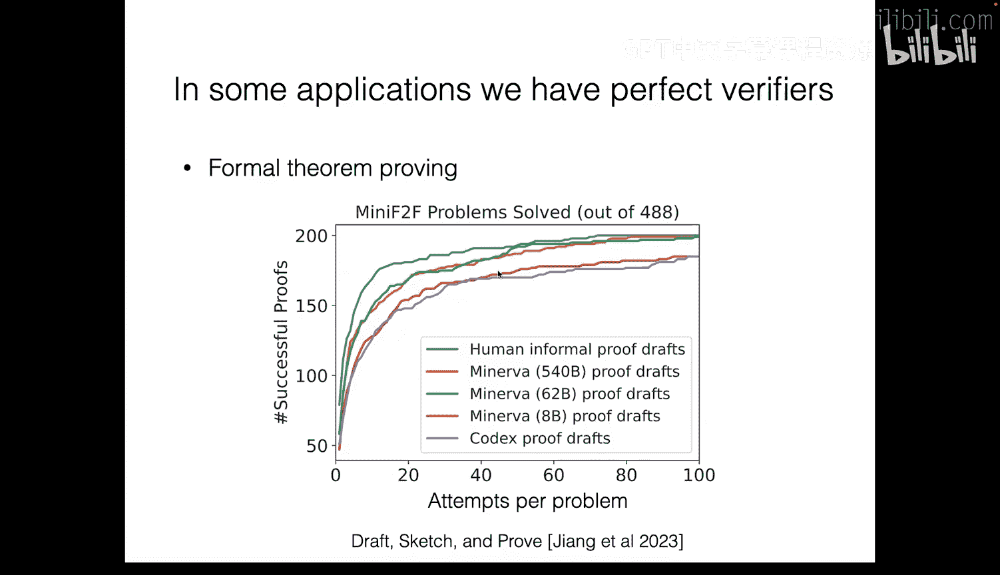

But you know， in the usual case， you don't have this luxury of having the perfect verifier and so if you want to take this approach。

 then you have to think about like learning some model。That tries to， for instance。

 predict whether an output is good or not or whether a solution is correct or incorrect。Okay。

 so here we'll use this term reward model or learned reward model and again you can also use the term verifier learned verifier。

 I guess reward model would be slightly more general。

 maybe than a verifier usually have the impression of like zero or one。Okay。

 so people have tried this a lot， a really simple thing you could do and we'll actually go into an example is you can train the model to classify whether a solution is correct or incorrect right so you can basically collect a lot of crack or incorrect solutions and then basically learn a kind of classifier。

Now， you don't have to， you know， you're not limited to math problems or things with a clearly correct or incorrect solution。

If you remember the reinforcement learning lecture。

 we talked about learning these kind of preference based ro models。

So here we just assume that we have preference data。

 so you have say two different outputs from a language model。

And then the goal is to train the models that assigns a higher score to the preferred outputs。

Okay so I'm not going to go into details on the algorithm for learning that we actually went into a lot of detail in the RL for LLMs lecture if you remember there's like this Bradley Terry model and we kind of derived the loss function。

Well， maybe that's the reason I'm using Ro model， it's basically the same you can use the same model here now instead of using it for reinforcement learning。

 you can use it to kind of you know select outputs， say from your chat bot model。

 something like that。Okay， so I didn't include any plots。

 but you can get these plots as well like let's see you have a conversation model and you have a really good ro model。

 then you can also you generate multiple outputs and kind of choose the best one。

But I wanted to go and look at this case study for this type right here。

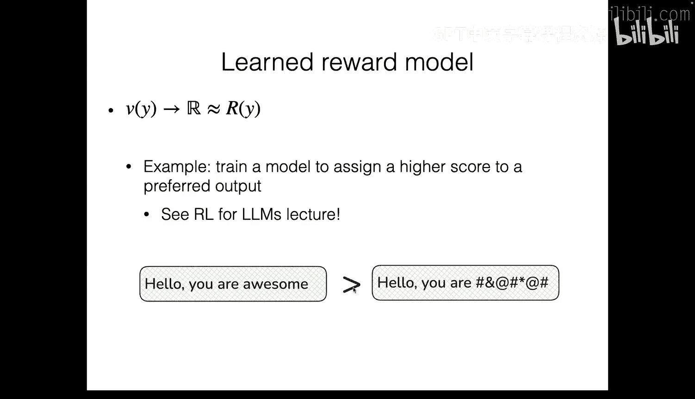

And。It's this paper that maybe like a lot of people have heard of the data set GSMAK I'm not sure if if like it's common nowadays to go back and actually read the paper。

 but it actually has a lot of good ideas in it and a lot of the ideas are actually repeated in a lot of papers later on so it's really nice papers you just go back and read。

So this was this paper from Open AI。And we talked about it in the evaluation lecture。

 but there's this data set of basically grade school math word problems called GSM8K。Okay。

 so part of the paper was constructing the data set。

But another part was basically training one of these roar models or verifiers for the math problems。

Okay， so here's the basic setup， you have a generator model and the generator again is going to take in a question and produce a solution。

 The solution is going to have some answer at the end。

Now here we have this verifier that we want to train。So what we're going to do is kind of the maybe。

You know， if you thought about it for a bit， maybe what you would try。Which is， okay。

 we're going to just generate some solutions with the generator。

And we know the answer in the training set。So we could just check whether the solution that was generated was。

Crred or whether is incorrected。So let's say that for each problem in the training data set。

 you do this 100 times， that's what they ended up doing。Okay。

 well now you actually have training data to train the verifier， so you could say， okay。

 given a question and given one of these solution candidates。And given the outcome。

 so whether it was correct or not。You can just train the verifier to basically predict whether it's correct or not。

Okay， so it's a really nice idea。 and then actually when you think about it， it looks really simple。

 but you could actually think about。You know， what do you actually do here and can you kind of make this a little bit better and so they had all this really nice kind of design choices and abls。

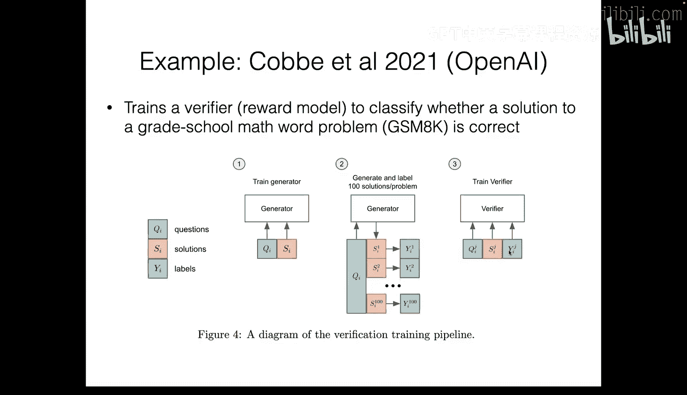

So one thing that they found is that。First of all， you know this verification involves you know processing a question and a solution。

 so the model probably has to be pretty good at language。

 so first of all they're using a language model kind of as the verifier。

And they also found kind of two different interesting things。So first。

 it was better to not only train the model to predict the solution。

 but to additionally mix in the kind of language modeling objective。So the model was in some sense。

 like learning to just kind of produce the solutions as well as verify the solutions。

The other interesting thing is like， you could imagine， okay， let's say that at the end。

 we have a label of whether the solution was correct or not。Interestingly。

 what you could try to do is just say， okay， at each token of the solution。

 you could try to predict the label。So it sounds kind of crazy at first。

 so you know given one token of the solution， you could try to predict whether it is eventually correct or not。

Now， if you think back to the reinforcement learning lecture。

 then this is actually something we talked about， it's called a kind of value function。

You're saying at each state， you're trying to predict the eventual kind of return。

And so actually maybe it's not as crazy as it sounds。

 and it turns out that that's what they end up doing and they have an ablation that I'll share later。

What they do is try to predict the。Yeah， the label add kind of each next token。

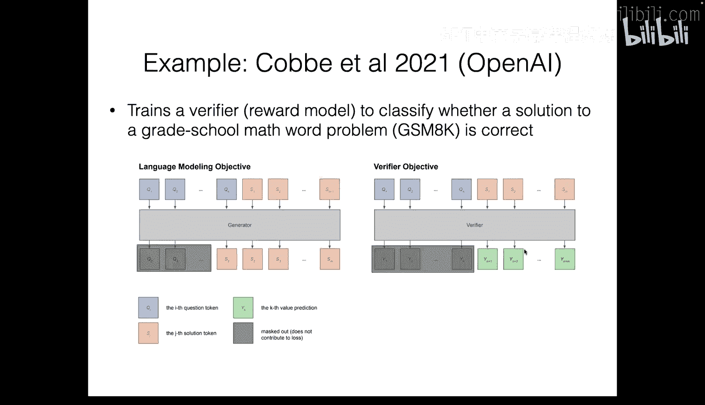

So here's one of the main results and so let's take a look at what is here。

So here on the X axis they have the size of the training set。

 I guess they're interested in just seeing how much kind of data you need。

And what they did is they tried to fine tune a 6 billion parameter language model just on the kind of training set。

Or you could try to use this verification model to kind of do best events。

 so choose the best solution。And so you could see that after a certain point。

 the verifier gets good enough where it's actually better than just fine tuning the model on the solutions。

And then also here they're doing it with a larger model， so 175 billion parameters。

So this doesn't just apply to these kind of small models。 it's also working for the larger model。

 and you can see that the larger verification model is actually requiring you know less training data than。

The 6 billion parameter model to kind of you know reach this turning point。

They were crossing over point。嗯。So then here's a few different ablations like I was mentioning。

So here on the left， they have the difference between。

Only training the verifier to produce the label at the end versus producing it every single token。

And so interestingly， here you can see a big difference and it looks like with the token loss。

 it's actually kind of still increasing monotonically。嗯。Here， they're using， you know， just the。

Verification loss versus the verification loss and the language modeling loss that'll be in blue and so you can see that adding in the language modeling loss helps a bit。

And then this one on the right is really interesting。 So you could ask like， okay， you know。

 how big does the verifier have to be relative to the size of the language model。

And so here they do these different combinations， so for instance， they have equal size。

 so 6 billion generator and 6 billion verifier that's in blue and they have 175 billion well equal size again for the larger model。

And then maybe these are kind of interesting， so let's say that we have a maybe the green is actually the most interesting。

So here we have a 175 billion parametermeter generator。

 but we have a relatively much smaller verifier。And it turns out that this actually can， you know。

 boost the performance a lot of。The generator by it， I mean like doing the best end sampling。

Using this relatively small verifier。So kind of cool result and then yeah less surprisingly maybe if you have a really large verifier。

 then it does better than using the small verifier。Let me just go through。

 I think there's maybe two more slides on this and then I'll pause for questions。

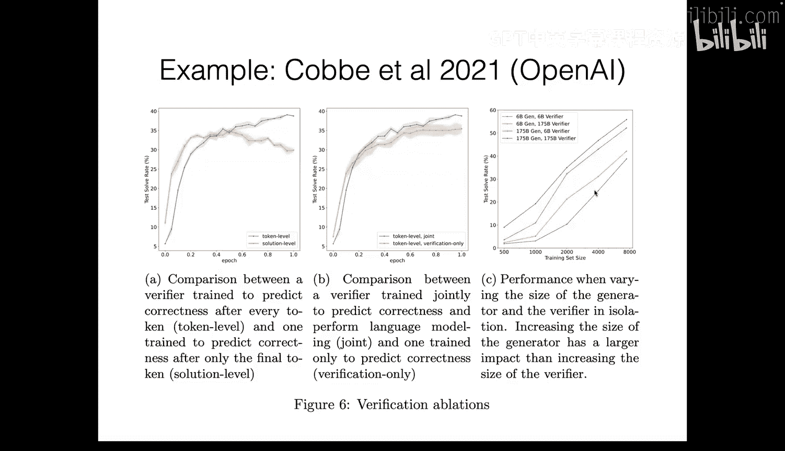

So the other cool thing is they have these visual visualizations。

 so if you remember again the model is trying to predict whether the solution is eventually correct from each token。

And so you can just visualize the kind of score that it's predicting。

And then they go through these different cases， so here is where the prediction was corrected。

And you could see that initially， you know， for some reason。

 it thought it was incorrect and over time it kind of moves to correct and then it's fairly confident at the end。

Here the verifier was kind of wrong and it's kind of thinking that it's predicting that it's incorrect。

嗯。This is kind of similar。Here the。Here's kind of opposite。 So it starts off， maybe。You know。

 unsure and then by the end， maybe detect some error I haven't actually looked at the the details of what's written。

 but maybe there's some error here and it kind of detects it。And then here's， again。

 the model kind of making a mistake。So yeah， it's a really nice paper and if you haven't read through it before。

 it's definitely good read and has a lot of useful techniques that are still relevant to consider today。

So does anyone have any questions about the things that I've mentioned so far？

Seems to be very complimenting， we。非常关注。

Oh， yeah， yeah。 So here， yeah， just。Just to emphasize。

 So here you only have a single label at the very end。

And then it's basically just reusing the label for every single token。Yeah。T岁。Mmh。😊。

Os the correct answer so we still assign a correct label to。Domestics in the middle。Yeah。

 so it's ultimately predicting whether the answer at the end is correct because that's what the labels based on。

 yeah。And so yeah I'm glad you asked the question so I could clarify so yeah here they're only having this label at the end and then they're just repeating it for every token So again。

 it's a bit unintuitive at first like you know for the very first token of the solution the models was to predict whether it's eventually correct。

But you could think of it as being similar to the value functions that we talked about in reinforcement learning。

Those if you remember， you know， I gave the example of playing the Atari game。And so similarly。

 there， if you have a value function， then at the first state of the game， it's trying to predict。

The eventual reward of the game， so you kind of have the same unintuitive thing in in reinforcement learning。

So that's one way to think about what they're doing here。嗯。

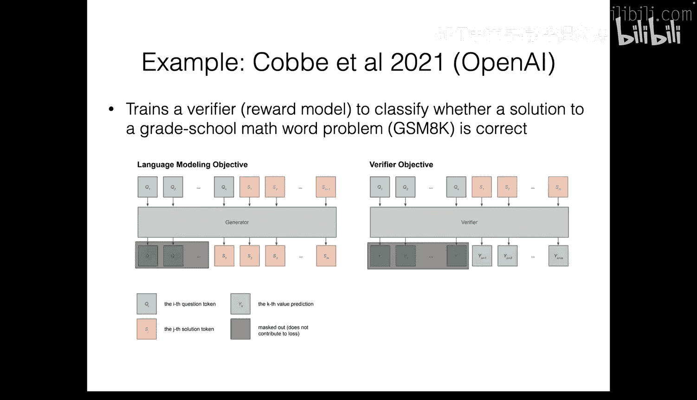

Okay， and then as I mentioned， this method's kind of simple， but。

You can kind of still keep thinking about it and it's kind of interesting。One question is like， why。

Are you like， why is it a good reason to do this？And what's happening is you're basically saying that this verifier model or this reward model that you have is somehow an approximation of the true reward。

 so in the case of the math problems it's you know trying to approximate whether the solution is actually correct or not。

And then you could kind of think about it and you could say like， okay， well。

 this approximation should actually get better we generate as we increase n so as we generate more and more。

The reason is that if you're trying to truly maximize the reward。

Then you would try to search over all possible sequences and choose the one that maximizes the tree reward。

The best event is basically saying we're going to just take a sample of n sequences and that's going to be our kind of search base and then among those you're going to choose the highest one。

With the highest verifier score。So through this simple argument。

 you can kind of see a justification for why we would。You know。

 maybe expect this to get better as we increase the number of samples。Now。

 it turns out that this isn't necessarily going to be the case。

So you also have to think about the second line here， what's happening。

And it's basically saying that we're assuming that our reward model is kind of a good model of the true reward。

And so what happens， and again we briefly talked about this in the reinforcement learning lecture。

What happens is you can have an imperfect ro model。

And so you could end up maximizing the reward model score。

 but not necessarily maximizing the true reward。Okay。

 and so this is called reward hacking or over optimization。So it was a concrete example。

 and this is again in this paper， like I said， they have a lot of nice kind of insights。

So here you could see that they're trying to generate even up to like 3。

000 different solutions and choose the best one with their reward model。

And you could see that at some point， what's happening is the solutions are getting a higher score according to the reward model。

But they're actually incorrect solutions。So in some sense。

 the reward model is being kind of over optimizeized or it's being hacked。Okay。

 so this is a kind of really you know striking illustration of this。

 and you will see this sometimes if you say have a really large number of samples and your reward models kind of you know imperfect。

🤧嗯，Okay， so clearly， this type of method depends on how good the reward model is。

And so one thing you could try to do is try to come up with better labels。So as we talked about。

Here we only have this label for the last step。 So why don't we try to get some labels for intermediate steps because。

Yeah， again， there might be an error at some intermediate step。

 and that might be useful to have a label for。Now， if you can imagine doing this。

 just like think about math problems。Then it's going to be kind of difficult to maybe automatically collect。

These labels of like whether a step in the solution is incorrect。

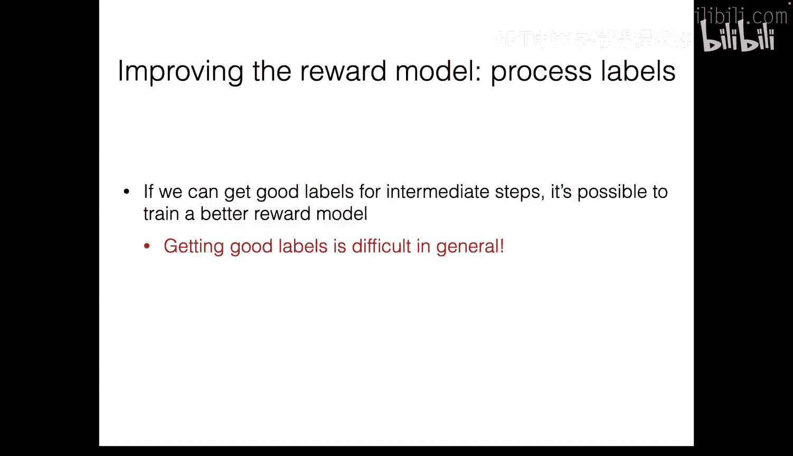

But basically， Open AI did this， so they had you know funding。

 so they basically got humans to label the mistakes。So these are called process labels。

 whereas the other type is kind of outcome labels。So here what they did is they。

Took solutions and then broke it down into individual steps。And then they had an annotator say。

 basically， was this step correct or or was it incorrect。

And then if there's a step that is incorrect， they don't have the annotator label anything after Canets。

A bit confusing when you think about it， like maybe the model made a mistake。 and then， you know。

 do you do we still count this as correct or incorrect。So that's basically what they did。

 they had people label each step of these solutions。And then they。

 they can construct a training data set。And now they could have a model that tries to predict。

Given the steps so far。You know， is the solution so far correct or incorrect？

Maybe I should have put maybe one more piece of explanation here。

If you think about training a model that predicts。Give some score of whether each step is correct or incorrect。

Then the question is， you know， how do you use that to actually choose a full solution？

So what they do is do something like， you know， you could take the average score across all the steps。

Or you could take the， let's see minimum score， for instance， or minimum score。

 so it's basically saying if the model predicts that any step was incorrect。

 then maybe you give a low score to the full solution。Okay。

 so this type of model and this type of model will be called process reward model， PRM。

And then ORM is kind of what I was showing you before。

And you could see here that the PRM is doing much better than the ORM。

Seems like they were able to also maybe train a better O RM now。 So we're not seeing as much。

 maybe slightly at the end。 it's， it's being over optimized a bit。

But now their ORM is mostly leveling off， whereas this one has much better scaling。嗯。Now。

 I don't have a slide on this， but you can kind of think about this method and the present cons。

And really， the con of this method is going to be。You know。

 how do you get these really reliable process labels for the given tasks that you care about？

So like in the case of a math solution， you have to somehow get labels for each step。

 whether it's correct or not。Let's say you have like an agent and you want to do best of end on its trajectories。

Then you have to have some way of saying， like， oh， this step was good。 This step is， is bad。

Things like that， so it's not necessarily impossible。

 but it's going to be like a key thing that you would have to consider if you're doing a method like this。

So people have proposed methods for， you know， at each step of a solution。

 say you could try to do maybe multiple rollouts and then。

Take the average of them and if it's too low， then you consider incorrect， something like that。

But those are going to be like really computationally expensive。And so yeah。

 I'm not going to go into too much detail， but you can just know that the process reward models are probably used a lot less frequently than the outcome based ones。

Just because you have to think about how you get kind of good reliable process labels。

I for training the model。

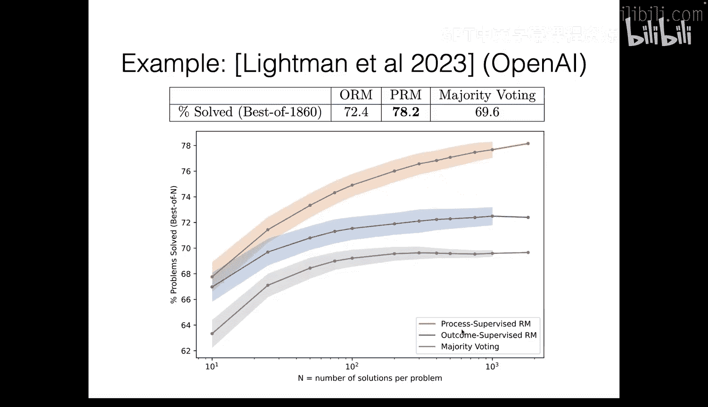

Okay， and then it turns out that， you know， there's been a lot of research into additional research into training these good reward models。

 it's a kind of useful thing to be able to you know assign some quality score to an output and then pick the best one。

So one thing people have found is that it's good to actually have the verifier or evaluator or reward model have its own chain of thought。

So this would say something like okay now let's look at this solution is it correct is it incorrect let me work at the details。

 things like that so now the kind of evaluator model or reward model is doing some kind of thinking on its own。

Here there are also kind of aggregating scores so you can do this parallel sampling。For purposes of。

You know， evaluating an output。And so this is one of the papers that did it。 And it's called。

Maybe the name isn't the best， in my opinion， it's called generative verifiers。

 but if you want to look it up and take a look at the paper。

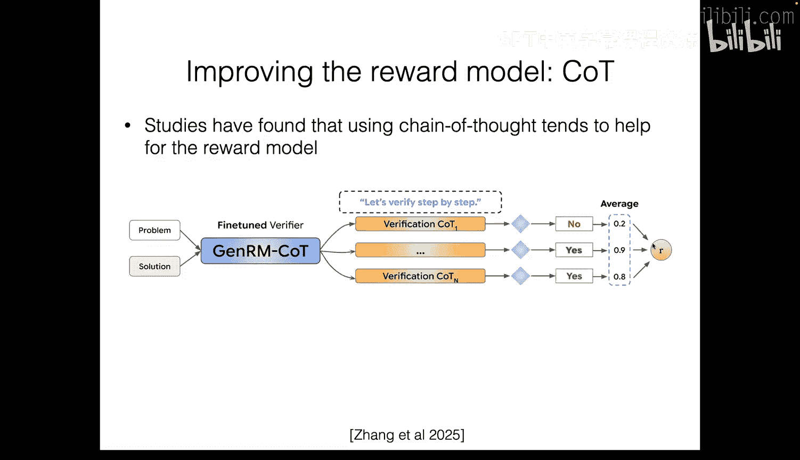

So here's an example result they have， so maybe this data set had the biggest difference。Oh。

 so what they're doing is。They are training this。Generative reward model。

 which has the chain of thought， and they're comparing it against the one that I mentioned before。

 which just tries to predict。The correctness。Without the chain of thought。

And they trained it on kind of trajectories that are sampled from GSM8K。And then they see like。

 how well does it transfer to this other data set， the math data set。And so you can see that。

 you know， this one with the chain of thought is kind of doing better than the one without the chain of thought。

We'll talk about this gray line in a bit， which is another method called self consistency。

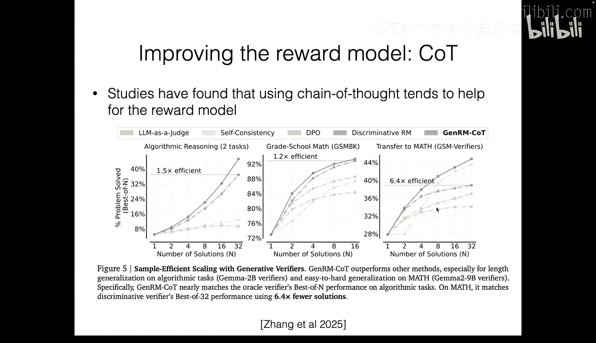

And then if you kind of follow what I was saying， then you can also sample， do parallel sampling。

In the ro model itself， so you could try to evaluate it multiple times。

 and each chain of thought might might vary so you'll get some variation。And so in some sense。

 you can like scale up the test time compute for the ro model so you have this like two different。

Kind of types of test time compute。 you have scaling up the number of。Generator outputs。

 and now you can even scale up the amount of compute that's used to evaluate the generator outputs。

 if that makes sense。Okay， and it seems like the reward model does better as you kind of sample more and more。

Chains of thought and try to aggregate them。

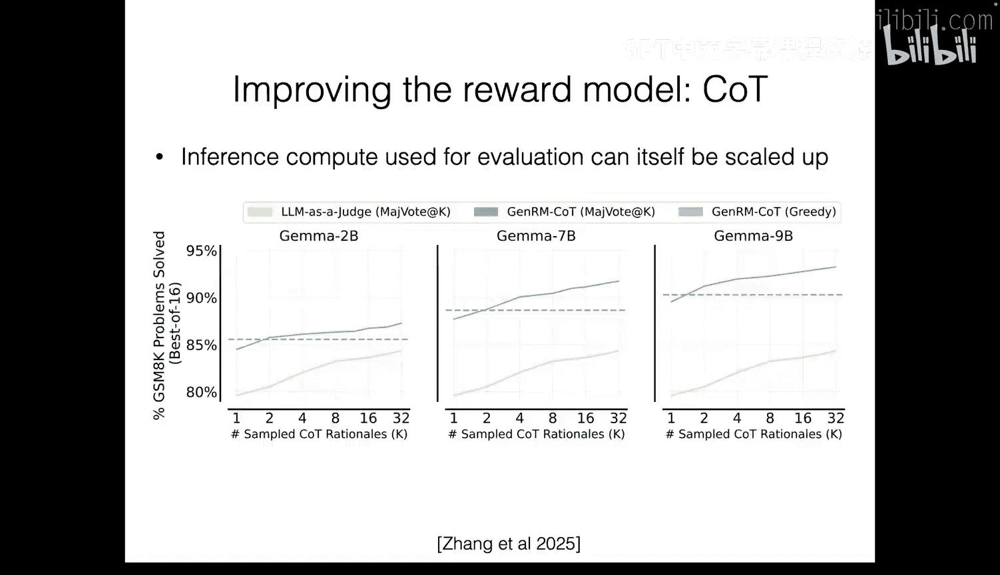

Okay， so that's going to be it for best of any questions about that？Otherwise。

 I'll start talking about the next method。Okay， so here again， the idea is kind of simple。

 but this idea is also going to be widely used。So this is a method called voting。

 or it's also called self consistency。So here what we do is we。We generate multiple outputs again。

And then here you could see that like， okay， the models has the answer two。

 maybe two times and the answer four once。Then you're going to choose the answer2 or just one of those sequences with the answer2。

 because it has the kind of most votes， So it's taking the majority or the most common vote where here the vote is the choice of an answer。

Okay， so this is called voting or self consistency。

And so the benefit is there's no reward model needed here。

 so you could really compare this to you know well you could compare it against you know any method that doesn't have some external reward model and it might be tricky to even come up with alternatives we'll see some one example actually。

But that's the kind of nice thing you could potentially scale up the inference test time compute without some extra reward model。

The potential con of this is you need some notion of equivalentvalence of outputs。So for example。

 here with these math problems， it's really。Well， for math problems that end in an answer。

 it's maybe easy。You kind of vote by saying。By using the answer identity。

 but in a really general application， let's say you're， I don't know， generating essays。

 then you know what's the notion of majority vote for an essay， I'm not really sure。

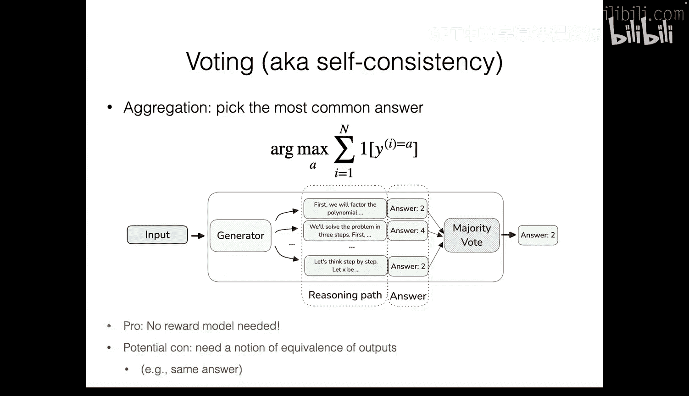

So here again is the。Paper that really popularized this or proposed it for the large language models。

And you can see here， they're just comparing against greedy decoding。And。

Here is their self consistency method。At the time， these are even， you know， much easier。

Math benchmarks and some QA benchmarks， things like that。And again， you see it leveling off。

 but you do see some performance gain from doing the self consistency。So as I mentioned。

 this method started being used and so here was a kind of really influential paper for the mathematical problem solving。

 it was called Minerva from Google。And so if you look in their appendix。

 they have this nice ablation。And so here there's a lot of lines， but let's。

Let me try remembering what the interesting ones are。So okay， first of all， you could say。

 what if you used the Oracle verifier that I was talking about before？

So this is basically checking pass at K， so if you check was the correct answer generated in any of the K samples？

And so that's going to be a kind of upper bound because again， it's in some sense cheating。

Now we could look at the majority vote。And here they have kind of two different versions。

This one is doing majority vote， and then it's still choosing the top five answers。

And using the Oracle to say is the correct answer in any of the top five？

And then the green one is going to be the kind of majority vote where you just pick one answer。

So again， you can clearly see that it doesn't fully solve the problem of solving the math problems。

But again， you can kind of get this boost in performance。

 and it's actually a pretty big boost versus just generating one output by kind of taking the majority vote answer。

嗯。Yeah， so yeah， here would be the just using greedy decoding。Okay。

 and so similar thing on this GSM 8K。

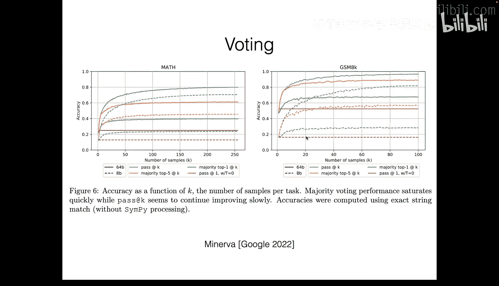

So here they actually compared against one baseline that also doesn't have a reward model。

 what they try to do is just use the language model's log probability as the reward model score。

And then you could try to do best best event。And you can see that at least here it doesn't work very well。

 it actually does worse than just doing greedy decoding， at least in their experiment。

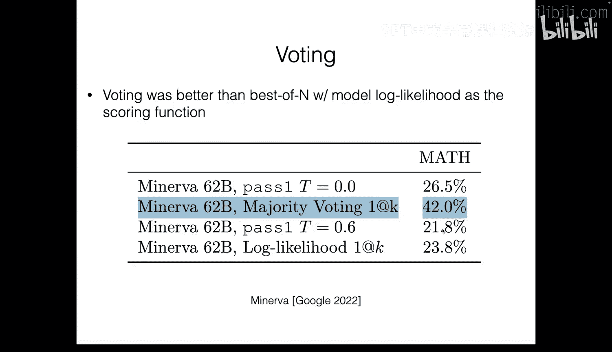

Okay， and then the question is like， this is， that was 2022， is this still relevant in 2025？Well。

 we could take a look at the deep Seaq R1 paper。And you can see here they report two different results。

 one is with pass at one， and the other is with this self consistency or voting at 16。

And so you could see that even with these kind of long chain of thought models。

 you can still get some boost if you。You know， generate multiple long chains of thought and kind of aggregate the results。

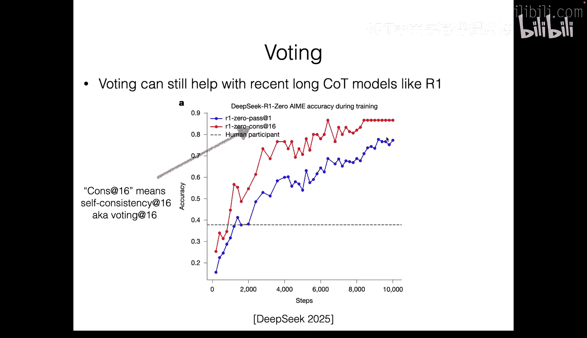

Then you could say like， okay， what if we do have a reward model。

 then you can also combine this with the voting， so this is called weighted voting。

And so now the idea again is pretty simple now instead of each answer counting as one vote。

 you kind of scale the vote based on the reward model score。

So one thing you can do is like break ties， like here you have an equal number of you know fours and twos and it could break ties。

And then。Also， if your ro model is you know really good then this will also just help。

Kind of improve over just using your language model and we'll actually see that in a bit。

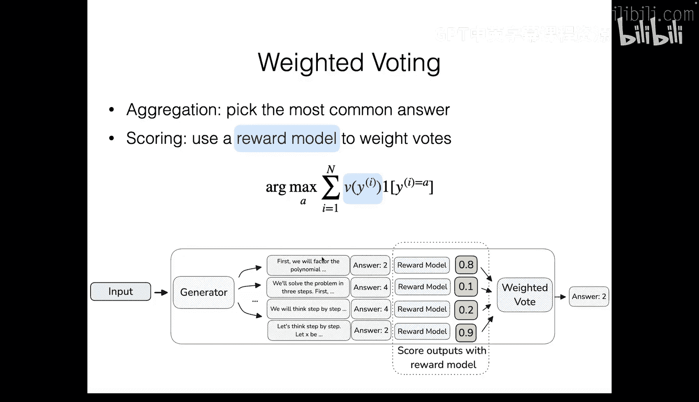

So here's， again， looking at the generative reward modeling paper and you can see that this kind of weighted voting is。

Doing better than the gray， which is the unweighted voting。

And then sometimes this can also do better than best of end。

 so kind of averaging over multiple outputs or aggregating over multiple outputs。

Could be better than just picking the best output。

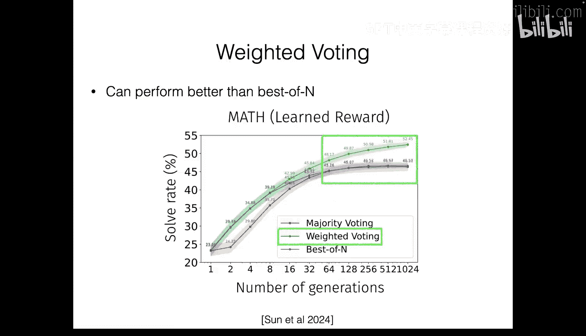

So if you want to think about what this is doing in kind of principled way。Then well。

 first kind of intuitively， what it's doing is if you imagine you have these multiple chains of thought and then you have some answers。

Then in some sense， it's kind of averaging over or it's。

It's kind of summing over marginalizing out the intermediate reasoning chains that are leading to an answer。

So this is from one of our papers， you can actually kind of formalize this idea and you can show that as the number of candidates goes to infinity。

tThen the voting accuracy will converge to distinction here。

And it's basically formalizing this idea here。 So what it's saying is it's the accuracy that you get。

If you kind of sum over or marginalize out every intermediate reasoning path。Okay。

 so it's this kind of nice idea that， you know， if you have enough samples。

 then it's in some sense saying。Let's take all of the probability mass that the model is assigning to an answer if you kind of consider all of the different you possible chains of thought leading to that answer。

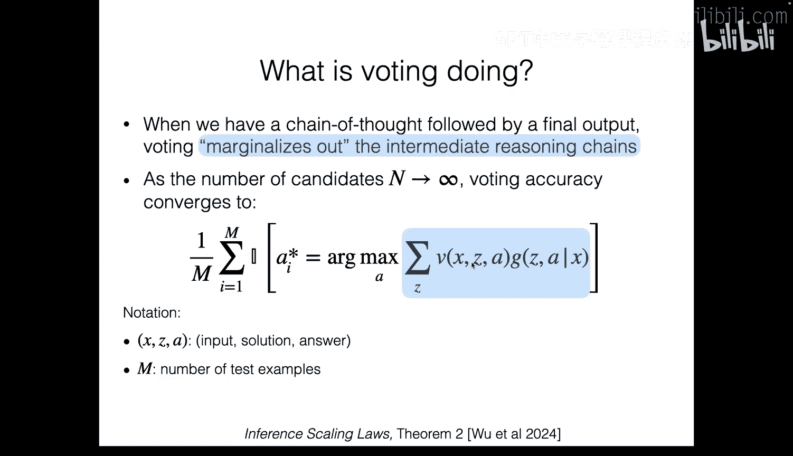

You can also look at this and see like when is weighted voting better than voting？Well。

 here you can see that it occurs when your reward model is in some sense good。

 so in particular if it assigns more mass to the correct answers than just your generator by itself。

And then the other thing is like， you know， you probably notice that the curves are kind of leveling off。

And this says that， you know， maybe that's not too surprising because。

This is saying that the accuracy will converge to this thing here。

And so unless you have an extremely good ro model or an extremely good generator。

 then this accuracy is going to be lower than one。 And you kind of can't do much better。

By doing this majority voting。Okay， so there's basically two ways to improve。

 you could either try to train a better reward model that'll push up this what it converges to。

And or you can try to improve the generator， so train a better model。

 use a bigger model something like that。

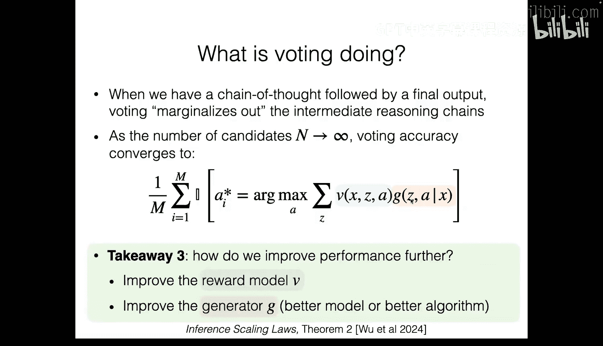

Okay， so that's it for the parallel methods and so next we're going to go into the refinement methods。

Okay， so refinement is maybe like it sounds。 So here the idea is。

We are going to try to generate and then in some sense， try to refine or try to correct an output。

So like here the model generates two plus two plus5。

If we had a really good refinement model or corrector， then maybe a we。You know， generate a。

Better output。And then here it's not showing this kind of loop。

 but it's this kind of recursive procedure where you call this in a loop so you could try to refine multiple times and then eventually stop and and。

哦。You know， either consider all the outputs or choose the final output。

So usually the way this is thought about is you want to also feed in some feedback。

So here we would maybe generate an output and then from somewhere get feedback that this output is incorrect。

And then you can imagine that like if you're able to get this feedback now maybe the job of the refinement model or the corrector is much easier now it kind of knows that the solution is incorrect and it can try to you know correct the mistakes and produce a better one。

So the key question is where does this feedback come from and how does that kind of impact performance？

So it turns out that the。Whetherather refinement works well really depends a lot on the feedback。

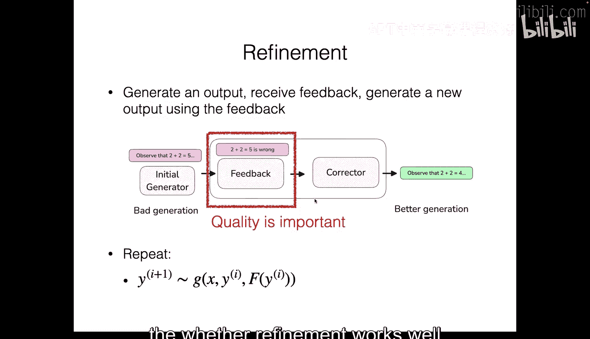

And so you could think of it in kind of two different categories。

You could have what's called extrinsic feedback， so this is saying that kind of intuitively new information is entering this refinement loop through the feedback。

And then intrinsic is trying to say that there's no external information。

 so the model is maybe trying to produce feedback on its own outputs and then refine accordingly。So。

There's been several different successes with extrinsic feedback and so this refinement can work well if you have good extrinic feedback。

So what are some things that constitute good， Well， again。

 it should kind of add new information that the model maybe doesn't have access to。

So we'll see some examples of that。It should not be noisy， it should be kind of accurate。

And then it also turns out to be helpful if the feedback is kind of specific。 So again。

 you could imagine now the refinement step kind of knows what it what it specifically what it should fix。

So try to localize the error or give it some specific aspect that the model should refine。

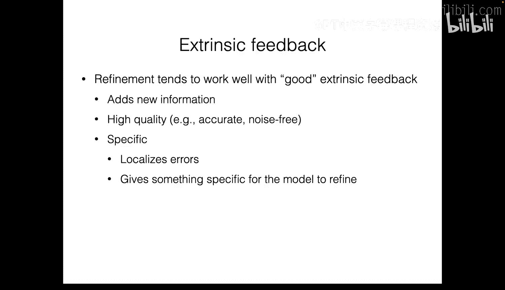

So one of the you know probably most common use of refinement is in cogen。

 so here you can get various sources of exns of feedback so for instance。

 here's one of the early papers that did this called self debugging。

And so what they do is they like produce some code and then they you assume that you're allowed to run test cases。

And then get the feedback from the test cases。And then given that feedback。

 you could try to kind of revise the output。Okay， so here there's some external information coming in from the test case。

And they also tried to have the model come up with an explanation of the code。

So that's maybe more intrinsic。And I guess here they got some gains， but you could see that。

It's kind of。Less gains than you got from the extrinsic results。

And then here they're comparing it against kind of doing best event。So in their case。

 they're able to get this kind of。You know， improvement over doing best event。

So here the results are maybe kind of simple in some sense。

 but this idea kind of took off and this is used a lot in cogen。

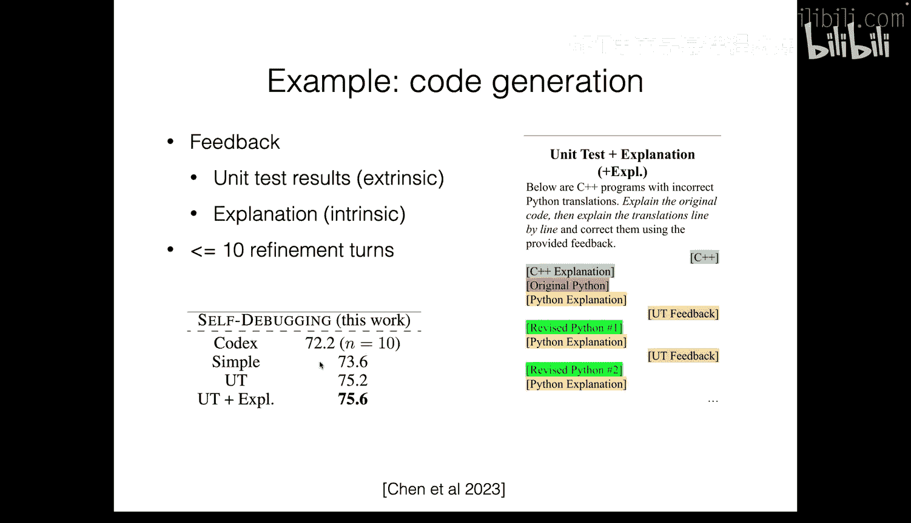

So here's an example from one of our papers where we were in the setting called formally verified Co generation。

So here this is another one of these nice settings where you have this perfect verifier。

So here you basically have some code and you can run the formal verifier。

 and it tells you whether the code。Meets the formal specification or not。

So it's even stronger feedback than you get from test cases。

And then these verifiers are also this verifier for rust。

 you can also see that it's kind of even localizing this error。

 it's like highlighting part of the rust code。And then when you use this with refinement。

 it turns out to be very effective。 So in this example， the you can see that the。

Feedback that we got is actually relevant to this line。

 and then it turns out that the refinement actually fixed something you know right near by that line and it's able to then pass the verifier。

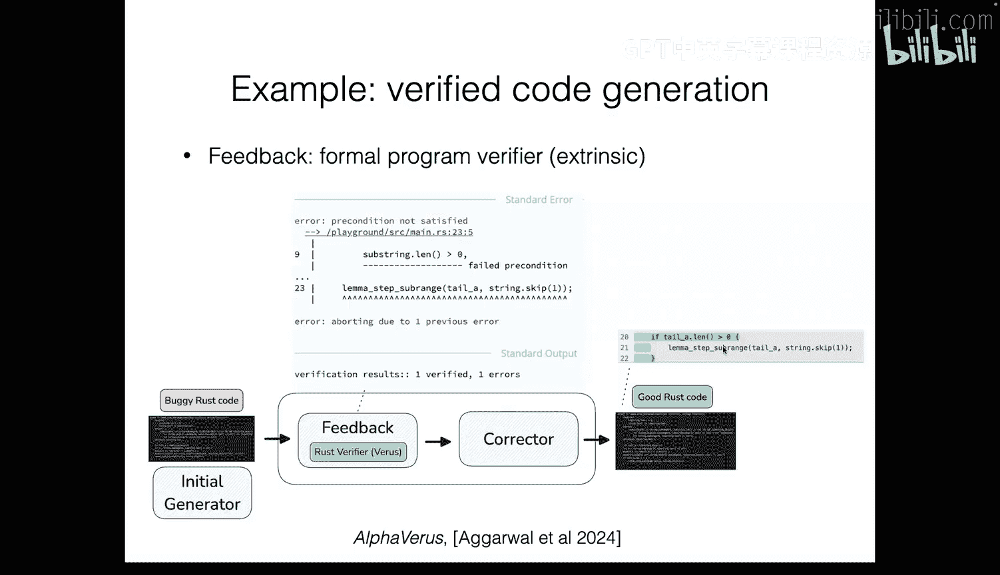

So here's a kind of cool result where you can try doing more and more parallel sampling and eventually you stop getting gains from it。

Then you can take like， you know， the best output you've found so far and you could do the refinement。

And so this really clearly shows that the refinement is kind of doing something on top of what you can get from just the best event。

 even with a perfect verifier。So yeah， again， there's been several success cases when you have this kind of good extrinsic feedback。

And so。Yeah， this is definitely something to to know about maybe it's like relevant for your project as well。

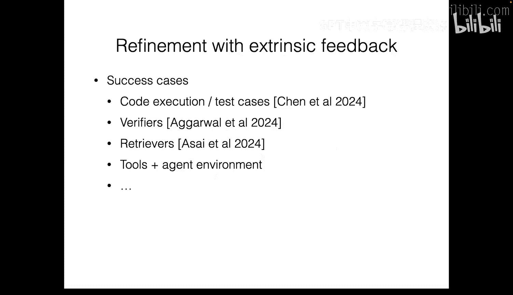

Now the other question is， can you use kind of purely， can you have a purely like extrinsic system？

So you could try to just repromp the same model to like generate， produce feedback。

 and to correct or refine。嗯。And here the results have been more mixed。So generally speaking。

 it is possible to get this to work on tasks that are kind of easy to evaluate。So for instance。

 let's say that your model produces。You know， some some summary and you want it to have 10 citations in the output。

And the model produces like a really good summary， but it only has nine citations。

Well then maybe you don't necessarily want to like regenerate and do parallel sampling instead the model can easily kind of go through a checklist and see oh this you know this is good。

 oh it only has nine out of 10， let me just do a little bit of refinement。

So in those kind of settings， the intrinsic refinement can even be you know， a bit effective。

Now if you look at like the models。Kind of capabilities。

 maybe like it's reasoning capabilities and you're trying to get really high accuracy on a data set。

Then there it's been less clear， so here there's this paper looking at this for mathematical reasoning。

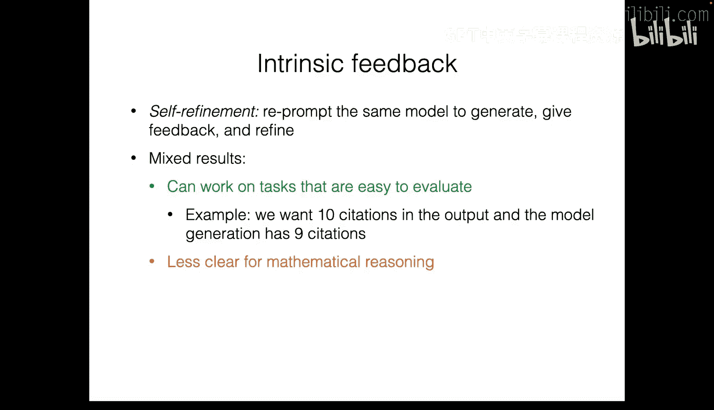

And again， all of these fine things are based on you know a specific model and models kind of change over time as well。

But here， at least they found that the so here the model was trying to say， like。

 let me look at the solution that I just produced。Let me try to tell whether it's cracked or incorrected and then refine。

And they basically found that the model was just as often kind of going from a solution that was already corrected to an incorrect solution as it was going from an incorrect to a correct solution。

Okay， so here it wasn't really working that well。嗯。Another thing that turns out to be really。

Important is the model has to also know the kind of criterion for the task。

So I didn't put it in here because it's not on archive yet。

 but we'll have another paper that's coming out and we basically looked at a bunch of different tasks。

And they could be very open into tasks， like。Writing essays， things like that。

And if the model kind of knows which aspects of the essays are relevant for evaluation and what it is currently got wrong。

 then the models can actually be very effective at refinement。

If they're not able to reliably detect whether whether they're wrong， that's bad。

 and then also if they kind of don't know the specific criteria that it's going to be evaluated with。

 then they kind of struggle to maybe like refine in the in the right direction， in some sense。

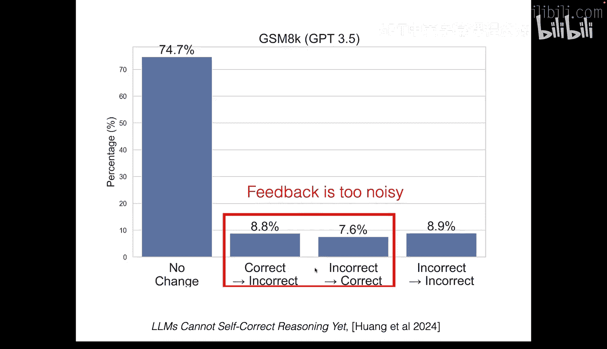

So here's a kind of toy model for thinking about this。

 so we had this tutorial and this was from the tutorial。

So you can kind of simulate what's happening here with even just not a large language model。

So here the goal is to generate。This sequence， Taylor Swift。

And so at the time we were giving this tutorial， Taylor Swift was actually performing in the same like had a concert in the same city。

 so it's kind of relevant example， but so here we just have a really simple unigram model that just produces one character。

And so basically， if you try to sample these characters independently。

 you're almost never going to you know， get the sequence Taylor Swift。Again。

 this this model doesn't have access to the other characters。

 You just have to hope that everything kind of aligns and you get the the output。

And so you can see that here。That's what this red line is showing。嗯。

Now you can imagine having some feedback， which is like。

 what if the model knew exactly which character positions are incorrect。Well， then in that case。

 even with， you know， this really naive model， maybe eventually the model gets a few characters correct。

And。Then you could try to refine by saying like， let's keep the characters that are corrected the same and only resample the incorrect characters。

Okay， and so what you could see here is that if you have this kind of perfect knowledge of which characters are incorrect。

And if you only refine the relevant things， which is kind of what I was saying before。

Then you can almost get like you can get basically perfect performance and have a model that eventually generates the output。

Then the question is like what if the feedback is a bit noisy。

 which is something we've been talking about， well then it turns out that you can kind of control how well the refinement works so if you add a bit of noise then you can't get the funnel output and if your feedback is very noisy then it's even worse than doing a kind of best event。

Okay， so it's a nice kind of toy。😊，Model for thinking about the refinement a lot comes down to kind of how good the feedback is and then kind of whether the model knows specifically what it should kind of refine in the next step。

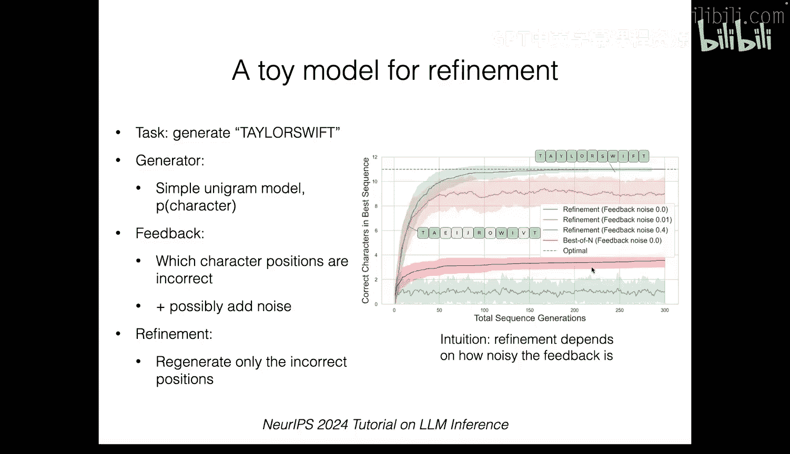

Okay， so those were the two patterns that I was going to talk about。

 maybe let me pause for questions before going to the next section。嗯是。

Some of the strategies that you've seen to help the model be able to generate good targeted types of feedback but look is it mainly a often who we need to ask it that these are kind of the criteria I have in mine or like ask it to have all of that or like what kind of strategies that I use。

Yeah， so I mean really the thing that's best is to have the evaluator or the feedback be in some sense like different from the model So again if you can get this like extrinsic source of feedback then the refinement will work pretty well because you could imagine that like otherwise then you could just repromp your generator to say oh before you yeah you know before you produce a final output。

 go back and look at your solution and critique it and then produce the final output so you can almost like fold one of these intrinsic feedback functions into the generator so that's maybe one reason why having something extrinsic can be really important。

Otherwise， again， if you have kind of simple objective things。

 then it really helps to have a kind of checklist of items and so then the model can go and look through and say like。

Okay， this thing is met， this thing is met， this thing is not met。

 and again there you could have it kind of clean up these small errors and output。

 and that's another thing that's used。嗯哼。😊，嗯。Okay， so even with removing the other sections where we'll probably run out of time。

 but let me just briefly talk about these this idea of inference scaling laws。

So here at the beginning， I mentioned this idea of， you know。

 you could either decide whether to have a large model and generate more or have a smaller model and generate less。

That's going to be the basic thing that's being studied here。

So here we have this idea of an inference cost and the inference cost will depend on how large the model is that you're generating from and times how many tokens are being generated。

And then you could say kind of what is the optimal configuration given some inference budget and a given strategy。

Okay， so if you think about it， then this is kind of similar to what we were talking about before with pre training。

 with pre training， we were thinking about how do we kind of choose the number of tokens that we're going to train on and the size of the model so that we have a compute optimal choice。

You could think about a similar thing here， which is like how many tokens should you generate or what model size should you have？

And at any particular compute budget， you'll have some optimal choice of model size and number of tokens to generate。

Now what you can do is you can try to like for many different model sizes。

 try to generate many different varying amounts of tokens。

And then you can kind of trace out these curves。And have this frontier of what is optimal。

And if you remember from when we talked about scaling laws briefly。

Then kind of some analytical form for this compute optimal frontier will be an example of a scaling law。

 so you could say like you know error is smoothly decreasing as long as you optimally allocate the compute budget according to this scaling law。

 something like that。

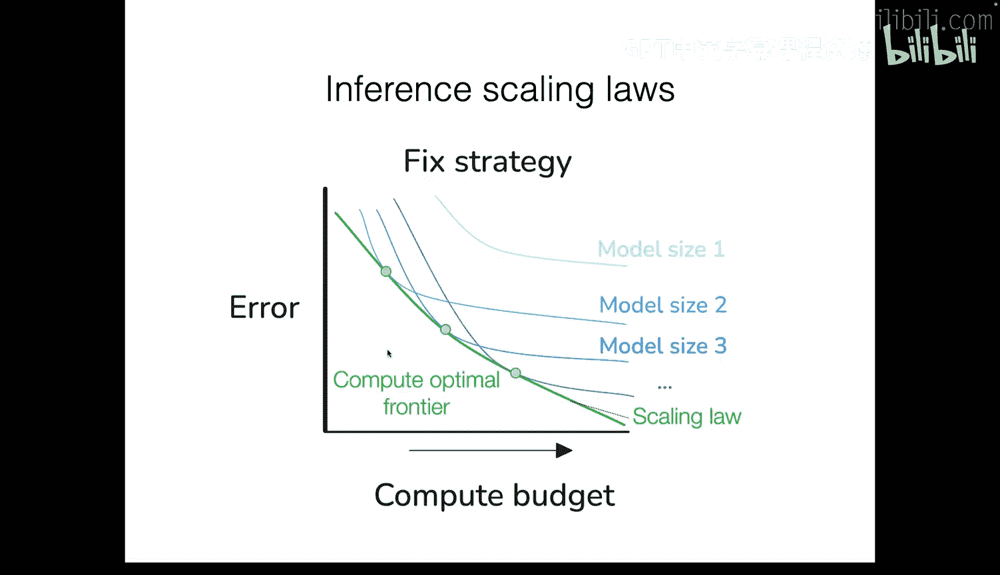

So。This is again from one of。From one of our papers and some other groups we're looking into this at similar times。

And so here what we did is to actually try to generate some of these curves that I'll show you in practice。

So here this is looking at this GSMAK data set。And you could basically try different model sizes and try to generate more and more with them。

 you could use something like majority voting， or you could try to introduce a reward model and use a different strategy。

And you see these kind of interesting trade offs come up， which is like for some inference budgets。

 say you're generating like 32 or 128。Then it was actually better to use a smaller model。

Than to use the like largest model that was available because for this given budget。

 you'd have to generate less with a larger model， things like that。Okay。

 so you could kind of have this notion of， you know， based on your compute budget。

 it's now not necessarily the best to just use the largest model possible。

 you could try to use one of these inference strategies and maybe use a smaller model。

Now one thing that typically holds in， well， it holds here and it holds in like the other analysis that's been done。

It usually ends up being for the really hard problems best to just use a larger model in the end。

So sometimes the inference technique will help with like easy and medium problems。

And then for the really hard problems， you'll need a model with kind of more， you know。

 capabilities in some sense。So you can see here， the very lowest point on the curve is using the largest model。

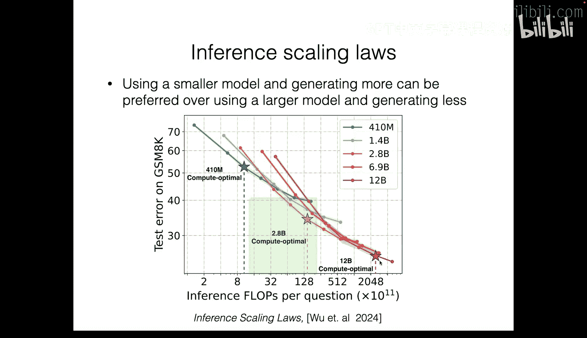

So I guess I just had a brief section on that but I was just going to say that you know nowadays the idea of inference cost is something you consider。

 so now there's like multiple versions of models you know that are released by a given provider and then so based on the setting that you're deploying the model in。

 you could consider like for the queries that I'm get typically getting doesn't make sense to deploy the smaller model and deploy the larger model。

And then if it is in some setting where you have， you know， a ro model， something like that。

 you can do best then， you can also say， like， well。

 what if we have a smaller model and kind of generate more with it， that type of thing。嗯。Okay。

 so then just in the name of time， let's go to the the last section。So here again。

 you could think about like， you know， I've been explaining these different methods which are in some sense。

 kind of hand designed in the sense that we're saying。

 you know we should generate in parallel and then apply this evaluator model or we should do this kind of refinement。

嗯。What you could imagine is like， can you just train the model to kind of search in some sense on its own？

And so that's one way to think about these kind of long chain of thought models。

So here we want to train the model to generate a thought。And now at inference time。

 you could even try to use just really simple， you know， single sample from the model。

But in principle， the model can basically learn whatever it wants in order to get a correct final answer at the end。

So it could even learn like different search algorithms， like trying different alternatives。

It could even learn how to do kind of self refinement， things like that， at least in principle。So。

This， we went over in the reinforcement learning lecture。

 so we looked at a way of training a model to do this， to produce a really long chain of thought。

And it's basically producing chains of thought that ultimately maximize the reward， right。

 so using reinforcement learning。And what they found in the steep Sea paper that you know。

 using the way that they trained the model， the length of the thought was increasing and that kind of correlated with the accuracy。

Again， you can also see that it's also still somewhat compliment。

 you can still apply the self consistency if you want。And then again。

 the interesting thing was that at least qualitatively， when you look at the outputs。

 the model had learned these kind of different search strategies in some sense。

Like here it was saying， wait。That's an aha moment I can flag here。

Let's reevaluate this step by step， so it's kind of doing some kind of self evaluation and maybe changing its strategy after a certain number of tokens。

And so right when these models came out， I guess this was last semester。

One of the students in my group， Weihua， I think he might have used GVT or something to do this。

 but basically pasted a lot of these trajectories from the model and then you can kind of cluster different things that the model' is doing。

And you can see that at least qualitatively， we don't know what computation is actually occurring like inside the language model。

 but you can see these different things that are surfaced in the chain of thought。

Where it's kind of branching， it's backtracking， retrying。 It has some kind of uncertainty。

 It's trying to to。Verify on a own。Or。Synthesis， so this is maybe some analogy to you know。

 looking at everything that's done and then you kind of put it together at the end to some final answer。

So this was a really kind of interesting phenomena， especially at the time。

 a lot of people were trying to really push in the direction of designing a like sophisticated inference algorithm。

And then when the long chain of thought models came out。

 it I think you know made people rethink that and then nowadays there's kind of a lot of simple inference algorithms that are used like the self consistency。

 bestav event， things like that。And it can be kind of complementary to the long chain of thought method。

Now the question is like， is long change of thought necessarily important？

So there's been kind of tons of papers on this since the， especially the deep seek model came out。

 and so there would be like several different topics to discuss。So here I want to just mention。

 again， what I briefly mentioned at the starting。Which is like， can you try to control the length。

And if you're able to control the length， maybe does it。Kind of give you this trade off of accuracy。

So here I showed this plot before and let me just talk through what they're doing here。

So here they came up with a simple method of。You know you could imagine the model is generating and then you want it to adhere to some length budget。

So you could just manually say put in the word final answer or put in the token's final answer。

 and then it kind of forces it to answer。Or let's say that it's about to answer。

 then you can just put in a token that says weight。

 and then that turns out the model will just keep generating longer。

So here they're able to do this trick， they call it budget forcing。

And they're able to control the kind of thinking time or number of tokens that are generated。

And you can see that at least here， this corresponds to kind of trading off the。The accuracy。嗯。Oh。

 I put this in the wrong order， so then yeah， this is the method I was telling you about before。

So then we basically train the model specifically to adhere to a length constraint。

 So the idea is in the prompt， you could say use up to you know n tokens。

And then basically in the reward function， instead of just having correctness。

 you could have some penalty if the model doesn't adhere to the constraint， so like if it goes over。

You could either say。Use up to 2000 tokens， so then it's fine if the model answers in 100 tokens。

Or you could have an exact version that's this L1 exact where you penalize it if it。

Kind of is far away from the。报只的一个人。Okay， so here this gets optimized by the model and then it turns out to be pretty good at adhering to these budgets。

And so now you can control the model again。And again。

 you see this kind of correlation between the tokens that are used and the pass rate。

Now as I mentioned there's like tons of papers on the now so people are also investigating kind of dynamic dynamically allocating the minimal amount that you need。

 so for instance the model could say oh this is an easy problem I'm going to use less tokens。

 this is a hard problem we need more， things like that。But we're basically out of time。

 so we managed to get through everything in the lecture though。

 so we went over some of these test time scaling strategies talked about generating multiple times and generating longer outputs and so hopefully you have some sense of all these different techniques and you can start reading the recent papers in this area because all of these things are still really active area of research。

Okay， that's it for today。 and thanks I'll see you on Tuesday。

