# CMU《高级自然语言处理｜CS11-711 Advanced NLP Fall 2025》中英字幕 - P2：(2)_ Learned Representations.zh_en - GPT中英字幕课程资源 - BV1ZWYAzuEMa

So today's class is going to be about learned representations and we're going to kind of continue the story from last lecture and start to go into a bit more detail。

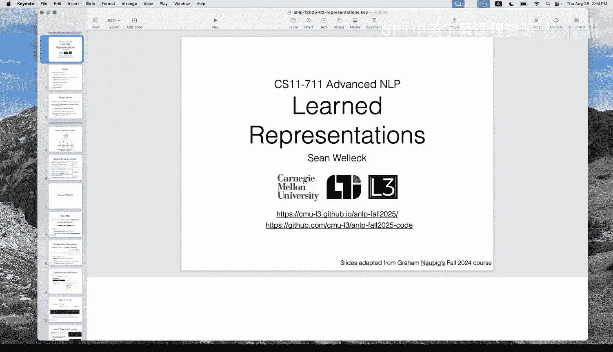

So if you remember from last lecture。We I apologize is a bit small。

 I talked about this idea of learning the scoring function。

 so something that can score the compatibility between an input X and an output Y so for example X might be some sentence or some document and then Y might be some class like is this positive movie review of the negative movie review whatever you want。

And then I briefly mentioned how you can， if you have a really good scoring function。

 you can actually form one of these probabilistic models by just making things by just normalizing the scores。

 and then you can get a probabilistic model。And then I introduced these kind of three different ingredients。

 so parameterization， we could also use the word modeling。

So this is basically what decisions do you make about how you compute this scoring function in the first place。

 like what neural network architecture you're using。

 do you have kind of different assumptions on the form and things like that？

Then I talked about learning， so setting the parameters， using supervision， and then inference。

So in last class we saw this kind of really simple example of a classification model and it was based on this model called bag of Word。

 and if you remember it was kind of naive， it basically just like looked up the identity of different words and then summed them together。

And then just briefly， we saw this algorithm， it was called structured perceptron。

 we won't go into that you know pretty much anymore but you saw it and it trained really fast and then you can get a model at the end。

And then to actually make a decision with the model。

 you use the simple strategy of kind of taking the highest scoring class。

So that's what we covered last time， and then this time we'll kind of build this into something more realistic。

So again， here we're going to still focus in this class on classification and very soon we'll get to things like generating you full strings of text。

And we're going to go over kind of three main things that actually turn out to appear in some form in basically any state of the art system。

So some of this might be a review， but even if you've seen it before it's good to see again and then if you haven't seen it。

 this is a kind of advanced class so the class is going to go fairly quick。

 so definitely take time to spend more time in this。After the course， if it's not clear。

 and we also provide these kind of Jupiter notebooks that I won't have time to go through。

Fully in today's class， but you can go through yourself to clarify things further。

So we'll talk about what are called continuous representations of cellboards， rather than words。

We'll talk about using neural networks。And then we will talk about the details of learning。

 so optimizing the loss function。By taking gradients and using back propagation and gradient descent。

Okay， so yeah， last class we saw this bag of words and as I mentioned earlier。

 I apologize they don't have the mouse here， I think there's some setting I have to activate。

 but anyways。嗯。So here for each word we are looking it up in this vocabulary and then you basically get this one hot vector。

 so everything is zero and then you have a one in corresponding to the word position。

 and then we just add them up and get this feature vector and then take a weighted sum。

And we saw some downsides of this last time， so it's difficult to handle these conjugated words。

It's you don't really have any notion of word similarity。

 So like with synonyms or or things like that。And then it actually gets tricky to kind of combine multiple features together。

 So at the very end you have this weighted sum， which。You know， might lead to some combination。

 but you don't really have this very sophisticated or rich combination of different features。

 like if the word love is present and don't is present and also taking into account the kind of position of each。

And then on the note about taking into account the positions， again。

 the bag of words just sums everything together， and so it gets really hard to kind of model the sentence structure。

Okay。So yeah， today we're going to talk about a few techniques that will allow us to overcome some of these。

We'll actually need the sequence architectures like RNNs， transformers。

 things like that to handle the structure。世lo表。2 lectures for now， something like that。Okay。

 so first we're going to go to these subboard models and also the problem of tokenization。

So here the basic idea is we want to take our different words。

And we want to split them into multiple tokens。So for instance， let's say we have the sentence。

The companies are expanding。Then what we're going to do is we're going to use some algorithm and the algorithm will give us this thing on the bottom。

And it's basically saying that， okay， the word companies is actually going to be split up into these two different。

 they're called tokens。Similarly， with expanding， it's going to split it up into these two tokens。

So can anyone think of an advantage just based on this very simple description。

 I didn't say how this works， but a potential advantage of splitting things up becauseus？

You get to share information whenever these reus in different contexts Yeah exactly so for instance yeah there's information sharing so for instance this ING at the end probably appears in a lot of different places and so the model can potentially learn something reusable or shared about that similarly expand might be an expanded not just expanding and so the model could potentially learn something about that and share information。

🤧嗯。Also， when you think about it， suppose we have like the entire internet。

And then we create this vocabulary， so vocabulary means set of all tokens。

Let's say we create this vocabulary with every possible word on the Internet。

Then can anyone think of an issue with that？I guess maybe the answer is on here。你点用见没。Yeah。

 so basically here we have a vector。And the size of the vector is the size of the vocabulary。

And so if you just take all these words， then this factor would be huge。

 your vocabulary would be massive， and then any particular element in that vocabulary。

 you might not actually see that much training data for it。 It might just be some weird word。

 And so this will again， allow us to share information among a smaller number of tokens。

 and thatll also reduce the kind of computational costs。

And so the core problem that is related to this， and you have to think about this like in。

Yeah in state of the art models too is how you do what's called tokenization。

 so tokenization means you want to map this sequence of data or state this raw data。

 so here it's some text。Into these discrete tokens， from some vocabulary。Okay。

 so that process is called tokenization， you can also kind of detokenize in the sense that you might have these discrete tokens and then you want to map back to your kind of raw data form。

And yeah， you can see here that's there's multiple choices you can make。

 you could tokenize based on white space。You could do some kind of subboard strategy you could tokenize based on these individual characters。

And when you think about it。There's at least two things that you want from your vocabulary or from your tokenization strategy。

So the first thing you want is that you want to be able to represent any text with your tokenization strategy。

So can anyone tell me an issue with splitting words by this white space in between words？

Many languages don't have exactly， so many languages don't have those。

 so most of the time you would just get an entire token for a whole sentence or something like that。

And then similarly， you might not want to do something specific to even natural language because nowadays we want these models to work on code。

 We want them to work on。Basically， like anything we， you know， copy and paste into chat GT。嗯。

And on the other hand， you want it to be very efficient。So you don't want it to be too large。

 I already discussed this because then you'll have to store this really large vocabulary and learn about each element。

But you also don't want it to be too small and we'll see an example of this in a bit。

What can happen is， let's say here you split on each character。

Then the length of your sequence gets really large and so this could require a lot of computational costs then to kind of process the sequence。

So in practice， you want to find something kind of in the middle。嗯。

And we could take a look at some how some actual language models do this tokenization。

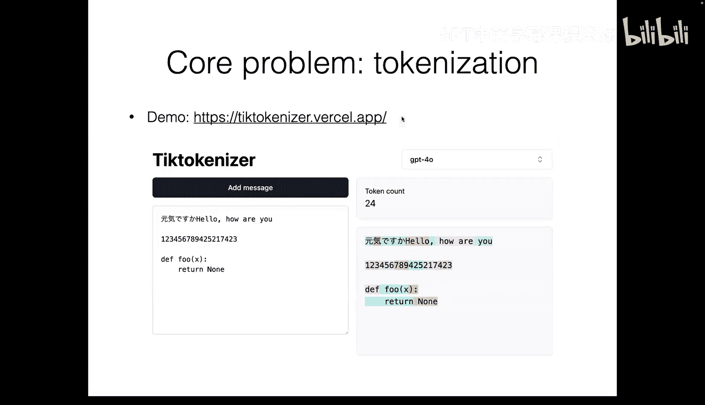

Not like the algorithm that they use， but just the kind of results。

So here's this cool website if you haven't seen it before called T tokenizer。And so up here。

 you can look up these different models。So like here's the GP4 model。

 we'll go over this if you haven't seen this before later。

But this is basically the formatting that you use to get it to be a kind of chat bot。

But then you can type different stuff like。I don't know。 advanceance N LP。It is awesome。

And so what this is showing you here is how it is being tokenized so you can see this word advanced。

Is turned into just one token and it's the number。63663 in the vocabulary。So you can see they have a。

 I mean， their vocabulary is at least。😊，I mean， assuming they have all the numbers filled in。

 then you can get a sense of the size of vocabulary。

And you can get a sense of how things are being tokenized。So an interesting thing is like one， two。

 three， four， five。So different models will have different ways of tokenizing numbers， especially。

Maybe they do something where they tokenize up to。Three， so just as an example。

Let's take a look at this model。So you can see here it's much different here they chose to。

Only sorry， tokenized。Each digit individually。And so this is a kind of rule that they probably hard cuted into their tokenization strategy。

So anyways you can kind of see why this is important。

 it's basically determining what will the input be to our machine learning system。

It determines the length of the sequence。It could determine yeah。

 kind of differences between how different numbers are represented and things like that。M哼。😊。

One examples for the first three forclock？I think each there are always yellow buildings right。

 but the second time between four and five shows up。一是。Yeah。

 so I think the it's just the color is deceptive。So I think they're still individual。

Ca this one is two9，9， four so， and then this one is 29，945。Yeah。O。嗯。Yeah，所真的是。Yeah。

 this one is something is something different。嗯。

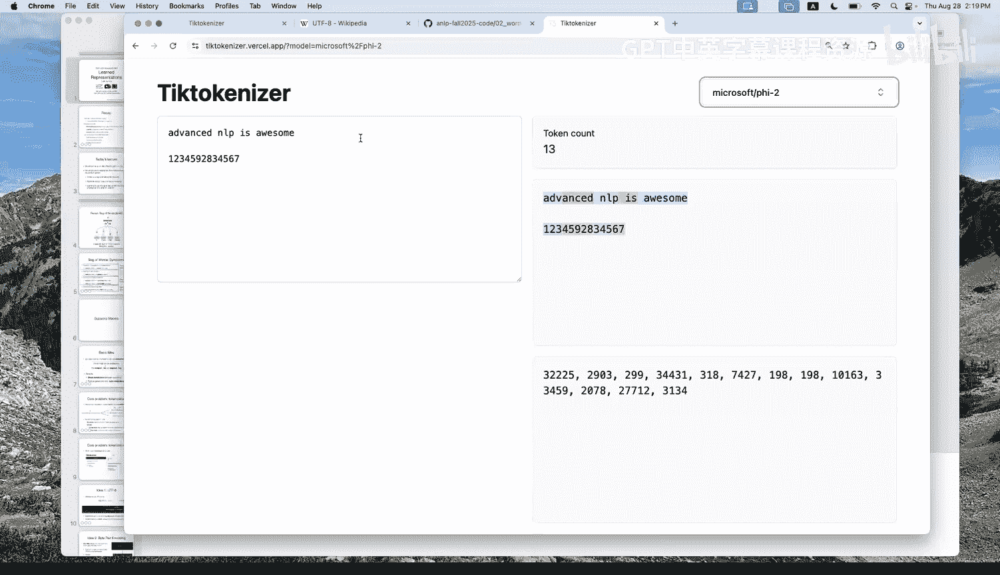

So anyways， yeah， this is definitely something to know about and be aware of and so the question is how do you actually do this？

嗯。Well， first， what you could do is start with。The most。

So I mentioned having an expressive vocabulary that means you can represent anything。

And one that's efficient。 So one strategy is to start off as expressive as possible。And basically。

 the most expressive thing you can do is to represent text as what are called UTFA bytes。

So basically when you write text， like here we have Japanese and we have some English。

Then these will at first be represented as these Uniicode characters。

But then there's a lot of different Uniiccode characters right there has to be like one for each different kanji and Japanese。

 each English and whatever like any language that's supported。

 and so the size of the number of Uniicode characters starts to grow。

So then basically what happens is each Uniiccode character will be translated into these bytes and so each individual character can actually be represented。

As between one and four numbers。That are between 0 and 256。Okay。

 so you can actually go into Python and and do this so here you can see this text and then we're encoding it as。

UTF8， and then you can print out the different numbers and you can see for this kind of simple string。

 it turns into this really long sequence of numbers that are between zero and 256。So kind of cool。

And the issue again though， is that this will result in very long sequences。

 and so we want to now try to make it more efficient。嗯。

So the key idea that's used in a lot of these different topkenization methods that are even used for。

The state of the art models。Is called Bte pair encoding。And the kind of core idea is very simple。

So what you do is you have some training set of data。

And then you go over and you look and you count up each pair consecutive pair of tokens。

So like here we have。Let's say we're using just like English letters as I'm talking through this example。

Then here you would have H is next to E， E is next to L， L is next to L， L is next to O， and so on。

 And so you count up the different occurrences of these。Characters。

And then you just select the pair that is occurring most often。

And you introduce a new token to represent that。Pair of tokens。Okay， so for example， here。

 it turns out that the most common pair is actually E plus a space。

So you could see that like the word here ends in E。 and then there's a space。

And that turns out to be the most frequent。So what we'll do is we'll introduce some new token。

And now we can represent E in space as just one token instead of two。Okay。

 so it kind of reduces the sequence length， but it increases the size of your vocabulary。

And that's really the key idea， so then you start with this kind of base vocabulary。

You run this algorithm， it'll keep finding the most common instances and doing these replacements。

And then it'll start to build up this vocabulary of kind of new combined tokens。

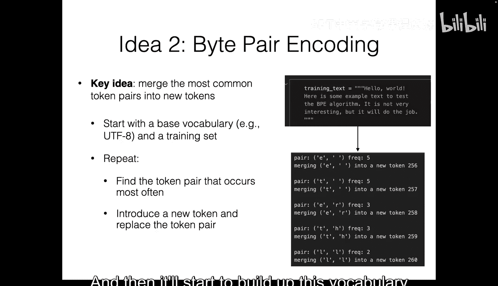

So。

I won't have time to go through the whole notebook。Here during this lecture， but in the course。

A code repository。There's a notebook that goes through this in detail and it's actually based on this this video。

 I don't know if you've heard of。Andre Carpathy。嗯。So yeah。

 he's kind of a well known researcher and he makes he also makes really nice kind of instructive videos that go into a lot of detail。

So I went through and basically。Turn that into a kind of notebook that you can go through and it'll go into a lot of detail if you haven't seen this before and again。

 if you have seen it before， I personally find it pretty interesting。

So here is an actual implementation of the bike pair encoding。

Where it's going through and counting up stuff。And then you can run it on。This text。

 this was about the。Osaka marathon。嗯。And it's kind of long and let's see what you get at the end。

So here it it's just yeah， merg things。嗯。And then。I guess， I don't have the。

Do I have things printed out， Yeah， I I don't have this part printed out。

But then here you can also look at these libraries that have implemented。These algorithms。

So there's a library called Tk token。And it's released by Open A eye。

And it doesn't have the code to train a tokenizer， but it has one to run the tokenizer。

So what you can do is like。Back in the day， Open now。

 you used to release things like their models and their re tokenizers。

So here you can load in the GVT2 tokenizer and actually run it。

Another one that's popular is called sentence piece。

So this one actually allows you to train your own tokenizer and it's actually pretty easy to do。

 actually in this next code example that we'll go into later， it trains its own tokenizer。

So you can see here it's being called。And then this one's actually showing the different。

Tokens that have been learned。And so you can see it learn to group together。These， yeah。

 these characters。嗯。Yeah， so you can see here， so what happens is I was basically training it on one document。

So if you give it a large enough vocabulary size， then it'll actually overfit sometimes。So like one。

 you know， entire words might appear really often and they end up getting like a full token。

 whereas if you run this on really， really large amounts of data。

 then the tokens will be kind of more split apart。But anyways。

 it could be pretty instructive to kind of go through and see how this all works。

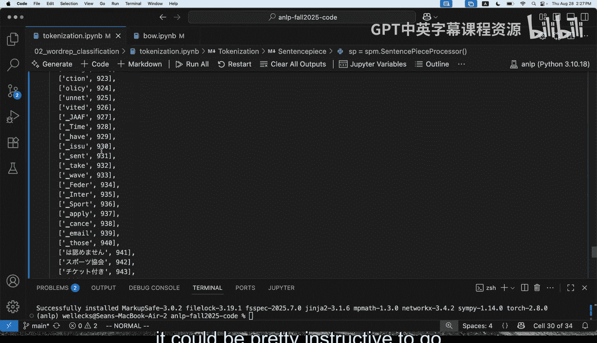

Okay， did anyone have any questions about this before I move on？

because keep onrg will will get very big to yeah， that's a good question。

 So i'm not aware of like all the different。Strategies that people use to decide。

 but what you can do is you can look at different models and models will usually have vocabularies that are in a certain range。

 so like 50，000 or 100，000 or 200，000 so I think sometimes the decision is made based on computational cost。

So when we talk about the language models later， it turns out that this initial。

 actually I'll actually talk about this in this lecture。

You have to store a vector for each item in your vocabulary。

And so you want to consider like how large is this embedding layer or this lookup table？

And that'll actually have a huge impact on memory， so sometimes the decisions based on computational reasons。

嗯。Yeah，最 hopefully首货嗯。嗯。嗯。怎我我。嗯。So well， so a big thing is you want the tokenizer to be expressive。

If it's not sharing information， let's say between。Like English and another language。

 then you're kind of losing then your model is kind of losing some learning signal and so if you really do have this like vocabulary where。

You know， bytes are being shared between different languages。

 then you can get some even transfer between languages。At least in theory， you know， so。

 so it definitely can。Yeah， it can have an impact。 Another area where you see a lot of impact is with numbers。

Because the model can sometimes they'll be a token for like some really specific number， like 768。

 but not 767。And it'll lead to these weird， like errors and addition and things like that。So yeah。

 it can have a， it can have a big impact on performance。 And then the other thing is that。

This will be later in the course， but when you're really trying to scale up the models。

Then you really want to take into account how many tokens you can kind of train on in a given amount of time。

And so then the sequence length matters a lot。So if you have a really long sequence length。

 then you're going to get through less data than if you have a shorter sequence length， so yeah。

They always retained to how specific the tokenag actually is a do train like a downstream model say hello so what's the general population？

Yeah well I mean one simple thing if you're like designing your own tokenizer is just to make sure that is just a reason through it and say like okay。

 if I'm only using English characters as my base vocabulary then I can't possibly represent like Japanese or something like that so that's like step one and then step two is yeah you probably have to use different diagnostics like the loss。

 the performance and different benchmarks and if you vary the tokenizer you might see differences in some case。

嗯哼嗯。So I have a question about choosing the token ID。

 so is there any kind of difference between like choosing another set of token ID or like that that to be good to figure out in any case？

Yeah， so the， the Is will just be used to kind of identify different。Vors， so the， the。

 the choice of the ideas is doesn't。Doesn't matter It's more like what they represent。

 So whether they represent， you know， a full word， a half word， things like that。嗯。

So only what context windows we measure in terms of the number of tokens in the。

 So how do you compare between the F models because we might be using the tokens like for example GP suppose x similar of tokens in its context windows suppose line numbers So are those numbers really compatible or how do you measure that yeah yeah so it'll I mean。

 it'll vary based on the token。 So yeah， I would look at like what is being used for the comparison my guess is when a company says our model supports this many tokens it means with their tokenizer。

嗯。Yeah。So。You already based other data or like how do you infer which organizations you should go for a this dial also。

Yeah yeah so this one is this algorithm byte pair encoding is a popular one and so this one is really data driven yeah it just merges based on these frequencies in the training corpus。

嗯。Yeah， this would probably work for change， but let's say I want to generalize what I then think about using others organizers。

Yeah， so things you might take into consideration is like so so for BPE。

 it depends on the training data so then one thing you can do is。Manipulate the training data。

So for example， if you have a particular language that appears 0。01% of the time in your corpus。

But you know that your model is going to be deployed to customers in that language or something。

 then you can ups samplele those in the BPE training data。嗯。So， yeah。

 one thing that's done is to kind of be careful about。How like what data the BPE。

Algorithm itself is run on。O。Cool， and then yeah， I talk about these， these numbers。 So， yeah。

 some of the models will just always split individual digits。嗯。So， oh， the larger point here is yet。

 if you look through different papers and things like that。嗯。Sometimes it's not fully data driven。

 you they might have these rules for like different edge cases they found like numbers and things like that。

So。Okay， so as a recap， yeah， I talked about tokenization and subboard models and so now I'll talk about token embeddings。

So here the idea is instead of representing words or now I'll use the word tokens。

As these one hot vectors。Now we want to represent each token as some dense vector continuous embedding。

 so this means that now we have this vector of real numbers。And it's not sparse。

 so there's not a lot of values that are zero， it's just this vector of you know different numbers。

And so here the other difference is instead of having the representation be the size of the entire vocabulary。

Now， we can define this。Ebedding dimension， so the size of this dense vector。

 and it can actually be much smaller if you want than the vocabulary size。

And so the kind of architectural。Way that this is done。

Is to introduce what is called an embedding layer。So in embedding layer。

 you can visualize it like this or you can visualize it。Pin of with Rose。

And it's basically this matrix。And each here， each column in the matrix will be a vector for each vocabulary token。

Okay， so like the first one might be the letter A， the second one might be。The letter be， and so on。

And then。You can have this operation which is like okay， look up a given token index。

 so if the letter B is represented as number two， then you can look up the vector for that token。

And then one thing to just be to know about because you'll see this sometimes。

Is that this is equivalent to multiplying by this one hot vector。So here we start with the1 h vector。

 it's of dimension v。If we multiply with this matrix。

Then you essentially is selecting one column from the matrix。Okay， so。Yeah。

That's the embedding model and we'll talk in a bit on how you actually train so how you actually set。

The parameters of these embedding。 So how you actually set the numbers。

But now we can already imagine making a better version of the bag of words。

Called continuous Baboards。Or potentially better。So here now， what we do is for each given token。

 we look up in our embedding layer， the vector for that token。

And now we can just sum together these vectors and we get this kind of continuous representation or dense representation of the sentence。

So again， this is still kind of naive in the sense that。It's just adding things together。And。

WhenWhen you just add like this， it's discarding the order information in the sentence。

So for example， if you flip the position of hate and this。

That'll actually end up with the same representation as the sentence shown here。

And then to kind of start adding to our vocabulary of these layers。

 another popular one is this linear layer。And so here we're saying that， okay。

 our representation is of dimension D。But ultimately。

 we want to get scores for these K different classes。And so we have to do this transformation。

Which is K by D。And so that will be represented as a matrix， and we'll call that W。So again。

 w could be k by D when you multiply that with this D by one， then you get you K by one。

Then it's also common to add on this bias vector。So that's like after you perform the matrix multiplication。

 you could add on the bias。And then this gives you this linear transformation。Okay。

 so these are this goes by the name of linear layer。And so here。

 the different parameters that we'll want to learn are the embedding layer。So we'll want to learn。

 you know those the red numbers at the bottom。We'll want to learn the weights W and we'll want to learn the bias。

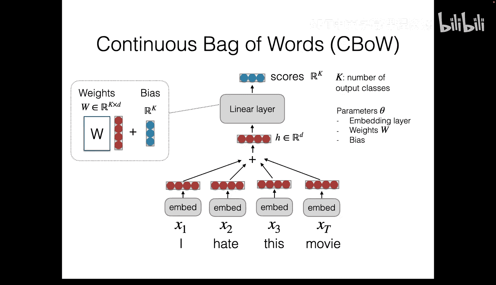

Okay， and then。We can actually implement this in code。

So here this is implementing an embedding table。An bedding layer。And here。

 this isn't an efficient way to do it。嗯。But。Or you know， there's probably more efficient ways。

 but here's just showing you， kind of convincing you that you can do this one hot multiplication。

So here again， we have this vector。And sorry matrix， one dimension is the vocab size。

 one's the embedding size。Then to actually look up， that'll be this forward function。

We'll look up a position X in the embedding table。By multiplying this one hot vector。

 which is what I showed you before。Okay， and now in practice。

 this embedding layer is implemented in libraries like Ptorrch。And they probably do it you。

 in the most efficient way that we know about。Okay。

So then we can actually implement the continuous bag of words model。

 and so now we'll have this embedding layer。And then we'll have this linear layer we can call the output layer。

And then here you can see the forward pass， so performing the computation。We start with our tokens。

 embed them。sum them up。Then you have to make sure things are in the right dimensions。

And then you apply this output layer and ultimately get scores for each output class。Okay， let's see。

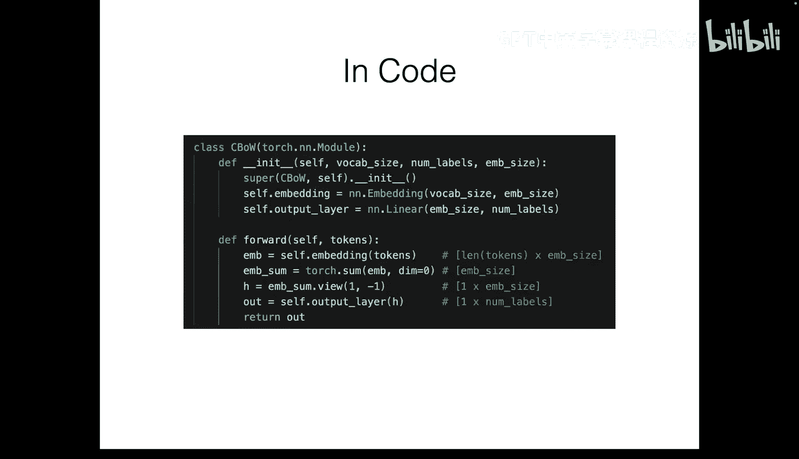

So this， again， will be in the。

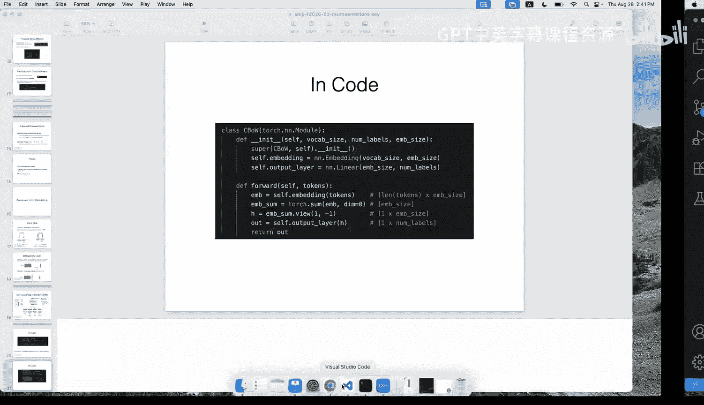

Course repository。So again， if you haven't seen this before。Yeah， I mean。

 you'll need to be familiar with。Pytorch。Things like that， you know， in homework one， you'll have to。

Implement parts of a language model and be pretty familiar with Pytorch。

So if you haven't seen this before， then definitely take some time to kind of get up to speed or refresh yourself if you haven't seen it for a while。

And then if you have seen it， it's kind of fun to go through this。Yeah。

 it's kind of fun to just train the small model on your laptop pretty satisfying。

So here we're doing this sentiment classification and it's with tweets。

 so here's like different tweets， some of them might be offensive I don't it's not me who created the data set I don't remember。

But anyways， then each tweet has a label， so either positive， negative or neutral。

And then this is kind of cool we're actually training our own tokenizer on this data set。

So here's some tokens that you got。And then this is showing loading the data。

And actually implementing this model， and then you can train it。

So I'll come back to this part because we'll talk about the loss function in a bit。

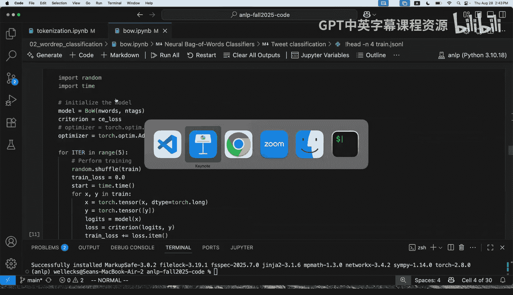

So first。One kind of hope with these continuous representations。

Is that now we can have some notion of similarity。So remember this was like one of the downsides of the previous model。

Now， like at least in principle， suppose that you could have some algorithm which encouraged two vectors to be close together in this。

Continuous vector space。If they're kind of similar in some sense。And so here。

 this assumes that maybe you have some huge data set。

And different words are used kind of interchangeably over the course of looking over all the data。

 So in one sentence， it might use the word great。 And then in a similar context。

 it might use the word excellent。And so。Yeah， as a result。

 the vectors may be pulled close to each other。So I think we'll actually look at。

A numerical example of this at some point to， I think when we're looking at language models。

To convince you that this can happen。But empirically， sometimes you do see this where。Yeah。

 if you look at kind of nearby vectors， then。They end up being kind of similar to each other after running the learning algorithm。

close to each other。Okay， so that was the token embeddings and so next we'll move to the neural networks。

So any questions on this part。Yeah， a good。How can so I think in the approach that we mentioned earlier we were summing the vector side so the wouldn't that aggregation kind of make this kind of visualization kind of mightisy and。

嗯， they。Or so like my question is if we have enough data。

 does that addition of patient kind of get overwritten through that much data or with that class well still have a noy gap。

Yeah， so I mean， one thing to keep in mind is the we're going to run some learning algorithm which sets the numbers for these different vectors。

And so it could be possible that even though you're summing。

 the signal gets back propagated to the individual vector and then similar ones end up having some similar representation。

嗯。Yeah， in other cases， the， the kind of structure the sentence will be more。

Clear and easier to kind of reason about。 but yeah。Okay。嗯。Okay， cool so。Yeah。

 yeah I'm ready to move to deep learning， I think I've had enough with the really simple models。

So next we're going to。So next you're going to talk about neural networks。And here one motivation。

 I mean， this is just one is that what we're going to be able to do is basically stack these different layers together。

And that will let us take advantage of kind of combinations of features。

Or as the kind of information will propagate through the network。

 it can make kind of richer and richer representations。

So if you think about like the first back words model。

 we had to rely on just this final kind of weighted sum。To try to take into account like negation。

 for instance。Okay， and so by introducing these multiple layers， we'll be able to。Yeah。

 take into account these combinations of different features and kind of transform them over time。

So here we have a model which is called deep continuous bag of Words。

And so here we're going to start with the same model as before， same architecture。You know。

 just on the bottom。And then we're going to introduce this layer here and the key difference。

Is we now have this function， which is called10 H。And the other key difference is that we are kind of stacking these layers one after another。

So here， for instance。We have a notion of like the embedding dimension。

 so here it's visualized as four， so we start off with this vector of four dimensions。

And then we have this layer， which is this linear transformation again。

But then it passes through this 10 H function。And this is called the activation function。

Then this can change the dimension if you want， so now we have this dimension RD。

And then we can just keep stacking layers if we want and maybe just keep the dimension the same。

You can also change it if you want。Then again， you have the same output layer or linear layer at the end。

 and ultimately you get these different scores for your different classes。

So does anyone before I show the answer in the next slide， does anyone know why ignore the stacking。

 for instance， right now， Does anyone know。Why this10 H is kind of interesting。

What it might add to this architecture。Without just make what a big matrix yeah exactly。

 so this 10 H the specific choice of10 H isn't too important。

 but the important part is that it's non linear。And so these introduce kind of something new into the architecture。

And they actually make it more expressive。So。嗯。As was mentioned here。

 if you don't have the nonlinearity and you stack these matrix multiple these linear layers together。

 well then that actually is just equivalent to a linear layer and so your learning algorithm can just basically almost you treat it the same as if you just use one layer。

However， if you introduce this nonlinear layer， then again it gets more expressive。

 it can represent a kind of wider class of functions。So here's the kind of。

A nice visualization where it learns this kind of decision boundary。

And it's a circle and it might be difficult to learn that otherwise。But anyways， so this is yeah。

 a really important part of the neural networks and the deep neural networks。

And nowadays we have a lot of different activation functions you'll see some， I guess。

 in detail when you do homework one and you're implementing the。The language model。

 you'll see what activation function they're using there。嗯。

And a good way to see it is just go on Pytorrch and see which ones they have implemented in Pytorrch。

 that typically means like， you know， people are using it。

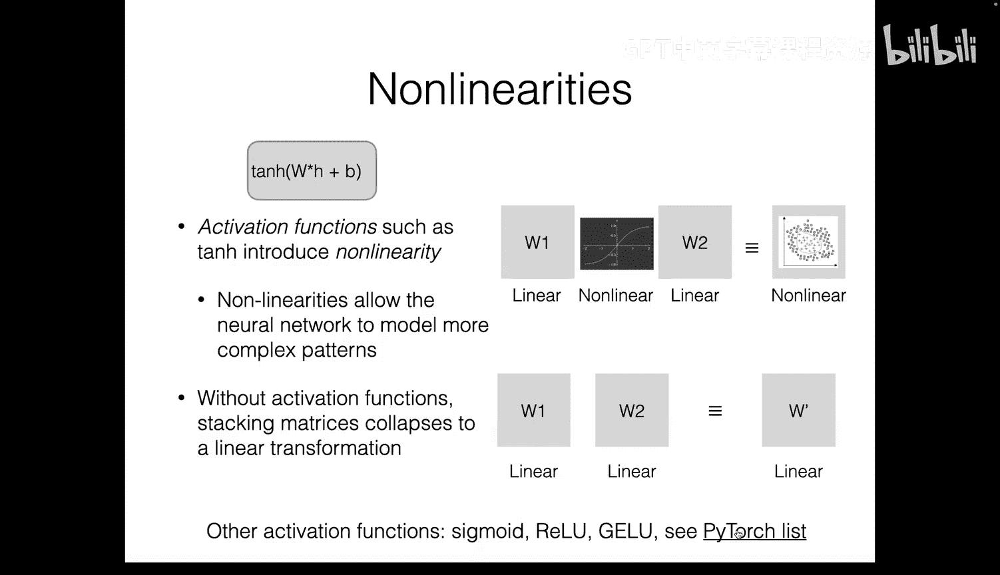

Okay。So that's that。 And so now it's actually the code doesn't change that much。So now we have here。

嗯。This is just。A simple one。 So we just have one layer。It'll be this linear one。And。

Now you could see others a comment new edition。 The only new addition here is you have this torch dot 10 H。

 and then the linear layer。

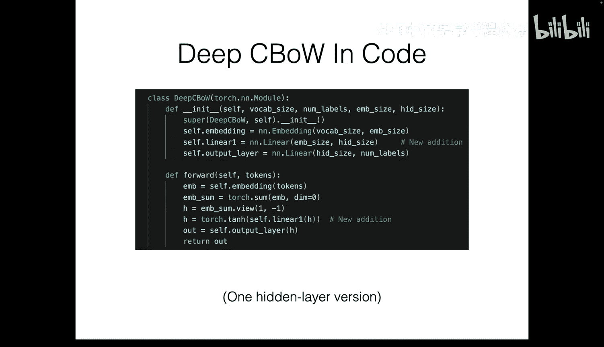

ok 嗯。But the interesting thing is。

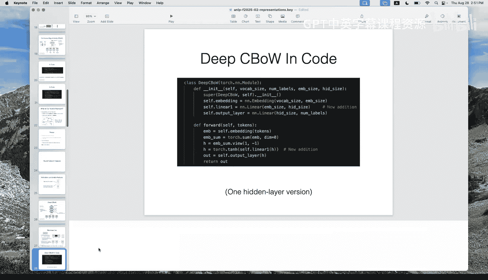

嗯。If you。嗯。If you look at the results。So we'll talk about the loss in training in a bit。

But if we just jump to the results。Then。Here is the accuracy that you get with the。嗯。This was the。

The simple bag of words。And you get what 71% validation accuracy。

If you use this continuous back of wordss， but without the deep layer。嗯。Then， you get。72 or 73。

 a little bit higher。Shes the deep， continuous bagg of words。

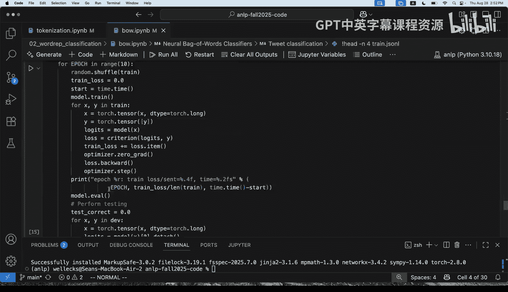

Beautiful， 94%。So you could see here， of course， you could argue that。

 you know maybe there's differences in the training setup。

 but I made a reasonable effort to try to get the best performance setup code。

 but you could see here that even just introducing this one layer with the non nonlinearity lets you have a much better system in the end。

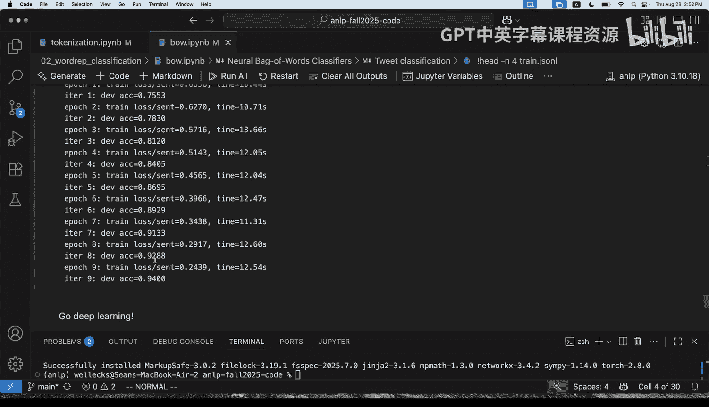

O。So that's kind of fun to go through if you want to see it for yourself and I was just。

 you can run it on your laptop if you have a， you know， reasonable laptop。

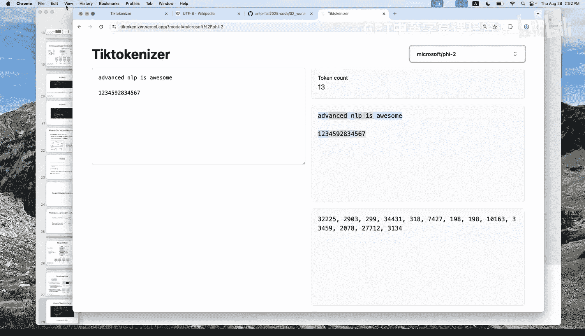

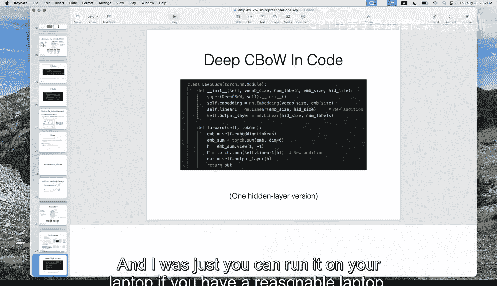

嗯。

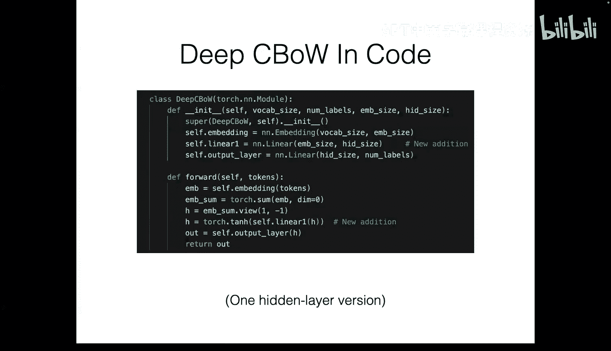

Okay。So。Yeah， so now you can learn things like。嗯。诶你。I mean。

 you can't really interpret everything that the model' is learning。

 but you could kind of reason about in principle what could it learn one thing it could learn is。

 you know， feature one and feature5 are active。 and so in the next layer that's going to be one number。

So that's like combining you know， two pieces of information。And then when you stack that。

 now you can learn maybe some like higher level thing on top of that。Okay。

 so that was a really quick introduction to。The deep， continuous backboards。

And so now we're going to go into some detail about training the neural network models。

So here at a high level， the strategy is to use gradient descent。

So what we're going to do is we're going to write down a loss function。

Or gradient based optimization， I guess， would be more general。

We're going to write down a loss function。They we're going to calculate gradients or kind of know derivatives of the loss function with respect to the model's parameters。

Then we're going to move the parameters in the direction that reduces the loss function the most。

Okay， so that's the kind of high level idea。 again。

 the goal is to reduce this loss function and you do it by kind of。

Calculating these gradients and then adding them to the parameters。So an example， a loss function。

I'm going to go through two here and I'm introducing these two because this cross entropy loss comes up all the time。

 it'll be not the binary， but the cross entropy will be used to train even like the large language models and things like that。

 so it's really good to be familiar with these and kind of get an intuition for what's happening。

But here we're just going to start with something simple， which is binary cross entropy。

 So let's say we want to classify these tweets into either positive or negative。

Then what we're going to do is。We're going to have the model output， the single score。

And we're going to interpret it as being a probability of the positive class。So。

I guess maybe the neural network doesn't necessarily care about how we interpret it。

 but we have to make sure that it's between zero and1 because then it can't possibly be。诶。You know。

 valid。So here what you do is use this activation function， which is called sigmoid。

 and this will just ensure that your outputs are between zero and 1。Okay。

 so now we can start interpreting this as interpreting the output of the network as a probability。嗯。

And so now we assume that we have some label， so the label will either be zero or one in our training data。

And the question is， how do we form some loss function？

So this binary cross entropy loss looks like this on the right， and you can see the loss。

Written there below。And the kind of easy way to or like a good way to look at this is just look at one thing at a time。

So let's first suppose that y equals one。Then what happens is this term beer。We'll be zeroed out。

So we could basically can it。And then this term here will be one times log peak。

So it's basically saying that the loss is minus the log probability。嗯。

And so what that's saying is if we want to minimize it。Then we want to push the probability up。

So towards one。And so。Here we could see。If the label is one。

And our models already assigning some high probability， then the loss will be kind of small。嗯。Here。

 if the model is predicting a small probability， then the loss will be high。

So I'll kind of encourage。Pushing the probability towards this one class。

Now if we suppose that the class is zero。Then you could kind of go through the same process。

 so this one will cancel out so we can only look at this。

And now it's log of one minus the probability， and this will basically encourage the opposite behavior。

 so it'll encourage the model to set the probability to zero， which is the label。嗯。So， yeah， kind of。

It can be pretty intuitive when you kind of step step through it again。

 it's encouraging the model to assign。Probability equal to the label。

So then you could consider what if we have multiple classes instead of just you know。

 one and zero or binary？So this will be the multi class cross entropy。And so here。

 let's say we want to classify tweets as positive neutral or negative。

But really it doesn't have to be three classes， it could be， you know 50，000 if you wanted。Oops。

So now our model will output this vector and it'll be a probability vector。

So to be a probability vector， what this means is。The sum has to be1。

 and then the numbers have to be individually non negative。

And so the way you one way to do this is to take your scores and then use the soft matchch function。

So we briefly mentioned the softm in last class， but here it is。And again。

 the one reason to use this is that it results in a vector， which is in the probability simplex。

 So it's。You know， it sums to one and everything is non negative。Okay， so yeah。

 this is the form of the the softmax function and if you haven't seen it before。

 then yeah be sure to review that because the softm will appear everywhere and you kind of wantan to be。

嗯。You don't know what it is。Now what we're going to do is we're going to imagine that this ground truth label。

 so in our data is actually a probability vector as well。 So when you think about it。

 these one hot vectors is actually a probability vector it sums to one。

And everything is now negative。So we can kind of view it as a probability distribution。

And now you can ask a kind of。You know， clever question， which is like， okay。

 what if the goal now is to just make our model match this distribution， so match the data。Then yeah。

 that's a pretty good criterion， right？So that's the idea of what the crosscentpoliists will do。

So here it is written out here。And you can see that basically we go over each class。

 so here we'll have three classes。And then again， you have the thing where。

All the zeros will zero out。And so you'll just end up with one term， which is the class。嗯。UIt is one。

 you know， so you'll have log probability of the class thats in the data。

And then if you take minus of the log。And you're trying to minimize。

 then it' basically corresponds to maximizing the probability。Of this particular class。Okay。

 so if you didn't。If it's hard to you。Interpret the words or something then it's worth spending some time with this again the basic idea is it'll zero and everything and then this loss will encourage increasing the probability of this class that's in the data that's a really core idea。

And actually there's a whole slider about this， so suppose that your model assigns high probability to the Christ class。

嗯。Then。The log probability will be， then you know P will be P for this class will be about one。

 the log probability will be about zero， so you'll have a small loss。Conversely。

 if the model assigns low probability to the Christ class， then you have this very large loss。Okay。

So that's the cross entropy loss and so now we can consider。One more thing。

And this is pretty interesting。This is basically saying that what this cross entropy loss does。

Is it actually causess the model to fit this。Target distribution or target probability vector。

So there's this。A diveivergence called kale divergence。And this is basically the formula。

And so the question is like， suppose we want to minimize the kale divergence between。

The model distribution， so the model kind of a vector and the target distribution。

Then this is just writing out the definition of kale divergence。Now this is just expanding the terms。

And then what you can observe is that if you're minimizing this P2。

Then this term over here just has P1 in that there's not P2 in the room。So you can just ignore it。嗯。

And so now you end up with this。Herm right here。And。I've actually seen that before。

 it's actually the cross Entropy loss。So basically it's saying that minimizing this cross entropy loss is equivalent to minimizing this divergence between two different distributions。

Okay， and then here's the concrete example that we were looking at。So again。

 this is a really cool idea and if it doesn't。Like kind of resonate yet then I'll bring it up again。

 especially when we talk about language models because it'll turn out that the way we train language models。

 you can also interpret in this way where the model is kind of learning to fit some target distribution。

So it is a pretty cool idea and so yeah， I'll mention it a couple other times。Okay。

 so then if you think about how to implement this， sometimes。I mean， nowadays， you know， this loss。

 as I mentioned is very common， so you might see it implemented in Pytorch。

And then you might see the implementation and it kind of doesn't look like the you know。

 it doesn't look like the equation。So yeah， what you have to do is kind of step through and make sure you understand this。

Essentially， it's taking advantage of what I was saying before where all of the terms are zeroing out。

Except for the target class。So then basically the loss ends up being selecting your model's probability of the target class。

And then， minus。Or minus the log probability。Okay， so it can look a bit tricky。

 but you this is how you can implement this pressenttropy loss。And again。

 this will be implemented in the notebook if you want to take a look。Now， as with everything。

 like suppose you're spending millions of dollars training a model with this loss。

 then the actual implementation they're using probably looks different because they want to make it efficient and stuff。

 but yeah， it's good to understand this one。Okay， any questions about that before I move on？Okay。

 cool， so now the next step is we want to calculate these gradients of the loss function。So。Here。

I have to be cognizant of time。嗯。But basically here you can go through and I mean， in the old days。

 what you'd have to do is you'd have your neural network architecture。And then you have to by hand。

 calculate what is the gradient or what is the derivative you know， with respect to each parameter。

 and then you implement that gradient and then you can run the optimization。So nowadays。

As I'll mention later， we have these automatic differentiation packages。

But it's good to do kind of one of these exercises to understand how this works。So here。

 like suppose our model is。The sigmoid function of Wx plus B。

And then let's say we're using this binary cross entropy loss。

Then what we want to do is we want to find what is the derivative of the loss with respect to this parameter。

 so partial L over partial W。And then the key idea that is taken advantage of in deep learning or this back propagation。

Is this chain rule。So you could decompose it into these three different parts。

And now you can just go through and compute each one of these parts one by one。

So if you' were to compute this partial L over partial P。Then it is this。

And then if you do these two， they're this。And maybe just make sure I get through everything I want。

Step through all of these， but then you know， you can multiply these together and you get this gradient here。

And so now the idea is now we have some direction that we can move our parameters in。And it'll be。

What's shown here， So P minus。Y times x。And this one actually turns out to have a pretty intuitive interpretation。

But maybe let me make sure I get through。Oh everything。So now once we've gotten the gradient。嗯。

Then we can use this gradient based optimization。So the standard。

 the kind of most basic algorithm is the stochastic gradient descent。

And so we'll get this gradient of loss like the one that we just computed on the on the slide。

 and then we will just do gradient descent， which means subtract the。The gradient。

And then this eda here is what's called a learning rate。

So the learning rate will just control how large of an update you do on each step。

 with each gradient。And then of course， you know， this is a really important part and it could affect how practical it is to train different models and things like that and the speed of training。

And so there's been a lot of research on this and better optimization algorithms have been developed。

 So I'll talk about one that's used frequently called Adam。

 but I think I put it in next lecture just because there's already a lot in this one。

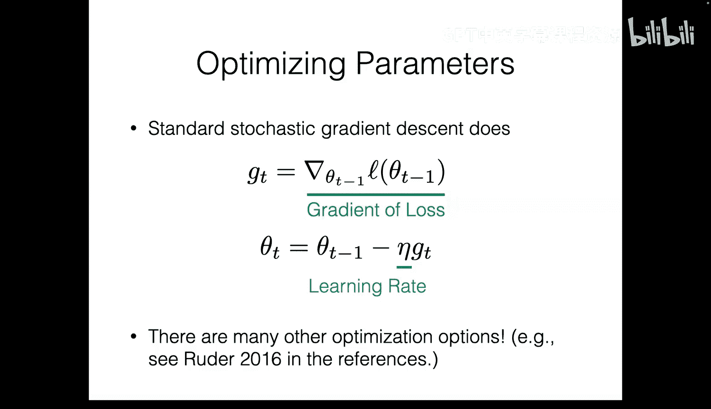

So then what you end up seeing if you use hightorch and don't implement it all yourself。

Then you'll see this kind of standard training loop。So here you can set up the loss。

 you can set up the optimizer， so this is using stochastic gradient descent or SGD。

And then you loop through your data。You pass it through the model。Typically。

 these scores are calledlogits。Then you would compute the softm and compute the loss。

And then you can kind of perform the optimization so actually perform the update that we saw on the previous slide。

Okay， and so。Although I went through it a bit quick now。

 at least I've introduced everything that's kind of involved in doing this。

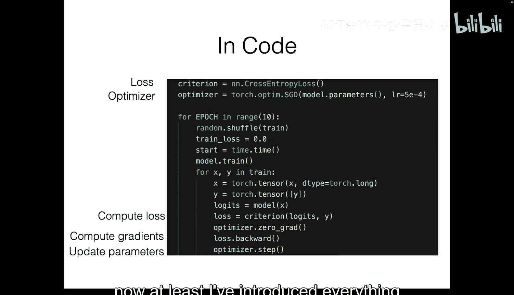

And so again， you can go through and run the。

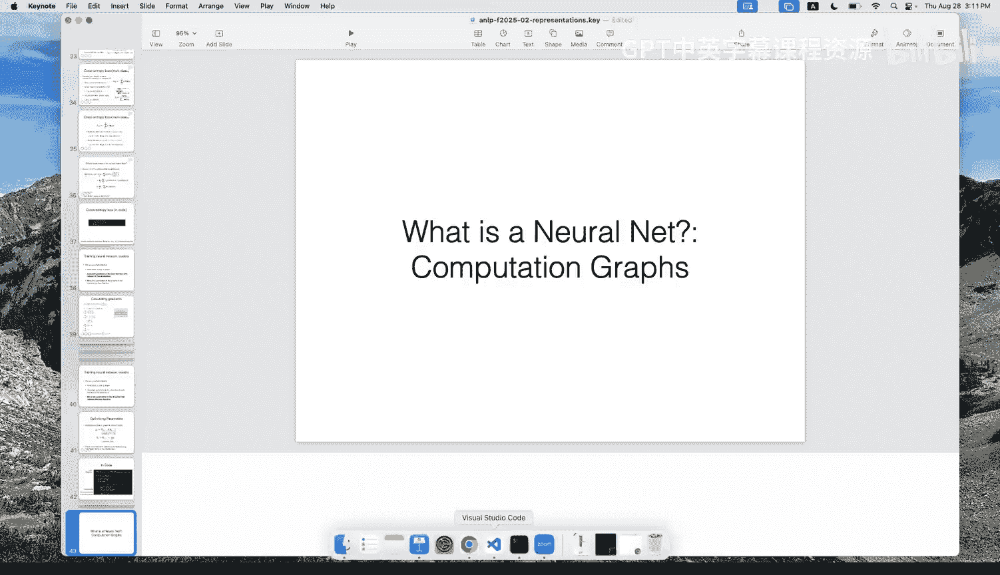

Take a look here， see this concrete example where we have actual data。

 you know print things out if you don't。See what's going on and make sure that you kind of understand this。

嗯。So， this is。Yeah， and then you can classify sentences， like。

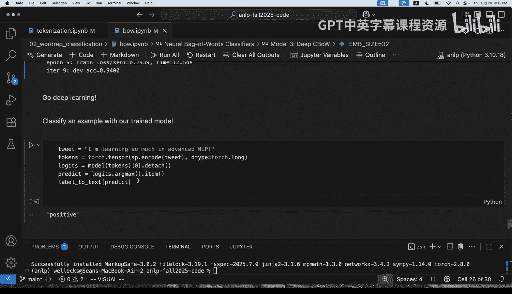

I'm learning so much in advance I'llP positive， yes。So。

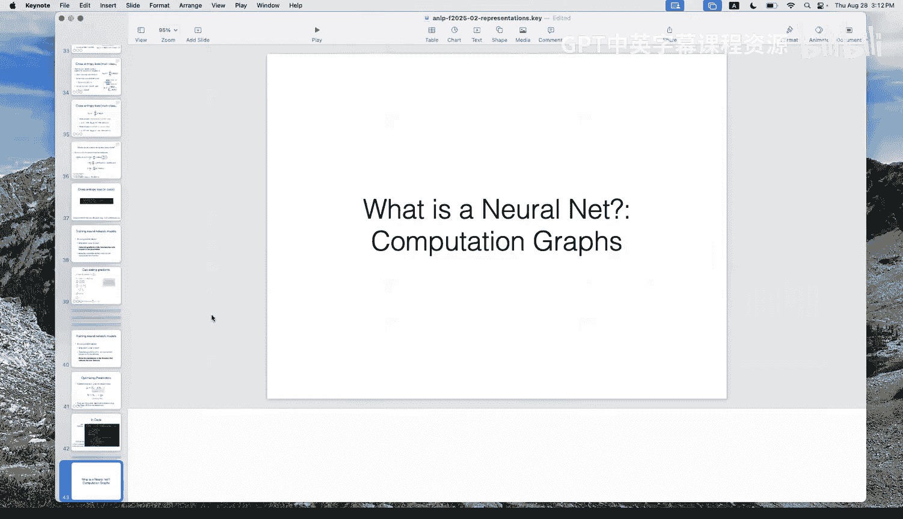

Finally。Yeah， as I mentioned， there's a lot in this lecture because hopefully at least some of it is a review。

 so right at the end here， I'll quickly just talk about this back propagation and automatic differentiation。

So nowadays， we don't really typically compute these gradients by hand。UYou'll use a system。

 you know， like Pytorrch， and behind the scenes， it'll be doing all of this bookkeeping to compute the gradients。

And so really in their modern form， this neural network is really one of these computation graphs。

So here we start off with some expression like our data X。

And then you can basically represent the forward pass through the network。

As this as this directed acyclic graph。So you can perform different operations like here we're performing the transpose。

And。Yeah。So here we have this operation and the kind of incoming edge will be the argument。

So here it's F of U， but then you'll use the argument X to perform the computation。

And then if you look at how you would implement one of these。

 then basically you have to ensure that each node can do two things。

It has to be able to compute the value of the function。

And then it also has to know how to take the gradient with respect to each input。Okay， so。Yops。

So what you have here is you have this kind of chain rule that we're going to take advantage of。

And if kind of each node knows how to compute its own gradient。

Then you can like take the kind of incoming gradient and chain them together and then ultimately get this kind of full the gradient of like things deeper in the network。

So。Just to。Show this here。 This expression is now getting more complicated。

 and here's the graph that corresponds to it。Now we have our output。And。And we can， yeah， get this。

So this will be called the forward pass and you can see here that we're going to have to do this bookkeeping to kind of keep these intermediate values。

And the reason is that for this back propagation。You now want to compute the gradients without kind of recomputing everything。

So here again we're going to start and compute this local gradient。

 remember we said that each node knows how to compute the local gradient。

Then we're going to pass that down and now you can multiply this kind of incomecoming ingredient with the local gradient。

Similarly， you can do that for the next node。And over time。

 you can get the gradients associated with every node in the graph。嗯。

So I'm going through this very fast， so if you want to like know the details。

 refresh yourself on them or learn them。You'll probably have to take a closer look at this to really。

Kind of， you know， internalize it。But here， this is the kind of key idea behind being able to automatically perform。

The computations of the gradients， which is then used to update the model through gradient design。

Okay， so。嗯。So nowadays， we have these different neural network frameworks。So pieytorrch， Tensorflow。

I think use less nowadays and Jacks。嗯。And this comparison slide was made by Graham。So yeah。

 pieytorrch， I guess is probably the most widely used in NLP。

And they do have different kind of properties， especially like Tensorflow versus Pytorrch Pytorrch was designed to have this dynamic execution at the time。

 you know， we didn't really have that you'd have to kind of declare the graph up front。嗯。

Whereas if you declare the graph upfront， then you can compile it and optimize it and things like that。

嗯。So like the the dynamic can be more flexible， you can put in like debug statements even if you want。

嗯。And then this was the， I guess， opinionated part， which is。

The most vibrant ecosystem is around Pytorch。Yeah， I guess your first homework will be in Pytororch。

嗯。So then this is just classifying using the the model that we trained。And。Yeah。So to recap。

 we covered a lot today， so I talked about tokenization and subboard models。

 so how you represent the tokens。Or how do you kind of represent them as input？Then we talked about。

Representing them as learned continuous vector。And the simple neural network architectures。

And then went into some of the details of choosing loss function， constructstructing this graph。

 and performing ingredient based optimization。So that's it for this class and I guess we're right at time。

 so thank you。

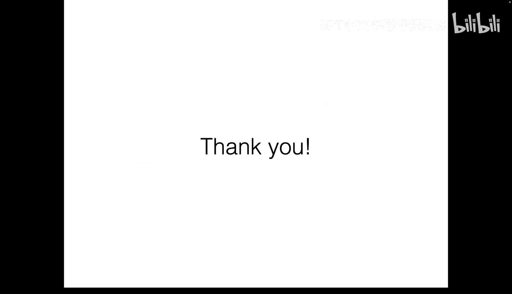

嗯。