# CMU《高级自然语言处理｜CS11-711 Advanced NLP Fall 2025》中英字幕 - P3：(3)_ Autoregressive Language Modeling.zh_en - GPT中英字幕课程资源 - BV1ZWYAzuEMa

So today we are going to do a lecture on language modeling。

We're not really going to talk about large language models quite yet。

 but we're going to talk about a lot of the key ideas that underlie any language model。

So we'll talk about learning algorithms， we'll talk about simple ways to grammarize the models。

We'll talk about data and basically we'll build up from the simplest possible language models。

To by the end， language models that use neural networks。

And then this will really lay the groundwork for then later in the course when we're looking at the more recent large language model techniques。

And so again， we have two different code notebooks to go through， so I'll mention them again。

 but those can be found。On the repository that's linked to right here。Okay。

 so just first at a high level。So so far， we've been talking about classification。

And in the first few lectures， we talked about binary classification and multi class classification。

So in binary classification， we have two different classes。So like。

 let's say we want to classify whether the smooth review is either positive or negative。

And then with multiple classes or multi class classification， you just go beyond too。

 so let's say that we have very good， good， neutral， bad and very bad。And sorry， is there a question？

And then we want to classify whether this movie review is。In one of these classes。Okay。

 so now today we're going to move to a more general setting。

Where we actually have a much larger set of possible labels。So when you think about it。

 let's say we want to translate this sentence。Then you could actually view that as some kind of classification problem。

Where we have one class assigned to each possible sequence。And so if you do that。

 then now you basically have this。Infinite set of possible labels。

Or let's say that you kind of consider it one token at a time。

 then the kind of number of labels grows exponentially in the length of the sentence。

Or in the length of the output。So a lot of different tasks fall under this setting。

This is a classical task here considered in NLP where you want to assign these different tags to different words in the sentence。

And then of course， you could basically view any task where you have some input text and you're producing some output text as falling into this class called structureucd prediction。

And so again， here， the key difference is that now we have this massive space of potential outputs。

And so we're going to have to use different techniques than we used for the simple classifiers。

In the first few lectures。However， as we'll soon see， the techniques actually end up being。

Fairly similar due to this connection that I'll talk about called autoaggressive modeling。Okay。😊。

So now with that setup。We could talk about language modeling and so language modeling will be one approach for tackling different tasks that fall into this idea of structured prediction。

And so first， you've probably heard this word language model， what actually is a language model？

So really at its core， a language model is a probability distribution。

And it'll be defined over some space of sequences， so this could be the space of all English sentences。

 it could be the space of any possible combination of tokens。Just some space of sequences。

And so again， an example of a probability distribution is。

Let's say you have a coin and it's not a fair coin。Then in this case， our。

Our space is just two elements， we have either zero or one。

And so this distribution is assigning some probability to each possible outcome。Okay。

 and so you can think of a language model as doing that except now you're considering this。

Really large space of possible sequences。So your language model might give you some。

Some like really small probability here for the sequence a period。

Maybe even smaller probability for AA period。Maybe higher probability for a cat sad。And so really。

 it's kind of。It's kind of crazy when you think about it like any possible sentence or sequence you could give to a language model and it'll give you some number。

And so the question is like how could you possibly learn these different numbers and then this isn't very exciting。

 kind of why is this useful for anything at all？Well。

 first I'll talk about what we can do with a language model。So first of all。

 you can score different sequences， so this was like traditionally actually the main use for language models before say the GPT model。

 what was that seven years ago？People would train these language models and then they would use them to score different sequences and then like prefer one sequence over the other one。

So let's say you had a translator and the translator gave you multiple candidates。

Then you can go to the language model and you could say， okay。

 this one at the top got a relatively high score。This one got a low score。

 it looks like it's kind of ungrammatical， and so maybe we would pick this translation。Okay。

 and so any language model， you know。That you have access to that you can get its probabilities from。

 you can still use them to do this kind of scoring。

Another thing you could do is with a probability distribution。

 you can sample outputs from the distribution。And so when we're talking about sequences。

 that means that you're actually kind of generating sequences。So if we had some way of。

Drawing a sample from this probability distribution， which is language model os。Then。

The kind of outcome is a sequence， and so that would be generating a sequence。

So we'll talk about how to do that in a second and then we'll have a whole lecture on it as well in a few lectures。

But still， like maybe this isn't that。Useful， like if you just。

 you just have a distribution of of like sequences。

 then still like what what can you really do with it？

So one thing you can do is you can use these language models for these input output tasks。

And so this is called conditional generation。So again。

 just viewing this as a kind of probability distribution， well。

 one thing you can do with the probability distribution is you can condition it on some information now you have some conditional distribution。

So now you can provide this input context。And now just try to generate or try to sample some output or some continuation。

And it turns out you can frame a wide variety of tasks in this way。So for instance。

 if you want to do machine translation， your context could be a sentence in English。

And then this output or this kind of continuation could be a sentence in another language。

And in general， you can， yeah， frame a wide variety of things in this way。

You could imagine like giving instructions， giving examples of what you want to do in it a different task。

 or you can just give like the start of some output。

And then you could consider what you're generating as being the output that kind of satisfies the instructions or follows the examples and so on。

So in the very first lecture， I showed an example where I gave it this kind of crazy task of generating。

 I think it was like it had to combine English。Japanese and Python code。

 and that was from a language model。Okay， so throughout the course we'll see different examples of doing this。

 what I mean by instructions， actually what I mean by examples and so on。

But right now we're just kind of considering the fundamental fundamentals and the basics。So again。

 given all this， you can do different things like answer questions。

 either by scoring possible answers or by generating。This is kind of。Potentially， you know。

 if you can train these well， then it actually subsumes what we talked about in the previous class because you can just use a language model to do classification。

So you could either score the different labels and then you choose the highest scoring one。

Or you could just give it some prompt which says， you know。

 classify this movie review to be positive， negative， neutral， whatever。

And then you can just generate a label。And then， you know， there's。

You could come up with a variety of tasks like correcting grammar or。Yeah， translation and so on。

 and so we'll see some more throughout the course。嗯。Okay， so。

That was what a language model is and some things that we can do with language models。

So now let me start talking about how we can formulate these language models in a way that makes it easy to generate text with them and easy to train。

And the key idea here is。嗯。To use what is called this autoaggressive model。

So auto aggressiveive model just refers to a model that uses this。Relationship here。

So does anyone know what this equation is called？没有。Close， close。

 so this is called the chain rule of probability。So it has nothing to do with language models。

 you know you could probably look up like a intro probability textbook and somewhere it'll have the chain rule of probability and you might read past it kind of quickly because it seems kind of like you know not important。

But for these language models that actually ends up having these really kind of interesting implications。

So what is it saying， so here we have on the left hand side some sequence。

 so this will be like x1 through x capital T。And it's saying that the probability of this entire sequence is equal to this thing on the right。

And the thing on the right is this product。Of these different conditional probabilities。

So here we would have probability of x2 given x1。Then you would have another one， which is like x 3。

 given x 1 and x 2 and so on all the way up to X， T， given X。1 minus like x capital T。

 given x1 to x capital t minus1。And so they're equal right so you can get the probability of this full sequence by just multiplying these kind of next token probability conditional probabilities。

Okay， and so this is just like a fact about these distributions。And again。

 when we interpret it in terms of a language model， then yeah， you have。

Here each term is like the probability of some context and then the next token。

And so the cool thing here is that。This can decompose the problem of sequence modeling。

 so learning this distribution over this really large space of sequences。

Into the problem of just next token prediction or next token modeling。So what do I mean by that？

Let's say that you gave me all possible like let's say you gave me some really good next token distributions。

Well， then I can just use this fact and I can get a distribution over full sequences。And so again。

 this kind of sequence distribution is over this really large space of all possible sequences。

But then these next token distributions are just defined over the token vocabulary。So。

We saw in the previous lecture this might have something like， 50，000 different possible next tokens。

And 50，000 is， you relatively relatively small， it's much smaller than the number of possible sequences。

So with that， our goal really is going to be learning these really good next token distributions。Um。

Because again， if we can if we can just learn this to kind of predict the next token given the previous tokens。

Then， we can learn to。Predicts the probability of full sequences。

 or it turns out even like generate full sequences。So this is called again， an autoregressive model。

And it's not the only way to。Learn or to formulate a language model。Wt at the end of the course。

 we'll see what are called diffusion models。So you could do this in a completely different way。

But this one we' focus on a lot because these really recent language models are use this autoregressive approach。

ok。So does anyone have any questions about this so far and we'll kind of step through all of the details about those so you'll see the details in a second。

Yeah， so here capital T will be the length of the sequence。And so this can actually vary based on x。

 it should be a T subscript x。嗯。I think the。嗯。So yeah， this type of modeling was used， you know。

 in statistical models before that， and so the name comes from those， I forgot exactly， yeah。

 where the name comes。Okay。😊，嗯。So yeah， today we're going to talk about these really simple models called bygram models and it'll be based on like count counting tokens。

And Ngram models。And then at the end， we'll look at using a simple neural neural network。

 sorry to parameterize the language model。And then the at the end。

 I'll go through some kind of practical considerations。

 some of it' will be a review for some people that you should consider when you're training deep learning models。

 so these are things that have kind of been you know implicit in the code examples that we've been saying and things like that and stuff that's good to review。

Okay， so the first language model that we'll look at is called a bygra model。

And so this one does something pretty extreme， maybe。It basically has this assumption。

And it's saying that， okay， we're going to assume that each next token is only dependent on the token immediately preceding it。

So。The by in bigram refers to the fact that there's two tokens here。And again。

 what we're basically doing is discarding all of the previous tokens。

So like let's say you have a sentence。The dog ran quickly。Then。I mean。

 that's a pretty simple sentence， but so maybe it's not the best example。

 but basically this assumption is saying that the word ran， for instance。

Would only depend on the word dog and not the word the。Or quickly would only。

Depend on the word ran and not on the word dog。嗯。And so yeah。

 here these this will follow this code example， which you can go through and run after if anything's not clear。

 you want to understand it in some more depth。So first。

 we're going to talk about how you will train a language model starting with this really simple one called the Bgram model。

And so here what we do in language modeling is our goal is to model what is called a data distribution。

So we here we have our model which will denote P theta。And then we have this data distribution。

 which we will call P data。And so we'll see a concrete example of this in a bit。

But it's basically like the underlying distribution for the data that you have。

 So if you have a data set of like people's names， then it's the kind of underlying distribution of。

 of names that generated the data。嗯。But of course， we don't have access to this actual distribution。

 what we're given is just some data set of examples。

And these can be viewed as kind of samples from this data distribution。So we'll denote those as D。

 and let's say you have n different examples。Then what you want to do is split this data set into three different parts。

 I mentioned this in the first lecture。You'll have a training set， you'll have a development set。

 and you'll have a test set。Actually， at the end of the lecture， as long as we get to it。

 then I'll go into the kind of justification for doing this splitting if you haven't seen it before just to review。

So now given this training data， the data set will be some sequences。

What these really simple count based bygram models do is they set the next token probabilities。

Based on how often each token appears after another token in the data set。

So you basically go through and you look at each token x t minus1 and then the token after it。

And you count up how many times that occurs。And then here on the denominator。

 you have the token x t minus1。And then you have all。The different next tokens in your data set。

And so doing that， you can get this。This estimate。Of the probability of xt given xt minus1。

So it's really going through and yeah， just counting and looking at the frequency。

Of Xc following xc minus-1。Now what you could view this as doing is this is somehow setting some parameter。

Theta， I J。And the parameter is the probability of token Xj given Xi。O。

So let me show a concrete example here。So here we have， and this is the one in the notebook。

So here we have this data set of names。And here's some example names， you know， Emma， Olivia， so on。

And we're going to say that， okay， each token will be one character， so this would be EMMA， O，L， I。

 V， IA， and so on。And so that's our data set that we have and so now we want to learn language model which models this distribution。

Then here's basically what I showed on the slide before。And what it's doing is。First of all。

 you for each different sequence， it adds this kind of start and ends token。

Then it goes through and it's just as for loop。And it's saying， okay。

 for token x1 and x2 that are next to each other， we're just going to increment the count。

So you basically count all of these up。And here's what it actually looks like for this data set。

So you can see that the most frequent bigram is the letter n followed by。This special token。

And you can kind of see why we add in these special tokens because then you could say things like。

 okay， what is the most。Like common letter that ends a sentence or what is the most common letter that starts a sentence or starts a name？

So here's the frequencies you get and then using oops and then using this formula now you have these different counts and you can get for any particular。

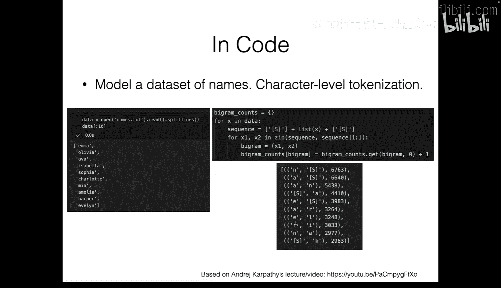

嗯。Character X T， what is its probability given some previous character by just using these counts？嗯。

And the results are are this is like， yeah， you can make these cool visualizations。

 So this is looking at。On the Y axis， we have each possible character。 So A， B，C， D， E。

 all the way to Z。And then similarly on the x axis， we have each possible character。

And it's showing what are the probabilities associated with one character given a previous one？

So you can see， for instance， this is like given that you have the character Q。

 what are the different probabilities？And you can see that almost all of the probability mass is assigned to you。

Here。And then you know， in general， it'll vary here。So you can look at some interesting things。

 which is like， okay， what is the。A letter that's most likely to end a sequence。

Or you know which letters have a kind of more spread distribution and so on。

So it gives you this really concrete sense of these probabilities that have been learned by the process。

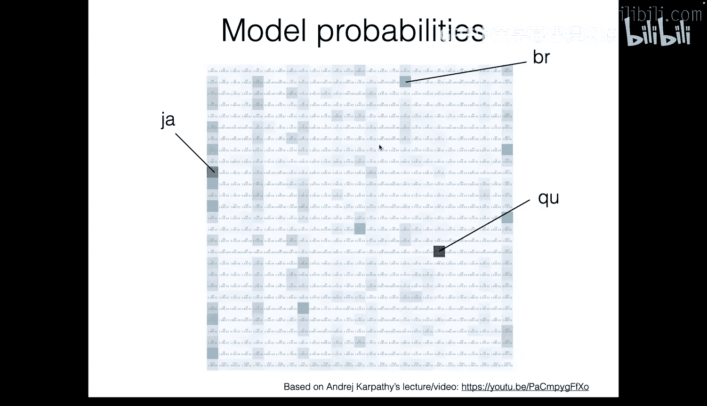

And so yeah， just again， so this is all in this notebook here。And。It will basically walk you through。

嗯。Yeah， what what I did here。And so here is basically like， okay， given the counts。

 we actually want to turn them into the probabilities。啊是 doing that。And then， here's this diagram。嗯。

That I just showed you。嗯。So， okay， so then we'll get to generating in a bit。

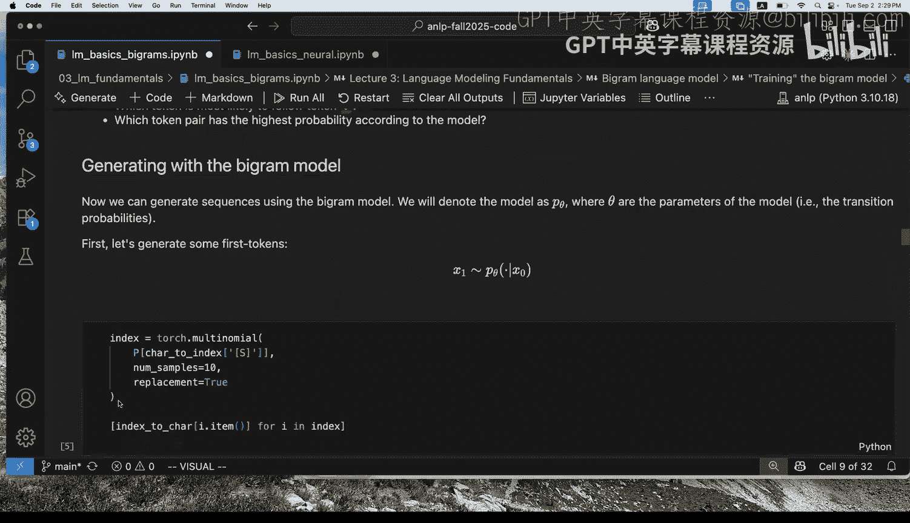

So what this says here is this is actually a really simple learning algorithm。

For setting the parameters of this bigram model。mAnd so the question is like， yeah。

 it seems kind of intuitive， u you know。Seems like a reasonable way， maybe to train the model。

But it turns out that this way of training the model is in some sense really connected to the way that willll even train like a large language model。

And so the connection is as follows。嗯。So I won't go through the kind of proof of this statement。

But basically doing this counting procedure。Corresponds to what is called the maximum likelihood estimate for the parameters of the model。

Or it corresponds to performing what's called maximum likelihood estimation。

And so maximum likelihood estimation。The idea is。Given some data set。

 you want to choose the parameters of the model so that the model assigns high probability or kind of maximal probability。

To the examples in the training data set。So it's kind of intuitive idea， right？

Kind of as you're learning a model， all you have is the training data。

 and so why not set the model to kind of assign high probability to the training data。

So that's called maximum likelihood estimation， and we'll see in a bit that this is actually how we'll train like the neural network based models and in the following classes。

 it's the same way that we'll train a large language model with maximum likelihood。Of course。

 with a neural network and more complicated models， we won't be doing the counting。

 so we'll have to come up with other ways of doing this maximum likelihood。So if you want。

 you can like look up houses derived or try to do it from scratch。

 but it turns out that the accounting procedure is yeah， kind of justified in this way。

But then there's a question of， okay， I said that counting is equivalent to this。

Thing called maximum likelihood， but what's the kind of reason for maximum likelihood？Well。

 one is this intuitive idea of assigning high probability to the training data。

But you can also show that this actually is equivalent to matching the data distribution using your model。

And actually， this will use the same argument that I talked about in the previous class。

So here we're going to start off with this kale divergence。

And it's basically the exact same thing that I talked about in the last class。

So here we have our data distribution， P star and our model P Theta。And。

Let's say that our goal is to minimize this divergence。

 so we want our model to match this target distribution。

Seems like a reasonable goal if our goal is to learn this probability distribution。

This here is just the definition of kale divergence。So if you haven't seen it before。

 you can go on Wikipedia and look up the definition， and this is just writing it out。

Then what you can do is you can expand out this log term。

So you'll have you know this and then minus this term done here。

And I talked about this in the previous class， this term over here will be p star of x log of p star of x。

And if you're minimizing with respect to theta， then that just is constant， you。

 irrespective of what you set theta to be。So it's kind of not relevant for the minimization。

Now here's a kind of interesting thing。So this is just writing the definition of expected value or expectation。

So here we have like the sum and P star of x， and that's just equal to or that's the definition of expected value。

So now you can see that our goal is basically minimizing。Minus the log of data。That has been。

Kind of sampled from our data distribution。And then here， this is saying that。

We can approximate this expectation。By just considering some finite data set that we have。

Right like in practice， we don't have all possible sequences。But we have this data set。

 which you can again see as being some samples from this P star。And so now we have this term here。

 that's just。This well， yeah， it's called a Monte Carlo sample of this expectation。Okay。

 then the last thing is you can just observe that， okay。

 you're minimizing this term that has a minus。So that's equivalent to maximizing。

The term without the minus。And actually， this is maximum likelihood， which was on the previous slide。

Okay， so it's a kind of cool。Kind of just cool argument here。

 it's basically saying that doing this maximum likelihood。

Is equivalent to doing this distribution fitting。 So finding a model that actually matches the data distribution。

OK对。嗯。So。Yeah， so that's the maximum likelihood and I showed the counting。

Now you probably saw that these logs are coming up in different places。And so yeah。

 there's a few different reasons to use the logs and it's used in practice。嗯。Well， first， I mean。

 yeah， so you can。You can reexpress these products in terms of sums when you're using logs。

And when you have these really small numbers。But like the really small probabilities and they're getting multiplied together。

Then that will usually result in just numbers that are too small to even know store in the computer so。

That can lead to issues of the numerical stability。So in practice， you see these logs used a lot。

 and so we'll just get comfortable with seeing you know log probability instead of probability。い。ok。

So that was the training and maximum likelihood。Let me talk about generating sequences from the model。

Maybe first， let me pause any questions about the previous part。Okay。

 cool so now let's say we've learned our model and we want to do kind of inference well here what we want to do is generate so say generate a new name。

And with these autoaggressive models， it's really nice because it turns out that you can do what's shown in the slide here。

The idea is you can basically sample one token at a time。

And then kind of put it into the context and then sample the next token， put it into the context。

 sample the next token， and so on。嗯。And this is actually ends up being equivalent to sampling from the distribution over full sequences。

So we'll talk about the implications of this a couple more times in the course。

But kind of in a nutshell， the really nice thing is that here you are sampling again from this next token distribution。

Which is only defined over this vocabulary of next tokens。

And so this is really easy to generate from。

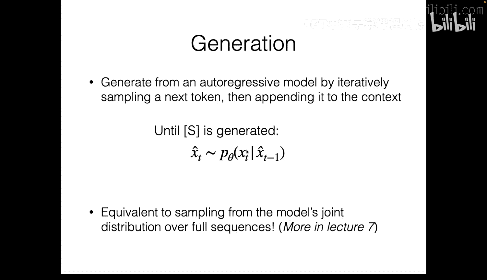

嗯。Let me actually show you what I mean by that。So here's in the code notebook where you go to implement this generation。

So we can start off with this。Start a sequence token。Then you can go into this loop。

And you could say， okay。It's a bygram model so you're taking like the previous character。

You're getting its index in the vocabulary。And then you're considering the next token probabilities。

You know， given that index。And then you can see here that there's this function， you。

 torch dot multinomial。Or actually sample like drawing a sample。

And so the sampling from this you know relatively small sized multinomial distribution is really fast。

 so it's not really an issue。And so the cool thing is that you can do this fast next token sampling and then at the end get this sample。

 which is like a full sequence。Okay， so。If you haven't like。You know。

 thought about that before or something， then we'll see it again when we get to diffusion。

 so diffusion models are formulated in a different way。

So you'll have to design some new way of sampling from the model。

 but with these auto aggressivegressive models again like sampling is pretty easy。

 so that's one reason one of a few reasons that they're really popular。Okay。

 so now we can see what happens if we actually generate with this model。And you can see that。 yeah。

 I mean， maybe it's not that good like。呃K。And， and， n。Anon C， H， N I。I see。 anyways。

Not very good names。But there's a question of like， did this actually learn anything？

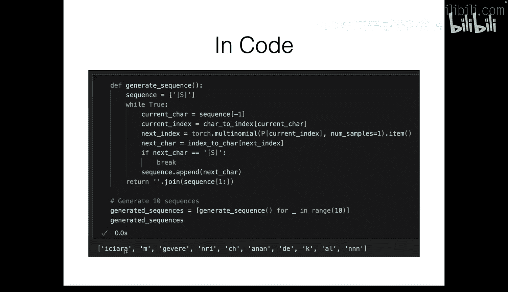

So what you can do is you could consider like what would it look like if we just sampled next tokens uniformly at random？

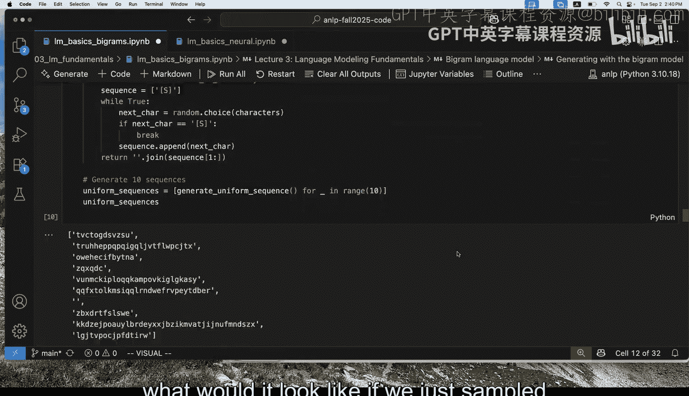

And this is actually shown in the notebook。And you can see that it's much worse。Again。

 this is like you take different characters and you just。Sample them uniformly。So clearly。

 even this really simple model did learn some kind of。

 it did learn something from this counting procedure。

But now our goal is to kind of improve upon this and we'll see this get better and better。

 I think I actually keep the same example over the next like two or three lectures。嗯。

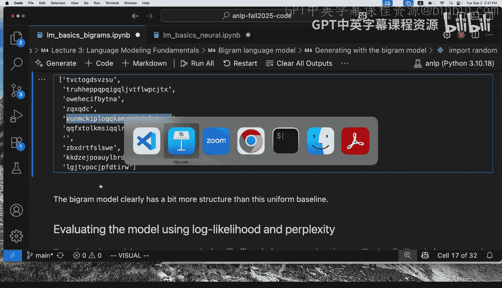

Okay。So that's generating with the model。

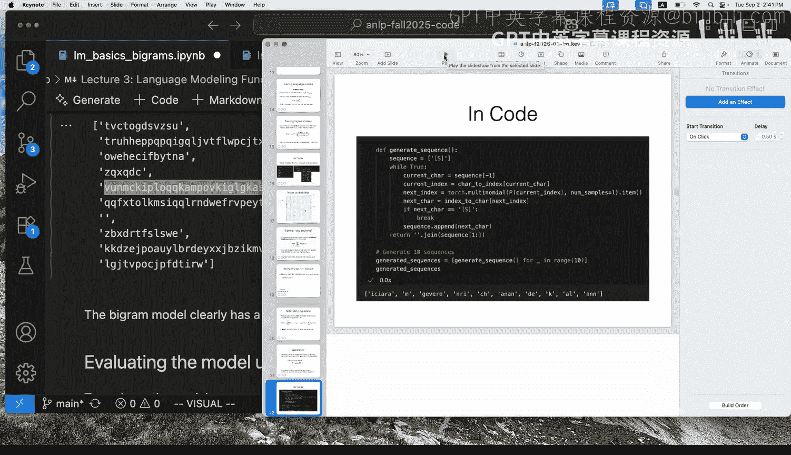

Now we could consider how do you evaluate one of these language models？So for this。

 we'll go into more evaluation techniques in a lecture later。嗯。But here we can just think about。

 like。Well， one question is like， okay。Let's say I want to evaluate the quality of those names。

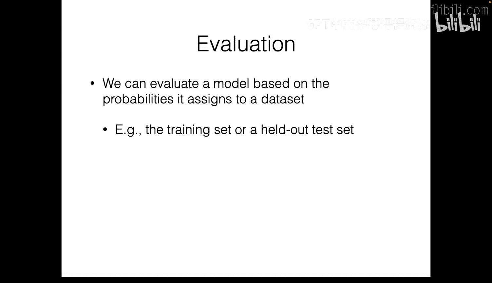

Then honestly， it was kind of difficult to say like。You know。Is。Javiier， like。

 is that a good or a bad name？You know， I don't know。 And it might depend on who you ask。嗯。

Is Ka a good or bad name？I don't know。 It might be good。 It might be bad。

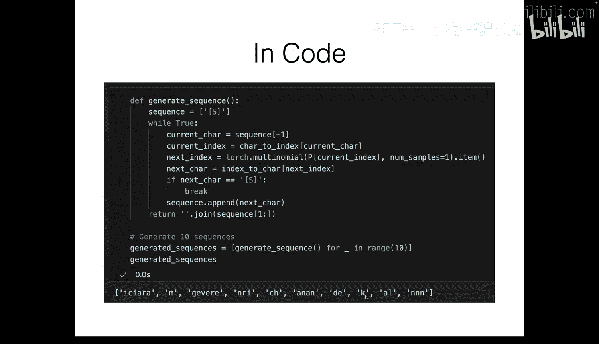

So what we want to do is first define metrics that we can just automatically evaluate by just purely treating the model as a probability distribution。

 so not actually looking， considering like the content of what it's modeling。

So that's what I'll talk about now。So here are the two metrics that are used widely。

And they're actually connected。Is the log likelihood and the perplexity？So log likelihood is。I mean。

 basically what it sounds。So here again， our model gives us this probability distribution and we can take the logs to avoid these numerical issues。

And so what we can do is basically go over some test set or some dev set。And say， okay。

 how well does our model like？What is the total probability or total log probability assigned to these test sequences？

And so what we can do is basically say like， okay。If it's higher probability。

 then that's pretty good because the model didn't see these test sequences during during training。

But it managed to assign kind of high probability to the test set。If it's low。

 then that'll be a worse model。And then what happens is if you run this on a kind of big test set。

Then the scale will kind of vary based on， you know。

 it could vary based on the length of words of sequences。

 it could vary based on the size of the testset。So one common thing to do is just normalize it somehow。

 So here， for instance， you can normalize it by the。Number of words。O。嗯。And then， yeah。

 we'll get to this in a bit， but here we want this number to be higher。

But if you have a loss function， you often want it to be lower。

So as the loss function will be using a minus log， I'll get to that in a bit。

But so as a result in papers， you'll usually see a minus log or negative log likelihood reported。

Okay， and then perplexity is very closely related。So here we have。诶。This word log likelihood。

So again， kind of normalized over the number of words。And then we have this exponential。

So it's the exponential of this。Or you could consider like two to the power of。This entropy。

And I guess I didn't put the equation for entropy here。 So yeah。

 here you can consider this exponential。 And so you can think of the exponential as basically scaling this somehow。

So it turns out that the perplexity has a kind of interesting interpretation。嗯。Oh yeah。

 I remember this， so anyone have any ideas for what's going to come next in the sentence？喂。Bk， good。

Okay， so our language model only is one possible output， Barc。

But basically these language models will have multiple possibilities。😊，And yeah， I think， yeah。

 I remember this from last semester， I think the there's an error in the example。But anyways。

 so here you have these different possible tokens。And if you look at the probabilities。

 then they might look like this。And the perplexity number will look like this so you can see that the scale has changed。

So it'll be positive。And there's this interpretation， which is like the perplexity is on average。

 how many times you would need to。I think it's how many times you need to draw a sample in order to get。

This token。嗯。And so again， here， let me check on that， though， here you have。Yeah。

 perplexity and so lower will be better。Okay， so you'll see this。

Very frequently reported in different papers， and again you could see that it's just connected to the probabilities that the model is assigned to。

You know， it's the different outputs。

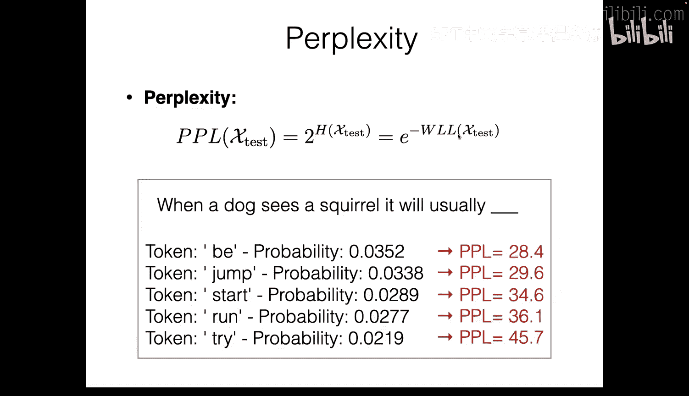

Okay。So again， here just to show you concretely。You can do this with this bygram model。

 so here you have the probability， you take the log and then this is computing the log likelihood。

You could see the numbers here so this is what I was telling you about before if you don't do the normalization。

 you can get these kind of crazy numbers。

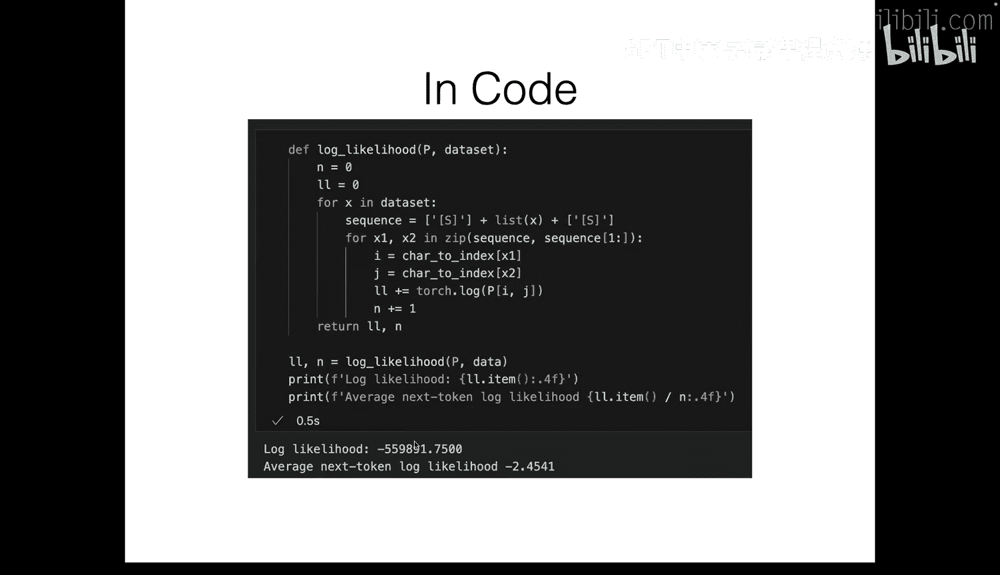

And then you could just take the exponential and then now you have this。There' perplexity here。Okay。

 so those are some automatic metrics that you'll see that will apply to any language model。

And so later in the course， we'll look at， you know。

 suppose you want to do evaluation that actually looks at say like outputs that are generated with a model。

 but these again are just using the fact that it's a distribution and so it'll apply apply to any。

Yeah， any language model that is a probability distribution。Okay。So to recap。

 that's it for the bygram models。And so this is a really simple language model。

 it uses this really kind of naive assumption that the probability of a token it only depends on the previous token。

But we actually saw some really important concepts that will apply throughout the course。

So we saw this idea of maximum likelihood estimation。

And this will turn out to be the way that we train really like pre train really large language models。

Just this kind of practical thing of using log。嗯。We saw auto regressive generation。

 which we'll have a whole lecture about。And we saw these automatic ways of evaluating the model。

And then finally， we actually saw this issue， which is present in today's language models as well。

 that we have this limited context size。So this is kind of the extreme。

 the it's basically saying that the context size is just one token。嗯。You know。

 that's like the definition of the bygram model。But we'll see this theme come up。You know。

 throughout the course， actually。So next we could consider generalizing this a bit to what are called NgramM models。

So in N&gram models， we consider the probability of the next token。

But now we have this n token context。 So instead of just looking at one。

 now we have n tokens or n minus one。Maybe it should be n -1。So you could have like bigram models。

 trigram models， you know， four gram，5 gram n gra。And really here。

 you can use this analogous counting procedure to train them。

So now you go through your data set and you say like， okay。Given some n-1 tokens。

You look at how many。You count the number of times that this token Xt occurs。

As well as like any possible next token。And then you just divide and you can get this probability。

Can anyone tell me a potential issue？With us。And let's say that like n is really large。

 like n n equals 10。因为冇你。All the very large you might not find sentence that that Yeah， exactly。

 Well， yeah， the the sentence might not be long enough or you might get these very kind of sparse count。

 So like one token one context of size 9 might only appear once。 And so now all of your counts are。嗯。

Yeah they're very sparse， so like for this nine token context。

 you don't have any counts for most tokens。And so this leads to a lot of issues and it could lead to a bad model。

So basically， especially before the neural language models came out。

 there was a kind of whole you know research field based around trying to overcome this idea of having these really sparse counts。

And so broadly， the methods are called smoothing。And the key idea is to like somehow add in these fake accounts to account for the fact that you have these like zero probability engrams。

So here's a really simple one called uniform smoothing。And this is basically saying that like， okay。

 suppose this count here is zero， so this like 10 gram never occurred。

Then we can still assign it a probability by just giving it count of one。And then similarly。

 when the count is non zero， you'll still just add this one and then this will ensure that it's a valid probability distribution。

 everything still sums to one and is between zero and1。So again。

 that's an example of what is called smoothing。And so in the past。

 maybe there would be you know a whole lecture dedicated to this。

 it can get like the methods get very kind of very tedious to go through and understand So in this course I won't go into the details of this。

But the next slide is basically oh two slides from now is basically saying that you'll you'll still encounter these Ngram models。

 so if you see like an Ngram model library， then it will have these different smoothing parameters。

So you want to be aware of。This idea of smoothing。And then if you're actually using them， you know。

 take the time to kind of look up the methods being used and understand it further。

But that's the basic idea of smoothing and the reason is that we get these really sparse counts where a lot of things are zero。

Okay， so now similar to last lecture， we could consider。

What are some issues that come up when we rely on these count based？Count based language models。

You know， you could imagine， look。What if you did this counting on all of the text on the internet？

And people actually did that for a while， there was like this paper from Google and they tried to train as large of a Ngram model as they could back back in the day。

Similarly， there was ones for code generation and so like yeah。

 people would try to generate the next token of code using one of these Ngramd models。

And this was like a big research area for a long time。嗯。But we can look at some issues with this。

One is that there's really no notion of similarity that these models leverage。嗯。

So here we have kind of similar structure in these sentences。

So here you have like bought and purchased。Here you have car and bicycle。

And similar concepts or similar ideas might occur in similar contexts。

And these models that are just based on the counts are kind of treating these things as completely just disconnected and kind of separate counts。

So the neural network models that we'll talk about will incorporate some notion of kind of learned similarity。

嗯。Here again。嗯。Yeah， here like let's say you estimate some you know really good distribution and then you like switch out a just like a name in the middle。

 then you'll have to kind of reest the distribution so again。

 when we have these more flexible methods that are based on kind of similarity between。

Embbedding and things like that， then we'll be able to overcome this issue as well。

And then this will' actually have to wait for the next lecture here there's this issue of capturing long distance dependencies。

So this is a much better example than the one I gave at the beginning of the class。

 I think I said like a dog runss。So here's a sentence for tennis class he wanted to buy his own racket。

And so basically， given this context here， in order to predict the word rackcet。

You kind of have to know that this word at the beginning of the sentence is tennis。Right。Otherwise。

Yeah， if it was。Program class。Then youd probably predict something like， I don't know， computer。

 Def not racket。So anyways， here， if you think about the Ngram model。

 it's only looking at the previous n tokens。And so you would have to have a really large end to capture this long range dependency。

And then as we just discussed， having this really high end in the Ngram model leads to these estimation difficulties。

Okay， so this will motivate the use of these very flexible sequence neural networks designed for sequences。

And some of them， at least in theory， will be able to model kind of infinite length sequences。O。

So there's a question of when do we want to use these？So as I said you'll still see these come up。

 one thing is that they're extremely fast to estimate and to and to kind of run。

 they're just like looking up these ngrams。And sometimes they're kind of perfect memorization。

 So they're just based on， you know， counting things that occur in the data。

 sometimes that can be useful， especially if you have like a really large。Training data set。

 let's say it's like terabytes of data， then sometimes these NG models are used to like do really basic filters on the data because you don't want to necessarily apply some really huge language model when you're just doing like really basic filters。

 things like that。嗯。And yeah， if you want to use one of these。

 one of the popular toolkits is called Ken LM。And again， if you take a look at it。

 you'll start seeing these things about smoothing， and so that becomes really important for yeah。

 using it in practice。Okay， so next I'm going to start talking about the language models。

And so now the key difference is in this lecture， we're still going to just talk about these NG models。

So we're still making this kind of assumption that we're only looking at n minus1 tokens。

But now we're going to parameterize the model using a neural network。

And so this is mainly based on this paper from 2003。

 which proposed this kind of neural language model。And actually。

 the paper is really nice and they give a lot of motivation for the method。

 it goes into a lot of the。Kind of intuitions behind it。 And it's actually really nice to read。

 So yeah， I recommend it。So this again， we have an implementation in the code notebook。And so here。

 these models are going to be able to take into account some notion of similarity of words or different contexts。

Um， like here the cat was walking in the bedroom。And the dog was running in a room。

The idea is like the model will in some sense be able to increase the probability of the dog was walking in the bedroom or the cat was running in a room。

Because like looking over you know， the whole data set， it'll see that， you know。

 cat and dog tend to appear in similar contexts and things like that。

So that's one of the key ideas behind or the kind of intuition or motivation。

One of them for the neural language model。And the solution will be to use these learned distributed representations。

 the continuous representations。That I introduced in the last class。

So let's take a look at the model that or the architecture that is proposed here。

And it actually starts off looking pretty similar to what we looked at in the last class。

So here we'll have different tokens， we look them up in this embedding layer and you get some vector。

Now， instead of using the bag of words， remember the bag of words just added these token vectors together。

Now we're just gonna concatenate them。So now you have， yeah， basically， you know。

 n different or n minus1 different token beddings just concatenated together。

And then here we're just going to use the same layers that I introduced in the previous class。

So here you have this nonlinear layer with the 10h。You can stack them together， of course。

 I'm just showing one layer。And then ultimately， you have this output weight matrix。

And so then here in the previous class， we are considering like classifying a document to be you know。

 positive， negative neutral。Now we're basically saying， okay。

 our different classes are going to be different possible next tokens。

So here you can see that this is over RV， so you have some number。

 some score for each token in the vocabulary。And that'll be the like score。

Of that token occurring after this context。Then you can normalize this by taking the softmax and so now you get this distribution。

Which is parameterized by this neural network， which says， okay， for each given position。

 that'll be some token X T。What is its probability given these two preceding tokens？Okay。

 so that's the basic idea and again you can see that it looks like a classification model and we're kind of learning to classify what is the next token。

And then this is just connecting it with some stuff， I said in the first few lectures。

That you can view these as you know， outputting some kind of score。Um， or you know。

 producing some hidden representation， outputting some score。

 and then you normalize them to get probabilities。Okay， so now to train this， we're going to use。

Maximum likelihood estimation。So again， we want to find the parameters that maximize the likelihood under the model of this training data set。

And so what we could do is just use the fact that this is an auto aggressiveive model。嗯。

And so this will be log of this product of the next toian distributions。嗯。

And then so now we got this here。And you can see that。

Now we have these next token distributions here。And so what we can do is if our goal is to maximize the log probability。

We could just have a loss， which is minus the log probability。Because again。If we want to maximize。

 well， we want to actually minimize the loss so you just take the negative。Okay。

 now the interesting thing here is if we look at this loss， then it turns out that。

This is actually crosscentulous。So I introduced cross entropy laws in the previous lecture。

And so here's the slide or here's like something that was on the slide in lecture number two。

And it basically said， okay， you go over each possible class and then you have this indicator。

 which is like， is it the class or not， and then you have the log probability。So in our case。

 with the language modeling， it's basically saying that this Yi is a one hot vector and it'll be one for the next token in the training data。

And then this PI is just the probability that is output by the language model on that token。

And again， instead of classifying into like positive， negative neutral。

 now our classes are the possible next tokens， so the vocabulary。Okay。

 so it's a kind of cool connection and it's worth going over a couple times to make sure you see the connection。

So again， we want to learn the language model。We want to use maximum likelihood estimation to learn the language model。

And then it turns out that that ends up being equivalent。To using this loss function。

 this cross entrytropy loss。So really nice connection。

And this will actually make it also like very practical to train language models。

The cross entrypy loss is pretty simple， you can implement it like efficiently。

And so now we have a way of training these language models by basically just framing it as a kind of next token classification。

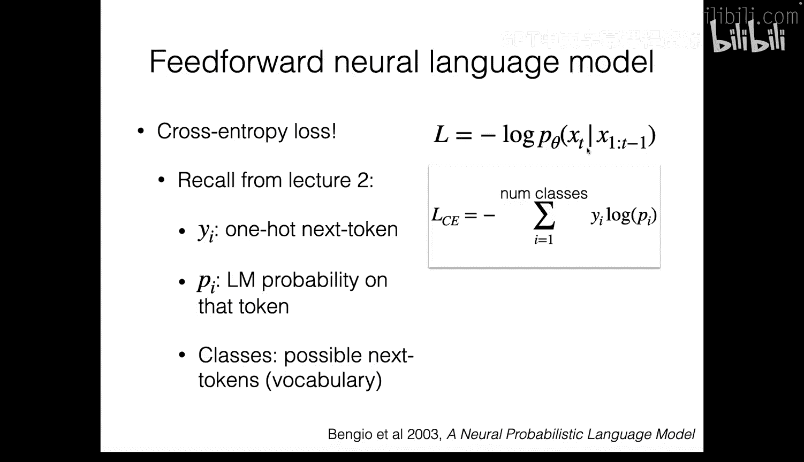

Okay， so again， pretty cool idea there and here again we have a notebook that does the implementation。

 it loads data for the names data set and everything。

 and so you can step through and make sure that yeah you kind of understand all this and see what's going on。

And so yeah， here's the different steps you're embedding。

This is just a different way of writing the concatenation with this reshaping。

Then you're applying this nonlinear layer here we're using a different， we're not using 10hch。

 we're using this raillu function。And then this is the output layer。

Which gives you the scores over the vocabulary。So I'm going over kind of quickly again。

 but the notebook is there you can go through。You know， at， at your own pace。

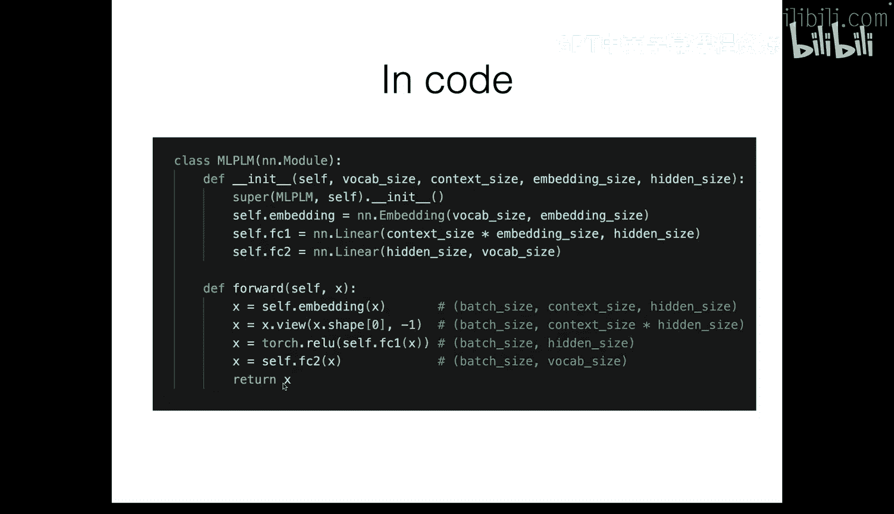

And then here's the training loop。So again。Here you can see we're using this built in crosscentripy loss as the criterion or as the loss function。

And then it's doing this kind of loop of choosing some data。Doing the forward pass。

 competing the loss and doing the backward pass so the same thing that I introduced。In last class。

Okay。嗯。

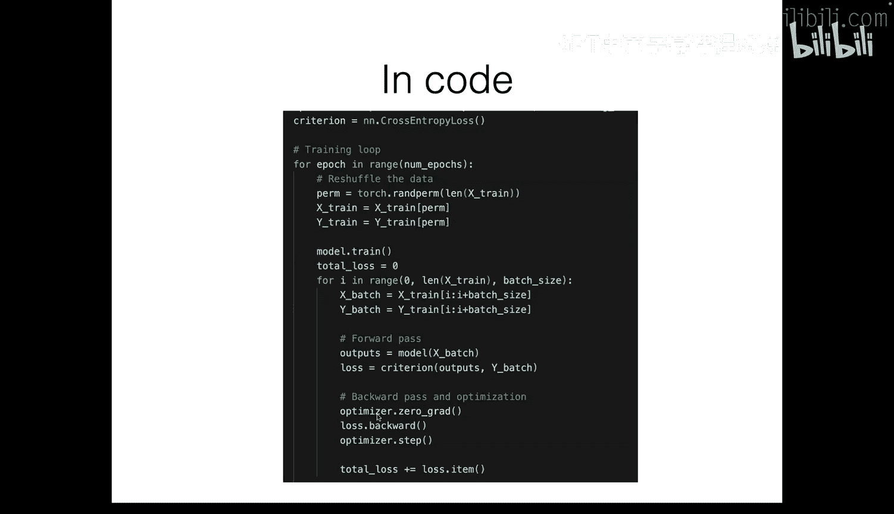

So， cool， so。Some examples of what this can learn。So here again， it gets hard to kind of。

Envision or interpret any possible thing that the model could learn。

But here's just like one possibility here we have two different tokens。

And then here we have some weights that might be learned， you know， after the optimization。

And maybe it could be interpreted as like， you know。

 this part of the weight matrix gives you a positive number if the previous word is a determiner and the second previous word is or something like that。

And you can kind of frame a lot of these different possibilities as like different sightings of the weights。

And the idea behind you know deep learning or the neural model is that it will kind of figure out what to learn based on the data so that the loss is minimized。

Okay， so then one other quick。Notion here is like this idea of sharing strength or having notions of similarity。

So here you could imagine that like， okay， let's say that similar words get end up getting similar embeddings after learning。

Then you'll have similar context， get similar hidden states。

That'll mean that similar output words can get similarops output。

You could also have similar output words get similar output weights， and then that will lead to。

Kind of impacting the final next token distribution。So its just one example of this。

 this one I think is in the reading for today。嗯。You could basically have this really simple model。

And kind of convince yourself that it's possible for these different contexts to be encouraged to be kind of similar to each other。

So let me just go through this。Yeah， quickly just due at the time。

So here we have this word movie and let's say in our training data set。

There's these two different contacts that occur。 It's a great movie。 It's a wonderful movie。😊。

Then let's say our language model is of this form。So this is basically just writing out the softmax and this is the denominator of the softmax。

And so we'll say that the probability of context of word W movie given context J。Is this。Similarly。

 this is the probability of word W given context k。Then here you could consider the ratio。

And you might say that like， okay， what if we want this ratio to be one。

 like we want the model to assign roughly equal probability to these two different contexts。Yops。

Well， then one way to make that ratio one is to make this equal to zero because then you'll have exponentialonent of zero。

And one way to make that zero is to make these hidden vectors the same or to make them kind of close to each other。

Um， so yeah， this is just an an argument that kind of gives you some intuition。Or。

How the optimization procedure could encourage this kind of behavior。And again。

 this is written out more fully in the reading that I referenced for the class。不。Okay， so。Yeah。

 just really quickly， this can kind of help overcome these first two issues and I mentioned this earlier in the next lecture we'll talk about handling these long distance dependencies。

嗯。But that is the neural language model or neural kind of Ngram model。So any questions。

 let me pause briefly for questions。你。等见。As J minus H kilo we also mean wO governor to H minus H。

Right， yeah， yeah。 So I said one way to make it equal is to make them so， but yeah。

 you could also make it。Yeah you can make the weight zero or you can make it orthogonal，同意。嗯。

But you want a weight matrix that works for many different possible ages。

So if you made it orthogonal to one specific pair of H， then it's not really a general strategy，嗯。

So the planning is usually to you， suppose your sponsor length is for you have maybe three words when you but are starting to generate us in how would you handle that。

Yeah， that's a good question， so basically you add in multiple of these special tokens。

So the probability of the first token will be， you know。

 probability of a token given three special tokens， the like bracket S。Yeah。

And that's actually implemented in the code example， yeah。嗯哼。Yeah。

 so I think we have passed this in a few classes by log laws。

 cross entropy and K&I which are almost equivalentent is there any advantage of using one over the other especially for training language elements for that matter because I do understand that cross entropy allows you to use auto regression very neatly。

 but if I had a probabilityb distribution。Would using care dirgence make more sense？Yeah， so。

 so the kale divergence in。This case。

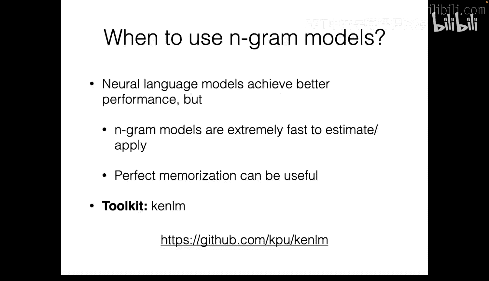

Where was the。The k divergence。Yeah。I can't find it， but anyways。

 the k divergence here is over the distribution of sequences。Whereas at the end。

 after you kind of break it down， then you could have the loss over just next tokens。

So the loss over next tokens is much easier to compute and practice。

To compute the k divergence over the sequences， you would have to compute this like summation over all possible sequences。

Can you also compute the K agents over individual words。

 right because we are also trying to predict the probability distribution of the next token scale and we compare that to the probability distribution。

YeahYeah yeah， so if you like in the code example， you could actually switch the instead of the cross entropy loss。

 you could use k divergence and it'll just be adjusted by this like constant factor。

 which is the entropy。And so， but it actually works， yeah， yeah。

So where you would see a difference is if you had the sequence level kill divergence because you'd have to like do some approximations。

嗯。Okay， so。

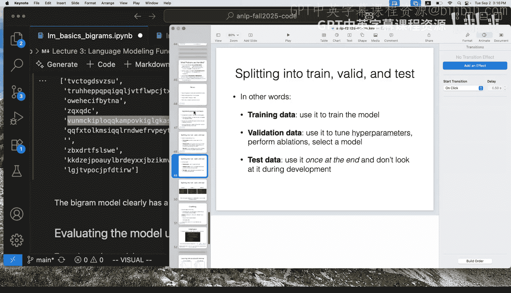

So that's the recap of this of this stuff and we're probably going to run out of time。

 so I will try to。Incorporate some of these things into the next lecture。But again。

 these are just some important。Kind of practical things which。Yeah。

 our appearing in these code examples are basically anytime you use deep learning。嗯。So again。

 this deep learning system will have multiple parts， it has the model architecture。

 it has the optimizers， the weights， the different hyperparameters。

 like learning rate and things like that。And so basically， when you run an experiment。

 you want the data to kind of give you reliable conclusions。

You don't want some difference to be due to like some specific setting of hyperparameters or something like that。

 if you're trying to establish that like one architecture is better than the other。嗯。

So here's just a few different things that are kind of related to to that to having like。

Setting up good experiments and things like that。So first is this idea of splitting into train valid and test sets。

嗯。And here you could kind of justify this pretty nicely。

So let's say that our goal is to fit this distribution P star。嗯。Then as I discussed earlier。

 you can view this training data as being some samples from this target distribution。Okay。

 and you're going to use these samples to fit your model P Theta。

But then the thing is is like we actually don't want to just fit the training data。

 we actually want the model to generalize to new data that's not the training data。

Right you don't want it to just memorize the training data and then be useless on everything else。

So what we do is we hold out some extra samples called the validation data or Dev set。

And these are used to check how well the model is generalizing， you know， it's one measure of that。

And then what we could do is like we could change our system so we could change the number of layers or change like the hidden dimension。

 whatever you want。And then based on this validation performance， you can choose the best one。

And this is basically saying that， like， okay， we're going to choose the model configuration。

That in some sense， generalizes the building。Okay。However。

 there's actually an issue with just doing this。Which is like in some sense。

 what we've done is we've chosen the system。Based on how well this validation。Based on how well。

 sorry， we're choosing the system based on this validation performance。

So we still have to do one final check of how well does our final system generalize？

And that is what we do with the test data。So here you hold out another sample。

And you want to use this as some kind of unbiased check of the final configuration。

And so if you start using the test data to like design your system。

 then it's kind of defeating the purpose So you'll hear of this term of like overfitting to the test set。

 things like that。That's when you're using the test data in the process of designing your model or setting its hyperparameter。

 et。So I think I'm out of time for today。But so I will make sure there's time in the next lecture to keep going through these things and that's all for today。

 Thank you。

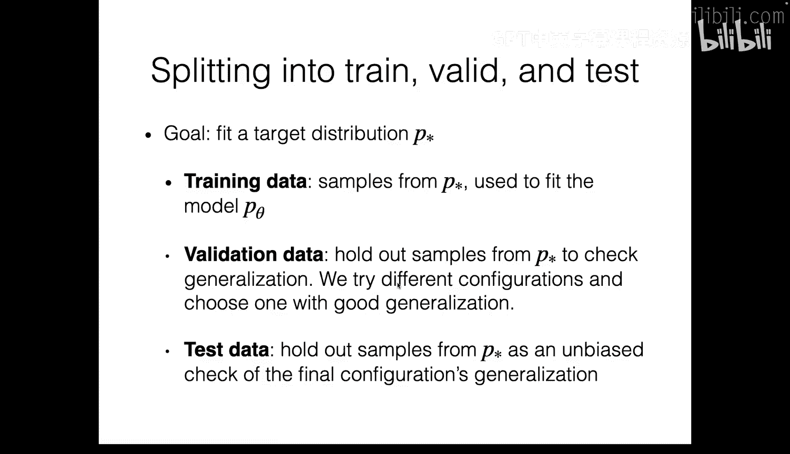