# CMU《高级自然语言处理｜CS11-711 Advanced NLP Fall 2025》中英字幕 - P4：(4)_ Recurrent Neural Networks.zh_en - GPT中英字幕课程资源 - BV1ZWYAzuEMa

Recurrental neural networks。So this will be the first lecture that's dedicated to a type of architecture。

 we'll have a few different lectures on architecture so next time we'll talk about transformers。

Later in the course， we'll talk about a mixture of experts。

 which are really common now and we're putting it as more of an advanced topic。

We'll also talk about architectures for extremely long sequences。

 things like that later in the course。But this will be the first kind of lecture dedicated to this。

And the interesting thing is that ideas from recurrent neural networks are still trying to be incorporated into different architectures today。

If you can compare this with like the next lecture on transformers。

 you can see that they're kind of difficult， sorry different。

And they have kind of different trade offs。Additionally， this really important concept in。

Modern advanced NLP， which is called attention。Was actually invented in the context of these recurrent neural networks。

So basically， since attention is really important， it's good to get good intuitions for what it's doing。

I'll actually talk about attention at the end of today's lecture。

 and then we'll talk about it again when I talk about transformers。So with that， we can get started。

嗯。So to recap what we talked about last time， we talked about language modeling and we talked about having these NG models。

And so language modeling is just one example task， but when we consider what kind of architecture we were using for language modeling and actually also for the classification models that we talked about。

It was this kind of multi layer perceptron， right， so you just have these very simple layers and you stack them together and there's some non linearities。

And really， the limitation here was that you had this very short context， so you had n -1 tokens。

And the way that the architecture worked was for every new token that you want to introduce。

 you basically concatenate。 and that's not very scalable if you like。

 let's say you have a million tokens。The now the size of your architecture is actually growing as a function of the sequence length。

So that's what we talked about last time， this lecture we're going to talk about a different type of architecture。

 which is called recurrent neural networks。And at least in theory。

 these will give us the ability to have an infinitely long context。Which is pretty cool。

And it'll also motivate the use of attention because what happens is that theory doesn't always line up with practice。

And it turns out to be kind of difficult to just have an infinite context。

 so in practice we'll want to kind of attend over different information and then like compress it into a single vector。

 and then if we go back to what I was talking about last time。

 if we use a recurrent neural network for language modeling。

 you could use it for other things as well。Now our model will look something like this。

 so again we have this auto regressive model， but now we don't have to go just like one token or two tokens back。

In principle， now we could predict the next token using all of the previous ones， okay？

So it becomes a kind of more expressive， richer model that you can learn。Okay。

 so first I'll introduce recurrent neural networks。

Then we'll talk about what happens when you train these really simple recurrent neural networks in practice。

So I'll talk about this important idea called vanishing gradients。

And other architectures and different kind of techniques that are used to overcome vanish ingredients。

We'll actually see them come up in transformers as well。

 it turns out the ideas that went into transformers didn't really come out of nowhere。

 they were actually built on a lot of these ideas that were invented for RNMs。

Then I'll talk about this encoder decoder architecture。And then finally， attention。Okay， so first。

 recurrent neural networks。So first， I want to just introduce this idea of we can call it a sequence model or a sequence architecture。

And the definition will just be some function， so it'll be some neural network。

And it takes in a sequence， so here we have some tokens。X1 through x， and the length can vary。

And then for each token， it gives us some vector， so it gives us some vector H1 for token number one and so on。

And kind of without choosing a specific implementation， it visually you know， looks like this。

 so again， you get some tokens。They start off as these vectors。 And then the output is。

 you get these vectors。Which are kind of representations associated with each token。And here。

 especially in this lecture， we're going to give a name to these。

 so we're going to call this the hidden state HT。嗯。Now， what can you do if you have a sequence model？

Again， we can separate the。The parameterization or the architecture with the particular task that you're using it for。

So here if we have a sequence model， we can actually use it for the task of language modeling。

So what you can do is if you want to predict the next token。

Then you can take the sequence model and you can basically add on this kind of output layer。

And now you can have some scores for each possible next token。And then that will give you this。

Next token distribution that you need for a language model。Okay。

 but you could imagine doing other things， this isn't like the only way you can use a sequence model。

So again， it's good to separate。What you're using in architecture for from the kind of architecture itself。

 that's all I'm trying to。Ill kind of say it right there。

So then if we take a look at different types of sequence models。

So the one I'll go into detail today is called recurrence。And so here again。

 we'll go into a lot of detail on this， but here the kind of key idea is that。

These hidden representations are going to be kind of conditioned on the previous ones。Right。

 so here we have the one for the first token and it kind of gets passed this to the model to produce the second one and so on。

嗯。Another one which we're not going to go into in in detail in this class， but it's good to just see。

Is called convolution。So with a convolution you do something different。

 so here instead of taking the previous state here kind of persively， you define this kind of window。

And then the hidden representation will be based on the inputs within this window。

 so here we have like a window size of three， and you can see that the hidden state is a kind of function of those three things。

And again， this is just showing the kind of key， the key idea on that。

m goinging to all the details here。And then in the next class。

 we'll see models that are based kind of purely on attention。So here again。

 you're not necessarily going to or you're not going to take this。

Output hidden stayed and kind of feed it back in。Now with attention。

 you're going to somewhat generalize this convolution， you're going to say， okay。

 each position can be a function of any of the tokens。Or any of these inputs。

And then you want to learn some weighted some of them。So again。

 we'll go into a lot of detail on this as well， but I just wanted to put this broad picture here before we start going into recurrence so you can kind of see that it fits into a kind of family of different approaches。

Okay， so then what is a recurrent neural network in more detail？So here's basically the key picture。

So what you have here is let's just look at this right now。What you have here is you have some input。

 and here it'll be a vector representing this token a。

And then you start off with this initial hidden state。This could be like random， it could be zeros。嗯。

Yeah， there's like various choices you can make。And then you have to compute this next hidden state。

Then you can see at the next step， you pass in this previous hidden state and the next token and you proceed。

So then the way that this next hidden state is computed is this formula here。

And so if we take a look at it， what is it saying？Well， it's actually pretty simple。

 so here we have the previous hidden state。And we have this matrix， WH。

So essentially it's multiplying this hidden state by a matrix， so that's a linear transformation。

Similarly， here we have the input XT。And now we have this other set of weights， which is a matrix。

And again， it's kind of doing a linear transformation here。And then you have a bias term。

Then to make the network more expressive， so we talked about this in the previous lectures。

 you include this non linearity here。So this could be the tan H function。

 it could be the relu function。Or there's a variety of them in one of the lectures I point into this list that's in pie torch and you can look at like the different。

Yeah， they're called activation functions that。You can use for this non nonlinear。Okay。

 so can anyone tell me here what are the parameters that we actually want to learn in this recurrent neural network？

W， H and W X， anything else。And the， yeah。So again。

 this HT is kind of computed dynamically and we can initialize it with whatever。

And then these are given to the system， so yes， we want to learn the values of the weights and the bias。

So this was here's the date， yeah， so this was invented a while ago in 1980 was the kind of original famous paper about recurrent networks。

It's also fun to go look back and read through and they do some pretty cool stuff in the paper。

 but this is kind of the most basic recurrent neural network。嗯。上个字。😔，Here， yes， yeah。

 so we already answered this。 these are the parameters that we're going to want to learn。Okay， so。

Now again。Just to drive this point home。Recurrent neural networks is not the same as language model。

 we can use recurrent neural networks for other stuff。

So here we're going to use it for just classifying some sequence。So this is the task we talked about。

In the first few lectures， you get some movie review and then you want to say whether it's positive。

 neutral or negative。And so one way to do this with a recurrent neural network is you can just take this hidden state at the end of the sentence。

And in some sense， it's incorporated information right from like all three of these tokens or the entire input。

And so then we can just add this output layer right at the end。And then again。

 it can give us these scores， so one will be negative， one will be neutral， one will be positive。

Okay， and so we can use this for this classification task that we saw in the other lectures。

And then you can use this for language modeling。So here the key difference is。At each position。

 the goal of the language model of this autoregressive language model is going to be to predict the next token。

So what you can do is like， okay， after each time step。Add in this output layer。

And the output layer will give you a score over the full vocabulary。And then the goal will be for。

 you know， the score of the actual next token to be high and the other ones to be。To be lower。

So like here you would want to predict。Bad。Hear you don't want to predict movie。And。😔，Yeah。

 this is the。Kind of task of language modeling。So these recurrent language models， you know。

 the first paper or one of the first ones are， you know the most。Famous early paper is here。

 so from 2010， and you can see this the title is recurrent neural network based languagengu Model。

Okay， so now when we think about how to train the parameters of an R&N， how would we do this？

So here what we're going to do is take advantage of the fact that this whole diagram here is kind of differentiable。

And so what we can do is at each output。We can have some loss。So like here。

 if you're doing language modelttling， then you'd have some loss for the next token。

Similarly here and similarly here。嗯。And then you can just add them together。

 you can take the average if you want， just combine them。And then now you have this total loss。

So this is kind of performing， you know， the the forward pass。To get the lost computation。嗯。

Then after doing that， you can just run back propagation。So。Here。Yops。Yeah， so here， as I mentioned。

 you can kind of follow any path that you want here。And the whole thing is differentiable。

 So here we just had the。Linear transformations and the non linearity here。

 this is just an output layer with like a linear transformation。

And then the loss will be differentiable， so again you can just use this back propagation algorithm that I introduced in the previous lectures。

So really it's not。It's not like too different from training the food forward model when you kind of view it as this kind of unrolled computation graph。

So this idea was historically called back propagation through time。And it basically refers to， yeah。

 viewing the R&N as。Kind of being this unrolled computation graph that you could then back propagate through。

Does anyone have any questions so far， probably a good time to pause？Okay， great。

 so here an important thing to note with these RNNs。😊，Is that there's this idea of parameter tying。

 so。In this image， you know， it's looking like different kind of blocks here。

 but then each block just has the same parameters。 and so across different time steps。

 these gradients are kind of accumulated and you have a single set of。

Prameters that are kind of shared across time。Okay， so then just to kind of complete this example。

 if we want to train a language model based on our recurrent neural network。As our loss。

 we'll use this loss that we saw in the previous class。

So here we're saying the negative log probability of。Token x2， given x less than 2。 So given x1。

And so here the basic idea is you have this。Training sequence in your training data set。

 and then yeah， you're coming up with this loss， which is encouraging the model to increase the probability of the next token in the sequence。

So here you can look like at the end， you have you might have this like special token and the model has to increase the probability of end given these previous ones。

And then you can see here that based on the way this model is set up。

 it can't really cheat in some sense。Because it's only receiving information from these previous tokens。

嗯 okay。So so again， that like using this loss， the log probability of the next token。

This corresponds to doing maximum likelihood estimation。

So this is what I talked about in the previous lecture。And again。

 I'm just repeating it here and making this connection that， yeah。

 that's the reason we'll see this kind of loss function coming up for training a language model。嗯。

Okay。So。So this is an interesting thing about RNs。So if we look at this， then。

If you think about like， let's say we have a really long sequence。嗯。

And we want to compete the loss for， let's say the last step。Well， then to compute the loss。

 we need this H3。But to compute that， we need H2 and H1。嗯。

And so it gets hard to kind of split up the computation because of this kind of recursive or temporal dependency in the RNA。

When we see the transformers， it'll be a lot more straightforward to just kind of split up。

The computation of each tokens loss and you know， send it to different devices and things like that。

And so this will turn out to be in practice， like a big reason why the transformers will be advantageous。

There they turned out to be kind of easy to parallelize and then that helped with scaling them up。

Of course， I'm kind of just summarizing this issue here。

 people have tried to come up with ways around that and still scale up the RNNs。But certainly it's。

 yeah， kind of much less straightforward with this recurrent neural network than with the transformer that we'll see in the next lecture。

Okay， but on the other hand， there's actually this really big benefit of RNNs。So if we think about。

 let's take the task of language modeling。And let's again suppose we have a like really long sequence。

Like a whole book， like the models generating a whole book。And it's at page， let's say，1000。

And it's going to generate the token you know， on page 1000。

 and so you want it to be dependent on the entire previous book。

Then the question is like what is actually needed for the model to you know。

 generate that next token？Well， when we look at the diagram。

Basically all you need is this one vector here。So here we're generating the next token cat and you can see that all it's using is this vector here。

And to compute this vector， you can really go just like one step at a time， and at any given point。

 you only have to store kind of one vector。And so this could be really beneficial and it'll actually be much different from what the transformer is doing。

 which will be to try to kind of attend over all the。

Proceeding tokens as it's going to generate the next one。So yeah。

 this is a kind of advantage to the recurrent neural network。

If the model is able to really compress all of the relevant information into this one vector。

Then you can do this very fast kind of inference on really long sequences。はい。Okay。So yeah。

 you'll have constant memory as the sequence length increases。And then， yeah， again。

 each step here is just like kind of local like I talked about。And so yeah。

 so we'll compare this to the transformers in the next lecture。Okay。

 so this was actually it for the simple RNNs， and then we'll get into the issues with these in a bit。

But I introduced this idea of a sequence model or a sequence architecture。

And it takes in this input sequence and gives you these hidden representations。And then here again。

 the key idea is to transform this hidden state at each step。

And then you could view this intuitively as being， you know。

 some kind of memory mechanism or compressing all of the history into this hidden vector。

 things like that， and those are good kind of intuitions to have when you're thinking about what these you're doing。

And then again， the nice thing is we don't have to change much in terms of。Training， you know。

 in terms of we can just back propagate through all of this。And yeah， train it in that way。

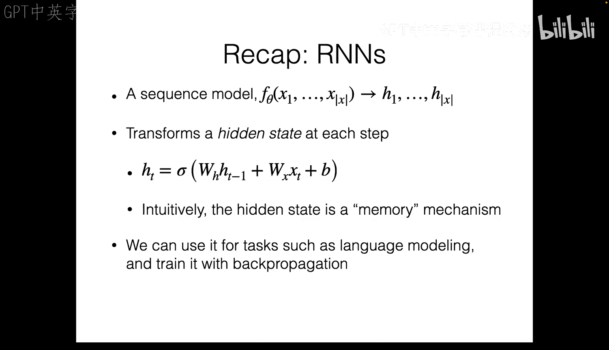

So in the courses code repository， we have an implementation of the RNN。

And it's kind of manually going through and implementing it。

 and so it's not going to be the most efficient， but you can kind of see。

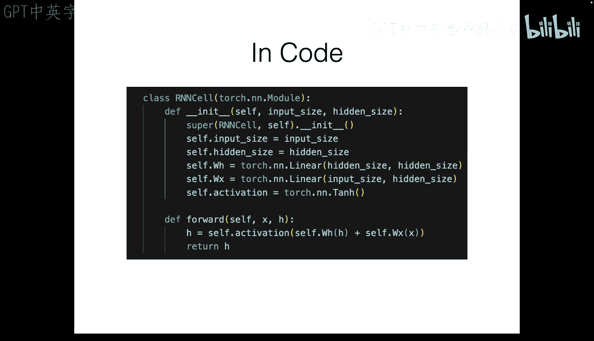

How it works here。And so here it's actually training a recurrent language model again for this task of generating different names。

And so here it'll go through all of the。Kind of details of setting up the， Yeah， the data。嗯。And yeah。

 actually defining the architecture and so on。So let me see if there's any kind of interesting things to note here。

So here one thing to。Yeah， one thing to kind of get comfortable with if you haven't seen this before is when you're training the model for language modeling。

Then you want to consider like what are the inputs and what are the outputs？

And so here this is just saying that like okay， at each step。

 the input is going to be x and then the output is going to be the next token so you can just like shift。

 you know the you can shift the indices here so that for say like token one， it's predicting token2。

So you'll see this a lot in any code that's training language models。

And then here's the actual implementation of this RNN cell and you can see that it's very。

 I mean it's what I had written on the slide there。

 the bias is actually implemented inside of this torch linear layer。

 so it's even simpler than what I had on the slide。嗯。And this will be the kind of cell。

Then you could define a language model using the RNN cell。

So now we have to have this embedding layer and this output layer。

And then here is the forward function。So this is just saying like at the first step。

We're not going to have a hidden state so you have to initialize it somehow。

 I think this is probably just， yeah， setting them to zero。嗯。

And then here it's going through and just using this for loop。 So it's saying like， okay。

 for each position in the sequence。You're going to compute this hidden state。

 And you can see it's taking in the previous hidden state。

And then we want to get some output for that time step。Okay。

 so then we can concatenate them together and you'll get this output of the sequence architecture。

 so for each position you'll have some like output vector。Okay。

 so it's worth kind of stepping through and making sure you understand this。And again。

 you can take a look at the implementation of RNN that's inside Ptorrch and compare and contrast。嗯。

So， so yeah， that's up。And then here's another thing， which is padding。

So here when you think about it， the different sequences will have different lengths。

And so what we want to do is have a batch of multiple examples。

And this will allow us to take advantage of parallelism。

So instead of just computing the loss and doing back propagation for one example at a time。

We can do it for like 8 examples at a time or 16 or 256。So that's called batching。

And then when you're doing this， when your output is a sequence。

Then the sequences will be of different length。So what you have to do is you have to ensure that the batch is。

 you know， a matrix。So you have to add in these extra padding tokens。嗯。So that。Yeah。

 so that you have a matrix， you know， like each row has to be the same number of columns。So yeah。

 if you haven't seen this before， then this idea of padding is， yeah。

 really important for actually implementing this。And then with padding， the thing is。

 is you want to ensure that the loss or the padding steps。Is is masked out。

 so not taken into account。The reason is that like if you consider giving。

 let's say we give this name to the model during training。

And one time it has like four padding tokens and the next time it sees it。

 it has like two padding tokens。Then the total loss for the sequence would be different。

 just as a result of。You know， having other items in the batch。Okay。

 and then here this is just showing the training loop。

 and it's actually not too different from the one that we saw in the previous class。So yeah。

 you can train this and let's see。Sample some names from the model and now it's starting to look more reasonable than the bygram model we looked at last time actually。

 yeah， starting to resemble kind of some nice names here。

The other thing you can do is you can prompt the model。

 so this is like a simple example of prompting。So prompting means that you remember these language models predict from left to right。

So you can basically just enforce you know the first few tokens or certain tokens called the prompt。

So here I'm going to force the model to have S as the input and then complete。And yeah。

 now you can see that the outputs all start with us。Okay。

 and then certainly here you can see if we think about， you know， at the technical level。

 here you can see these longer range dependencies。If you remember last time with the bygram models。

 there was basically nothing past one token， and when you think about these names。

 there's clearly some structure that's longer than two tokens。

So that's what the sequence model is giving us here。

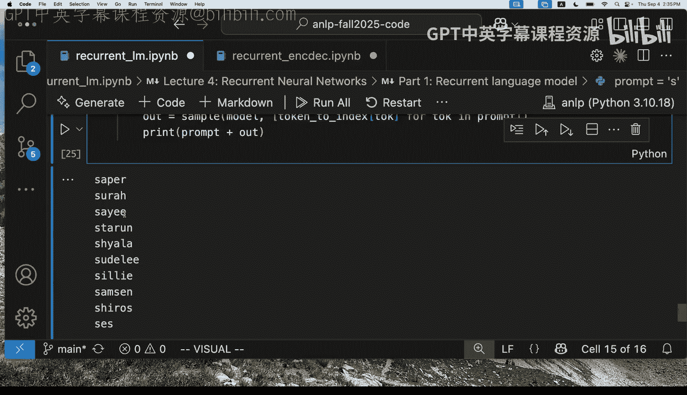

Okay。

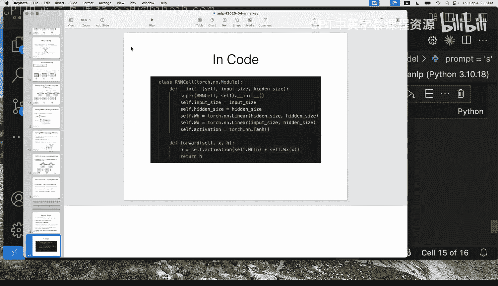

So that's the simple RNs and。Now I'll start going into some drawbacks with the simple RNNs and some architectural innovations that were developed on top of this。

So one really important issue is called vanish ingredientss。

So here if we think about what happens when we do this back propagation through time。

Then something interesting happens。Let's say here at the very end。

 we have a gradient and the scale is kind of normal。Well。

 what happens is and I'll make the argument on the next slide。What happens is， you。

 suppose this is less than one。Then you'll start multiplying these。

Graads that are like less than one together。 And just as a consequence of kind of moving back in the network。

 the gradients will start to shrink。So here it might be small， here it might be tiny。

 and eventually it gets very small。And so as a result， again。

 the gradients are updating the weights to kind of minimize the loss function。

And what this is basically saying is that if these gradients are virtually zero， then the impact。

 like the update the grade to the weights， is really not taking into account the very long range dependencies。

Similarly， the opposite can happen， which is called explodeloding gradient。

So suppose the numbers are larger than one， and then you start kind of multiplying them together and I'll show you where the multiplication happens。

Then this can grow and these can get very large and lead to these kind of overflow errors or the training will just crash。

So you have this kind of issue of needing to somehow stabilize the gradients to either not be too small or not be too large。

嗯。So here， if we want to look at the details of why this occurs。嗯。

The details here again are in the reading that is suggested for this lecture。

But here I'll kind of give the key part of it。So here we have the normal RN。

And here we're predicting some output。Then if we look at the gradient of the loss with respect to the weights。

Then it'll look like this， so it'll be this summation over time steps。

And then this is just working out the the chain rule。 You can see that， you know， ultimately。

 we get this partial L and partial W。 And here's the kind of things in between。And again， here。

 just in the name of time， I'm just going to kind of go through this kind of quickly to show you the key idea。

So what happens is this term here becomes problematic。So this term here turns out to be of this form。

So it's basically saying for each time step， we're going to add on this term that gets multiplied。

So you end up having this product， which is the number of terms in the product is the number of time steps。

So now we can consider， okay， let's look at one of these。Well。

 then this is a this gradient is of this form， this is just using like。You know。

The standard derivative formulas， you can get this。So this is each one of these terms。

And then you can take a look at this。And so the derivative of this 10h is between0 and 1。

And so remember I said that like things start to be less than one。

 then that could be problematic because they can vanish。And then if we take a look at this W。

Then you can do this matrix decomposition。And it turns out that you have this property that when it's dominant eigenvalue is less than one。

Then， if you。If you exponentiate it multiple times， then it'll go to zero。Conversely。

 if it's greater than one， then it'll go to infinity。

 so you have to have you have to get like really lucky for it to be kind of stable。So anyways。

 as a result， this here has a like very high chance of either vanishing or exploding as the sequence length is getting longer。

 that's the kind of high level takeaway from this argument。

So this was actually like a big problem for a long time and it was like really difficult to either train the model or it like wouldn't be able to model the long dependencies。

So yeah， a variety of different techniques were developed。

So one of them is called gating and another one is called these additive or residual connections。

So here the basic idea is。We want to kind of control the flow of information across time stepss。

And so here。We'll have the model。Output what is called a gate。

And so the gate will be something which is between zero and1。

And if we consider what happens when the gate is zero。Then what happens is it basically just。

Keeps the hidden state from the previous time step exactly the same。

So here if you want to kind of retain something over a long horizon。

 then the model could learn to kind of set this gate to zero and it would literally just like copy the previous hidden state from the。

Yeah， from the previous time step。Conversely， if the gate is set to one。

 then the model will kind of store new information or add new information to the hidden state。

So that'll be this H tilde of T。嗯。And I think I'll show the H T of T on a different slide， but it's。

 you know， it's nothing too surprising。But the idea here is yeah。

 we can add in this gating mechanism and then in principle the model can kind of learn to adjust it if it needs to kind of store information over a long time range or if it needs to。

Kind of erase or or write， add new information。And so here yeah， if you send this to zero。

 then the gradient would just be constant。So。Here， another thing to remember is that what's happening is the model is getting。

This current hidden state and some input。And then here it's again， just like learning this this gate。

 So these are going to be some learned weights。And it could be between zero and 1。

And then what it's doing is this Z T is a kind of vector。

 so it can actually learn like some dimensions will be high， some will be low。

 some will be in the middle， things like that。And so it can actually like learn to like set aside some dimensions to store information and some to like update information and。

Yeah， things like that。嗯。Okay。So that's the idea of gating and in a second I'll show you a kind of full architecture that incorporates this idea。

The other one is this idea of residual connections。So here you can see that。If the gates is set to。嗯。

Oh yeah， if you just have no gate， then there's this other idea of learning the difference or the residual。

So here we have the previous hidden state。And then basically。

 instead of producing an entirely new hidden state。

We'll want to have the model produce just the difference。So。嗯。

The difference here will be this residual。Right， if you do like H minus Ht minus。Ht minus Ht minus1。

 it will equal this。And so again， we'll want the model to just predict this kind of difference here。

So an architecture that takes advantage of these two different ideas is called the gated recurrent unit or GRU。

And so this one again， you can view it as just， you know， a sequence。Model sequence architecture。

 and you just use it in place of the R&N。And so it has these different ideas。

 so it has this update gate。So。Let me just write out everything。

So here we have now like a new formula for updating the hidden state。

And the formula will be right here。And so you can see here it has this idea of gating that I introduced。

And this gate will be learned。By the network。Using these additional parameters that you introduce。

So we have parameter WZ and。We'll call itUzy。And that will determine the gate。In one case。

 the model kind of is taking information from the previous state。

 in another case it's kind of adding potentially new information。And then here。

We have this other gate， which is controlling。How much of the。

Like current input is being used versus how much of the previous hidden state and kind of combining those in some way。

So yeah， so this is the gated recurrent unit。And。Yeah， the idea was。Here。

 like one reason this was developed was in practice。

 it was able to overcome some of the vanishing or exploding gradients。And then we see these ideas。

We'll see these ideas like in other architectures as well， like having a learned gating mechanism。

So another one is so the reason I introduce this one is because it has these two different gates。

 so update and reset。So again， update says like， should I update the previous heading state reset says。

Should I just use the current input or use the hidden state in the update？

There's this other one and maybe you've seen the name， maybe you haven't。

 but it's called long short term memory or LSTM。And so this one has four gates。

 so it would be like just double the number of equations I'd have to talk through。嗯。

But broadly speaking， it's again， based on having these gates that somehow control information flow in the recurrent network。

The new thing here is it'll actually introduce a new vector called the context vector in addition to the hidden state。

And this was motivated by kind of retaining long term information。In the recurrent network。

So anyways， if you like want to use these or read further about them。

 then hopefully after seeing this GRU， you'll be able to understand the different。Yeah。

 the discussion about the LCM and you can kind of look it up。And then you can also use these in。

Pytorrch， like both of these now are implemented inside of pytorrch。嗯。Okay， so。Yeah。

 to recap with these basic R Ns， one issue is that the gradients vanish。

So there's been these better models developed to overcome this。And then as I just mentioned。

 in practice now。You can just like swap these out。 so here it's using this GRU implemented by Ptorrch instead of the R&M。

Okay， any questions about that so far sounds like it's more but kind of the gene yeah。

 so so one thing is the LSTM has。This has a separate context vector。嗯。

Whereas the GRU is kind of simpler in that it has fewer gates and doesn't introduce this additional context vector。

So it'll actually have different， you know， like memory requirements and was just simpler overall。

And then I think my understanding is that like the LSCM wasn't like widely known by everyone and so to some degree it like developed someone independently and then later there was like comparisons done。

嗯。So， but yeah， certainly there's this difference between。The additional context factor。

 and then just the number of gigs yeah。O。Cool， so yeah， this is good。 So yeah。

 we want to make sure to have time for those。 So next I'll go to the encoder decoder。😊，Um。

 so here so far， I've been talking about this kind of this task， which is like。

Just like pure language modeling， so you have like this data set of names and you just like learn the distribution of names and then you can produce new names。

But really， we want to do more useful things with these different sequence models。

So really general formulation is called sequence to sequence。

So you take in some input sequence and you produce some output sequence。

And an architecture designed for sequence to sequence。Is called encodeder decoder。

So here the idea is we'll have some model which is encoding this input。

 so this might be like a English sentence or chat history or whatever you want。

And then we'll have a model which is producing the output so that'll be called the decoder。

And that'll be the kind of output of the task。And the basic idea is that。Yeah。

 we're just going to use the sequence architectures for kind of both parts。

So let's take a look at this。So here we have。Two things。So here we have an R&N on the left。

 and this will be the encoder。And maybe I should have put a concrete example here。

 but you know this might be。Let's say it's a movie review written in English。

And then this why will be the movie review written。In Japanese。Okay， so this encoder， the job is to。

Encode or kind of come up with some vector， which represents this input。 So like this input。

Review that's written in English。Then what you can do is， okay。

 now we want to actually produce the translated review。

So you can take this encode director and just use it to initialize the state of the second RNN。

 which is called the decoder。Now you can see here that this decoder is kind of like a language model。

In the sense that， yeah， you have at each different position。

 you have this output layer and it will give you this distribution over the next token to predict。

And so when you think about it。Here the kind of zoomed out core idea is use some RNN to encode the input and use an RNN to produce the output。

嗯。But actually， if you looked at this for a while， there's actually like a lot of different design decisions。

Like， for instance。Is just using this vector at the end。As the initialization for the decoder。

 is that like the best thing to do？Second， when you go to predict a token。

What should this output layer have？Like maybe it just takes in the hidden state， but I don't know。

 maybe it's helpful to also give it this context vector and things like that。

So anytime you see one of these encoder decoders written down or like used in a paper or something like that。

 sometimes they'll have like slightly different design decisions like。Here。

 you know when you're protecting the output。Sometimes they would。呃。Oh。

 sorry here when they were predicting the。Recurrent update， they were using this context vector。

Whereas like in principle， the model could have just like retained it in the hidden state。

 things like that。But anyways， that's the kind of basic encoder decoder here and so yeah。

 the original one was from this paper here if you want to go read about it。

Where Y zero comes from is another design decision。

Oh oh yeah so that's a good question so here the y zero if you remember in our examples we had this like special token to denote the start of the sentence or start of the sequence so that's what the y zero will be so yeah you always need some like starting token so you could just add in the extra one。

嗯。And then again， if you're training for this task， then nothing really changes。

 you just use this same loss and it'll just be over the output。Okay。

 so now one question is when you think about it。嗯。Here it's basically saying， I mean， again。

 suppose this was like an entire book or something。

Then it's basically saying that up front you have to this model has to learn to put all of the relevant information into the single context vector。

That is then used to predict all subsequent tokens。And so the question is。

 is there a way to kind of do better or even like generalize this idea？

And so this will motivate the use of attention。So。Here the idea is。At each time step。Here。

What we're going to do is we're going to try to compute a new context vector。

And the context vector will basically be a weighted sum of。These vectors from the encoder。Okay。

 so like now when we're going to predict the second token。

 the context vector can be different than when you're predicting the first token and so on。

And so the model won't have to kind of up front press all of the information into this one vector。

So that's just the you know kind of motivation and then here's going into the idea。

So here what we want to do is in the encoder。Encode each token in the sequence into a vector。

And then again， one word。Generating so the decoder perform some linear combination of the vectors。

And it'll be a weighted combination， and the weights will be called attention weights。

So here to kind of assign some notation to it。Here we're going to say that the outputs of the encoder at each step。

Will be these vectors， H1。Encodeder through HN。Then we're going to consider like at a given time step of the decoder。

We're going to call the hidden state H。Now we're going to define an attention score as some function。

 and I'll go into a couple examples in a second。Of this hidden state H。

 and we can call the hidden state a query。And with each one of these encoder states。

So here we're looking at like position。N in the encoded sequence。

 what is the score or what is like the attention score for that position。Okay。

 and then the output context is just going to be a weighted sum of these encoder hidden states。Okay。

 so again， we go through and we compute this score between the query and each key。

We get some weight and then we take weighted sum and we get some back there。

And so you can think of this as like these keys is you can think of this if it's helpful in terms of like information retrieval。

The encoder is basically saying here's different vectors that represent the input sequence。

And then the query is saying， okay， I'm going to go through and come up with a score and see which ones are actually kind of relevant or useful for the task。

 which is like predicting the next token。So there's different options for these scores。

 so a really simple one is you can just take the dot product between the two vectors。

You can also introduce like an additional weight matrix。嗯。So this will be， you know。Yeah。

 now you can learn weights specifically for computing the score。嗯。

And then this was done in the original paper。 You can also make this kind of nonlinear。

 and so now you have。Yeah， the weight as well as this nonlinearity。So again， this can become a。

 you know， design decision and。Yeah， they could have different trade offs。This might be too simple。

 this might be too expensive， so maybe in practice like bilinear is not too bad。

So one benefit of the。Of the transformer architecture that we'll talk about。

Is they'll specify like a specific way of repeating the attention score。

 and then that kind of fits into the recipe and it turns out to work。Kind of work， okay。

But at least when these were being developed， you can try these。Kind of different options。Okay。

 so just to illustrate this visually in case it's helpful。

This is showing what was on the previous slide but visually， so here again。

 the encoder is computing these different output vectors and those will be called the keys。

Now at each time step， so this is looking at like time step number two。

 you'll have some hidden vector of the decoder。And that will be this query here。

And then you're computing these attention scores with one of the like dot product if you want。

And then taking the weighted sum。 And you get some context vector。

Then you can use that context vector in this output layer to help predict the next token。Okay。

 so that's the idea of attention in the encoder decoder model。And again。

 the key difference is the model is kind of learning to dynamically create this context vector at each step。

Now， can anyone tell me a。Kind of downside with us， especially if we imagine。

 let's say we're encoding an entire book。嗯哼。😊，It full fence blur to exactly yeah。

 so now we kind of lose this nice property that we had about yeah， being kind of O。

Now at each position， we have to go compute these attention scores for yeah。

 for the whole encoded sequence。O。And so yeah， that's important to remember because again。

 in the next lecture we'll talk about transformers and transformers are like based purely around attention versus recurrence and so they'll have this issue of the quadratic。

Comp cost。UThis is just visualizing the the scores， you know， one ways to take like the dot product。

嗯。And then yeah， here it's showing putting the context into the output layer。

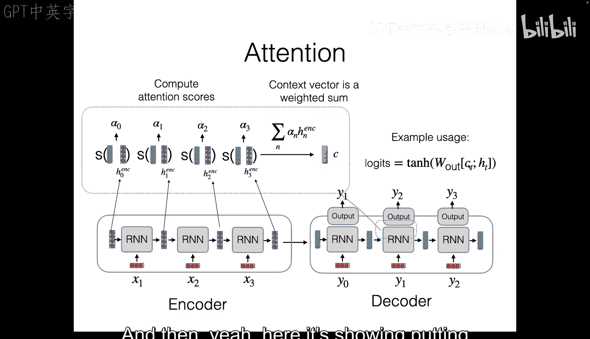

Okay， so here's the kind of famous example from from this paper。

So this is looking at the different attention scores that are assigned as the model was doing this translation task us。

by assigned I mean like， okay， so they trained the model and now they're going to use it to translate。

From English to French or from French to English。And then they're just visualizing like what attention scores did the model produce as they're using it？

And it's kind of cool， so you can see here that in order to predict the word。

The it is attending almost purely to this right here。Here to。Cdt European。

 it's looking at the French equivalent， someone could probably pronounce it better than I could。

And yeah， you can just see here that the model has kind of learned to automatically look at the kind of relevant information in the other language as it's producing that token in the translation。

嗯所有。嗯。Yeah。Kin of cool。 and and。It really shows。Kind that the model is learning something about the structure of the sequence to sequence mapping here。

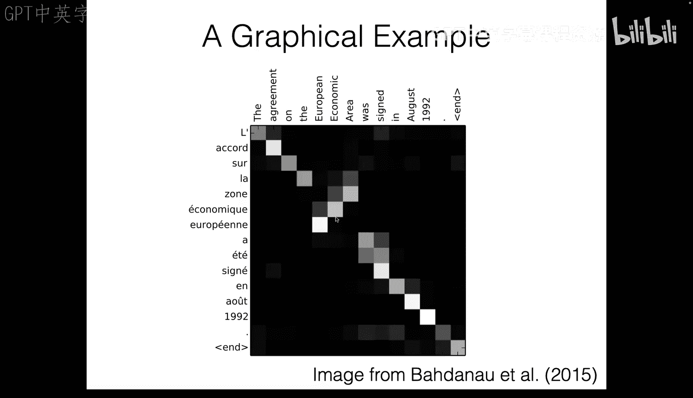

So here we also have an implementation of this and it actually shows you how to visualize the attention scores as well。

So here this is showing implementing the dot product attention。

So here you can see you have the keys and the query。

And then this is just doing this matrix multiplication， you know after transpo。

 so it's taking that product of a lot of things at once。And then， oh， I forgot to mention that， yeah。

 usually these scores will be normalized。The attention scores。

 So here you can see that it's taking the softm。So again， you can think of like at each step。

 it's going to be。Allocating scores that have to sum up to one across like different parts of the sentence。

 parts of the input。嗯。Okay， and then here is the code for the forward pass。

So here we will encode the sentence。And then we'll decode。

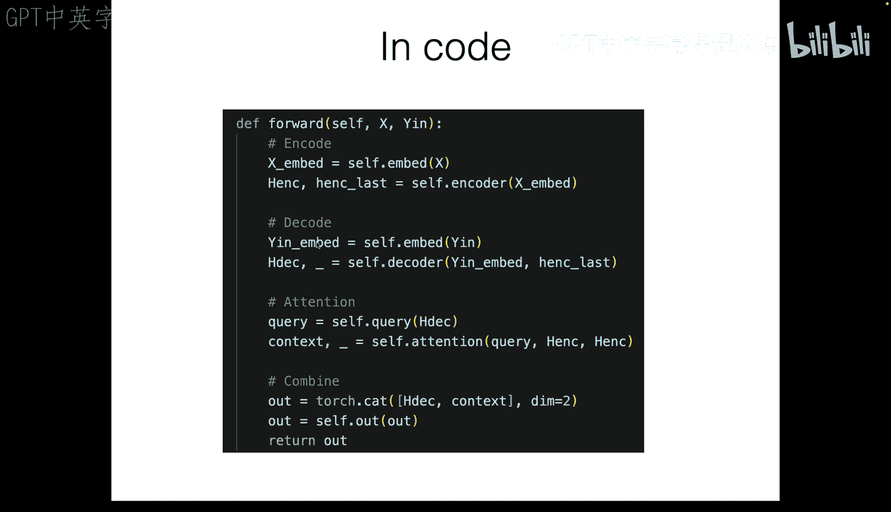

And。Maybe let's， let's just take a look at the code here。

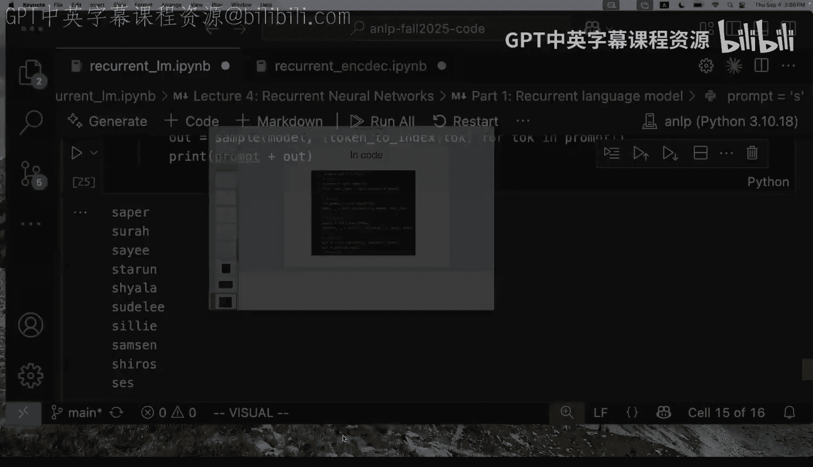

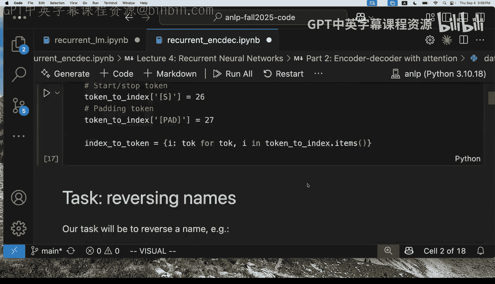

嗯。So， yeah， I think I have some time to， to just show you this。So。Here again， we're doing names。

 but when you think about it， like names aren't really an input output task。

 just like generating a name。So here， I came up with this fake task of reversing a name。

And then just to make it more interesting。Basically after each character of the input。

We're going to add some noise character。So a noise character is just like uniformly。

 I'll pick some character and just place it there。So here you can see that like Sophia has been。

 the input to the model will be。You can see Sophia is still here， but then in between each one。

 there's some random character。And so the model has to learn to kind of ignore the random characters and reverse the name。

Okay， so。And then we can take a look at the attention and maybe see that it's， you know。

 ignoring the the noise。So here's just constructing the data。

And then here is if you want to take a look at this later。

 this is just writing out the computations that are involved in producing the。

The attention weights and doing the weighted sum。So again， here we have。queries。Keys， and then。

What you're doing， the weighted sum of。And so usually those are called values。Here。

 the values are just the same as as the。as the keys。And so yeah。

 maybe I won't step through this in detail， but you can take a look to make sure you understand this。

And then this is what I was saying before where since we're taking the softm over the weights。

Then the sum of weights at each。Particular time step will equal one。Okay。

 then this was what I showed you on the slide， and then here's the whole encoder decoder architecture。

USo here you could see， oh， I guess yeah， it's using GRUs instead of the RNNs。

And you could see that you have one for the encoder， one for the decoder。

 Then you have this detention layer。And you have the normal embedding layer。嗯。

As well as these two linear layers。So one linear layer will be for the output。

And you can see that it is now the hidden size times 2。

Because it'll take in the hidden state as well as the context vector。And then this query is just for。

Tranforming the。Hid in state before you do the attention。So again， this is a kind of design decision。

 but yeah， you can see that it goes from the hidden size to the hidden size。嗯。Okay。

 so now what happens is you encode the sentence， the input X。And now you're going to。嗯。

You're going to decode。 I guess the term here is a little bit。It's basically during the forward pass。

To look at to get the hidden states。And then here it's computing the。The attention， again。

 as a function of the。嗯。Hidden states。That had been transformed。And the encoding vectors。

So then you get this context and the context will be you one for each time step。

And then you combine them， and then you get the output of the network。So again。

 this could be tricky if you're looking at it quickly because it's doing， this is at training time。

 it's trying to do the kind of whole sentence at once。Then when you actually go to generate。

 you're going one token at a time and maybe this one looks a lot more kind of intuitive。

So here again， we're going to encode the whole input sequence。Now we're going to start generating。

So you embed。嗯。You embed the previous token。Then you pass it through the decoder to get some hidden state。

You do the attention to get the contact， and then you produce the next token。Okay， and then。

Here it's selecting like the token that is。Highest probability。

And then you'll feed that in for the next step。嗯。So， yeah， we'll talk more about。

How you select these tokens， like highest probability or drawing samples， things like that。But yeah。

 this is the generation procedure with the。En cutter decoder。Again。

 it's just showing you the batching and the padding。Again。

 the the training loop stays roughly the same， of course you have to like make sure the data is managed correctly and things like that。

嗯。And then here you can generate examples。 And so。This is。

This is only printing out the original name。 It's not printing the noise characters。

 but you can see that it's learned too。Kind of ignore the characters and do the， do the reversal。

And then finally here， you can save these attentions and then visualize them。

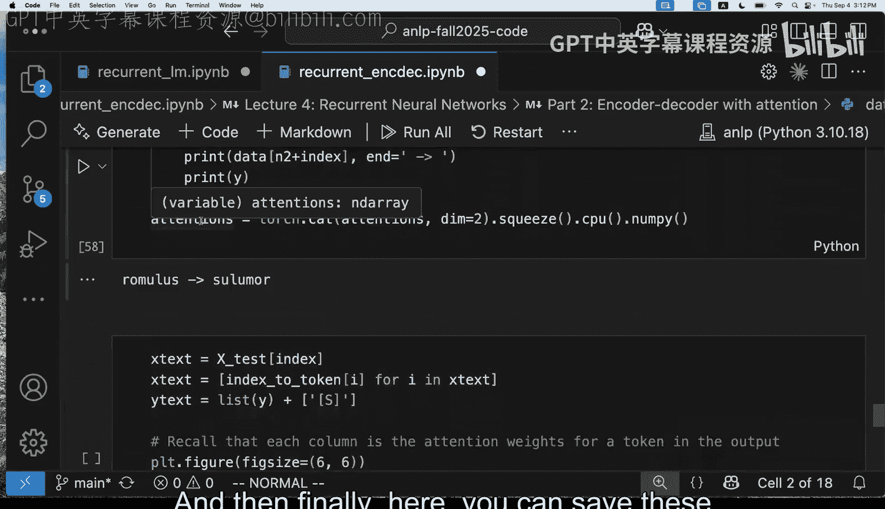

And so here it is。So on the y axis， we have the input and the input was this name。

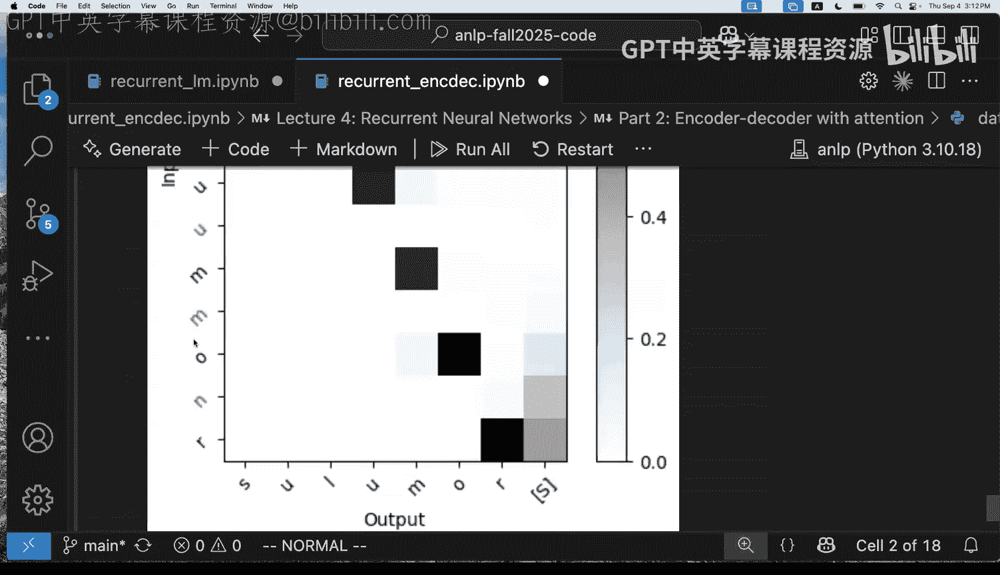

呃。

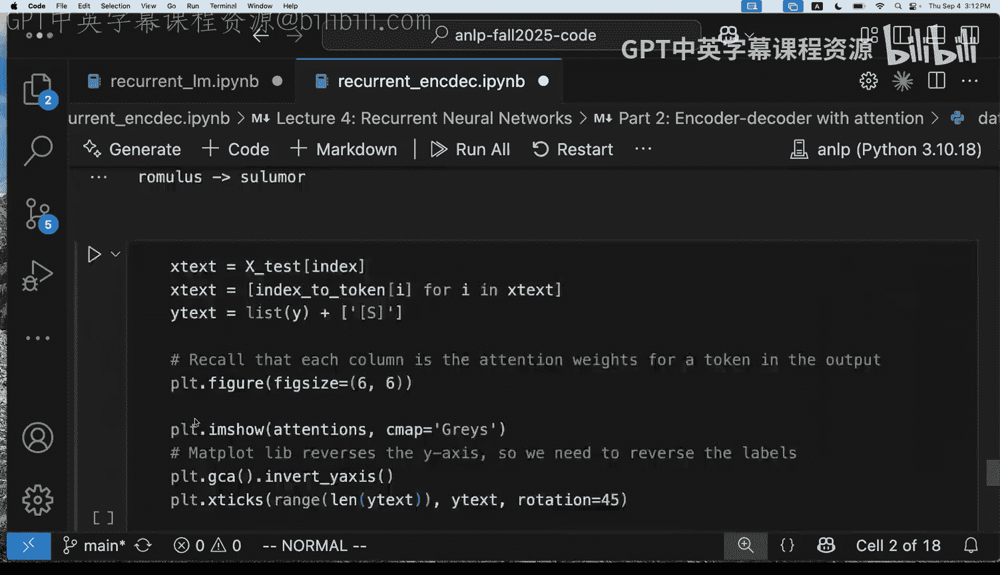

The input was romuluous。And then， you can see that。After each character。

 there there's a noise character。And so let's consider what happens when the model is predicting S。

You can see that it's attended to。Pretty much only us。And then similarly， when it's generating U。

It's attending。To yeah， just you and it's kind of ignored everything else。

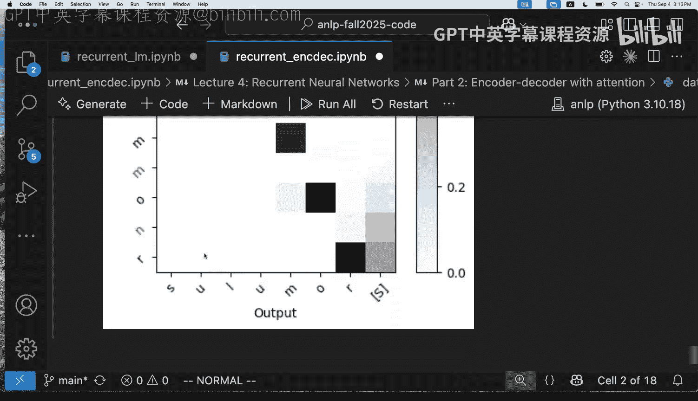

So kind of interesting。So yeah， that's the encoder decoder model with attention and using the recurrent neural network。

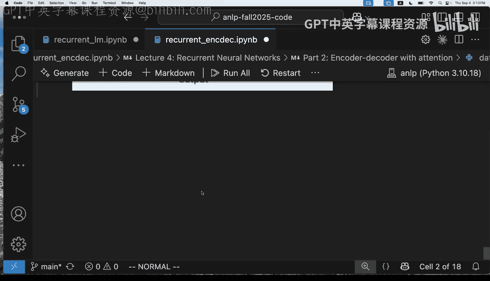

嗯。Okay。So。To。

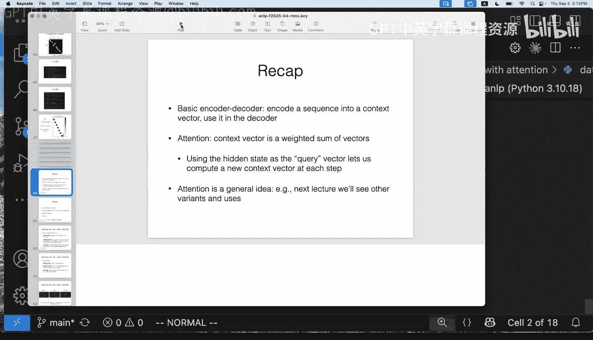

Recap。Again， the basic encoder decoder is encode a sequence into a context using the decoder and the attention will let you do this learned weighted sum。

And again， attention is kind of its own idea it doesn't have to be with。Recurrent networks。

 and so in fact in the next lecture we'll see， I think sometimes they even use the exact same slides。

 but just to show you that the idea transfers and is incorporated into the transformer architecture。

 and then the transformer will have its own kind of specific design decisions。

So in the last five minutes， I guess towards the end of these lectures with the remaining time。

 slowly we'll get through all these kind of extra basics。So the last at the end of the last lecture。

 I started talking about this train valid and test split。And basically。

 the idea is the training data you're using to train the model validation is to tune the hyperparameters or perform ablation。

 and so on。And then test data is you're using it once at the end。

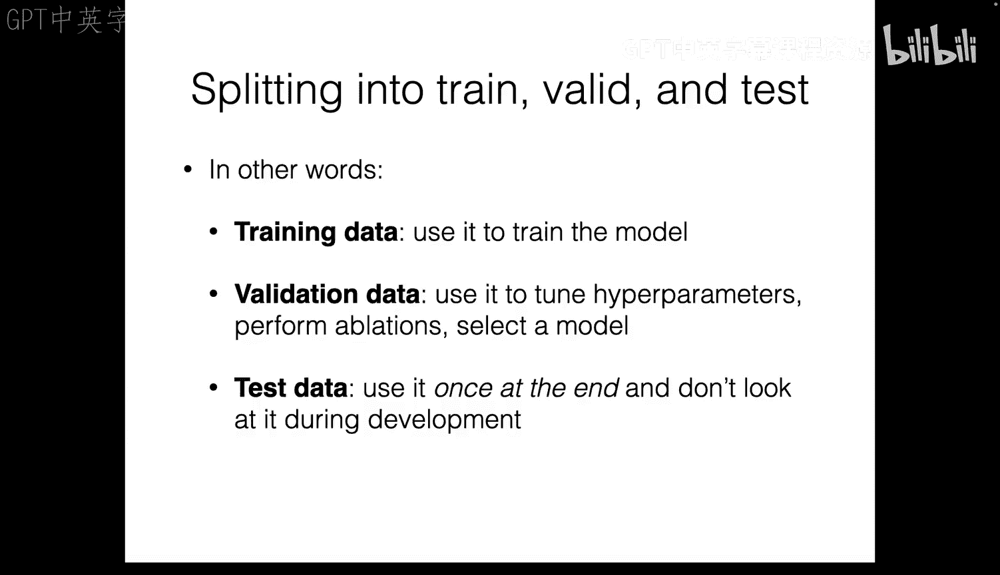

So a question is like， let's say you were training a model。

And you see these different losses and valid or dev accuracies。Then the question is。

 which model would you select based on these？I guess its actually kind of easy， know。Anyone know。

Yeah， the third one， any reason why？来。Yes， you have high accuracy。

 it also turns to have the lowest training loss as well。

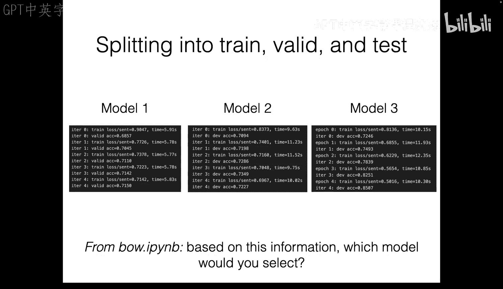

But basically sometimes you'll see different things showing up in these loss curves。

So a really important thing is called overfitting。So here again。

 we want to fit this target distribution。And the model might actually fit the training data really well。

But actually， it doesn't generalize。And so the symptom， like the way to observe this。

Is you'll see the training loss decreasing， but then the validation loss will be increasing so it'll be getting worse。

Or like the validation accuracy will be decreasing， so getting worse。And that again。

 means that the model is learning to fit the training data better。

But the way that it's doing it is not generalizing to the validation set。

 so that's called overfitting。嗯。Okay， so there's different ways to start to get around this。

One is sometimes different hyperparameters will impact overfitting。

Like sometimes the model might have too many parameters。

Or there's different architectural features like dropout and you can like change the amount of dropout I guess I won't go into the detail of that one。

 but sometimes like given your system you can adjust different hyperparameters and then you'll see。

Worse or better overfitting。You can also add different forms of regularization。

So one is like called weight decay， where it'll impact how the kind of weights are getting updated over the course of training。

And then another is you could just stop the training before validation loss gets worse。

 and this is a perfectly good thing to do。So oftentimes there's a question of like。

 how long should I keep training the model， well， one way to know when to stop training is just once the validation loss starts going up。

 then you know starts getting worse， then you'll just choose the model right before that。

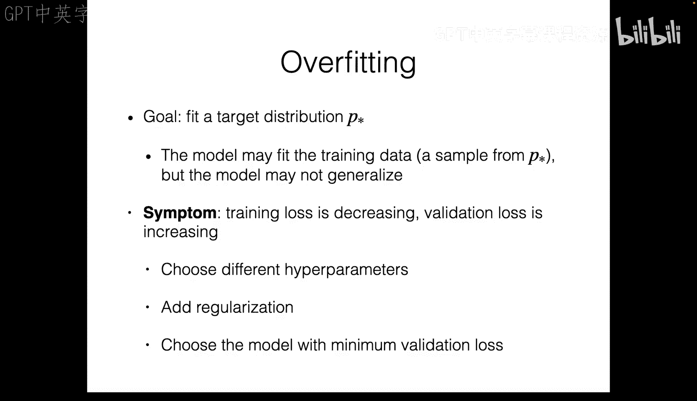

嗯。Okay， maybe I can get through one more， so it turns out that if you look through these code examples。

 I think this is the one from the first lecture。Then actually。

 so I was writing up the example and I was kind of depressed because I couldn't get this like very simple network toward work。

 but then it turns out that this weight initialization was very important。

So basically especially when people were training， I mean， people st through it。

 but training the models from scratch instead of like using a pretrain model。

 so we'll have a whole lecture on pre training。Then how you initialize the weights is actually really important and it kind of affects the optimization trajectory。

So here it turns out that and you can run the code and try it without it。

 it turns out that in order to get like pretty reasonable performance。

 you have to use at least not the default initialization here it's using this initialization strategy called Xavier uniform。

So maybe here， I mean， in the deep learning course， you'll go into this in detail if you want。

 but here I'm just you showing you what it is。Here they basically came up with this way of initializing weights according to this like particular uniform distribution。

And it turns out that this kind of ensures that the variance across different layers is balanced。

And so this actually turned out to be like extremely important for being able to train the deeper and deeper models。

 so like early and when people were first getting deep learning to work。

 it wasn't clear how to just like stack layers together and so having these good initialization strategies was like really important。

And so again， this will come up， especially if you're trending models from scratch。

So I think I'm out of time and so yeah i'll keep including these at the end and there's not that many left so we'll get through them before。

Yeah， I put first on。Okay， thank you。

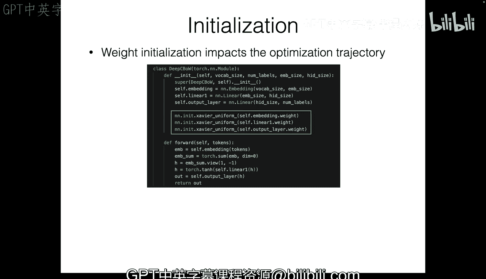