# CMU《高级自然语言处理｜CS11-711 Advanced NLP Fall 2025》中英字幕 - P5：(5)_ Attention and Transformers.zh_en - GPT中英字幕课程资源 - BV1ZWYAzuEMa

Okay， so today we're going to go over transformers。

 which are basically the main architecture used in。Modern advanced NLP。As we'll see， there's。

Many different modifications you can make the transformers。

 so the exact transformer that will be used will varyy a bit。And then later in the class。

 we'll talk about other。Architectural aspects that are incorporated or are being investigated actively in research right now。

But broadly speaking， these are really the main kind of workhorse of。嗯。

Advanced NLP and language models in particular。So first to recap。In the last lecture。

 we defined this idea of a sequence model or sequence architecture。

So if you remember the sequence architecture takes in the sequence of tokens。

And then for each position， it will give you this vector。And so in the last class。

 we call this the hidden state， or you could call it just the vector representation associated with this position。

And broadly， they kind of look like this。And then you can implement or design a sequence architecture in many different ways。

So。Well， before I get to that， so then again， once you have a sequence architecture。

 you can use it for different things。So for example。

 you could use it to parameterize this language model。

And you do that by basically adding on this output layer， which will map from your hidden state。

To the score for each possible next token， then you could have an autosive language problem。Okay。

 so this is all a kind of review and then if you remember in the last class I showed this slide。So。

 you can design。These sequence architectures in various ways。And broadly speaking。

 you could take a variety of approaches， here's three kind of broad approaches。

One is you could try to use recurrence， which is to feed in the previous positions hidden state to compute the next hidden state。

So we spent all of last lecture going over these recurrent neural networks。

This is one where we're not going to focus on that much in the course。

 but you could also use what's called convolution。So here the intuition is that each hidden state is computed based on this kind of small window around the position。

And then of course， you could stack these together so each position could see a kind of wide wide range。

And then the key difference is with attention。We are trying to have a model that is considering all possible positions。

And then the question is， how do you kind of train it？

To select the positions that are relevant for producing the representation at the current position。

So today we're going to focus on these attention based methods。

And talk about the transformer architecture， which again doesn't use recurrence。

 but instead is going to fully kind of depend on using attention。So。

The roadmap is first I'm going to go over attention again。

 so some of the slides are actually going to be the same as the ones we used in the previous course previous lecture。

But now instead of looking at this encoder， decor recurrent architecture。

 like we did in the last lecture。Now we're just going to consider attention kind of abstractly。

And then see how it is incorporated into this transformer architecture。

So I'll go over the major parts of the transformer architecture。

And then we'll talk about some improvements that were made after the most recent transformer。

 sorry after the initial transformer was designed。Specifically， we'll cover ones that were。

That appear in the llama。Language models。And that'll actually be the topic of your homework to kind of implement some of these components and then show that it works for a variety of things like prompting and fine tuning。

So so that's the roadmap and so now we can move to attention。So here again。

 the idea with tension is we want to。Encodeode each token in the sequence into a vector。

Like we saw previously。And then when we are decoding when we're generating。

We perform a linear combination of these vectors awaited by attention weights。嗯。And so。呃。Oops。

And so this is still reviewing what we were talking about last time where you might have this。

Encodeder and decoder。And so your encoder might be encoding some sentence that you want to translate。

And then at each position of decoding， so of translation。

 you are coming up with some weighted sum and this is just visualizing the attention weights that we talked about last time。

So now the difference is we don't necessarily have to use this just for。Encoding and decoding。

We can actually use this idea of attention to just kind of build up these representations and kind of attend to。

The positions as we're moving up through a network。So what do I mean by that， well。

 there's this idea which is called self attention。And so here we basically have the same sequence。

And here we just。Aim to kind of attend to the the elements of that sequence rather than some separate one。

So you'll see kind of why this might be a good idea once we start talking about the transformer。

 but again here this is just showing that you don't necessarily have to have a notion of like this input and output here you could imagine like producing this vector representation by looking at all of the positions in the output and then you can train it for a variety of tasks。

So that's just the high level concept of self attention and we'll see how it's incorporated it into the transformer。

So then again， whether it is the cross attention or whether it's self attention。

To calculate the attention， it basically comes down to this weighted sum。

 so you have to compute some scores and then take a weighted sum。

And usually we refer to the inputs to the vectors involved in this。In terms of query， key and value。

 so it's a kind of information retrieval analogy。So here we have the query vector。

Which is in this example， like the current token， and we're going to generate the next token。

Then we can have these key vectors， so it'll be each。Token from the input sentence in this example。

And then for each query and key pair， we calculate some score or some attention weight。

So this one might be 2。1。 this one might be。This， and and so on。嗯。Then as I mentioned last time。

 you typically will normalize these。And so you could use a softmax。And after using the softmax。

 they're all between0 and1， and they'll add up to one。So then you can think about like， okay。

 basically what the model has to learn to do is it has this budget of。A total of one attention score。

 and it has to choose kind of where it's going to allocate。The budget across the sentences。

 across the input tokens。Okay， so then suppose we get these。Attention scores。

Then you want to do a weighted sum and so for the weighted sum。

 we have this third notion of a value vector。So the values are like what you're taking the weighted sum of。

 so here you multiply each value times the score。Add them together and then you get the output of attention。

Okay， so we have these keys， we have the queries。We have the values and we have the attention scores。

And then you can use this in to， yeah， basically design different neural architectures。

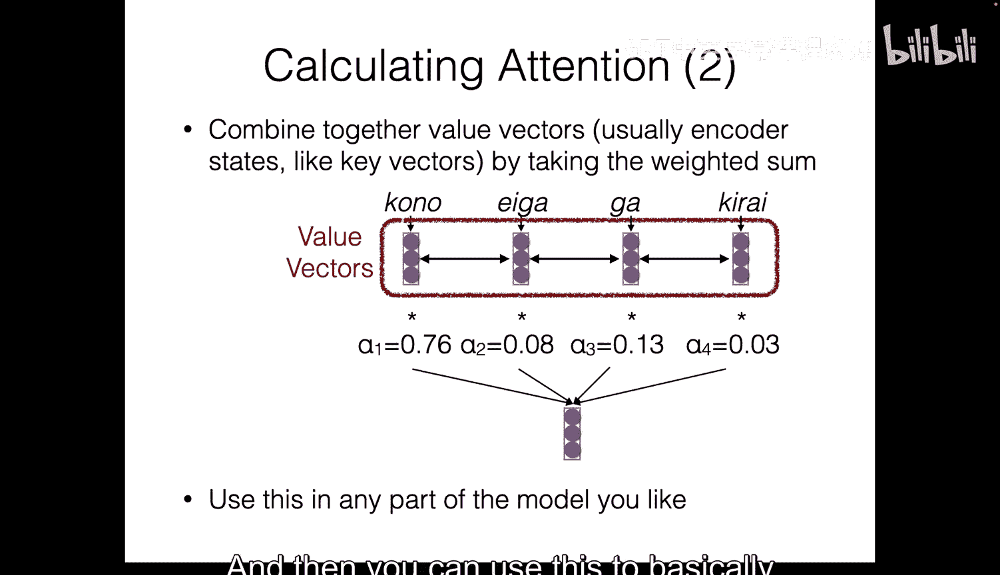

So this was the example we saw from last time， and again， this was looking at the cross attention。

So here we have an input sentence and an output sentence。And then we looked at like， okay。

 after the model was trained， it's actually learning to assign high scores to words that。

 you know kind of align in this translation。嗯。

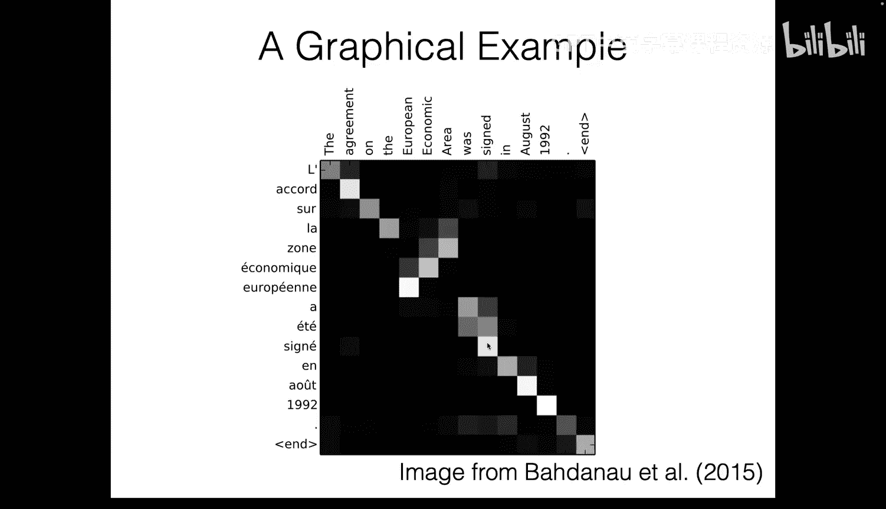

Okay， and then this is still some review， but we're getting to the part which is appears in the transformer。

So then again， we could consider like， how do you？Actually compute these attention scores。

And throughout the years， there's been a variety of。Techniques， actually in this original paper。

 they had this nonlinear function。So here they're concatenating these queries and keys。

 and then you have a weight。嗯。A linear transformation and then this kind of nonlinear layer。嗯。

Here we don't have a non nonlinearity。And the kind of most simple version is you can use a dot product。

And you can imagine that each one of these has different trade offs in terms of like the computational cost。

嗯。嗯。Oops。ops the computational cost and then also the expressivity。

So like a dot product will have lower expressivity than introducing the weight matrix。

 which can take into account these interactions。And then the adding in the linear layer will be the most computationally expensive。

 but it would be the most expressive。So then basically the idea of the transformer was to kind of come up with a recipe that。

Made some of these decisions。So here they made the decision to use what is called scaled dot product。

And so here it's basically using this very simple dot product score。嗯。

And then you basically adjust it by the size of the vector。By the dimension。

 So you can imagine that the。The scale might increase as the dimensions get larger。

And this might lead to kind of unexpected headaches when you adjust hyperparameters。

 so they probably just try to keep it， make the architecture have less variability as they're trying out different hyperparameters。

So yeah， so that's the scaled dot product。And again。

 it's just some way of coming up with these attention scores。

So that's actually it for this basic attention， and then we'll look at exactly how this appears in the transformer in a bit。

But does anyone have any questions about that this before we start going through the transformer？

Okay， great。So the transformer was originally proposed in this paper in 2017。

 and it's called attentiontention is all you need。And again。

 it's the sequence to sequence architecture based entirely on attention。And at the time。

 it kind of got a lot of attention because there was this。

There was a few machine translation data sets that a lot of people were working on。

And so the the numbers on it were very reliable， like if you had a method that improved on the data set。

 then you kind of knew that something was there。So the authors here were able to build this architecture which wasn't based on the recurrent models at all。

 which were kind of the state of the art at the time。

And then they were able to get a pretty good number on this machine translation benchmark and kind of showed that this had a lot of promise。

And it's different from the recurrent models because it will turn out to be very easy be very easy to parallelize。

And so broadly， most of this is just leveraging these matrix multiplications。Wwhichch are。

 easy to paralyze on GPUs， and this actually helped lead to these models being easy to scale up。

So broadly， yeah， first， they got these strong results， people kind of took notice。

And then it turns out to be a really good architecture that was amenable to being scaled up。And now。

 you see these。In all different types of language models and different architectures in NLP。

And here again， there's kind of two types， so you'll see these terms encodeder decoder and then decoder only。

So encoder decoder， you'll have one of these transformers encoding some input。

Then you'll have this second transformer doing decoding so like generating similar to the encoder decoder。

Recurrent network that we saw in the last lecture。Decoder only just refers to having the single。

Architecture here。And again， you can provide it some input。

By just treating like the input and output as a single sequence。And so yeah。

 in this lecture we'll just。Just focus on this。Decoder only one。

And the key difference is that when you have the encoder， you just have to attend to。

Add in an intention layer that will consider the outputs from the encoder。

But in order to introduce what a transformer is and go through all the different key parts。

 we can kind of just simplify and look at this decoder only model。

 which will be used in language models as well。So okay， so then with all of this。

 what is the transformer and what are the different parts？So really。

 the key idea is to stack these transformer layers。So you could see here。

 this is from the original paper。They have some inputs， they embed them。

And then they have this n times， which means they're stacking this kind of block or this layer multiple times。

Then the output will produce some vector and we have actually the same thing that was even in like the very first lecture。

 you just do a linear transformation of this output。

 these vectors that are output by the model and then you can take a softm to get output probabilities。

So yeah， next we're going to go through each one of these parts。

 so we'll look at how the inputs are embedded。And we'll look at the major parts of these transformnder loads。

So I think there are five different ones， so we'll go over yeah， all the things shown here。

 so positional encodings， scale dot product， self attention， multi headed attention。

Normalization and the feet forward layer。So first we're going to start at the bottom of this diagram and think about how do we provide inputs to this architecture？

So again， if you remember from lecture number two， we talked about doing this subward encoding。

 somehow and tokenization， so somehow turning your input into the sequence of tokens。And then again。

 similar to other architectures we talked about in this class。

 basically as long as you can represent your input as this sequence of tokens。

Then it can be processed by the architecture。So here nothing really changes for embedding these inputs。

You'll just have one of these embedding layers， which is basically like for each possible token in your vocabulary。

 you have this vector which is learned， so it's this embedding layer。Now。

 the difference with a transformer is。It turns out that when you think about the attention mechanism。

Then。It's just based on these weighted sums。So there's actually no way。

 there's no notion of position。 and it's kind of。嗯。Let's see what this is saying so so here here the。

Just using the attention on its own。Can lead to kind of duplicate results with different input sentences。

Due to the lack of modeling the position。So here we have the same number of occurrences of。

Cat and dog。And then we've just kind of flipped the location。

And so these would actually result in kind of the same representations if we didn't take into account。

Position。So the positional encodings will specifically add in some information about the position of each token。

Then when the model is trying to do attention over the whole input， it would be able to say like。

 okay， this is attending over cat in position number three versus dog in position number eight。

UAnd then for this input， it's， you know， dog in position number three and cat in position number eight。

So then the question is， how do we actually do this position encoding？

So this will turn out to be a kind of design decision。

So there's a method proposed in the original transformer paper。

 and then people developed different methods。So let me actually show you maybe like the simplest possible one。

 and then later we'll see。One called rope， which will be in your homework and you'll look into that one in detail in the homework。

So for the I would say like the simplest possible position embedding。

What you can do is you can have this vector for the word。

And then you can add this vector for the position。So here you have big in position two and then you add position two。

Similarly here， you have big in position 7 and then you add this vector for position7。

And to get those vectors， you can just create one of these embedding lookup layers。

 so similar to the tokens。So you can basically say like， okay。I'm going to have a maximum input size。

And then for each position， I'm going to have this learns vector representation similar to how you have a learned vector representation for each token。

So really simple idea and then yeah， you just make it the same dimension as the token embedding and you can just add them together and then input them to the network。

Okay， so can anyone think of any， let's say we do this。

 can anyone think of any downsides to this approach？This isYeah， exactly。So what happens is。

Let's say that we train our model and。In the training set。

 the maximum length that the model sees is like five tokens。Well， then basically， it'll learn。

These embeddings for one through5。But then at test time， if we try to generate or give it as input。

A sequence with six tokens。Then the embedding for token number six will just be random or。

 however it was initialized。 so it won't be trained。And then when the it's provided to the network。

 it kind of leads to。Unfined behavior。And so in general。This is really simple。

 but it has the downside of not being able to extrapolate to longer sequences。Okay， so。

So that's one way of doing the positional encodings and then as I mentioned later we'll see another method that you'll implement in the homework。

So now we can move up through the architecture， so now we have these vectors that we're basically going to pass through these layers that are stacked together。

And the first thing you can see here is this。Maskask multi head attention。

So that'll actually be the next two concepts that we'll go over。

So the first one is having this scaled dot product self attention。So as we saw in the previous slide。

 self attention， sorry， the scale dot product attention。

Corresponds to using this formula for coming up with a score between each pair of query and key。

Now the idea will be we want to have a query for each position in。In the sequence。And similarly。

 we want to have a key。And value for each position in the sequence。

And so if we kind of stack these all together， then you can get these three different matrices。

And then if you read through the Transformers's paper， which was like the reading for this lecture。

You saw this formula here， which looks， yeah， it's basically like a matrix version of。Of this。

 this part， you can see。And what it's doing is just for all of the positions。

 it is computing these scores with just a single matrix multiplication。Okay。

 so then if we think about like what is the dimension after you do this， then let's take a look here。

 So it'll be T by D， and then you'll be multiplying it with。啊迪拜 tea。So this will be T by T。

And so what it's saying is basically。For each。Position， we have scores for each position T by T。

Then you'll take this values matrix， which is T by D。And multiply it。

And so that's basically saying like， okay， for each row of V， you have this value vector。

And then you multiply it and it's doing this weighted sum。Okay。

 so this is just a kind of compact way of computing these attention scores or all of the positions at once。

And if my kind of hand waving didn't， if you didn't like fully get it from that。

Then later I'll show the code that we have for the lectures you can step through and make sure you really understand this or you can kind of work through it。

Yourlf。Okay， so。So that's the scale dot product attention。And then again。

 the self attention refers to the fact that we are applying this attention operation。

To the kind of previous inputs in the network。Okay， so now we don't have some separate。Encoder。

But again， we just have the kind of current vectors of the current layer。

We pass those to the attention module and it's just attending over the various positions。

 and then it's going to output this new set of vectors。So yeah。

 here's the kind of a signature of the function if you want， again， you take in the previous layer。

 you use them as queries， keys and values。And then that gives you some new set of factors for each position in the sequence。

Okay， so。So yeah， kind of kind of cool idea。嗯。So， that's the self attention。And again。

 you could basically compute it with just these matrix multiplications and the softms。

So then the next idea is this idea of multi headed attention。So。Here when you think about。

Attention scores。So I mentioned that when you take the softmax。

It basically has this budget of attention scores that it has to kind of allocate across the sentence。

And so it turns out to be beneficial to kind of repeat the attention multiple times so that it can kind of look it can。

It can have multiple places to。To kind of get information from across the sentence。So for instance。

Oops。Here you could have one attention kind of head or one attention layer， but yeah。

 we'll use the word head。Which is learning to attend to syntax。But here。

 maybe it learns to look for I or A or whatever in the sentence。

Maybe another one learns to attend to semantics。And you could kind of come up with a variety。

 maybe one had actually learn to look for numbers or something like that。

Or one head learns to like just spread its attention mass over the input uniformly。

And they could basically learn， you know whatever they want in order to minimize the loss。嗯。

So to do this， we have what's called multi headed attention。And so again， oops。And so again。

 this is just going to be kind of matrix operations at the end of the day。

But then we could kind of look at what's happening here。

So here we're going to start off with this matrix and it'll be four times three。

And so here I think it is。Ops。😔，Yeah， yeah， okay， and then we're going to split this into。

And different attention inputs。And then you can just run each you can run the attention over kind of each one of these individual ones。

And each kind of copy corresponds to a different head。

So you can see this written up here in notation where。Head eye is having。嗯。This set of weights。

For the I head， and so you'll have kind of multiple copies of the weights。

And you can think of these as just being like taking a weight matrix and splitting it into multiple parts。

Then as the output of the。Does this show yeah， so then as the output。

 you can just concatenate these outputs together， these head outputs together。

And consider that as the output of the attention。So。Yeah。

 you again might have to like different representations will be useful for different people。

 So sometimes it's helpful to look at the equations or this visual form。

 Another thing to do is look at how this is done in code。

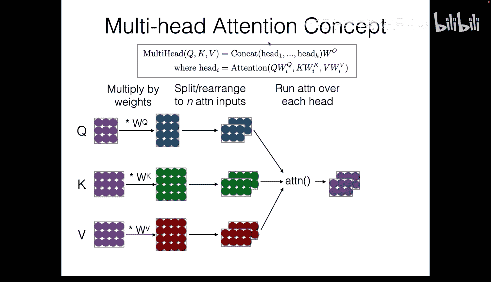

So you'll have to do this。Well， I mean， yeah， you'll have to look at this in the homework probably。嗯。

And so。Here we can see that。We have。Oops。Yeah， so here we can see that we're doing these calculations。

And then， basically， reshaping the。The tensors so that they have this extra head dimension。

 so that'll be basically what I was showing in the previous slide where you have kind of multiple copies and so this final dimension is the head dimension。

And then here you can kind of step through the computations。

 this will be actually implementing the attention computation。

And then here you could see it says reassemble all head outputs side by side。

So that's basically the concatenate those was on the previous slide。

And so this this code is shown from。This repository called Min GP。

So this is again by the the author who did the。One of the notebooks on Tokenization was kind of based on his video。

So yeah， he has this kind of minimal implementation of the GPT language model。

And so here's the actual attention implementation from the code。

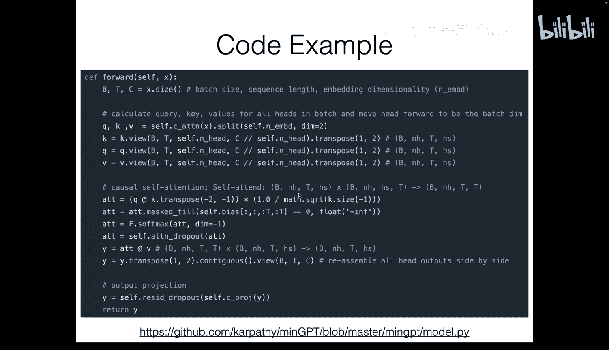

Okay， and then if we go back to the kind of intuition for。These multiple heads。Then。

What you can do is you can visualize like different heads and the attention weights that they're assigning。

嗯。So here we are kind of considering for the for the word making。

How are these attention heads attending different parts of the。Of the sentence。And。

So here each color will be a different head。And you can see that， yeah， this one， for instance， is。

Attending to this E O token， whereas other ones aren't， this one's attending to。Like difficult。

 but it looks like a lot of them are attending to difficult and so on。

And so basically these heads really do learn to kind of perform different operations and it would be difficult to perform all of these operations at once with just a single weighted sum。

 so again that's the reason for introducing the multiple heads。Actually。

 you can get these visualizations from oh， it's it's still on here。 Yeah。

 you can get these visualizations from this website so there's this tool and you can。

Play around and look for kind of interesting things。Okay。

 so one more thing on this before I pause for questions。So here， if you noticed。Basically when it's。

When it's doing the attention for the word making。Here it's actually looking into the future。

So can anyone tell me why this is an issue for a language model when you're going to predict the next word？

Mmm。Exactly， yeah， so one thing is like at training time。

It becomes a pretty trivial task to predict the next word if you can just attend to the next word。

So that would be kind of silly and then when we're actually generating a new output with the model。

 you actually don't know what the future word is。So we have to train the model in a way that it's basically like not allowed to look into the future if we're doing this kind of auto aggressivegressive language modeling with the transformer。

So for that， the trick will be to use masking。So。Let's take a look at this。

So basically here it's just showing it visually and then。Again， in the code example for this lecture。

 it shows you how to actually implement this。But here。

 let's say that we have this sentence or this input。

And then we're considering the attention for the word I。Then basically。

 you could have this this huge or this matrix， which is just zeros and ones and it will determine。

What the model is allowed to attend to so here it's allowed to attend to these things for this token it's allowed to attend to these things and so on。

And so the way you can do this。Again， I wonder if it's actually in here。

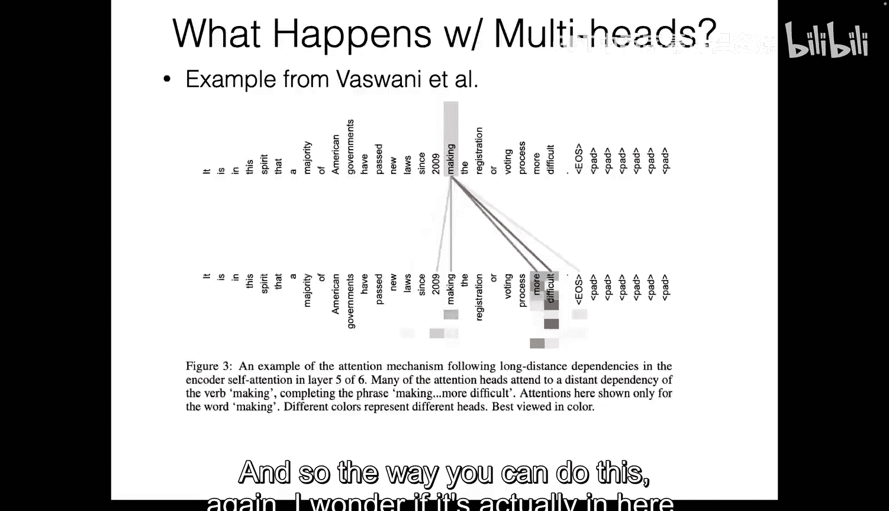

It might be that this， right here。But yeah， typically you'll have this this matrix of zeros and ones and then you can just。

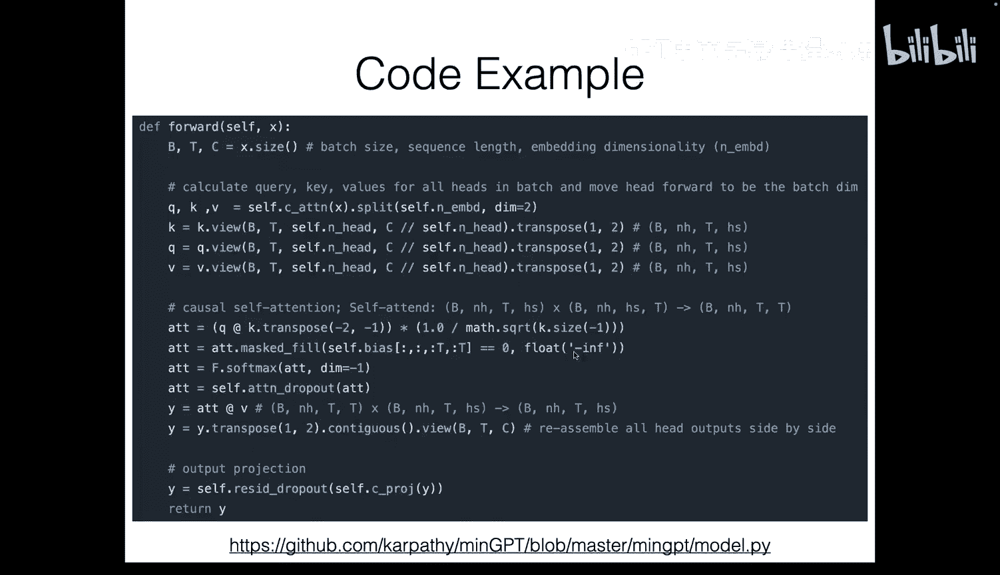

Set either the zeros or the ones to negative infinity。 And then when you take the softm that will。

End up having an attention score of0。So again， you'll see this in。

In the homework when you're taking a look at the implementation。

 but this is really important to do because otherwise your model will instantly learn to just cheat if you're doing language modeling and just attend to the next word。

Okay， so any questions so far before we move to the next part of the transformer？嗯哼。😊。

how about determine feeling。I say it again。对。Let's say because the evening。

Yeah yeah so that's a good question so yeah when you think about it you could think about this architecture is like these vectors being passed through different operations。

So typically what's done is you try to simplify things as much as possible。

 so you'll try to pick a consistent as a hyperparameter， you pick a just consistent dimension。

For the various vector， so like your input embedding would have the same dimension as the query key and so on。

And then that makes it easier to just like set one hyperparameter for the whole network。

And then what you have to do is you have to take into account this like splitting into multiple heads。

So if you have like four heads， then you want things to be divisible by four so you'll see that in。

You'll even see that in the code or it'll like divide by the number of。The number of heads。

 which is also hyperparameter。嗯。你是永月轮嘅。I importing repoing。

 we are still generating one token at a angle。So you are like if you want to send10 tokens。

 we are going to like generate first loop and they pass it again to the rank end。

Genrate the second token so you have to run the model depending。Yeah yeah。

 so if there's time at the end， we'll do a comparison with recurrent neural networks。

 but just quickly this is the kind of tradeoff so transformers it'll turn out to be easy to parallelize them during training because you could just split up these matrix multiplications。

But then at inference time， when you're actually going to generate。

 you run into this issue that like for each new token。

 you have to yeah pass it in and then attend over all of the different inputs。However。

 we'll talk about in the， we have a whole lecture on inference。There's some tricks you can do。

 So the most basic one is called key value cash。So you can actually cache the keys and values in the attention from the previous steps。

And it turns out to be like， okay to do that， it doesn't mess up the attention computations。

So you can， yeah， cache some computation and then reuse it for generating the next token。Okay。Okay。

 cool， so now we'll go to the next part， which is。Oh yeah so it's highlighted here。

 so it's both this arrow right here as well as this box right here。So yeah。

 this will be layer normalization and residual connections。Okay。

 so if you remember this image from the last lecture。

 we talked about this issue of either vanish ingredientss or explodelod ingredientss。

And it was basically saying that like， okay， with these recurrent networks。

 as we take them longer and longer in the time dimension。

 so if we use them on kind of long sequences，Then when you do back propagation。

 if you have a small number or a large number， it'll either like。For the gradients。

 it'll either lead to vanishing or exploding。So now when you think about it。

 it's kind of interesting， suppose I kind of flip this diagram。And now we're not going in time。

 but we're talking about like a really deep network。So let's say our transformer has。

 50 layers or 100 layers， which people actually do know。Well。

 then it turns out that we can actually run into the same issues。

 so if we don't take care to make sure that the gradients are kind of well behaved。Then。

As they're propagating through the network。Then they can either vanish or explode and lead to issues。

Similarly， like even the activations as their。Passing through in the forward pass。

If we don't kind of ensure they're in a good range and things like that。

 then if we have like 50 or 100 layers， then things can go wrong。

So that'll motivate two of the architectural components here。

So the first is called layer normalization。And so here the idea is to normalize the outputs so that they're in a consistent range。

And this will basically be to yeah， address what I just said。

That if you have a lot of these layers stacked together。

 then you want to kind of control the range or control the possible variance as it's being propagated through the network。

So let's see here。So here， what you do is。You have this this layer。

And what it's doing is it's subtracting the mean and the standard deviation of the vector。

So for instance， here it's looking across the different。Dimenssions and taking the。Yeah。

 you what the mean and the same deviation。And then you have these two learn terms。

 so these are going to be parameters that you introduce and they're going to be trained you know with back propagation。

So this gain is basically adjusting the scale after doing this normalization。

And then the bias will allow you to kind of shift after doing the normalization。Okay。

 so now the model can actually learn to kind of。嗯。Yeah， adjust the the scale of these outputs。

So in a bit， we'll talk about another version which will appear。In the kind of improved transformer。

 But I think for your homework， you'll actually implement。This version。So， yeah。

You'll have time to look at the details and understand them as you go through that。Okay。

 so then the next is the residual connections。So I briefly mentioned these again in last lecture。

But here you can see that this is visualized as this kind of skip。

So a residual connection is one that's of this form。So you have some function F of input X。

And then you could just add the input。To get this kind of residual connection。

And so when you think about what this is doing， it's basically allowing F。

To just learn the difference from the original input。So let's say that x was。呃。Yeah， somem like。

I don't know， large number。嗯。And as it's moving through the network。

 it's just changing a small amount。Well， then instead of having each。嗯。Sorry， let's say that， yeah。

 yeah the input is large and then as it's propagating through the network。

 you want to kind of adjust the input。Well， then instead of having the learns function。

 kind of learn to generate a large number。Then it could just learn to generate these kind of adjustments to the input。

So that's the kind of intuition， and again， the equation is here and it's fairly simple。

And then as we saw in the previous lecture， yeah， this can also help prevent vanish ingredients。嗯。

And yeah， help with the。Again， the。嗯。The kind of behavior that results as you stack these into architectures with many different layers。

So actually， these residual connections were invented in the context of the image classification models or learning representations of images。

And they were really one of the key things that led to being able to create networks which were like hundreds of layers。

So those are called res notess。Okay。So， those are。The major elements of these transform layers。

 So again， just the attention and then the normalization and the residual connections。嗯。And well。

 I guess also we incorporate these feed forward layers into each block。

So here after performing the attention， what we want to do is have a kind of very expressive transformation。

Which can allow us to just extract richer features after performing the attention。

So here we can have this multi layerer perceptron or feed forward network。

Which has some linear transformation as well as some non nonlinearity。And then this will again。

 just kind of increase the expressivity and allow you to learn， you。

 some transformation after performing the attention。嗯。So yeah。

 nothing to its nothing too kind of new or crazy here。

 this is just adding in these layers that we've seen before。嗯。Okay。

 so then if you want to look at a simple example of this。

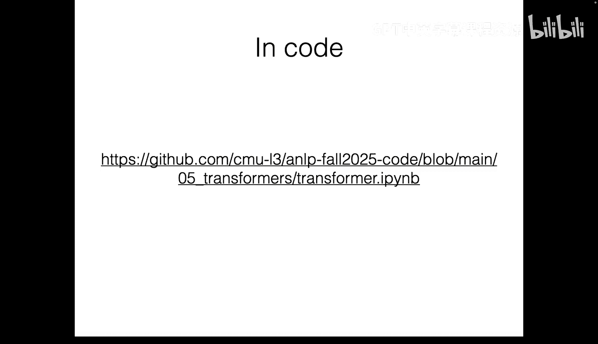

In the code repository， there's a。

So it's not going to be the most performant， but just a simple implementation of a transformer language model。

And again， it's looking at this task of just generating names。嗯。So yeah。

 you could compare it to the recurrent neural networks and things like that。

So just to give a quick overview of what's here， here's the actual transformer block。

So you can see that it has multi head attention， so this is actually cheating a bit。

 it's using the attention implementation that's in Pytororch。

Then it has these two layers here for the feed forward part。

It has these two layer norms that I introduced。And this will be the activation function for the feed fork part。

And then here you can see。The whole forward pass， and it's pretty simple and hopefully after introducing different parts。

 it's not too mysterious。But you can basically step through and yeah。

 see the different operations here。So here's the self attention， here's passing in the mask。

We have the residual connections， normalization， and then the feed For network。

I had another residual connection。Now， if you're paying close attention。

 then you might have noticed that these normalizations are at a slightly different point compared to in the slides。

So I'll talk about this a bit later， but it turns out that people found that doing this before the operation。

 so preormalization is kind of more stable and even has some nice properties that you can kind of analyze。

嗯。Okay， so then as I mentioned before， if anything here is mysterious。

 then you can kind of step through and debug and things like that and hopefully understand what's going on in this really simple form and then in the homework you'll see a more kind of sophisticated example。

 which is like the actual version which will be used in the Lama language model。

So then given one of these blocks， you can see that it really is just kind of repeating the blocks。

So here we have here just doing this for loop， which is repeating the transformer blocks。

And then here's the embeddings that I was telling you about。 So the token embeddings。

And the position embeddings。And then you can see the forward pass is yeah， also relatively simple。

 so you do the embeddings， you run the blocks， and then you get your output。嗯。Okay。

 so then this is just showing batching and the usual training glue。And then again。

 you can generate some names either just sampling from the model or providing it with a prompt and then doing the sampling。

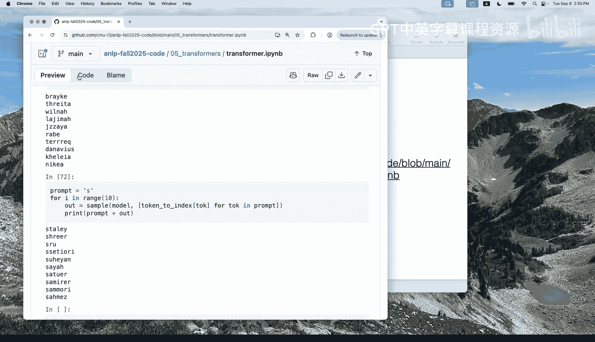

Okay， so that's the。Pode。😔，And yeah， that's really it for the basic transformer architecture。

So does anyone have any questions on that before we move to some of the improvements？Okay。Cool。

 so as you can imagine， as the transformer got incorporated into more and more。Models and， you know。

 money is being poured into AI and models are being scaled up and things like that。

 There's been a lot of work that's gone in to looking at the different components of the transformer and trying to improve them。

So。One thing is the positional encodings。So as we mentioned with the absolute positional encodings。

One downside is that， yeah， it's not easy to kind of generalize or extrapolate to other sequence positions。

So there's another kind of approach based on relative positional encodings。

So here instead of saying that token。You know， two is token number two。You would say that， like。

 okay， for each different pair of tokens， how far apart are they。And then using that。

 the model can kind of learn to reconstruct the positional information of the sequence。

And then if you're just looking at relative positions， well。

 then those can kind of be shifted across a longer sequence and at least in principle。

 like maybe the model could then。Extrapolate to different lengths。So as an example of this。

What you can do is。I think this is the approach used in this paper referenced here。

 and if you know about like the T5 models， they had a notion of relative positional encodings。

So now what you could do is instead of at the input level for the transformer。

 you can actually modify this attention layer to take into account the positional encodings。

So here what this is doing is。Here's the kind of original attention score on the left。

 and then here's this new thing that we're adding in。

And basically what it's doing is it's saying like， okay， you define some window of K tokens。And then。

 for。1 through k and minus1 through minus k as well as zero。

You're going to learn a vector that represents the relative position of two tokens。

So here you'll take here we're looking at IJ， so here's an example you might take like the query and then do the dot product with this vector for i comma J。

Okay， and so now the model can actually learn to take into account this relative position。Now。

 can anyone think of any downsides with this approach？This one's a bit tougher。

Well so there's a few there's a few different ones。

 so one reason that people moved away from this is because of the actual is because of the extra computational cost。

So here now we're kind of modifying the attention operation and。Doing this extra computation。

But then it really。It gets tricky to implement this idea that I talked about earlier。

 the key value cache， it gets tricky to do the caching when you do this type of the relative positional encoding。

And so。Yeah， people have moved to try to develop other strategies。

And so here's one that you'll look at in detail in the homework。And so I probably。Yeah。

 there's a reason it's in the homework to kind of really understand it it maybe takes a bit so here I'm just showing the kind of key idea and then in the homework right up we provide some more description and then you'll actually maybe go and read the paper and then implement it in the homework。

But here they had this like really cool idea， which is when you think about what you want out of a position embedding。

Then you basically want the dot products。To only be dependent on the relative position。

So it's kind of this like。Yeah， interesting way of thinking， it's like， okay。

 what do we ideally want if we are able to come up with some scheme for relative position encodings。

Yeah， again， ultimately we want the dot product to just be a function of the relative positions。

So that's just writing this out here where you have like position M and position N and this difference。

So then in rope， they came up with some function that satisfies this property。

And it'll be based on basically doing these rotations。So the kind of key。Idea is for each。

Different position， you can kind of do a rotation of a vector。So， like， if the。

Token is in position one， then it'll be right here， if it's in position two。

 it'll kind of be rotated a bit and so on。And it turns out that this kind of function will satisfy this property and allow you to get the relative position encodings。

So you end up with these kind of rotation matrices and the cosines and signss and the complex numbers。

So again， it's not。It's not too bad to understand it。

 but we'll give you a chance to go through this in detail in the homework。

And so these have actually become very popular。So yeah。

 like they were incorporated into the Lama architecture， which the is the homework。And yeah。

 the rope style embeddings have been used in various architectures。嗯。

Kind of jumping ahead in the course， it turns out that these don't fully solve the problem of extrapolation。

So you kind of still have to do a bit。 a few different more tricks to get them to extrapolate。

 So actually， later in the course， when we talk about the。Really long sequence models。

We'll talk about modifying these rope embeddings。嗯。Okay。

So then the next thing is the one that I mentioned is we are going through the code。

So there's a question of where should this layer norm be applied？Yeah。

 one option is to do what they did in the original paper and kind of normalize after the attention and after the pe forwardd layer。

Or you could do it before。And。Here I won't go through the details。

 but you could check out this paper if you're interested in。

 they did a pretty careful analysis of this as well as like empirical experiments。

And found that doing the pre layer norm was actually better for the gradient propag。

And then in practice， people have found that， yeah。

 this can lead to more stable training or better results。U，So yeah。

 you'll see this pre layer norm versus what's in the original transforming the paper。嗯。嗯。

And then the next one is RMS norm。So I introduce the layer norm。And the layer norm had this。

It had the。Subtraction of the mean， it had the division by the standard deviation。

 and it had the gain and the bias terms。So then the RMS norm just found that you actually don't need all of these things。

You can just have this。Kind of second order statistic here。Or a second moment statistic。

 as well as this gain term。So again here I believe this was just empirical。

 they kind of did both and said that one worked and it has kind of fewer parameters it's simpler。

 and so this also got incorporated into different architectures。嗯。Okay。

 and then I think the last one is this idea of grouped query attention。So again。

 you'll see this in the code that you're working with through in the homework。

So this was basically finding this was based on the observation that。

We don't maybe necessarily need copies of the values。Keys and queries。For。You know， like one to one。

So on one extreme， you could just have a single key for all the different queries。

 a single key and a single value。And this turns out to save a lot on memory again。

 maybe we won't fully see why until the inference lecture， but again。

 just briefly I mentioned this idea of caching the keys and values。

And so you can imagine that like as the sequence grows really long。

 this cache is getting really large。So what you can do is just try to have fewer keys and values。

And that will make it kind of more efficient。Or you could try to have a middle ground and say like okay。

 for each group of queries， so say for each like two， we're going to have a key and a value。

And so you basically have like the spectrum。 And so that is called grouped query attention。

And so this again was actually motivated by the inference speed and in practice this will lead to。

 yeah， speed ups while you know mostly retaining the performance， of course。Like strictly speaking。

 this will be more expressive， it has more parameters。

 but then people found that this is kind of a good trade off。And so again。

 you'll see this in the code。

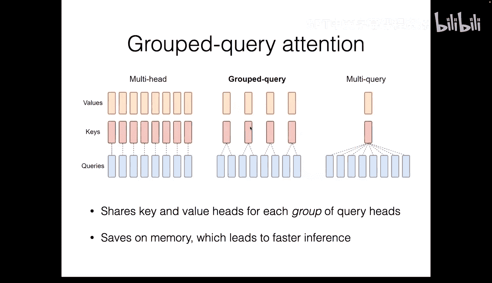

And a lot of it， or do you have a code example here， yeah here it is， you'll see it in the code。

And a lot of it。The first time you see it， it doesn't necessarily look like a diagram。

 it comes down to kind of you know reshaping weight matrices or reshaping tensils。So again。

 you'll have some time to kind of go through the details of this within then the kind of high level picture is yeah。

 doing this kind of。

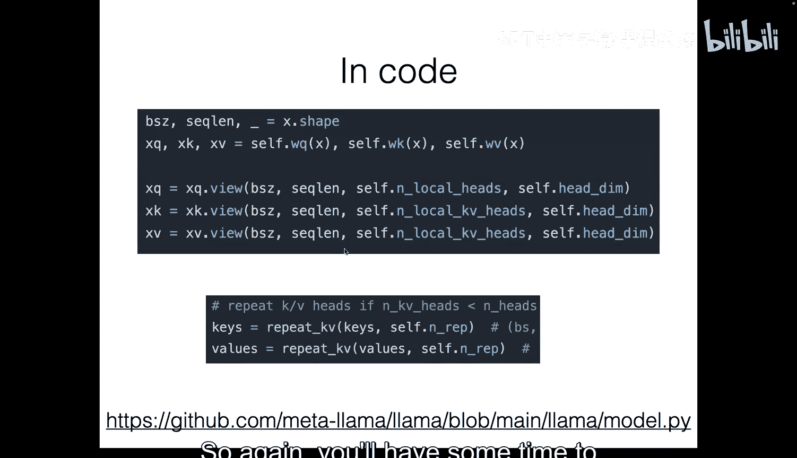

Reduction of the keys and values。Okay， so then in summary。

 if we look at the original transformer versus Lama and Lama 2。

Then you could see that these things I mentioned were actually incorporated in。So the pre normor。

 the RMS norm。They also use a different linearity， I didn't really go into details about that。

The rope positional encoding and then the group query attention。

So now you can kind of see the transformer architecture， you could see potential ways to modify it。

 so then it's a kind of good exercise to look at some more recent models so ones that have been developed after Yoma2。

And you'll usually see them adjusting， you know。One， two， three things。Here and there， and。

The exact architecture that's being used is kind of evolving over time。There's also larger changes。

 so a lot of the different。Recent models are based on this mixture of experts architecture。

So we'll have a whole lecture about that later in the course。Okay。

 and then this is a kind of nice plot just showing。

That these different factors can help these different architectural features。

So it's kind of jumping ahead， but I guess in the next lecture when we talk about free traininging。

We will talk about this idea of。Basically trying to trade off training computation for better performance in terms of loss or perplexity。

And so here， these authors were basically training these different architectures in。

While holding the amount of compute constant。And up here they have the original transformer。

 and you can see it's this kind of yellowish line。And then this transformer plus plus is basically the one that I just introduced。

 which is like basically Lama 2。 And you can see that it leads to。Yeah。

 better performance in terms of the perplexity。This plot， the subject of the paper is。

These other kinds of architectures， and we'll talk about that in later lecture。Okay， so yeah。

 to recap， we saw the transformer。We went over different architectural components and talked about some ways to improve it。

嗯。So now I have。One or two additional topics， but maybe let me just pause for any questions before going into them。

Okay， so another thing you'll do in the homework is implement a variant of this atom optimizer。

 so I wanted to be sure to introduce the atom optimizer So if you noticed in the code examples。

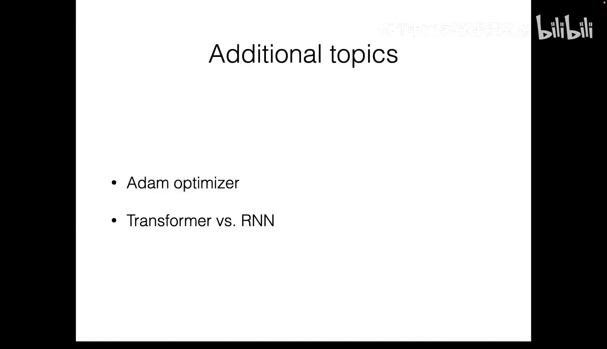

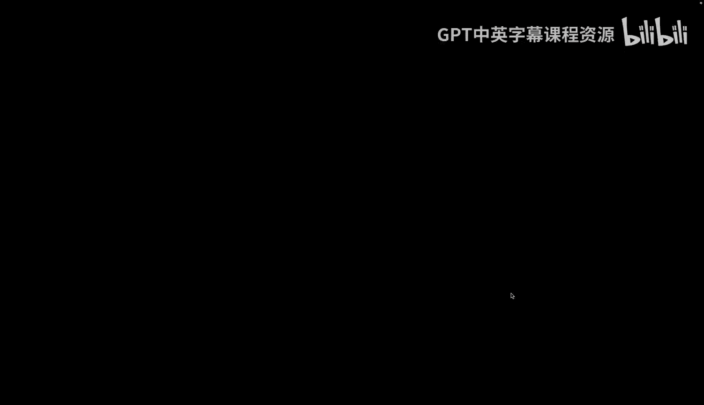

Let's take a look at this one。Yeah， here it's using atom， so it's not using。SGD。

 so it's just the normal。The very simple kind of update here it's using at。

And so Adam is one of the most popular optimization options。To use an NLP or。呃嗯。Yeah。

 other areas as well。嗯。And it basically introduces a few different ideas。So first of all。

In the ideas that I'll introduce。Each kind of formula。Applies to each parameter in the model。

So basically， it will give us some way and you'll see it in a bit of。

Kind of adjusting the learning rate or adjusting the size of the update for every single parameter in the network。

 So you can imagine that some might require kind of smaller updates。

 Some might require larger and that's not present when we just have this single kind of learning rate and the naive update。

With a stochastic gradient descent。And then it incorporates these two key ideas。

 so one is called momentum and one is or the paper was called RMS Pro。

 and so yeah I'll go into each one of these。So the first idea is called momentum。

So here are these two different equations。So here we're looking at like the equation that's being used to actually update the weights。

And if you remember with normal。Graadient stochastic gradient descent。Instead of this MTt here。

 it was just the gradient。So the idea of momentum is to basically have this term M。

 which is called momentum。And it's basically this kind of weighted sum。

And so you can see that the update is going to be based on the past value。

 as well as some contribution of the current gradient。Okay， so if you want。

 you can set this beta parametermeter， this is a hyperparameter to zero。

 and you have original stochastic gradient descent。But if it's not zero。

Then you're taking into account the kind of previous updates。

And so the intuition for this is you could think about like， okay。If the optimization trajectory is。

Kind of fluctuating， but somewhat going in a consistent direction。

Then by doing this kind of historical weighted average。

 it'll help smooth out some of those oscillations。So any particular update will now be kind of balanced by this past term。

So here's a nice intuitive view of this。I think this is actually from Sck Overflow Post。

 but it's a nice diagram。Okay， and then the second idea is RMS there's a paper called RMS Pro and here's the idea。

So now when we look at the weight update， now we're not dealing with momentum。

 so we have the gradient here and then we have this thing here。So here we have a learning rate。

And now we have this term VT here。And basically， you could think about like， okay。

 what if this VT was very small and what if it was very large， what would happen？Well。

 it feels very small。Then。It would increase the size of the weight update， feels very large。

 then it would decrease the size of the weight update。So it can basically， yeah。

 adjust the size of the update。And the adjustment will be based on this shown here。

So you again have this。Kin of historical or this moving average。And then this will be。呃。

A kind of point wise multiplication。And so what this is is it's an estimate。

Of what's called the raw variance。 So it's like the variance without adjusting it by the mean。

So it's getting some notion of this kind of second moment or this variance and adjusting the scale based on it。

So then if we look at Adam and if you read through the paper。

Then they basically have the same equations， and then they call it like first moment and second raw moment estimates。

So here we again have this notion of momentum and that's the kind of first moment。

 it's a kind of you know estimate of the average in some sense。

And this one's kind of an estimate of the variance。It turns out that if you have this。

This like weighted sum based on time， then early in training。

 it'll be biased because you're starting out at zero so they add in this kind of correction term。

And then here's their final update， and you can see that it looks somewhat like what we saw in the previous slide。

 but it's basically combining the two ideas。So you have here the momentum that's been kind of adjusted and you have this adjustment here from the RMS Pro。

Okay， so that's Adam。And this is again widely used and we'll talk about some of the implications of using Adam。

So again， since we are making these adjustments based on historical averages。

We actually have to store these in memory。And when you think about this。

 if we have like one term for each possible parameter， then with a really large network。

 it's actually something we have to take into consideration like how much memory this is consuming。

So that'll actually be a huge deal when we're talking about scaling up the models to really large sizes。

But the kind of trade off in memory usage and things like that has been worth it。

 people will typically use an optimizer like this instead of the really kind of simple naive one。

Okay， maybe I'll stop there and you can take a look at these。Just on your own。

 it's kind of going through the details of transformers versus RNs in terms of the cost of generating them versus training。

And so you could see some of the trade offs。But maybe since we're at time and it's of it involves notation and things like that。

 we could just end here。

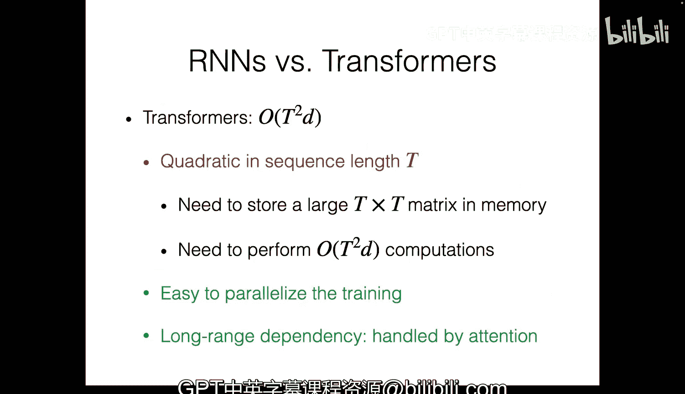