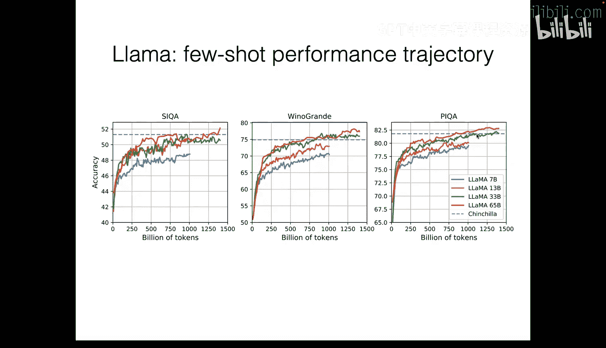
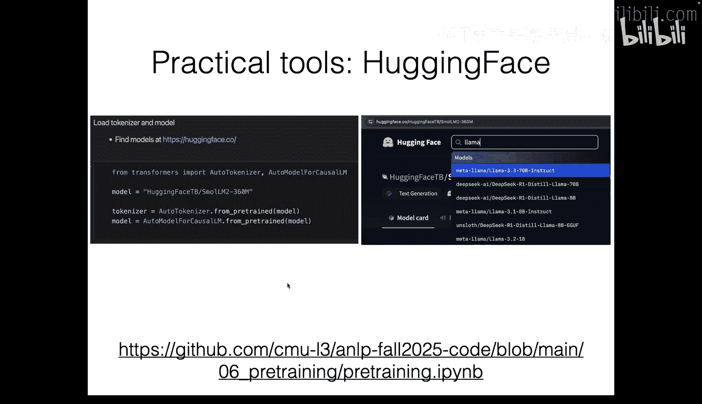
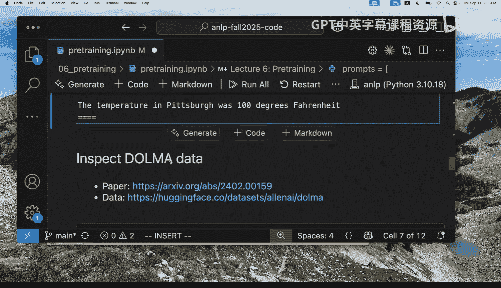
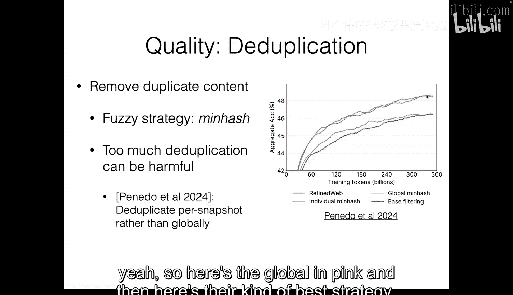
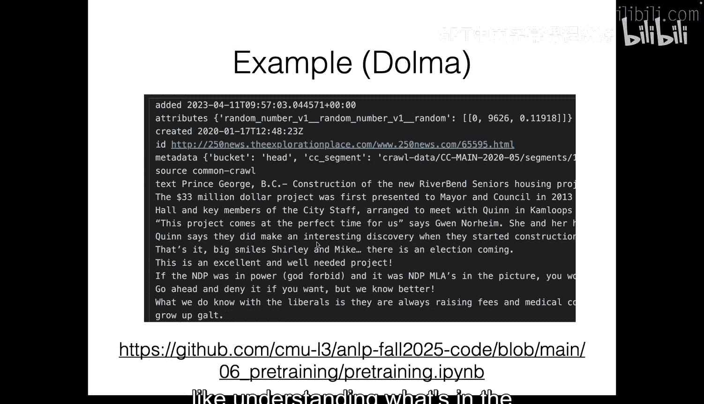
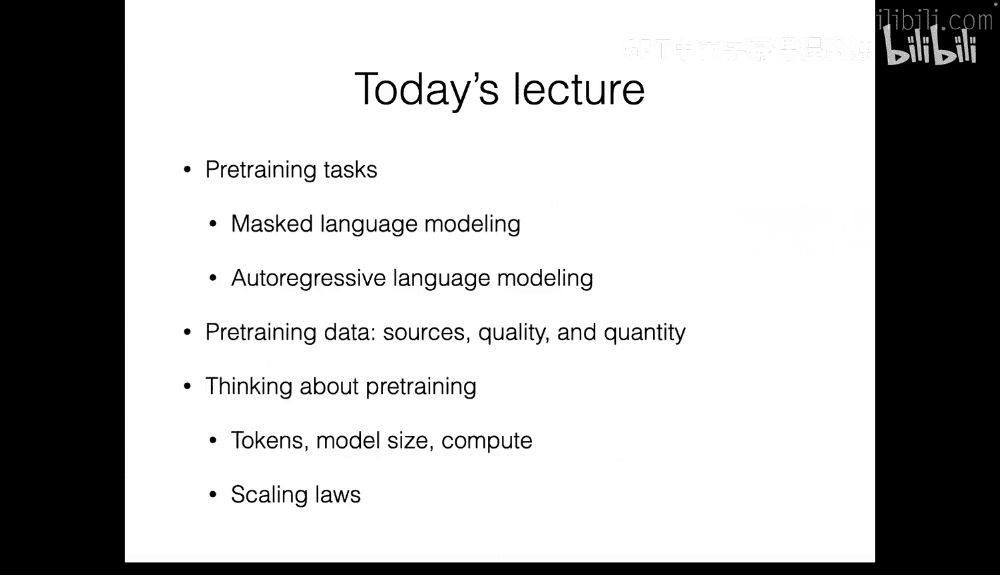

# CMU《高级自然语言处理｜CS11-711 Advanced NLP Fall 2025》中英字幕 - P6：(6)_ Pretraining.zh_en - GPT中英字幕课程资源 - BV1ZWYAzuEMa

So today is another really exciting and big topic， so we're going to go over pre training。

So pre training has really become a key part of。Most advanced NLP systems。

It's kind of this initial as we'll see this kind of initial stage that you do and it allows the model to become more data efficient to pick up a variety of。

Caapbilities， and it's really become an important part of NLP。

So a lot of this is kind of evolving each year， so here parts of it will be from you know a few years ago。

 some of it will be from you know within a year within two years。

 so it's very much an evolving field。So already we're at lecture what6 and we're already starting to look at some very recent techniques。

So to recap so far in this course， we've talked about a variety of things。

 so we've talked about classification， we talked about the task of language modeling。

 and then we went into these various architectures like recurrent neural networks。

 simple feed forward neural networks as well as transformers in the last lecture。

And so far I've been showing you these kind of toy tasks like generating names。

 one of them was like reversing a name， things like that。And in all of those different examples。

 we were training the model from scratch， even to I classify。

 you know whether a movie review was positive or negative， and we were training from scratch。

 meaning we set the weights to just random numbers。

And then we run the pytorch code and we get some model。

 And this model is very specific to this one task， as well。

Look if we train the model to generate names。Then it's not going to be able to say whether a movie review is positive or negative。

 for instance， and vice versa。So this was actually the paradigm for a long time in NLP。

And now we've kind of in a different paradigm， and it's based on pre training。

So here we'll first pretrain a single model， and you can kind of spend a lot of computation and resources to pretrain this model。

And then the benefit is that you could then adapt the model to many different tasks at a kind of lower computational cost。

So the basic idea just before going into details， it's good to see just a high level picture。

We're going to collect a bunch of data as much data as we can。

And then we're going to run this pre training algorithm and we'll go into the details。

And then we'll get some model as a result of running the algorithm。And this goes by various names。

 some people call them foundation models， I think I'll use the word base model。

And so you get this model。And the model could be a language model。

 we'll see one other example of something else called it a masked language model。

 but in general you get some type of model from pretraining。

And then you try to adapt the model to different tasks， so it could be sentiment analysis。

 translation， following instructions， kind of a general task， solving problems， things like that。

So for adaptation， we'll have。At least two different lecture。

 we'll have several lectures on how you take a pretrain model and adapt to different tasks。

Let me just go over two that we'll cover in the next few lectures。

 so the first is prompting so here we take the model and we don't run any additional learning algorithm on it like we don't update its weights at all we just in its input context。

 kind of describe a task maybe give some examples of the task。

And then we try to have the model perform the task。So a few years ago。

 this would have sounded absolutely crazy like why would this work。

 but it turns out to work with these language models that have been pretrained for a while and this idea of kind of describing a task to a model without training it further is now kind of you know somewhat standard and it's what you might do。

 let's say if you're using， I don't know， chat GBT。

 then you kind of describe what you want it to do maybe you give it some input output examples or maybe you just kind of tell it what to do。

And then it can perform a task。So we'll go into this in the next lecture。

 we'll talk about the pros and cons， but this is a perfectly viable way to try to get your model to perform various tasks。

The other is called fine tuning， so here the difference is， well， first of all。

 we have some task data， so we have these input in output pairs。And then we'll fine tune the model。

 which is to say we will actually run some optimization algorithm。

 which is updating the model's weights。So here， the difference is that now the model's weights are somewhat specialized maybe for this task。

Like you could fine tune in the model for translation。

But then the trick is that you can kind of fine tune it for a very general purpose task and still perform a lot of different tasks with the model。

So we'll talk about this in lecture 8， but these are called instruction following models where the model is fine tuned kind of for the task of performing different tasks it's kind of a clever tro。

So anyways， today we're going to focus on this first step， which is called pre training。

And there's a question of like， why would you want to do this retraining？嗯。

Well first is this idea of transfer learning which is a kind of classic idea in machine learning。

 we're not going to go to in depth here， but here the basic idea is you are taking some knowledge from one task and then applying it to another task。

And so here we want to do some kind of pretraining task and we'll talk about what those are。

 and then the idea is you know maybe this this model has learned something which can then be transferred or applied to another task。

So what does that actually mean， well， it could mean that now when you go to perform a new task。

 say like translation， now you might actually need less data to reach a given level of performance。

Whereas if we want to train a model from scratch， say for translation。

 then you might have to assemble this huge training data set in order to train the model specifically for translation。

Another thing is you might just get a better task performance。

 so slightly different it's not saying you know you need less data to reach the same level of performance。

Sometimes it might just not be possible to beat using a pretrain model and then say fine tuning it with the amount of data you have。

 so you might not have enough data to reach this level of performance。

And then this also is just convenient for many reasons。

 so first you can think of this pre training phase as some kind of expensive use of resources。

But then in some sense， it's covering the cost then of developing a new model because it might be more computationally efficient than to adapt the model to a given task。

And this is certainly the kind of paradigm we're in now where， as we'll see in today's lecture。

 you know， sometimes a large company will pretrain a model and then people can use it in various different ways。

跟。So when we think about pre training， I showed the kind of high level picture。

 but what are some of the major factors that come into play？And again。

 this is still at a kind of high level， we'll go into the technical details。

So you might see these different pre trained models like BRT。Lama， deep seek。

 And the names are kind of， you know， all over the place。 But then you could really kind of。诶。

Identify these by kind of four major factors。The first is the architecture that the model is using。

Typically， nowadays， they're based on different versions of variants of transformers。

But as we saw at the end of the last lecture， if you look at specifically which transformers is being used。

 people are kind of modifying them in different ways。Second is the task。

 so what the model has been trained to do during pre training。

A big one is the data that is used to do the pre training。We'll talk about this later。

And then actually it turns out to be very important to choose the hyperparameter well。

 so to choose the learning right well to choose even like the batch size well。

 and we'll actually go into this really in depth later in the course when we talk about how you actually scale up the model to do this pretraining。

So it will require。A lot of computational resources。

 So you'll basically have access to a bunch of know GPUs。And then the problem becomes like。

 how do you kind of optimally make use of those GPUs？

And changing the hyperparameters can actually have a big impact on that。

So today we'll go into two different tasks。So one nowadays is still used called Ma language modeling。

 it was really popular， I don't know， something like five years ago。

And then we'll go into using this language modeling objective that we've talked about for doing pre training。

Then I'll give an outline of things you're concerned about with data， so sources。

 quality and quantity。And we'll actually look at a couple real examples。And then at the end。

 as long as we can get to it。I'll talk about some useful ideas for。

 I guess I'm calling it thinking about pre traininging。

 so thinking about this as a process where we have a lot of compute。And we want to think about like。

 how do we allocate it towards training a bigger model or training on more tokens？

And there's been some kind of systematic ways of thinking about this， which are called scaling laws。

Yeah。Okay， so first we'll go to the two different tasks， so we'll start with mask language modeling。

So mass language modeling is maybe like it sounds。So the task is we have some input sequence。

 you know this could be some it could be anything you know。A web page， a sentence， whatever。

And then what you're going to do is you're going to mask out some tokens。

And the task is essentially to predict the mask tokens。Okay， so like if this was， I don't know。呃。

You know， the president of the United States is and the name happened to be masked out。

Or even like the president having to be masked out。

Then you can kind of see that the model is kind of forced to predict something and over the course of training。

 kind of store useful things or useful representations in its parameters。

So that's the kind of intuition and if we look at maybe like it written down a bit more formally。

So here again， we have our pre training data set and you have your model parameters。

And then this is basically saying like， okay， for each x。

 for each sequence x in the pre training data set。And then here we have this expectation。

So this is basically saying that somehow we're going to have some function that corrupts or masks out the sequence。

And then you're going to apply this loss function。And what it's saying is， okay。

 you go over each token that has been masked out。And you are just。

Maximizing the probability of the masked out token， like the actual version of the masked out token。

 given this masked sequence。Okay， so it's kind of similar to the loss you see in the next token prediction。

 but now instead the model is seeing this mask thing and has to predict the mask word。Okay。

 so in a bit， I'll show an example of how like very concretely you might do this masking。

 so this corrupt function。嗯。But we can think about this in。Two different ways。So。Yeah。

 I guess I'm not going to go into too much detail here。

 but there's this kind of classic series of methods which are called denoisers or denoising。

And the task is basically to go from some corrupted input to a uncorrupted one。

 so basically like reconstruct the input or kind of remove the noise from the input。

And so you can think of this as being one of these kinds of methods where we have this input sequence。

 and then we're adding some noise to it with these masking tokens。

 and then the model's task is to kind of denoise it or uncorrupt the sequence。

And then it turns out that， you I've talked about this idea of maximizing likelihood。

It turns out that this mass language modeling objective is a bit different。So again。

 I won't go into too much detail here like showing the equations and everything。

But it turns out that when you provide。This masked input。When you have these different conditionals。

 which are like masked input and then some unmasked input。

Then you can't always have this kind of neat chain rule de composition that you get with the auto aggressivegressive model。

And so it doesn't necessarily when you're summing over all of these。

 it doesn't necessarily correspond to this joint distribution over the whole sequence。

And so this goes by the name of pseudo likelihood and you can kind of see that it looks somewhat like maximum likelihood。

 but then it's not exactly the same thing。So anyways。

 that's the kind of background for it and now we can look an example then maybe I'll pause for questions。

So here's an example， and this was a really famous model called Bert， and it's from 2018。

And so here the architecture was a transformer。And the data they were using was based on different books。

 so they had this book corpus， and then English Wikipedia。Okay。

 so that'll be the D and the formula on the previous slide。And then from this data。

 you get these like different sequences。And they do mass language modeling。

So here they formatted the data like in a specific way。

 so they were looking at like two sentences or like spans next to each other。

So you can see here they have the special token， which like denotes the start。

 and then they have these two special separator tokens。And yeah， I had the data of this form。

I don't remember exactly why they do two sequences。

 I think like at the time a lot of tasks involved a kind of input and output and could kind of be neatly decomposed in this way like you know translation with just like single sentence translation there was other tasks called like natural language inference where people would want to say like okay。

 is this sentence contradicting this one and a lot of the benchmarks were based on that so potentially why that's why it's kind of split up like this。

嗯。So then if we look at their actual kind of corruption function or masking function。

So here you don't have to actually worry about the like why they specifically did this because people found in the future that you could do other things and it still works。

 so theres a there's a follow up called Roberta which's actually got better performance。

And it actually is a simpler masking procedure。But I'm just trying to give you some sense of what's actually done here。

So here， 80% of the time， they'll substitute their input token with mask。And then 10% of the time。

 they'll substitute the input token with a random token。And then 10% time is no change。So basically。

 if there's a mask here， then the model has to predict the missing you know token。

It also has to kind of pay attention to whether these tokens are real or fake。

 so that's what this random token is。So if there's some unusual token here。

 then the model will learn to predict the true one。嗯。So。

80% and then I think of like these you determine like what percent will be modified and then。

80% of those is will be masked， 10% will be random and 10% will be no change。啊。

So that's the basic idea。 So actually， does anyone remember， can anyone predict the mask tokens here。

嗯。Okay。The second it is in。Right， okay。我知。😔，Yep， perfect。Okay。

 so we have a distributed mass language model in here。So。Oops， let's see what I have What else So。

 so yeah， any questions on。On this， or on。On the bird model。Yeah。to the bottom sequence。Yeah。

 so I need to check on the exact percentage， but I think here。嗯。Yeah， let me check after this。

So one option is you apply this and it's on 80% of the sequence it does sound like a lot。

 Another is you say like okay， 20% of the tokens will be corrupted and that's what I think it is and then okay of that 20% 80% will be masked。

 10% will be replaced， 10% will be。Just left the same。

 And then only on that 20% are you applying the loss function， yeah。Okay。

 and it turns out in this Bt， they actually had additional losses。 so they had。

They had ones based on the two。The two sentences， but then like this next sentence prediction was found to not be needed in Roberta and things like that。

 so this was a huge， you know research area to figure out what was the best way to train a mass language model and this was the kind of first one that was done at scale。

So then if you think about， actually， yeah， maybe before moving。

 can anyone think of a downside of having this as your pre training task？Mm。😊，嗯。

Predicing if you mask a phrase that's harder to predict than masking just tokens so you want to train your model to be able to predict entire phrase so potentially just randomly masking some tokens。

It could be better to mask like consecutive spans and things of that。 Yeah。

 so people actually did look into that， like changing the strategy used to， to mask。

 So that's definitely a downside of。Or that's a potential downside of of this bird。

 but I'm actually looking for something slightly different。

 generating new tasks without having the future value might be difficult because you'reing not just the past。

 but also the future but when you're trying to generate something you don't have a future or're trying to generate some new sentences Yeah。

 exactly exactly。 So this pretraining task turns out to be good for kind of learning representations and then fine tuning。

 which I'll show in the next slide。 but it doesn't turn out to be as effective for generation tasks。

 So you would still need to train another kind of generator you know， on top of this model。And again。

 yeah， the model's learning to you know potentially depend on these future tokens and there's not really consistent algorithm for generating like you know。

 left to right is a kind of consistent strategy。So you can try to generate with these and there's been like papers about that。

 but it kind of turned out to not be。Yeah， as effective for the generative tasks。

So the typical way you would use these is you do some fine tuning。

And you introduce these additional weights so here this is basically what we've seen in other lectures where you have this output layer。

 so here we're just attaching an output layer to it could just be one of these output vectors。

Actually， what they do is typically use this like special token and then just put the output layer there。

嗯。So yeah， and then you could have your model， you know， predict do classification， for instance。

And then we'll talk about fine tuning in the lecture， but it's basically you know running。呃。Itops。

It's doing this like sequence to sequence。Training though that we actually saw last time with some data set。

 So here you might have movie reviews， and then these three scores are positive。

 neutral and negative。And now you can fine tune and have a model that can perform the movie review classification。

嗯。So this is really the common way to use these。And this kind of paradigm somewhat like revolutionized NLP。

 you know， in 2018， because now instead of training this movie reviewer from scratch。

 now we can kind of leverage all of the different。Things that the model has。

We can leverage the representations that it learned during this large scale pre training。

For doing the various tasks。嗯。Okay， so any questions about those？嗯哼。😊，嗯。Yeah。

 so this just means so if you remember like in the previous lecture。

 we were talking about the sequence to sequence models。

Then you assemble this data set and it'll have an input sequence x and an output sequence y。

And then we'll basically apply the cross entrytropy loss to。Oh， well， here it's not a sequence。

 here's just a label。So now you just do this classification loss on the label。

 and that's the cross entrytropy loss from lecture number 2。Yeah。Okay。嗯。嗯。

What's the difference between having their mask token and the input there or applying just throughoutout？

咁啲人不对得。嗯。Drop out on the input layer。Well， I guess drop out。So dropout will。

So oop I guess typically you'll apply dropout to。La so you could apply it to the embedding layer。

 Maybe you're suggesting， yeah， and maybe one difference is like dropout is usually like per dimension。

 So you're masking out some dimensions of the embedding。

 whereas maybe the masking is more extreme because it's。

 it's literally changing it to this new token embedding。This having the forward。Yeah， this is like。

 this is another thing。 I don't know if it's。Necessary。I guess the intuition would be。

So when you have a mouse token， the model is forced to do some prediction task。

The random token is a kind of prediction task that。Requires。

Reasoning about the input in the sense that like it has to identify that this token is kind of out of place。

So maybe it's a slightly different task than just predicting。

A token when you know that it's masked out。O。Sounds good so。So yeah。

 I just wanted to say so these are still very useful so now you know the trends is to use language models。

 but these can be very useful especially for classification tasks。

 so it's still you know very popular to train a classifier with one of these mass language models。

And they'll be like， you know， standard。Like notebooks or libraries for for training this。

 so it could be very useful in practice if you need to like， yeah。

Tra a classifier or fine tune a classifier。Okay， so then now we'll go to autoregressive language modeling。

嗯。And so here this is doing what we talked about in lecture three。

So here we want to take in some context so some previous tokens and then basically predicts the next token。

And then with the auto aggressiveive language model。

 if you do this kind of for each context in each next token。

Then this is equivalent to yeah using this chain rule to kind of break down the probability of the or to break down the joint distribution over the full sequence into these individual next token distributions。

But anyways， like when you compare it to mass language modeling， you can see it's a bit different。

 it's only given this history and you're just predicting。This next second。So this is like the same。

A loss that we've seen before。Does anyone know why it's written M L， It doesn't mean masked language。

Etimator。嗯。MaxYeah exactly so this is kind of doing this maximum likelihood estimation and it turns out to for the autoreive model B of this form。

😊，And this is what we talked about in the previous class。

 it kind of reduces to the problem of given the previous context kind of increase the probability of the next token that is in your training data set。

So again here we have some training data D， it'll be a bunch of different sequences。

 and then we're going over the data set and then saying like okay for each next token protected it。

And so yeah， this maximizes likelihood so the model's parameters are set so that the likelihood of the training data is maximized。

 like if you optimize this successfully。And to give two more kind of intuitions for this。

First energy you going review the same derivation those in the previous lecture。

So you could think about this as kind of fitting some underlying data distribution。嗯。

And then this is another one， which is you can also think of this pre training task。

 this language modeling pre training。As the model actually learning to compress the data。

So that's kind of interesting， so we'll have a slide on that。

So here if we think about this pre training task in terms of fitting some distribution。

Then we basically are saying that like， okay， our pre training data。

 we assume that it is drawn from some data distribution。 So this could be like the distribution that。

Kind of gives rise to all the data on the Internet or something like that。

 So sometimes it's a bit mysterious。 But you assume that your training data is sampled from some。

 from some underlying distribution。 And then now we want the model to kind of fit it。

So we'll call the data distribution P star。And then we could do this like distribution fitting by minimizing this divergence between the two distributions。

Okay， so then if you write out the definition of this KL divergence。

Then it's just this and we've seen this slide a couple times in the other lectures。

Then what you could do is you can expand this out and you'll get this term here， and then you'll get。

P star log of P star right here。Does anyone know what P star log of P star is called。starYeah。

 exactly the entropy of P star。So maybe that's a good quiz question because it's not in the slides。嗯。

But anyways， I'll get back to the entropy on the next slide。

 There's a reason I pointed out because it's actually interesting to to think about。But anyways。

 so now you have this and that is the entropy is constant with respect to the model parameters。

 So for minimizing it's not really。We can kind of ignore it。嗯。

This is just writing this as this expectation。And then we're basically saying that our data set is a sample。

 it's a this like Monte Carlo approximation。It's helping us form this approximation of this expectation。

 so based on the kind of finite number of samples in the data set。And then you could see here that。

 yeah， if you flip the min and negative and do max， then this is maximizing the log likelihood。Okay。

 so again， we're predicting the next token， but it can kind of。

 it's a bit more interesting than that， it also turns out to be like fitting this data distribution。

So then here's another one。 And this one would probably require a while to to really get。

 So here I'm just gonna kind of just like sketch the。The idea of this compression。

And if you're if you find this interesting， there's a link to a paper that kind of。

Goes into this in more detail。But I think it's kind of useful for useful to know about。

So here' there's this idea of compression and so in compression you want to compress the data from some distribution。

And the way that you'll compress it is to basically try to come up with this binary representation of the data。

That is as short as possible。So like you might try to take in some like input sentence and then try to represent it as like zeros and ones。

And then the thing is that you have to do it over any possible data。

 so you have to have a really clever scheme for any possible data element kind of coming up with a short sequence of zeros and ones。

And then being able to go back to the data。 So like， decompress。

So this thing that goes from the data to the to the。A sequence of1s zeros is called a code。

And here I'm not going to go into the details， but it turns out that there's this kind of clever algorithm called arithmetic coding。

And it basically allows you to take a autoregressive distribution。And turn it into a code。

So here's the figure and I purposely made it small so that I didn't。Start explaining all the details。

But it basically comes down to like looking at， so for like the first token。

 looking at your model's next token probabilities and you kind of come up with this like ranked。

This like partitioning of between zero and one。And then you can do that for each next token and kind of make this like partition。

And then it turns out that you can。You can turn that into this binary sequence。

By doing these kind of like splits。 So you， you split0 and one and half， and you split。0 and 。

5 and half and， and so on。So again， I'm purposely not going into the details。

 but here I'm just saying that it's it's possible to actually take a language model and have it produce。

These codes using its next token probabilities。So then if you think about like what is the best possible code length that you could get。

 like what's the shortest possible。Yeah， like the best possible code you could create。

Then the expected length is equal to this entropy of the distribution P star。

And so this is this like classic result from。Claude Shannon in 1948。And yeah。

 so that's like the best you can possibly do。Now， suppose that we use a language model to do this coding thing。

Then we're not actually using P star to to compute the code。So， we incur some loss。

And that loss is called the cross entropy。So it's basically the the extra code length you get as a result of using a this like imperfect model versus the target distribution。

嗯。Then this cross entropy decomposes into these two different parts。

So you could see cross entropy is equal to entropy and kale divergence。

So then basically want to minimize if we want to achieve the minimum code length。

Then you could see that it corresponds to minimizing this kale divergence。Between P star and P Theta。

And actually， that's exactly what I just argued this next token prediction does。

So I'm going through it kind of quickly， but there's this kind of really cool idea that。

When you're doing this， this pre trainer， when you're doing this next token prediction。

The model is actually minimizing this divergence with the target distribution。

And that actually corresponds to learning to compress the data better and better。

And so why is this idea of compression useful well just like at an intuitive level。

 you could think like what is required to compress new data。

 well maybe you have to learn kind of good reusable representations of the data。

Or if you have kind of algorithmic data， maybe the most efficient way to compress it is just to like learn the algorithm that describes the data。

So yeah， one way to think about the pre training is it's going over this like massive。

 massive data set and it has to figure out some way of kind of cleverly compressing kind of future data。

So so this is the paper， I think it was by authors' deep mind， these ideas have been around。

 you know， for a long time and this connection's been known for a long time。

But then this is one that kind of puts it into terms of pre training and language models if you want to read about this more。

Okay， so that's some maybe theoretical motivation for doing pre training with the language modeling task。

嗯。Now we're going to actually go into like very just concrete things。

And look at specifically what is involved in doing this pre training and practice。

So if we just look at this equation。Then。Or maybe you could step back and you can say like， okay。

Maybe you've heard of these different language models and they're developed by companies。

So companies will have these teams， you know， if people now and their job will be to specifically maybe pretrain a language model。

And you could think about like like what like， what are they doing。

 Like there must be so many different things you can do， right？

But what we can do is we could look at the equation that's being used to pretrain the model。

And then we can actually classify everything into kind of these three different categories。

So one thing you could do is you could try to design a new architecture。

Or you could try to like increase the number of parameters in the architecture to train a larger and larger model。

And that will potentially impact the pre training so you might get a lower loss。

Another thing is you could see that like the input to pretraining is a data set。Rett。

 you have to do the pre training on some data。So you could spend a lot of time and a lot of effort thinking about like what is the right data to pre train on？

So we'll talk about that in the next part of the lecture。

And then the third thing is in order to kind of minimize this loss。

 you have to actually run some algorithm with different hyperparameters like you have to choose the learning rate。

 you have to choose the batch size and you have to figure out how to run it on a lot of GPUs。

And so we' talk about those in we'll talk about the GPU part in later lecture。Okay。

 so it turns out that a lot of time and a lot of effort。

 especially go into this data part because you could see that it's one of the key kind of inputs to pretrain。

So first， let's just look at one example or two examples。

So one of the original papers that really started to get really strong results with doing this language model pretraining。

There was GP， which was recommended。Reading for this lecture。And there's GP2。

Or maybe GP2 is a recommended rating， Does anyone remember？GGPT 2， Yes， so GT 2。Um。

 and so they had this transformer and at the time it was， you know， massive u 1。5 billion parameters。

And then this amount of data was just like you know， massive as well。

 millions of web pages from this data set called webtext。嗯。And they were able to train this model。

 And it was able to perform some of these tasks like， you know， sentiment analysis。

 other things like that by just providing。Just like giving the model a prompt。

And then they're also able to fine tune it and achieve kind of good results。

Now if we fast forward a bit， so tollma， so by now there's like Lama 4， but here's the originalllma。

And back then they would give the details of the data that the model is trend on。

 they don't do that anymore。But here you can see that the sizes of the models have gotten a lot bigger。

 so now the smallest one was like 6。7 billion。And the amount of data has increased by a lot。

So here I don't have the number of pages， but this will be much smaller than what's here。

And you could see that it's broken down into different parts。

 so you have this web data from common Prowl， you have some code data， Wikipedia， archive， so on。

And so now if you look at the number of tokens that the model is pre trend on， it's in the trillion。

 so 1。4 trillion tokens。And then here's the actual loss that you get that they got as they were pre traininging the model。

Right， so again， we're just minimizing this loss and then we can actually plot it during pre training。

And so on the x axis we have the billions of tokens that have been pre trained on。

 and then you see the loss。So can anyone find some interesting patterns in this plot？

And they could be really obvious。At least in terms of the training well just seems to be like a diminishing your problems to like doubling the ground science。

So doubling the parameter size has dimensioning returns。 Okay， yeah， that that's good。

 We'll return to that one later。Have that an even simpler one？So one thing is that like。

 it looks like just training on more tokens is helping。decreaseec。Dec the loss。

 And maybe some of them are leveling off， but it looks to be。A fairlyair consistent gain。

And then another thing is that although there's maybe some diminishing returns。

It looks to be beneficial to just increase the size of the model and train on the exact same data。

So we'll return to those two things。In a bit， but maybe for now。

 for the next section we're going to talk about data and so from this we could see that you know maybe all we need to do is just get more and more data and just keep training the model longer on it and it'll keep getting better。

嗯。Oh， another thing to note is that this plot here is in terms of training loss。

So we don't actually know whether this model is good for anything， you know。

 maybe it's just good at minimizing this loss and that doesn't actually correspond to anything useful。

So we also have to talk about like how you would evaluate a retrain model on different tasks。嗯。

So yeah， one thing is to just look at the loss so you could look at the training loss。

 validation loss and test loss。You could see whether training。

 whether there's something weird just happening。So you can see like here there's these different spikes。

嗯。Yeah， maybe some some issue happened there and they had to roll back the training or something like that。

You can also compare models so you can see that like the bigger models are better in this case。

But if you want actually perform tasks without。Modifying the model， as it's being trained。

Then you kind of want to rely on prompting。So this technique called Fu shot Proing will go into more detail。

 we have a whole lecture on kind of prompting and in context learning。

But this was popularized in the GPT3 paper。And so the idea is， again。

 you basically describe the task in the input prompt。

And then here it's providing three different examples。

And then you could basically just use this trick， which is like， okay。

 since these models are predicting from left to right。Then to test the model on a new input。

You could just give the model the input， and then it's basically just following the pattern of completing the examples。

Okay， so then in this way， you can have the model。Perform a task like translation。Without。诶。Kind of。

 yeah， fine tuning it or modifying its parameters。嗯。

So here's what it looks like if you do this as the models being trained。

And it's actually kind of interesting， so as the model is getting lower and lower loss。

It appears to be getting better and better on most tasks。嗯。But can anyone。Yeah。

 anyone have any like thoughts about。These plots and maybe compare them to the lost plots that we saw earlier。

Okay， one thing is that like if you look at， let's look at this line， for instance。

Then this red model is fairly similar to the green model， I mean， maybe at the end but。

Not sure maybe it maybe it's noise as well。Whereas if we look at the lost plots。Then， you know。

 the red models pretty much。嗯。You know， consistently better than the green model。

So when you evaluate on the actual tasks， sometimes you see。You know。

 differences with just looking at the loss。But then broadly speaking。

 it's kind of good that there's some correlation between the loss and the task performance。

Okay， so。Now if we think about practical tools， so if you haven't heard of this site called Huging F before。

 then it's a good thing to know about。嗯。It's kind of ridiculous name， but that's fine。

So here they have this hub， I guess。And the hub has different models as well as different data sets。

And so you can go and now you know， even if a large company pretrains a model。

 sometimes they'll upload it to a hugging face and then you can actually download it using their software package you could use other ones。

 but here they have this like really easy interface or。For loading the model。So。

In the code example for today's class， it just shows doing this。So here we have。

Hgging face and the soft package。For accessing it would be called transformers。嗯。And。Yeah。

 you can go pick a model， so this one is called a small LM2， 360 million。

And then it's loading both the tokenizer and the model。

Then we can actually use the model so here we have these different prompts。The meaning of life。

 some addition problem。And。Oh， this is actually from last semester， so I was trying to。

 why don't we say September 12th？我哼。So we could see if it could predict the future。

And I think this is loaded in。 so yeah， like this is a pretty small model。

 it's it's just running on my laptop。And it gives us some meaning of life。It's。Gets this incorrect。

And then it says it was 100 degrees on September 12th， 2025。

So actually a lot interesting here and we'll talk about these issues throughout the course。

 so we'll talk about what are called hallucinations。Where it's fabricating fake info。

We'll talk a bit about this kind of logical reasoning and how you might improve this。嗯。And then。Yeah。

 also just general use of models for advice， I guess。And whether that's a good idea。

So anyways， if you haven't seen this before， very useful way to use these pretrain models。

So any question about the content so far before we move the data？Okay。So yeah。

 we observed that more data in this plot was leading to better loss。

So what are some different factors， so first quantity， how much data you have？Quality。

 so you could have like infinite amount of just like random like random zeros and ones。

 So you also want high quality data that's actually beneficial。And then coverage。

 say you could have a lot of high quality data in one domain， say like math data。

 but then the model won't work well， I don't know if you ask it the meaning of life or something like that。

So if we look at the general trend is over time， the data quantities that are reported for repeat training are increasing。

So we went through Lama1 in the previous slide。And now there's a kind of next order of magnitude。

 so models are being trained in like 15 trillion and probably even more， this was。

 I think I updated this at the beginning of 2025。Oh and just as a reference point。

 all of Wikipedia is about 10 billion tokens， so yeah， 10 trillion is yeah kind of a lot of data。

So a large source of data is from the web and there's different ways to get web data。

 you could even build like your own crawler for the web and maybe some companies are doing this。

But if you're not able to do that， then there's these different organizations that will provide these kind of snapshots of web pages。

So one of the really popular ones is called common C。

And what happens is if you look at the common kernel data。

 then it's just extremely kind of low quality。So first of all， it's not in kind of text form。

 it's in HTML and maybe we don't want to train the model with all the HTML tags and all that。So yeah。

 you'll have to do this extraction phase。Then you'll have to filter the data according to different criteria。

 we'll go into some examples。And then it turns out that they'll do these snapshots periodically。

 And so you can imagine that。You might want to consider multiple snapshots because there might be new data。

 but then there's like tons of duplicates and so you really have to deduplicate and when you're doing it at this incredibly large scale。

 it's not a matter of just like I don't know doing like stream matching you have to use。

A different algorithm to do that。So let's yeah briefly talk about some of this so again for extraction going from HTML to text。

You have often have a lot of boilerplate in different web pages and you might just want the kind of main content。

嗯。It also turns out to be pretty tricky to retain kind of different types of mathematical content。

So here's a paper that was trying to scrape mathematical data and they found all these different ways that the math was represented。

 sometimes it's like in this alt tag and things like that。

And so you really have to look at the data and kind of be careful that you're。Yeah。

 doing this extraction properly。You could imagine for code。

 same thing happens you might have like a tutorial about code and you have to decide。

What you want to do。With that kind of data。And then it turns out that the decisions you make for this extraction phase can have an impact on performance。

So this was other reading for today's lecture here they kind of open sourced all the different ideas for processing pre traininging data。

And here they're showing that using their kind of custom extraction versus the default one。

 it actually translates to differences in the model's performance after you pretrain in the data。

Then for filtering， so this is just not looking maybe at like the deep semantic content of the pages。

 but just like filtering out。嗯。Things like repetitions。

A lot of the times there'll be a decision of like， okay。

 do we just want to train the model on English data or just like some set of languages， if not。

 maybe filter out the other ones？And then， you know， when you think about the entire internet。

 there's just kind of odd pages that come up like empty pages or ones with like。

Auto generated text or like debug trace or just weird stuff and so once you start looking at the data you realize that you have to add in all of these different filters and it'll and it could be you know millions of pages。

A kind of garbage and you don't want in the pre training data set。So here again。

 you can see that these decisions actually translate to impacts on the model。

So here they were trying all of their different filters or this strategy from this prior work C4。

And then there were， I won't go through each one， but removing some of them actually leads to drops in performance。

Then for D duplication， the one typical algorithm that's used is called min hash。So again。

 when you're doing this at scale it you can't really do this exact deduupplication and then it's not even clear what it means to deduplicate。

 so like does it mean duplicate pages， duplicate paragraphs， duplicate sentences。嗯。So yeah。

 some of those things are like decisions you have to make like what granularity you want to deduplicate at。

Then you need some algorithm which you can run kind of at scale。

 and so one of the fast ones is called Min hassh。So I probably won't go or I won't go into the details of how that's implemented。

 but it's to be， it's good to have seen this name before so then you can go look it up if you have to use it or if you see it in a paper。

嗯。And then there's like this different decisions will have kind of different effects。

 So like in this paper， they found that。Dduplicating individual snapshots was better than global de duplication。

 So over all the snapshots。So potentially when you run this algorithm over like the entire corpus。

 then it's just。Coming up with too many duplicates。 and you throw away too much data。

And so things like this end up having， you know， impacting performance。Let's see if that's， yeah。

 So here's the global in in pink。 And then here's their kind of best。

Strategy。engng。Okay。So then if you wanted some really concrete sense of pre training data。

 so different organizations are you know making an effort to make as much as they can publicly accessible。

Which is really helpful for learning exactly how things work and things like that。

So especially this nonprofit AI too。Is trying to do this a lot so they have this series of data sets as well as language models that are kind of fully open。

So here's an example， the dataset set name is called Doma。And in the， maybe I won't show the code。

 the code is just doing like a W get on the URL， but you can actually go and look at。

The pre training data and see very concretely like， okay， this is actually from Common C。

And you can look at the actual source if you want。嗯。So， yeah， you can go。Explore that if you want。

Or maybe there's some interesting， you know， projects just based on like understanding what's in the pre training data or something like that。

And then there's coverage。嗯。This is kind of saying， yeah。

 does the data cover the domains you care about and in the right proportions？So if we remember。

 we could think of pre training as kind of fitting the data distribution。So therefore。

 the data distribution that you're fitting kind of matters a lot。

 so web data is not necessarily the same as like math data。

It's not necessarily the same as like educational data。It's not necessarily the same as code data。

 of course there's some overlap， but let's say you're building a model and you really want it to be good at code。

 then you have to think about like okay， is the pretraining data。

 does it have good coverage of code and like the languages they care about and things like that。

So one common technique for doing this is based on learning a classifier and then filtering out data。

Um， so u could anyone tell me like what？Let's say you're trying to filter。我唔。Oh。

 there's one of those Pittsburgh flies， sorry。A lantern flies。Anyways。

 let's say you're trying to learn a classifier and here the idea is you go over every page in the pre training corpus and then say。

 do I want to keep this classifier or not keep it？😊，Then what are some kind of。

Things you want to take into consideration for this classifier。

Maybe's too broad of a question Well one thing is you these pre training data sets are are huge so you can't necessarily use like a massive language model to。

Detect to decide whether you're going to keep a document or not。 So the。

 the classifier has to be very efficient。And then you have to come up with。

Some some like examples to train the classifier of what is good data and what is bad data。

So those are two things to take into consideration。

So here's an example where they're trying to specifically identify math content。

So they built this classifier specifically for math。

And here they had this trick where they like removed lateeek from a page and then tried to predict whether the page actually included lateek or not。

So I guess the thought here is like the model could actually。

If a page looked like it's likely to have latex。Then。Yeah。

 then maybe it's a more kind of mathematical or math related page。嗯。And so from that， you can。

You can get some label again， because the hard part is coming up with a lot of good examples of like。

Mathematical versus non mathematical。Pages that you could train the classifier。

And then these classifiers are typically based on really simple ones。Actually。

 this idea we talked about in the first lecture bag of words。

 where we just discard all the word order。The bag of words classifiers are often used。

For this kind of filtering。嗯。So。Yeah， because it has to run extremely， extremely fast。

Then in practice， doing this is kind of a whole you know， engineering slash research project。

 and there could be these multiple phases。So you can see here。

 the math score filter is one of just like six different phases。

And you can see that here they went from 237 billion pages to 6 million documents at the end after doing all the filtering。

And then this is another one that's open， so you can go look at the data if you want called open webMath。

goes into the annual filtering that dropped it by 10。5 million so。Manual filter。

 this might That's a good question。So they did describe them in the paper I don't remember off the top of my head。

 but it might literally be， you know， now now that we have what we consider to be our final data set。

 let's like，Look at， let's manually inspect some documents。And maybe it was still， including like。嗯。

I don't know。 advertisements for。Math courses or something and that's not like the goal of their data set something like that。

 but i'm pretty sure they would have it in the paper about this I just don't remember。嗯哼。😊。

are going to your free data， Are you going to bring your model beyond the filter data。你好这。Yeah。

 so that's a good question so we'll get to that in a bit so for these domain specific models they're sorry domain specific data sets they're typically like grouped in with a bunch of other data sets so you'll have a kind of general domain data then you'll have these more specific domains specific ones like math code whatever。

we said like one of papers that filtered our rumma data on this its like if you go from 237 to6 million。

 that's an filter of rumma data。Yeah， yeah。 So that that'll be the the trade off like having high quality data versus high quantity。

 And they'll be some optimal。 And it it's probably。嗯。I don't know if there's any， you know。

There's kind of engineering and maybe like science within different companies of doing that。

 but that's the general trade off。So like we talked about the date application but we also said like we want the data in the right proportion。

 So when you are sampling from a distribution， if you doplication。

 you are actually changing the distribution it's great Yeah， yeah， that's true so。So yeah。

 if you think of it in terms of like sampling from the distribution。

 it is it is changing the distribution in terms of duplicates specifically， what will be done is。

Let me see if I can。Or let me just talk through it。

So the way that they'll have these different data set splits is they'll basically be sampling different batches of data。

And so sometimes if you have a really small data split。

 it'll actually be seen multiple times during training。So sometimes the model will see。

The the data over again， and so if you deduplicate。

 maybe just you have more understanding of exactly what the model is seeing。

Whereas if there's duplicates in there， like without you knowing them。

 maybe it's harder to reason about。thanks you want the order to have a。

人 then that kind of supplement。He I changing our data。Yeah。Yeah， I mean。

 all of these things are so there's also been some work showing that。呃。You know。

 D D duplication isn't。Like within some setting de duplication is not as harmful as thought as previously thought and things like that。

 so all of these things I would just view as different like concepts and then if you're going to build and pretrain a language model you have to consider all these things like are we doing D duplication。

 what algorithm we're using， things like that。Yeah。O。嗯。So， so here's some different domains。

And then here's another one， where they。Trained a model to detect whether pages are educational。

And so here what they do is they use a language model， but they use it just to get labels。

 so they give the language model a page and they say， is this educational or not？And then again。

 since they want to run it on terabytes of data， they actually train this fast deck ofboards classifier using that data。

So yeah， here they apply it to this like 15 trillion tokens data set。

 and they get this educational data， which is like one trillion tokens。And then again here。

 you could see the training on this kind of educational。诶诶。Distribution， I guess， or data。

Is having much better performance。On。This kind of reasoning benchmark versus just training on the。

Still high quality， but kind of just general web data。So then as I mentioned in practice。

 the training data will be a mixture of different parts。So here's the one from this Olmo2。

 this is from AI2。And you could see that here they have open web math。

 but it's just 12 billion tokens out of almost 4 trillion。

 So most of the the the large proportion of data is coming from web pages in their mixture year。

 and then they add in。These other things。嗯。Okay， so I think we're going to get kind of low on time for the last section。

 but here' is the recap of the data considerations。And then if you look at recent examples。Yeah。

 as I mentioned， the size keeps increasing。You have these different mixtures and then the domain specific ones will be usually smaller。

Or definitely smaller。Okay。And then we're probably going to run out of time on this。

 but let me at least start this and then I'll get decide。

If we include in a later lecture or just what we'll do because these are some kind of interesting ideas。

嗯。So here we saw the。y， as we increase the size of the model and have more data then we can get a better loss。

So a kind of unified way for thinking about this。Is we want to have some compute。

 and then we want to。Ideally， just like use more compute to go to better model。

So there's this idea called the bitter lesson and it says that。

The the kind of biggest lesson from the past is that general methods that leverage computation are ultimately the most effective and by a large margin。

And so ideally， we want some way of just saying， okay。

 I'm going to exp more compute on pre traininging and the model is going to get better。Well。

 then you have to think about like what is computation and what is compute and how should I kind of spend it？

Well， the what compute means is actually doing these like forward passes and backward passes on different training sequences。

And what you could do is you could actually like calculate how much compute in terms of floating point operations。

 like how many operations are being performed when you do a forward pass and when you do a backward pass。

And then you could say like， okay， given that my model is training on this much data。

 here's the total amount of compute used during pre training。Now， if you work this out in detail。

 then it's maybe some like long formula， so in practice people will use these different approximations。

So this is a kind of。widelyidely used approximation。

 which is just six times the number of parameters in the model times the number of tokens that you're training on。

 and that is the total amount of floating point operations。

Used by pre training on that or training on that data set。So for example， to pretrain Lama2。

 you use like this 10s of the 22 flops。So then you could say like， okay。

 if we want to increase compute， then there's basically two different decisions。

One is we can increase the number of parameters。And the other is we can increase the number of training tokens。

嗯。And it turns out that doing this kind of。ButChoosing whether you increase the size of the model or the number of tokens can lead to different changes in performance。

So there's this idea called scaling lows and this will try to look for different relationships between。

 especially compute and some other quantity。Maybe this is written a bit flipped。嗯。

And what this is showing is。They're basically training models of many different sizes and many different numbers of tokens。

And then you could say like， okay， each one of these blue lines is a model that they're training。

And at any given point， they've trained a model of a given size on some number of tokens。

 so that is some amount of compute。And what this is showing is that at any given amount of compute。

There's actually some optimal setting of the model size and yeah。

 the model size and the number of tokens。And that'll be called the kind of compute optimal configuration。

So then like what this scaling wall is showing is that if you allocate compute optimally。

Then if you just like increase the budget and allocate it optimally。

 then you get this like predictable decrease in the test laws。So anyways。

 that that's the kind of famous scaling law and you can actually come up with a formula for it。

And you can use these scaling laws for different things。

 even for like predict picking hyperparameters or choosing like the optimal model size for a given level of pte。

So we're almost at the end， but maybe I'll try to incorporate these last slides into maybe the lecture on scaling later in the course。

 but we actually got through most of the content， so hopefully that gives you a nice overview of pre training。

