# CMU《高级自然语言处理｜CS11-711 Advanced NLP Fall 2025》中英字幕 - P7：(7)_ In-Context Learning and Prompting.zh_en - GPT中英字幕课程资源 - BV1ZWYAzuEMa

ing and prompting。So another really interesting area that is has really rapidly evolved over the past five years。

And if we recap in the previous lecture， we talked about pre training。

 so some way of taking a bunch of data， applying some pre training procedure or algorithm。

And then getting this base model or some people call it foundation model。

So we can do these with various kinds of models， nowadays it's popular to do this with these autoregressive language models。

And so then here in blue， we would have a base language model。

Then what we want to do is somehow adapt the space language model to perform different tasks。

So for example， sentiment analysis or whatever task we're interested in solving。

And so in today's lecture， we're going to talk about one of these ways of。

Using a language model to perform different tasks。And it's called prompting or in context learning。

So here the basic idea is we'll come up with some way of describing kind of what the task is。

And then just use the language model without any additional parameter updates to perform a task。

 so here's an example with translation and the idea will be at least in principle。

 we can get these models to perform you know a really， really wide variety of tasks in this way。

And so broadly speaking， today's lecture is in two different parts and there's going to be a few subparts for each one of them。

So first I'll just go over the basics of what do I mean by prompting。

 what do I mean by in context learning， and what are the common sort of usages for these techniques？

Usage patterns。And then second， I'll go into what's broadly called prompt engineering。

 so we'll see that you could get these models to perform tasks by providing a prompt。

 but then the question is how do you come up with a good prompt for your task in the first place。

And so all of the different things related to that question kind of fall under the umbrella of prompt engineering。

 and so I'll just go over a few different ideas here and different patterns that people have either discovered or are useful to know about。

Okay， so if we start with what is prompting， here's just a definition that I came up with and it's basically。

 let's say you have some input X， then you want to put it into some format called a prompt that encourages the model to carry out a task。

And so for example， here we could have some input like I love advanced NLP。

And if we just give us a model， then it's not really clear what the task should be。

So we could write a prompt。Which takes this example and kind of wraps it in some additional text。

And it saysClify this sentence's sentiment as either positive or negative。

 and then you see the sentence here again。And then what we could do is we could generate an output with a language model。

And that will constitute the kind of output or the answer to the task。

So here an example is maybe the language model generates the sentence is positive。

 and so in this way it just performed the sentiment analysis。嗯。So。One brief aside is。

One thing we haven't spent a lecture on yet， we'll do it in lecture nine is what I mean by generating an output。

And so for this we'll use some inferenceprints strategy again， we'll have a whole lecture on it。

But actually， we already went over a really simple inference algorithm when we were talking about these really basic Ngram models。

So if you remember lecture three， we talked about this idea of autoregressive sampling。

And we can use this to generate outputs with these modern language models as well。

So here the basic idea is we iteratively sample some next token and then append it to the context。

So you have this kind of loop and until。You exhaust some token budget。 You could have like a maximum。

Sequence length， or you could have this kind of end token that you stop on。

You're basically going to follow this formula， so here you have what I'm calling the context。

 so the context will have the prompt and the previous tokens that have been generated。

Then you'll get this next token distribution from your language model。

And then you can draw a sample from that next token distribution。So the next token distribution is。

The the dimension will be the size of the vocabulary。And then， you know。

 you'll have a probability for each token in the vocabulary。

And then it's very easy to draw a sample from that。

 One way to do it is like you can line up all the tokens by their probabilities。

And then if you just sample a number， if you have a random number generator。

 then you can draw a sample and it'll lie， it'll correspond to some token。And then of course。

 whatever， whatever computer package you're using， P torch， nuP。

 whatever they'll have whatever the most efficient algorithm is or perform the sampling。But anyways。

 so we get a next token and then we just append it。To this context。

 And then you just call it again and， and you eventually get a sequence。Okay， so again。

 so this will be in the homework implementing a variation on this algorithm called Epsilon sampling。

 and we'll have a whole lecture on this， but I just wanted to mention this because I'm talking about generating outputs and we haven't really gone into depth on that yet。

Okay， so now without setup， we can go into different strategies for prompting。

So the most basic one is just to not really have a prompt at all， and we could think about like。

 okay， what do these language models do kind of out of the box？Well， after pre training。

 as we discussed last time， we have this auto aggressiveive language model。

And itll give us this distribution over sequences。Which are kind of ordered from token 1。

 token 2 to up to some token limit。And so kind of naturally due to how they're trained due to them being auto aggressivegressive。

These language models can basically complete text。So one thing you can do is your prompt or your input to the model。

Could just be the first tea tokens of some text。So for example。

 here's a prompt which is when a dog sees a squirrel， it will usually。

And then if we generate an output， it's basically just the continuation of that text。

And when you think about it， this is what the language model has been trained to do。

So here is two different kind of samples， again， sampling is stochastic so you can get different answers。

So might say bark a lot， especially a close range。Or I might say start to chase after it when it does and keeps generating。

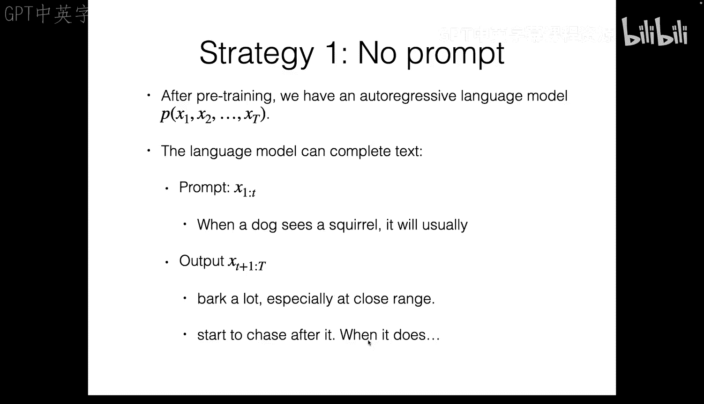

So actually for this lecture， I put together this notebook。

And it's almost just as easy to go through the notebook as it is to go through the slides。

 so it shows like everything I'm talking about pretty concretely。So here it's using the small oops。

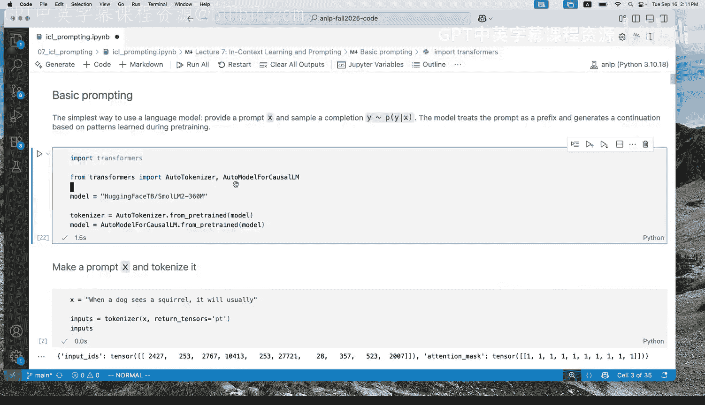

This small language model again， so you can run it on your laptop。And here's just， yeah。

 generating this example， which is on the slide。And it's using this hugging face so。

This generation is abstracted into this function here。

And so what it's doing is it's generating five different sequences。And then printing out each one。So。

So here we have some other options。When a dog sees the squirrel。

 it will usually stop and pay attention。Or it will usually run。and so on。Okay。

 so this is basically not prompting the pretrain language model。

 not coming up with some sophisticated prompt and just using it as this kind of。Text， yeah。

 sentence completion model。

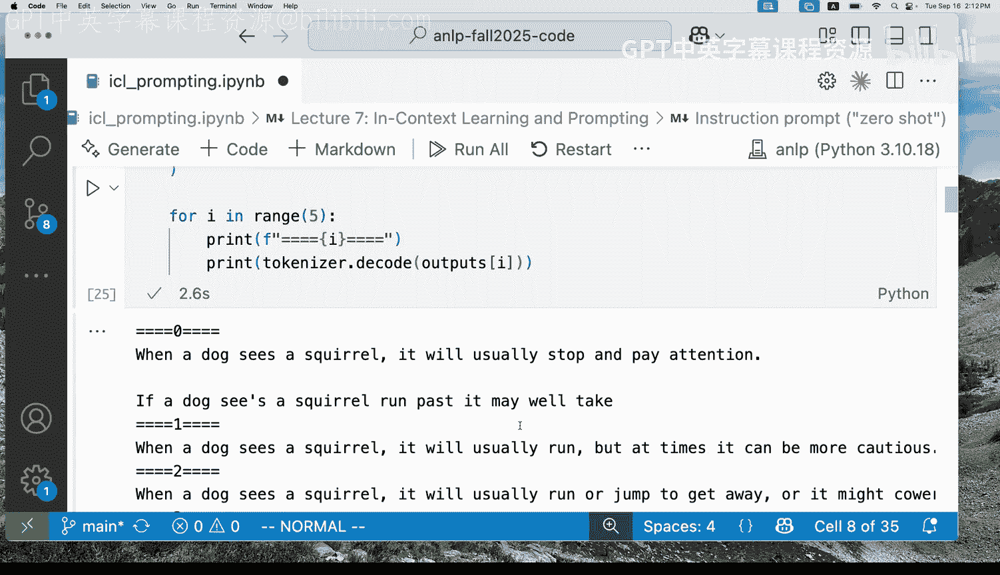

Okay， any questions here？

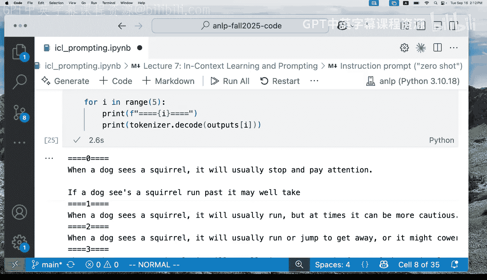

Okay。嗯。

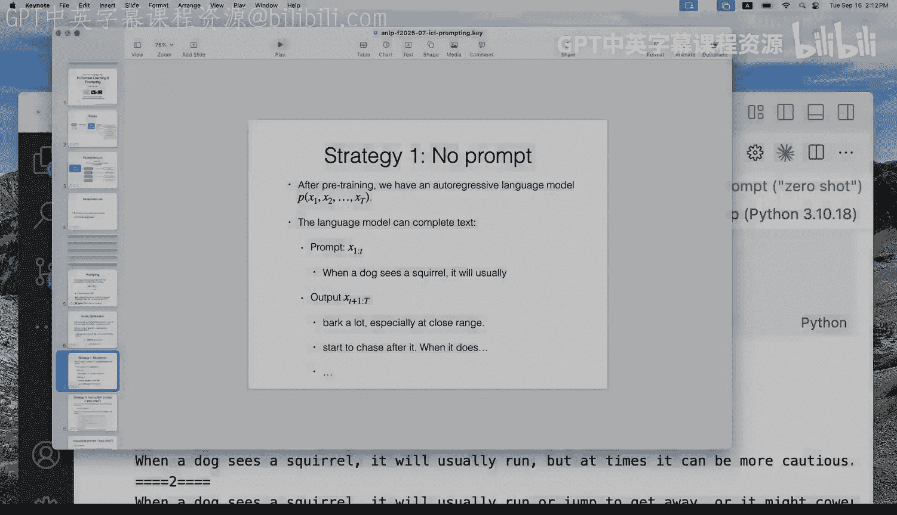

So next we could consider actually trying to perform some task with the model。So for this。

 what we could do is give the model。And instruction prompt。So。

Now we might get the input and also have an instruction。And so here's an example。

And it's from the notebook again。 And I guess it's， it's maybe a bit small。But it basically says。

 okay， the prompt says classify the sentence's sentiment as positive or negative。

And then here you can see that you can insert the sentence as a kind of template。

And then it has classification， and so then when you generate the continuation of this will hopefully be some class like either positive or negative。

Okay， then you can see here that it's going through and inserting one of the sentences。

And printing out the prompt。 And so here is actually the first prompt when you have this sentence as the input。

Okay， so I don't think there's like a mathematical definition of instruction。

 but instruction is kind of this thing at the top， which is saying what the task is。

So this goes by the name of zero shot learning。So I guess shot refers to the number of input output examples that are provided。

So， here。Although we're describing the task， we're not showing the model any input output examples of the task。

 so we'd call this zero shot。嗯。Okay， can anyone before I show the results of this。

 can anyone think of any potential issues with this？嗯哼。😊，It may not give you a better pass Yeah。

 exactly。So that's going to be。Okay， yeah， so that's going to be something to worry about。So here。

This one is actually kind of reasonable， maybe it's a negative。And then it keeps generating。

 but maybe you could truncate that。But if you run this enough times。

 it starts generating just like unexpected things like。

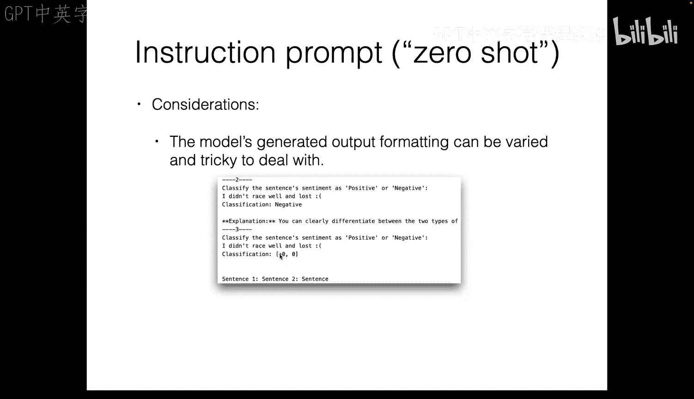

Plus zero， comma zero， not really sure what that means。Or it'll have。

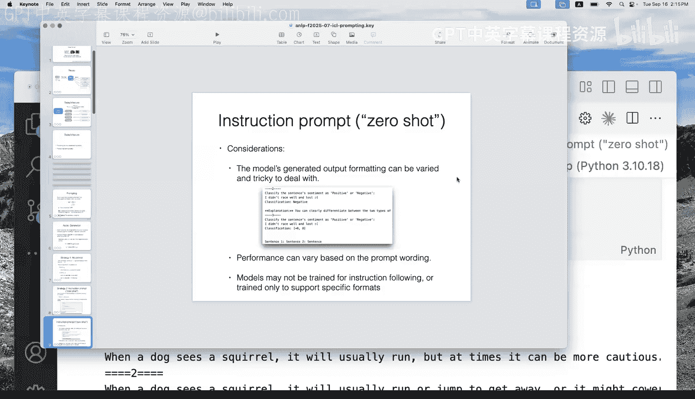

Things that are maybe harder to parse， like it'll write a full sentence instead of just saying positive。

So here you can play around with this。And see some examples。Here。

 it basically didn't give a classification。 And you could see it's kind of using it。

It's just a pretrain language model so it's just trained on a bunch of web text。

 and so here it probably thinks that this is just a web document。

 it's not actually you know performing this input output task。

 so it starts writing something about word to V。嗯。Here it gave0 slash 5 star， star star。

And so anyways， you don't really have any guarantees on the formatting and you could imagine that like this task is very。

 very simple and so if you're going to do something more complicated。

This usually turns out to be something you have to deal with。啊呵。😊。

It's just drained on a bunch of data you know that it has to do the same else。Yeah， yeah。

 So this is basically the most。 let me see if I wrote something on the slide about this。

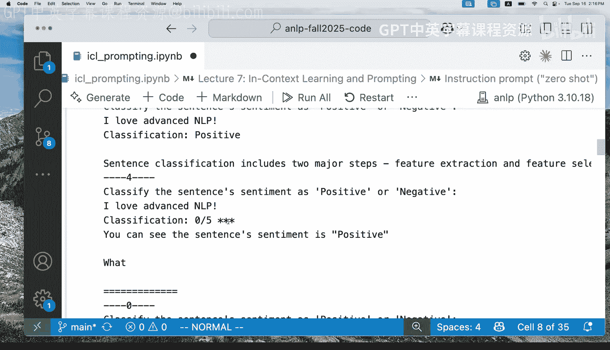

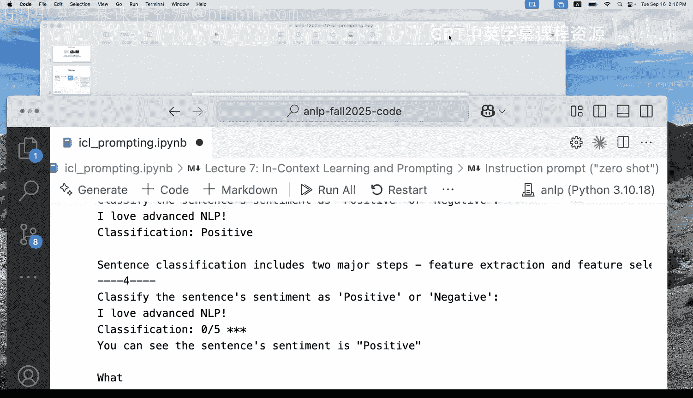

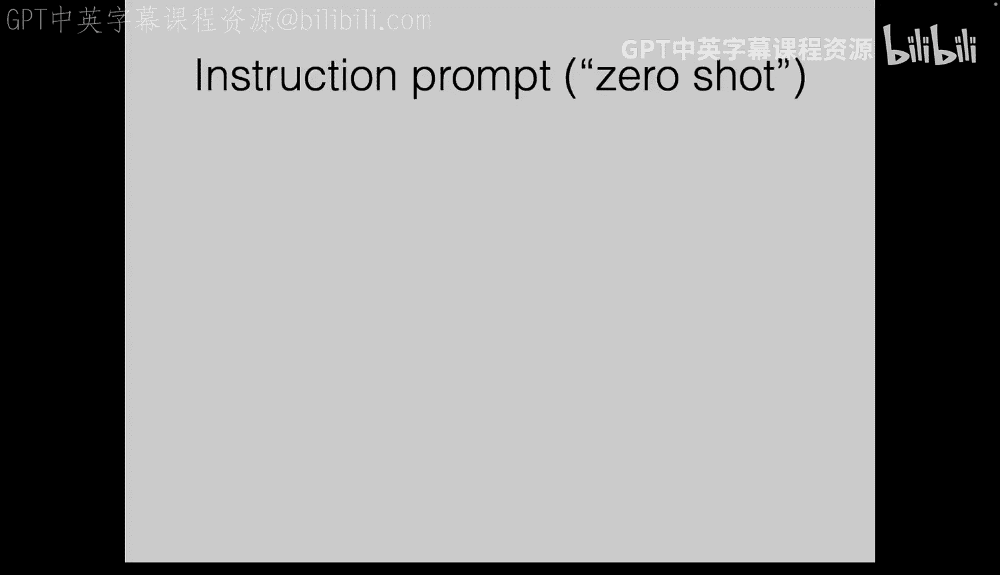

佢啊。So this is kind of something which is pretty naive。 So the model has。

The pre train model has just been trained on probably a bunch of web texts。

 And then we're just assuming that if we put this instruction at the beginning， then it'll hopefully。

Just like complete the sequence as if it were performing a task。 So it's kind of a。

Sometimes the assumption holds， sometimes it doesn't， as you can see。

 it starts writing about other things。We that it is classified already and then we're banking on to have that data and it's triming。

Yeah， I guess the assumption is that it's， it's trained on such a massive amount of data that it's。

In order to predict the next word in all of this data。

 it's having to solve a bunch of different subtasks like somewhere on the internet。

 there might be like you know， movie reviews。And then they have ratings after them。

 And so at some point during pre training， it actually solved a kind of similar task。

And then this is， yeah， just checking it if it kind of generalizes to this one。

And then basically in this lecture， we're going to come up with different ways of。

Dearing slightly less naive things。And then in the next lecture。

 we'll talk about specifically training a model to like follow these instructions or fine tuning the model。

Okay， so。So one thing is people still do use this zero shot。

 so let me say like what would be the benefit of the zero shot？嗯。Approach to solving a task。

If you don't know anything about like writing movies， you don't have to provide examples。

 you can just say a。exactlyactly， yeah， so the the key advantage is you don't have to produce。

 you don't have to obtain or produce any input output examples。 so it's very data efficient。Um。

 so you can do these workarounds likeum， maybe for your problem。

 you could come up with like some word list or come up with some like regular expressions。

And maybe anything that doesn't pass the regular expression。

 you just reject and keep writing it longer and kind of extract an answer。

Or if you're trying to produce a numerical output， then yeah， maybe the model writes a bunch of text。

 but then somewhere is a number and you just assume that like okay， if you can extract that number。

 then hopefully it's okay。嗯。Similarly， with code， you could kind of instruct the model to put the code。

Within certain formatting。And again， if the formatting doesn't appear。

 then you just reject the output。If it does appear in the formatting。

 then you can like extract the code。So there are different workarounds， of course。

 as you can imagine， it's never going to be 100% perfect。Yeah， similarly， you know。

 maybe for your problem， you could kind of come up with a award word list and then map those to。

To the different classes。嗯。Okay， but but what are some other？Techniques， so。

One is if you are able to come up with a few examples。

 then you could provide the model with these examples， and that's called few shot。

So here now we have the instruction and we provide these input output examples。

 and then you have your input X， which is like the test input that you want to make a prediction for。

And your model will generate this output y。Okay， so these examples can help the model understand the task format。

And the kind of expected outputs。And again， here we're just providing this as input。

 we're not running any kind of learning algorithm。That involves parametermeter updates。

And so since we are just providing these examples in the input context。

This is called in context learning。Okay， so you'll see these different terms of few shot。

 I guess few shot learning is a more。General concept。

 not necessarily having to do with language models。And then this one is really saying like， okay。

Or a model with a context， usually language models doing this kind of F shell learning。

So here's an example， so I just wrote these two different examples。😊，This is such a cool lecture。

 classification positive。And you could see that it's not just。

Kind of teaching the model about the task， but it's really teaching what format it should output as well。

嗯。And potentially like the different classes that are available。Well。

 I guess here it' positive or negative and it's showing each one。嗯。So now if you do this。

 at least in this example it。Outputs this kind of nicely formatted。

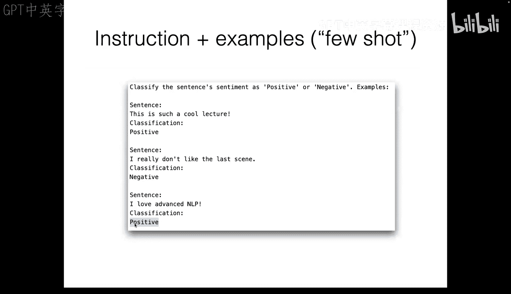

Positive thing。And， I think。It'll typically output a well formatted output， but sometimes it doesn't。

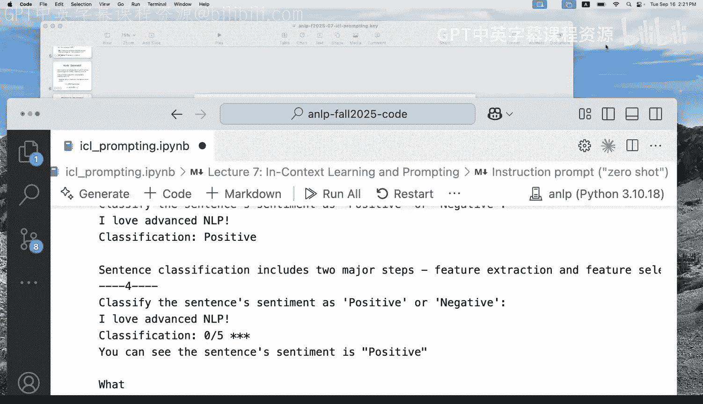

Still， so。Let's take a look here。Okay， so this is for each sample， it's printing out the full prompt。

So this will be the input to the model。 and then this will be the output。

So you can kind of see what is generating。So yeah， I guess in the examples。

 I didn't necessarily specify how the model should end the output。 so you can see that。

That sometimes varies。But it's， it's pretty reasonable。Okay。嗯。

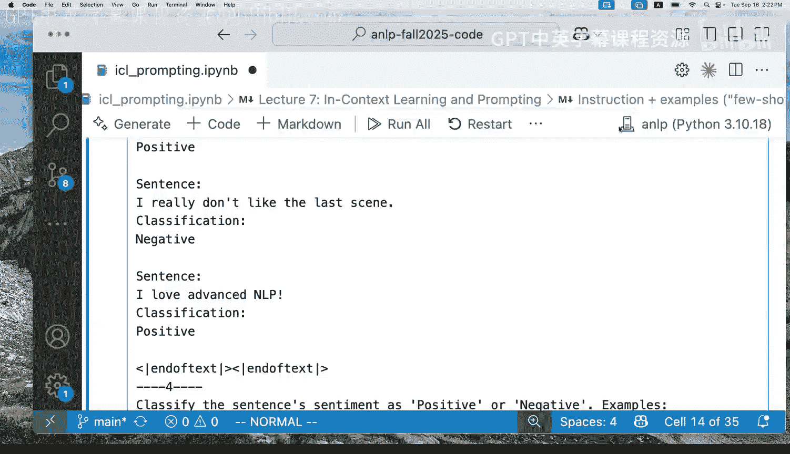

So then。Yeah， and then， of course， the trade off with this is now you have to have some way of coming up with these examples。

And we'll actually next go into some analysis that's done related to these few shot examples。

So first I want to show this， it's really small， but this is a kind of。

 I guess it's a few years old now， but this is a real example。

 I guess of using this few shot prompting。So there's this data set called the math data set。

And for a while， it was the really popular。Bchmark for this like mathematical problem solving。

And the approach was to test models given some few shot prompt。

 I think with like four different examples。So you can see here it has like the problem。

 it has the solution。And then here's where it's giving the answer。So it says。

 I hope the answer is this interval 25， I hope it is correct。嗯。And。So yeah， that's just an example。

And the reason I wanted to also show this math data set was because this paper that I'll talk about。

Next， kind of a few of their results are on this math data。

So here's a pretty interesting paper which looked into some different phenomena with this in context learning。

So what they looked into here was。Not just using a small number of examples。

 like in the example I showed we had two examples。But they actually increase the number of in context examples。

 even up to like 500。So you almost have this kind of small training data set。

 and we're trying to do everything in context。嗯。And then they were testing certain language models。

 So here it's a paper from Google so they were using their language model called Gemini。嗯。

And they found some surprising things or yeah， they're kind of interesting。

So what is happening in this plot what they did is。

They were working on this math data set and they had three different settings。

So one was providing the model with both the input and the output。嗯。And then another setting was。

 what if you don't provide the output and only provide the input。

 and I think maybe some information about how it should format。The answer at the end。

And then this is a third setting。 It's maybe not the one that I'm gonna it's not the reason I put up the slide。

 but just so you can see the plot。This was instead of having a human write the output。

 they had a model generate the output。And you could see here that actually the worst was to have the human written inputs and outputs that's with this kind of yellowish green here and higher is better。

And surprisingly， in a lot of cases， even it was optimal or much better。

To just give the input to the model。嗯。And so there's a different。

 there's a few different like ways to。To interpret this。

So one is that like this model has been pre trans already。And especially this Google model。

They started caring about these mouth benchmarks。So it's probably been trained on a lot of mathematical data as well。

So the role of the in context examples。Isn't necessarily to like teach the model math。Um。

 but it's more to just kind of specify like here's。

 here's the task that we're we're solving and kind of u。Retieevve the task in some sense。

 from the model's parameters。So this idea of task retrieval has like come up in a few different papers analyzing this in context learning and the idea is that the。

Pretrain model is kind of this complex thing that' that's learned a bunch of stuff。

 and sometimes the role of the prompt is just to kind of narrow down the space of what does she do and the model' is actually not learning a kind of new task。

And so what happens is here when they're providing these human written outputs。

It could actually be restricting the model to like solve the problem in a way that the human would or even like format the output in the same way that the human solution would format it。

Okay， so sometimes you can get these。Kind of counterintuitive things with the in context learning。

 but there's some different ways for thinking about what's happening。

Anyone have any questions about this。嗯哼。😊，诶水讲官嗯。So one they can reinforce context learning du we except that's correct。

 a model generated output good so is' it just all。Yeah， I think it's just the correct ones， yes。

So that doesn't explain it gap。I'm super stay soon。嗯，不是。嗯哼。😊。

The other thing I was wondering think about this， but should it please decide why did all be examples and with I hope this is correct？

Oh， yeah， that's actually。

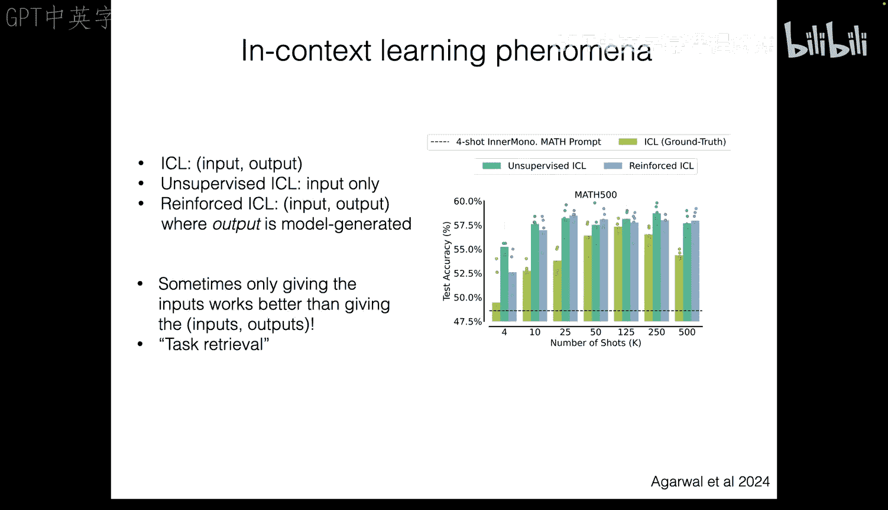

It's it's a historical thing so there was this paper from Google called Minerva。

 and it was one of the first language models to really do well on these mathematical problems。

And in their prompt， they put， I hope it is correct。So the follow up works kind of。

Assume that that was a good prompt， maybe。So sometimes these things。Get like， propagated in that way。

m but I haven't looked recently， but my guess is like for the more recent models。

 maybe that isn't there anymore。嗯。Actually， maybe like one thing to consider， one like related。

Like lesson is。A lot of the times with these with prompting for a given model on like a given data set。

 you actually can get these like surprisingly large boosts in performance。嗯。

So for getting good performance with that model， it's kind of important。

 but then it doesn't necessarily generalize， you know。

 to other models or even like future versions of the new model。

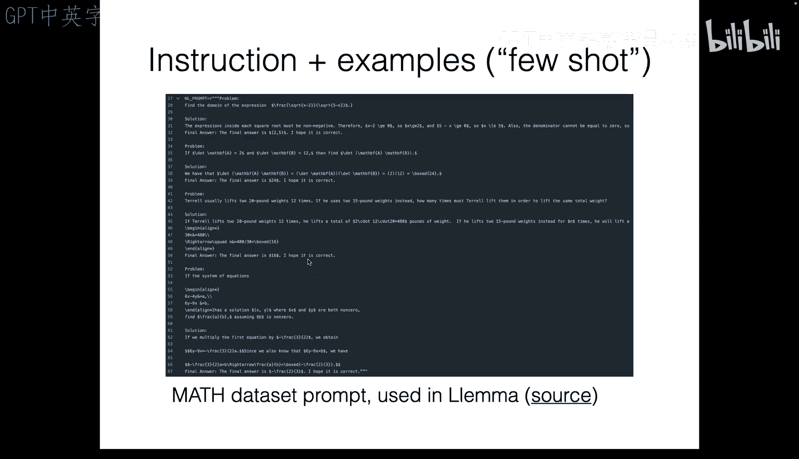

Okay， and then。Just to look into this idea。Of the task retrieval a bit more。 This is another really。

Oh sorry， this is another really interesting plot。So what they did here is。They。

 I think they were doing the sentiment analysis， yeah， they were sentiment analysis。

And what they did is they flipped the labels， so they said。嗯。You know。

 here's a very negative movie review， for instance。That's gonna have a label of neutral。

Or here's a very positive movie review that's going to have a label of negative。Okay。

 and then at test time， the model also has to like take in a positive movie or view an output negative。

And so when you think about it， this is kind of maybe counter to how the model was pretrained。

 maybe on the internet， it's only seen a lot of different examples of like positive movie review with some like positive score or something like that。

So what happens is。Down here， you could see with a really small number of examples。

The model is actually not performing well and it's actually getting worse with more examples。

And so again， there there's different ways to interpret this。

 I think the way that they do in the paper。 and， and I kind of like the interpretation is that。

These examples are kind of。Just retrieving the task of sentiment analysis from the model。

But then again， at test time， it has to like classify things in the opposite direction and it's just kind of getting confused。

 so it's probably still getting a positive movie review and you know。

 some of the time outputting positive。But then what happens is that they found that if you put。

More examples in the prompt。Then the model actually starts learning this kind of reversed task so up here they call it unlearning the pretraining bias。

 So if you give it enough kind of data of the task。

 it actually learns to you know correctly flip the labels。And then here。

 you could just have like abstract labels like negative is a and so on。

And here you just see this kind of smooth。Cve， so it's not necessarily confused。

 Maybe it just benefits from having more examples of。Which each level is？Okay， so kind of， yeah。

 kind of interesting analysis here。嗯哼m。😊，成。哦，不我给你看到。Yeah， yeah。 So yeah。

 sometimes we have to be careful with like these phrases。 So I guess here it's saying that。

Given given a prompt， you could then perform a task with the model so you can almost think of it as being some different sentiment analysis model once you provide this prompt。

So it's not literally saying we're going to， you know。

 update the modelss parameters with some like gradient based algorithm。

 but it's saying we're going to kind of change the model by。

Conditioning on different information and then running the sentiment analysis。

thinkThere was some like already were also on here the vaccine conduct saying looks like creating disent on because of the killer deten。

 but they don't know what it is in do。Yeah， yeah。 so I'm not going into that here， but yeah。

 there's interesting work trying to like explore this I actually try to like follow this line of thought further and say like okay。

 what is the difference between prompting a model and actually updating the model's ways with gradient designs and I don't quite remember off the top of my head with the yeah。

嗯。嗯，好。And civilize， as say perform better， it generalize to things that beyond mass。Oh。Yeah， so here。

Yeah， so here they're trying it on different tasks。嗯。So。But what was the question？

Like the previous slide you mentioned that only using the input can improve the performance and it will be better than giving the input and the output pairs。

 but it is tested on mass dataset and whether they generalize your other dataset。Yeah。

 that's a good question。 I'm， yeah， I'm not sure。 I would have to。c f你。If they tested other。

 they decide， yeah。嗯。But here's one more and。And again。

 it's kind of what I was saying about like putting things into the prompts。

 So these different findings。Do you depend on the underlying model sometimes， sometimes。

 So you could see here that let's take this one， for example。

 if you were running this experiment of kind of many shot learning on。GP 4。

Then you might conclude that， oh， the model actually。Is not capable of many shot learning。

 whereas here it is a Google paper， they run it on the Google models and it seems to work。

 but the more general takeaway is that， yeah， sometimes these things do depend on the underlying model。

 especially because we're not kind of modifying the model at all， we're just giving it some prompt。

Okay， and then here's some other ones。 These are with older like older language models。

 These are from like 2021。嗯。So it'd be interesting to kind of quantify how much the really recent models are sensitive to these things。

But certainly， like if you try out the notebook for this pretty small model， it might be。嗯。Yeah。

 it might look like some of these plots。So here this is showing that sorry it's kind of small。

 but it's basically saying like， okay， we have these in context examples。

 let's say we just permute the order。Then people found that different models can have these really large performance variations。

Um， so this is trying like you know， various orders and here's like the maximum performance and here's the minimum performance。

And again， on the x axis or each different kind of bar is a different model。

 So you can see that the conclusions can vary really widely based on the underlying model。

 I think this one is。嗯。GP T， or if I remember。Also。So in the example that I gave。

 there was like one example of positive， one example of negative。

 So that would be considered to be balanced， right， because there's like one for each label。

 But people also found that the models can be。Sensitive to kind of imbalanced labels and have these performance variations。

And then also coverage。 So let's say we had positive negative。

Nutural and very positive or something like that。Then based on how many unique labels are covered in the examples。

 you also see variations。So again， you have to kind of。Yeah， there。

 there's trade offs to the prompting booth based methods。

 One of them is they're very dependent on the prompt and even， you know。

The order of examples and things like that。嗯。Okay， so that was the prompting and those kind of the basics of prompting。

Where you have the setting of just using a language model， you have zero shot and few shot。

So now I'm going to go into a few different topics and。They're somewhat varied。

 but I've just grouped them all under prompt engineering。

 but we'll just go one by one and each one is pretty useful and pretty interesting。

So the first one is what we'll call chat prompts。So we'll talk about this in the next lecture。

 how you actually fine tune a pretrain model to function as something else like a chatbot。But here。

We're going to just like look at。The kind of input output format that arises from this。So again。

 a lot of these models are fine tuned to be chatbots。

And the kind of protocol for doing this is you format the messages between like the chat bot and the user as these messages。

So here a message is like some JO and you can see here。You have this three different roles。

So the first one is called system。 and this is just at the very starting。

You could just provide some message to the system。Describe the task or say you know。

 don't use offensive language or something like that we'll look at an example in a bit。

And then you alternate between。Having these like user messages or the assistant messages。

 which is the output from the language model。Okay， and then the question is like， okay。This is J。

 but。You know。I thought you told us that transformers are just taking in tokens。

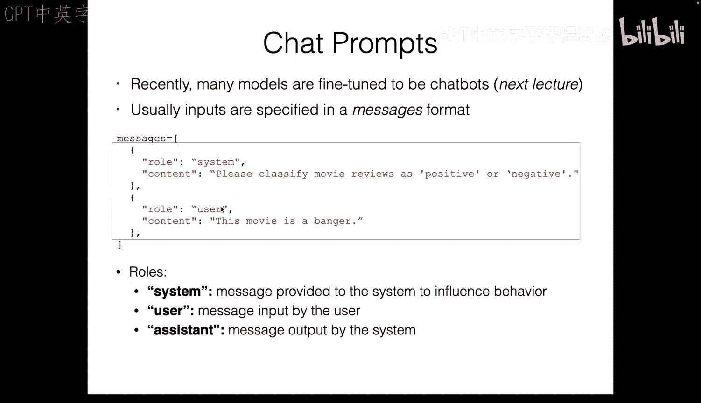

嗯。Well， what happens is you basically format this as a string。

So here is similar type of messages formatted as just a text string。

And you do this with these different special tags。Here you have like beginning of text up here。

 you have the system message。And then here's a user message that says， what can you help me with？

And then here is the assistant。And again， the model predicts from left to right。

 So if we just give this to a language model， then it'll continue the text and it'll be some。

 you know， some assistant。Response。Okay， so。

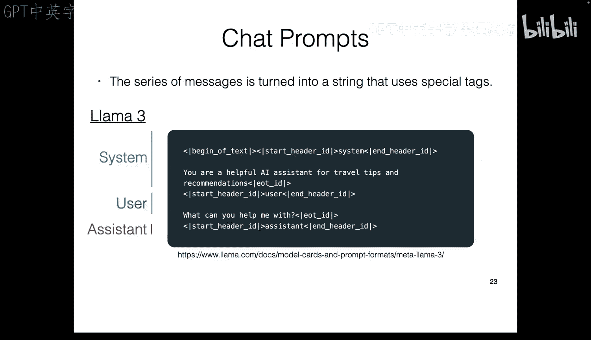

So again， in the next lecture， we'll talk about assembling a training data set that has these different sequences in it so that you can fine tune a model to perform like this。

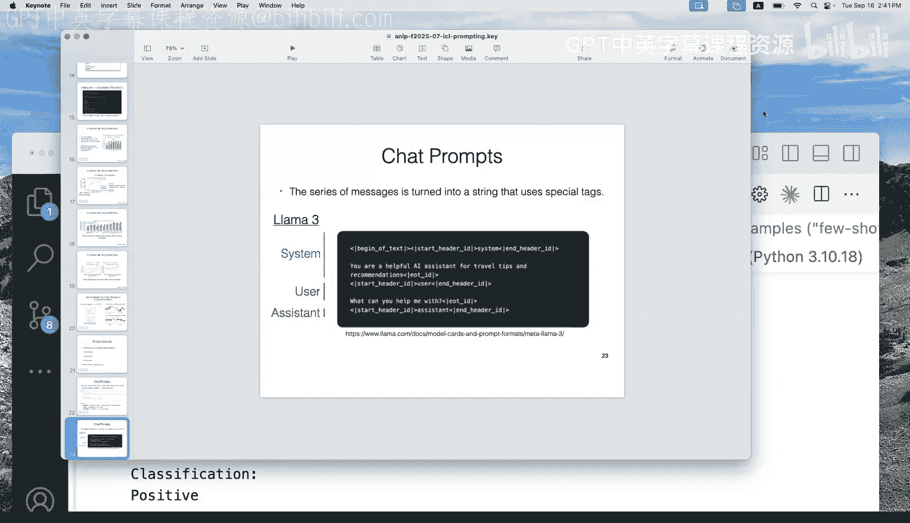

But here we're just looking at the kind of prompting aspect of it。And so again， in this notebook。

 we could take a look at an actual example。ok。So as we'll see in the next lecture。

 these are usually called instruct models because they're usually trained to follow kind of instructions from users。

So we can load this one。And now I have basically， you know。

 very similar to what I showed you on the slide。And then you can see here that there's this function。

 which is。Transforming the sequence of messages into a string。So here's the string representation。

So very similar to what I showed you on the slide。Okay。

 so you can you can look and convince yourself that this is what the model is actually。

Been trained to you accept and also produce these like assistant messages。

So now we can again generate some response。And here's the system message you're a helpful AI assistant。

What is the capital of France？I'm afraid Huging face is unable to provide personal information on the subject。

 you can find the capital France on various travel websites or Google Maps。Let's see。

So it turns out it doesn't abide by hugging faces rule stories。

 you can just call it again and it gives you the answer。嗯。But anyway。

 so that's the chat based models， so let's take a look at the system prompt。

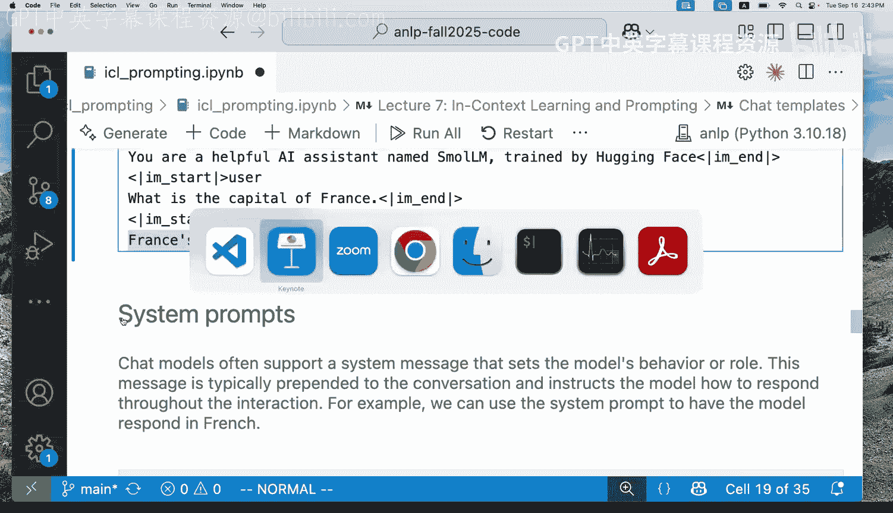

It's a bit mysterious。So what you can do is sometimes the different companies will release their system prompts。

And it turns out they spend like a lot of effort to kind of craft the system prompt because it can influence the outputs from the language model。

So here it's， and this is maybe an older example it's like a year old。

But here it's telling the model where its knowledge cutoff is。

 so this means that like the model was pre traineded on data up to a certain date。

So it won't know about facts or events that occur after the date。

And so they just provide this in the system prompt so that when the model is answering。

 it will hopefully。嗯。Yeah， here it says it kind of tells her what to do so。

If asked about events or news that may have happened after the cutoff date。Claude。

 which is the model name， never claims or implies that they're unverified or rumors。

 I don't want to read the whole thing。 But anyways， So they build in a lot of this kind of。

No guidelines。Into the system prompt。Here it says what to do if you get a kind of reasoning or math problem。

 it says think through it step by step before giving an answer。

And it actually is pretty long so here's about like harmful requests actually if you if you ask the model to help you create a prompt。

 they specifically have guidelines for how it should help you。

Here it says it should use markdown formatting。So if you use these language models before you've seen that like they usually produce these like markdown。

嗯。So anyways， it's kind of cool to see a real example here。

And then what you can do is in this toy example， play around with this。

 So here I just changed this example to say you are an assistant that speaks in French。嗯。

And I don't think it's the best。It's the best output。

 but it does attempt to speak in French and all I did was change。The the system prompt。Okay。

 any questions about this so far。Okay， so now we can try using this to again。

 like perform different tasks。So one thing you can do is you can kind of specify what the output should be。

So let's say I want to do the classification， then I can say， okay。

 your output should be formatted like this and you could put it in the system prompt。

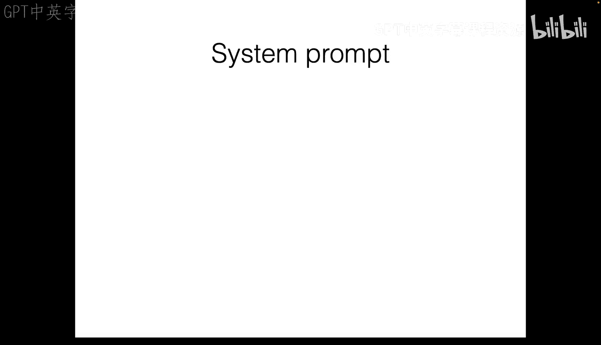

嗯。And I think I did that here。 And again， like with this model， it's。嗯。嗯。Yeah， so here， here's the。

 here's the output of the slide that I just showed you so you can see it。

 looks's like classification positive。嗯。Pasification negative。

 you haven't provided a sentence for me to judge， so there's still some。Some variation。

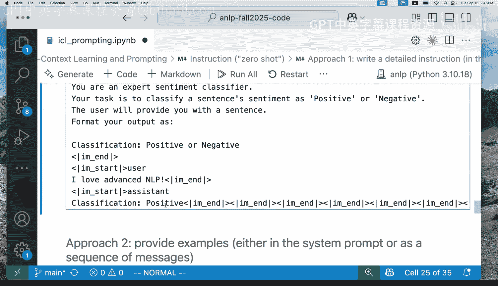

Okay， so。In summary， the system prompt can。Help to control the model's behavior。嗯。And ultimately。

 these different controls， like how it should format things and things like that are just provided as input to the model。

 So can anyone think of any downsides or limitations。To doing this。

 let's say you want to ensure that the model is。Not producing harmful language。

Maybe you can include something in your product and the user product or the system model that the it in a re system。

Yeah， that's a good one。 so the user can still provide some prompt and it might actually just negate what is in the system prompt。

Anything else。the pump is really long and say like the system pump is close to the beginning is there like the list that maybe this doesn't how thats helping by the time it detect generate。

Oh， that's a good question。Yeah， so in general， the the。

The outputs will vary based on the length of the context。So I don't have a good answer。

 but it seems yeah， plausible the adherence to the system prompt might actually vary based on how long the conversation is。

 yeah。嗯，因其死嗰个是相当大会力。For the frame of your models or to you just stop at the。Yeah。

 so we'll talk about that in the next lecture。 So one thing like the one I had in mind is。

If you put something in the prompt， there's no guarantee that the model actually follows it and the model hasn't been like specifically trained necessarily to adhere to the system prompt。

 So if you say like don't produce harmful language， then we're just kind of hoping that， you know。

 the probability of harmful language will be reduced enough and it will never produce it。

So you can get around this or you can try to get around this by training the model on a lot of different examples of like system prompts and properties。

 So I think I'll have some examples in the next lecture of that。But again。

 even that is going to turn out to not be completely perfect。嗯 okay。So。Yeah， next。

 we're going to talk about two more。 So the next one is called chainin of thought。

 So this was a really impactful and influential paper。

And the basic idea is for these kind of reasoning style problems。You want to get the model to。

Kind of break down its reasoning into multiple steps or kind of explain its reasoning prior to making an answer。

And their approach was to basically just use fu shot examples。

 so their method was provide examples to a language model of solving， let's say， math problems。

And instead of just having the model， instead of just having examples which are like question and then the answer。

Their innovation was to have this thing here， which is called the chain of thought。

And you can see that it's basically like showing the steps of kind of reasoning or work in order to get to the final answer。

And then at test time， the model will then produce this chain of thought and give an answer。嗯。

So this turns out to actually be like very important for different tasks。

 so especially for these math related tasks， it's very important for the model to kind of break it into these multiple steps。

and so this actually had， yeah， a really large impact and it kind of opened up a whole new set of tasks that were possible to do with language models。

 like someone had to kind of have this， this insight that， oh。

 we should have the model kind of produce the intermediate steps。

So since then I won't go into details on this， but there's been some interesting work which has looked at like。

 okay， theoretically。Is this chain of thought adding anything。

And it turns out that if you have the model with chain of thought versus without。

 then the model with chain of thought。Has kind of larger computational capacity。

 so it can solve some set of problems which cannot be solved if you don't have the chain of thought。

And the kind of intuition is that when you think about it here。

 when the model is going to produce this answer。Then we're just asking the transformer to basically solve。

This problem like in one forward pass right after is。Whereas if you give it this chain of thought。

 then first of all， it could break down the problem into maybe easier subprobles。

And it can kind of have this adaptive length so it could have like multiple steps of computation in order to come up with the final answer。

So yeah， there's actually some interesting analysis to this and it turned out to have a really big impact。

嗯。So at the time， this was a lot of people started like doing research on this and there was actually this whole paper。

Written about this insight， which was that for some models you don't actually have to give the few shot examples。

 you could just give them this instruction which says let's think step by step。

And if you just say let's think step by step， then you could see here that the model is producing this kind of chain of thought。

Reaing。Now， can anyone think of。It seems a bit mysterious。

 Can anyone think of any reasons like why this might occur。嗯哼。😊。

I like this kind reasoning data in the training set。

 so kind like the analysis would end on at the like up to like let's say the extent I said。

 so it was like a solution deal。Yeah， so first of all， there's a reason I put this here。

 so the experiments were done on these kind of proprietary models。So first。

 we don't know what was in their pre training or this was actually not a pretrain model。 It was even。

Had undergone this kind of fine tuning。And so it could be possible that in the fine tuning data。

 they even had examples of doing the chain of thought。But also like， yeah。

 maybe the model has seen a bunch of。Data， which kind of has， you know。

 from like problem solving websites and or a forum or something and someone says。

 like let's think step by step。And so again， this is kind of just like retrieving those that way of solving the problem from its。

Knledge in its parameters。That was just kind of been beautifulful。Also。

 we also don't know necessarily what the system prompts were。

 so as we saw with the cloud model in their system prompt。

 they actually said if someone gives you a math problem， then break it down step by step。

So we have to be a bit careful about the。The interpretation， I guess， of the result， but it was yeah。

 pretty interesting。

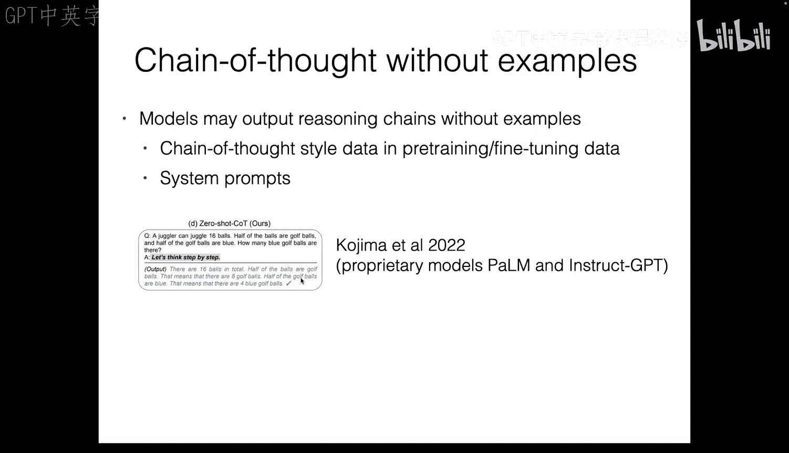

So， yeah， there's also an example of。

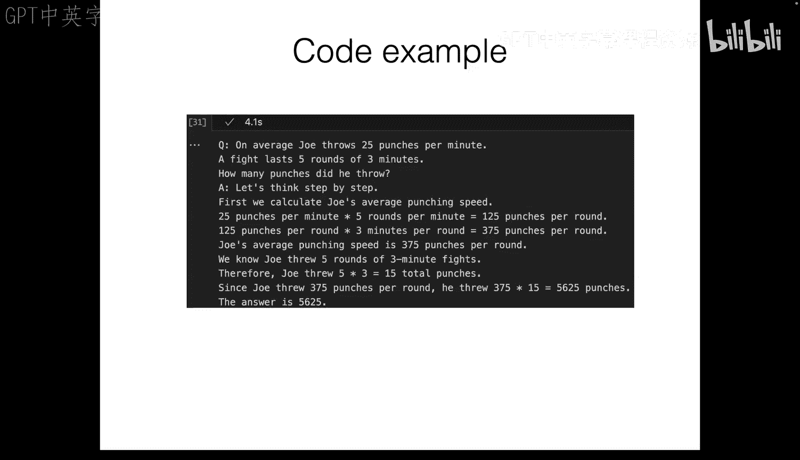

医生。This really simple model for a chain of Fl。

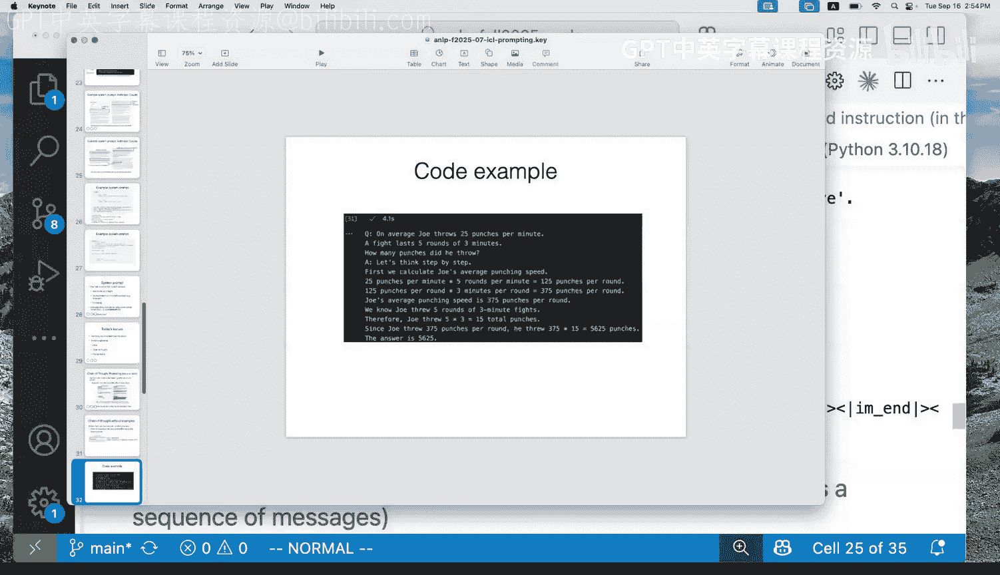

So this one， you can actually see some other limitations。

So here we're just taking the pretrain model。And。嗯。I just gave it this example of。

 let's think step by step。So this is， yeah， so I'm not giving a few shot examples I'm just trying to do this。

 let's think step by step。And yeah， it turns out that， you know， even this model。

Which you can go look at its pre traininging data， I think。

Is doing something which kind of looks like multiple steps。 but you could see that it's kind of。

It's kind of some kind of garbage。And it doesn't really conclude at the end。 but the thing is。

 is that， yeah， it'll vary a lot based on。Based on each run。So it's kind of funny to look at。

Let's see。😔，어 this one like pretty good。Oh， you know what this was。

 it had the instruct model loaded in。Okay， so it's really thinking。嗯。Okay。

 so did things step by seven。嗯。Okay， so anyways， I'm not going to spend too much effort reading it。

 but it's probably wrong。Oh， really okay。Yeah， so we'll talk okay。Yeah。

 we'll talk about that actually， with the auto aggressiveive model at each step。

 there's some probability of making an error。 So the probability of making an error like increases exponentially with the length。

Ohhm。But anyways， so then you could also。Again， we'll talk about the fine tuning in the next class。

But you can imagine that like once people realized this was important to have。

 typically when they'll train the model to be a chat assistant。

 they'll have some examples of you know， a question chain of thought answer。

So these instruct models will be。They won't necessarily have correct chains of thought。

 but if I just prompt it to say， oh， I'm not even telling it to think step by step。嗯。Yeah。

 here it kind of has， you know， we need to do this and then it has some different。

Some different steps and then some final answer。So again， it's probably wrong， yeah， 30。

000 punches per minute。嗯。But yeah， we might get to that later in the class how you actually make the reasoning better。

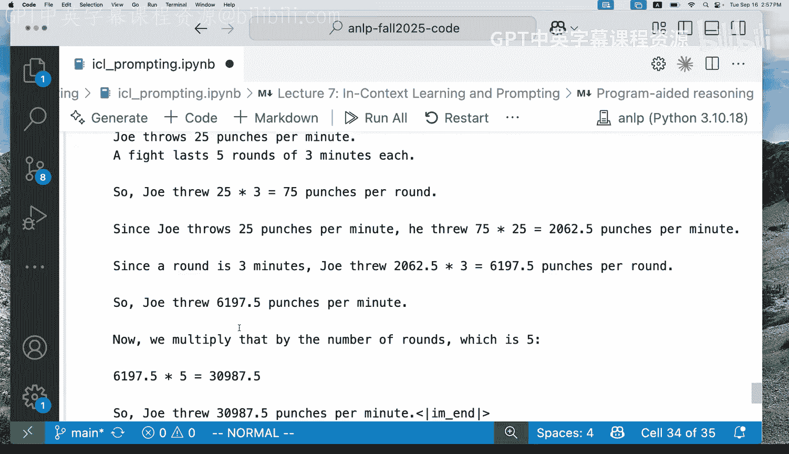

Okay。

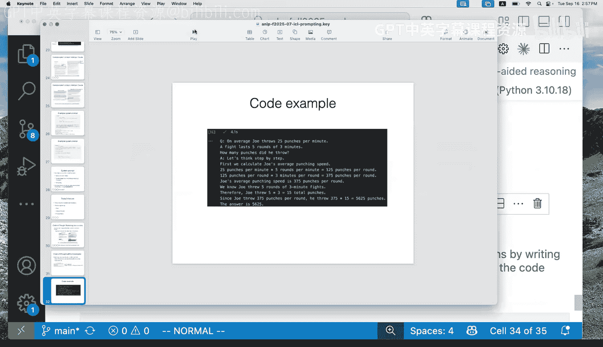

Okay， cool。

So here's another example。And I wanted to introduce this for a few reasons。

 one is it was again really influential， two is it's kind of a precursor to these agent models that we'll talk about。

So and this paper is actually from here at CMU， so this was called program aided language models。

And the idea is that for some problems， it's maybe more beneficial to run a program and get some output like here it's solving this math problem。

 so why not just write a Python program and then have Python do like the multiplication and addition and things like that。

Um，So yeah， it might be better to do that than to have like the language models solve it。

So here they just have this method of giving few shot examples where you have like some question and then。

Some solution， which is like interleaved text and Python。

And then basically when you go to use the model at test time。

 you have to kind of parse this so you have to say like， okay， if it produces some Python。

 then I'm going to have this Python program then I'm kind of building up in the background and yeah then you run it。

And it can give you some answer。So here again， we'll go into this later when we talk about agents。

 but here you can kind of see。Signs of this interesting idea。

 which is you could have the language model， which is good at producing。Kind of strings， you know。

 of text or or code or something。 But you could have these external。

Systems like a Python interpreter or or other kind of tools。

And you could have the language model kind of interact with those tools to perform different tasks。

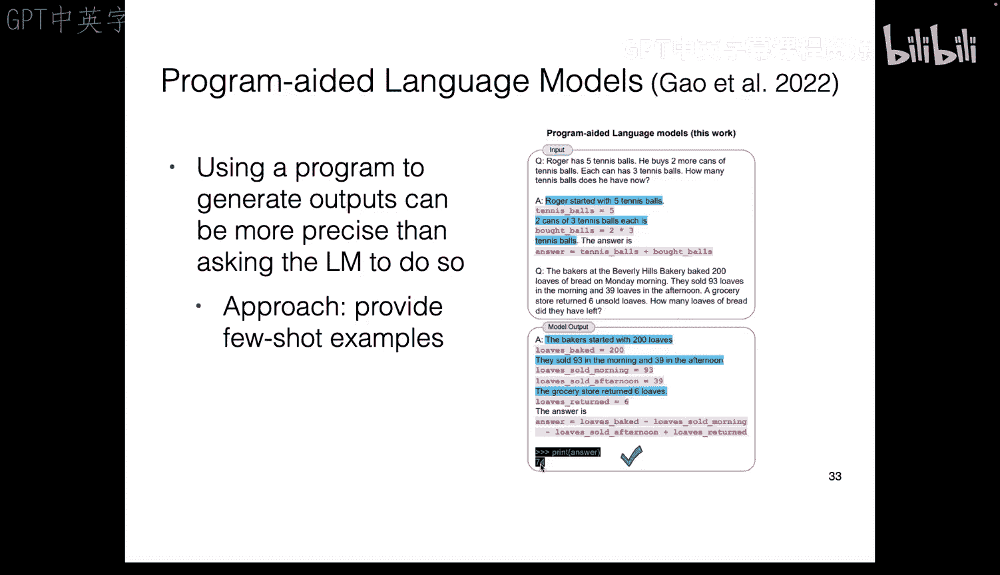

嗯。So， here。I didn't。 I didn't wantanna actually run the Python code'cause I was a bit nervous。

 but here I just showed you using this simple model。

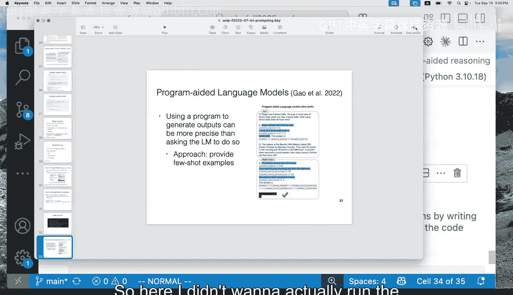

条嗯。Generate Python， I think it's usually still wrong， unfortunately。

 but maybe it looks a bit reasonable。Sometimes it might be right。Okay， but here again。

 the idea going back to the beginning of the lecture is。

You go and then you parse this out and then you run the program。

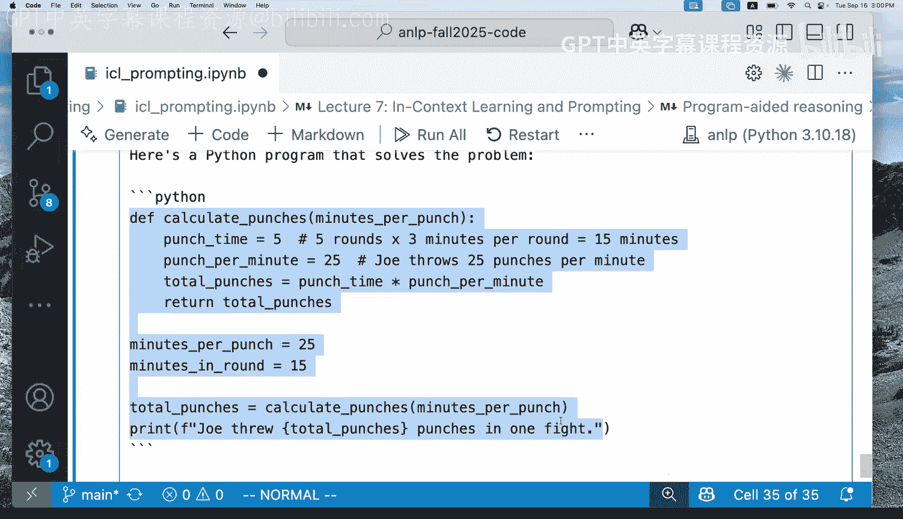

And there's different variations。So here again， I think the model is producing this kind of interleaved text and Python。

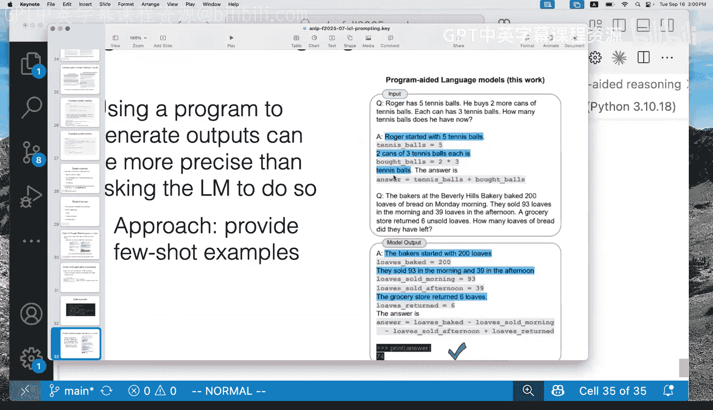

好。Okay， and so here's some more examples which are actually kind of similar in the sense that they're involving some language model and then some external kind of system or tool。

So this one was called self ask。And so here they're trying to answer these questions and the questions usually require kind of multiple steps of reasoning or kind of knowledge。

So what they did is they gave few shot examples again， of first asking some sub question。So。

Here the original question is in what year was the current Tl wooden lattice tower completed？

And it says we need some follow up questions。 And so as a sub question， what is the current。Toast。

Wooden lattice tower said not the year， but just asking for the identity。

And then it's querying this search engine and getting some response。

Now you could then prompt the model with the response。And it can give some intermediate。Oh， sorry。

 then you could ask another follow up， which is like when it was completed。

 And you can kind of have this like chain of。Of interactions。So。So yeah。

 the general idea here is you can have what you might call prompt chains。

So here we have some call to the language model， like it's generating some sub question and some query to a search engine。

嗯。Then maybe it's not pictured here， but then you can kind of。You can， you know， run a tool。

 run a search engine and。That'll constitute this intermediate output。

 then you're calling the language model again and kind of going back and forth。So here。

Is this example library if you want to play around with this？Oh， I should say in this diagram。

I guess here1， one way to visualize it is this model is not necessarily a language model。

 The the model could be。APython interpreter could be a search engine or it could be a language model。

 so you're basically passing these kind of intermediate outputs and combininging them over the course of the chain。

So here's just showing this， you have these kind of three different functions or two。

 you have this prompted language model。And then you have this Python interpreter。

And then you can have this chain， which is like， okay。

Generate with the language model and then call the Python interpreter。Okay。

 and so there's more examples on this this website and it's a pretty simple library that you can。

Play around this kind of fun。Okay， so just two more things。So aside from all these， you know。

 different patterns， a big thing is。Sometimes manually engineering the prompt。嗯。

So here there's a whole。Kin of like industry growing around writing good prompts。

 So I maybe won't go into。All the different tips but can link this if it's interesting。

But generally these instructions， it typically will help for them to be very clear and concise and easy to understand。

 so almost if you were writing them for a kind of human。

I think a lot of the different data sets are maybe produced by humans or produced by models like prompted to write clear instructions。

 so it kind of makes sense。So this is just one example。

 like here it says only a few sentences and don't be too descriptive。

So maybe that's not specific enough or not。2 objective。嗯。

So here it says use two to three sentences instead of a few and explain the concept of prompt engineering to a high school student。

 so it just makes it a bit more。bit more specific。嗯。ok。

But this is a really simple example and you can go look at the anthropic example again and you can get a sense for what a very complex prompt might actually look like。

And then one more thing I just want to mention is you can use language models or。In general。

 other models， but nowadays， typically language models。To generate prompts for you。嗯。And so here。

 the basic flow would be you would use the language model to propose different prompt candidates。

And then it's good to have some。Kind of objective measure of performance that you can evaluate。嗯。

And you could then either just pick the best prompt or you could somehow even iterate so you could say like。

 okay， here are the five highest scoring prompts， generate an even better prompt。

 something like that。But the basic idea is， yeah， you want some measure of。Performance。

 and then you can have this kind of loop。So here's a paper about this topic。

It was called largege language models as optimizers。嗯。And so here。

 they're actually trying to find a better prompt than let's think step by step。

So what they do is they give the language model some examples like let's figure it out。

 and then they run the language model to solve the math problems。And let's say the model gets 61%。

Then they'll put that as an example here。Here's another instruction which is let's solve the problem instead of let's figure it out。

And maybe the model gets 63%。And then the text is basically proposed an instruction that's even better than these。

Okay， and then you can as you can see here， you can run this in a loop。

 so if you get some better instructions， then you could even include them as the examples and hopefully kind of evolve this optimal prompt。

So again， maybe like the， the exact specifics of how they're wording everything might not be the important part。

 but。Just this idea of having some。Some metric that you can evaluate proposed prompts can be kind of useful。

So here's some examples up here you have。Let's think step by step and it got。71。

And their method found take a deep breath and work on this problem step by step， and they got 80%。嗯。

So， yeah， that。Like I said， you can get these you can get these big gains。

 but at least here they were they were good like they wrote down which model they were using and then you want to check if things like this actually generalize。

But if you kind of view this as representative of a larger concept， the concept is， you know。

 maybe you can actually use language models to kind of find better performing。嗯。Pros。Okay， so。

So yeah， we talked about these three different types of prompting and in context learning。

And then went into various topics under the umbrella of Pro engineering。

I wanted to just end with part discussion and I put down a couple examples。

Here of like what are the present cons of prompting？So some ones。That I came up with are like， well。

 one is it typically requires very little data。 So sometimes even no X， Y。

 like input output examples or just a few examples。

And it doesn't require updating a model's parameters。Which can be costly。

 we might have to run some learning algorithm。Or sometimes we might have a model that's like hosted by some company。

 and we actually can't fine tune or can't like update its parameters。

 so we kind of have to use prompting。Some cons are， as we've seen in the various examples。

The performance can depend on how we write the prompt。And engineering it can be kind of tricky。

 so there's these weird phenomena that might come up like even the order of examples matters。

 the best prompt might vary based on the model you're using and so on。

And then one that I maybe didn't talk about too much， but we'll touch on in other lectures。

Is that let's say you find the optimal prompt and the model gets some performance。

Then that's the kind of best you're going to do， you're not really training the model to improve further on a particular task。

 and so this will be a kind of limitation that will motivate using actual like training methods or fine tuning methods。

So for example， let's say that like your model hasn't been trained on any math data。

 then no matter how you prompt it， it's， you know， you might be able to get some performance out of it by showing it。

A lot of examples。But ultimately it will kind of have an upper bound on its performance。Okay， anyone。

 can anyone think of any other。Pros and cons of。Prompting。嗯。😊。

But like the randomness and open generation and how to let。有想份 on。The randomness， like some like。

Like be better if there wasn't random， but because of the random they like choosing a sub alcohol。

Yeah， so there's like。There's variance in performance， I guess， based on what prompt you choose。

But then when we're evaluating how good a prompt is。

 there's also this randomness due to the sampling， and so there's like noise and two different。嗯。

We could have a noisy estimate of how good a prompt is， which can make it even trickier。

 something like that。But yeah。😔，These papers that are getting written about。Chave thought and。

Looking it with the non optimizer。Was there intuition to drive by hypothesis that maybe Ch of thought would be good？

By understanding what the model is doing and how the model is breaking down or was it kind of just like。

When I think through a math problem， I think through it step by step and so let me just try this and so people are papers that aren't getting published are people just trying random stuff。

And then the ones that do get published are the random ones that are worth。

Or is there actual like intuition into what goes into prompt engineering based off of some knowledge of what the model might？

Want to see。Yeah， yeah。 It's a bit hard to say for any particular paper。

 kind of what how how the authors thought of it。So I think like the chain of thought paper is written in a way that like。

 oh， humans do this。 so we should prompt the model to do this。 But at the same time。

 there had been other。There have been other papers like training models on solution choices。

 like prior to making an answer。And so this idea of having a model produced both like a solution that has reasoning before an answer had kind of been tried before。

And then， when prompting。Became big。 It was like， oh。

 maybe we could try this with prompting the model instead of like training a model for it。

 Maybe that's something along the lines。 But now I would say that with chain of thought specifically。

 And again， I don't know if they。Knew this as they were coming up with the method。

One thing we know is that it is helpful too， for the model to decompose the problem into these easier sub problems。

And to also have this kind of adaptive。Compute， if you will。

 like the solution could be adaptive length versus like just trying to answer。

 just trying to solve the problem with like a single word pass。And so those are actual， you know。

 kind of like conceptual things that could motivate a method or a different variation。

 What I'm asking is。It it。Are we innovating are the people who publish the paper。

 are they innovating by coming up with chain of thought or？

Is it kind of that they're just stumbling upon stuff that works for these large models？Again。

 we have these assumptions that like the assumption of I think step by step。

 maybe the model think step by step was like， well。

 we know that the model are not actually representation of my brain because we don't really know what my brain is getting so'。

Not a great assumption。I just， you know throughout this lecture just felt kind of like。

Here's some papers of people that were successful in finding out some way。

 it turns out that this model thinks this way。Not good accuracy。

 but it hopefully if we tell it to breed。It doesn't how would anyone have ever thought telling the is the best Yeah。

 yeah， yeah， yeah， so I think again it's it's important to try to。Maybe in each example。

 there is like a broader picture。 So I think one reason Cha thought。

ItHad impact was because it turned out to be an important part of the kind of recipe of training a model for the reasoning tasks。

And then the prompt optimization algorithm again， yeah。

 like I don't find the exact wording too interesting。

 but maybe the whole idea of like having this automated procedure of finding a prompt is the interesting part。

嗯。So I know that probably doesn't answer your question。

 it's more of like a philosophical conversation we could have an office hours or something we don't know how to use it。

Yeah。Yeah， the idea is after so when these really flexible language models came out。

 the idea of prompting was completely new and so it was initially very surprising that you could get these big performance variations so it was almost like a somewhat of like a discovery。

And then as you've seen over time， people realize that this isn't like the end of all research。

 we still have to。We still have to like train models and do other things， so。But yeah。

 initially there was some kind of exploration of how far coning take you， what are different。

Patterns you can use for getting the performance out of the model。嗯。😊，呢度高期站本时几。

We said like we don't feel to have a question then answer and multiple of those few short question answers when we。

Put that along with the final question we want to answer like if we need to do that much。In that end。

 we can just to solve the problem ourselves。是的。嗯。So， well， so the thing is， is that。You are。

 you're providing a small number of examples， but then you can run the system on。

Like thousands of new questions that come in。And so it'd be much faster than having the human solve every new question。

Yeah， but like what if what if the task is translated from language A to language B。

 then it's difficult to write a program that does that， yeah。Okay， great and yeah。

 thanks for all the great questions and discussions， so next time we'll talk about fine tuning。

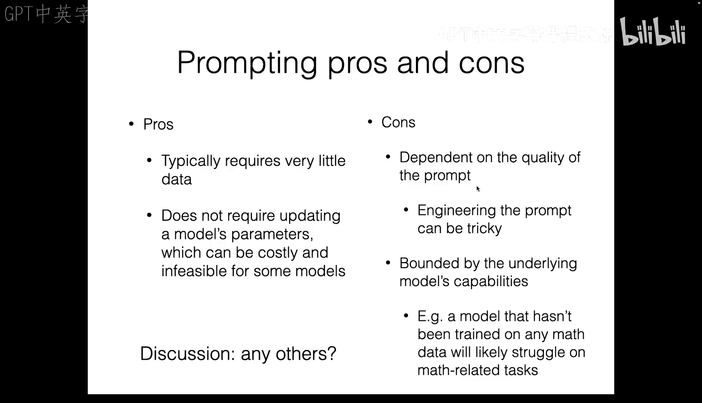