# CMU《高级自然语言处理｜CS11-711 Advanced NLP Fall 2025》中英字幕 - P8：(8)_ Fine-Tuning and Distillation.zh_en - GPT中英字幕课程资源 - BV1ZWYAzuEMa

Today we're going to go over fine tuning and there's several different topics and all of them are pretty interesting and very kind of practical as well。

 this is something you do nowadays if you're working on most NLP tasks。

 you either do this or you do prompting which is the previous lecture。

So if we recap two lectures ago， we talked about pre training and again。

 you get this base model and then you want to adapt it to various tasks。

And in the previous lecture I talked about prompting。

 so here we kind of describe the task either through instructions and or examples。

In the input to the language model or to the model， which is the prompt。

 and then we have it perform a task。So today we're going to talk about fine tuning and in particular。

 the setup where we have some task data。So for example。

 let's say we want to build a model for translation， then you'll have this paired data。

 say in the languages that you want to translate。And then we'll run this fine tuning algorithm and the difference now is that our base models parameters will be adjusted you know。

 through like the gradient based optimization。And so now we'll have this model。

 which is kind of adapted to translation。Okay， so we'll go through the details of of all of this today。

And then we're going to go into a bit of detail on this kind of special case。

 which is what if you still want to build a fairly general system， a fine tune。

 a fairly general system？Then again， you can do this kind of trick。

 which is you can fine tune the model for the task of performing tasks， so to speak。

 so like following user instructions。Okay， so we'll talk about this instruction tuning， which is。

Also something which you see in the more recent models and it's kind of standard thing nowadays。

 so we'll go into specific detail on that。And then finally。

 the third topic will be what's called knowledge distillation。

So this is something which is really useful if you don't necessarily have human created data。

Then the basic idea is you can use， say， a larger model to create some some fine tuning data so that you can then run the fine tuning procedure on。

Okay， so we'll briefly go over this so that you've kind of seen the key ideas behind it。Okay， so。

Now we can start with fine tuning so what is fine tuning so here's you know one definition you could say that fine tuning is continued gradient based training of a pretrain model。

Okay， so there's a notion of a pretrain model， there's a notion of kind of continuing to train it。

 so you're not like resetting its weights。And then gradient based training。

 so this just means that you're actually going in and kind of adjusting the model's parameters。

So a bit more formally， given some pre trained model parameters， theta zero。In this setting。

 we'll assume that we have some data， which is like this paired data of inputs and outputs， x and Y。

We want to run some algorithm which solves this problem。And it's basically saying。

know go over the data or you have this expectation over the data distribution and for each data point。

 you want to minimize some loss。Okay， so it's a simple idea being conveyed here。

 it's just saying we want to minimize some loss on the data points and adjust the model parameters to achieve that。

And so we'll go into some concrete examples。But just in this general formulation。

 you also want to allow for。Forms of regularization or different techniques to prevent overfitting。

Because what can happen is your model can minimize the loss on these training examples。

 but then it might not generalize to test problems。And so in your homework one。

 you'll see a few of these different things。So I think there you'll see this idea of dropout。

 which is used to mitigate or mitigate overfitting。And then， even like the。

Varianance of the atom optimizer will have this idea of weight decay and so you could have weight decay as。

嗯。This kind of extra technique that is meant to mitigate overfitting。嗯。But。Yeah， really at its core。

 we want to minimize this loss on our data set。So just to make this really concrete。

 let's go through two different examples， so first I'll talk about classification and second I'll talk about generation solving generation tales。

So let's say that we have a pre trained model。And we want to fine tune it for classification。

 what would we do？Well， here it doesn't necessarily need to be a language model。For instance。

 it could be a mask language like we could the pre training could be say mask language modeling all we need here is this idea which we saw in a few different lectures。

 which is like a sequence model。Okay， so here the model is taking in some input tokens and then for each。

kenOr corresponding to each token， it has this kind of hidden state。

And you can get one of these by doing different types of pretraining。So mass language modeling。

 but also the autoaggressive language modeling。Okay。

 so let's say you have this like a transformer that gives you these vectors。

Then we again assume that we have some paired data set。

 so here we'll have some input text X and we will have as y， these labels， so let's say1 to K。

Let's say as a concrete example， we're doing the sentiment analysis。

And so here the input sentence would be， I love A andLP。Does anyone know why it's written like this。

嗯。Exactly， yeah， so here it's just showing the subboard tokenization。

 so a little review of some previous ideas。Then we pass that through the transformer and up here we have our other piece of data。

 which is the class label， so this will be labeled Y。

And so we want to figure out how to train the model so that it assigns kind of high scores to the positive class。

So what you do is this idea that we've seen in a few different contexts in this course。

You add on this output layer or output head。And here it's just fairly simple。

So you have this new weight matrix and the two dimensions will be。The hidden dimension， D。

And the number of classes， K。 so you can see K showing up here。

And so when you multiply the hidden vector by the matrix。Then you get something of dimension K。

Then you can also have this bias term if you want， so you basically get these scores for each class。

And then as we've talked about before， you can take the soft Mac and so now you basically have the probability of each class。

Now the thing here is with the transformer each one of these。Each one of these vector。呃。Could。

 you know， potentially attend over the full sentence based on how you do the masking。

So you don't directly have to use like the last token。But maybe that's a reasonable thing to do。

 just take the last token hidden in vector and then attach this output layer。

And I think that's what you're doing in the homework for homework one。Okay。

 so now now that we're introducing this new weight matrix。

 now we have these pretrain weights and we have these new weights and so we actually have to further train the model so that it assigns these。

Good scores。So for that we can use a loss function and so just as an example。

 we can use the loss function that we've talked about several times in the class。

Which is the cross Entropyos。And so here you have your target label and you're essentially training the model to assign a high probability or to minimize the negative log probability。

Of the label。Okay， so here this loss function would encourage kind of pushing up the probability of positive。

And then since everything's normalized since you know the distribution has to sum to one。

 as you push up one class， the other ones have to get pushed down。Okay， and so then you can run。

The training loop that we've seen a few times。Where， you know， you have the optimizer。

 you have like atom or SGD。And you go over batches of data and you adjust the parameters to minimize the bill lawss。

So that is。F tuning or classification， and you can see that it's fairly similar to training the model from scratch for classification。

 the only difference is we're starting with these pretrain parameters。So here， though。

 like the implementation is a bit different， like slightly different。

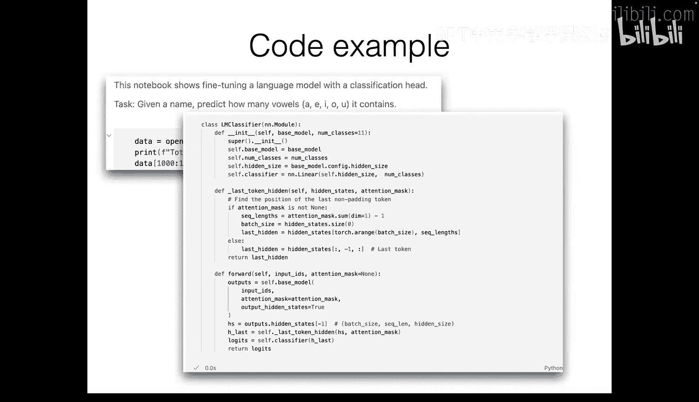

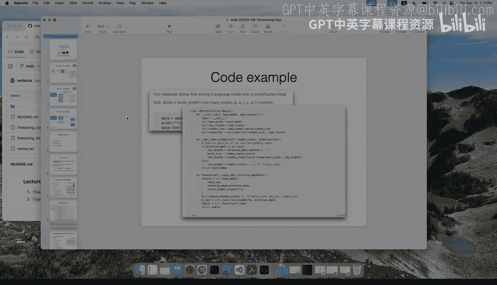

In the sense that， yeah， you actually have to consider how you use the pretrain model。

 like how you implement the extra head。So just as one example， the code。

That's provided for the course kind of steps you through。Doing this for a kind of toy task。

So the task is given our favorite， this data set of names。

We want to train the model so that it counts the number of vowels in the names， so like AEIO and U。

So you could frame this as a classification task， let's say that we assume that all of these names don't have any more than like 10 vowels。

Then you could just frame this as a classification of given a name。

 classifiedify the number of vowels that it has。So here's some examples like Emma has two。

 X by Z has zero， and AAA has three。So then here's showing you like actually loading this model from hugging face and then we're going to attach this extra output layer to this model and then fine tune it so it's just using the small language model that we saw it in the previous class。

Here it's adding some special tokens。And。Yeah， what you have to do is。

If you add any tokens into your vocabulary that aren't in the pretrain model。

 then you have to add on like extra vectors in this embedding layer。

Then I won't step through all the details here， but you can。You can go through。

 this is basically assembling the data set。And。So again， your input x is going to be。

This text and the output will be the label， which is the number of vowels。Okay。

 so then you do the data splits and you can take a look at this if you want。

 you could see the inputs have this padding。You see here the attention mask and then you can see the labels are just going to be one number。

Here's a bit of like extra analysis looking at the label distribution。

And then here's the actual implementation。And again， this is just one way of doing it。

But here we're calling this kind of hugging face model。

 and then we have to get the last layers hidden states。

And then here I won't step through the exact logic， but this is basically saying like， okay。

 let's say you have hidden states for every token in sequence。

 then we want to extract the one corresponding to the last token。

And the kind of tricky thing is that the sequences have padding。Right here。

So if we take the hidden state， just the very last one。

 then you'll get one that's corresponding to the padding token。

So here what it's doing is it's just trying to find like the actual less token。你的。嗯。And then here。

Again， I'm not going to like walk through every line of the code。

 but this is we've seen a few examples now of this training loop and again it's pretty much the same。

So we're going over these batches of data， we're getting these output logits or the scores in the model。

 and then we're applying our loss function， which is。呃。Which will be declared down here。

 which you can see is the cross entropy loss。Okay， so here it's using atom and it's using this cosine scheduler for the learning rate。

 and then you can run the training or run the fine tuning。

So here it's running for two passes over the data and you can see a few different things here。

So interesting thing is， at first， this might look。Like like what's going on here？

So we can see that the train accuracy is 0。74 and the validation accuracy is 0。96。

So can anyone does anyone know what happened here。And it's a somewhat like boring reason。

 it's not like a deep so the accuracy is like foot。So they improve that last one， which is。

so what's happening is in the first pass of the data it's taking the average training loss over all of the different batches and so the model starts out being pretty bad and then by the end it's pretty good。

And the way you can see that is here's the accuracy for just the last batch in training。

 you can see it's 96， but then it's averaging together everything。

So you have to be careful with like exactly what is being logged， maybe that's the kind of lesson。

And you can see here， then in the second pass， now the model starts the epoC pretty good。

 and so now the metrics are pretty much aligned。And you can see it gets pretty good on this task。

 actually not perfect。But then here's just doing some error analysis and you can look at some correct and incorrect outputs。

Okay， and then the idea is that like。You know， you could write a Python program that sells this task。

 but the idea is that if you wanted， you could apply this kind of same pipeline to almost any classification task where the input is taxed and then the output is some class labels。

Okay。So， that's the classification。

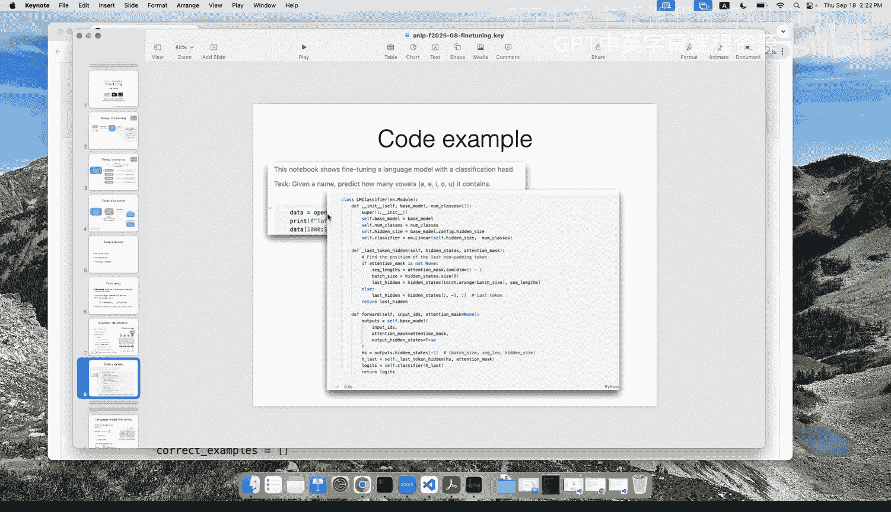

Any questions about this before going to the language model finetain for generation？Okay， great。

So the difference with classification and generation。Is that now we just don't have。

 we don't just have a single。A class label at the very end。We actually want to generate text。

 and so it turns out that if we start off with a pretrained language model。

Then we don't even have to add on these kind of new weights。 It's like new output hood。

You can just fine tune the model basically in the same way that it's in a similar way that it's pre traineded。

So specifically， here we have data and it'll be input text and output text。

And here's the kind of picture。Here the input will be this like start token ABC up to this separator。

 and then the output will be this CBA up to the end token。

So can anyone say what the task is in this case。Yeah reverse so again you could write a Python program to do this。

 but then the idea is you could basically apply this to it turns out like most sequence to sequence tasks。

Okay， so here unlike pre training， what we're going to do is we're going to so we're going to use the language model and again。

 the language model is auto aggressive， so we're you know providing。Each token。

 and then it gives us some probability distribution over the next token。And then unlike pre training。

 we could。Consider just applying a loss to the output。

So here the black arrows are basically the ones that we're applying a loss to。And the gray arrows。

 there's no loss。And yeah， you could see here that it's just training the model to predict the next token in the output。

Okay， and so here the loss is， I mean the standard loss is going to be the same one that we've talked about。

 you have this cross entropy loss except now you can just apply it to this output sequence。嗯。Okay。

 so any questions about this， and then I'll show another concrete example， I like the code。Okay。

 cool， so here there's some code that actually solves this reversing task。

So one thing I didn't talk about which is like what is the motivation for fine tuning or I guess I'll talk about it later as well here it's that depending on what model you're using。

 you don't really know or the model might not be good when you just prompt it。嗯。

So here I didn't go through too much effort to prompt it， it's just doing the zero shot prompting。

 but certainly if you just want to use it zero shot。

 it's a bit ridiculous it just when you tell it to reverse this name。

 it's really unpredictable actually。So anyways， if you have data for your task。

 then you know why not just adjust the and you really care about the task。

 then why not just use fine tuning and it could do the task really well？

So then here's the kind of end result after fine tuning， it's able to reverse these names。

And with the settings I use， it still makes a small number of mistakes。

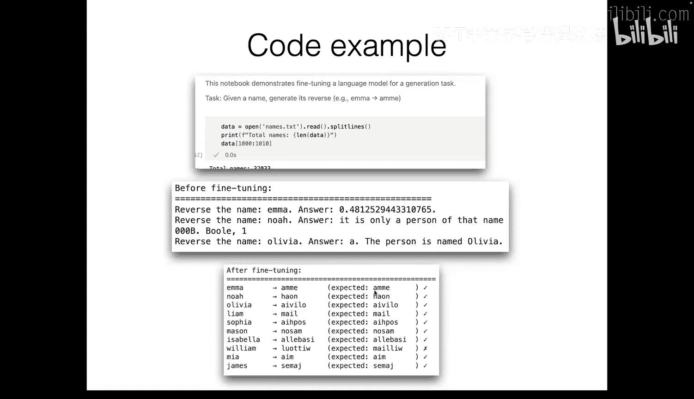

But yeah， clearly it's， it's learned something。And so again。

 the implementation for this is in the separate notebook here。嗯。And so。Here is。

Let me just talk through some of the key points。So here' is basically the。Foratting the data。

 so when you go to fine tune a model in practice， you know in researcher in industry if you want to do this。

Then yeah， one thing you have to do is。Format the data。

 so here's how I'm formatting it for this task。You have this start token。

 you have reverse the name and then the answer and then end token。And so the input x will be。呃。This。

And then the output， I forgot if it includes the space or not。

 will be this and so you'll be applying the loss just to this here。

So this is just showing us and you can take a look and。嗯。Yeah， playground with this if you want。

It's also good， so with these data formatting things。

Like I just mentioned this example here of I don't remember if the space is in the output or the input。

So it's actually surprisingly easy to make。Had of mistakes， or there's some bug in your code。

So a really practical recommendation is just print out some examples and just make sure the format is in a good form before you actually run the fine tuning。

嗯。So， let's see here。T斯 model。😔，So as you can see， it's actually simpler than the classification in the sense that you didn't have to modify the model at all。

We're just jumping right in here， too， by doing the actual fine tuning。

And so here's the kind of usual loop。So then this is just showing generation and I talk about those screenshots。

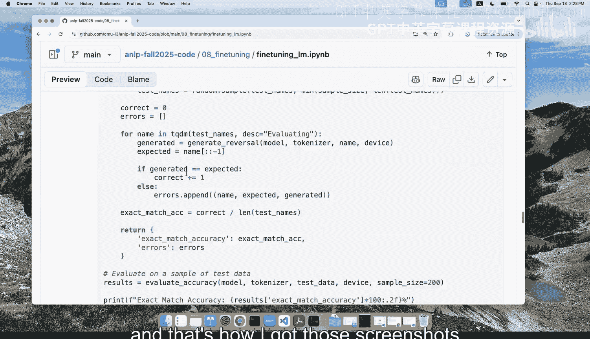

And you can evaluate accuracy。You can do some analysis like。

It looks like it's getting worse on these longer names。And again， here I just wanted to。You know。

 obviously， we don't necessarily care about reversing tokens。

 but you really could apply the same kind of pattern here， including like， you know。

 after you get a model， you want to analyze its outputs in different ways to a wide variety of problems。

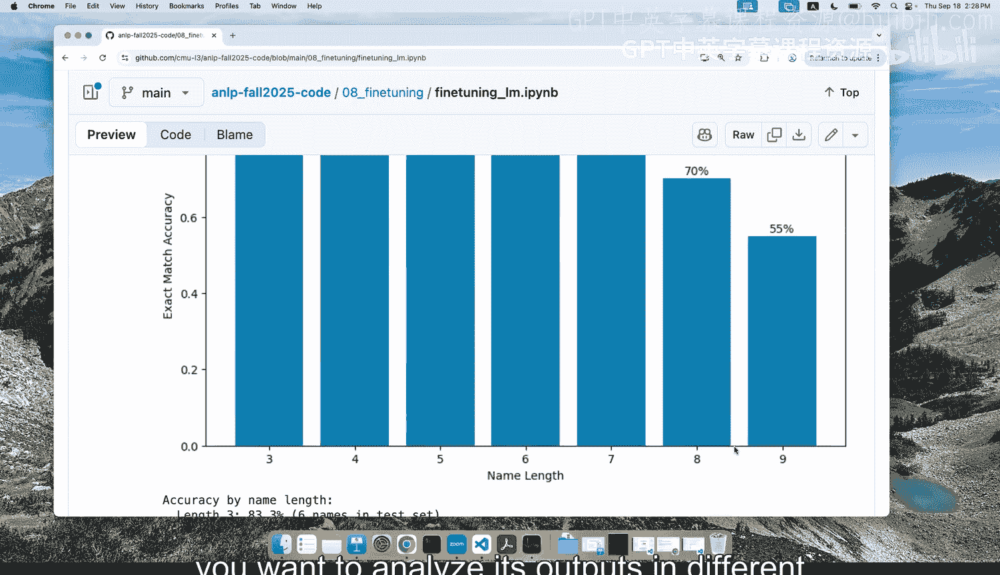

Okay， and so you can take a take a look at this and the implementation is fairly simple so you can。

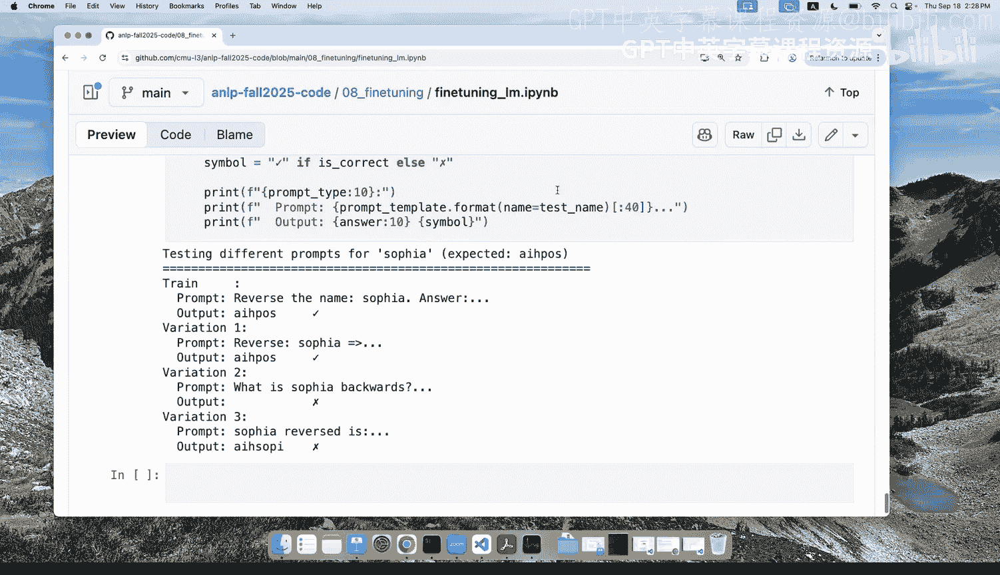

Make sure you see what's going on。

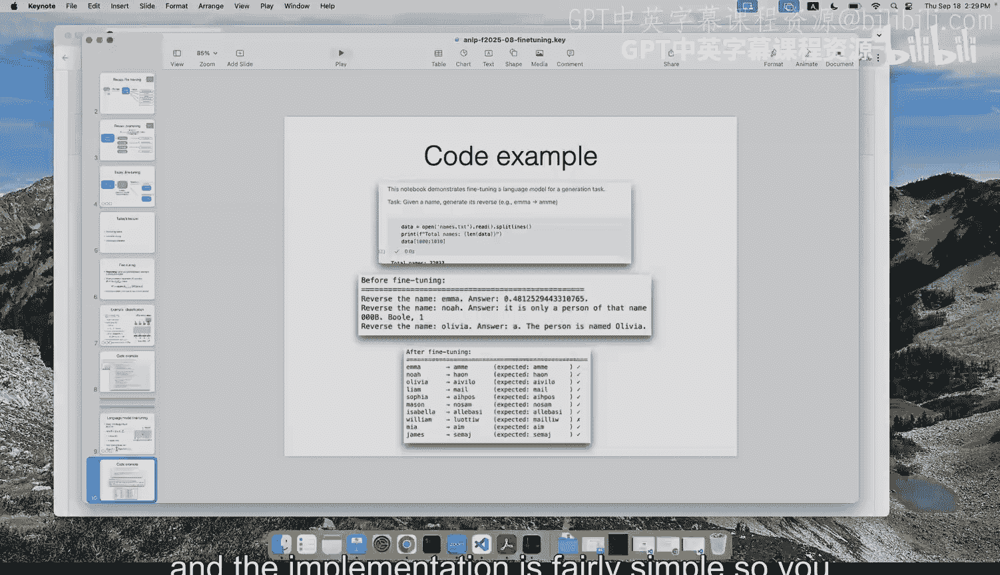

The reason I mentioned the simple implementation is because if you look at the libraries that you'll。

 if you want to just treat the fine tuning as a black box。

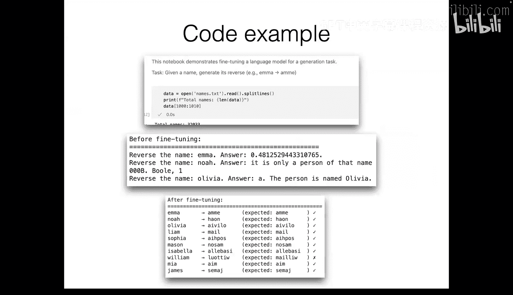

And run a library。Then they'll have a few extra features in them。

So some of the times they'll want to support like this distributed fine tuning， you know。

 like putting things on multiple GPUs。It'll have things like tracking， you， different dashboards。

 things like that。Checkpointing， this is actually a really simple example， this is from Huging F。

But it's good to know like what is really the core of what's going on and then what's kind of the extra stuff or what's needed to scale it up and you'll see this difference when you look at like the actual performance implementation versus this really simple one。

So yeah， this is actually a useful script。 It's one way to。嗯。Yeah。

 it's a fine tune in a wide range of models。And then there's several libraries that have been developed。

嗯。So。Yeah， there's a few different ones。One， so I asked some of my students， which ones they use。

One is actually paired with one of the reinforcement learning libraries。

 so later when we talk about reinforcement learning， there's a library called Verl。

And they also have a fine tuning script。And again， it's the same thing。 It'll be like just one file。

 But then when you read the code， it'll have a bunch of。

Kind of extra functionality so you can scale things up。

 but that turns out to be pretty useful and then there's different libraries like one's called Lama Factor。

 the other one's called axelotl， and there's a few different ones now。So anyways。

 depending on what your goal is， you might want to just treat this all as a black box。

 but certainly it's good to at some point know what's going on。So that you can。Yeah。

 better understand the tool that you're using。

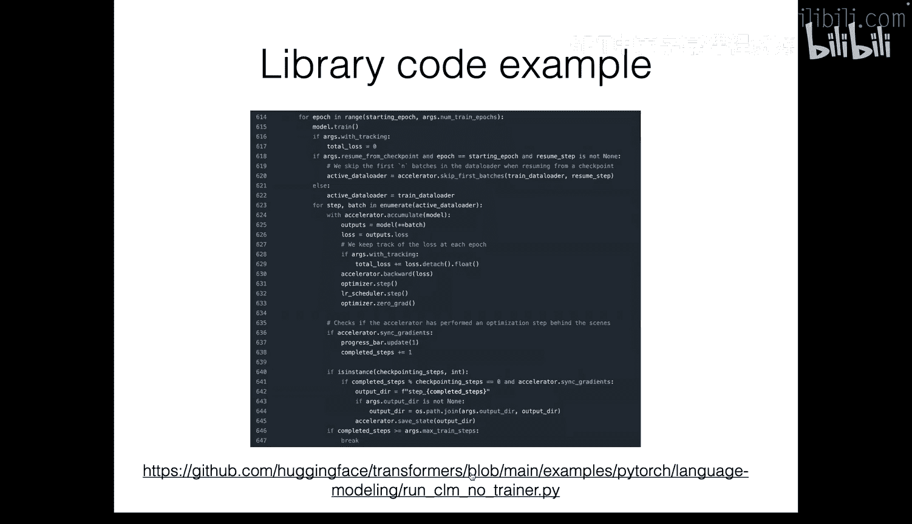

Okay， so any questions about this， and then now we'll start to go into some more analysis and then instruction tuning and the disstillation。

Okay， cool， so there's a few different practical questions that come up with fine tuning。

So one that we'll focus on here， and it's directly related to something you're doing in the homework。

Is should you fine tune all the parameters or should you choose some of the parameters to fine tune。

 should you do something else， really practical question。So let's consider an extreme example。

 which is we only update like the final output head。

 so it could be some new output head that we're introducing for classification or it could be the output layer of the language model。

嗯。Then this is potentially good in the sense that it is computationally cheap。So。

We only have to compute the compute and store the gradients。For this one layer。

 so it'll be a k times d plus K parameters。And so potentially you could， you know， with。

Potenally you could do that with very few computational resources。

 like on a laptop or on a single GPU。Now the issue with this is that if you think about how the model is built。

 then it's basically going putting the input through this kind of complex you know nonlinear function。

 which is the transformer， and then right at the end it's taking this vector and doing a linear transformation。

So if we only update the output head， then you're only updating this kind of linear transformation。

 so it's basically assuming that your pretrain representations。Are like pretty good， like。

 for example， they already kind of linear linearly separate the labels pretty well。Okay。

 and so just based on that kind of。Somewhat informal argument。

 you could kind of see why updating more parameters could be beneficial because now you could have the model actually adapt its representations specifically for the task that you care about。

So then we could consider the other extreme， which is we update all the parameters。

And so here that really the key downside is that this is expensive。So by expensive。

 I mean that let's say you're updating all the parameters and you're doing this on a 100 billion parameter model。

In a later lecture， we'll actually break down exactly what is involved in that。

 like what you need to store， how you'd fit this on to different GPUs。But here。

 we could just say that， okay， if you have 100 billion parameters。

 then it's going to be pretty large even to store the gradients。

And it's also going to be expensive to compute the gradients。

And so if I want to do that on my laptop， maybe now it's less feasible。

Or if I have like a single GPU and it's like an old GPU and it's kind of small。

 then well for 100 billion even with a new single GPU。You're going to get an out memory error。

The plus is， of course， you get more kind of flexibility， it can change the representations。

Another thing is that this could lead to overfitting， so now that you have so many parameters。

 it could really learn to kind of overfit to the training data。

So you also have to be careful about like stopping the fine tuning early and things like that or adding in extra things to mitigate the overfitting so。

I mean， the model already might have dropout inside of it。But yeah， just in general。

 being aware of overfitting。So the third option， which we're going to talk about on the next slide as well。

Is to try to do something more clever， so either try to update some subset of parameters inside the model。

Or like maybe add some new parameters， but not at the very end of the model somewhere inside the model。

 so you can kind of adjust the model's representations。Okay。

 and then as long as this smaller number of parameters is much smaller than the total。

 then potentially you can get the best of both worlds。

 you can kind of have a more expressive fine tuning while it being cheaper。

And so this kind of general class of strategies goes by the name of parameter efficient fine tuning or PEFT Pft。

 so you'll see that acronym in like different libraries and things like that。

So in order to go through the whole kind of history of these methods and go through the pros and cons between different ones。

 it would probably require you know most of a lecture or full lecture。

So here I'm just going to jump to one which is widely used。

And it's also the one that you have to implement in the homework。

And this one is called low rank Ad or Laura。And so the key idea is actually just in this image right here。

 but maybe let me write some more details。So here we want to just focus on one weight matrix in a model and it could actually be any weight matrix。

 okay？And so here we say that the pretrain weight matrix is called w0。

Now Laura basically introduces these two new matrices， A and B。

And the purpose is to basically implement this right here。

It's saying we take the pretrain weight matrix and we're basically learning the difference。

 so you know this could be positive， it could be negative。

 and it's basically saying how should we adjust the pretrain weight matrix。

Now the key trick in or the key idea of Laura。you could take a look at the dimensions of these two matrices you introduce。

And in particular， there are these low rank matrices。

So you can see here that this middle dimension is R， so R will be the kind of you know。

 visually this very small dimension。And so if you multiply two matrices like this together。

 then you'll get one which is the original size， so d times d prime。But this R is much smaller。

 and this is the idea of low rank， so rank refers to the dimension of the column space of the matrix。

And here the kind of。Intuition is if you treat the matrix as performing some transformation。

Then the rank corresponds to the dimensionality of the output space。

So it's basically saying that the matrix is kind of representing this like lower dimensional space of possible updates to the original weight。

Okay， so again， here we are using this kind of approximation here。

 so it can't capture or it's difficult to represent like。This huge space of possible updates。

 but the assumption is maybe you only need to look at this kind of subspace。

And then the benefit is that now we have much fewer parameters to update。

So what we're going to do is during fine tuning， we're not going to update this original weight matrix。

 we're just going to update these two。And you can kind of go through the math and see that it's much fewer parameters than this one。

Okay， and so then the cool thing is， let's say you do this and you learn these two here。

Then when you go to kind of use the model or deploy it。

 what you the cool thing is that you don't actually have to store or save these two。

You could just add them to your old weight matrix and now you have a new one and you just kind of ship that as your model。

Okay， so yeah， again here it's just。Taking， taking advantage of the fact that all we're doing is this addition。

Now there's two like practical tips， so you'll have to， this is an assignment right up as well。

So here in the Laura paper， they are doing the scaling。So you have these two different terms。

 one is this hyperparameter alpha。And so alpha， it's kind of like a learning rate， like you。

 it's a hyperparmeter that you can set， which will adjust the weight of this update。

Sorry of this edition。Um and at least in the paper。

 they argue that they didn't have to spend you know， too much time setting this parameter。

And then this R is basically to account for。To make this more kind of invariant to。

Choosing different values of R。So when you have one of these matrices。

 you can actually view it as being a sum of our different terms of like rank rank one matrix multiplications。

And so that sum can grow， you know， based on R。So here they're just scaling it by dividing it by R。

Then you have to decide like where do you actually apply this to， so here I was just saying。

 you know imagine any weight matrix in a transformer。

Typically what's done is you look at these weights， which are in the attention layers。

And then in particular， like one practical thing to do is you could apply it to the query and the value weights。

And this might be based on like in the original paper。

 they did some ablations and found that there wasn't too much variation。嗯。

And then people use this a lot in practice。 So you can go and look like in a library kind of。

What do they suggest or what do they do？So that's the basic idea of the Laura。

 any questions about this？嗯哼。😊，嗯嗯哼。で one。If we're going into training for step in this class。

Yeah that's a good question so here you're going to still start with the pretrain parameters and then you're going to update the parameters from there。

 whereas training from scratch starts from a random initialization。And so in practice。

 like the optimization trajectory ends up being different。

 the pretrain weights are a kind of really good starting place for doing the updates。嗯哼。😊。

Its like seeing of things could end up causing the model to perform worse on the particular task that you wanted to see a few for。

That's an interesting question。嗯。I'm not sure I guess all I could do is kind of like reason through the question。

 so I guess it comes down to the learning procedure because the learning procedure could learn to just set these lower weights to be zero。

 then it's exactly the same as the previous model。m so hopefully it shouldn't hurt the performance。

 but yeah， I'm actually not sure if if people have found like， you know。

 particularly bad places to put the lower lowers。嗯哼。😊。

Let'll say if we have already trained a model and then we trained it on another purpose of general data that should we consider it as some sort of pro traininging or yeah yeah this is a great question so I don't know if there's like a if there's a hard line and there certainly is stuff in between so。

There's this idea of continued pre training， so continued pre training is you take a pretrain model and you have a fairly general corpus and then you continue pre traininging model on that corpus。

And so this is especially done with like if you want to to adapt the model to a certain domain。

 then you might have a。You know， like。Take a general model and just continue pretraining on a bunch of different code。

 something like that。So there is stuff in between and then the other thing that's done is that nowadays the especially the companies will include this supervised data like the XY pairs into their pre traininging corpus because then that boosts the performance on the benchmarks。

So I would say some differences are like some rough differences are one is usually how。Well。

 so one is like very practical。You know， people will pre train a model and then a different user will then try to fine tune it or adapt it。

Another is that， yeah， typically you associate this with like a smaller amount of data or a more narrow task。

 whereas pre training is。Yeah， it's more just， you know。

 model all of this kind of diverse data so of。Good representations that you could then use to adapt to a new task。

Whereas the， yeah， supervised fine is like you're at the stage of adaptation。

 you're not considering like。Maybe further adopting it。好拜。嗯好好。Yeah， so I guess， yeah。

 if you define fine tuning as being you know further adjusting pretrain models parameters。

 then that would also include reinforcement learning。

 then the important part would be starting with the pretrain parameters。And then， yeah。

 you could refer to this as supervised functionning where you have the supervision of the inputs and outputs。

嗯，嗯是。Strange on。Some specific native but the data where I want to train on is very different from the data that was trained on the peak model is it worth spell fine to me or is it better to enter production that？

y， so。嗯。So I guess the question is like， is your？Like if your target task is much different than the pretrain models。

 your target like task distribution is much different from the pre training distribution。

 what should you do？嗯。Well。The thing is， is that like。Yeah。

 as your task is further away from the pretraining， then it might require more data。

 so especially if it's in like an entirely new language or your model's not been pretrained on any code and you want to do code。

Then it might require more data than if it's similar to the pre training distribution。

But then just broadly speaking， the model could become more data efficient as a result of pre training。

So it might still be a good idea to start with the pretrain weights versus training from scratch and the thing is is that like in practice with the pretrain model。

 it's been trained on such a massive amount of data that it probably has learned some useful representations for your task yeah。

Okay， great yeah， great questions， thank you。So。So here's just some few effects of fine tuning。

 So maybe this is what I was just just talking about。 So this is。You know。

 this idea occurs in many different。Places I tried to find a kind of early example of this with language models。

So this is a paper from 2018 and they were investigating like the pre training and then fine training versus training from scratch。

And so one kind of fundamental benefit that you see empirically is that doing this pre training causes the model to be more data efficient。

So what we can see here is on the x axis， the number of this will be fine tuning examples。And。

Then on the Y axis is the performance。So here you can see if you train from scratch。

 then here's your performance curve。And it， it seems like at any given。Amount of data。

 it's beneficial to start off with a pret model。U。I'm actually forgetting this was like two different settings for their method。

 but here the the important idea was just trying to show is the from scratch versus these。You know。

 using the initialization from the prement model。嗯。Then when you think about what this is doing。

 So then a really good intuition is， again， when you're doing pre training， there's no。

Maybe it's difficult to draw like a formal distinction。

But generally pretraining is associated with learning this really kind of diverse and broad distribution。

 and so you could think of the fine tuning as kind of narrowing the distribution to a certain you know region of tasks。

And so you can think about this in terms of the actually like the distribution that is being fit by the model。

So we've talked about this idea in the course that when you use this loss function。

 it corresponds to fitting some data distribution。And so here with fine tuning。

 we're kind of fitting the distribution that's in our fine tuning data and that's typically much more narrow than the huge pretraining corpus and so yeah it's a helpful thing to keep in mind。

The reason that it's a kind of helpful intuition is you could think about some consequences of this。

So， for example。Let's say you have a model and you find to tune it for summarization。Well。

 then it's basically saying that okay， we've now narrowed the distribution to summarization tasks。

 so maybe the model actually doesn't work very well now on translation。

And it's a kind of simple thing it's like if translation isn't in your。Fine tuning get set。

 maybe it won't work， but it's definitely something to remember。Can anyone else think of any other。

 I think I have two more bullet points here， but can anyone else？Think of any other。

Symptoms of fine tuning。A due to the kind of narrowing the model's distribution。Okay。

 so what can happen is the model even becomes dependent on the specific formatting that's in your fine tuning data set。

So here is in the same notebook。It turns out that the model， here's the original input format。

 reverse the name colon。The model is able to still perform， okay， if you just say reverse。

But then if you give it you know， these different versions of kind of the reversal task。

 then it kind of fails catastrophically or just outputs nothing。

whereasas at least with the pre trade model， it seems to be more flexible， you know。

 with the specific prompt， could you fine tune in？Where you don't make it as narrow in a sense that right you fine tuneitive on reverse the name colon and it figures out reverse colon but it said if you added more examples where you came up with what are some possible different ways to ask something to reverse like your distribution isn't necessarily as narrow down to just that reverse colon it's a little bit wider Yeah exactly so that's I think we'll talk about some of these things we talk about the instruction tuning so that's yeah when people are building these practical chatbots and things like that。

 that's something they'll do so it'll be trained on different variations and different wordings that are you know of different queries。

And it can learn to kind of generalize them。Across the input prompts。

So when we are open a really large language of models， usually the larger the model。

 you would need more data to find unit or train later time。Yeah， so the。

 I don't know if it's counter intuitivetuitive， but yeah， the。

 the finding has been that the better trained models。 So like if you use more compute。

 if you train it on more data or it's a larger model。

 actually become more data efficient for fine tuning。So they had some of these experiments in the。

In the scaling loss paper， I think。嗯。但系。Yeah， we haven't necessarily seen。Yeah。

 sometimes we see the the the opposite phenomenon。One way to think about this is。

The really good models are usually better at in context learning。

And you could think of in context learning as like learning from very small number of examples。

 So there's somehow more， it can be more data efficient。

And then you could find different counter examples too， it's just broad。Kind of broad saving。Yeah。

 also you know if。If your data doesn have examples of Phe learning。

 then maybe it can lose some capabilities。

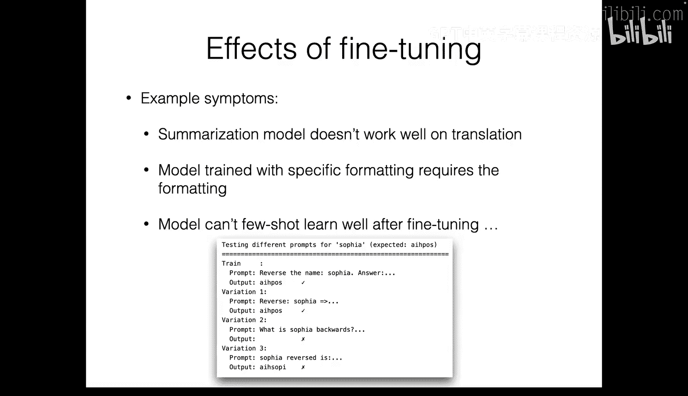

Okay， so。Here's just some more practical。Or some concrete examples of data sets。 And then again。

 the idea is if you wanted， you could run the exact same code that we used to。嗯。You know。

 reverse names。To fine on this。So here's like going from a paper to an abstract。

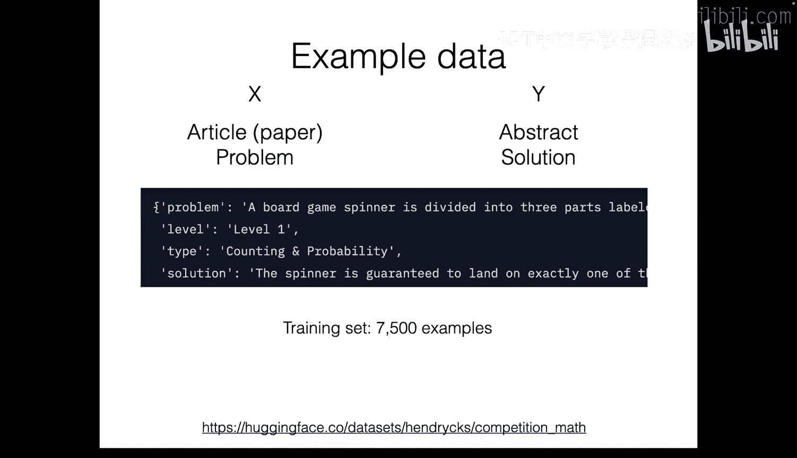

Here's going from a problem to a solution。And then here's a more kind of general data set。

Where they collected these actual。Like user prompts。So they have like  three million examples here。嗯。

So one might be about writing a sentence， not in English。

Another one might be like give me advice on my life or something， it could be anything。

And so this is a much more。Yeah， just。嗯，对。It's more aimed at building a kind of chat bot that can just receive a prompt and give a response。

So yeah， you can go on this website and look for actual data sets and some of them will be available。

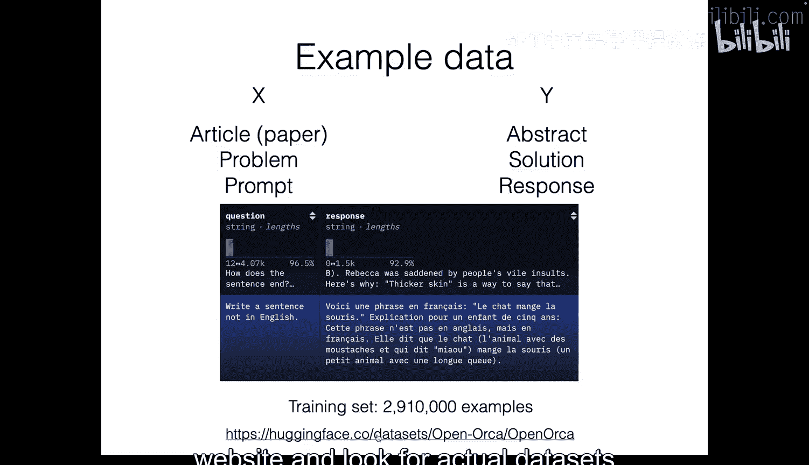

Okay， so let me go to the second。Topic we might not be able to get through。All three today。

So here we want to train a model for this instruction following。So again。

 we don't want a model that's just specialized to one task， we want it to perform multiple tasks。

So the kind of basic insight is we can just fine tune it on data of the following form where we have some instruction that describes the task and then some input and some output。

Okay， so now instead of just having a model that works for a translation。

 we can have some examples which say you know， translate this。

 you could have another example which says write an essay about this sentence， for example。

 and then the problem becomes， how do you find these instructions。

 how do you find these inputs and how do you find good outputs？Like in the example I gave。

 if you have write an essay about the sentence， the question is。

 you know how do you get this output so that you can fine tune the model？U so。嗯。

This itself became like a huge。Area of research， there's papers about all these different combinations。

And you could think of a lot of them as kind of of this form。

So you can decide whether your instructions are based on some template， so the template might be。

 you know， we have reversed a sentence and the template comes up with different variations of it or something like that。

 I have a concrete example later。Or you could have humans write it。

 or you could even have a language model generate the instructions。

And same for the inputs and same for the outputs。So let's take a look at a few examples， oh。

 and then the other kind of variation is the domain that you care about。

So you'll have these instruction following data sets for just general domains。

People actually make specific ones for code if you want like a code assistant。

 people would make specific data sets for like math or for chatbots and so on。

So this is a kind of just maybe like history， and then you'll also see some ideas that go into these things。

So here is an early instruction， so you could call these data sets instruction tuning data sets。

 it's like instruction following and fine tuning。Here was an early one and they basically took 62 different NLP data sets。

 so it could be like reasoning， sentiment analysis， translation。

And they use these templates to basically transform the inputs and outputs to have some instruction。

So here it's saying。You know， read the following and determine。

If this hypothesis can be inferred from the premise。And they basically handrte these templates。

 and then you can run this on all the data sites。And。

Now you have these three ingredients for the instruction tuning data。And so their key finding。

 which was somewhat new at the time， was that if you train a model on a data set like this。

 then it can actually generalize to some unseen tasks。So let's say that we had you know。

 translation summarization， but then we didn't have these like reading comprehension。

 we didn't have any of those in our fine tuning set。

Then the model is actually able to generalize somewhat after applying this procedure。Okay。

 and so you can see here that they were able to get their model to do better than if you took like the best pretrain model at the time and just use it。

few shot。So yeah， I guess people started noticing that you could get these performance gains over the pretrain model by doing this fine tuning and so a lot of work started going into coming up with like the most general or the best instruction tuning data sets。

So here is one which tried to be a bit more general by doing this crowdsourcing。

 so they would like hire people and the task was to like create some instruction and some input and output。

And so now you can scale up to instead of like 42 different tasks。

 like 1 thousand0 different tasks if you spend enough money。嗯。

But this requires you actually hiring people to write the instructions and the inputs and outputs。

So then people started trying to use these language models to try to automate parts of this。

So here you might start with some C dataset set， which is created by humans。

 and then you use the examples to prompt a language model。

And then you could ask it to do a variety of things， you could say like。

 generate something similar to this， generate something different to it。

And you could try different variations。 But the basic idea is you have the model actually generate。

These new task instructions， new inputs and new outputs。

And then you could you could do this in a kind of loop。

So here's an example of some actual instructions， inputs and outputs that were generated by a model at the time。

So here it's like given an address and city come up with the zip code and then you have some input and some output。

嗯。So can anyone think of a downside to doing this。The use you don't know the instruction that a user wants right。

 the user use your question and you don't know what instruction to use。

Also like you have to be very specific if you change your instruction by a small amount which semantically means the same thing your model might go wrong。

Yeah， those things， I guess you could within this framework。 you could have。

Let's see collect some user queries and then you have your seed data set and then your prompt says generate some other user queries that are similar to this or or change the wording of the instruction so you could plausibly。

Try to tackle those using this framework。But in practice， that is something to consider。

These tasks might be kind of artificial and then your users ask for more complicated things。

I was actually going for， I had something else in mind though。

Maybe take like think about what this is actually doing here。Like， what could go wrong？嗯哼。😊，喂。

We a big data set of loss。Outputs exactly so this might not actually be the zip code for this this like street in San Francisco it might just be yeah。

 like there's no guarantee that it's correct。And so when you think about like code or when you think about like generating a solution to a math problem。

 the student， it turned out to like be kind of helpful， but you also need to yeah。

 worry about the kind of correctness of the output。So。That is， that's that。

 and then as you mentioned。You want to also ensure that the instructions are also kind of aligned with how you're going to use the model。

嗯。So that's really it for the instruction tuning。嗯。That's the basic idea。

And so then there was a lot of follow up work， trying to improve this or try to adapt it to certain domains。

So let me actually talk a bit more about these chat models because we talked about them in the previous lecture and because they're widely used。

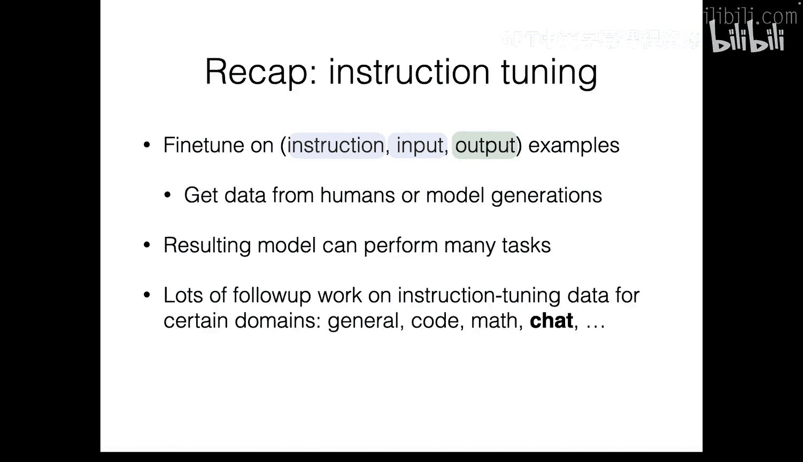

So here， as we saw in the previous lecture， we can treat one of these chat conversations as basically just like a sequence of tokens。

So you have some system prompt and then you have this like possibly alternating conversation between a user and an assistant。

So then the question is basically like， okay， how do we get this data so that we can train a really general purpose chat assistant？

And here people still call this instruction tuning but it's it's a bit less like well defined。

 I guess you could say that when you have a chat kind of assistant then maybe there is some instruction that's implicit in the。

The conversation。But it's going to be a bit more kind of free form than the instructions we were looking at before。

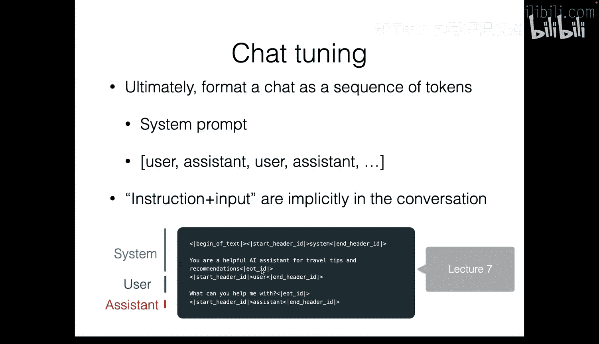

U so。One option here is to try to use language models to generate this chat data because it might be hard to collect the chat data。

So people tried to do this， so here they started off with these 16 just handwritten system messages。

And then you can kind of prompt the language model and。哦。Try to。Yeah。

 try to generate some different outputs。

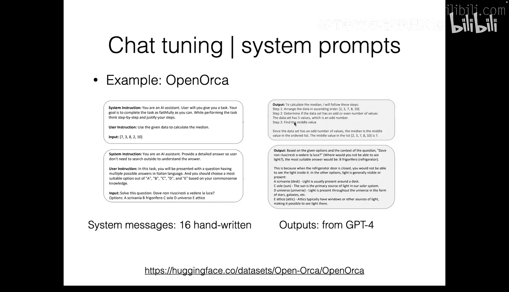

嗯。And maybe like yeah， maybe this is a better example。

 So then here when we talked about when we talk about chats。

You could try to collect like actual chat data。So this team at Berkeley in Stanford did this。

 it was called L LMss Cha。And so they basically， this was like。

 right when these early chat models were coming out， had this service。And collected the interactions。

 and then they put them into a data set of like a million kind of multiter conversations with the LM。

Okay， and so I guess there's not too much here， but the idea is that you can see here that they they really did collect this data that I was showing you before you have like user role and。

Then。😔，The the content of whether the human or the user said it。

And now you can format this as fine tuing data set and fine tu the model。Now， as you can imagine。

 there's。You know， this can be turned into a product and so there's teams at different companies trying to make this better and better。

So there's a lot of effort and a lot of engineering into making this better。

 One kind of interesting paper to look at is Lama 3， one of them， there's like 3，3。1。

 one of the papers kind of goes into some detail on how they。

How they come up with different system prompts or what they put in the different system prompts？

They also talk a bit about kind of whether they hired humans to like write different instructions or use models to generate them and things like that。

But you can imagine that this is a kind of whole industry around kind of getting good data for。

fine tuning the chat model。Okay。Now this doesn't turn out to be the last step。

 so we'll talk about this like reinforcement learning step where you take one of these fine tune chat models and then you try to further kind of adapt it。

So that it iss better aligned with the human's preferences。

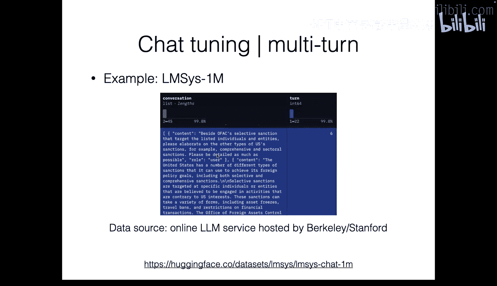

。Okay， so let me briefly try to go through knowledge distillation。

So you probably noticed that a couple different times I was saying we should just use a model to generate data like we should use like in this open orRCca。

 they used GPT4 to generate some of the chat data and so on。So you can view this as a。

This technique called knowledge disillation。Where you use some kind of knowledge from one model and try to kind of transfer it to another model。

So here we're going to have what's called the teacher model。😊。

And we're going to distill to the student model， which might be like a smaller one。

So let me talk about two ways to do this。So the first one is kind of at a somewhat low low level。

 maybe you could think of it。And so here we basically look at each next token distribution and train the student to mimic the teacher's next token distribution。

So here， let's say we have some data。Like some translation data。

Then our teacher gives us these next token distributions。

And you can just train the student to basically mimic what this teacher is doing。Okay。

 and so to do this， you can use this cross entrytropy loss。Except here。

 what it's doing is you have a supervision for every possible next token choice。

So here you no longer have this one hot vector。 you actually are doing the summation over the full vocabulary。

And again， you can kind of see the idea through this picture。

 it's basically making this whole next token distribution similar to this one from the teacher。Okay。

 so the intuition here is that the well， number one。

 the teacher probably has better next token distributions than the student。

 like the very top of it is better。But then also potentially you can get an even richer signal than on just the next token。

 potentially these like other。Tokens being high probability are kind of useful。Like maybe here。

 it says how are or。You know， maybe in other cases， there's like alternatives。

 and so you're able to get some supervision from this well trained teacher without actually having the data that shows those alternatives。

Okay， so this is called token level knowledge distillation。

And it was actually introduced in the context of image classification。

 but then you could use the same idea for the language model。嗯。So one issue with this is。

Let's say you want to do this with like GP5。Then you want GBT5 to be the teacher。

Then can you an issue with this type of distillation。It you black box。

 so you don't know the which be。Exactly， yeah。 So this assumes that you have access to these next token distributions。

嗯。So。嗯。Okay， maybe just due to time。 but this is just saying。We're using cross entry Ps。

 And so it turns out that。This corresponds to minimizing the kale divergence between this teacher and the student。

 so you're really using the teacher as kind of the ground truth， you know。

 of what it's being learned。And then you could view this again as being these kind of soft labels。

 so instead of just having a one hot vector， which is like what is the one ground truth next token。

 now we have these soft labels over all the different next tokens。So the other kind of。

Approach you can do is if you just have a black box model。

 then you can just use the model to generate these different outputs so like here's x。

 heres here's y， and now y will be a full sequence。

And then the student model fine tunes on the generated data， so on the XY pairs。

So here you have this like prompt and response data set and you fine tune the student。

And so you're probably saying like what like what is this， this isn't like。

How how does this relate to the idea of distillation？Well。

 then the idea is that like you can actually view this as saying， oh。

 this teacher is kind of your target data distribution。

 it's generating the data and then you're fitting the student to samples from this data distribution。

And so you can actually view this。Oh first， this technique is used all the time and so you can look at these different language models and they'll have these different names like deepse R1 distillQun 7B and so here the teacher was this deepse R1 model and the student is the smallerquin 7B model。

But yeah， you can actually view this as， yeah， minimizing this kL divergence between the teacher and student。

And so now we're not looking at it at a kind of token level， it's just at the sequence level。

 and here you're viewing these teachers generations as being kind of samples from the target distribution that you're fitting。

Okay， and so in order to come up with this， you kind of use the the same arguments that we've seen in the course about the connection between。

Maximum likelihood are using this log probability and the scale divergence。嗯。Okay。

 and then the question is like。What other things can you do in this framework？Well。

 when you think about it， you don't necessarily just need to take the outputs from the teacher model。

You can still do something additional to them， like you can filter them， that's a good example。

So let's say that you want to fine tune the model so that it。So that it reverses names。

And your teacher model， like 99% of the time， generates。You know， good reversals。

But then 1% of the time， it has some examples that have errors。Well。

 then you can actually just filter those out。If you're able to detect them。

And you could think of that as being kind of like modifying this teacher's distribution because now you have this additional kind of knowledge you're injecting。

 which is like the filter or the classifier。Okay， and so then the idea is if you actually have a really good kind of augmentation or some like really good filtering process。

Then it's possible that your student could even become better than the teacher。For instance。

 let's say that the teacher was like incorrect on the string reversal， like 40% of the time。Well。

 then if you generate like millions of examples and only train the student on millions of examples of correct things。

 then it's plausible that it could actually become better than the teacher because of this kind of filtering step。

Okay， so I'm showing this kind of abstractly here， but。Kind of you could imagine that in practice。

 there's like a lot of work that goes into， you know， let's say we want to， oops。

Let's say we want to build this distilled model here。

 what's actually the data that we are distilling， how are we filtering it， things like that？嗯。Okay。

 so。Yeah， hopefully the last two sections weren't too quick。

 but we did manage to get through all of the content。So we talked about fine tuning。

 so adjusting models parameters and then went over this parameter efficient method， which is Laura。

Then we talked a bit about instruction tuning and knowledge distillation and you'll see these ideas come up like both in research and also in like really practical settings。

 so it's definitely good to know what these terms refer to。So that's it for today and。

We have two minutes， so maybe you could come up in person and ask questions if you want。

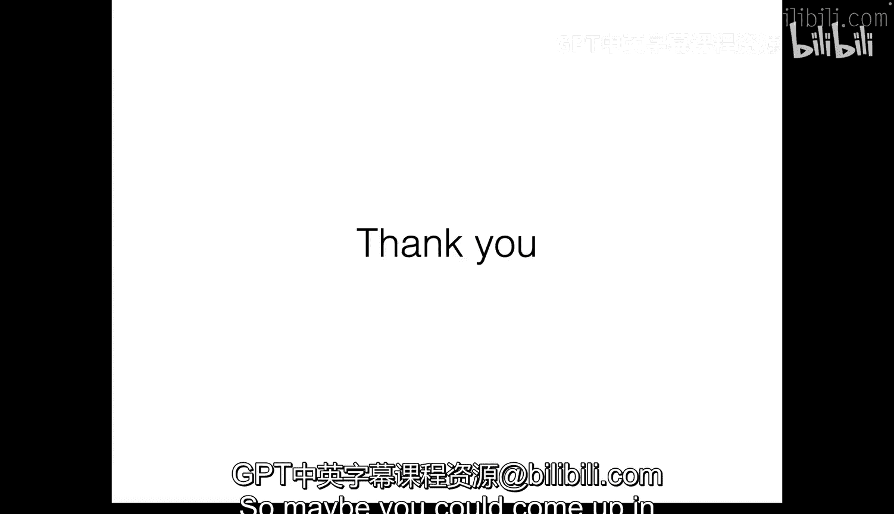