# CMU《高级自然语言处理｜CS11-711 Advanced NLP Fall 2025》中英字幕 - P9：(9)_ Decoding Algorithms.zh_en - GPT中英字幕课程资源 - BV1ZWYAzuEMa

So today' is going to be a lecture on decoding algorithms， so generating text with a language model。

And these slides are heavily based on two different sources。So first， Amanda。

 who's a PhD student here。She gave the guest lecture in this course last semester。

 so I've integrated a lot of content that was made by her。And then also Matthew Finlayson。

 who's a PhD student at USC。He was part of this N tutorial we gave on decoding and generation algorithms。

 and he was in charge of the decoding algorithm section。

So I've also incorporated content that was created by him。

 in particular he's really good at making these latex diagrams。

 so you'll see a few of them and those are his work。Okay。

 so if first I want to do a recap of some broad themes that we've covered in the course and going back to the terminology that I introduced in the very first lecture。

So we've had a few different lectures that fall under the umbrella of modeling or parameterization。

So let's say you're going to solve a task， well you have to decide what is your model for。

 is it for classification， is it for generation？Then。

Let's say you want to build a probabilistic model， then one decision you can make is you can make it autoregressive。

Later in the course， we'll see another option which is to have it be based on diffusion。

And then we had a few different lectures on the architecture that you then use to parameterize the model。

 so it could be a simple feed forward architecture， be a recurrent architecture。

 or it could be a transformer。嗯。Then throughout mixed into the different lectures and sometimes we have an individual lecture on it。

 we've talked about various types of learning。So a few different times， I've。

Reemphasize this idea of maximum likelihood and kind of next token prediction。

We've also talked about pre training and then fine tuning。And throughout this。

 you usually have to consider what kind of data or what kind of supervision can you leverage in order to train your system。

Okay， and so today's lecture is going to fall under this third category， which is called inference。

And this basically says， let's say that you've。Chosesn your model and you've learned all of its parameters。

 then how do you actually kind of use it to do things？In the case of language models。

 how do you generate text with them and what are different strategies you can use？

So that is going to be the theme of today's lecture。

 basically what are the kind of core algorithms you can use to generate outputs with one of these other regressible English forms。

Okay， so there's three different parts， so first we'll just go through the basic setup and I'll kind of give a definition of this idea of a decoding algorithm。

Then we'll talk about two different classes of decoding algorithms。And briefly， at the end。

 talk about。A really key technique for speeding up decoding when you're using a transformer model。

Now we'll have two lectures or now we'll have one more lecture later in the course on kind of advanced inference strategies。

So we'll build on some of these algorithms and look at ones that kind of generate like multiple outputs or generate really long outputs。

 and then we'll also talk about more about speeding up decoing。

But I'll introduce an idea here that basically appears in any implementation you'll see。

So want to I want to put it in this kind of first lecture on inference algorithms。

Okay so with that kind of overview of the structure we can get started so again here we're dealing with these auto aggressiveive language models and hopefully this should be familiar by now these kind of break down the process of modeling a sequence into these next token distributions。

And so here just for notation。For the full sequence， sometimes I'll just use the letter Y。

 and then if we're talking about a single token， it'll have a single subscript like YT。

And so if we look at just one of these next token distributions， then again。

 it's giving us this probability distribution over next tokens。So here's the Run example。

 which was created by Matt， and it's about Taylor Swift。So let's say that we have this input X。

Then here's our next token distribution。Then what we could do is we could somehow choose a token。

 let's say we chose the token and， that'll be y1， and then we get this new distribution over next tokens。

Okay， so decoding a kind of informal definition that's still useful is just some strategy for choosing these next tokens so that we eventually end up with a full output。

Okay。So when you think about this， we could kind of draw this huge kind of tree of different possibilities。

This is just showing a few of different possibilities， but it's basically saying， okay， at each step。

We can select one out of any of the possible next tokens。Suppose that we select one。

 then we have the same decision here and you kind of do this at each step。

And you could see that you have to have kind of some algorithm for determining which choices to make right so determining which token you actually want to generate at each step。

And so if you're going to design an algorithm and that does this。

 you kind of to have to ask like what is the actual goal like I'm going to make a choice about a token。

 then what is the choice being made for？嗯。And ultimately， if we want to generate a full sequence。

 then you have to think about like。If you make these local choices about which tokens generate next。

 how does that impact the kind of global sequence that you got at the end？Okay。

 so we're going to talk about two different kind of objectives or families of algorithms。

 so the first will be based on optimization and the second will be based on sampling。

And it turns out there's intersections between them like you can use a sampling algorithm to do optimization and hopefully you'll see what I mean after we。

Go through both of them。So the first objective for decoding could say， okay。

 I have this probability distribution， why don't I try to decode or generate the output y that has the highest probability or is the most likely under the model？

Okay， so here we have this maximization and it's saying over all possible output sequences。

 we want to find the one that。Maximizes this conditional probability。And what this corresponds to is。

 you know， if you have a probability distribution， this corresponds to finding the mode。

 so the mode is just。You know， the highest probability point on this。Distribution。

Here this is visualizing a continuous distribution， but of course these sequences are discrete。

 but it's kind of just conceptually showing you what this is aiming to do。And this kind of。

Objective for this kind of decoding algorithm。 it's referred to by different names。So first。

 it's referred to as a mode seeking algorithm， and you could probably see why it's called that based on what I just said about finding a mode。

And then second， there's this like fancier name。Maximum posteriary， or M。

And this is kind of taking a Bayesian view。 So it's saying that you have some prior。

And then you observe some evidence， so that'll be the kind of input x。

And so now you have this posterior distribution over outputs given your prior distribution and the evidence。

And you're finding some output which kind of maximizes this posterior。Okay。

 so I think in a few of the other slides， I'll say like map decoding and that's what I'm referring to。

 just an algorithm that's trying to solve something like this。Okay。

 and so if we just remind ourselves of what this would involve。

It basically involves going through this full space of output sequences and trying to find the one that has the highest probability。

嗯。And the key challenge is that the space of possible outputs is really large。

Right because at each time step you have。The size of the vocabulary number of given of different choices。

And so if you have a sequence of length t， you basically have vocab size to the power of T possible sequences。

 so it kind of grows exponentially with the length of the sequence。Okay。

 so what we have to do in practice is use some kind of approximation。嗯。

And hopefully it'll still kind of be a good output sequence and have fairly high probability。

But kind of exhaustively searching in a naive way is not really feasible。

So the simplest or most naive approximation， or one of the most naive is called greedy decoding。

And this is basically saying at each time step， we're going to choose the most likely token。Okay。

 so now we're not saying argm over the sequence。 we're just saying argm over the next token。

So what does this look like visually， well， let's say we're at step number two。

Then we would look at this next token distribution and again just take the maximum。嗯。Now。

 if you look at it too quickly， then you know， maybe this looks like the previous formula。

 they're both both Arcmes， maybe it's actually the same thing。

But it turns out that doing this kind of local AgmX does not give you the global AgmX。

And we can see this with this really simple counter example。So here。

 let's say that we're generating these two time steps worth of or we were generating some tokens。

And here we have a choice between taking this more probable token or this less probable token。

And then here again， let's say we do the greedy decoding。

 so we take the more probable one and keep doing that。

Then here's the final sequence probability that you get。

 Remember we just multiply the three together。And it turns out that if we would have taken this lower probability path at first。

Then you could see here that soon after it becomes。Very high for the next few tokens。

 and you can actually get a higher。Global sequence probability。Okay。

 so this is just saying that this local kind of greedy decision isn't a perfect。

isnsn't exactly the same as finding the globally most probable sequence。

And then here's just to drive to the point， Home more， here's a concrete example。

 I think this was done using an actual language model GPT2。

So here's just looking at different tokens and here you could choose former instead of Ser。

But if you would have chosen S， then you can end up with a slightly higher probability sequence。

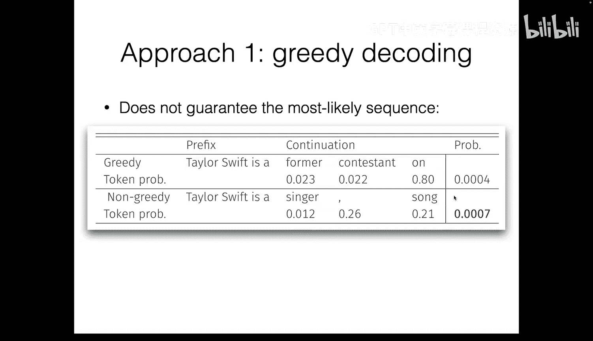

嗯。So。

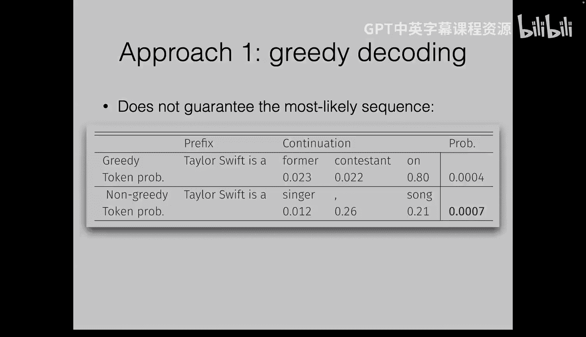

Also in the so we have this notebook and it has。Different implementations。

So here you could take a look at。But this。So here it's going to be based on this language model that we've used in other notebooks。

 it's really small。And here it's just going through and you can see it's taking the arcmax and then you concatenate the token that you chose into the input and you kind of continue the process。

We'll get to this in a bit， but you can see it's it's very repetitive and so we'll talk about that in a bit maybe to。

Kind of a sneak peekek。

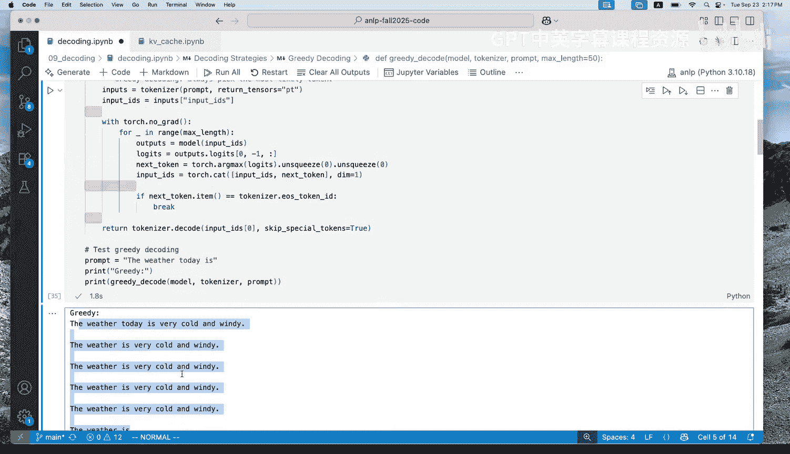

So any questions about this greedy decoding or stuff before that before I move on to the next method？

Which is called beam search。It seems like intuitively pretraination should。

 to the extent possible actually dist like these global objective components into like local choices。

嗯。But to what extent does that。To does query decoding differ from the optimal。ロボするかす。Well。

 so we'll see some examples with these kind of edge cases like the very repetitive sequences。

 but I think another case that comes up is if one path，Ends up having really low entropy。

Whereas some other path， there's like multiple ways to phrase the sentence， for instance。

Then basically like this like concept， which is expressed in multiple ways。

 might have higher aggregate probability， but then each individual path is lower。

And you can actually go through the。The way that the next token probabilities are optimized and it'll actually result in something like that。

Okay， cool。So what you can do to make it a bit more。Exhaustive of a search。

Is this generalization called beam searcharch？And so here we're doing。

It's this with limited breath research。It's probably easiest to just look at an example。

And the key idea is we're going to， instead of just going down one greedy path。

 we're going to maintain this beam of multiple paths。So let's take a look at an example。

 so here let's say we have a beam size of two。Then。

Here what we're going to do is instead of just selecting this most probable one。

 we're going to select kind of both of them at once。And then for each item in your beam。

 for each prefix in the beam， you're going to expand them。Okay， so now we generate these expansions。

And we again select because our beam size is， too， we would select the kind of。

Top two at this frontier。I guess maybe for explanation purposes， we could have set these to be。

Different numbers。 But you can imagine you have to break ties somehow if there are ties。

So now our beam looks like this。And so again， we expand these， but we don't expand the other stuff。

We again form the beam of the two highest scoring things。 and you proceed like that。Okay。

 so now you can see in this example， it actually got over this issue we had before。Um。

 or it was able to kind of explore this alternative path despite the initial token having a lower probability。

So that's the idea of beam search and I'm just showing it as this diagram to to write this in notation。

 it gets kind of。Tedious， but I mean， it's not too bad。

But hopefully you can see the key idea of beam search here。And when you think about it。

 it has these two different extremes。So if you set the beam to be of size1。

 then it's actually just greedy decoding。Because。Yeah。

 you would just explore this one because it's the most probable and then you would keep expanding and just explore the most。

Probable continuation。On the other extreme， let's say we set the beam to be infinity or if you want like the specific number of possible tokens that you've encountered so far。

Then this would actually be an exact search。Because you're really going over like every possible kind of prefix and maintaining the maximum。

But the thing is， is that this isn't really feasible。 let's say you have 50。

000 tokens in your vocabulary， which is like what。Roughly what。some of these language models we have。

And let's say your output length is 128。Then it's just a very big number and you can't store all of these things in memory or kind of keep expanding things it' just not feasible。

So in practice， we treat the beam size as a kind of hyperparameter。And typically。

 you'll see numbers like you know， 8， 16， 32， maybe 64。And you'll have you know， some validation set。

 and then you try the beam size number that either gives you the best performance or if it's a kind of monotonic improvement。

 then you maybe make the decision based on the runtime or something like that。

Now it's actually kind of interesting， we'll talk about what happens if you were to increase this to be very large。

Actually， maybe next。So nowadays these are implemented in these different libraries。Here。

 I showed you the kind of manual implementation of greedy decocoding。

 but you can just call this if you're using hugging face。

They also have beam search implemented and you could see it just corresponds to。

Setting the beams size to be larger than one。嗯。Okay。

 and so in order to get through all the content in this lecture。

 I'm not going through too many like different variations of beam search。

But beam search was widely used for a while， and I'll talk about that in a bit。

And so people have developed different versions of it， so for example。

 you could actually sample within the beam search instead of just taking the top two highest things。

You can also adjust the way that the sequences are scored so you don't necessarily have to use the log probability。

 you can like normalize it or you can even incorporate some kind of like external score into it。

But let's take a look at this and see how it works with the language models。So traditionally。

 this was the kind of widely used decoding algorithm。

 especially for these kind of closed ended tasks like translation or summarization。

So here's just some examples， here's like this paper， and you can see on the X axis is the beam size。

And it's clearly much better than greedy decoding， for instance。

 and there's this kind of monotonic relationship and they end the beam size at like 25。

And then similarly here， it's again， just showing。That you can get some gains over greedy decoding。

For these different types of problems， like translation or。嗯。Summarization， I guess even here。

For solving these like simple coding problems。However， what happened is。

Especially when the language models came out， these map decoding algorithms started to have these kind of odd flaws。

 and I would say that nowadays it's actually less common to use something like beam search and it's more common to use what I'll present in the second part which is the sampling algorithms。

So I wanted to introduce some of these issues and there's been a lot of research about it and it's kind of interesting。

 so let me just talk through some of the downsides or pitfalls of the map decoding。So the first is。

 as we saw in the code example， it kind of went into this weird。

 repetitive loop when we used the greedy decoding。And this wasn't just some one off instance。

 and it wasn't because like this data even occurs in the training data。For some reason。

 when you use these language models。They tend to go into these repetitive loops when you use either greedy search or beam search。

And you can actually look at the probabilities that the model is assigning to these repetitive loops。

And it turns out to be very high。So for some reason they've learned to。

 assign high probability to them and then kind of once you enter one of these repetitive cycles。

It's basically like only putting the probability mass onto the kind of repetition。嗯。So the。

 the like exact， exact reason why this occurs is maybe not。Exactly none。

 but people have noticed that it does tend to happen with models that are undertrained。

So if let's say you have basically any model and you try to fit all of the data on the internet。

 so like a pretrain model， then it probably hasn't fit the distribution perfectly and so with pretrain models you'll tend to see this kind of odd repetitive behavior。

Whereas you see it less often with models that have been kind of instruction tuned or attuned with reinforcement learning。

 just generally speaking。And then also， yeah， there's been this observation that the model kind of。

Once it goes into these loops， it assigns high probability to the repetition。嗯。And so。

There's been a variety of different strategies for getting around this。

So one thing is you could have some kind of penalty。

So instead of purely using the next token probabilities。

 you could add a penalty to certain tokens if they like have been mentioned before and things like that。

So you'll still see this repetition penalty as like an option in language model APIs and things like that。

Or you could actually try to modify the loss function。

So you could try to explicitly penalize repetitions like this。Um or another thing is， you。

 if you train a model with reinforcement learning， which we'll talk about later。

And it's using some reward， which is based on kind of like human preferences。

Then some of these might naturally be kind of like optimized away if it has some examples of like repetitive sequence versus not repetitive。

 things like that。嗯。So that's the repetitions and then。It turns out that something which is。

I don't know if it's like the opposite， but instead of going into this like infinitely long repetitive loop。

 the other thing that the model could do is just output the empty sequence。

 like the end of sequence token。So here there's this cool paper and they。

They did either an exact search or like this very large search to try to get the highest probability sequence from one of these machine translation models。

And what they found is that the model was actually assigning the highest probability to just outputting the empty token first。

And so what they were observing is like， if you keep increasing your beam size large enough。

 eventually you'll get this performance drop because eventually it'll start just picking this like empty sequence。

So again， you could try to like build in these kind of techniques to get around things like you could try normalizing by the length。

 you could change the way that you're scoring the sequences in beam search and things like that。

But certainly it seems a bit odd if the model is kind of assigning high probability to this empty sequence。

UAnd so there's a cool way to think about both maybe like both these repetitive sequences and the empty ones。

And it's based on this idea from information theory， which is called typical sets。

So basically for a probability distribution， you could consider like where most of the mass is allocated in the distribution。

 and that'll be called the typical set。And it turns out that you can have these like small number of points that are individually。

 very high probability， but aren't in the kind of typical set。So to see this， here's an example。

 let's say we have this biased coin。And does anyone know what the most likely outcome is？

If we were to flip it 100 times。Like the highest probability outcome。食屎会。

Maybe most likely is Fred like what is the the？The sequence of flips with the highest probability。

Yeah， exactly。It's actually all heads because you just multiply 0。

6 100 times and if you ever introduce a 0。4， then it'll be lower。And so you could say that。

 but on the other hand， if you actually flip coins， you'll pretty much never get this output。

So although the sequence itself has this kind of abnormally high probability。嗯。

There's just so many other sequences that make up like the mass of the distribution that you end up getting more realistic things like。

 yeah， 60% heads and 40% tails。So you would call this outcome atypical。

 and so if you kind of draw an analogy， it might be that there's these kind of atypical things that the model learns to assign very high probability to。

But maybe if you just like sample from the model， for instance， you might。

Not get the atypical sequences。So this is just the kind of a flavor of this argument。

 but there's a really nice paper which is linked to down here that kind of explores this and even comes up with a different decoding algorithm if this seems interesting。

嗯。Okay， so we'll see that these this issue of repetitions can go away by just sampling from the model。

But then sampling will also have different trade offs and so next we'll go。Over sampling。

But there's one other。Downside of maximizing the probability。So in general。

 you might think that like in general， you know， it's the case that something with higher probability might be kind of more reasonable than something with lower probability。

 maybe aside from these weird edge cases like the repetitions。But then what happens is like。

 let's suppose you look at some collection of fairly high probability outputs。

Then it becomes less clear。Whether one is actually kind of better than the other。

Like here we have the cat sat down and it happens to have higher probability than the cat ran away。

And so really we want some notion of like some utility or some external score for how good a sequence is。

 and maybe we can't rely purely on the probability。

Another thing that happens with this is something I was mentioning before。

Which is oftentimes there's multiple ways to say the same thing。And so here， for instance。

 the cat sat down， got the highest probability。But then these three collectively are kind of saying。

You know， instead of sitting down， the cat is running away。And so collectively。

 those have higher probability， so maybe we should be picking some sequence like one of them from this group。

But if we were to just search for the single sequence that has higher probability。

 we would end up choosing this one。Okay， so actually later in the advanced decoding lecture。

 we'll talk about what are called minimum base risk algorithms and they'll actually kind of solve or they'll address this problem。

I just wasn't sure for you。Have time to put into this one。

One question so when we train that we are training we using na like establishment rate so basically when we are training we are saying that at each step we are training we could generate the most。

We are aligning the model probabilities to generate the best data。

But when we are going into decoding algorithms， we are seeing that instead of using what we trained it for we sampling and we' doing something else too。

Yeah， yeah， so what happens is let's say that you have。

Let's say what you're doing pre training and you have the prefix， the cat。

Then what happens is like over the course of pre traininging。

 there's actually many possible continuations。So it's no longer just maximizing。

The probability of one continuation？It has to kind of allocate the probability across multiple。

 so the loss will。We'll go down for ran away， and then。In pre traininging。

 it'll see the cat sprint it off， and so then it'll equalize。 and so over time。

 it actually has to kind of spread the probability mess。嗯哼。😊，那个。

Its in sense that we have in the National free training datacadet also end up influencing what I see and so we were just talking。

Yeah， it could。 So， yeah， again， the。The model is just determined by the kind of statistics of the data it's trained on。

 So if there was some really consistent phenomena and。You would see it at decoding time as well。嗯。

嗯 same。真是。Yeahum。I guess， like。Like nowadays， when you're using the language model for different tasks。

 it usually has undergone the second stage of fine tuning。And so there。

 the fine tuing corpus will kind of really resemble the。The downstream is。嗯。So， maybe that's。

That's one way of doing it it's not like directly。Al， I guess it it is somehow directly。

Incorporating。The inference， because。Sometimes when you're fine tuning the model。

 you might actually check its performance on downstream tasks。

And so in order to do a downstream task， you actually have to use a decoding algorithm to like generate text。

So it like somewhat incorporates the generation。But often， there's not like a very fine grain。Yeah。

 a consideration of。Of the interaction of decoing algorithm。Okay。

 and so potentially we often want outputs that are kind of likely， but not maximally likely。嗯。

And so for that， we can talk about the sampling algorithms。

So now if you look at one of these LLM APIs， the ones that have the kind of interactive playground。

 or you can look at the parameters to the API call。

Pretty much all of them will have these parameters for sampling。

 not all of them will have parameters for beam search。And here's just one example。

Here you can see temperature， top P and top K。So we'll go over all three of these。

But all of these have to do with sampling。And so visually what's happening now is we have this distribution and it's like you're flipping a coin and you get some outcome and so the outcomes will be different sequences and they'll be kind of proportional to the probabilities。

 but you're not necessarily going to get the most likely one every so often you might even get some really low pro output。

So the most basic form of sampling， it's often called ancestral sampling and this name comes from the fact that you could view the autoreive model as being this kind of directed graph and so here you're kind of starting at the top and then you go like token by token and sample from it。

And so here we're sampling from the model's next token distribution。So， for instance。Here。

 now we're looking at the second step again。Now you have this distribution。

And when you sample from it， you might get the highest probability thing。

 but then if you sample again， it's kind of stochastic and you might get something different。

And so on。And it turns out that this with the autoreive model。

 doing this kind of step by step token level sampling is equivalent to sampling from the full sequence distribution。

That's just like a property of the auto aggressiveive model because we're using this chain rule and the chain rule just has this kind of equality。

嗯。So this is really nice because now we can get these kind of full sequence samples。

I wanted to just explain what I mean concretely by sampling just in case。

It's not clear you haven't seen it before or just as a review。

So here are each one of these next token distributions。

Is this categorical distribution over each item of the vocabulary？It。

So let's say our vocabulary is right here， ABC D E。Then the categorical distribution will be。

 you know some numbers that some to one and are between zero and 1。So here's a distribution。

 the parameters of a categorical right here。And it turns out to be pretty easy and pretty fast to sample from this distribution。

So what you can do is you can。Assume that you have some order for the tokens。

Then you can take the cumulative sum， so this would be like 0。1， 0。3， 0。4， 0。8 and 1。0。

Then you can just assume that you have some random number generator and most like computers have a random number generator。

That'll give you something between 0 and 1。And you can just look at which position that random number lies。

And that will be the sample from the distribution。

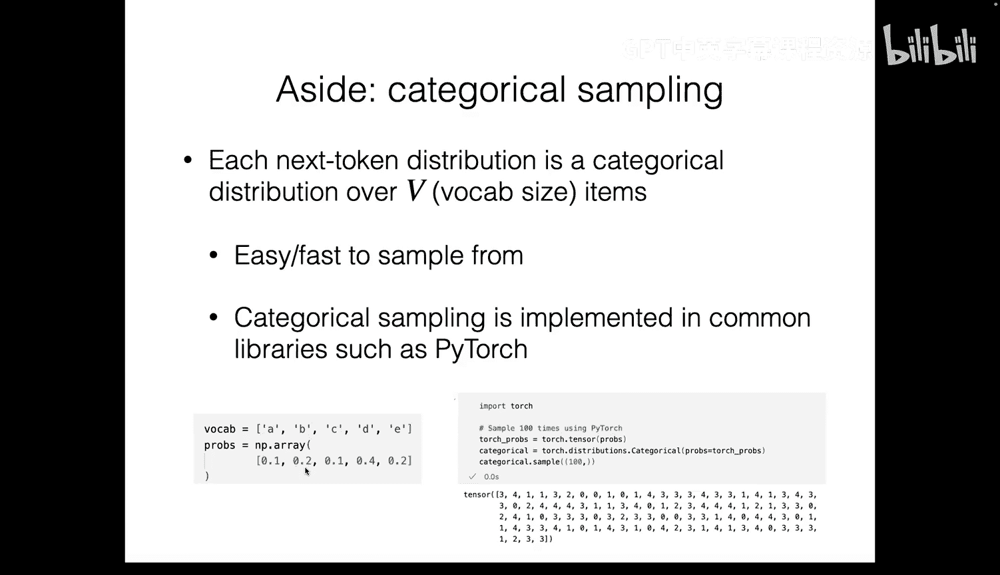

嗯。So。

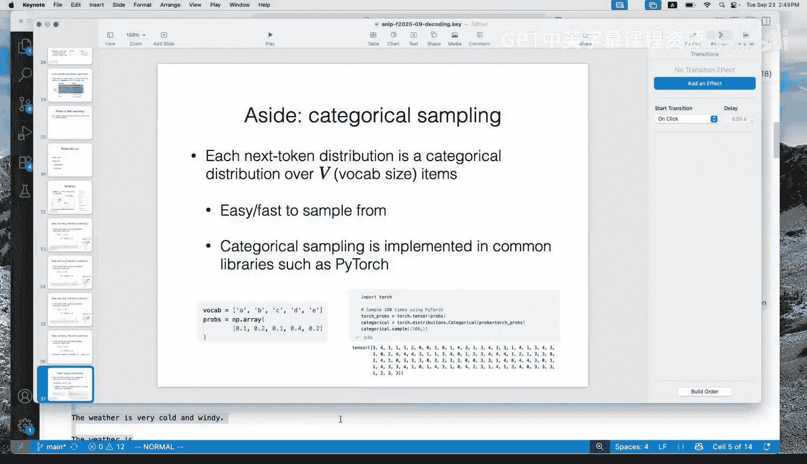

Again， if you haven't if you haven't seen it before， like want to convince yourself more of this。

 here's actually implementing it so you can use like a linear search or a binary search。

And then you can run this， say 100 times。And you can see that the kind of empirical distribution that you get starts resembling as you sample more and more this true distribution that's determined by the parameters。

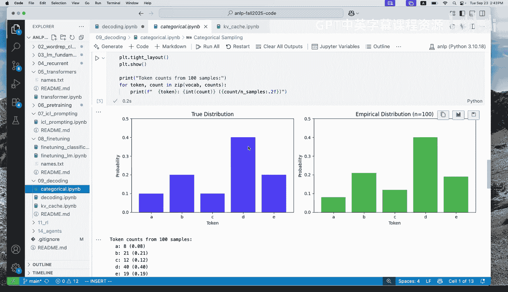

Okay， and so there's actually different algorithms for doing this。 there's another one based on。

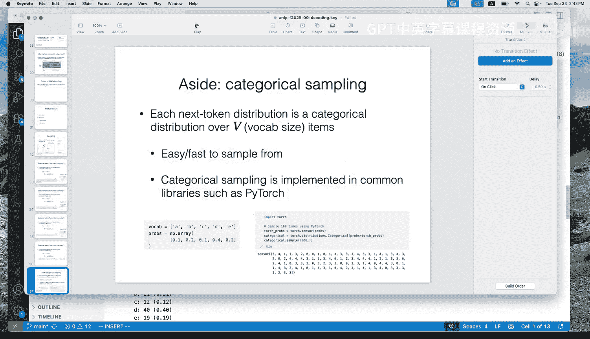

What's called the gumbe distribution， so I'm not sure exactly which one is implemented。

 but nowadays this is just a stand this sampling is just standard operation in these different libraries。

And so again， the nice thing here is that we've reduced the problem of。

Kind of sampling a full sequence into these really kind of efficient next token samples。Okay， so。

What is wrong with ancestral sampling？Well， here， instead of getting something like repetitions。

We often might see what you could call incoherence。

So here's what happens when I sample from the language model， the small one that we've been using。

And it says the weather today is very cold outside as it got cold the night before。14。

 the teacher is going to give card tomorrow。So you can see by the end。

 it gets a little bit crazy and each time you sample from it， you'll get something new。

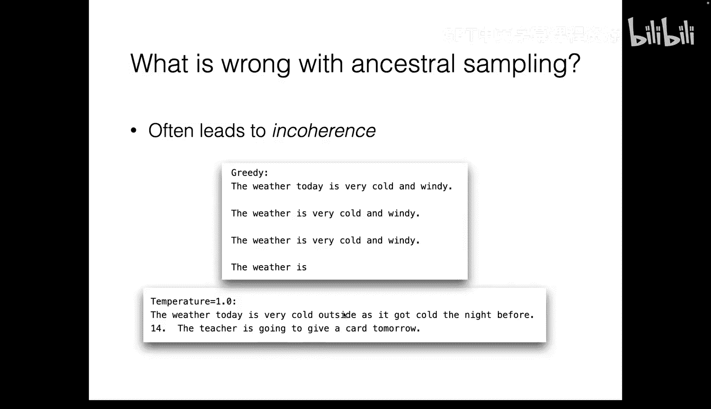

So you could take a look at the。The notebook here。The weather to is not like the low cold Sultana blasting that was in 2006 and said it is sunny and bright absence thereof miing weather。

See， it always gets a it。

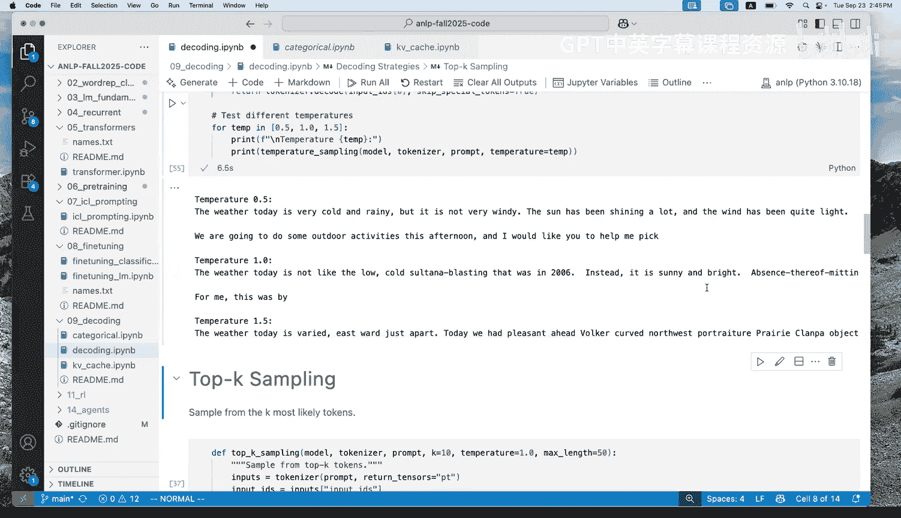

So's a bit off。嗯。

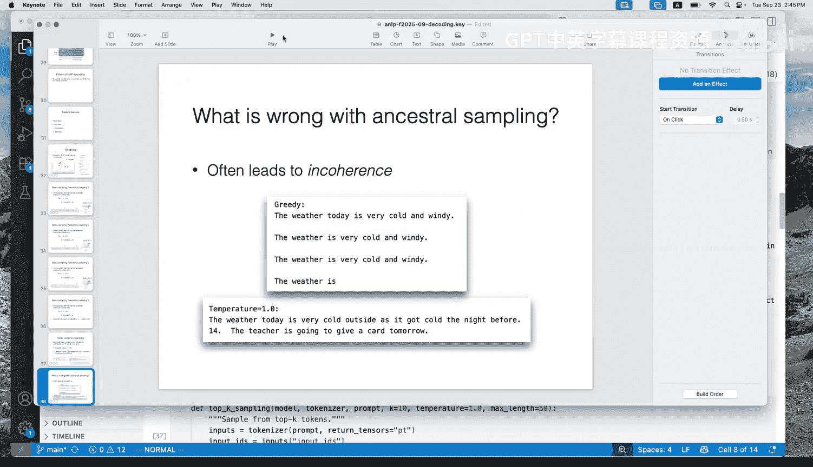

So yeah， maybe there's not a formal definition of incoherence。

 but maybe you can kind of see the difference。But you could think about this a bit more formally。

 like what might be happening。So first of all， you could consider what's called the heavy tail。

So for each one of these next token choices， there's like many different choices。

 let's say we have like 50，000 next tokens。And first of all。

 the model has to assign some probability to each one because of the softm。

 it'll ensure it's greater than zero。But then also each one of these probabilities is kind of estimated。

 so it's not going to be perfect， it's going to have some noise。

And so let's say there's a lot of these kind of very low， but。Maybe they should be zero。

 but they're slightly higher than zero。Then if you add together all their probabilities。

Then collectively， there's a kind of non trivial probability of sampling one of these kind of bad tokens。

 it's called them。And then what happens is you have some probability of sampling a bad token。

And then we do this multiple times because the sequence is more than one token。

And so if you suppose that the probability of sampling some bad token is epsilon。

Then for a length T sequence， the probability of sampling no bad tokens。Is this here？

And you can see that this basically decreases exponentially in the length of the output。

So let's say you have like a 1% chance of sampling a bed token。Then the in 128 length sequence。

 the probability of no bad tokens is。27%。Whereas if。

If there's like a slightly higher probability of sampling a bed token， then you're kind of doomed。

Or if you're sampling really long sequence， then you're also doomed。Okay， so。

This doesn't fully model reality because like in reality the。

The probability of sampling some bad token might vary based on where you are in the。In the sequence。

It's also not like。Exactly clear what bad token means， it'll depend on the application。

Like if you're solving a math problem， then maybe there's a clearer notion of like a bad token。

Whereas if you're like writing an essay， maybe。Some are good。

 but hopefully this gives you some intuition for these kind of compounding errors that can happen。嗯。

So before I talk about the mitigations anyone， let me pause for any questions。别说。

Al friends most likely think。Ss and so is the goal for sampling then just to like approximate the traditional reaction and you don't learn as much about getting the most likely。

Yeah， yeah。 so' they're slightly different and they're slightly overlapping so。Yeah， for sampling。

 you're just trying to。Yeah， produce sequences like proportional to the models' of distribution。嗯。

And you could imagine using a sampling algorithm to do optimization。

Like you could draw multiple samples and then take the maximum and that's the optimization algorithm。

嗯。But yeah， in practice， there's been these like algorithms specifically designed for the optimization like like beam search and the more they're of a kind of different flavor。

 the more discrete kind of search based。Yeah。Okay。So one workaround is to use one of these。

 they're called truncation strategies。嗯。So it basically says choose some position in the next token probabilities。

And then just set everything below that position to zero and only sample from these kind of high probability tokens。

So there's different versions of how you choose this kind of line。

 one version is called top K sampling。So here， yeah， you set a number， like， let's say five。

You said all of the。Probabilities that aren't in the top five to zero。

 and then you only sample from these。嗯。So can anyone think of downsides to doing this？

If a distribution is really narrow， then you might not even have free samples。

You might want like only look at like one or two or like if your institution is valid or。

 you might want to look at more。Yeah， yeah， yeah exactly so it can maybe。

Like one way to look at it is the choice of k somewhat depends on the shape of the distribution。

 yeah。Also depends on the vocabulary size sort title。一2再回一。Okay， yeah， yeah， those are。

 those are good downsides。So there's been other ways of like choosing this threshold。

 so the other popular one is called top P or nucleus sampling。So top P basically says。

 let's look at the cumulative probability mass。And。Then， truncate everything。他了。

Like you maintain the cumulative probabilities， let's say they reach 0。9。

 then all subsequent tokens will just be set to  zero。

And so here you could see it's different from top K。Now it some extent does。

 it'll adjust based on the kind of shape of the distribution。

So if you have a few things that are very probable。

 then the cumulative sun will kind of hit the threshold very soon。If it's more spread out。

 then maybe it'll allow。More possibilities。嗯。And so a lot of these kind of techniques were developed and then。

你。Kind of evaluation of them was either it's just very empirical。

 sometimes like human evaluation was used or you could look if like repetitive sequences are generated。

 these turn out to。Yeah， like you don't see the repetitive sequences if the parameters are set high enough。

 for instance， and that was a kind of big finding at the time。And then just qualitatively。

 oftentimes people were finding that you get these kind of more coherent outputs。嗯。

Can anyone think of a drawback to。Let's say having to use top K or top P versus using just temperature at 1。

0。Okay， well first first， you have to introduce this new hyperparameter。

 so you now have to choose whether use 20 or 09。嗯。And then second。

 maybe it's not necessarily drawback， but it's just something interesting to think about。Like。

 let's say that you had a perfect language model。Then the question is like。

 why would you actually need these at all like so maybe the goal should be to just learn a better model and then possibly we don't need these kind of heuristics that are added on after。

But like I said， in practice， you kind of have this。Trade off between okay。

 the model is what it is and we want to use it and so if we do get more coherent outputs。

 then we kind of add on this strategy afterwards。嗯。So again。

 these are now kind of like standard in these different language model libraries。

 and there's also a simple implementation in the code notebook。

And as you probably saw from your homework， there's other strategies like epsilon sampling。

 so epsilon sampling is sampling things that have probability of at least epsilon。

And there's been other ones like ones based on the entropy or there's a whole variety of them。Okay。

 so so that was the truncation heuristics and then another extremely popular thing is to do what's called temperature sampling。

And this one's a bit different in the sense that。嗯。Here we're not truncating。

 we're just kind of making the distribution more peaked。

And so the way this is done is you take the softm。And then you divide the logits or the scores。

By this scalar。 So this will be a scalar， like greater than 0。And 1。

0 corresponds to just original ancestral sampling。And then down here。

 you also have to divide so that everything still sums to one。So here。

 as we'll see on the next slides， if you set the temperature higher than one。

 then you do get kind of more diverse outputs， but they quickly become very incoherent because you're kind of going past the randomness present in your model in some sense。

And then as you lower it down， you might see。More coherent outputs。

But then what happens is as this goes to zero， then it's actually just like concentrating all the mass over the maximum and it ends up being equivalent to greedy decoding。

 so you'll see repetitions if you set it too low sometimes。Okay， so here's a little visualization。

 let's say this is our unaltered distribution， then again。

 making the temperature smaller will kind of concentrate the mass more around the mode。

And making the temperature larger will make it kind of more uniform。And then you can try this out。

 you can try other values in the notebook if you want。

 and so here you can kind of see what I was saying。So temperatureature five looks。

 you know with this language model to be maybe a bit reasonable。Temperature one。

Is maybe going off the rails a bit and then temperature 1。

5 is really going off the rails and kind of inventing new words。Okay， so temperature。

 you'll definitely see it everywhere when you're using language models。

 it's probably even more popular than the top K and top P， but top K and top P are also very popular。

Okay， so that was it for the sampling algorithms and again I was kind of going over the basic ones。

 the core ones that you'll see a lot in practice。So now in the last part。

 I want to talk a bit about the speeding up decoding。So again， we'll go over。

A more comprehensive discussion。 I'll introduce some kind of concepts from systems that you take into account when you're thinking about how to speed up decoding。

Speeding up decoding is very important in practice。So you can imagine like。

 let's say I want a language model to run on my laptop。

 then you have to think about how do you make the kind of decoding algorithm as fast as possible？

Similarly， let's say'm open AI and I want my API to be very fast or I want chat GT to be very fast。

Then it becomes very important to think about， yeah。

 what are the algorithms to use to do that as fast as possible？But yeah， today。

 let me just go over this feature which is in most implementations of decoding when you use a transformer。

 and it's called key value caching。Okay， so here during decoding。

 if we think about the transformer end， then when we're producing each new token。

The model is going to be basically attending to positions before it。Okay。

 it can't attend to positions after it because when we're decoding。

 the after it part doesn't exist yet。So it's just attending to positions before it。Of course。

 during training time， we also don't want it to attend to positions after it。

 so we use the attention mask。Okay， so then by definition。

 this attention will need the keys and values for these past tokens 1 through t。

And the kind of insight is that if you consider doing multiple steps of decoding。

 then there turns out to be a lot of repeated computation。So at the first step。

 you have the key and value for position one。Then let's say you you're decoding the second token。

 Well， now you need again， the key in value for position 1， as well as position 2。呃。

For the third step， you again need these first two， and these are kind of redundant computations。

And so the idea of key value caching is to basically store the previously computed keys and values。

And then again， like even when the model is trained。

 the model has learned to only store to only compute the key in value using past information。

So it turns out to be equivalent to just kind of cache these and save these versus recompetuting them again。

so。Just to see this in detail， what you have is， let's say we're at the step key of decoding。

Then you'll basically have the single query vector。

 which is corresponding to this new token you want to produce。

And this will be computed by this current hidden vector。Multiply by and weight matrix。Similarly。

 you can compute the key for the current step and the value for the current step。

And then these go into the kind of attention formula。Okay， so then again。

 this key value caching just says let's keep around this matrix， which has all of the past keys。

 so it's like K1 through Kt minus1。Similarly， let's keep around the past values。

And then we can just append the new key and new value and then do the attention。Okay。

 so then this is just showing the。Attention formula using just a single query。

 which is like the next token you want to generate。

Or the position for the next typeken you want to generate。Okay。

 and so then the key savings here is again， if we kind of recomputed these at each step。

 we would have this much larger matrix multiplication now we just have this kind of matrix vector multiplication。

So then here's just a visual version again here we kind of have this cache and you reuse it and then we only have to kind of compute。

The single time step。呃。Worth of new keys and values。嗯。

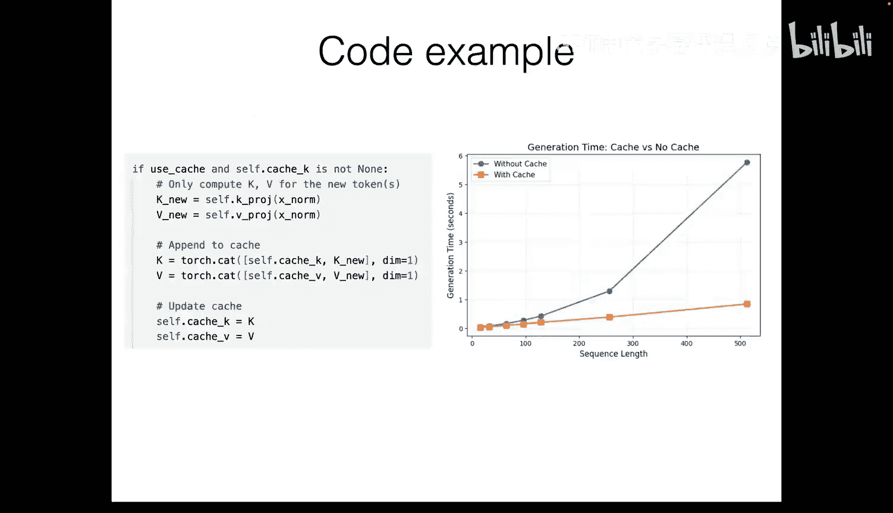

So here there's a separate notebook implementing this。

So if you look through different implementations， like。The Carpaths one of GPT2， for instance。

 or like thellma implementation， you'll see the key value caching implemented。

This is just showing it with one of these simple kind of like built from scratch models and a bit more explicitly。

And you can see here that it really is what I'm saying。

 so here you produce this new key and new value， and then you're just concatenating it to this cache。

Or with the cash values， and then you kind of update the cache。

And then you can without even training the model， you could just start generating with it and compare the speed。

And you can see here that basically like as the sequences are getting longer。

 you're starting to get these huge speedups， so here lower is better， this is the time on the Y axis。

 you can get these huge speedups by using the caching。And then again， the outputs should be。

 as long as you've implemented it correctly， should be kind of exactly the same。嗯。Due to yeah。

 what I showed on the slides。Okay， so。It turns out that there's actually more to the story and we'll go into it in the next lecture。

 so it turns out that the trade off is now you have to do a lot of memory exes。

 so either writing to memory or reading to memory，And that'll actually turn out to be a really big bottleneck in practice。

And so that'll be a kind of huge focus of attention for methods that are speeding up the decoding in practice。

But we'll get to that later。

Okay so so that's all the content for today， so we have some time for questions either here or in person。

 so we went over the kind of core decoding algorithms。

 we talked about the ones based on optimization， ones based on sampling。

And then went over one of the key techniques for speeding up decoding。Okay， thank you。Or， I'll take。

Any questions， if there are any then you can come in person。你个。Yeah。Yeah， so。Okay。😊。

So here you have so prior to applying attention。You have to compute the keys and values。

And so with the caching， you're only multiplying this current hidden state to get the current key。

If you don't have the caching， then you'll do this and kind of compute the keys for all the time stepss。

 so this will be a matrix， this is like you know stacking them together。嗯。

Yeah exactly so you do have something that's still growing with the lengthal sequence yeah。好。

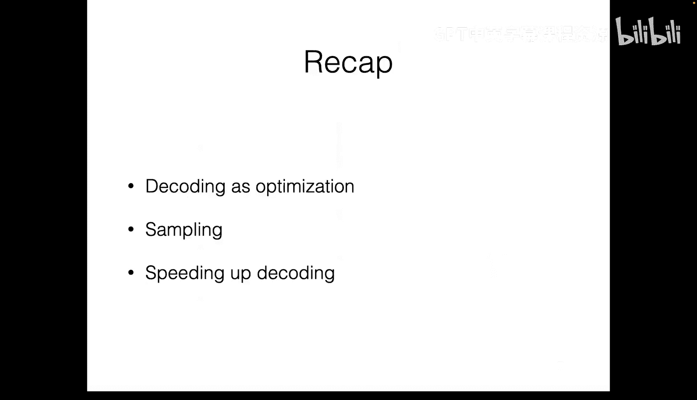