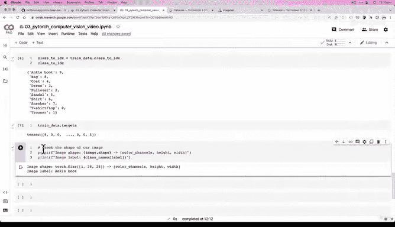
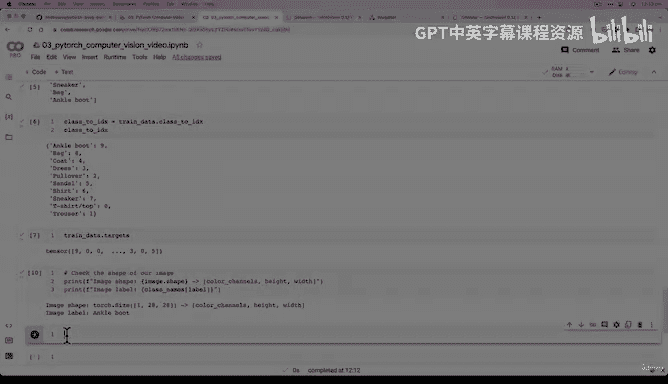

# Daniel Bourke《PyTorch 深度学习｜PyTorch 101 Crash Course For Beginners in 2025》中英字幕 - P101：101_05_005 获取计算机视觉数据集并检查输入输出形状.zh_en - GPT中英字幕课程资源 - BV1kTSKB1E9m

Welcome back。 So in the last video， we covered some of the fundamental computer vision libraries in Ptorrch。

 The main one being torch vision and then modules that stem off torch vision。 And then， of course。

 we've got torchuts dot data dot data， which is the base data class for Ptorrch and data load。

 which creates a Python iterable over a data set。 So let's begin where most machine learning projects do。

 And that is getting a data set。😊，Getting a data set。 I'm going to turn this into markdown。

And the data set that we're going to be used to demonstrating some computer vision techniques is fashion MN。

Which is a take of the data set we will'll be using。Is fashion Mnist。

 which is a take on the original Mnist data set， Mnist database。

Which is Modified National Institute of Standards and Technology Databs。

 which is kind of like the hello world in machine learning and computer vision。😊，Which is。

 these are the sample images from the Mnines test data set。

 which are grayscale images of handwritten digits。 So this， I believe。

 was originally used for trying to find out if you could use computer vision at of postal service to。

 I guess， recognize postcodes and whatnot。 I may be wrong about that。 But that's what I know， Yeah。

1998。 So all the way back at 1998。 How cool is that。

 So this was basically where convolutional neural networks were founded。

 I'll let you read up on the history of that。 but。😊。

Neural networks started to get so good that this data set was quite easy for them to do really well。

 And that's when fashion Ms came out。 So this is a little bit harder。 if we go into here。

This is by Zlando Research Fashion Enist。And it's of grayscale images of pieces of clothing。

So like we saw before at the input and the output， what we're going to be trying to do is turning these images of clothing。

Into numbers and then training a computer vision model to recognize what the different styles of clothing are。

 And here's a dimensionality plot of all the different items of clothing。

Visualizing where similar items are grouped together。 There's the shoes and whatnot。

 Is this interactive。I no。 it's a video。 Excuse me。

There we go to serious machine learning researchers。We are talking about replacing Mns。

 Mnist is too easy。 Mnist is overused。 Ms cannot represent modern C tasks。 So even now。

 fashion amnist， I would say， has also been pretty much solved， but it's a good way to get started。

 Now， where could we find such a data set， We could download it from Github。

 But if we come back to the torch vision documentation。 have a look at data sets。

 We have a whole bunch of built in data sets。 And remember。

 this is your extracurricular to read through these for 10 minutes or so each。

 but we have a example we could download imagenet。 if we want。😊。

We also have some base classes here for custom data sets。 We'll see that later on。

 But if we scroll through， we have image classification data sets。 Caltech 101。

 I don't even know what all of these are。 There's a lot here。 C P 100。

 So that's an example of 100 different items。 So that would be 100 class multiclass classification problem。

 C5 10 is 10 classes。😊，We have E M N。 We have fashion M Nist。 Oh， that's the one we're after。

 But this is basically what you would do to download a data set from Torchvision dot data sets。

 You would download the data in some way， shape or form。

 And then you would turn it into a data loader。 So imagenet is one of the most popular or is probably the gold standard。

😊，Data set for computer vision evaluation。It's quite a big data set， it's got millions of images。

 but that's the beauty of Torch vision is that it allows us to download example data sets that we can practice on。

I wouldt even perform research on from a built in module。

So let's now have a look at the fashion MN data set。How might we get this。

 So we've got some example code here， or this is the documentation。

 Torchvision dot data sets dot fashion Mnest。 We have to pass in a route。

 So where do we want to download the data set。We also have to pass in whether we want the training version of the dataset or whether we want the testing version of the dataset。

 Do we want to download it， Yes or no， Should we transform the data in any way shape or form。

 So what we're going to be downloading images through this function call or this class call。

 Do we want to transform those images in some way， What do we have to do to images before we can use them with a model。

 We have to turn them into a tensor so we might look into that in a moment。

 and target transform is do we want to transform the labels in any way， shape or form。

So often the datasets that you download from Torchvision datas are pre formatted in a way that they can be quite easily used with pitorch。

 but that won't always be the case with your own custom datas。 However。

 what we're about to cover is just important to get an idea of what the computer vision workflow is and then later on you can start to customize how you get your data in the right format to be used with the model。

 Then we have some different parameters here and whatnot。

 let's just rather than look at the documentation if in doubt， code it out。😊。

So we'll be using fashion MNist。And we'll start by。 I'm gonna just put this here。

From Torchvision dot datas。I'm going put the link there。And we'll start by getting the training data。

Set up training data。 I're going to make some code cells here so that I can code in the middle of the screen。

Set up training data。Train data equals data sets dot fashion Mist， because recall we've already。

From Torch visionion。We don't need to import this again。

 I'm just doing it for demonstration purposes， but。From Torch Viion。

 import data sets so we can just call data set stop fashionash Mist。

And then we're going to type in root。😊，See how the do string comes up and tells us what's going on。

 I personally find this a bit hard to read in Google collabs。 So if I'm looking up the documentation。

 I like to just go into here。 but let's code it out。 So root is going to be data。

 So where to download data2。We'll see what this does in a minute。Then we're going to go train。

 we want the training version。Of the data set。 So as I said。

 a lot of the data sets that you find in Torch visionion dot data sets have been formatted into training data set and testing data set already。

 So this bulling tells us。Do we want the training data set？So if that was false。

 we would get the testing data set or fashion MNist， do we want to download it？

Do we want to download？Yes， no。 So， yes， we do。 We're going to set that to true。 Now。

 what sort of transform do we want to do？ So because we're going to be downloading images and what do we have to do to our images。

To use them with a machine learning model， we have to convert them into tensors。

 So I'm going to pass the transform to tensor， but we could also just go torchvision dot transforms dot to tensor。

 that would be the exact same thing as what we just did before。 And then the target transform。

 do we want to transform the labels。 No， we don't。 We're going to see how they come or the target。

 Sorry， hightorrch， this is another way another naming convention often uses target for the target that you're trying to predict。

 So using data to predict the target， which is I often use data to predict a label。

 theyre the same thing。 So how do we。Want to transform the data？And。How do we。Want to transform。

The labels slashed targets。And then we're going to do the same for the test data。

 So we're going to go data sets。😊，You might know what to do here。

 It's going to be the exact same code as above， except we're going to change one line。

We want to store it in data。We want to download the training data set as false because we want the testing version。

Do we want to download it， Yes， we do， do we want to transform it the data？Yes， we do。

 We want to use two tensor to convert our image data to tensors。

 And do we want to do a target transform？ Well， no， we don't。

 We want to keep the label slash the targets as they are。 Let's see what happens when we run this。

Downloading fashion M thats beautiful。So this is going to download all of the labels where we have train images。

 train labels， lovely test images， test labels beautiful。

 so that's how quickly we can get a data set by using Torch vision data sets。

 Now if we have a look over here， we have a data folder because we set the route to be data and then if we look what's inside here。

 we have fashion MNest exactly what we wanted， then we have the raw。

 and then we have a whole bunch of files here， which torch vision has converted into data sets for us。

😊，So let's get out of that and this process would be much the same if we used almost any data set in here。

 of course they might be slightly different depending on what the documentation says and depending on what the data is。

 but that is how easy Torvision。t datasets makes it to practice on example computer vision dataset sets。

So let's go back。😊，Let's check out some parameters or some attributes of our data。

How many samples do we have？So we'll check the lengths。So we have 60。

000 training examples and 10000 testing examples， so what we're going to be doing is we're going to be building a computer vision model to find patterns in the training data and then use those patterns to predict on the test data and so let's see a first training example。

 see the first training example。So we can just index on the train data。 Let's get the zeroth index。

 and then we're going to have a look at the image and the label。Oh， my goodness。

Whole bunch of numbers。Now you see what the two tensor has done for us。

So we've downloaded some images。 and thanks to this Torch vision transforms to Tensor。

 How would we find the documentation for this？ Well， we could go and see what this does。

 transformforms to Tensor。We can go to Tensor。 There we go。 What does this do？Convert a pill image。

 so that's Python image library image or nupy array to a tensor。

This transform does not support torch script， So it converts a pillow image or nup array height width color channels in the range 0 to 255 to a torch float tensor of shape C here。

 This is what I was talking about how pi torch defaults with a lot of transforms to C HW。

 So color channels first height， then width in the range of 0 to1。

 So typically red green and blue values are between 0 and 255。

 But neural networks like things between 0 and1。 And in this case。

 it is now in the shape of color channels first， than height， then width。 However。

 some other machine learning libraries prefer height width， then color channels。

 Just keep that in mind。 we're going to see this in practice later on。So we've got the image。

 we've got a label。 Let's check out some more details about it。 Remember how we discussed， oh。

 there's our label， by the way。 So 9， we can go train data dot classes。

 find some information about our class names。😊，Class names。Beautiful， so number 9 would be 0，1，2，3，4。

5，6，7，8，9。 So this particular tensor seems to relate to an ankle boot。 How would we find that out。

 Well， one second， I'm just going to show you one more thing， class to I D X。

 Let's go train data dot class to I D X。 What does this give us。😊，Class to IDDX。

This is going to give us a dictionary of different labels and their corresponding index。

 So if our machine learning model predicted 9 or class 9。

 we can convert that to ankle boot using this attribute of the train data。

 There are more attributes that you can have a look at if you like， you can go train data dot。

 Then I just push tab to find out a bunch of different things。

You could go data as the data that'll be the images， and then I believe you can also go targets。

So targets， that's all the labels。Which is one big long tensor。 Now let's check the shape。

Check the shape。Of our image。 So image dot shape and label dot shape。

 What are we going to get from that。Oh， label doesn't have a shape。 Why is that， Well。

 because it's only an integer。So， oh， beautiful。 Look at that。

 So our image shape is we have a colour channel of one。

 So let me print this out in something prettier。😊，Print。Image shape。

 which is going to be image shape。 Remember how I said it's very important to be aware of the input output shapes of。

Your models and your data It's all part of becoming one with the data。

 So that is what our image shape is。And then if we go next， this is print。Image label， which is。

Label， but will index on class names for label。And then we'll do that。Wonderful。

 so our image shape is currently in the format of color channels's heightight width。

 We've got a bunch of different numbers that's representing our image。 It's black and white。

 It only has one color channel。 Why do you think it only has one color channel。😊，Well。

 because it's black and white。 So if we jump back into the keynote， fashion ems。

 we've already to discuss this grayscale images have one color channel。 So that means that for black。

 the pixel value is 0 and for white， it's some value for whatever color is going on here。

 So if it's a very high number， say it's one， it's going to be pure white if it's like 0。001。

 it might be a faint white pixel。 but if it's exactly 0， it's going to be black。

 So color images have three color channels for red， green and blue， grayscale have one color channel。

😊，But I think we've done enough of visualizing our images as numbers。 How about in the next video。

 we visualize our image as an image。

I'll see you there。

