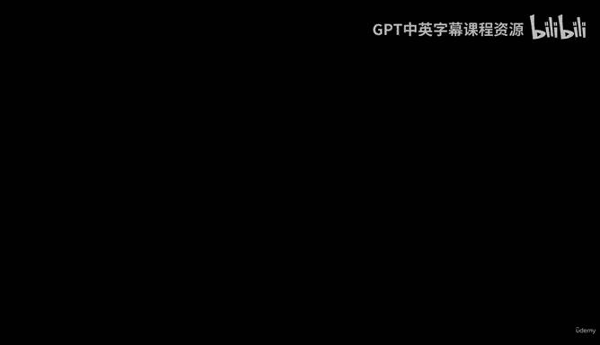
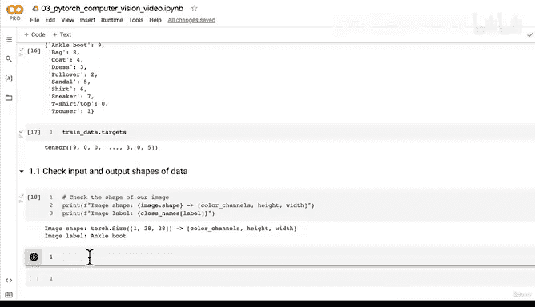
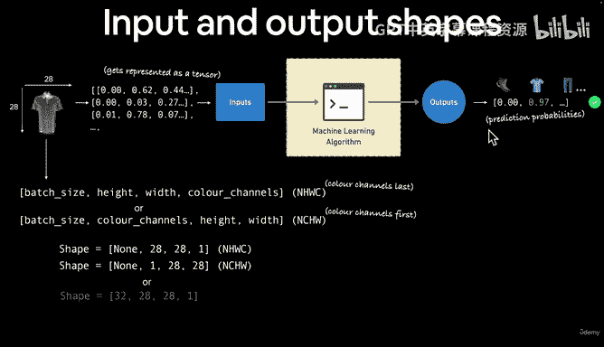
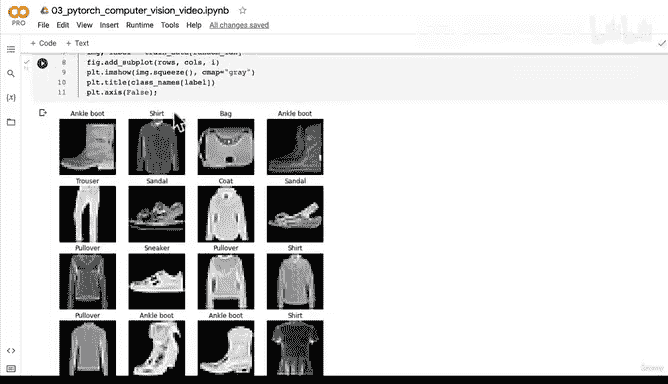
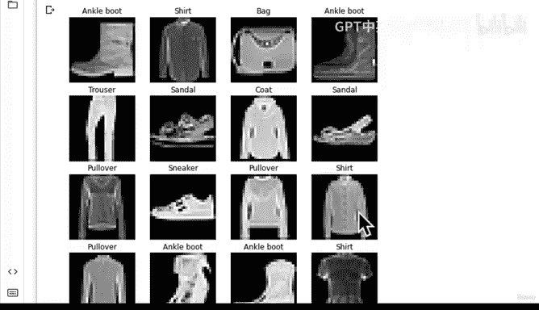
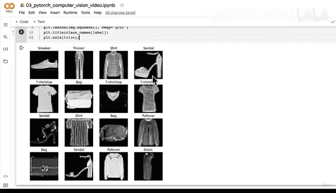
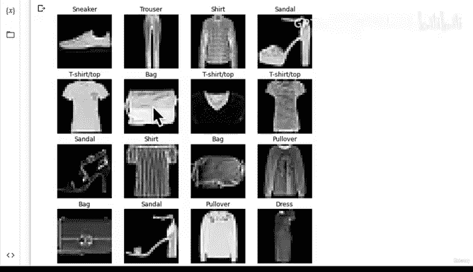
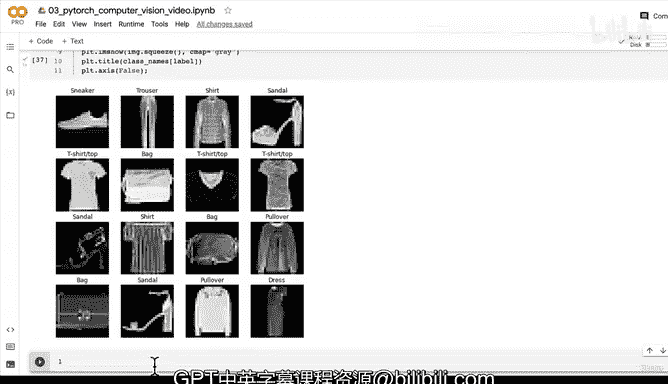

# Daniel Bourke《PyTorch 深度学习｜PyTorch 101 Crash Course For Beginners in 2025》中英字幕 - P102：102_05_006 随机样本数据可视化.zh_en - GPT中英字幕课程资源 - BV1kTSKB1E9m

Welcome back。 So in the last video， we checked the input output shapes of our data。

 and we downloaded the fashion Ms data set， which is comprised of images or grayscale images of T shirts。

 trousers， pullovers， dress， coat， sandal， shirt， sneaker， bag， ankle boot。 Now。

 we want to see if we can build a computer vision model to decipher what's going on in fashion Mns。

 So to separate， to classify different items of clothing based on their numerical representation。😊。

And。Part of becoming one with the data is， of course， checking the input output shapes of it。

 So this is a fashion Mnes data set from Zlando research。

Now if you recall， why do we look at our input output shapes Well， this is what we looked at before。

 We have 28 by 28 grayscale images that we want to represent as a tensor。

 we want to use them as input into a machine learning algorithm。

 typically a computer vision algorithm such as a CNN then we want to have some sort of outputs that are formatted in the ideal shape that we'd like so in our case we have 10 different types of clothing。

 so we're going to have an output shape of 10， but our input shape is what。😊。

So by default， pie torch turns tensesors into color channels first。

 so we have an input shape of  nu12828。So none is going to be our batch size。

 which of course we can set that to whatever we'd like。And so our input shape format is in NCHW。

 or in other words， color channels first。 But just remember。

 if you're working with some other machine learning libraries。

 you may want to use color channels last。So let's have a look at where that might be the case。

 we're going to visualize our images。So I'll make a little heading here。1。

2 Now this is all part of becoming one with the data。Otherwise words。

 understanding its input output shapes， how many samples there are， what they look like。Visualize。

 visualize， visualize。 Let's import Matpllib。I'm just going to add a few code cells here。

 import map plot lib。Dot pie plot。Pyiploot as PLT。Now let's create our image and label is our train data0。

 and we're going to print the image shape so we can understand what。

Imputs are going into our mappllib function。And then we're going to go plot。im show。

 and we're going to pass in our image and see what happens because recall。

 what does our image look like。Image。Our image is this big tensor of numbers。

And we've got an image shape 128，128。 Now what happens if we call plot。m show what happens there？Oh。

We get an error invalid shape 128128 for image data。😊，Now， as I said。

 this is one of the most common errors of machine learning is a shape issue。

 so the shape of your input tensor doesn't match the expected shape of that tensor。

 So this is one of those scenarios where our data format。

 So color channels first doesn't match up with what Matplotlib is expecting。

 So Mapllibb expects either just height and width So no color channel for grayt images。

 or it also expects the color channels to be last。 So we'll see that later on。

 but for gray scale we can get rid of that extra dimension by passing in image dot squeeze。

So do you recall what squeezeeze does？It's going to remove that singular dimension。

 If we have a look at what goes on now。Beautiful， we get an ankle boot。 Well。

 that's a very pixelated ankle boot， but we're only dealing with 28 by 28 pixels。

 So not a very high definition image。 Let's add the title to it。😊，We're going to add in the label。

Beautiful， so we've got the number 9 here。 So where if we go up to here， that's an ankle boot。 Now。

 let's plot this in gray scale。 How might we do that， We can do the same thing。

 We can go plot P L T dot M show。 We're going pass in image dot squeeze。😊。

And we're going to change the color map C map equals gray。 So in mappl Lib。

 if you ever have to change the colors of your plot。

 you want to look into the C map property or parameter， or sometimes it's also shortened to just see。

😊，But in this case， M show is CM map and we want to plot title。

 and we're going to put in class names and the label integer here。😊，So we have a look at it now。

 we have an ankle boot， and we can remove the axises to if we wanted to plot dot axis and turn that off。

 That's going to remove the axis。 So there we go。 That's the type of images that we're dealing with。

 But that's only a singular image。 How about we harness the power of randomness and have a look at some random images from our data set。

 So， how would you do this。 Let's go plot more images。We'll set a random seed。

 so you and I are both looking at as similar as possible images 42。Now。

 we'll create a plot by calling plot dot figure， and we're going to give it a size。

 and we might create a 9 by 9 grid。 So we want to see 9 random images from our data set。 So rows。

 coals。Or sorry， maybe we'll do 4 by 4。 That'll give us 16。 We're going to go4 I in range。

 and we're going to go one to rows times columns plus one so we can print I。

 What's that going to give us。We want to see 16 images， or thereabouts。So 16 random images， but。

Used with a manual C to 42 of our dataset。 This is one of my favorite things to do with any type of data that I'm looking at。

 whether it be text， image， audio doesn't matter。 I like to randomly have a look at a whole bunch of samples at the start so that I can become one with the data。

 With that been said， let's use this loop to grab some random indexes。

 We can do so using torches ran int。 So random integer between0 and length of the training data。

 This is going to give us a random integer in the range of 0 and however many training samples we have。

 which in our case is what60000 or thereabouts。😊，So we want to create the size of one。

 and we want to get the item from that so that we have a random index。 What is this going to give us。

Oh， excuse me， maybe we print that out。There we go。 So we have random images now。

 because we're using manual seed， it will give us the same numbers every time。 so we have 3，7，5，4，2。

3，7，5，4，2。 And then if we just commented out the random sea， we'll get different。Numbers every time。

But this is just to demonstrate， we'll keep the manual see there for now。

 You can comment that out if youd want different numbers or different。Images。

 different indexes each time。 So we'll create the image and the label by indexing on the training data at the random index that we're generating。

😊，And then we'll create our plot。 So fig or we'll add a subplot， Fig add。Subplot。

 and we're going to go rows Cols I。 So at the ifF index， we're going to add a subplot。

 Remember we set rows and columns up to here。And then we're going to go Pt dot M show。

 We're going to show what we're going to show our image。

 but we have to squeeze it to get rid of that singular dimension as a color channel。 Otherwise。

 we end up with an issue with mappl Lib。 We're going to use a color map of gray。

 So it looks like the image we plotted above。 And then for our title。

 it's going to be our class names indexed with our label。

 And then we don't want the aes because that's going to color up our plot。

 Let's see what this looks like。😊，Oh my goodness。 look at that。 It worked first go。

 Usually visualizations taken for a bit of trial and error。😊。

So we have ankle boots， we have shirts， we have bags， we have ankle boots， sandal， shirt。

 pull over all。😊，Do you notice something about the data set right now？Pull over and shirt。To me。

 they look quite similar， do you think that will cause an issue later on when our model is trying to predict between a pullover and a shirt？

How about if we look at some more images？We'll get rid of the random seeds so we can have a look at different styles。

So we have a sandal， ankle boot coat， T shirt， top， shirt， oh。

Is that a little bit confusing that we have a class for T shirt and top and shirt？

Like I'm not sure about you， but what's the difference between a T shirt and a shirt？

This is just something to keep in mind as a Ts shirt and top does that look like it could be maybe even a dress？

Like the shape is there。 So this is just something to keep in mind going forward。 Chances are。

 if we get confused on our， like you and I looking at our data set。

 if we get confused about different samples and what they're labeled with。

Our model might get confused later on。So let's have a look at one more and then we'll go into the next video。

😊，So we have sneaker， trousers， shirt， sandal， dress， pullover， bag， bag， T shirt。 Oh。

 that's quite a difficult one。 Doesn't look like there's even much going on in that image， but。

The whole premise of building machine learning models to do this would be。

 could you write a program that would take in the shapes of these images and figure out。

 write a rule based program that we would go， hey， if it's looked like a rectangle with a buckle in the middle。

 it's probably a bag。I mean， you probably could after a while。

 but I prefer to write machine learning algorithms to figure out patterns and data。

 So let's start moving towards that。 We're now going to go on figuring out how we can prepare this data to be loaded into a model。

I'll see you that。

