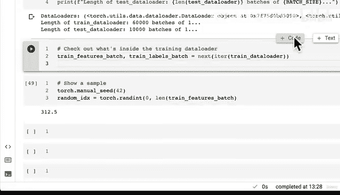
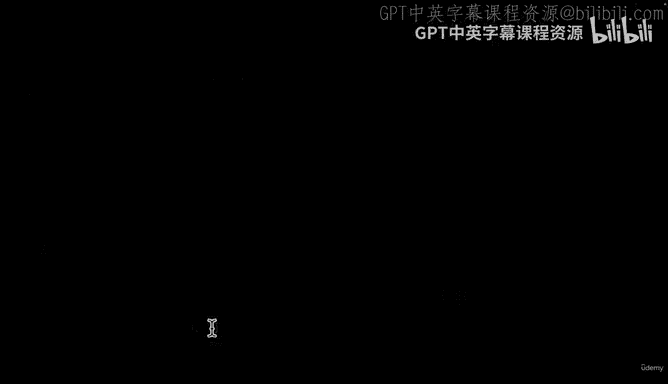
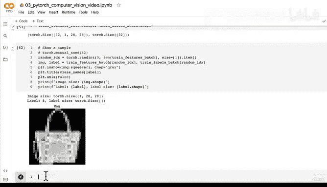

# Daniel Bourke《PyTorch 深度学习｜PyTorch 101 Crash Course For Beginners in 2025》中英字幕 - P104：104_05_008 将数据集转换为DataLoader.zh_en - GPT中英字幕课程资源 - BV1kTSKB1E9m

Welcome back。 In the last video， we had a brief overview of the concept of mini batches。

 And so rather than our computer looking at 60000 images in one hit， we break things down。

 We turn it into batches of 32。 Again， the batch size will vary depending on what problem you're working on。

 but 32 is quite a good value to start with and try out。😊，And we do this for two main reasons。

 if we jump back to the code， while we do this， it is more computationally efficient。

 So if we have a GPU with， say 10 gig of memory， it might not be able to store all 60000 images in one hit in our data set because it's quite small。

 it may be our two， but it's better practice for later on to turn things into mini batches。

 And it also gives our neural network more chances to update its gradients per epoch。

 which will make a lot more sense once we write our training loop。 but for now。

 we've spoken enough about the theory， let's write some code to do so。

 So I'm going to import data loader from torch do us do data importport data loader。

 And this principle， by the way， preparing a data loader。😊，Goes the same for not only images。

 but for text， for audio， whatever sort of data you're working with。

 many batches will follow you along or batches of data will follow you along throughout a lot of different deep learning problems。

So set up。The batch size hyperparameter。 Remember， a hyperparameter is a value that you can set yourself。

 So batch size equals 32。 and it's practice。 You might see it typed as capitals。

 You won't always see it， but you'll see it quite often a hyperparameter typed as capitals。

And then we're going to turn data sets into iterables。So， batches。

So we're going to create a train data loader here of our fashion MN data set。

We're going to use data loader。 We're going to see what the dock string is， or actually。

 let's look at the documentation， torch data loader。😊，This is some extra curriculum for you too。

 by the way， is to read this data page， Taunch U， not data because。😊。

No matter what problem you're going with with deep learning or pytorch。

 you're going to be working with data。 So spend 10 minutes just reading through here。

 I think I might have already assigned this， but this is just so important that it's worth going through again。

 read through all of this。 Even if you don't understand all of what's going on。

 It's just it helps you know where to look for certain things。 So what does it take。

 Data loader takes a data set。 We need to set the batch size to something is the default of one。

 That means that we would create a batch of one image at a time In our case。

 Do we want to shuffle it。 Do we want to use a specific sampler， There's a few more things going on。

 numberumb of workers。 numberumb of workers stands for how many core on our machine do we want to use to load data。

 General， the higher the better for this one， But we're going keep most of these as the default。

 because most of them are set to pretty good values to begin with。

 I'll let you read more into the other parameters here。 We're going focus on the first three。

Data set， batch size and shuffle， true or false。Let's see what we can do。

So data set equals our train data， which is 60，000 fashion MNIS， and then we have a batch size。

 which we're going to set to our batch size hyperparameter。

 so we're going to have a batch size of 32。😊，And then finally。

 do we want to shuffle the training data？ Yes， we do。

And then we're going to do the same thing for the test data loader。

 except we're not going to shuffle the test data。😊，Now you can shuffle the test data if you want。

 but in my practice， it's actually easier to evaluate different models when the test data isn't shuffled。

 so you shuffle the training data to remove order and so your model doesn't learn order。

 but for evaluation purposes， it's generally good to have your test data in the same order because our model will never actually see the test data set during training we're just using it for evaluation so the order doesn't really matter the test data load。

 it's just easier if we don't shuffle it because then if we evaluate it multiple times it's not been shuffled every single time。

So let's run that。 And then we're going to。Check it out。

 our train data loader and our test data loader。Beautiful， we've got instances of Torch Us data。

 data loader do data loader。 And now let's check out what we've created， hey。😊。

I always like to print different attributes of whatever we make。Check out what we've created。

 this is all part of becoming one with the data。So， print。If I'm going to go data loaders。

And then pass in， this is just going to output basically the exact same as what we've got above test data loader。

And we can also see what attributes we can get from each of these by going train data loader。

 I don't need caps lock there， Tra data loader full stop， and then we can go tab。

 We've got a whole bunch of different attributes。 We've got a batch size。 We've got our data set。

 do we want to drop the last as in if our batch size overlapped with our 60000 samples。

 do we want to get rid of the last batch， say， for example， the last batch only had 10 samples。

 Do we want to just drop that， Do want to pin the memory that's going to help later on if we wanted to load our data faster。

 a whole bunch of different stuff here。 If you'd like to research more。

 you can find all the stuff about what's going on here in the documentation。😊。

But let's just keep pushing forward。 What else do we want to know。

 So let's find the length of the train。Data loader。We will go length。Train data loader。

 So this is going to tell us how many batches there are batches of which of course is batch size。

And we want print。leength。Of test data loader。We want length， test data loader。Baches of batch size。

Dot dot dot。 So let's find out some information。 What do we have。 Oh， there we go。

 So just we're seeing what we saw before with this one。 But this is more interesting here。

 length of train data loader。 Yeah， we have about 1875 batches of 32。

 So if we do 60000 training samples divided by 32。😊，Yeah， it comes out to 1875。

 And if we did the same with 10000 for testing samples or 32， it comes out at 3，13。

 This gets rounded up。 So this is what I meant that the last batch will have maybe not 32 because 32 doesn't divide evenly into 10000。

 but that's okay。And so。This means that our model is going to look at 1875 individual batches of 32 images。

 rather than just one big batch of 60000 images。 Now， of course。

 the number of batches we have will change if we change the batch size。So we have 469 batches of 128。

 And if we reduce this down to  one， what do we get。We have a batch per sample。

 so 60000 batches of one，10000 batches of one。 but we're going to stick with 32。

But now let's visualize。 So we've got the in trained data loader。

 How would we visualize a batch or a single image from a batch。So let's show a sample。

I'll show you how you can interact with a data loader。We're going to use randomness as well。

 So we'll set a manual seed and and we'll get a random index。 random Id X equals torch Rand int。

We're going go from0 to length of train features batch。 Oh where did I get that from， Excuse me。

 getting ahead of myself here。 I want to check out what's inside the training data loader。

 We'll check out what's inside the training data loader because the test data load is going to be similar。

 So we want the training features batch。So I say features as in the images themselves and the train labels batch is going to be the labels of our data set or the targets in Pytor terminology。

So next， it data loader。 So because our data loader has。

1875 batches of 32。 We're going to turn it into an itriable with itta。

 and we're going to get the next batch with next。And then we can go here， train features。

Battch dot shape。 and we'll get train labels。Batch dot shape what do you think this is going to give us？

Well， there we go。 Look at that。 So we have a tensor。 each batch。 We have 32 samples。

 So this is batch size， and this is color channels， and this is height， and this is width。

 And then we have 32 labels associated with the 32 samples。 Now， where have we seen this before。

 If we go back。Throughout Canote。Iput and output shapes。 So we have shape equals 32，28，28，1。

 So this is color channelss last， but ours is currently in。

Cour channels， first。Now， again， I sound like a broken record here， but these will vary。

 depending on the problem you're working with， if we had larger images。

 what would change or the height and width dimensions would change if we had color images。

 the color dimension would change， but the premise is still the same。

 We're turning our data into batches so that we can pass that to a model。Let's come back。

 Let's keep going with our visualization。So we want to visualize one of the random samples from。

A batch。And then we're going to go image， label。Eles， train featuress。Batch。

 and we're going to get the random IDx from that and we'll get the train labels batch。

And we'll get the random I D X from that。 So we're matching up on the。We've got one batch here。

 train features batch， train labels batch， and we're just getting the image and the label at a random index within that batch。

So oh， excuse me。 I need to set this equal there。And then we're going to go Plt。Do show。

 what are we going to show？We're going to show the image。

 but we're going to have to squeeze it to remove that singular dimension。

 and then we'll set the C map equal to gray。And then we'll go PLT dot title will' set the title。

 which is going to be the class names indexed by the label integer。And then we can turn off the aes。

You can use off here， or you can use false。Depens on what you'd like to use。

 let's print out the image size。Because you can never know enough about your data， and then print。

Let's also get the label。Lel and。Label shape or label size。Now label will be。Just a single integer。

 So it might not have a shape， but that's okay。 Let's have a look。Oh， bags。 See， look。

 that's quite hard to understand。 I wouldn't be out a detector。 That's a bag。

 Can you tell me that you could write a program to understand that。

 that just looks like a warped rectangle to me。 But if we had a look at another one。

We'll get another random。 Oh， we've got a random seed。

 so it's going to produce the same image each time。So we have a shirt。 Okay， shirt。

 So we see the image size there，1，28，28。 Now， recall that the image size is， it's a single image。

 So it doesn't have a batch dimension。 So this is just colour channels height width。We' go again。

Label 4， which is a coat。And we could keep doing this to become more and more familiar with our data。

 but these are all from this particular batch that we created here。Coat， and we'll do one more。

 another coat。 and we'll do one more just to make sure it's not a coat。 There we go。 We've got a bag。

 Beai。 So we've now turned our data into data loaders。

 So we could use these to pass them into a model。😊，But we don't have a model。

 So I think it's time in the next video。 We start to build model 0。 We start to build a baseline。

I'll see you in the next video。