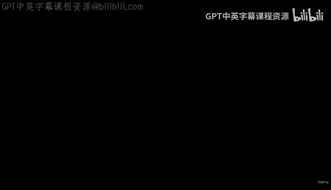
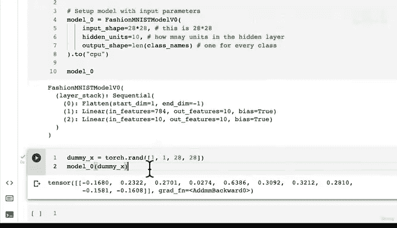

# Daniel Bourke《PyTorch 深度学习｜PyTorch 101 Crash Course For Beginners in 2025》中英字幕 - P105：105_05_009 模型0：构建双线性层基线模型.zh_en - GPT中英字幕课程资源 - BV1kTSKB1E9m

Welcome back So in the last video we got our data sets or our data set into data loaders。

 so now we have 1，875 batches of 32 images or for the training data set rather than 60。

000 in one big data set and we have 13 or 313 batches of 32 for the test data set。😊。

Then we learned how to visualize it from a batch。 And we saw that we have。Still the same image size。

1 color channel，28，28。 All we've done is we've turned them into batches so that we can pass them to our model And speaking of model。

 let's have a look at our workflow。 Where are we up to。 Well， we've got our data ready。

 We've turned it into tensess through a combination of torch vision transforms。

 Torch uils data dot data set。 We didn't have to use that one cause Torchvision do data sets。

 did it for us with the fashion Mnes data set。 But we did use that one。

 We did torch uils do data the data loader to turn our data sets into data loaders。

 Now we're up to building or picking a pretrained model to suit your problem。

 So let's start simply Let's build a baseline model。

 And this is very exciting because we're going to build our first model。

 our first computer vision model。 albeit a baseline， but that's an important step。

 So I'm just going to write down here。😊，When starting to build a series of machine learning。

Modeelling。Experiments。It's best practice to start with a baseline model。I'm going to turn this into。

Mockdown。A baseline model。So a baseline model。Is a simple model。You will try and improve upon。

With subsequent。Models。Models slash experiments。So you startt simply。In other words。

Start simply and add complexity when necessary， because neural networks are pretty powerful， right。

 And so they have a tendency to almost do too well on our data set。

 That's a concept known as overfitting， which we'll cover a little bit more later。

But we build a simple model to begin with a baseline。

 And then our whole goal will be to run experiments， According to the workflow。

 improve through experimentation。 Again， this is just a guide that's not set in stone。

 But this is the general pattern of how things go。 Get data ready。 build a model， fit the model。

 evaluate， improve the model。 So the first model that we build is generally a baseline。

 And then later on， we want to improve through experimentation。 So let's start building a baseline。

 But I'm going to introduce to you a new layer that we haven't seen before。

 that is creating a flatten layer。 Now， what is a flatten layer。 Well。

 this is best seen when we code it out。 So let's create a flatten model。

 which is going to be N N dot flatten。 And where could we find the documentation for this。

 We go N N flatten。😊，Flatten and pie torch， what does it do？

Flatens a continuous range of dims into a tensor for use with sequential。So there's an example there。

 but I'd rather， if in doubt， code it out。😊，So we'll create the flatten layer and of course。

 all NN dot flatten or NN dot modules could be used as a model on their own。So， we're going to get。

A single。Sample， so x equals train features batch。Let's get the first one zero。

 what does this look like？😊，So to ten生。X， maybe we get the shape of it as well。 X shape。

What do we get， There we go。 So that's the shape of X。

 Keep that in mind when we pass it through the flatten layer。

 Do you have an inkling of what flatten might do。So our shape to begin with is what，1，28，28。Now。

 let's。Flaten the sample。 So output equals。 We're going to pass it to the flatter model X。

 So this is going to perform the forwardd pass internally on the flatten layer。

So perform forward pass。Now， let's print out what happened。Print out what happened。Print。

Shape before flattening equals x dot shape。And we're going to print shape after flattening equals output dot shape。

 So we're just taking the output of the flat model and printing its shape here。Oh。

Do you notice what happened？Well， we've gone from 128，28 to 1784。Wow， what does the output look like？

Output， a。The values are now in all one big vector。 And if we squeeze that。

 we can remove the extra dimension。So you've got one big vector of values。 Now。

 where did this number come from？Well， if we take this and this is what shape is it。

 We've got colour channels， we've got height， we've got width。And now， we flattened it to be。

Color channels。Hight。With。So we've got one big。Feature vector because 28 by 28 equals what。

 we've got one value per pixel。7，8，4。One value per pixel in our output vector。Now。

 where did we see this before？If we go back to our keynote。

 if we have a look at Tesla's takes eight cameras， and then it turns it into a three dimensional vector space。

Vectctor space。 So that's what we're trying to do here。

 We're trying to encode whatever data we're working with In Tesla's case。 They have eight cameras。

 Now theirs has more dimensions than ours because they have the time aspect because they're dealing with video and they have multiple different camera angles。

 We're just dealing with a single image here。 But regardless， the concept is the same。

 We're trying to condense information down into a single vector space。

 And so if we come back to here， why might we do this？ Well。

 it's because we're going to build a baseline model。

 And we're going to use a linear layer as the baseline model。

 and the linear layer can't handle multidimensional data like this。

 We want it to have a single vector as input。 Now， this will make a lot more sense。

 after we've coded up our model。 So let's do that。From torch。Import N N。

We're going to go class fashion Mnist model V0。We're going to inherit from N N dot module。

 And inside here， we're going to have function in the constructor。 We're going to pass in self。

We're going to have an input shape。Which will use a type hint。

 which will take an integer because remember， input shape is very important for machine learning models。

We're going to define a number of hidden units， which will also be an integer。

 And then we're going to define our output shape， which will be。

 What do you think our output shape will be， How many classes are we dealing with。

We're dealing with 10 different classes， So our output shape will be。I'll save that for a later one。

I'll let you guess for now， or you might already know。 We're going to initialize it。

And then we're going to create our layer stack。Self dot layer stack equals N N dot sequential。

 Re that sequential。 whatever you put inside sequential， If data goes through sequential。

 it's going to go through it layer by layer。 So let's create our first layer。

 which is going to be N N dot flatten。So that means anything that comes into this first layer。

 what's going to happen to it。It's going to flatten its external dimensions here。

 So it's going to flatten these into something like this。So we're going to flatten it first。

 flatten our data。 Then we're going to pass in our linear layer。

And we're going to have how many in features。 This is going to be input shape。

Because we're going to define our input shape here。And then we're going to go。Out featuress。

Equals hidden units。And then we're going to create another linear layer here。

And we're going to set up in features equals hidden units， Why are we doing this？

And then out features equals output shape， Why are we putting the same out features here as the in features here？

Well， because subsequent layers。The input of this layer here。

Its input shape has to line up with the output shape of this layer here。

Hence why we use out features as hidden units for the output of this N end linear layer。

And then we use in features as hidden units for the input value of this hidden layer here。

So let's keep going。Let's go D will' create the forwardd pass here because if we subclass N end dot module。

 we have to override the forward method。The forwardd method is going to define what it's going to define the forwardd computation。

Of of our model。 So we're just going to return self dot layer stack。Of X。

 So our model is going to take some input X， which could be here X。

 in our case it's going to be a batch at a time。 And then it's going to pass each sample through the flatten layer。

 It's going to pass the output of the flatten layer to this first linear layer。

 Then it's going to pass the output of this linear layer to this linear layer。 So that's it。

 Our model is just two linear layers with a flatten layer。

 The flatten layer has no learnable parameters。 Only these to do。And we have no non nonlinearities。

 So do you think this will work。Does our data need nonlinearities？Well。

 we can find out once we fit our model to the data。But let's set up an instance of our model。

 So torch。Dot manual seed。Let's go。Set up model with input parameters。

So we have Model0 equals fashion MNt model。Which is just the same class that we wrote above。

And here's where we're going to define。The input shape equals 784。Where do I get that from。Well。

 that's here。That's 28 by 28， so the output of flatten needs to be the input shape here。

So we could put 28 by 28 there， or we're just going to put 784 and then write a comment here。

 This is 28 by 28。Now， if we go。I wonder if NN dot linearar will tell us。And then dot linear。

Will tell us what it expects as in features。Size of each input sample。Shape。

Where star means any number of dimensions， including none in features。Lia white。Well。

 let's figure it out。 Let's see what happens if， in doubt， code it out，h。We'll see what we can do。

Hiden units。Eals let's go with 10 to begin with。How many。Units in the hidden layer。

And then the output shape is going to be what？Output shape is length of class names。Which will be。

one。For every class。Beautiful， and now let's go model 0。

 We're going to keep it on the CPU to begin with。 We could write device agnostic code， but to begin。

 we're going to send it to the CPU。😊，I might just put that up here， actually， to CPU。

 and then let's have a look at Model 0。Wonderful。So we can try do a dummy forwardd pass and see what happens。

 so let's create dummy X。Equals torch。Rand will create it as the same size of an image。

Just a singular image。 So this is going to be a batch of one color Channel 1， height 28， height 28。

 And we're going to go model 0。And pass through dummy X。

 So this is going to send dummy X through the forwardd method。 Let's see what happens。Okay。

 wonderful。 So we get the output of 1，2，3，4，5，6，7，8，9，10 logits。 Beaiful。

 That's exactly what we want。 So we have one logit value per class that we have。 Now。

 what would happen if we。😊，Got rid of flatten。Then we ran this， ran this， ran this。 What do we get？

Oh， mat 1 and mat 2 shapes cannot be multiplied。So we have 28 by 28 and 7。 Okay。

 what happens if we change our input shape to 28？We're getting shape mismatches here。

What happens here， Oh， Okay， we get an interesting output。But this is still not the right shape。

 is it。So that's where the flatten layer comes in。 What is the shape of this？Oh， we get 1，1，28，10。

 Oh， so that's why we put in flatten so that it combines it into a vector。So we get rid of this。

 See if we just leave it in this shape。 We get 28 different samples of 10， which is not what we want。

 We want to compress our image into a singular vector and pass it in。

 So let's re instantsantiate the flatten layer。And let's make sure we've got the right input shape here。

 28 by 28。And let's pass it through。Torch size 110， that's exactly what we want， one loit per class。

So this can be a bit fiddly when you first start， but it's also a lot of fun once you get it to work。

 And so just keep that in mind， I showed you what it looks like when you have an error。😊。

One of the biggest errors that you're going to face in machine learning is。

Different tensor shape mismatches， so。Just keep in mind the data that you're working with and then have a look at the documentation for what input shape certain layers expect。

So with that being said， I think it's now time that we start moving towards training our model。

I'll see you in the next video。