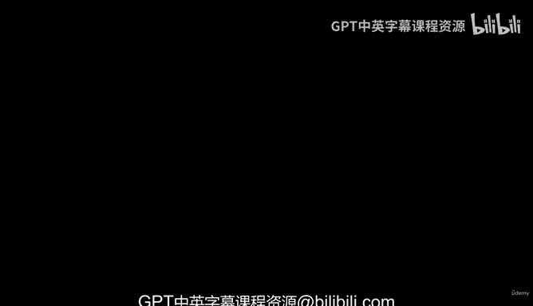
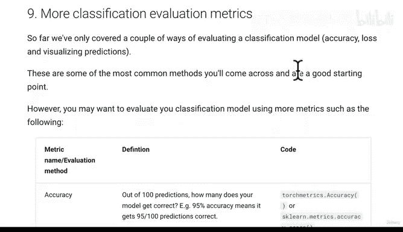
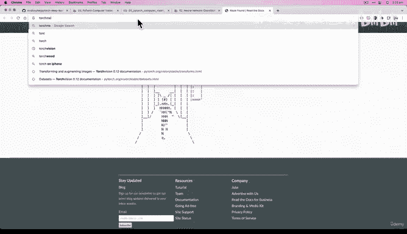
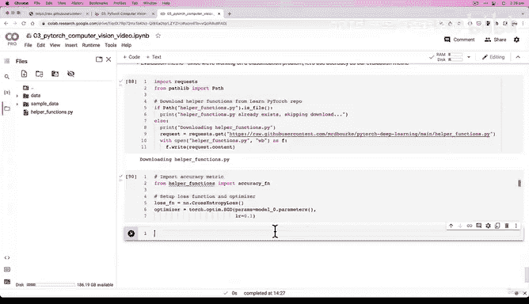

# Daniel Bourke《PyTorch 深度学习｜PyTorch 101 Crash Course For Beginners in 2025》中英字幕 - P106：106_05_010 为模型0创建损失函数与优化器.zh_en - GPT中英字幕课程资源 - BV1kTSKB1E9m

Welcome back。 In the last video， we created Model 0。

 which is going to be our baseline model for our computer vision problem of detecting different types of clothing in 28 by 28 grayscale images。

 And we also learned the concept of making sure our or we rehashed on the concept of making sure our input and output shapes line up with where they need to be。

 We also did a dummy Ford pass with some dummy data。

 this is a great way to troubleshoot to see if your model shapes are correct。

 if they come out correctly。 And if the inputs are lining up with where they need to be。

 And just to rehash on what our model is going to be or what's inside our model。

 if we check model 0 state di。😊，What we see here is that our first layer has a weight。Tensor。

 it also has a bias， and our next layer， has a weight tensor， and it also has a bias。 So these are。

 of course， initialized with random values。 But the whole premise of deep learning machine learning is to pass data through our model and use our optimizer to update these random values to better represent the features in our data。

 And I keep saying features， but I just want to rehash on that before we move on to the next thing。

 feature in data could be almost anything。 So， for example。

 the feature of this bag could be that it's got a rounded handle at the top。

 It has a edge over here it has an edge over there。 Now。

 we aren't going to tell our model what features to learn about the data The whole premise of it is to。

 or the whole fun。 the whole magic behind machine learning is that it figures out what features to learn。

😊，And so that is what the weights and bias matrices or tensors will represent is different features in our images。

 and there could be many because we have 60000 images of 10 classes。 So let's keep pushing forward。

 It's now time to set up a loss function and an optimizer。Speaking of optimizers， So 3。1。

 set up loss Opr and evaluation metrics。 Now， recall in notebook 2。

 I'm going to turn this into markdown。We created， oh， I don't need an emoji there。So。This is。

 by the way， we're just moving through this workflow。 We've got our data ready into tenses。

 We've built a baseline model。 It's now time to pick a loss function， and an optimizer。So。

If we go back to Google Chme， let's right here。Loss function。

 What's our loss function going to be Since we're working with multi class data， our loss function。

Will be N， N dot cross entropy loss。And our optimizer。We've got a few options here with the optr。

 but we've had practice in the past with S GD， which stands for storcchastic gradient descent and the atom optimizer。

 So our optimizer， let's just stick with S GD， which is kind of the。Entry level Opr， Torch Optim SGD。

For stochastic。Graient。Desent， and finally， our evaluation metric。Since we're working。

On a classification problem。Let's use accuracy as our。Evaluation。Metric。

So recall that accuracy is a classification evaluation metric。 Now， where can we find this， Well。

 if we go into learnpytorch。o， this is the beauty of having online reference material。😊，In here。

 neural network classification with pitorrch in this notebook Section 02， we created。

 Do we have different classification methods， Yes， we did。

 So we've got a whole bunch of different options here for classification evaluation metrics。

 We've got accuracy， precision， recall F1 score， a confusion matrix。 Now。

 we have some code that we could use。 If we wanted to use torch metrics for accuracy， we could。😊。

And torch metrics is a beautiful library that has a lot of evaluation， oh。😊，It doesn't exist。

 What happened in torch metrics。 Maybe I need to fix that。

Link。Torch metrics。Has a whole bunch of different pytor metrics。 So very useful library。

 But we also coded a function in here。Which is accuracy FM， so we could copy this。😊。

Straight into our notebook here。Or I've also， if we go to the Pi To Deep Learn Github。

 I'll just bring it over here。 I've also put it in helper functions Pi。 Now。

 this is a script of common functions that we've used throughout the course。

 including if we find accuracy function here。😊，Calculate accuracy。 Now。

 how would we get this helper functions file， this Python file into our notebook。

One way is to just copy the code itself straight here。 But let's import it as a Python script。

 So import requests。 Then we're going to go from part Lib import path。 So we want to download。

And this is actually what you're going to see。 very common practice in larger Python projects。

 especially deep learning and machine learning projects。

 is different functionality split up in different Python files。

 And that way you don't have to keep rewriting the same code over and over again。 Like。

 you know how we've written a training and testing loop a fair few times。 Well。

 if we've written it once and it works。 We might want to save that to a dot p file so we can import it later on。

 But let's now write some code to import this helper functions dot p file into our notebook here。

 So download。😊，Helper functions from Learn Pi Torch Repo。

So we're going to check if our helper functions。Got Pi If this already exists。

 we don't want to download it， so we'll print。Helper functions dot pi already exists。

Skipping download。Skipping download dot， dot dot。 And we're going to go elses here。

If it doesn't exist， so we're going to download it， downloading。Alba functions dot pi。

 And we're going to create a request here with the request library， Eagles requests。Dot get。 Now。

 here's where we have to pass in the URL of this file。 It's not this URL here。

 when dealing with Github。To get the actual URL to the files， many files。

 you have to click the raw button。 So I'll just go back and show you， click raw here。

 and we're going need to copy this raw URL here。 it's just text here。

This is what we want to download into our coabB notebook。And we're going to write it in there。

 request Eagleles requestquest do get。 and we're going to go with open。

And here's where we're going to save our helper functions stop high。We're going to write binary。

As file， F is for file， we're going to go F dot right request dot content。

 So what this is saying is Python is going to create a file called helpber functions dot pi and give it right binary permissions as F F is for file。

 short for file。 And then we're going to say F dot right。 Hey， request。

 get that information from helper functions dot pi here and write your content to this file here。

 So let's give that a shot。Beautiful， so downloading helper functions Stop Pi。

 let's have a look in here。😊，Do we have help a functions Stop high？Yes， we do。 Wonderful。

 So now we can import our accuracy function。 Where is it， There we go。 Import accuracy function。😊。

So this is very common practice when writing lots of Python code is to put helper functions into dot P scripts。

 So let's import the accuracy metric。Accur sesymmetric。From helper functions。

 of course we could have used torch metrics as well。 that's another perfectly valid option。

 but I just thought I'd show you what it's like to import your own helper function script。Of course。

 you can customize helper functions do pi to have whatever you want in there。 So see this。

 we've got from helper functions， import accuracy function。😊，Whats he saying could not be resolved。

 Is this going to work。It did。😊，And where you can go accuracy function， do we get a dock string？嗯。😊。

Seems like coab isn't picking things up， but that's all right。 It looks like it still worked。

 We'll find out later on if it actually works when we train our model。

 So set up loss function and optimizer。So I'm going to set up the loss function equals Nn dot cross entropy。

Loss， and I'm going to set up the optimizer here as we discussed before as torch dot optim dot Sgd for stochastic gradient descent。

 The parameters I want to optimize other parameters from model 0， our baseline model。

 which we had a look at before， which are all these random numbers。

 We'd like our optimizer to tweak them in some way shape or form to better represent our data。

 And then I'm going to set the learning rate here。 How much should they be tweaked each epoch。

 I'm going to set to 0。1。 nice and high because our data set is quite simple。 it's 28 by 28 images。

 there are 60000 of them。 But again， if this doesn't work。

 we can always adjust this and experiment experiment experiment。 So let's run that。

 we've got a loss function。 This is gonna give me a doc string。😊，There we go。

 So calculates accuracy between truth and predictions。 Now。

 where does this doctrine string come from， Well， let's have a look。 Hober functions。

That's what we wrote before。Good on ask for writing good dog strings。 accuracy function。 Well。

 we're going to test all these out in the next video when we write a training loop， so。😊，Oh。

 actually， I think we might do one more function before we write a training loop。

How about we create a function to time our experiments。

Yeah， let's give that a go in the next video。 I'll see you there。

