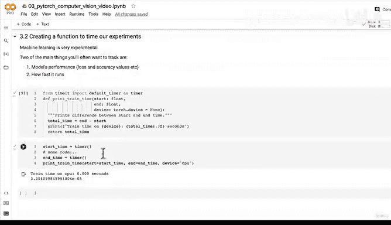

# Daniel Bourke《PyTorch 深度学习｜PyTorch 101 Crash Course For Beginners in 2025》中英字幕 - P107：107_05_011 创建模型代码计时函数.zh_en - GPT中英字幕课程资源 - BV1kTSKB1E9m

Welcome back。 In the last video， we downloaded our helper functions dot pi script and imported our accuracy function that we made in notebook 2。

 but we could really beef this up。 Our helpper functions dot pi file。

 We could put a lot of different helper functions in there and import them。

 So we didn't have to rewrite them。 That's just something to keep in mind for later on。😊。

But now let's create a function to time our experiments。

 So creating a function to time our experiments。 So one of the things。😊。

About machine learning is that it's very experimental。 You've probably gathered that so far。

So let's right here。Machine learning is very experimental。Two of the main things。

You'll often want to track。1， your model's performance， such as its loss and accuracy values。

Et cetera。 And two， how fast it runs。So usually you want a higher performance and a fast model。

 That's the ideal scenario。 However， you could imagine that if you increase your model's performance。

 you might have a bigger neural network， it might have more layers。 It might have more hidden units。

 It might degrade how fast it runs because you're simply making more calculations。

 So there's often a trade off between these two。 and how fast it runs will really be important。

 if you're running a model， say on the Internet or say on a dedicated GPU or say on a mobile device。

 So these are two things to really keep in mind。 So because we're tracking our model's performance with our loss value in our accuracy function。

 let's now write some code to check how fast it runs。 And I did on purpose above。

 I kept our model on the CPU。😊，So we're also going to compare later on how fast our model runs on the CPU versus how fast it runs on the GPU。

 So that's something that's coming up。 Let's write a function here。

We're going to use the time module from Python。 So from timeE import the default timer。

 as I'm going to call it timer。 So if we go Python default timer。

 do we get the documentation for here we go。Time it。So do we have default timer？Wonderful。

 so the default timer， which is always timed up Perth counter。

 You can read more about Python timing functions in here。😊，But this is essentially just going to say。

 hey， this is the exact time that our code started。 And then we're going to create another。

Stop for when our code stopped， and then we're going to compare the start and stop times and that's going to basically be how long our model took to train。

So we're going to go de print train time。This is just going to be a display function。 So start。

 we're going to get the float type hint， by the way。Start an end time。

 So the essence of this function will be to compare start and end time。

 And we're going to set the torch or the device here or pass this in as torch dot device。

 And we're going to set that default and none because we want to compare how fast our model runs on different devices。

So I'm just going to write a little dock string here， Prince。Difference。Between start and end time。

And then， of course， we could add more there for the arguments。 But that's a quick one liner。

 Tell us what our function does。 So total time equals n minus start。 and then print。

 We're going write here。 train time on。Whichever device we're using might be CPU， might be GPU。

 total time equals。We'll go to three and we'll say seconds， three decimal places that is。

 and return total time。Beautiful， so， for example， we could do。Start time equals。Timer。

 and then end time。Equals timer。And then we can put in here， some code。Between those two。

 And then if we go print。Train， oh， maybe we need timer like this。We'll find out， if in doubt。

 code it out， you know。We'll see if it works。Start es。Start time。And n equals end time。

And device equals， we're running on the CPU right now。CPU， let's see if this works。Wonderful。

 so it's a very small number here。😊，So train time on CPU。

Very small number because the start time is basically on this exact line。

Comment basically takes no time to run。 then M time is on here。 We get。3。

304 times 10 to the power of negative 5。 So quite a small number。

 But if we put some modeling code in here， it's going to measure the start time of。This cell。

 it going to model our code in there。 Then we have the end time。

 and then we find out how long our model took the train。 So with that being said。

 I think we've got all of the pieces of the puzzle。For creating some training and testing functions。

So we've got a loss function。 We've got an optimizer。 We've got a evaluation metric。

 We've got a timing function。 We've got a model。 We've got some data。

 How about we train our first baseline computer vision model in the next video。😊。

I'll see you there。