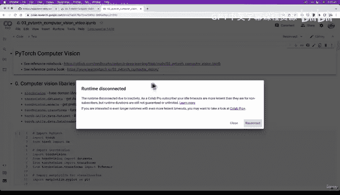
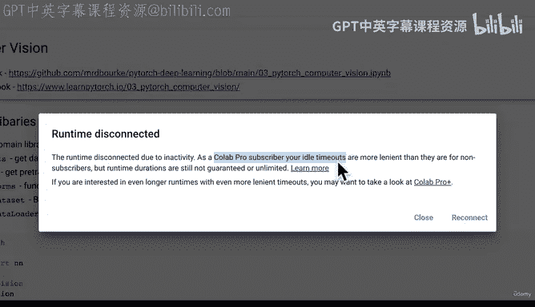
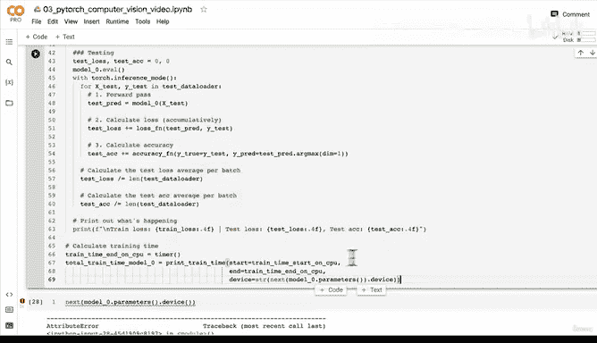
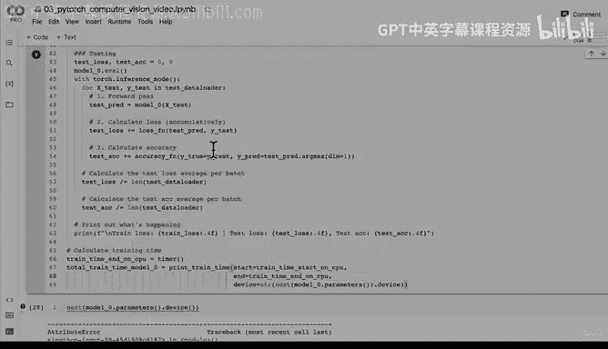

# Daniel Bourke《PyTorch 深度学习｜PyTorch 101 Crash Course For Beginners in 2025》中英字幕 - P108：108_05_012 编写批次数据训练测试循环.zh_en - GPT中英字幕课程资源 - BV1kTSKB1E9m

Good morning。 Well， might not be morning wherever you are in the world。It's nice and early here。

 I am up recording some videos because we have a lot of momentum going with this。 But look at this。

 I took a little break last night。 I have a runtime disconnected。

 but this is just what's going to happen if you're using Google Coab since I use Google Coab Pro。😊。

Completely unnecessary for the course， but I just found it worth it for how much I use Google coabab。

 I get longer idle timeouts。 So that means that my coab notebook will stay persistent for a longer time。

 But of course， overnight， it's going to disconnect。 So I click reconnect。

 And then if I want to get back to wherever we were。

 because we downloaded some data from Torchvision dot data sets， I have to rerun all of these cells。

 So a nice shortcut we've might have seen this before， is to just come down to where we were。

 And if all the code above works。 Oh there we go。 I wrote myself some notes of where we're up to。😊。

Let's go run before。 So this is going to run all the cells above。 And we're up to here，3。

3 creating a training loop and training a model on batches of data。

 So that's going to be a little bit interesting。 And I wrote myself another reminder here。

 This is a little bit of behind the scenes。 The optimizer will update a model's parameters once per batch rather than once per epoch。

😊，So let's hold myself to that note and make sure I let you know。So， we'll go。

Make another title here。Let's go creating a training loop and training a model on batches。Of data。

So something a little bit different to what we may have seen before if we haven't created batches of data using data loader and recall that just up above here。

We've got。Something like 1800 dead， There we go。 So we've split our data into batches rather than our model looking at 60000 images of fashion Mnes data at one time。

It's going to look at 1875 batches of 32， So 32 images at a time。

Of the training data set and 313 batches of 32 of the test data set。

 So let's go to training loop and train our first model。 so I'm going to write out a few steps。

 actually。Because we have to do a little bit differently to what we've done before。 So one。

 we want to loop through epochs。 So a number of epochs loop through training batches。 And by the way。

 you might be able to hear some birds singing。 The sun is about to rise。

 I hope you enjoy them as much as I do。😊，So we're going to perform training steps。

And we're going to calculate， calculate the train loss per batch。

So this is going to be one of the differences between our previous training loops。

And this is going to after number two， we're going to loop through the testing batches。

 so we'll train and evaluate our model at the same。Step or same loop。

And we're going to perform testing steps。😊，And then we're going to calculate the test loss。

Per batch as well。Per batch。Wonderful。4， we're going to， of course， print out what's happening。

You may have seen the unofficial Pytorch optimization loop theme song。

 and we're going to time it all for fun， of course， because that's what our timing function is for。😊。

So let's get started。😊，There's a fair few steps here， but nothing that we can't handle。

 And remember the motto， if and doubt， code it out。Or there's not one， if in doubt， run the code。

 but we haven't written any code to run just yet。So we're going to import TQDM for a progress bar。

 If you haven't seen TQDM before， it's a very good Python progress bar。

That you can add with a few lines of code。 So this is just the Gitthour's open source software。

 One of my favorite pieces of software。And it's going to give us a progress bar to let us know how many epochs our training loop has gone through。

It doesn't have much overhead， but if you want to learn more about it。

 please refer to the TQDM Github。 However， the beautiful thing is that Google Coab has TqDM built in because it's so good and so popular。

 So we're going to import from T QDM do auto。 So there's a few different types of T QDm progress bars do auto is just going to recognize what compute environment we're using。

 and it's going to give us the best type of progress bar for what we're doing。 So， for example。

 Google Coabab is running a Jupiter notebook behind the scenes。

 So the progress bar for Jupiter notebooks is a little bit different to Python scripts。😊。

So now let's set the seed and start the timer。We want to write all of our training loop in this single cell here。

And then。Once it starts， once we run this cell， we want the timer to start so that we can time how long the entire cell takes to run。

So， we'll go。Train time。 Start on CPU。Equals we set up our timer before。Beautiful。

Now we're going to set the number of epochs。Now， we're going to keep this small for faster training time so we can run more experiments。

 so。We'll keep this small for faster。Training time。 That's another little tidbit。

 Do you notice how quickly all of the cells ran above。 Well。

 that's because we're using a relatively small data set。In the beginning。

 when you're running experiments， you want them to run quite quickly so that you can run them more often so you can learn more about your data so that you can try different things。

 try different models。So this is why we're using number of epochs equals3。

We start with three so that our experiment runs in 30 seconds or a minute or so that way。

 if something doesn't work， we haven't wasted so much time waiting for a model to train。Later on。

 we could train it for 100 epochs if we wanted to。So we're going to create a training and test loop。

 So for epoC in TQDM range epochs。Let's get this going。 So for TQDM to work。

 we just wrap our iterator with TQDM and you'll see later on how this tracks the progress。

So I'm going to put out a little print statement here。We'll go epoch。

 and this is just going to say what epoch we're on。There we go here。

That's something that I like to do quite often is put little print statements here and there so that we know what's going on。

 So let's set up the training。 We're going to have to instantiate the train loss。

 We're going to set that to 0 to begin with。 And we're going to cumulatively add some values to the train loss here。

 And then we'll see later on how this accumulates， and we can calculate the training loss per batch。

Let's what we're doing up here， calculate the training loss per batch。

 and then finally at the end of the loop we will divide our training loss by the number of batches so we can get the average training loss per batch and that will give us the training loss per epoC。

Now that's a lot of talking if that doesn't make sense。 remember， if in doubt， code it out。

 So add a loop to loop through the training batches。So because our data is batchrified now。

 and I've got a crow or maybe a cookaberer sitting on the roof across from my apartment。

 It's our singing its song this morning。😊，Lovely。So we're going to loop through our training batch data。

 So I've got four batch comma X Y， because remember our training batches come in the form of X。

 So that's our data or our images and Y， which is label， you could call this image。

Label or target as Py touch would。 But it's convention to often call your features X and your labels Y。

 We've seen this before。And we're going to enumerate the train data loader as well。

We do this so we can keep track of the number of batches we've been through。

 so that will give us batch there。We're going to set Model 0 to training mode。

Because even though that's the default， we just want to make sure that it's in training mode。

Now we're going to do the forward pass， if you remember。

 what are the steps in App to optimization loop？We do the forwardd pass。 We calculate the loss。

 Op 0 grad， loss backwards， optimizer step， step， step。So let's do that， hey， Model 0。

 We'll put the features through there， and then we're going to calculate the loss。😊。

We've been through these steps before， so we're not going to spend too much time on the exact steps here。

But we're just going to p writing them out。 And， of course， later on， you might be thinking， Daniel。

 how come we haven't functionised this training loop already。

 We've seen to write the same generic code over and over again。 Well。

 that's because we like to practice writing Pytorch code， right。

We're going to functionise them later on。 Don't you worry about that。

 So here's another little step that we have in number four is we have the training loss。

 And so because we've set that to0 to begin with， we're going to accumulate the training loss values every batch。

 So we're going to just add it up here。 And then later on。

 we're going to divide it by the total number of batches to get the average loss per batch。

So you see how this loss calculation is within the batch loop here。

So this means that one batch of data is going to go through the model。

 and then we're going to calculate the loss on one batch of data。

 And this loop is going to continue until it's been through all of the batches in the train data loader。

 So 1875 steps or whatever there was。So accumulate。Train loss。And then we're going to。

Optimize zero grad。Optimr dot。0ero grand。And then number four is what loss backward。Loss backward。

 we'll do the back propagation step。 and then finally， we've got number5， which is optimizer step。

So this is where I left my little note above。To remind me and to also let you know。

 highlight that the optimizer will update a model's parameters once per batch rather than once per epoch。

 So you see how we've got a four loop inside our epoch loop here。So the batch loop。

So this is what I meant that the optimizer， this is one of the advantages of using mini batches is not only is it more memory efficient because we're not loading 60。

000 images into memory at a time。 We are updating our models parameters once per batch。

Rather than waiting for it to see the whole data set with every batch。

 our model is hopefully getting slightly better。So that is because the optimizer dot step call is within the batch loop rather than the epoch loop。

So let's now print out what's happening。Print out what's happening。So if batch。

 let's do it every 400 or so batches， because we have a lot of batches。

 We don't want to print out too often。 Otherwise， we'll just fill our screen with numbers。

 That might not be a bad thing。But 400 seems a good number。

 That'll be about 5 print ouns if we have 2000 batches。So， print。Looked at。 And， of course。

 you can adjust this to whatever you would like。 That's the flexibility of py torch。

 flexibility of Python as well。 So looked at how many samples have we looked at。

 So we're going to take the batch number， multiply it by x。 The length of x is going to be32。

 because that is our batch size。Then we're going to just write down here， the total number of。

Items that we've got in our data set and we can access that by going train data loader do data。

 So that's going to give us length of the data set contained within our train data loader。

 which is you might be able to guess 60，000 or should be。Now。We have to。

 because we've been accumulating the train loss。This is going to be quite high because we've been adding every single time we've calculated the loss。

 We've been adding it to the train loss， the overall value per batch。

 So now let's adjust if we wanted to find out， see how now we've got this line we're outside of the batch loop We want to adjust our training loss to get the average training loss per batch per epoch So we're coming back to the epoch loop here。

 a little bit confusing。 but you just line up where the loops are。

 and this is going to help you figure out what context you're computing in。

 So now we are in the epoch loop。So， divide。Total train loss by length of train data loader。

Oh this is so exciting training our biggest model yet。 So train loss equals。😊，Or divide equals。

 We're going to reassign the train loss。 We're going to divide it by the length of the train data loader。

 So why do we do this， Well， because we've accumulated the train loss here。

For every batch in the train data loader， but we want to average it out across how many batches there are in the train data loader。

So this value will be quite high until we readjust it to find the average loss per epoch because we are in the epoch loop。

All right， fair few steps going on， but that's all right。

 We'll figure this out or watch it happening in a minute。 Let's code up the testing loop。So testing。

 what do we have to do for testing？Well， let's set up a test loss variable。

Why don't we do accuracy for testing as well， Did we do accuracy for。Tining。

We didn't do accuracy for training， but that's all right。 We'll stick to doing accuracy for testing。

We'll go Model0 dot。A vow will put it in evaluation mode。And we'll turn on our inference mode。

 context manager。With torch dot inference mode。 Now， we'll do the same thing for X。

 Y in test data loader。 We don't need to keep track of the batches here again in the test data loader。

 So we'll just loop through X。 So features， images and labels in our test data loader。

We are going to do the forward pass。Because the test loop， we don't have an optimization step。

 we are just passing our data through the model and evaluating the patterns it learned on the training data。

So we're going to pass in X here。This might be a little bit confusing。Let's do this X test， Y test。

That way， we don't get confused with our X above。For the training set。

 now we're going to calculate the loss。Acuulully might smell that wrong have to sound that out。

What do we have here so we've got our test loss variable that we just assigned to zero above。😊。

Just up here。 So we're going to do test loss plus equals。 We're doing this in one step here。

 Test pre， Y test。 So we're comparing our test prediction to our Y test labels， our test labels。

Now we're going to back out of the for loop here。Because that's all we have to do the forward pass and calculate the loss for the test data set。

Oh， I said we're going to calculate the accuracy。Silly me。 So calculate accuracy。Let's go test act。

And we got plus equals。We can bring in our accuracy function here。

 That's what we downloaded from our helper functions do P before。😊，Why true equals y test。

 And then y pre equals test Pre dot arg max dimm equals 1。 Why do we do this？ Well。

 because recall that the outputs of our model， the raw outputs of our model are going to be logits。

And our accuracy function expects our true labels and our predictions to be in the same format。

If our test pre is just logits， we have to call Argmax to find the logit value with the highest index。

 and that will be the prediction label。 And so then we're comparing labels。To labels。

 that's what the Agmax does here。So we can back out of the batch loop now。

 and we're going to now calculate。Calculate。The test loss。Average。Per batch。 So let's go here。

Test loss。Divide equals， length test data loader。 So because we were in the context of the loop here of the batch loop。

Our test lost and test accuracy values are per batch and accumulated every single batch。

 So now we're just dividing them by how many batches we had。

Test data loader and the same thing for the accuracy， calculate the a or test a average。Per batch。

 So this is giving us test loss and test accuracy per epoch Test a divided equals length。

Test data loader。 wonderful。 we're so close to finishing this up。

 And now we'll come back to where's our epoch loop。😊。

We can these lines are very helpful in Google Co Lab， we scroll down。I believe if you want them。

 you can go settings or something like that。 Yes， settings。

 that's where you can get these lines from if you don't have them。 So print out what's happening。

We are going to print F equals n。 let's get the train loss in here。

Train loss and we'll print that to four Simal places。And then we'll get the test loss， of course。

Test loss and we'll go， we'll get that to four decimal places as well， and then we'll get the test a。

Test accuracy。 We'll get that to。4 decimal places as well。For F。Wonderful。And then finally。

 one more step is to。 Oh， we've written a lot of code in this video。

 We want to calculate the training time， because that's。😊，Another thing that we want to track。

 we want to see how long our model is taken to train。 So train time end on CPU。😊。

Is going to equal the timer。 And then we're going to。Get the total train time。

 model 0 so we can we'll set up a variable for this so we can compare our modeling experiments later on。

 We're going to go print train time， start equals。Train time。 Start on CPU。Andd eles。

Train time and on CPU。And finally， the device is going to be string next， Model 0 dot。

Pararameterters， so we're just， this is one way of checking where our model zero parameters live。So。

Beautiful， all right。Have we got enough brackets there， I don't think we do。Okay， there we go。ho。

I'll just show you what the output of this is。 So next， model 0 dot parameters。

What does this give us。Oh， can we go device here？Oh。What do we have here？Model 0， thought parameters。

 I thought this was a little trick。And then if we go， next。Prameter containing。

I thought we could get。Device， oh， there we go。 Excuse me。That's how we get it。

 That's how we get the device that it's on。 So let me just turn this。

This is what the output of that's going to be。SepU， that's what we're after。

So troubleshooting on the fly here。 Hopefully all of this code works。

 So we went through all of our steps。 So we're looping through epochs at the top level here。😊。

We looped through the training batches perform the training steps。

 So our training loop forward pass loss calculation， optimizer 0 grad loss backwards。

 calculateulate loss per batch， accumulate those。 We do the same for the testing batches except without the optimizer steps。

 we print out what's happening。 and we time it all for fun。 a fair bit going on here。

 But if you don't think there's any errors， Give that a go， run that code。

 I'm going leave this one on a cliff hanger。 And we're going to see if this works in the next video。

😊。

I'll see you there。😊。

