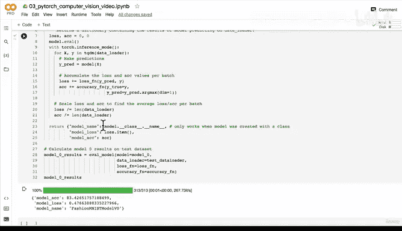
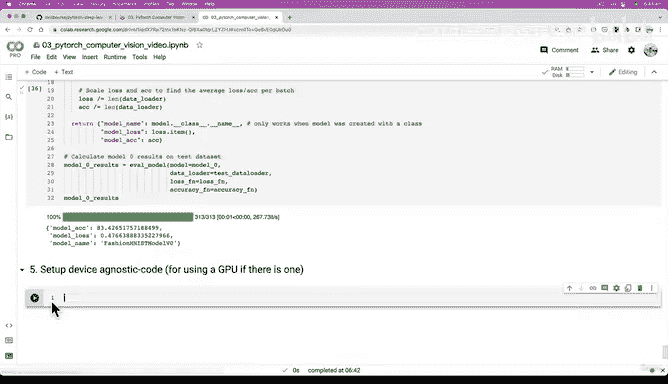

# Daniel Bourke《PyTorch 深度学习｜PyTorch 101 Crash Course For Beginners in 2025》中英字幕 - P109：109_05_013 编写模型结果评估函数.zh_en - GPT中英字幕课程资源 - BV1kTSKB1E9m

Welcome back。 the last video was pretty full on。 We did a fair few steps。

 but this is all good practice。 The best way to learn P torch code is to write more pin toch code。

 So did you try it out。😊，Did you run this code， Did it work， Did we probably have an error somewhere。

Well， let's find out together already， let's train our biggest model yet in three， two， one boom。😊。

Oh， of course we did。 What do we have， What's going on。Indentation error， classic so。

Print out what's happening。 Do we not have an indent there。Oh。

 is that not in line with where it needs to be。Excuse me， okay。Why is this not in line？

 So this is strange to me， enter， How did this all get。Off by one。I'm not sure。

 but this is just what you'll face。 Like sometimes you'll write this beautiful code that should work。

 But the main error of your entire code is that it's off by a single space。

 I'm not sure how that happened， but we're just gonna。Pull this all in the line。

We could have done this by selecting it all， but we're going to do it line by line just to make sure that everything's in the right order。

😊，Beautiful， and。We print out what's happening， ready， three， two， one， round two。We're going okay。

 so this is the progress bar I was talking about look at that how beautiful is that oh we're going quite quickly through all of our samples I need to talk faster。

😊，Oh， there we go， we got some good results， we've got the test， the train loss， the test loss。

 and the test accuracy is pretty darn good。😊，Oh my goodness， this is a good baseline already。😊，67%。

 So this is showing us it's about 7 seconds per iteration。

 Remember TQDM is tracking how many epochs we're going through。

 So we have three epochs and our print statement is just saying， hey。

 we've looked at zero out of 60000 samples。 Then we looked at 12000 out of 60000 samples。😊。

And we finished on on epoch 2 because it's 0 indexed and we have a train loss of 0。

4550 and test loss 4766 and a test accuracy，834265 and a training time about just over 21 seconds or just under 22。

 So keep in mind that your numbers may not be the exact same as mine。

 They should be in the same realm as mine， but due to inherent randomness of machine learning。😊。

Even if we set the manual seed might be slightly different。

 so don't worry too much about that and what I mean by in the same realm。

 if your accuracy is 25 rather than 83 well then it's probably something's wrong there。

 but if it's 83。6 well then that's not too bad and the same with the train time on CPU this will be heavily dependent how long it takes to train will be heavily dependent on the hardware that you're using behind the scenes。

So I'm using Google Coab Pro。 Now that may mean I get a faster CPU than the free version of Google Coab。

 It also depends on what CPU is available in Google's。

Computer warehouse where Google CoLab is hosting。Of how fast this will be。 So just keep that in mind。

 if your time is 10 times that， then there's probably something wrong。

 If your time is 10 times less than that， well， hey。

 keep using that hardware because that's pretty darn good。 So let's keep pushing forward。

 This will be our baseline that we try to improve upon。 So we have an accuracy of 83。5。

 And we have a train time of 20 or so seconds。 So we'll see what we can do with a model on the GPU letter and then also later on a convolutional neural network。

 So let's evaluate our model。 Where are we up to。😊。

What we just did we built a training loop so we've done that that was a fair bit of code。

 but now we're up to we fit the model to the data and make a prediction。

 let's do these two combined hey， we'll evaluate our model。😊，So we'll come back。

 number four is make predictions。And get model0 results。

Now we're going to create a function to do this because we want to build multiple models。

 and that way we can， if we have， say， model 0，1，2，3。

 we can pass it to our function to evaluate that model， and then we can compare the results later on。

😊，So that's something to keep in mind if you're going to be writing a bunch of code multiple times。

 you probably want to functionise it and we could definitely do that for our training and lost loops。

 but we'll see that later on， So let's go de aval model。

 So evaluate a given model we'll pass it in a model which will be a torch do N dot module or of type and we'll pass it in a data loader which will be of type。

😊，Torch。utils。dat data loader。And then we'll pass in a loss function。

So that it can calculate the loss， we could pass in an evaluation metric if we wanted to track that too。

 so this will be torch and end dot module as well。 and then oh， there we go。

Speaking of an evaluation function， let's pass in our accuracy function as well。😊，And I don't want L。

 I want that。 So we want to returns。A dictionary containing。

The results of model predicting on data loader。So that's what we want。

We're going to return a dictionary of model results that way we could call this function multiple times with different models and different data loaders and then compare the dictionaries full of results depending on which model we passed in here。

So let's set up loss and accuracy equals 00。 We'll start those off。We'll go。

 this is going to be much the same as our testing loop above， except it's going to be functionalised。

 and we're going to return a dictionary。So we'll turn on on our context manager for inferencing。

With torch do inference mode， now we're going to loop through the data loader and we'll get the x and Y values。

 So the x will be our data。 The Y will be our ideal labels。We'll make predictions with the model。

 in other words， do the forward pass。So we'll go Y pre equals model on X。 Now。

 we don't have to specify what model it is because we've got the model parameter up here。 So this is。

 we're starting to make our functions here or this function generalizable。

 so it could be used with almost any model in any data loader。So we want to accumulate。

The loss and accuracy values per batch because this is within the batch loop here per batch。

And then we're going to go loss plus equals loss function We'll pass it in the ypre and the y the true label and we'll do the same with the accuracy。

 so except this time we'll use our accuracy function we'll send in y true equals y and ypre equals ypre arg maxax because the raw outputs of our model are logits and if we want to convert them into labels。

 we could take the softmax for the prediction probabilities but we could also take the argmax and just by skipping the softmax step。

 the argmax will get the index where the highest value Loitt is。Dim equals1。

And then we're going to make sure that we're still within the context manager here。

 So with torch inference mode， but outside the loop。So that'll be this line here。 We're going to。

Scale the loss and a to find the average loss。Slash act per batch。So， loss。Or divide and assign。

To the length of the data loader。 So that'll divide and reassign it to however many batches are in our data loader that we pass into our of our model function。

 Then we'll do the same thing for the accuracy here， length data loader。Beautiful。

 and now we're going to return a dictionary here。 So return。

We can return the model name by inspecting the model。 We'll get an attribute of the model。

 which is its class name。I'll show you how you can do that。😊。

So this is helpful to track if you've created multiple different models and given them different class names。

 you can access the name attribute。So。This only works when model was created with a class。

 So you just have to ensure that your models have different class names if you want to do it like that。

 because we're going to do it like that， we can set the model name to be its class name。

We'll get the model loss， which is just this value here after it's been scaled。

 we'll turn it into a single value by taking dot item and then we'll go model dot arc or we'll get model underscore a for the model's accuracy。

 We'll do the same thing here。Ac， I don't think we need to take the the item because accuracy comes back in a different form。

We'll find out。 if and down， code it out。So calculate Model0 results on test dataset。

 and I want to let you know that you can create your own functions here to do almost whatever you want。

 I've just decided that this is going to be helpful for the models and the data that we're building。

 but keep that in mind that your models， your data sets may be different or will likely be different in the future。

 So you can create these functions for whatever use case you need。😊，Model 0。Results。

Equals a vow model。 So we're just going to call our function that we've just created here。

 Model is going to equal model 0。The data loader is going to equal what。The test data loader。

 of course， because we want to evaluate it on the test data set and we're going to send in our loss function。

 which is loss function that we assigned above just before our training loop。So if we come up here。

A loss function is up here。And then if we go back down。We have our accuracy function。

Is equal to our accuracy function。 We just pass another function in there。 beautiful。

 And let's see if this works。 Model 0 results。 Did you see any typos likely。😊，Or errors in our code。

 How do you think ourm model did， Well， let's find out。Oh there we go。 We got model accuracy。

 You see how we could reuse this dictionary later on。 So if we had Model 1 results， Model 2 results。

 we could use these dictionaries and compare them altogether。 So we've got our model name。

 our version 0 of the model has an accuracy of 83。42 and a loss of 。47 on the test data loader Again。

 your numbers may be slightly different， they should be in the same realm。

 But if they're not the exact same， don't worry too much。 if they're 20 accuracy points less。

 and the loss is 10 times higher， then you should probably go back through your code and check if something is wrong。

 And I believe if we wanted to do a progress bar here。 could we do that T Q D M。😊，Let's have a look。

 okay。Oh， look at that。Progress bar。 that's very nice。

 so that's nice and quick because it's only on 313 batches。 It goes quite quick。😊，So， now。

What's next。 Well， we've built Model 1。 We've got a Model 0。 sorry， I'm getting ahead myself。

 We've got a baseline here。 We've got a way to evaluate our model。 What's our workflow， say。

 So we've got our data ready。 We've done that。 We've picked or built a model。

 We've picked a loss function。 We've built an optimizer。 We've created a training loop。

 We've fit the model to the data。 we've made a prediction。

 We've evaluated the model using loss and accuracy。 We could evaluate it by making some predictions。

 but we'll save that for later on。 As in visualizing some predictions。😊。

I think we're up to improving through experimentation。😊，So let's give that a go， Hey。

 do you recall that we trained Model zero on the CPU？😊。

How about we build Model1 and start to train it on the GPU？So in the next section。

 let's create number 5 is set up device agnostic code。

 So we've done this one together for using a GPU if there is one。

So my challenge to you for the next video is to set up some device agnostic code。

 so you might have to go into coLab if you haven't got a GPU active。

 change runtime type to GPU and then because it might restart the runtime you might have to rerun all of the cells above so that we get our helper functions file back and the data and whatnot。

 so set up some device agnostic code and I'll see in the next video。

