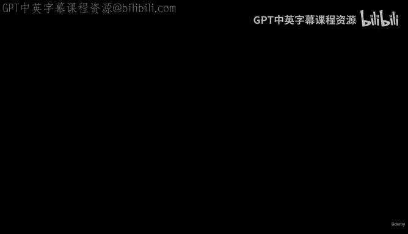
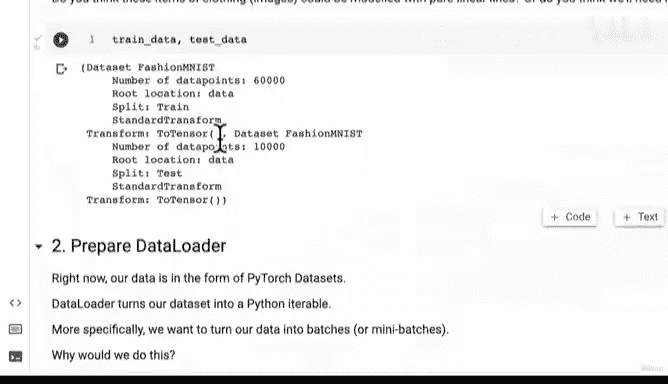
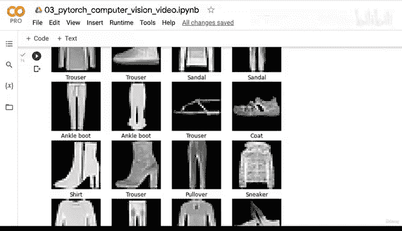
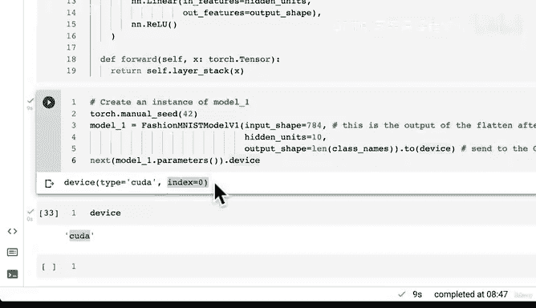

# Daniel Bourke《PyTorch 深度学习｜PyTorch 101 Crash Course For Beginners in 2025》中英字幕 - P111：111_05_015 模型1：创建含非线性函数的模型.zh_en - GPT中英字幕课程资源 - BV1kTSKB1E9m

Hello， everyone， and welcome back。 We are making some terrific progress。

 Let's see how far we've come。 We've got a data set。 We've prepared our data loaders。

 We've built a baseline model， and we've trained it， evaluated it。 Now it's time all。

 And the last video， we set up device agnostic code。 But where are we in our little framework。

 We're up to improving through experimentation。 And quite often。

 that is building a different model and trying it out。 It could be using more data。

 It could be tweaking a whole bunch of different things。 And so let's get intoencoding。

 I'm going to write it here。😊，Model 1， I believe it up to section 6。 Now。

 Model 1 is going to be building a better model with non linearity so。

I issued you the challenge in the last video to give it a go to try and build a model with linearity。

 I hope you gave it a go。 because if anything that this course。

 I'm trying to impart on you in this course， it's to give things a go to try things out because that's what machine learning and codingd is all about。

 trying things out， giving it a go。 But let's write down here。

 We learned about the power of non linearity。😊，In notebook O2。So if we go to the Learnne Pytorch。

o book， we go to section number two。We'll just wait for this to load。 And then if we come down here。

 we can search for non linearity。The missing piece， nonlinearity。

 So I'm going get this and just copy that in there if you want to see what nonlinearity helps us do。

 it helps us model nonlinear data and in the case of a circle， can we model that with straight lines。

 In other words， linear lines recall linear means straight nonlinear means nons straight And so we learned that through the power of linear and nonlinear functions。

 neural networks can model almost any kind of data if we pair them in the right way。

 So you can go back through and read that there， but I prefer to code things out and try it out on our data So let's create a model with nonlinear and linear layers。

😊，But we also saw that our model with just linear layers can model our data。

 it's performing quite well。So that's where the experimentation side of things will come into play。

 Sometimes you won't know what a model will do， whether it will work or won't work on your data set。

 But that is where we try different things out。 So we come up here。 We look at our data。

 That looks actually quite linear to me as a bag。 Like it's just some straight lines。

 You could maybe model that with just straight lines。

But there are some things which you could potentially classify as nonlinear in here。

It's hard to tell without knowing。 So let's give it a go。 Let's write a nonlinear model。

 which is going to be quite similar to Model 0 here。

 except we're going to intersperse some re layers in between our linear layers。

So recall that ReLou is a nonlinear activation function and Relu。Has the formula。

 if something comes in and it's a negative value， Reou is going to turn that negative into a zero and if something is positive。

 Relu is just going to leave it there。😊，So let's create another class here。Fashion Mness model。V1。

 and we're going to subclass from N N dot module。 beautifuli。

 And then we're going to initialize our model。 This is going to be quite the same as what we created before。

 We want an input shape。😊，And that's going to be an integer。

 And then we want a number of hidden units， and that's going to be an end here。

 And then we want an output shape。And。And I want to stress as well that although we're creating a class here with these inputs。

 classes are as flexible as functions。 So if you need different use cases for your modeling classes。

 just keep that in mind that you can build that functionality in。Self dot layer stack。

 We're going to spell layer stack correctly， and we're going to set this e to Nn dot sequential because we just want a sequential set of layers。

The first one's going to be N N dot flatten， which is going to be flatten inputs into。

A single vector。And then we're going to go Nn dot linearar because we want to flatten our stuff because we want it to be the right shape。

 if we don't flatten it， we get shape issues。Input shape and then the out features of our linear layer is going to be the hidden units。

Hidden units。I'm just going to make some code cells here so that way。

Code goes into the middle of the screen。Then here is where we're going to add a nonlinear layer。

 So this is where we're going to add in a re function and where might we put these， Well。

 generally you'll have a linear function followed by a nonlinear function in the construction of neural networks。

 However neural networks are as customizable as you can imagine whether they work or not is a different question So we'll go output shape here。

As the out features， oh， do we mess this one up？ Yes， we did。 This needs to be hidden units。

And why is that。Well， it's because the output shape of this linear layer here needs to match up with the input shape of this linear layer here。

 The Re layer won't change the shape of our data。And you could test that out by printing the different shapes if you'd like。

And then we're going to finish off with another nonlinear layer at the end。Really。Now。

 do you think that this will improve our model's results or not？Well。

 it's hard to tell without trying it out， right， So let's continue building our model。

 We have to override the forwardd method。Self X is going to be。 we'll give a tie hint here。

 This is going to be a torch tensor as the input。 And then we're just going to return what's happening here。

 We'll go self。Dot layer stack X。 So that just means that x is going to pass through our layer stack here。

 And we could customize this。 We could try it just with one nonlinear activation。

This is actually our previous network， just with those commented out。

 all we've done is added in two Re functions。And so I'm going to run that。Beautiful。

 and so what should we do next。Well， we shouldn't instantiate it。 but previously。

 we ran our last model， Model 0 on if we go parameters。Do we run this on the GPU or the CPU。

On the CPU。 So how about we try out our fashion Mnes model V1 running on the device that we just set up。

 which should be Kuda。Wonderful， so we can instantiate。 so create an instance of model 1。

 So we want Model 1， or actually， we'll set up a manual seed here so that。😊。

Whenever we create a new instance of a model， it's going to be instantiated with random numbers。

We don't necessarily have to set a random seed， but we do so anyway so that our values are quite similar on your end and my end。

 inputput shape is going to be 7，84。 Where does that come from。 Well， that's because。

This is the output。Of the flatten liar。After Al 28。By 28 image goes in。

Then we're going to set up the hidden units， we're going to use the same number of hidden units as before。

 which is going to be 10， and then the output shape is what we need one value。

 one output neuron for each of our classes， so length of the class names。

And then we're going to send this to the target device so we can write send to the GPU。

If it's available。So now that we've set up device agnostic code in the last video。

 we can just put two device instead of hard coding that。And so if we check。

So this was the output for Model zero's device。 Let's now check Model1's device， Model1 parameters。

 and we can check where those parameters live by using the device attribute。Beautiful。

 so our model1 is now living on the GPU Couda at index 0。

 index 0 means that it's on the first GPU that we have available。 We only have one GPU available。

 So it's on this Tesla T for GPU。😊。

Now we've got a couple more things to do now that we've created another model。

 we can recreate if we go back to our workflow。 we've just built a model here。

 What do we have to do after we built a model。 We have to instantiate a loss function and an optimizer。

 Now we've done both of those things for model 0。 So that's what we're going to do in the next video。

 But I'd like you to go ahead and try to create a loss function for our model and an optimizer for model 1。

 The hint is that they can be the exact same loss function and optimizer as model 0。

 So give that a shot， and I'll see in the next video。😊。

